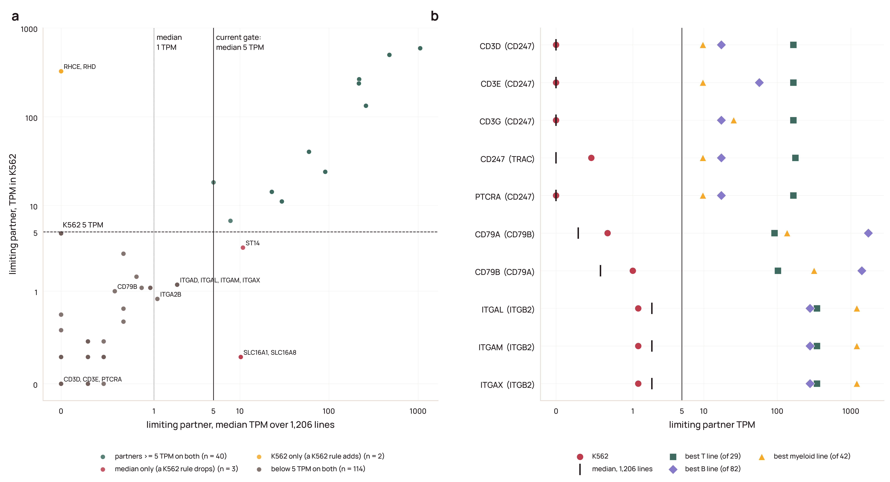

# Co-receptor gate against the K562 screening line

The co-receptor gate (`analysis/sprint1/s1e3-surface-library-filters/final_library.py`,
`coreceptor_ok`) keeps a gene that needs an obligate partner only if every partner it can measure
has a **median** TPM ≥ 5 across the 1,206 Human Protein Atlas (HPA) cell lines. The median asks
whether the partner is ubiquitous. The library is screened first in K562, so the question that
matters for the screen is narrower: is the partner expressed in K562? This page answers that
question without changing the gate. The gene list stays as it is unless a dated addition is
recorded.

Regenerated by [`coreceptor_host_line.py`](coreceptor_host_line.py). Outputs are at the experiment
root and in `processed://sprint4/s4e9-orf-design-fg-panel/`:

| File | Contents |
|---|---|
| `coreceptor_host_line_genes.tsv` | one row per gene the partner rule decides: partners, limiting-partner TPM (median, K562, best T, B and myeloid line), outcome under each rule |
| `coreceptor_host_line_partners.tsv` | one row per listed partner string: resolution status, Ensembl ID, TPM in each context, lines ≥ 5 TPM |
| `coreceptor_host_line_options.tsv` | each candidate rule: genes kept, and the genes it adds or drops relative to the current gate |
| `figures/coreceptor_host_line.png` | the figure below |

## Inputs

| Input | Source |
|---|---|
| Cell-line TPM | HPA 23.0 (released 2023-06-19, Ensembl 109) `rna_celline.tsv.zip`, pinned at `external://hpa/v23/rna_celline.tsv.zip` (SHA-256 `e5b11779…`). The file in the v23 archive is byte-identical to the one HPA serves today under release 26.0. Its per-gene medians equal the gate's own table (`hpa_celline_per_gene.csv`, `ba9735fa…`) for every gene, so the gate was built from HPA v23. |
| Lineage of each line | HPA v23 `rna_celline_description.tsv.zip`, pinned at `external://hpa/v23/rna_celline_description.tsv.zip`, using its disease subtype: T lymphoid (29 lines), B lymphoid (82, excluding myeloma) and myeloid leukemia (42: acute myeloid lines plus HMC-1). Lines HPA leaves without a subtype are assigned from Cellosaurus. K562 is kept out of all three groups. |
| Genes and partners | the gene filter rerun offline over surfaceome release 1.3.0 (`library_pipeline.run_gene_filter`, which reproduces the 2,370-gene filter output) |
| Partner identity | `gene_resolver` (MyGene, the same configuration the catalog uses), joined to HPA on Ensembl gene ID; aliases of one gene collapse to a single partner. The resolver's response is committed in `coreceptor_host_line_mygene/`. |

## Which genes the question touches

The partner rule decides 305 genes. The other genes needing a partner are settled either by a
reviewed accession or by the allowlist. Of the 305, **168 pass every other gate**, so the co-receptor
gate alone decides whether they are in. 48 of those 168 are in today: 43 because every partner
clears 5, and 5 whose only partner is the gene itself (BDKRB1, OTOP1, OTOP2, OTOP3, PCDHGB7).

**a**, the 159 of those 168 genes with a measurable partner. Each point is one gene, placed at
its limiting partner: the partner with the lowest value, which is the one an all-partners rule
turns on. Left out: the 5 self-partner genes, and ADAM2, CATSPER4, CD180 and PCDHA8, whose partners
do not resolve. Solid line: the current gate. Dashed line: 5 TPM in K562. Dotted line: a median of
1 TPM. Genes sharing one partner share one point. **b**, the receptor subunits the review asked
about, whatever their other gates. In each row and each column, the value plotted is the lowest
partner for that measure. The partner named in brackets is the limiting partner in K562. TPM
values are single HPA consensus measurements per line, plotted as log10(TPM + 0.1).
Regenerated by [`coreceptor_host_line.py`](coreceptor_host_line.py) from HPA v23.

## What each rule would add or drop

Relative to the 48 kept now, among the 168:

| Rule | Kept | Adds | Drops |
|---|---:|---|---|
| current: all partners, median ≥ 5 | 48 | — | — |
| all partners, median ≥ 2 | 48 | — | — |
| all partners, median ≥ 1 | 53 | ITGA2B, ITGAD, ITGAL, ITGAM, ITGAX | — |
| all partners, median ≥ 10 | 46 | — | HS3ST2, IL17RC |
| all partners, K562 ≥ 5 | 47 | RHCE, RHD | SLC16A1, SLC16A8, ST14 |
| curated alternatives, K562 ≥ 5 | 51 | GRIN1, KCND2, RHCE, RHD | ST14 |
| curated alternatives, median ≥ 5 **or** K562 ≥ 5 | 52 | GRIN1, KCND2, RHCE, RHD | — |
| all partners, K562 ≥ 1 | 64 | 18, including CD79B, the β2 integrins and six DAP12-paired receptors | SLC16A1, SLC16A8 |

- **The median threshold has no effect from 2 to 5.** At 1, the rule admits only the αIIb and β2
  integrins. Their β partners are lineage-restricted: ITGB2 is ≥ 5 TPM in 409 of 1,206 lines, 142 of
  them among the 203 blood-cancer lines (25 of 29 T, 59 of 82 B, 40 of 42 myeloid; median 35 TPM in
  blood lines against 1.5 elsewhere) and ITGB3 in 377. Both are low in K562 (1.2 and 0.8 TPM).
  Lowering the median therefore adds genes whose partner the screening line lacks.
- **A K562 rule adds the Rh proteins.** RHD and RHCE need RHAG, which is erythroid: 0.0 TPM median,
  327 TPM in K562.
- **A K562 rule drops three genes, but only one of those drops is real.** SLC16A1 and SLC16A8 list
  BSG *or* EMB as partners. K562 has BSG at 498 TPM; only EMB (0.1) is missing, and the
  all-partners reading counts that absence against the gene. ST14 is different: both of its
  alternatives are low in K562 (SPINT1 3.9, SPINT2 3.3), so its partner really is short there.
- **Six DAP12-paired receptors sit at the K562 threshold.** TREM1, TREM2, SIGLEC16, SIRPB1, NCR2 and
  CD300LB depend on TYROBP, which is 4.8 TPM in K562. Whether they fall in or out turns on a single
  measurement just below 5, so they stay out.
- **The T- and B-cell receptor subunits stay out under every K562 rule.** In K562, CD247 is 0.0 TPM,
  TRAC 0.2, CD3E 0.4, CD79A 1.0, CD79B 0.4 and IGHM 1.9. Their partners are present in lymphoid
  lines (CD247 ≥ 5 TPM in 27 of 29 T lines; CD79A and CD79B in 74 of 82 B lines). Including them
  would mean screening in a T or B host. That is a choice of host line; no threshold delivers it.

## Partner lists mix three kinds of entry

The gate requires **every** measurable partner to pass. A gene's partner list, however, can contain
three different kinds of entry, and only one of them fits that reading:

| Kind | Example | Fits "every partner" |
|---|---|---|
| obligate subunits of one complex | CD3E: CD3D, CD3G, CD247, TRAC | yes |
| alternatives, any one of which suffices | SLC16A1: BSG or EMB; ST14: SPINT1 or SPINT2; GRIN1: any GluN2 or GluN3 | no |
| aliases of one gene | RAMP1: CLR and CALCRL; TREM1: DAP12 and TYROBP | harmless once the aliases collapse |

Reading every list as "any partner" does not fix this: it admits CD3E, PTCRA, TRB, the sarcoglycans
and GP1BA/GP9, whose partners form a single complex. The script instead scores a short list of
genes whose partners are alternatives (`ALTERNATIVES`), with the gene needing one partner from each
group. The list covers SLC16A1, SLC16A8, ST14, GRIN1, KCND2, GABRA5 and GABRB1, and was drawn up
from the partner biology of the genes where the two readings disagree. It has not been reviewed.
Under the median rule it changes no outcome; under a K562 rule it decides five genes.

## Free-text partners

Of 620 listed partner strings, 544 resolve to one gene, 6 are the gene itself, 5 are ambiguous and
65 do not resolve. The unresolved strings include `TCRβ`, `TRBC` (two genes, TRBC1 and TRBC2),
`IgG`, `MD1`, the CatSper auxiliary subunits written as Greek letters, `SUR2A`/`SUR2B`, `APH1`,
`tapasin`, `peptide` and `unknown`. The gate drops an unresolved partner rather than failing the
gene. Three free-text partners resolve to the **wrong** gene, both in the gate's lookup and in
MyGene's:

| Listed partner | Resolves to | Intended | Gene |
|---|---|---|---|
| `CLR` | DCLK3 | CALCRL | RAMP1, RAMP2, RAMP3 |
| `IgM` | CD40LG | IGHM | CD79B |
| `mIg` | CXCL9 (alias MIG) | IGHM | CD79A |

The script overrides these, and `CD16` (MyGene picks FCGR3B; the DAP12/FcRγ-paired receptor is
FCGR3A) and `TCRα` (TRAC), with the resolver still supplying each target's Ensembl ID. No gate
outcome changes: CALCRL's median is 0.1 TPM and IGHM's is 0.3. The gate's statement that
unresolvable partners are dropped is incomplete, however: a misresolved partner is scored as
whatever gene it lands on.

## Recommendation

1. **Keep the median rule at 5.** It is flat down to 2, and at 1 it admits only integrins whose β
   partner K562 lacks.
2. **If K562 remains the first screening line, add a host-line arm rather than replacing the
   median:** a gene also passes when, in K562, every partner is ≥ 5 TPM, counting only one partner
   from each group of alternatives. That adds GRIN1, KCND2, RHCE and RHD, all of which pass every
   other gate, and drops nothing. The gene list is fixed, so these would enter as dated additions.
   Replacing the median outright with K562 would also drop ST14.
3. **Record ST14 as at risk in K562** (its HAI partners are 3.3–3.9 TPM there), but keep it in.
4. **Leave the TCR–CD3 and BCR subunits out** unless a T or B host line is added; with one, they
   become a host-line question, and Jurkat is the obvious candidate: in HPA's JURKAT line, CD247
   is 83 TPM, CD3D, CD3E and CD3G 68–581 TPM, and TRAC 324 TPM.
5. **Confirm the alternatives list** before relying on any rule that uses it.
