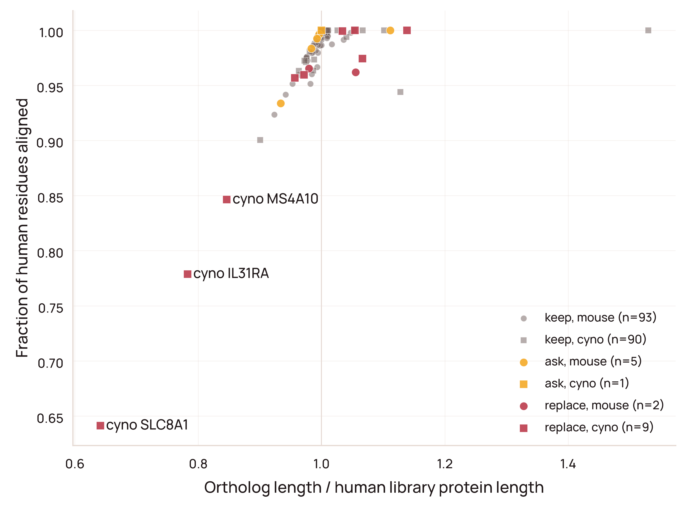

# Ortholog panel: biological correspondence review

The CDS-eligible ortholog review panel (`ortholog_panel_cds_eligible.tsv`, 100 mouse and 100
cynomolgus forms, described in [ORTHOLOG_CDS_POLICY.md](ORTHOLOG_CDS_POLICY.md)) guarantees
that every selected coding sequence is native, complete and translates to the selected protein.
It does not guarantee that the protein has the same architecture as the human L1 library
member it stands in for. This review asks that question for all 200 forms. 183 forms reproduce
the human architecture, 11 lack a human feature and should be replaced, and 6 differ in a way
that needs a decision. The panel remains a review panel: no manifest, construct, D1 record or
existing S3 object changes here, and adoption is still undecided.

## What is compared

Each pair is the exact selected ortholog protein (translated from the archived selected CDS)
against the exact human library protein (translated designed CDS from
`processed://sprint4/s4e9-orf-design-fg-panel/library-candidates/candidate_cds.json`). Both
are matched by sequence hash, never by accession, and every hash is checked against the panel.

| Evidence | Source | How a human feature counts as conserved |
|---|---|---|
| Residue correspondence | Global alignment, BLOSUM62, gap open 11 / extend 1, end gaps free | Reported, not scored: aligned fraction of human residues, identity, and every human-only or ortholog-only segment classed N-terminal, internal or C-terminal |
| Signal peptide (SP) | DeepTMHMM v1 (`deeptmhmm_v1`) by exact sequence, topology snapshot `2026-11-06-ortholog-cds-policy` | The ortholog also has a predicted SP |
| Transmembrane (TM) helices | Same DeepTMHMM v1 rows | Each human helix pairs one-to-one with an ortholog helix that overlaps its aligned residues |
| Topology label and N-terminal side | Same rows | Identical label (`SP+TM`, `TM`, `SP`) and first non-SP compartment |
| GPI anchor | Human: frozen GPI set; ortholog: NetGPI 1.1 call on the exact sequence | Ortholog called anchored |
| Pfam domains | Pfam 39.0 HMMs, searched on both proteins | Each human domain hit pairs one-to-one with an ortholog hit of the same family or the same Pfam clan overlapping its aligned residues |

All 400 proteins (200 ortholog forms and their human references) have an exact-sequence
DeepTMHMM v1 row, so no new predictions were run.

Human domains are called at each family's **gathering threshold (GA)**, the score Pfam uses
for its own annotations. An ortholog counterpart may score down to the family's **noise
cutoff (NC)**, the highest score Pfam curators recorded for a known false positive. Matching
within a **clan** (Pfam's grouping of families with a common ancestor) and resolving
overlapping same-clan hits to the best-scoring one follow Pfam's own annotation procedure.
With exact-family matching at GA alone, 20 forms appear to lose a domain; 9 of those resolve
once same-clan families and noise-tier hits count. For example, CNTN4's first Ig domain is
called `Ig_2` in human and `I-set` in mouse.
Both thresholds and the clans are Pfam's curated values; this review adds no numeric cutoff.

## Recommendation rule

Every flag is a presence/absence call. The rule maps them to one recommendation per form.

| Recommendation | Condition |
|---|---|
| Replace | A human TM helix, signal peptide or GPI anchor has no counterpart, or a human Pfam domain has no counterpart and its span carries an indel (human residues deleted or ortholog residues inserted inside it) |
| Ask | Nothing above is lost, but a human Pfam domain is undetected in a span that aligns without any indel, or the predicted architecture differs without a loss (an extra helix or SP, a changed label or N-terminal side) |
| Keep | Every human feature has a counterpart and the label and N-terminal side agree |

A Pfam domain that is undetected in an indel-free aligned span is an *ask*, not a loss:
failing an HMM threshold on a diverged sequence is not evidence that the fold is absent.
Short indels inside a feature that is still present are reported in the table but do not
change the call: signal peptides vary in length between species and are cleaved. 61 of the 200
forms have at least one unaligned human residue inside some annotated feature.

One form departs from the rule, with its reason recorded in
[ortholog_correspondence_judgements.tsv](ortholog_correspondence_judgements.tsv).

## Results

| Recommendation | Mouse | Cyno | Total |
|---|---:|---:|---:|
| Keep | 93 | 90 | 183 |
| Replace | 2 | 9 | 11 |
| Ask | 5 | 1 | 6 |

*Each point is one panel member (n = 200; 100 mouse circles, 100 cyno squares), colored by
recommendation. No summary statistic is shown. Only the three cases named in the review brief
are labeled; the other 14 flagged forms sit inside the main cluster near ratio 1.0 and aligned
fraction ≥ 0.93, so length and coverage alone do not find them. Kept forms span length ratios
0.90–1.53 (cyno NIPAL4 carries a 214-residue N-terminal extension with no change in predicted
helices or orientation). Regenerated by
[review_ortholog_correspondence.py](review_ortholog_correspondence.py).*

### The three named cases

| Form | Lengths (ortholog/human) | What the alignment shows | Lost features | Recommendation |
|---|---|---|---|---|
| Cyno SLC8A1 | 624 / 973 | Human residues 631–973 have no counterpart (C-terminal truncation) | TM6–TM10 and the C-terminal `Na_Ca_ex` domain (799–964); the second `Calx-beta` repeat is cut at 611 | Replace |
| Cyno IL31RA | 598 / 764 | Human residues 1–142 have no counterpart. The human library form is UniProt canonical Q8NI17 plus a 32-residue N-terminal extension | Signal peptide, the `IL6Ra-bind` domain (59–151) and the first `fn3` domain (155–250); without an SP the cyno form is no longer predicted as type I | Replace |
| Cyno MS4A10 | 226 / 267 | A 40-residue internal deletion (human 62–101) | Human TM1 (59–79), so 4 helices become 3, the N-terminus moves from cytoplasmic to extracellular, and the `CD20` domain (59–166) is no longer detected | Replace |

### All flagged forms

Proposed replacements are the first architecture-conserving candidates after the drawn ones in
the same stratum (species × correspondence band × human topology class), taken in the archived
seeded shuffle order. The table gives each one's position among that stratum's unused
candidates.

| Form | Band, class | Finding | Recommendation | Proposed replacement (queue position) |
|---|---|---|---|---|
| Cyno ADGRB2 | Diverged, multipass | 55-residue internal deletion (human 349–403) removes one of the four TSP_1 repeats; 7TM, SP and other domains intact | Replace | Cyno MRGPRX3 (4) |
| Cyno MS4A10 | Diverged, multipass | See above | Replace | Cyno CCR5 (5) |
| Cyno SLC8A1 | Diverged, multipass | See above | Replace | Cyno MRGPRX4 (8) |
| Cyno TMEM67 | Diverged, multipass | 33-residue internal deletion (human 559–591) removes TM2 | Replace | Cyno GPR78 (9) |
| Cyno FLT4 | Diverged, type I | 47-residue insertion (cyno 169–218) inside the second Ig domain (`VEGFR-1-like_Ig-like`, human 143–224), which is then undetected | Replace | Cyno CSF2RB (1) |
| Cyno IL31RA | Diverged, type I | See above | Replace | Cyno CD84 (2) |
| Cyno IL6R | Diverged, type I | 43-residue N-terminal extension places the signal peptide internally; no SP predicted | Replace | Cyno AMIGO3 (3) |
| Cyno ITGA10 | Diverged, type I | 63-residue N-terminal extension; no SP predicted | Replace | Cyno TNFRSF10B (4) |
| Cyno NFASC | Diverged, type I | 59-residue N-terminal extension; the old SP is predicted as a second helix and the N-terminus becomes cytoplasmic | Replace | Cyno NCR1 (5) |
| Mouse ADGRE5 | Diverged, multipass | Mouse has three `EGF_CA` domains to human's four. The undetected one (human 116–158) carries a single-residue deletion; 61% identity overall | Replace | Mouse AVPR1B (1) |
| Mouse BTLA | Diverged, type I | The Ig domain (human 38–118) is undetected; its span carries short insertions; 56% identity overall | Replace | Mouse IL15RA (1) |
| Mouse OR10G6 | Diverged, multipass | Mouse lacks only human residues 1–21, which DeepTMHMM calls an SP; all 7 helices and the 7tm domain align one-to-one | Ask (rule: replace) | Mouse CLDN8 (2) |
| Cyno MARCO | Diverged, type II | First collagen repeat (human 140–205) undetected even at NC; the span aligns gap-free at 92% identity overall | Ask | Cyno CLEC4E (1) |
| Mouse TMIGD1 | Diverged, type I | First Ig domain (human 42–115) undetected; span aligns gap-free; 74% identity | Ask | Mouse LRP11 (2) |
| Mouse IGSF1 | Near, multipass | Two of seven Ig domains (human 874–964, 1162–1247) undetected; spans align gap-free | Ask | Mouse OR10Z1 (1) |
| Mouse TMPRSS7 | Near, type II | First CUB domain (human 247–357) undetected; span aligns gap-free | Ask | Mouse ITM2B (1) |
| Mouse CACHD1 | Near, type III | Mouse adds a 127-residue N-terminus carrying an SP. The human library form is UniProt canonical Q5VU97 minus its first 134 residues, so the mouse form is closer to the human canonical protein than to the library form | Ask | Mouse KCNE4 (1) |

The cyno replacements cluster in two strata: four diverged multipass forms and five diverged
type I forms. Five of the eleven replacements (IL31RA, IL6R, ITGA10, NFASC and SLC8A1) come from
an N- or C-terminal difference rather than an internal one. ADGRE5 and BTLA are the weakest
replacement calls, because each rests on an undetected domain in a low-identity alignment
whose indels are short.

## Open questions

| Question | Why it matters | What would resolve it |
|---|---|---|
| Accept the 11 replacements? | Each lacks a human feature the assay depends on (membrane insertion, topology or an extracellular domain) | Becca's decision; the replacement forms are already reviewed and conserve the architecture |
| Mouse OR10G6: is the human N-terminal 21-residue "signal peptide" real? | If it is a misprediction, the mouse form matches the human 7TM architecture and should be kept | Compare with the other ORs in the library: does DeepTMHMM v1 call an SP on their N-termini? |
| The four Pfam non-detections in gap-free spans (MARCO, TMIGD1, IGSF1, TMPRSS7) | Absence of an HMM hit on a diverged sequence does not establish that the fold is missing | Structural check of the domain span on the member's AlphaFold/ColabFold model against the human model |
| Mouse CACHD1 | The human library form lacks the canonical signal peptide that the mouse form has; replacing the ortholog would not fix the reference | Decide whether the library's human CACHD1 form is intended, then keep or replace accordingly |
| Mouse ADGRE5 and BTLA | Replacement calls rest on low-identity alignments with short indels | Same structural check as the Pfam non-detections, if keeping these genes matters |

## Materials and provenance

| Element | Source |
|---|---|
| Analysis code | [review_ortholog_correspondence.py](review_ortholog_correspondence.py); run with `uv run --locked --group modal --group domains python analysis/sprint4/s4e9-orf-design-fg-panel/review_ortholog_correspondence.py` (about 1 minute) |
| Per-member table | [ortholog_correspondence_review.tsv](ortholog_correspondence_review.tsv): one row per panel member, all evidence columns, flags, rule and final recommendation, proposed replacement |
| Reviewed alternates | [ortholog_correspondence_alternates.tsv](ortholog_correspondence_alternates.tsv): the 62 next-in-queue candidates reviewed with the same evidence |
| Pfam hits | [ortholog_correspondence_pfam_hits.tsv](ortholog_correspondence_pfam_hits.tsv): every resolved hit with tier (GA or NC), clan and coordinates |
| Run record | [ortholog_correspondence_summary.json](ortholog_correspondence_summary.json): input URIs and SHA-256, counts, method strings |
| Reviewer departures | [ortholog_correspondence_judgements.tsv](ortholog_correspondence_judgements.tsv) |
| Durable copy of outputs | `processed://sprint4/s4e9-orf-design-fg-panel/ortholog-correspondence-review/2026-11-07/` (table, alternates, Pfam hits, run record, judgements, figure), generated from commit `e696b394` with a clean worktree |
| Selected ortholog CDSs | `processed://…/ortholog-cds-eligibility/2026-11-05/final-v2/results/panel/selected_cds.json.gz` |
| Topology | `external://accessible-surfaceome/topology/2026-11-06-ortholog-cds-policy/topology.parquet` (SHA-256 `7683d75a…`) |
| Pfam 39.0 | `external://pfam/39.0/Pfam-A.hmm.gz` and `Pfam-A.clans.tsv.gz`, copied from the EBI release directory `releases/Pfam39.0` and verified against its published MD5 checksums |
| Seeded draw replay | Reruns `draw_eligible_ortholog_panel.py` on its archived stage-3 inputs, asserts that it reproduces the committed 200-member panel exactly, and records each stratum's shuffle order |

## Decision log

| Date | Was | Now | Why |
|---|---|---|---|
| 2026-11-07 | Correspondence judged by the matching-block score and length only | Per-feature presence/absence review (SP, TM helices, label, orientation, GPI, Pfam domains) of all 200 forms | CDS completeness and the correspondence score do not establish that domains and topology are kept |
| 2026-11-07 | Pfam domains matched by exact family at GA | Same family or same clan, ortholog counterpart down to NC, same-clan overlaps resolved | 9 of 20 apparent losses under exact-family matching were a related family or a sub-GA hit on the same span |
| 2026-11-07 | Every undetected Pfam domain counts as lost | Lost only when its span carries an indel; otherwise ask | HMM non-detection on a diverged but gap-free span is not evidence of a missing fold |
