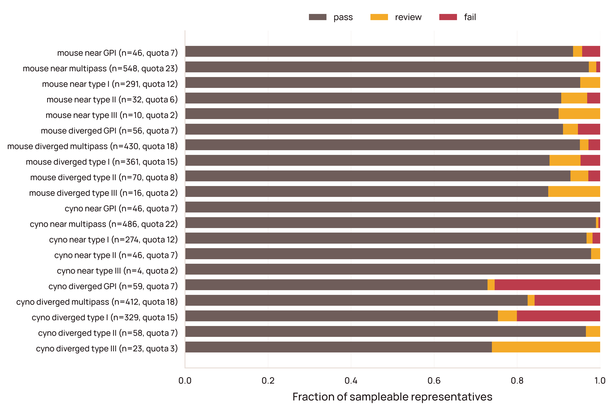

# Ortholog draw: architecture gate and start-site rule (proposal)

This page proposes two changes to how mouse and cynomolgus ortholog forms are drawn for the
library, and measures what each would do on the full candidate pool. Nothing here is adopted:
the L1 panel, manifests and construct tables are unchanged, and each change below is a
decision for Becca.

- **Architecture gate.** A form is drawable only if it keeps the human library protein's
  signal peptide (SP), transmembrane (TM) helices, GPI anchor and Pfam domains, judged by the
  rule already used in the [correspondence review](ORTHOLOG_CORRESPONDENCE_REVIEW.md). Today
  that rule is applied only after the draw.
- **Start-site rule.** A form that loses the SP only because its gene model starts upstream of
  the human start methionine is re-started at the methionine aligned to it, instead of being
  discarded.

On the full pool of 3,643 forms, 195 (5.4%) fail the gate, 146 of them in the cyno diverged
band, and every draw stratum still fills its quota with passing forms. All 15 forms the
start-site rule can re-start pass the gate once re-started.

## The current draw

The draw is specified in [ORTHOLOG_CDS_POLICY.md](ORTHOLOG_CDS_POLICY.md). In order:

| Step | Rule |
|---|---|
| Pool | High-confidence one-to-one Compara 116 orthologs of every library gene |
| CDS gate | Clean in-frame CDS with a native ATG, annotated start and stop, protein-coding transcript |
| One form per gene | Among a gene's eligible proteins, the one with the highest correspondence score: matching sequence blocks divided by the longer protein's length, against the exact human library protein |
| Bands | "Near" at or above a fixed score (mouse 0.8644, cyno 0.9595), "diverged" below it |
| Draw | Seeded shuffle within each stratum (species × band × the human protein's topology class), filled to fixed quotas: 100 mouse and 100 cyno |

The result is 3,643 sampleable forms, one per gene and species. Neither the CDS gate nor the
correspondence score tests whether a form keeps the human protein's features. The review of
the 200 drawn forms found 11 that do not (replaced on adoption) and 6 open cases.

## The gate on the full pool

The gate reuses the correspondence review's evidence and rule unchanged:

| Gate result | Review rule | Meaning |
|---|---|---|
| pass | keep | Every human SP, TM helix, GPI anchor and Pfam domain has an aligned counterpart; DeepTMHMM v1 label and N-terminal side agree |
| review | ask | Nothing is lost, but a Pfam domain is undetected on a gap-free aligned span, or the predicted architecture differs without a loss |
| fail | replace | A human SP, TM helix or GPI anchor has no counterpart, or a Pfam domain is undetected across an insertion or deletion |

There is no numeric cutoff: every call is the presence or absence of a feature. Topology is
DeepTMHMM v1 matched by exact sequence (pinned 2026-11-06 snapshot); every one of the 3,643
forms and their human proteins already has a prediction, so the gate needs none. As a check,
the 200 drawn forms get exactly the calls recorded in the review.

| Species | Band | Forms | Pass | Review | Fail | Fail fraction |
|---|---|---:|---:|---:|---:|---:|
| Mouse | near | 931 | 895 | 28 | 8 | 0.9% |
| Mouse | diverged | 933 | 856 | 43 | 34 | 3.6% |
| Cyno | near | 898 | 883 | 8 | 7 | 0.8% |
| Cyno | diverged | 881 | 704 | 31 | 146 | 16.6% |
| **All** | | **3,643** | **3,338** | **110** | **195** | **5.4%** |

*Each bar is one draw stratum (species × band × human topology class); the label gives the
number of sampleable forms (n) and the stratum's quota. Segments are the fraction of forms that
pass, need review or fail the gate. No error bars: each bar is a complete count, not a sample.
Regenerated by [ortholog_architecture_gate.py](ortholog_architecture_gate.py).*

| Finding | Evidence |
|---|---|
| Failures concentrate in the cyno diverged band | 146 of the 195 failures; 16.6% of that band against 0.8% of cyno near. The cyno cutoff (0.9595) is high because cyno and human proteins are nearly identical, so falling below it often means a broken gene model rather than divergent biology |
| Most failures involve the N-terminus | 119 of 195 failing forms (103 of them cyno) have an unmatched N-terminal segment. Of the 80 that lose the SP, 74 differ at the N-terminus |
| Feature losses behind the failures | SP lost 80, TM helix lost 71, Pfam domain lost 70 (a form can lose several); no GPI anchor is lost |
| Many mouse failures look like real, expressed transcripts | 33 of 42 failing mouse forms carry an APPRIS principal label (17 of them PRINCIPAL:1, APPRIS's most confident call for the main protein product), 5 an alternative label and 4 none. Cyno has no APPRIS data, so the same evidence is unavailable for it |
| The gate does not starve the draw | In all 20 strata the number of passing forms meets the quota on its own; the tightest is cyno near type III (4 pass, quota 2) |

Four failing forms have no unmatched sequence at all: DeepTMHMM calls a feature in one protein
and not the other on aligned residues (mouse CATSPERH and MDGA2 SPs, cyno SLC26A9 and mouse
SLC8A2 helices). Those are prediction disagreements, the same kind as the mouse OR10G6 ask, and
belong in review rather than fail.

## The start-site rule on the full pool

The rule applies to a form whose only loss is the SP and which carries an N-terminal extension.
If the ortholog residue aligned to the human start methionine is itself a methionine, the form
re-started there is the candidate. There is no window: the methionine must be the aligned
residue.

| Outcome | Forms | What it means |
|---|---:|---|
| Another CDS-eligible transcript of the same gene starts there | 0 | Would be a free rescue; none exists |
| Aligned methionine, no eligible transcript (exception candidate) | 15 | All cyno diverged: CADM4, C19orf38, CSPG5, ENPP6, GPC1, ITGA10, NFASC, SLC9A2, SPN, SPRN, TIGIT, TM7SF3, TNFRSF1B, TNFRSF25, VLDLR |
| No aligned methionine | 16 | The N-terminus does not resolve to the human start (for example cyno IL6R); the form stays failed |

In cyno ITGA10, for example, the 63-residue extension is followed by a methionine that begins
an exact copy of the human SP, which is the pattern of a gene model that chose an upstream ATG.
An exception candidate is not drawable until it has its own DeepTMHMM v1 prediction and passes
the gate. The policy already provides for it: a checksum-bound entry in the exception registry,
which is currently empty.

All 15 re-started forms were predicted with DeepTMHMM v1 (the academic 1.0 package, run on
Modal with the project's v1 runner) and gated against their human library proteins. **All 15
pass.** Each regains a signal peptide at the human position (human and ortholog SP lengths
agree within three residues), keeps the human TM-helix count and N-terminal side, and loses no
Pfam domain. The re-started proteins align over 94–100% of the human protein at 88–100%
identity.

| Human class | Re-started forms (aligned methionine) |
|---|---|
| GPI | ENPP6 (M58), GPC1 (M206), SPRN (M127) |
| Multipass | SLC9A2 (M183, 11 helices), TM7SF3 (M127, 7 helices) |
| Type I | C19orf38 (M69), CADM4 (M126), CSPG5 (M108), ITGA10 (M64), NFASC (M60), SPN (M107), TIGIT (M68), TNFRSF1B (M110), TNFRSF25 (M71), VLDLR (M75) |

The GPI call for the three GPI forms reuses NetGPI's call on the full-length form. Re-starting
changes only the N-terminus, and NetGPI reads the C-terminal anchor signal, so a new NetGPI run
would be expected to agree. That expectation is untested.

That every candidate passes is consistent with these extensions being gene-model errors: in
each, removing the residues upstream of the aligned methionine restores the human architecture
exactly. It does not show that cyno initiates there; that needs transcript evidence at the
N-terminus.

The 15 are registered in [ortholog_cds_exceptions.json](ortholog_cds_exceptions.json), which the
CDS eligibility audit reads. Each entry binds the native transcript's CDS and protein checksums
and the restarted CDS and protein checksums, names the codon where the restarted CDS begins (an
in-frame ATG), and carries its rationale, evidence, `decided_by` and `implemented_by`. The audit
re-starts a native CDS only when both pairs of checksums match, so a changed gene model fails
loudly instead of being trimmed silently. Registration takes effect at the next eligibility run;
it does not redraw the panel or change any existing ledger.

## Extensions that cost no feature

The same pattern occurs without a lost signal peptide. In 178 forms that lose no feature, the
ortholog carries an N-terminal extension and the residue aligned to the human start methionine is
itself a methionine (129 cyno, 49 mouse). In 4 of them, another eligible cyno transcript already
starts there. The gate does not fail these forms, because nothing human is missing. For a protein without a
signal peptide, though, the extension stays in the mature protein, and on an extracellular
N-terminus it sits where the N-terminal tag goes.

Four adopted cyno members fit that description. They are restarted at the aligned methionine
rather than replaced, each recorded in
[ortholog_restart_decisions.tsv](ortholog_restart_decisions.tsv) with the rejected alternative:

| Member | Extension | Restart | Gate on the restarted protein |
|---|---|---|---|
| CCR5 (l1-p2959) | 27 aa | Met28 | Pass: 7 helices, N-terminus outside, as human |
| CHRM3 (l1-p2938) | 31 aa | Met32 | Awaiting a DeepTMHMM v1 prediction |
| OR3A2 (l1-p2963) | 32 aa | Met33 | Awaiting a DeepTMHMM v1 prediction |
| NIPAL4 (l1-p2962) | 214 aa, Gly/Arg/Pro-rich | Met215 | Awaiting a DeepTMHMM v1 prediction |

A restart keeps a correct ortholog of the gene and removes only sequence with no human
counterpart; a next-in-draw replacement would discard the gene. Other adopted forms with this
pattern are left as they are: cyno FOLR2 and TGFBR3 keep their signal peptide, which carries
the extension away on cleavage, and the mouse cases are 1–9 residues or intracellular.

## A gene-level fallback

A failing form is one gene's best-scoring eligible protein, not its only one. 107 of the 195
failing forms belong to genes with other CDS-eligible proteins (279 in all). 58 of those already
have a DeepTMHMM v1 prediction; the other 221 would need one before they could be gated. Gating
every eligible protein, and choosing the best-scoring one that passes, would keep more genes in
the pool, at the cost of those predictions.

## Proposed policy and decisions

| Change | Proposal | Decision needed |
|---|---|---|
| Architecture gate | Move the review rule into eligibility, before the one-form-per-gene choice and the draw: fail is excluded, review is listed for a decision | Exclude failed forms outright, or allow a failing mouse form with an APPRIS principal label (likely real biology) in a separately labeled stratum |
| Prediction disagreements | A loss with no unmatched sequence (4 forms) is review, not fail | Agree to treat these as review |
| Start-site rule | Exception candidates with an aligned methionine are re-started there, recorded in the exception registry, predicted, then gated | Done: all 15 predicted, all pass, all registered |
| Gene-level fallback | Gate every eligible protein of a gene and take the best-scoring one that passes | Approve up to 221 predictions, or skip the fallback (quotas are met without it) |
| Bands | Keep the cutoffs, applied after the gate, so "diverged" means substitutions within a conserved architecture | Whether to keep the cyno cutoff at 0.9595 once broken models are gone |

Adopting the gate does not require redrawing L1. The adopted L1 panel already holds only forms
that pass or that Becca reviewed (the 6 asks), which is what the gate would produce. Redrawing
under the gate would reshuffle every stratum's queue and change forms that are already fine, so
the proposal applies to the next draw (L2 and any re-pick), not retroactively.

## Open questions

| Question | Why it matters | What would resolve it |
|---|---|---|
| Are the 103 failing cyno forms with N-terminal differences gene-model errors? | If so, the start-site rule and a better cyno source would rescue genes rather than drop them | Cyno RNA-seq splice junctions or UniProt reviewed entries at those N-termini |
| Should real architecture differences in mouse ever be drawn? | 33 of 42 failing mouse forms carry an APPRIS principal label; excluding them removes genuine mouse biology from the ortholog comparison | The purpose of the ortholog arm: same-architecture comparison (exclude) or species-difference survey (include, labeled) |
| Is a C-terminal truncation that keeps every TM helix acceptable? | Under the current rule it passes whenever no Pfam domain is lost; the tag compartment is unchanged | Confirm that the C-terminal tag on a shortened cytoplasmic tail is acceptable for the readout |

## Provenance

| Item | Location |
|---|---|
| Analysis code | [ortholog_architecture_gate.py](ortholog_architecture_gate.py), reusing [review_ortholog_correspondence.py](review_ortholog_correspondence.py) |
| Run | `uv run --locked --group modal --group domains python analysis/sprint4/s4e9-orf-design-fg-panel/ortholog_architecture_gate.py` (about 2 min; Pfam hits cache by sequence hash) |
| Start-site predictions | `start_site_predictions/`: the submitted FASTA, DeepTMHMM v1 3-line output and runtime record (package identity, shard hashes); runner `scratch/becca/appris-principal/modal/deeptmhmm_v1_app.py`. Not yet imported into the topology snapshot or D1 |
| Exception registry | [ortholog_cds_exceptions.json](ortholog_cds_exceptions.json), generated by the gate script; the restart action is implemented and tested in `audit_ortholog_cds_eligibility.py` (rule ORTHCDS008) |
| Outputs | `ortholog_architecture_gate.tsv` (one row per sampleable form, 3,643), `ortholog_start_site_gate.tsv` (the 15 re-started forms), `ortholog_architecture_gate_feasibility.tsv` (per stratum), `ortholog_architecture_gate_summary.json`; durable copy at `processed://sprint4/s4e9-orf-design-fg-panel/ortholog-architecture-gate/2026-11-11/` |
| Inputs | The archived final-v2 draw replayed exactly (`processed://sprint4/s4e9-orf-design-fg-panel/library-design/ortholog-cds-eligibility/2026-11-05/final-v2/`), DeepTMHMM v1 snapshot `external://accessible-surfaceome/topology/2026-11-06-ortholog-cds-policy/`, Pfam 39.0 at `external://pfam/39.0/` |
| Pull request | [Ortholog architecture gate proposal](https://github.com/Deliverome-Project/deliverome-analysis/pull/297) |

## Decision log

| Date | Was | Now | Why | Decided by / implemented by |
|---|---|---|---|---|
| 2026-11-11 | Domain and topology checked only on the 200 drawn forms, after the draw | Gate and start-site rule measured on all 3,643 sampleable forms, as a proposal | Becca asked for a draft update after the review's signal-peptide losses ("Yes, draft it") | Becca Carlson (asked for the draft); no policy decision taken / Claude Code session ortholog-correspondence-review |
| 2026-11-11 | 15 start-site candidates unpredicted | DeepTMHMM v1 predictions for all 15; all pass the gate | Becca approved the 15 predictions ("Yes, run 15") | Becca Carlson / Claude Code session ortholog-correspondence-review, PR 297 |
| 2026-11-11 | Exception registry empty; it could only waive review reasons for a native CDS | 15 restart exceptions registered; the registry can re-start a native CDS at an in-frame ATG, bound to native and restarted checksums | Becca: "Yes, register them" | Becca Carlson / Claude Code session ortholog-correspondence-review, PR 297 |
| 2026-11-12 | Adopted cyno CCR5, CHRM3, OR3A2 and NIPAL4 carry extracellular N-terminal extensions | Restarted at the methionine aligned to human Met1, each subject to the gate | Proteoform audit flag; extension sits where the N-tag goes; restart keeps the gene | ortholog-correspondence-review (delegated by Becca 2026-11-12, "use your best judgment") / Claude Code session ortholog-correspondence-review, PR 297; panel change by l1-reviewer-package, PR 283 |
