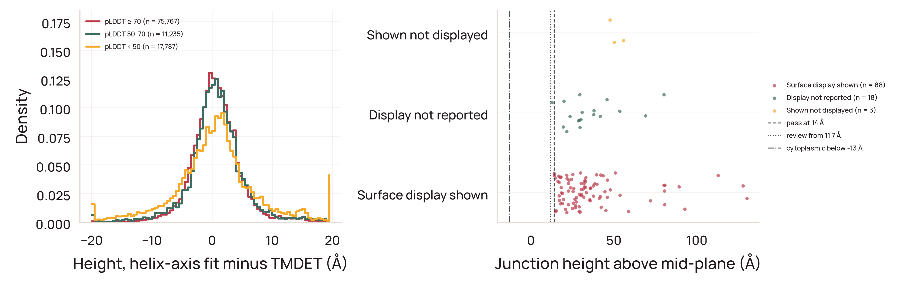

# Membrane-side gate for internal tag sites in the L1 library

**Question.** Members on the internal rung of the L1 library take the 51-aa SpyTag003/ALFA
cassette in an extracellular loop. Do any proposed loop sites actually sit on the cytoplasmic
side of the membrane, or inside its hydrophobic core? A tag there is not displayed, so the member
reads as a non-expressor in a pooled surface screen.

**Answer.** Yes, 43 of the 1,070 shipped internal sites fail on membrane side, and 5 more by a manual exclusion. Each site is placed
on the member's own structure model, in a membrane fitted to that model. 13 sites sit on the
cytoplasmic side. Nine of those are a member's rank-1 site: ANO1 698 (both ANO1 members), ANO2 702,
ANO3 729, ANO4 651, ANO7 678, XKR5 62, XKR6 408 and XKR7 350. Another 30 sit inside the
membrane core. Most of them are re-entrant pore loops of aquaporins and K⁺ channels, and the rank-3
sites of the Na⁺/K⁺-ATPase α subunits. DeepTMHMM v1 calls every one of these 43 junctions
extracellular.

Five more sites fail by a manual exclusion, not by membrane side: the β-subunit docking loop of the
P-type ATPase α subunits (see "Manual exclusion" below).

The gate proposes a change for each of the 48 failures, on 43 members. For 33 sites it would drop the site, because the
member keeps another site that passes. For 13 it would substitute a passing site from the tag-site
API. Two members, XKR5 and TRPM2, are left with nothing that passes and need a re-rank on the
corrected extracellular mask. None of these changes has been applied.

Another 42 shipped sites are flagged for review and 2 are held rather than failed. 2 internal members (single-pass) cannot
be scored, and 9 shipped sites on 3 members (DISP2, SLC22A17, TRPV6) are numbered on a protein
the member no longer has, so they need redesigning.

Members are named by design id (`l1-pNNNN`), which survives renumbering. Every output table also
carries the current member id (`candidate_id`, `l1-mNNNN`). That id is the adopted panel's numbering on the
reviewer-package branch (PR #283, open). It differs from `main`'s numbering over the earlier panel
(SLC67A1 is `l1-m1246` here and `l1-m1244` on `main`), so join on `design_id` or
`sequence_sha256` until PR #283 merges.

## Terms

| Term | Meaning here |
|---|---|
| Member | An active L1 library member on the internal rung, in the adopted panel: 581 members (519 library references, 32 isoforms, 30 orthologs), read from `l1_tag_paths.tsv` at [`6bf341f2`](https://github.com/Deliverome-Project/deliverome-analysis/blob/6bf341f231e0841ffea13e589c4119a909fde93f/analysis/sprint4/s4e9-orf-design-fg-panel/l1_tag_paths.tsv) on branch `claude/l1-reviewer-package-aa447f`. That branch adopts the Compara 116 ortholog panel, renumbers members to `l1-mNNNN`, and adds a second pass of reference fixes and ortholog start trims; it is not yet on `main` |
| Protein | The member's designed CDS translated, from `library-candidates/2026-11-12-ortholog-start-trims/candidate_cds.json`. Its SHA-256 is checked against the tag-path table |
| Topology | DeepTMHMM v1 (`deeptmhmm_v1`, tool stamp `deeptmhmm-1.0.24`), the per-residue string of the member's own protein. It is matched by sequence hash in `accessible-surfaceome/topology/2026-11-06-ortholog-cds-policy/topology.parquet`, using the row whose `topology_version` and cohort the tag-path table records. v1 remains the topology of record, and the gate never relabels a residue |
| Model | The member's `is_chosen` row of `library_structure_payload.tsv`: the AlphaFold DB v6 model (511 identical, 3 contained) or our ColabFold fold of the designed CDS (51). 16 internal members have no chosen row. For SLC22A17 (`l1-p1882`), whose protein became isoform Q8WUG5-2 in the reference fixes, the model is AlphaFold DB `AF-Q8WUG5-2-F1-model_v6`, found among the UniProt isoforms of the recorded accession. For the other 15 it is a ColabFold fold made since the payload was built: the 2026-11-10 ortholog folds (`predicted-structures/colabfold/2026-11-10-l1-orthologs/`), and TSPAN10's fold of its current, start-trimmed protein (`processed://sprint5/s5e13-tag-site-benchmarking/predicted-structures/colabfold/2026-11-12-start-trims/l1-m0930.pdb`, folded by the l1-ortholog-features session, PR #298). Where the payload files a 2026-11-10 mismatched-ortholog fold under `2026-10-14-mismatched/`, the file is read from `2026-11-10-l1-ortholog-mismatched/`, where it was published (SLC22A8, `l1-p3013`). Every fold is used only when its sequence is identical to the member's protein. Either is used only when its sequence is identical to the member's protein. Residues are matched to the protein by sequence, never by accession |
| Site | "Insert after residue *n*", 1-based on the member's protein. The junction lies between *n* and *n*+1 |
| Height | The mean height of the junction's two C-α atoms above the membrane mid-plane, along the membrane normal, in Å. Positive is the extracellular face |
| Shipped site | A site the library would order: every S5E13 v4 pick (all are within each protein's `recommended_sites_to_order`), plus the six built panel loop arms |
| TMDET | The membrane-placement algorithm behind PDBTM. TmAlphaFold has run it on AlphaFold DB models ([Dobson et al., 2023](https://pubmed.ncbi.nlm.nih.gov/36318239/)) |

## Method

### Placing each model in the membrane

| Step | Rule | Evidence for it |
|---|---|---|
| Placement of record | TMDET's placement, when TmAlphaFold holds the member's AlphaFold DB entry and our v6 copy superposes on TmAlphaFold's model within 2 Å C-α RMSD (pLDDT ≥ 70 residues). This applies to 440 members | Matching entries superpose at a median 0.26 Å. Those over 2 Å (46) were re-issued after TmAlphaFold was built in 2022, so their coordinates differ |
| Fallback placement | Helix-axis fit, used for 137 members: every ColabFold fold, AlphaFold DB entries TmAlphaFold does not hold, and re-issued entries. The membrane normal is the mean axis of the v1 helices, counting each helix that has ≥ 10 C-α at pLDDT ≥ 70. The mid-plane passes through those helix C-α atoms. Only helix positions are read from v1, never its sides | On the 440 members TMDET placed, the fit's normal lies a median 7.8° from TMDET's (90th percentile 17°). Loop heights differ by a median 2.3 Å at pLDDT ≥ 50 (left panel of the figure) |
| No placement | Fewer than two confident helices: ATRN, EPHA6, NRG2 and RGMB. One helix does not define a plane | — |
| Extracellular face | The face holding most of v1's confidently modelled `O` residues against its `I` residues, counting residues more than 5 Å from the mid-plane. A single wrong loop, the error being gated, cannot flip a whole protein | — |
| Face checks | The face must pass three independent checks: (1) the `O`/`I` vote must exceed 3.9 : 1; (2) the extracellular face must not carry more than 4 Lys/Arg at helix flanks beyond the cytoplasmic face's count (positive-inside rule; flanks are confidently modelled residues within 10 residues of a core residue), unless DeepTMHMM v2 independently calls both termini on v1's sides; (3) UniProt topological domains with experimental evidence (ECO:0000269) must not contradict the face. A member failing any check is `review_orientation` | (1) and (2) are the weakest vote and the largest K/R excess seen among the 50 members whose face UniProt experimental topology confirms. Over those 51 members, UniProt's experimental domains agree with the chosen face at 14,744 residues and disagree at 173 |

A hydrophobic-slab search was tried first as the fallback placement. It maximized exposed apolar
surface (Wimley–White octanol scale) inside a 30 Å slab. In an exploratory comparison, not
reproduced by committed code, its normal tilted a median 17° from TMDET's, so the helix-axis fit
replaced it.

### Parameters set by hand

Per Becca's 2026-11-10 rule, every value below that no code derives is attributed. All were
decided and implemented by the l1-membrane-side-gate session (Claude Code, PR #291) on
2026-11-10, unless the row says otherwise.

| Parameter | Value | Reason |
|---|---|---|
| Confident residue for the fit and the side vote | pLDDT ≥ 70 | AlphaFold's own confident band; low-pLDDT loops are unpacked ribbons |
| Helix counted in the axis | ≥ 10 confident residues; ≥ 2 helices per protein | Ten residues give a stable axis; one helix does not define a plane |
| Side-vote exclusion band | residues within 5 Å of the mid-plane are not counted | Keeps helix-end residues that v1 labels I/O from voting from inside the slab |
| Positive-inside flanks | K/R within 10 residues of a core residue, from 5 Å inside the face to 15 Å beyond it | von Heijne's rule concerns loop ends near helices, not large domains |
| Same-model cutoff for TMDET | 2 Å C-α RMSD | A conventional same-conformation cutoff; its effect is measured in the limitations below |
| Separation between sites | 25 residues | Taken from S5E13 v4's `MIN_SEPARATION`, decided in S5E13 |
| Replacement choice | the deepest passing API site | A placeholder until a ranker scores replacements; it is not a ranking |

### Verdicts

All thresholds are written to `calibration.json` by [`calibrate.py`](calibrate.py). The gate reads
them from there, and none is set by hand.

| Verdict | Rule | Threshold and its evidence |
|---|---|---|
| `pass` | height ≥ 14.0 Å | 14.0 Å is the shallowest published internal tag with surface display shown (CNR1 179), among 88 such sites in multipass proteins from the audited literature gold standard (`processed://scratch/becca/tag-site-corpus-audit/gold_standard.tsv`). These sites are placed by the same code. No working published site would be refused |
| `review_interface` | 11.7 ≤ height < 14.0 Å | 2.3 Å below the pass line, the median helix-axis error against TMDET. A junction this close could pass under a better placement |
| `fail_membrane` | −13.0 ≤ height < 11.7 Å | 13.0 Å is TMDET's median hydrophobic half-thickness over the 440 members it placed (10th–90th percentile: 9.8–17.0 Å) |
| `fail_cytoplasmic` | height < −13.0 Å | Beyond the hydrophobic core on the cytoplasmic face |
| `hold_low_plddt` | a failing junction with pLDDT < 50 | Below pLDDT 50 the helix-axis error against TMDET is not reliably smaller than the core half-thickness: the upper end of a 95% bootstrap interval (whole proteins resampled) for its 90th percentile is 14.2 Å in the 40–50 bin, against 9.2 Å in the 50–60 bin. Such a junction could lie on either side, so it is held, not dropped |
| `review_orientation` | the member fails a face check | See the placement table above |
| `unscorable` | no model, no placement, a site not on a residue of the member's protein, or a v4 site numbered on a protein the member no longer has | Every internal member has a model of its own protein. Two single-pass members (ATRN, NRG2) cannot be placed (Limitations). Their sites are never passed |

The published sites shown not to reach the surface (n = 3), and the three placed constructs that
failed for other reasons, all sit above 16 Å. Height cannot explain those failures, and the gate does not
claim to (right panel of the figure).

*Left panel: the helix-axis height minus the TMDET height, for loop residues (v1 not `M`, within
40 Å of TMDET's mid-plane) of the 440 members TMDET placed, split by pLDDT. Unit: residue;
n = 104,789. Differences are clipped to ±20 Å, so the end bins hold the tails. Right panel: the
junction height of published internal tag sites in multipass proteins on their AlphaFold DB
model. Each point is one site, grouped by whether the paper showed surface display. Dashed line:
pass threshold. Dotted line: start of the review band. Dash-dot line: cytoplasmic boundary.
Regenerated by [`calibrate.py`](calibrate.py).*

### Where the sites come from

| Source | Sites on members | Numbering check |
|---|---:|---|
| S5E13 v4 member picks, `tag_sites_v4_members.tsv` at [`c7be01a4`](https://github.com/Deliverome-Project/deliverome-analysis/tree/c7be01a419af8b4cfa3d1570e7a6c9c2b3500346/analysis/sprint5/s5e13-tag-site-benchmarking) (shipped) | 1,064 on 541 members; 51 further rows belong to members no longer on the internal rung | The member's protein must be the one S5E13 designed on (sequence hash from S5E13's `l1_internal_members.tsv`); 9 sites on DISP2, SLC22A17 and TRPV6 are not, and are reported unscorable. Every other junction residue is v1 `O` on the member's protein |
| Built panel loop arms, [`constructs_loop.tsv`](../constructs_loop.tsv) (shipped) | 6 (SLC2A4 E67 and V319, MS4A1 F146 and Y161, AVPR2 L302, CCR5 F263) | Residue identity checked on the designed protein |
| Tag-site API deterministic `disorder` and `surface_loop` lanes, fetched 2026-11-10 (not shipped; used as replacements) | 2,180 | `residue_before` checked on the canonical sequence, then carried to the member by sequence alignment. 38 land on a residue the member's protein does not share |

## Results

Shipped sites, by verdict:

| Verdict | Sites | Rank-1 v4 sites among them |
|---|---:|---:|
| pass | 967 | 512 |
| review_interface | 36 | 5 |
| review_orientation | 6 | 4 |
| hold_low_plddt | 2 | 1 |
| fail_membrane | 30 | 5 |
| fail_cytoplasmic | 13 | 9 |
| fail_partner_interface (manual exclusion) | 5 | 0 |
| unscorable | 11 | 5 |
| **All** | **1,070** | **541** |

All six built loop arms pass, at 15.8–31.7 Å. By these thresholds, CCR5 F263 (15.8 Å) and
AVPR2 L302 (16.8 Å) are the shallowest.

### Why the failing sites were chosen

All 43 membrane-side failures are vetoed by the model: the gate fails them, and none is `E` in the
junction mask. The question here is only why the original pickers chose them. Each failure is
classified by where the model places the residues of the DeepTMHMM v1 `O` segment that holds it
(`cause` and the segment columns of `l1_internal_pick_changes.tsv`, computed by `failure_cause()`
in [`membrane_side_gate.py`](membrane_side_gate.py)):

| Cause | Sites | The v1 `O` segment on the model | What went wrong |
|---|---:|---|---|
| v1 missed two helices | 7 (ANO1 ×2, ANO2, ANO3, ANO4, ANO7 ×2) | ~100 residues, with ≥ 3 residues below −13 Å and some above 14 Å | v1 joined an extracellular loop, two helices and the cytoplasmic loop between them into one "extracellular" segment. The ranker rewards distance from a helix, so it picked the middle of the segment, 29–42 residues from any v1 helix. That middle is the cytoplasmic loop |
| v1 put a whole loop on the wrong side | 6 (XKR5, XKR6, XKR7, XKR9, SLC4A9, TMC4) | 10–36 residues, ≥ 3 below −13 Å, none above 14 Å | A short cytoplasmic loop labelled `O` |
| v1 loop barely leaves the membrane | 10 (ATP1A1–4, AQP10, MIP, KCNJ14, TRPM2, SLC12A8, SLC26A11) | ≤ 25% of residues above 14 Å; none for the three ATP1A loops | The loop sits in the extracellular half of the bilayer, so v1's `O` call is wrong about the membrane, though not about the side. The aquaporin, MIP and Kir loops are re-entrant pore loops, which v1's alphabet cannot express. KCNJ14 158 is 33 residues from the nearest residue outside |
| Site at the base of a loop that reaches outside | 20 | 39–97% of residues above 14 Å | The loop is extracellular, but the junction sits 2–8 residues short of its nearest residue outside, still in the bilayer at +3.5 to +11.7 Å. The ranker allows sites where v1's loop begins rather than where the chain leaves the membrane |

All 30 membrane-core junctions sit on the extracellular half of the bilayer (heights +3.5 to
+11.7 Å). DeepTMHMM v1 got the side right for them and was wrong about where the membrane
ends.

So two things need fixing, and the mask fixes both: v1's side errors in the anoctamin, XK/XKR,
SLC4 and TMC families, and the ranker's freedom to place a site where the chain is still in the
membrane.

### Changes for approval

Each failing shipped site is listed in [`l1_internal_pick_changes.tsv`](l1_internal_pick_changes.tsv)
with a proposed action. "Replace" takes the deepest API deterministic site of the member that
passes and lies ≥ 25 residues from every kept site, the separation the S5E13 ranker uses. No ranker
has scored these replacements; they are placeholders until a re-rank.

Sites on the cytoplasmic side:

| Gene | Member | v4 rank | Insert after | Height (Å) | pLDDT | Proposed action |
|---|---|---:|---:|---:|---:|---|
| ANO1 | l1-p0110 | 1 | 698 | −30.6 | 52 | replace with API 856 |
| ANO1 | l1-p2393 | 1 | 761 | −23.6 | 51 | replace with API 856 (member residue 919) |
| ANO2 | l1-p0111 | 1 | 702 | −14.5 | 71 | replace with API 571 |
| ANO3 | l1-p0112 | 1 | 729 | −33.6 | 61 | replace with API 897 |
| ANO4 | l1-p0113 | 1 | 651 | −22.1 | 54 | drop; keeps its other site |
| ANO7 | l1-p0115 | 3 | 619 | −34.4 | 78 | replace with API 398 (member residue 344) |
| ANO7 | l1-p2394 | 1 | 678 | −39.7 | 59 | replace with API 398 |
| SLC4A9 | l1-p1978 | 2 | 776 | −25.1 | 66 | drop; keeps its other sites |
| TMC4 | l1-p2159 | 2 | 519 | −21.5 | 70 | drop; keeps its other sites |
| XKR5 | l1-p2348 | 1 | 62 | −22.7 | 74 | re-rank: model-outside runs 27–33, 134–139, 202–205, 287–293 |
| XKR6 | l1-p2349 | 1 | 408 | −24.1 | 51 | drop; keeps its other site |
| XKR7 | l1-p2350 | 1 | 350 | −18.3 | 52 | drop; keeps its other sites |
| XKR9 | l1-p2352 | 2 | 253 | −18.8 | 76 | drop; keeps its other site |

The 30 sites inside the membrane core are in AQP9, AQP10 and MIP; ATP1A1–4 (each one's rank-3 site,
+7 to +11 Å) and ATP11C; BEST2; CALHM1; CNGA1; FLVCR1 and FLVCR2; GJB2, GJB6 (two sites) and GJC3;
KCNC3, KCNJ1, KCNJ14 and KCNQ5; PLPPR2; RNFT2; SLC6A6, SLC12A4, SLC12A8, SLC16A3, SLC16A6
and SLC26A11; and TRPM2. TRPM2's only site, 1014 at +8.9 Å, has no passing alternative,
so the member needs a re-rank. Seven of these sites sit within 1 Å of the review band, at
+11.2 to +11.7 Å: ATP1A3, GJB2, GJB6 (both sites), SLC12A4, SLC12A8 and SLC26A11. They are the
failures most open to argument.

### Members with nothing that passes

15 members have no shipped site that passes:

| Members | Reason |
|---|---|
| ANO1 (both), ANO7 `l1-p2394`, XKR5 | Every shipped site fails as cytoplasmic. Replacements are above |
| TRPM2 | Its only site is in the membrane core |
| LRRC8D | Its only site, 84 at +7.0 Å, has pLDDT 29, so it is held. The QC session flagged the same site |
| DISP2, SLC22A17, TRPV6 | Their v4 sites are numbered on a protein the member no longer has; they need redesigning on the current protein |
| SLC44A1, SLC68A1, TMEM169, TMEM174 | The member fails a face check, so none of its sites is called |
| ATRN, NRG2 | Fewer than two confident helices, so the membrane plane is undefined |

SLC68A1 (TMEM180) is the clearest face-check failure. DeepTMHMM v1 puts both termini inside. UniProt's
experimental topology, from [Anzai & Matsumura, 2019](https://pubmed.ncbi.nlm.nih.gov/31615651/),
puts both termini outside. If the paper is right, this member needs an N-terminal tag rather than an
internal site.

### Topology decisions for the last held members (2026-11-12)

The gate held DISP2 and both MFSD2A members for an unconfirmed extracellular face. Under Becca's
delegation of 2026-11-12 ("use your best judgment"), the membrane-side-gate session decided each
from the evidence below. DeepTMHMM v1 stays the topology of record; MFSD2A's correction is a
separate layer in [`topology_overrides.tsv`](topology_overrides.tsv), named in every output's
`topology_tool` column as `deeptmhmm_v1_inverted_by_override`.

| Member | Decision | Evidence | Rejected alternative |
|---|---|---|---|
| MFSD2A `l1-p2466` (canonical Q8NA29, 543 aa) and `l1-p1213` (530-aa isoform) | DeepTMHMM v1 is inverted: the helices are right, the sides swapped. Both termini are cytoplasmic | DeepTMHMM v2 calls both termini cytoplasmic (v1: both extracellular). UniProt has both termini cytoplasmic (by similarity) and N-glycosylation at N230 and N240 in loop 222–241 (PMID 21677192; 217/227 on the isoform), which v1 calls cytoplasmic. The N-terminal tail is Lys-rich (QVKKEPKKKK). Positive-inside contradicted v1 (14 and 11 flank K/R on v1's outside, 4 and 5 inside), and after inversion supports it (4 and 5 outside, 13 and 11 inside). Cryo-EM shows the twelve-helix major-facilitator fold ([Cater et al., 2021](https://pubmed.ncbi.nlm.nih.gov/34135507/)) with a distinct extracellular domain ([Wood et al., 2021](https://pubmed.ncbi.nlm.nih.gov/34349262/)) | v1 as is, which puts both glycosites and the Lys-rich tail on the wrong side |
| DISP2 `l1-p0513` | DeepTMHMM v1 is right: 12 helices, both termini cytoplasmic, two large extracellular domains (191–484, 721–962), the Patched/Dispatched family layout | v2 agrees on both termini; UniProt's predicted glycosites (239, 349, 465) fall in v1's first extracellular domain. The flag was the gate's error: 4 of the 10 "outside" flank K/R were in the cytoplasmic termini at pLDDT 26–32, which the model lays across the slab. Counting confident residues only gives 6 outside and 3 inside | Inverting it, which no source supports |

Two rule changes came out of this, both applied to every member:

1. The positive-inside count reads only residues modelled at pLDDT ≥ 70, like the topology vote.
   Besides DISP2, it releases PLPPR4, SLCO1B1, SLCO6A1 and TMC2, whose flags were the same
   artifact.
2. A positive-inside excess holds a member only when DeepTMHMM v2 does not independently confirm
   v1's termini. The rule exists to catch a v1 inversion; some proteins have genuinely K/R-rich
   extracellular loops. STEAP3 (v1, v2 and UniProt all agree; 10 flank K/R outside, 5 inside)
   would otherwise be held.

MFSD2A's corrected extracellular loops, as eligible junction runs: `l1-p2466` 68–94, 150–154,
218–253, 332–341, 391–394, 462–482; `l1-p1213` 68–81, 137–143, 205–241, 319–329, 378–381,
447–471. They coincide with UniProt's extracellular domains.

### A snorkel for members with only tiny loops (proposed)

A snorkel ([Brown et al., 2013](https://pubmed.ncbi.nlm.nih.gov/24023844/)) appends a
transmembrane helix, then the tag, to a protein's cytoplasmic C-terminus. The tag is displayed
outside the cell without entering any loop of the protein. Brown et al. built it for multipass
proteins whose extracellular loops are too small to tag, and report that it tracked surface
expression across GPCRs and ion channels. Becca asked on 2026-11-11 that members with only tiny
loops be considered for it. [`snorkel_candidates.py`](snorkel_candidates.py) measures, for every
placed internal member, the longest run of consecutive junctions that pass the gate
(`l1_snorkel_candidates.tsv`).

| Longest passing run (junctions) | Members | C-terminus cytoplasmic on the model | Without a shipped site that passes |
|---|---:|---:|---:|
| < 4 | 2 | 0 | 2 |
| < 10 | 20 | 18 | 7 |
| < 14 | 40 | 37 | 7 |
| < 20 | 90 | 85 | 12 |

The literature does not settle where "tiny" ends for our cassette. On their own models, published
internal tags with surface display shown sit in passing runs as short as 4 junctions (GLP1R 375–377;
10th percentile 8, median 30.5; 88 sites in multipass proteins,
`snorkel_published_loop_runs.tsv`). But those tags are short epitopes, mostly HA (9 aa) and FLAG
(8 aa), and the L1 cassette is 51 aa. How small a loop can hold 51 aa is unknown.

The two members below 4 junctions, TMEM169 and TMEM174, are already held for an unconfirmed
extracellular face. Their C-terminal side is unconfirmed too, so a snorkel is no safer for them.
At < 10 junctions, the floor below which the S5E13 ranker stops treating a run as its own region,
there are 20 members. For 18 of them the model puts the C-terminal flank well inside the cell
(−17 to −39 Å), which a snorkel requires. They are TMEM139 (×2), TRPM2, KCNJ14, TMEM268, RNFT2,
TMEM86A, TMEM86B (×2), TMEM229B, BEST2, CATSPERQ, XKR5, XPR1, AQP5, MIP, TMEM238 and XK.

What a snorkel costs:

| Cost | Evidence |
|---|---|
| A longer variable region ahead of the barcode | S1E2 estimated that a 60–120 bp snorkel raises barcode–variant uncoupling from ~9% to 12–15% at its point estimate. Whether that carries over depends on where the L1 barcode sits relative to the C-terminus; not checked here |
| C-terminal motifs are no longer terminal | PDZ ligands and ER-export signals at the native C-terminus are followed by the snorkel helix. Not checked per member |
| It reports surface delivery, not the fold of an extracellular loop | That is what the pooled screen measures, so it is a cost only if loop integrity matters downstream |

These costs and the choice of cut-off are Becca's decision. One way to answer the open question
at the same time: for the 18 members below 10 junctions with a cytoplasmic C-terminus, order a
snorkel arm alongside the best masked loop arm. Each pair would show whether a 51-aa cassette
survives in a loop that short.

### Manual exclusion: the beta-subunit docking loop of the P-type ATPase alpha subunits

This is a hand-made decision, not a measurement, and the gate reports it as its own verdict,
`fail_partner_interface`, with the membrane verdict kept beside it in `membrane_verdict`.

| | |
|---|---|
| Members | ATP1A1 (`l1-p0152`), ATP1A2 (`l1-p0153`), ATP1A3 (`l1-p0154`), ATP1A4 (`l1-p0155`), ATP12A (`l1-p0151`) |
| Excluded | The DeepTMHMM v1 `O` segment that contains the SYGQ motif: the H7–H8 extracellular loop, about 46 residues in each. Every other loop stays available |
| Why | [Colonna et al., 1997](https://pubmed.ncbi.nlm.nih.gov/9139681/) found by alanine scanning that SYGQ in this loop is crucial for α–β subunit interaction. The α subunit needs β to leave the ER, so a 51-aa cassette in the β docking surface risks blocking surface delivery, and the member would read as a non-expressor |
| Why the whole loop, not a window around SYGQ | In solved structures the β contacts run nearly end to end along it: ATP1A1, 25 contact residues across 874–917 of 874–919; ATP1A4, contacts across 880–920 of 880–924; ATP1A3, across 884–907. ATP1A1's one contact-free gap (881–891) is flanked by contacts on both sides |
| Weaker for two | ATP1A2 and ATP12A have no partner structure; their exclusion is inferred by homology |
| Effect | Five shipped sites change: ATP1A1 893, ATP1A2 890, ATP1A3 896 and ATP1A4 898 are dropped (each keeps its M1–M2 site), and ATP12A 906 is replaced by API site 811 |
| Decided by / implemented by | Becca, 2026-11-11, who asked that the exclusion be no broader than needed and clearly noted / the extent chosen and implemented by the l1-membrane-side-gate session, PR #291 |
| Record | [`manual_exclusions.tsv`](manual_exclusions.tsv), one row per gene with basis, evidence, decided_by, implemented_by and reason. The excluded region is recomputed from the rule on each member's own protein, so it regenerates from code |

Partner interfaces in general stay evidence-only in the ranker, by an earlier decision of Becca's,
because published tags have worked on interface residues (ERVW-1 51 and 139, KCNQ1 148). This
exclusion is limited to an assembly interface that surface delivery depends on.

### The live API serves the same errors

The API's deterministic lanes have 21 sites on the cytoplasmic side and 79 in the membrane core,
across the members' genes ([`l1_internal_pick_gate.tsv`](l1_internal_pick_gate.tsv), `source` = `api_*`).
The cytoplasmic ones include ANO1 697, 707 and 711, ANO7 679, 687 and 690, ANO3 727, and XKR9 255.

The ranker then redesigned seven members whose features had been numbered on the wrong isoform
(PR #331; decisions at `5924ca7b`, SHA-256 `85d61e00…`). The same script on that file
(`ordered-sites-2026-11-14-pr331/`) changes exactly those seven rows, and every new site passes:
ANO2 868 (+45.1 Å), BEST3 268 (+15.0 Å), CLRN1 53 (+35.9 Å), SCNN1D 651 (+65.5 Å), SLC22A24 59
(+49.1 Å; it was a snorkel), SLC4A11 545 (+34.2 Å) and TMEM181 55 (+58.2 Å). ATP1A2 311 and KCNK9
212 are unchanged and pass. BEST3 268 is the closest call, 1 Å above the pass line with residue
269 the first of a v1 helix; SLC4A11 545 is far outside but modelled at pLDDT 32. The four sites
that do not pass, and their dispositions, are unchanged.

### Snapshot check and reproducibility (2026-11-14)

The gate's tables were built on the DeepTMHMM snapshot `2026-11-06-ortholog-cds-policy` (SHA-256
`7683d75a…`), pinned in [`gate_inputs.py`](gate_inputs.py), with the panel at `6bf341f2` and the
designed-CDS record `2026-11-12-ortholog-start-trims`. Every member's DeepTMHMM v1 row is the one
`l1_tag_paths.tsv` names (its `topology_version` and cohort are columns of every table). Since
2026-11-12 the snapshot of record on `main` is `2026-11-12-cyno-restarts` (SHA-256 `c8fb5874…`).
The l1-reviewer-package session's brief-versus-code audit asked whether the gate's calls depend on
that difference.

They do not. [`snapshot_check.py`](snapshot_check.py) compares two runs of the gate, written with
`membrane_side_gate.py --out-dir` to new folders (the committed tables are not overwritten), call
by call and keyed by design id:

| Rerun | Pins | Members compared | Member calls changed | Sites compared | Site verdicts changed |
|---|---|---:|---:|---:|---:|
| A | The 2026-11-12 snapshot, everything else as committed | 583 | 0 | 3,250 | 0 |
| B | Everything as on `main` at `2cc9432d`: panel, CDS record `2026-11-12-ortholog-start-trims-2`, the 2026-11-12 snapshot | 583 | 0 | 3,250 | 0 |

A member call is its rung, placement status, DeepTMHMM v1 row, topology layer, face support, and
its per-residue and per-junction masks; a site call is its verdict. A rerun with the committed
pins reproduces the committed tables byte for byte. Results are in
[`snapshot-check-2026-11-14/`](snapshot-check-2026-11-14/), and run B's full tables in
`processed://sprint4/s4e9-orf-design-fg-panel/membrane-side-gate/2026-11-14-main-pins/`.

The first pass of run B did change two members (SLC68A1 released, SLC7A10 held). That was a bug
in the gate, not an effect of the snapshot: `calibration.json` recorded the member whose UniProt
experimental topology inverts v1 by member id (`l1-m1545`), and `main`'s renumbering gave that id
to SLC7A10. It is now recorded by design id (`uniprot_inverted_design_ids`: `l1-p1995`), which
survives renumbering, and the second pass of run B changes nothing.

**The S5E13 v4 picks are vendored.** The gate read its v4 picks, and S5E13's member keys,
by `git show` at `c7be01a4`. That commit is on PR #180's branch, which closed unmerged, so it
is not on `main`. `main`'s `tag_sites_v4_members.tsv` is the older table at `5ac64d0e`, from
before S5E13's proteoform-numbering fix. It differs from `c7be01a4` in 15 picks and lacks
CLRN1's ranks 2 and 3. Read on `main`'s table, the gate would change 4 shipped verdicts, in
each case to a site the fix had removed: ASIC1 465 and TMEM181 431 (cytoplasmic),
SCNN1D 142 (interface) and BEST3 69 (membrane). The other two files are byte-identical on both.
So the three files are vendored from `c7be01a4` in [`s5e13-c7be01a4/`](s5e13-c7be01a4/), with
their SHA-256 in `SOURCE.json`, and the gate refuses a copy whose hash differs. The committed
tables reproduce byte for byte from the vendored copies. Since 2026-11-12 the ranker's designs
of record on `main` are v5 (`tag_sites_v5_adopted.tsv`); the gate still checks the v4 picks,
and moving it to v5 is a separate step.

**Inputs outside Git.** The gate and its calibration read three kinds of input that a clean clone
does not have:

| Input | Pinned by |
|---|---|
| S3 objects: both topology snapshots, both designed-CDS records, the published-site gold standard | SHA-256 in [`input_manifest.tsv`](input_manifest.tsv); the gate also refuses a topology snapshot whose SHA-256 differs from its pin |
| AlphaFold DB and ColabFold model copies, TmAlphaFold (TMDET) entries | Bundled with SHA-256 per file |
| Tag-site API responses, UniProt sequences and isoform lists, EBI features (live services) | Bundled with SHA-256 per file |

[`pin_inputs.py`](pin_inputs.py) wrote the manifest (4,408 rows) and a bundle of the 4,402
non-S3 files (`processed://sprint4/s4e9-orf-design-fg-panel/membrane-side-gate/inputs/2026-11-14/inputs_bundle.tar.gz`,
SHA-256 in [`input_bundle.json`](input_bundle.json)). `uv run --locked python pin_inputs.py
restore` downloads the bundle, checks it, and unpacks it into the gate's cache. After that,
`calibrate.py`, `membrane_side_gate.py` and `snorkel_candidates.py` run with S3 access only and no
live service. The one step a clean clone cannot rerun as it was run is fetching *new* inputs: a
member added later, or a refreshed API response, would be read live and would need pinning again.

### The gate on the sites actually ordered (2026-11-14)

The designs of record are S5E13's final internal decisions (`l1_internal_decisions.tsv` at
`debbc418`, SHA-256 `db1dbf7d…`): the v5 ranker under this gate's mask, with a ligand-contact
veto. [`gate_on_ordered_sites.py`](gate_on_ordered_sites.py) gives every ordered site the gate's
verdict at `main`'s pins (panel `34910ec6`, CDS record `2026-11-12-ortholog-start-trims-2`,
topology snapshot `2026-11-12-cyno-restarts`), joining on the designed protein's sequence hash.
An internal-loop site is judged as any other site; a snorkel passes when the model puts the
C-terminal flank (the 15 residues after the last helix, pLDDT ≥ 70) below the mid-plane, since
the snorkel's extra helix then carries the tag outside. The shipped gate tables are not touched;
the results are in [`ordered-sites-2026-11-14/`](ordered-sites-2026-11-14/). The four sites that do not pass have an attributed disposition each in
`ordered-sites-2026-11-14/dispositions.tsv` (reason, rejected alternative, what would change it,
decided by / implemented by).

| Ordered decision | Sites | Pass | Not passing |
|---|---:|---:|---|
| `internal_loop` | 528 | 527 | ATRN 1038, unscorable (single-pass, the documented exception) |
| `internal_loop_orientation_unconfirmed` | 1 | 0 | SLC44A1 273, `review_orientation`: the junction is at +26.8 Å, but the member's face is unconfirmed (weak topology vote), as its decision says |
| `snorkel` | 29 | 27 | NRG2, unscorable (single-pass); TMEM134, unscorable by rule: its C-terminal flank lies at −17 to −31 Å and DeepTMHMM v1 and v2 both call it cytoplasmic, but at pLDDT 39–66, below the 70 the side check reads; accepted on that evidence by the L1 coordinator session under Becca's 2026-11-12 delegation (2026-11-14) |

No ordered site is `fail_cytoplasmic`, `fail_membrane`, `fail_partner_interface` or
`review_interface`, and none was left unevaluated. The five P-type ATPase α subunits order sites
outside the β-docking loop that all pass (ATP1A1 123, ATP1A2 311, ATP1A3 126, ATP1A4 132,
ATP12A 139). Of the 527 passing loop sites, 23 sit within 2 Å of the pass line and 139 are at
pLDDT < 50. Every passing snorkel's C-terminal flank lies at −11.8 Å or deeper. The run read no
input outside the 2026-11-14 bundle; the decisions table is pinned by commit and SHA-256.

## Recommendations

| Question | Recommendation | Reason |
|---|---|---|
| Gate design | Drop each failing site and promote the next site that passes (option 1). Where no site passes, re-rank on the model-corrected extracellular mask (option 2, [`l1_extracellular_mask.tsv`](l1_extracellular_mask.tsv): the parts of each v1 `O` segment the model places at ≥ 14 Å). Do not adopt a model-based topology (option 3) | Option 1 settles 41 of the 43 membrane-side failures without touching the ranker. Option 2 is needed only for XKR5 and TRPM2. Option 3 would replace DeepTMHMM v1, the topology of record; the mask corrects the same errors residue by residue as a separate, documented layer, for every family rather than only anoctamins and XKRs |
| Where the gate belongs | In the L1 tag-path stage (here, after `l1_tag_paths.py`), as the last check before a site becomes a construct. The S5E13 ranker should also read the corrected mask, so that it stops proposing these sites | The stage sees every site whatever proposed it: the ranker, the API lanes, and hand-selected arms. Gating only one picker would leave the others ungated |
| Accessible-surfaceome API (proposed, not implemented here) | Apply the same mask in the `disorder` and `surface_loop` lanes. Withdraw the 21 cytoplasmic sites and flag the 79 membrane-core sites | Those lanes read v1 `O` residues only, so the same error reaches the public API |
| Library pipeline | After the reviewer-package branch merges, add this gate to `library_pipeline.py` as a verify stage that fails while a shipped site does not pass | It is not wired in now, to avoid a conflict with that unmerged branch |

## Limitations

- **Single-pass and GPI members are not scored.** ATRN, EPHA6, NRG2 and RGMB need a hand check, as
  do the 22 displayed published sites on single-pass or GPI proteins, which the calibration excludes.
- **Placement error.** The helix-axis fit, used for 137 members, has a median error of 2.3 Å and a
  90th percentile of 7.3 Å against TMDET at pLDDT 70–80. The review band covers the median error
  only. TMDET is itself a model of the membrane, not a measurement.
- **The same-model cutoff matters at the margin.** TMDET's frame is used when our model superposes on
  TmAlphaFold's within 2 Å, a hand-set cutoff. 54 members fall between 1 and 3 Å. For 9 of their 106
  shipped sites, the helix-axis fit gives a different verdict:
  - CNGA1 362 fails as membrane on TMDET (+9.7 Å) but passes on the helix fit (+17.0 Å).
  - SLC44A1 198 is already under orientation review.
  - The other seven move between the interface band and pass (GJE1 71, GJA5 71, GJC2 265, SLC9B1 282,
    KCNQ1 150, SLC44A4 630) or between interface and membrane (CNGA1 192).
- **Monomer models.** Pore loops that line a shared vestibule (the aquaporins, Kir and the connexins)
  are placed from the monomer. "In the membrane" for those means within the bilayer plane, which can
  still be solvent-exposed inside the pore. That is no better for display, but the label is
  approximate.
- **Experimental structures not re-checked here.** The QC session reports that 11 mouse TMEM16A
  structures (PDBTM) put ANO1 698 on the cytoplasmic side. This gate reaches the same call from
  TMDET on the AlphaFold model and from UniProt. It did not re-read PDBTM's experimental entries.
- **TmAlphaFold terms.** Its data carry the PDBTM copyright statement: free for non-profit use, with
  a license required for commercial use. Confirm that Deliverome's use is covered before relying on
  it beyond this analysis.

## Files

| File | Contents |
|---|---|
| [`membrane_side_gate.py`](membrane_side_gate.py) | The gate. `uv run --locked python membrane_side_gate.py` |
| [`calibrate.py`](calibrate.py) | Derives the thresholds and draws the figure. Run it before the gate |
| [`gate_inputs.py`](gate_inputs.py), [`placements.py`](placements.py) | Pinned inputs, and per-member placement. Models, API responses and TmAlphaFold entries are cached in `~/.cache/deliverome-analysis/membrane-side-gate/` |
| `l1_internal_pick_gate.tsv` | One row per site on a member: source, rank, residue identity, v1 state, tranche (`library` = `l1`), `candidate_set`, `topology_tool`, `topology_version`, `topology_cohort`, model, height, pLDDT and verdict |
| `l1_internal_pick_changes.tsv` | Shipped sites that do not pass, with `proposed_action` and `decided_by` / `implemented_by` / `reason` (every change is pending Becca's approval). For a review or hold, `if_refused` gives what would follow if the site were refused |
| `l1_internal_member_gate.tsv` | One row per member: placement source, TMDET RMSD, face-check counts, status |
| `manual_exclusions.tsv` | Hand-made partner-interface exclusions, attributed per gene |
| [`snapshot_check.py`](snapshot_check.py), `snapshot-check-2026-11-14/` | Diff of two gate runs by design id; the 2026-11-14 snapshot check |
| [`gate_on_ordered_sites.py`](gate_on_ordered_sites.py), `ordered-sites-2026-11-14/`, `ordered-sites-2026-11-14-pr331/` | The gate's verdict at every ordered internal site and snorkel |
| `s5e13-c7be01a4/` | The three S5E13 tables the gate reads, vendored from `c7be01a4` with SHA-256 |
| [`pin_inputs.py`](pin_inputs.py), `input_manifest.tsv`, `input_bundle.json` | SHA-256 manifest and bundle of every input outside Git; `restore` for a clean clone |
| `topology_overrides.tsv` | Attributed corrections to DeepTMHMM v1 sides (MFSD2A ×2), with evidence and the rejected alternative |
| `l1_snorkel_candidates.tsv`, `snorkel_published_loop_runs.tsv`, `snorkel_summary.json` | Longest passing run and C-terminal side per member; the passing run around each published site. From [`snorkel_candidates.py`](snorkel_candidates.py) |
| `l1_extracellular_mask.tsv` | Per v1 `O` segment: the height range and the runs the model places at ≥ 14 Å |
| `l1_extracellular_mask_residues.tsv` | **The mask for site rankers.** One row per internal member, keyed by `sequence_sha256` of the designed protein, with a one-character-per-residue `mask` string (alphabet in `l1_extracellular_mask_residues.alphabet.json`). Its `junction_mask` string is the rule a ranker should filter on: character *n* is `E` exactly when "insert after *n*" passes this gate (mean height of residues *n* and *n*+1 ≥ 14 Å, residue *n* v1 `O`). Requiring both residues to be `E` is stricter: on 2026-11-11 it refused 40 sites the gate passes, where one flank is the first residue of a v1 helix or in the review band. A member with `usable` = 0 (6: ATRN and NRG2, single-pass; SLC44A1, SLC68A1, TMEM169 and TMEM174, face unconfirmed) has no mask, and its sites are held rather than ranked on v1 alone |
| `calibration.json`, `calibration_*.tsv` | The thresholds, and every number they rest on |
| `gate_summary.json` | The counts quoted on this page |
| [`tests/test_membrane_side_gate.py`](tests/test_membrane_side_gate.py) | Seeded cases ANO1 698 and XKR5 62, placed offline from C-α copies of their AlphaFold DB models (CC BY 4.0); plus consistency of the committed tables |
| [`membrane_side.py`](../../../../src/deliverome_analysis/membrane_side.py) | Shared placement and verdict code, tested in `tests/test_membrane_side.py` |

## Provenance

| Input or output | Version |
|---|---|
| Outputs (durable copy) | `processed://sprint4/s4e9-orf-design-fg-panel/membrane-side-gate/2026-11-12-r8/`, generated at commit `419409f1` on the panel at `6bf341f2`. Earlier runs are kept under `2026-11-10/`, `-r2/`, `-r3/`, `-r4/`, `2026-11-11/`, `-r2/`, `-r3/`, `-r4/`, `2026-11-11-snorkel/` and `2026-11-12-r5/` to `-r7/` |
| Adopted panel | `claude/l1-reviewer-package-aa447f` at [`6bf341f2`](https://github.com/Deliverome-Project/deliverome-analysis/tree/6bf341f231e0841ffea13e589c4119a909fde93f/analysis/sprint4/s4e9-orf-design-fg-panel) |
| Designed proteins | `processed://sprint4/s4e9-orf-design-fg-panel/library-candidates/2026-11-12-ortholog-start-trims/candidate_cds.json` |
| Topology | `external://accessible-surfaceome/topology/2026-11-06-ortholog-cds-policy/topology.parquet` (SHA-256 checked), `deeptmhmm_v1` |
| S5E13 v4 sites | `tag_sites_v4_members.tsv` at [`c7be01a4`](https://github.com/Deliverome-Project/deliverome-analysis/tree/c7be01a419af8b4cfa3d1570e7a6c9c2b3500346/analysis/sprint5/s5e13-tag-site-benchmarking) |
| Tag-site API | `https://api.deliverome.org/surfaceome/v1/tag-sites/{gene}`, fetched 2026-11-10 |
| TMDET placements | TmAlphaFold `api/tmdet/{acc}.json` and the entry's transformed model, fetched 2026-11-10 |
| UniProt topology | EBI Proteins API features, fetched 2026-11-10 |
| Published sites | `processed://scratch/becca/tag-site-corpus-audit/gold_standard.tsv` and `failed_sites.tsv` |
| Lead checked | [Topology-loop QC](https://github.com/Deliverome-Project/deliverome-analysis/pull/246), `scratch/becca/topology-loop-qc/` |

## Decision log

| Date | Decision | Decided by / implemented by | Reason |
|---|---|---|---|
| 2026-11-10 | Use TMDET's placement of the member's own AlphaFold DB model where TmAlphaFold has it, and a helix-axis fit elsewhere | l1-membrane-side-gate session (Claude Code) / same, PR #291 | TMDET is a principled placement of exactly these models. The helix-axis fit is measured against it |
| 2026-11-10 | Replace the hydrophobic-slab fallback with the helix-axis fit | l1-membrane-side-gate session (Claude Code) / same, PR #291 | The slab normal tilted a median 17° from TMDET's; the helix axis tilts 7.8° |
| 2026-11-10 | Count Lys/Arg only at helix flanks for the positive-inside check | l1-membrane-side-gate session (Claude Code) / same, PR #291 | Counting every K/R near the membrane let K/R-rich ectodomains (ASIC3, ATRN) outvote the flanks |
| 2026-11-10 | Hold a failing site rather than drop it when pLDDT is low (40 at the time; 50 since 2026-11-12, see below) | l1-membrane-side-gate session (Claude Code) / same, PR #291 | Below pLDDT 40, the 90th-percentile placement error exceeds the core half-thickness |
| 2026-11-10 | Propose changes; do not apply them | Becca / l1-membrane-side-gate session, PR #291 | Becca approves changes to shipped sites |
| 2026-11-10 | Read the panel at `9a1c2c91` (renumbered, with the 61 ortholog folds) instead of `61fd290d` | Becca's reviewer-package session reported the renumbering / l1-membrane-side-gate session, PR #291 | Same proteins and v1 rows; 13 more members become scorable |
| 2026-11-10 | Use a 2026-11-10 ortholog fold for a member with no chosen model, only when its sequence is identical to the member's protein | l1-membrane-side-gate session / same, PR #291 | The folds are of the members' own proteins but are not yet in the structure payload; the task forbids passing an unmodelled member |
| 2026-11-10 | For members with no chosen row, also use the AlphaFold DB model of the accession `proteoform_match.tsv` records, when its sequence is identical to the member's protein | reviewer-package session (found the 13 identical models) / l1-membrane-side-gate session, PR #291 | The payload is not regenerated for the adopted members yet; these are the members' own models |
| 2026-11-10 | Also read the folds in `2026-11-10-l1-ortholog-mismatched/` (named by design id), under the same identical-sequence rule | reviewer-package session (folded the 5 mismatched orthologs, PR #283) / l1-membrane-side-gate session, PR #291 | SLC22A8's AlphaFold DB model is another protein; its own fold makes it scorable |
| 2026-11-11 | Publish a per-residue mask keyed by sequence hash, and ask the S5E13 ranker to refuse to design internal sites without it | Becca, 2026-11-11 ("talk to the ranker so it knows to not run without the mask") / l1-membrane-side-gate session, PR #291 | The segment table could not be joined residue by residue, and the ranker must not rank on v1 `O` alone |
| 2026-11-11 | Add a per-junction mask that applies the gate's own rule, and point the ranker at it instead of the both-residues-`E` rule | l1-membrane-side-gate session / same, PR #291, after the ranker-retrain session (PR #245) counted 125 mask failures against the gate's 45 | The both-`E` rule refused 40 sites the gate passes; one rule for both avoids two answers to one question |
| 2026-11-11 | Classify each failure's cause in code (`failure_cause()`), splitting the membrane-core failures at 25% of the v1 segment outside | Becca asked how the cause was determined / l1-membrane-side-gate session, PR #291 | The first classification was an ad hoc script that over-counted loops barely leaving the membrane (13, not 10). The 0.25 cut sits in the observed gap and is hand-set |
| 2026-11-11 | Measure each member's longest passing loop and C-terminal side as the basis for a snorkel lane; propose, do not route | Becca, 2026-11-11 ("seriously consider things that only have tiny loops for a snorkel tag lane") / l1-membrane-side-gate session, PR #291 | Published loop sizes come from short epitopes, so the cut-off for a 51-aa cassette is a decision, not a measurement |
| 2026-11-11 | Exclude the H7–H8 β-docking loop (the v1 `O` segment holding SYGQ) for ATP1A1–4 and ATP12A, as `fail_partner_interface` | Becca, 2026-11-11 (exclusion if needed, no broader than needed, noted clearly) / extent and implementation by the l1-membrane-side-gate session, PR #291 | β contacts span the loop end to end in three solved paralogs; a ±12-residue window around SYGQ would miss contacts at both ends |
| 2026-11-12 | Read the panel at `6bf341f2` (second pass: 11 more internal-rung members, reference fixes, ortholog start trims) | Ranker-retrain session asked for mask rows for the 11 / l1-membrane-side-gate session, PR #291 | Every internal member needs a mask row before the ranker scores it |
| 2026-11-12 | Set `min_plddt` from a bootstrap upper bound of the 90th-percentile error, not the point estimate | l1-membrane-side-gate session / same, PR #291 | The point estimate for the 30–40 bin sat at 13.0 ± 0.3 Å and flipped the cut-off from 40 to 0 when 15 members were added; the bound gives 50 with a clear margin. SLC4A7 1002 (−25.9 Å, pLDDT 48.5) moves from fail to hold |
| 2026-11-12 | Refuse a v4 site whose member's protein differs from the one S5E13 designed on | l1-membrane-side-gate session / same, PR #291 | DISP2 (1,184 → 1,401 aa), SLC22A17 and TRPV6 changed in the reference fixes; their 9 sites were being read on the new protein |
| 2026-11-12 | Read a 2026-11-10 mismatched-ortholog fold from the folder it was published to when the payload names another | l1-membrane-side-gate session / same, PR #291; reported to the reviewer-package session | The payload at `6bf341f2` files the five folds under `2026-10-14-mismatched/`, where they do not exist |
| 2026-11-12 | Read TSPAN10's new fold of its current protein | Folded by the l1-ortholog-features session (PR #298), passed on by the ranker-retrain session / l1-membrane-side-gate session, PR #291 | Its AlphaFold DB model is an older sequence and the payload's fold is stale; the new fold is identical to the member's protein |
| 2026-11-12 | For a member with no chosen model, also try the AlphaFold DB models of the recorded accession's UniProt isoforms, on an identical sequence | l1-ortholog-features session (found SLC22A17's isoform model, PR #298) / l1-membrane-side-gate session, PR #291 | SLC22A17's protein is now isoform Q8WUG5-2, whose AlphaFold DB model is identical to it |
| 2026-11-12 | MFSD2A ×2: invert DeepTMHMM v1's sides (override layer) | membrane-side-gate session (delegated by Becca 2026-11-12, "use your best judgment") / l1-membrane-side-gate session, PR #291 | v2, UniProt topology and glycosites, the Lys-rich N-tail and positive-inside all put both termini inside |
| 2026-11-12 | DISP2: keep DeepTMHMM v1; release the hold | membrane-side-gate session (delegated by Becca 2026-11-12) / same, PR #291 | v1, v2 and UniProt glycosites agree; the flag came from disordered termini |
| 2026-11-12 | Positive-inside counts confident residues only, and holds only when v2 does not confirm v1's termini | membrane-side-gate session (delegated by Becca 2026-11-12) / same, PR #291 | Disordered tails inflated the count (DISP2, PLPPR4, SLCO1B1, SLCO6A1, TMC2); STEAP3's loops are genuinely K/R-rich |
| 2026-11-14 | Check the gate against the 2026-11-12 topology snapshot of record, read-only | Requested by the L1 coordinator session after the l1-reviewer-package audit / l1-membrane-side-gate session | No call changes (583 members, 3,250 sites), so the committed tables stand |
| 2026-11-14 | Record the UniProt-inverted member by design id, not member id | l1-membrane-side-gate session / same | Member ids are renumbered between panels; the member id pointed at the wrong protein on `main` |
| 2026-11-14 | Pin every input outside Git with SHA-256 and a restorable bundle | Requested by the L1 coordinator session / l1-membrane-side-gate session | The gate read live services and local caches that a clean clone does not have |
| 2026-11-14 | Vendor the S5E13 v4 picks from `c7be01a4` instead of re-pinning to a `main` commit | L1 coordinator session asked for a `main` pin / l1-membrane-side-gate session | `main` carries the pre-fix table; re-pinning would have changed 4 shipped verdicts to sites the numbering fix removed |
| 2026-11-14 | Gate the sites actually ordered (S5E13 final internal decisions), read-only | Requested by the L1 coordinator session / l1-membrane-side-gate session | No ordered site fails; the four that do not pass are single-pass or orientation-unconfirmed members, and one snorkel whose C-terminus is modelled below the pLDDT the check reads |
| 2026-11-14 | Accept TMEM134's snorkel; record ATRN 1038 and NRG2 as documented single-pass exceptions and SLC44A1 273 as the ranker's orientation-unconfirmed decision | L1 coordinator session (delegated by Becca 2026-11-12) / l1-membrane-side-gate session, PR #330 | TMEM134's C-terminal flank sits at −17 to −31 Å and v1 and v2 call it cytoplasmic; rejected alternative: hold |
| 2026-11-10 | Attribute every hand-set value and proposed change | Becca, 2026-11-10 / l1-membrane-side-gate session, PR #291 | Becca's traceability rule for manual fixes |
