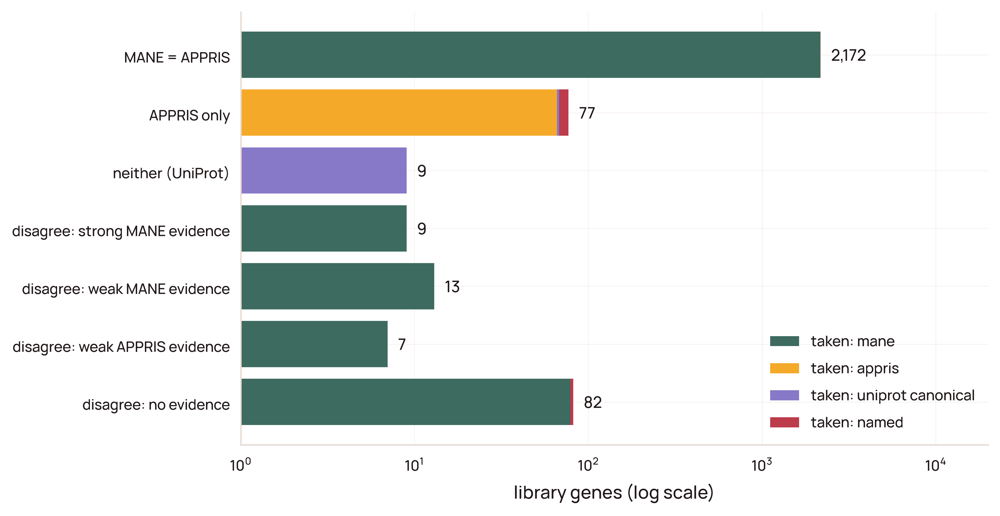
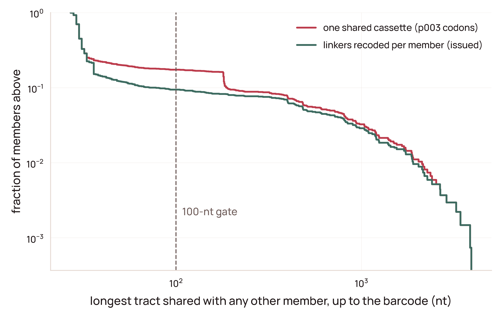
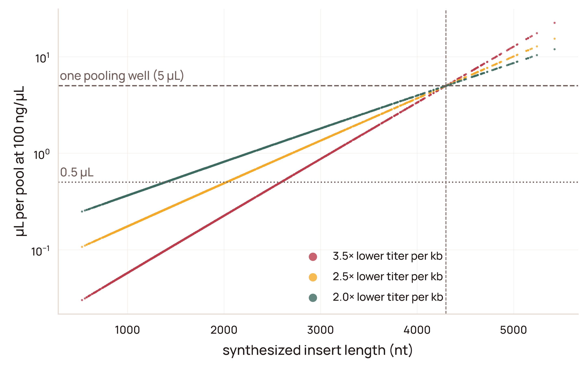

# The L1 surface-protein ORF library: design brief for external review

L1 is Deliverome's first barcoded library of cell-surface protein open
reading frames (ORFs): 2,710 active CDSs, ordered and screened as one pool, each a human, mouse or cynomolgus proteoform
with an epitope-tag cassette placed where it should be displayed outside the cell, cloned
into a common lentiviral vector and identified by a DNA barcode. Nothing in L1 has been
ordered. This brief sets out how each CDS was chosen and built, what is pinned so the
design can be rerun, and the decisions we would like reviewers to weigh in on. It describes the
design as it currently stands; the exact frozen set it was written against, and its checksum,
are recorded in [section 7](#7-domestication-linker-encoding-and-synthesis-compliance). Issues
still being worked on before the order are listed separately in the
[cover note](COVER_NOTE.md).

**If you read only one section, read the seven questions we would most like answered**
([section 12](#12-decisions-we-would-like-reviewers-to-weigh-in-on)). They are the places where
the design rests on an argument rather than on data, and where a reviewer changes what we order.

Each gene has a page in the
[surfaceome viewer](https://dev.surfaceome.deliverome.org/l1-review/) giving the evidence behind
its surface call, the proteoform that was built, and the tag sites on it.

Unless a count says otherwise, every number below describes **L1, active CDSs** —
the designs not retired as duplicates — with topology called by **DeepTMHMM v1**
([Hallgren et al., 2022](https://doi.org/10.1101/2022.04.08.487609), a preprint; version
1.0.24 throughout). Every count
is measured from the library's own tables, and the reviewer package reruns that measurement
from the committed inputs ([section 11](#11-reproducibility-what-is-pinned-and-the-one-permanent-limit)).

## 1. What L1 is for

L1 expresses 2,710 cell-surface protein coding sequences one at a time from a common vector,
each carrying an epitope tag where the protein should present it outside the cell, and each
identified by a DNA barcode. The purpose is to find out which of them reach the plasma membrane
and display that tag. Three properties have to hold for every CDS or the readout means nothing:
it is a real surface-anchored protein in the form that is expressed, its tag sits on the
extracellular side, and its barcode identifies it unambiguously.

What the set supports is comparison within a gene: an alternative human proteoform against the
gene's reference, and a mouse or cyno counterpart against the human, each built by the same
rules. Tag position is comparable only where one CDS carries more than one construct, which on
the internal rung means two or three; the terminal rungs carry one design per CDS.


*Figure 1. What L1 is made of: one bar, segmented by candidate set, each set's count in
the legend. A library reference is the gene's chosen reference proteoform, an isoform an
alternative human proteoform of the same gene, and an ortholog its mouse or cynomolgus
counterpart. Unit: CDS; n = 2,710; values are counts. Regenerated by
[`brief_numbers.py`](brief_numbers.py) from the library's own tables. How the isoform and
ortholog sets were drawn is in [section 4](#4-isoforms-and-orthologs).*

**One pool; one design per CDS on the N-terminal [rungs](#appendix-terms).** L1 is pooled whole. On the
N-terminal rungs (N after SP, residue 1) and the C-terminal rung each CDS is ordered as one
construct. An internal CDS may be ordered as 2 or 3 constructs, its *constructs* ([section 5](#5-tag-placement), "How many
constructs an internal CDS gets"). Every construct is kept in the one pool: "swap rate
is low at the level of thousands of CDSs". The measured cost: two constructs of one CDS share
the native sequence from the later site up to the barcode, so a template switch between them
moves the barcode to the same protein tagged at the CDS's other site. It misattributes the
site, not the protein. On the order of record, 373 CDSs are ordered as more than one
construct (955 of the 3,255 constructs, 29%), forming 791 pairs of constructs of one CDS. Their
shared tract up to the barcode is median 366 nt (range 21–2,886), and 608 of the 791 pairs
exceed the 100-nt gate the library applies between CDSs ([section 7](#7-domestication-linker-encoding-and-synthesis-compliance)). The modelled swap rate
([`seqtools.barcode_swap_rate`](../../../../src/deliverome_analysis/seqtools.py), the Walton
model) is median 16.1%, maximum 47.7%, against 5.0% at the gate
(`l1_domestication_barcode_audit.json`, `swap_tract_same_member`).

That risk is narrow rather than low. The 3,255 ordered constructs make about 5.3 million
possible pairs, and only these 791 — the pairs that are two tag sites of one CDS — share
enough sequence to swap at all, so for all but a few hundred of the order the question does
not arise. Within those 791 it is not low: three quarters of them sit above the gate, and the
modelled rate says a swap is expected rather than rare. The gate is a statement about which
pairs can swap, not about the library's average pair, and reading it as an average understates
the few and overstates the rest.

The 2,360 references cover 2,369 library genes; [section 3](#3-proteoforms-one-reference-per-gene-chosen-by-a-ladder) explains the 9 genes without a
reference CDS. CDSs have a median
length of 1,401 nt. Finished vectors are 7,753–12,706 bp (median 8,968) measured over the
designed constructs; measured over the tagged, recoded constructs actually ordered, the range is
8,004–12,900 bp. The second is the one the packaging limit applies to.

## 2. Genes: from the surfaceome universe to 2,369

Genes come from the accessible-surfaceome catalog, release 1.3.0
([Zenodo doi:10.5281/zenodo.23445521](https://doi.org/10.5281/zenodo.23445521)), which
records per gene the evidence that it reaches the cell surface, its membrane architecture and
its DeepTMHMM v1 topology. A gene enters the library if it passes every gate of the cohort
filter ([`final_library.py`](../../../sprint1/s1e3-surface-library-filters/final_library.py)):

| Gate | Rule | Why | Excluded here |
|---|---|---|---:|
| Surface evidence | in the catalog's `canonical` or `likely` surface tier | the catalog's own curated surface call | 2,297 |
| Accessibility | `surface_accessibility` is not `no` | the protein must be reachable from outside | 0 |
| Surface fraction | `surface_dominant` or `mixed` | — | 362 |
| Anchored | at least one transmembrane helix, or GPI-anchored | — | 141 |
| Co-receptor | no obligate partner, or every obligate partner whose expression can be measured has a median TPM ≥ 5 across the 1,206 Human Protein Atlas (HPA) cell lines | an obligate partner that the host cell lacks would fail the CDS for reasons unrelated to it | 160 |
| Expression | the catalog does not flag the gene as having low endogenous expression, or its highest expression is ≥ 5 TPM in at least one of GTEx v10 tissue medians, HPA tissue consensus (nTPM), HPA cell lines or TCGA tumors | a gene expressed in no normal tissue, tumor or cell line gives no cell a binder could be used on | 81 |
| Localization | the catalog's reason for its surface call is not one of: secreted only, inner-leaflet anchored, cytoplasmic, nuclear, nuclear envelope, mitochondrial interior, endomembrane resident (ER, Golgi, endolysosome), presented only as an MHC peptide, or surface only as a partner in a complex. A complex partner is kept if it has its own transmembrane helix and its reviewed partners pass the co-receptor rule | each of these reasons means the protein's own sequence is not displayed on the outer surface, so a tag on it would not be either | 7 |
| ORF size | ≤ 5,000 nt | synthesis and packaging limit; larger genes go to truncation (L2) | 100 |
| Ectodomain | ≥ 30 extracellular residues | below that there is no domain to display | 50 |

Two qualifications on the gates above, which the rows are too narrow to carry. A partner the catalog names only as free text, or one absent from the HPA matrix, is dropped from the co-receptor test rather than failing the gene, so a gene passes when at least one partner resolves and every resolving partner clears 5. And the expression gate reads four pinned tables, all of them in the reviewer bundle: the Deliverome compilation of GTEx v10, HPA and TCGA at `external://expression-tpm/deliverome-internal-5a1416ea/genomewide_expression_tpm.csv` (SHA-256 `9d098e07…`), its re-derivation at `external://expression-tpm/rederived-2026-08-04/genomewide_expression_tpm_rederived.csv` (`6f2d04e6…`), and the per-gene HPA cell-line median the co-receptor gate reads at `external://expression-tpm/rederived-2026-08-04/hpa_celline_per_gene.csv` (`ba9735fa…`). Each file is listed with its hash in [`bundle_manifest.tsv`](bundle_manifest.tsv). Which HPA release those tables were built from is not recorded, and we could not recover it.

Genes that pass every gate above make up the core: **2,133** genes. Three further groups enter
as named tiers, each with its own rule, because each has direct evidence of surface expression
that the gates miss:

| Tier | Rule | Genes |
|---|---|---:|
| Low-literature UniProt surface | UniProt places the protein at the cell surface (the catalog's `low_lit_uniprot` badge), fewer than 100 papers describe it, the catalog does not place it in its canonical tier, and it is membrane-anchored, has a maximum TPM ≥ 5 and an ORF ≤ 5,000 nt. The catalog's surface call rests on literature, so for little-studied proteins UniProt's annotation stands in for it | 139 |
| Screen-validated GPCRs | GPCRs that the gates exclude but whose anti-HA surface immunostaining is ≥ 1,000 a.u. in a pooled HEK293T screen of the human GPCRome ([Tedman et al., 2026](https://pubmed.ncbi.nlm.nih.gov/42736269/)) | 85 |
| Overexpression surface | proteins the catalog calls mostly intracellular but that have a functional plasma-membrane pool when overexpressed, judged from the catalog's recorded evidence (the DLL3, GLUT4 and FcRn pattern); only the surface-fraction gate excludes them | 12 |

### How each gate is actually decided

The filter reads annotations from the catalog record; it does not run predictors. Every gate
above is a query against fields of a per-gene record in release 1.3.0, and every one is
evaluated on the gene's **UniProt canonical sequence** — not on the designed CDS the construct
carries, which for a substantial minority of genes is a different protein ([section 3](#3-proteoforms-one-reference-per-gene-chosen-by-a-ladder)). Where an
annotation and a predictor disagree, the gate follows the annotation.

That matters most for the anchoring gate, whose two terms rest on different kinds of evidence:

| Term | What decides it |
|---|---|
| at least one transmembrane helix | `canonical_topology.tm_helix_count`, from DeepTMHMM 1.0.24 on the canonical sequence, at ≥ 1 helix |
| GPI-anchored | the catalog's architecture annotation (`filters.subcategory`), a reviewed language-model judgment with cited evidence in the record. It is not a predictor output and carries no score or threshold |

NetGPI 1.1 does run on L1, but downstream, and it decides tag placement rather than membership:
a GPI ω-site deletes the C-terminus, so an extracellular C-terminal tag would be removed with
the propeptide. The set used there is the union of NetGPI and the catalog's GPI curation, which
is a different attribute from the one this gate reads.

**"Membrane-anchored" in the low-literature tier is this same test, unchanged** — one helix or
more, or the architecture annotation. That tier also applies only the five conditions in its
row: the ectodomain, co-receptor, localization, accessibility and surface-fraction gates are
not evaluated for it, so a gene admitted by that tier can carry an ectodomain below the minimum the
core filter imposes.

**The obligate-partner relationships come from the catalog; the overrides on them are ours.**
Which genes are partner-dependent, and who the partner is, are fields of the same per-gene
record. Some partners are
given as free text rather than symbols (`"ATP4B-like beta subunit (ATP1B1/FXYD family)"`),
which no identifier join resolves — which is why an unresolvable partner is dropped from the
expression test rather than counted against the gene. Hand curation sits on top of that: six accessions reviewed against the
literature (ATP1B3, CDC50A, P2RX6, HFE, ATP8B1, CDC50B), four of them also carrying a reviewed
exception to the complex-partner localization veto, and an allowlist of subunits shown to reach
the surface without a heterologous partner. Both are pinned on S3 and in the reviewer bundle as
`coreceptor_calls.tsv` and `coreceptor_rationales.json`. The TPM is a per-gene median over the HPA RNA cell-line consensus (20,151 genes
× 1,206 lines), re-derived here on 2026-08-04 because the published per-gene summary carries
only a maximum, and a maximum answers "detected in at least one line" rather than "present in a
standard cell line".

[`GATE_METHODS.md`](../GATE_METHODS.md) gives each gate's full derivation: the deciding field or
predictor, its version, the sequence it ran on, the threshold, where the output lives, and
whether that provenance is durable today.

A count cannot say why one particular gene is absent, so the outcome is recorded per gene in
[`gene_gate_outcomes.tsv`](../gene_gate_outcomes.tsv): one row for each of the 5,332 cohort
genes, with the tier it entered the library by or the gate that excluded it, and a column per
gate holding `pass`, `fail` or `not_reached`. Filtering one column gives the genes that cleared
that gate, which is the list behind each count above. `not_reached` is a distinct value on
purpose: the gates apply in order and stop at the first failure, so a gene rejected early was
never judged by the later ones, and recording that as a failure would assert something the
filter never tested.

[`gene_gate_outcomes.py`](../gene_gate_outcomes.py) writes it from the filter's own gate list
rather than restating it, and a test asserts that the gate named for a gene agrees with that
gene's membership, so the table cannot drift from the decision it documents.

The filter passes **2,369** genes (core 2,133 plus the three tiers), after one recorded
removal:

- One gene is **removed** ([`gene_list_exclusions.tsv`](../gene_list_exclusions.tsv)):
  EPPIN. It entered on the GPI term of the anchoring gate and on nothing else — its canonical
  sequence is 133 residues with a signal peptide and no transmembrane helix — and the
  architecture annotation is the only source that calls it anchored. UniProt carries no GPI
  keyword, NetGPI 1.1 calls all five human forms non-anchored at 0.994–0.996, DeepTMHMM finds no
  helix, and the catalog's own GPI curation does not list it. EPPIN does reach the sperm
  surface, but through the eppin protein complex, so the membrane attachment belongs to its
  partners.

**The gates have been tested against an independent challenge set.** A cross-method survey of
published surface proteomics selects proteins by how often they recur across studies rather
than by this filter, so its output checks these gates from outside them. It is browsable per
protein in the [surface-proteomics viewer](https://dev.surfaceome.deliverome.org/surface-proteomics/). Under the log-odds rule
(at least 20 admitted intact-cell surface-labeling publications, and log-odds of surface versus
membrane-fractionation detection above 0.5), 347 proteins qualify and **42 are in neither L1 nor
L2**. **Every one of the 42 fails at least one gate above**, with none left unexplained. Gene by
gene in [`s3e8_gap_gate_reasons.tsv`](../s3e8_gap_gate_reasons.tsv), regenerated from committed
inputs by [`s3e8_gap_gate_reasons.py`](../s3e8_gap_gate_reasons.py).

The challenge set itself is S3E8's, not this experiment's: the 42 are
`scratch/becca/s3e8-library-gap/v16/rule_B_not_in_library.tsv` at commit `3fb584ea`
(SHA-256 `ab6a1c9b…`, 42 rows, verified here), built from the sweep-v16 snapshot.
That file is **not on `main`**: it sits on `claude/s3e8-v12-drive-workbook`, whose pull request
targets another feature branch, so the commit hash is the durable reference until that chain
merges. Candidates are joined on `uniprot_accession`, not on the symbol: the sweep output carries
UniProt entry-name mnemonics for three rows — `TMM94`, `F234B` and `K1549`, which truncate the gene
name to five characters — so a symbol join silently drops TMEM94, FAM234B and KIAA1549.

Each gene is counted once below, under the **first** gate it fails; most fail several, and the
per-gene table gives the full set.

| Gate the protein fails first | Genes | Type case |
|---|---:|---|
| ORF over 5,000 nt — **routed to L2 truncation, not excluded** | 20 | FAT4, 4,981 aa |
| Surface evidence: not in the canonical or likely tier | 18 | FAM234A, `deep_dive_tier=low`, mostly intracellular |
| Co-receptor: an obligate partner the host line must also express | 2 | ITGAL, which needs ITGB2 |
| Specificity: mostly intracellular at steady state | 1 | LNPEP |
| Anchored: no transmembrane helix and no GPI | 1 | THBS1, secreted |

Of the 18 that fail on surface evidence, 5 have no deep-dive record at all — FAM234B, KIAA1549,
MYORG, PLTP and TMEM94 never passed triage into the deep-dive set, each carrying a `no` triage
verdict (`endomembrane_resident`, except KIAA1549 `cytoplasmic` and PLTP `secreted_only`) and, for
four of the five, zero supporting database votes.

**Absence from the library is a recorded consequence of these gates, not an oversight.** Two
readings are worth separating. The 20 over the ORF cap are *deferred to L2*, not rejected, so their
absence from L2 as well is a coverage question for L2 rather than a judgement about the
protein. The 18 that fail on surface evidence are a disagreement about the catalog, not about this
design: a gene like FAM234A enters the library if and when the catalog places it in a surface tier,
which is a change upstream of s4e9 rather than an exception inside it. **No gene from this list has
been added to the library**, and no CDS was added or removed on the strength of it.

### Well-known surface proteins the gates exclude, and why

Absence from the library is not a claim that a protein is absent from the cell surface. The
gate that most often separates the two is the co-receptor gate, and it turns on the **host
cell**, not on the protein: a subunit that reaches the surface only inside an obligate complex
cannot be displayed by transfecting its ORF alone into a line that lacks the other subunits.
The partner-expression threshold in the gate table is what encodes this — a required partner
that is itself ubiquitous (median cell-line TPM ≥ 5) keeps the gene in, and co-delivering a
missing partner is not an option the library offers.

The T-cell and B-cell antigen-receptor subunits are the clearest cases, and reviewers should
expect them to be absent:

| Gene | Obligate partners | Why its own ORF is not displayable |
|---|---|---|
| CD3D, CD3E, CD3G, CD247 | the other CD3 chains, and TRAC / TRBC | each reaches the surface only as part of the assembled TCR–CD3 complex; unassembled chains are retained inside the cell |
| CD79A, CD79B | each other, and membrane immunoglobulin | deleting CD79A in a B-lymphoma line abolishes surface IgM and retains the receptor's components intracellularly |
| B2M | the MHC class I heavy chains (HLA-A, -B, -C, -E, -F, -G) | it carries no transmembrane helix of its own and reaches the surface only as the class I light chain, so it also fails the anchored gate |

All of these partners are restricted to lymphoid lineages, so their medians across the 1,206
cell lines sit far below the threshold. Each exclusion rests on the trafficking and knockout
evidence recorded against the gene in the catalog, not on a topology prediction.

The gene list is fixed. A later catalog release changes it only through a dated addition
or exclusion recorded in the repository, never by rerunning the filter, so no existing CDS
is dropped or redesigned by a change upstream.

## 3. Proteoforms: one reference per gene, chosen by a ladder

A gene's reference proteoform is chosen by
[`select_reference.py`](../../../../scratch/becca/appris-principal/select_reference.py),
trying each rung in turn. Agreement is tested on the protein sequence, never the transcript
ID, because several transcripts commonly encode one protein.

| Rung | Rule | Genes |
|---|---|---:|
| 1 | MANE Select and the APPRIS principal isoform encode the same protein | 2,172 |
| 2 | only one of the two exists: take it (APPRIS only) | 77 |
| 2 | neither exists: UniProt canonical | 9 |
| 3 | they disagree: look for observed evidence at the residues that distinguish them | 111 |
| | — strong evidence for MANE | 9 |
| | — weak evidence for MANE | 13 |
| | — weak evidence for APPRIS | 7 |
| | — no evidence | 82 |
| 4 | without strong evidence, default to MANE | (all 111 above, unless a named override applies) |

"Strong evidence" is at least 3 proteotypic PeptideAtlas build 607 peptides on residues that
distinguish the two forms, the best seen in at least 10 samples, and none for the other form;
GENCODE Ribo-seq ORF overlap is recorded but does not decide. None of the 111 disagreements has
strong evidence for APPRIS, so the ladder keeps all 111 on MANE; 3 of them
(ADGRF3, CD200R1L, LRRC37B) then take a named override (below), leaving 108 on MANE. We default to MANE
because 74 of the 111 disagreements carry APPRIS's lowest-confidence principal label
(`PRINCIPAL:4`), so "APPRIS wins" would side with APPRIS exactly where it is least sure.
Twenty genes with weak evidence either way are flagged for review.

Eighteen genes carry a named override that takes precedence over the ladder:

| Genes | Why the ladder's pick is not built | Decided |
|---|---|---|
| ACHE, BCAN, CD55, CD58, NCAM1, TFPI | GPI-anchored proteins whose anchor sits on a non-canonical form | 2026-10-11 |
| MICA | the ladder's pick lost its transmembrane helix | 2026-10-15 |
| KIR2DS4, OR12D1, OR5AL1 | the ladder's pick is the loss-of-function copy in GRCh38 (below) | 2026-11-04 |
| CD200R1L, LRRC37B, CACHD1 | the pick starts after the gene's signal peptide; the signal-peptide form is built | 2026-11-11 |
| ADGRF3 (Q8IZF5-1), RGMB (Q6NW40) | the signal-peptide-bearing form, as for the three above | 2026-11-12 |
| DISP2, TSPAN10 | the pick is an APPRIS-only Ensembl model that truncates the protein (DISP2 leaves 217 canonical residues unaligned; TSPAN10 keeps 3 of 4 TM helices); the UniProt canonical is built | proteoform audit, 2026-11-12 |
| LMLN | the pick starts 232 residues downstream and lacks the signal peptide; the canonical Q96KR4 is built | proteoform audit, 2026-11-12 |

A soluble-form guard also rejects a pick that topology calls signal-peptide-only or globular,
unless it is GPI-anchored.

The source finally taken, across 2,369 genes: **MANE 2,274, APPRIS 66, UniProt canonical
11, named override 18**. For 206 genes the reference is not the UniProt-canonical sequence,
so a record fetched by UniProt accession can describe a different protein; every downstream
record is therefore matched on sequence rather than accession ([section 5](#5-tag-placement)).



*Figure 2. How each of the 2,369 library genes got its reference proteoform. One bar per
ladder outcome; color is the source finally taken (the 18 named overrides are 6 within
"MANE = APPRIS", 3 within "no evidence, default MANE" and 9 within "APPRIS only", too thin to
see at this scale). Unit: gene; n = 2,369; values are counts, log scale. Data: the current
reference record, `library-design/reference-selection/2026-11-12-reference-fixes-2/reference_selection.tsv`.
Regenerated by [`brief_numbers.py`](brief_numbers.py).*

### Genes without a buildable reference copy

The 2,360 references cover 2,369 library genes. Of the 9 genes without a reference CDS,
4 are paralogs whose identical protein is built under another symbol (OPN1MW2, OPN1MW3,
OR2A42, UPK3BL2; [section 4](#4-isoforms-and-orthologs)), and 5 have no CDS because the human reference genome
(GRCh38) carries a disrupted copy and Ensembl 115 has no intact one. Ensembl 115 annotates their
primary-assembly transcripts as `protein_coding_LoF`, so none has a MANE Select transcript, the
ladder took the APPRIS principal, that disrupted transcript, and CDS resolution refuses any
transcript that does not translate to an intact protein. Each is compared with its reviewed
UniProt entry, which describes the intact protein, by
[`unbuildable_genes.py`](unbuildable_genes.py):

| Gene | Defect in the GRCh38 copy | Intact copy in Ensembl 115 |
|---|---|---|
| FCGR2C | premature stop at codon 57 (UniProt Q), plus one residue difference | none |
| OR8J2 | premature stop at codon 64 (UniProt R) | none |
| OR10AC1, OR52P1 | frameshift: under two thirds of the protein aligns | none |
| OR4Q2 | frameshift and compensating frameshift (121 residues out of frame) | a patch-scaffold transcript, 1 residue short of UniProt |

Three further genes have the same defect but an intact copy, identical to UniProt, on an
alternative-haplotype or patch scaffold of Ensembl 115. They are built from it, through a
named override (above): KIR2DS4 (design id `l1-p2740`, alternative KIR haplotype), OR12D1
(`l1-p2741`, alternative MHC haplotype) and OR5AL1 (`l1-p2742`, patch scaffold).
[`check_reference_allele_lof.py`](../../../../scratch/becca/appris-principal/check_reference_allele_lof.py)
recomputes from the pinned files that each primary copy is loss-of-function (3, 8 and 10
internal stops) and that the transcript built equals the UniProt protein
(`reference_allele_lof_evidence.tsv`).

## 4. Isoforms and orthologs

Both panels are seeded, class-stratified draws, balanced across membrane architecture
(type I, type II, type III, GPI, multipass) rather than uniform, because a uniform draw loses
the rare architectures whose placement is least certain.

| Panel | CDSs | Draw | Composition |
|---|---:|---|---|
| Isoforms | 150 (133 genes) | seed 20261009; 100 with observed evidence (mass spectrometry or Ribo-seq) + 50 prediction-only (TRIFID above 0.5, no observed evidence) | type I 61, multipass 51, type II 17, GPI 16, type III 5 |
| Orthologs | 200 | 100 mouse (seed 20261011) + 100 cyno (seed 20261012), each split 50/50 into "near" and "diverged" bands at a fixed sequence-correspondence score to the human library protein (0.8644 mouse, 0.9595 cyno) | multipass 81, type I 54, GPI 28, type II 28, type III 9 |

In both panels a drawn form the library cannot use is replaced by continuing the same seeded
draw within its own stratum, so every valid pick keeps its place and the panel regenerates from
code.

**An ortholog is built only beside a built human CDS of its gene**, and never in place of one.
An ortholog asks whether the human design transfers across species,
which has no answer without the human CDS; where the human CDS is held, its orthologs are
held with it. `l1_completeness.py` fails if a mouse or cyno CDS is built while no human
CDS of its gene is.

**Isoform forms pass a gate before the draw** (
[`gate_isoform_cohort.py`](../gate_isoform_cohort.py) → `isoform_gate.tsv`). A form is drawable
only if it starts at a native ATG supported by an exact Ensembl 115 CDS, and keeps its gene
reference's signal peptide, N-terminal orientation and first transmembrane helix, all judged by
DeepTMHMM v1 on the form's own sequence. 802 of the 1,894 cohort forms pass. 931 of the
1,092 failures fail only because the form has no DeepTMHMM v1 prediction yet, so they are
unverifiable rather than defective. A pick that fails the gate, duplicates another CDS's
protein or is encoded by no transcript is replaced by continuing the seeded draw: 32 of the
150 picks were replaced this way (`isoform_panel_replacements.tsv`). There is no length floor:
a 50% floor was considered and rejected because it would also remove isoforms kept on evidence.

**Isoforms are drawn from a pool narrower than the library.** The isoform universe was built
from an April 2026 query set (the expression-filtered `surfaceome_expressed` list behind
accessible-surfaceome commit f9c73691), which holds 1,775 of the 2,369 library genes. **594
library genes were therefore outside the query set and could not have an isoform drawn at
all.** (A different and smaller number, 92, appears in the coverage audit: of the 451 library
genes that have a non-canonical UniProt isoform but no CDS in the isoform cohort, 92 lie
outside the April set. That is a subset of the 451, not the panel's reach.) Within that
universe every library gene is
accounted for: all 451 library genes with a non-canonical UniProt isoform but no CDS in the
isoform cohort have scored rows, and the cohort's own rules exclude each one
(`audit_isoform_coverage.py`, which fails on an unexplained absence). For 399 of those genes,
every alternate form is below the evidence bar, which requires a diagnostic peptide, a positive
OpenProt translation score or a TRIFID score above 0.5. The other 52 include forms excluded for
lost surface anchoring. Lack of evidence is not evidence that an isoform is absent.

**Orthologs are drawn from every library gene, and admitted only with a supported coding
sequence.** The pool is the Ensembl Compara 116 one-to-one, high-confidence mouse and cyno
orthologs of all 2,369 library genes (3,643 sampleable gene–species representatives). A form is
eligible only if its coding sequence has a native ATG start, supported start and stop
coordinates, a terminal stop and no internal stop, and translates exactly to the selected
protein; no start or stop is repaired, with four recorded exceptions: the cyno CHRM3, CCR5,
OR3A2 and NIPAL4 models start 27–214 codons upstream of the Met aligned to human Met1 and are
the only cyno models of those genes, so each is restarted at that native Met (5′ trim, no codon
edited; `ortholog_start_trims.tsv`, the decision log). Among a gene's eligible mouse forms the APPRIS principal
(APPRIS 2026_08.v50 for Ensembl 116) ranks first; cyno has no APPRIS dataset, so no form is
preferred on that ground. Every one of the 200 CDSs matches its pinned Ensembl source file,
the four restarts as a 5′ suffix of it
([`ORTHOLOG_CDS_POLICY.md`](../ORTHOLOG_CDS_POLICY.md)).

Coding completeness is not domain equivalence, so each drawn form is compared with the human
library protein for signal peptide, TM helices, N-terminal orientation, GPI anchor and Pfam 39.0
domains ([`ORTHOLOG_CORRESPONDENCE_REVIEW.md`](../ORTHOLOG_CORRESPONDENCE_REVIEW.md)). A form
that loses a human feature across an insertion or deletion is replaced by the next
architecture-conserving form in the same seeded draw and stratum. Eleven are replaced this way;
for example, cyno SLC8A1 loses TM6–10 and its C-terminal exchanger domain, cyno IL31RA its signal
peptide and N-terminal 142 residues, and cyno MS4A10 its TM1, which flips its orientation. Six
forms are kept as drawn because the comparison does not show a lost feature:

| Form | Comparison | Why it is kept |
|---|---|---|
| cyno MARCO; mouse TMIGD1, IGSF1, TMPRSS7 | a human Pfam domain is not detected | the aligned span carries no insertion or deletion, so the miss is more likely detection than loss |
| mouse OR10G6 | lacks the human protein's first 21 residues | DeepTMHMM calls those residues a signal peptide; all 7 helices are kept |
| mouse CACHD1 | the mouse form has a signal peptide | the human library form is the one without it, so another mouse form would not match better |

The adopted panel and each form's source are in
[`ortholog_panel_adopted.tsv`](../ortholog_panel_adopted.tsv), built by
[`adopt_ortholog_cds_policy.py`](../adopt_ortholog_cds_policy.py), which `library_pipeline.py`
replays from the pinned draw.

Barcode-swap screening ([section 7](#7-domestication-linker-encoding-and-synthesis-compliance)) does not apply between a gene's CDSs: an isoform
shares its parent's sequence by construction (median overlap 1,071 nt over 2,150 pairs, none
under 100 nt), so a swap-tract bar would remove the panels entirely.

**Duplicate proteins.** Comparing translated designed CDS across the library found CDSs
with different symbols, accessions or transcripts that encode the identical protein. One
CDS is kept per protein; 7 L1 CDSs are retired (ACHE and CD177 isoforms identical to
or an allele of the reference; a cyno MMP16 identical to human; the paralogs OPN1MW2,
OPN1MW3, OR2A42 and UPK3BL2, whose proteins are built under OPN1MW, OR2A1 and UPK3BL1). Design
ids are never reused.

## 5. Tag placement

### Rungs

Each CDS gets one rung from the DeepTMHMM v1 topology of **its own** designed protein,
matched by sequence hash, never by accession: a CDS's ordered form can differ in topology
from its gene's canonical (an isoform can lose or gain helices, so the gene's count says
nothing about the ordered form). The ladder takes the first rung that applies:

| Rung | Rule | Rests on | CDSs |
|---|---|---|---:|
| N after SP | the residue after the signal peptide is extracellular | predicted cleavage site | 1,285 |
| N at residue 1, multipass | N-terminus extracellular, no signal peptide, >1 TM | a mechanism argument for the Igκ leader that 564 of 565 carry; the GPCR surface screen's displayed tags were leaderless, and the panel constructs that test the leader have no data yet | 565 |
| N at residue 1, single-pass (type III) | same, 1 TM | topogenesis argument only; untested | 44 |
| C-terminal | C-terminus extracellular | topology only | 208 |
| internal | neither terminus extracellular, or GPI-anchored with an ecto-C call | needs a loop or ectodomain site | 608 |

A site is written as `insert_after_residue` *n*: 1-based on the CDS's designed protein, so
the cassette goes after codon *n*, at nucleotide 3*n* counted from the A of the start codon.

Two rules sit on top of the ladder. First, a GPI-anchored protein's C-terminus is removed at its
ω-site, so a C-terminal call for one is rerouted to internal; this touches 1 CDS, BST2.
Second, a short, documented layer of lane overrides (`lane_overrides.tsv`), each with
its evidence: MFSD2A (both CDSs) and AQP12B move to internal; GLP2R to N after SP, built as an
Igκ swap of its predicted signal peptide (residues 1–66); and SLC68A1 to C-terminal (the decision log). Shedding risk is recorded but never moves a rung, because none of the CDSs at
proteolytic risk has a usable inter-TM loop to move to.

**The cassette is the full 51 aa at every rung, including right after Met1.** At a free
N-terminus nothing but the initiator precedes the cassette, so its leading `GGGGS` looks
dispensable. Without it, SpyTag003's hydrophobic `VPHIVMV` sits directly behind Met-Arg, the
shape of a signal peptide's n- and h-regions, and DeepTMHMM v1 called a cleavable signal
peptide on 12 of the 62 type III CDSs tested with the tag alone, cleaved at residue 12 (17
for one) inside SpyTag003. That cleavage would remove the SpyTag003 epitope and leave ALFA, so
the CDS could display ALFA yet fail SpyCatcher capture. The calls fall as the spacer after
Met1 grows: none 12, S 7, G 7, GS 3, GG 2, GGS 0, the full `GGGGS` 0. Behind an Igκ leader the
trimmed cassette drew no call, but the full cassette is kept there too so that every
residue-1 CDS has one design. These are DeepTMHMM v1 calls, not SignalP 6, so they mark a
risk rather than prove a cleavage ([`TYPE3_NTERM.md`](../TYPE3_NTERM.md), "Why the full cassette stays at
residue 1"; raw calls `processed://sprint4/s4e9-orf-design-fg-panel/type3-nterm/type3_spacer_test.v1.3line`).
The result concerns terminal placement only.


*Figure 3. Tag-placement rung for every L1 active CDS with a designed tag path, by
candidate set. Unit: CDS; n = 2,710; values are counts. Topology: DeepTMHMM v1, matched on the ordered protein.
Data: `l1_tag_paths.tsv`. Regenerated by [`brief_numbers.py`](brief_numbers.py).*

The internal rung is the hard one, and two different measures of "space" are worth separating.
By the **run between two TM helices**, the median internal CDS has 51 residues to work with
and **33** have no such run of at least 8. By **any extracellular run**, whether or not it lies
between two helices, only **7 CDSs of five genes** have nothing of 8 residues: TMEM139 ×2,
TMEM169, TMEM268, TMEM86A and TMEM86B ×2. The second is the one that decides whether a loop
site can exist at all, which is why those seven are the CDSs the rung has to solve: five are
tagged in a shorter loop that passes the membrane-side gate and refold, one TMEM139 CDS is a
[snorkel](#appendix-terms), and TMEM169 is held ([section 5](#5-tag-placement), "Snorkels"). The 33 are a looser class — a CDS can
have no inter-TM run and still carry a usable terminal-adjacent ectodomain loop. BST2 reports 0
on the inter-TM measure as an artifact: it is a single-pass GPI protein with a 137-residue
ectodomain.

### Topology

DeepTMHMM v1 (1.0.24) is the topology of record, chosen over v2 because v1 recalls 99.5% of
signal peptides against v2's 92.9%; v2 is kept alongside and not substituted. A v1 row is
selected by its tool-version stamp, not by the presence of a per-residue string, because v2
rows carry a v1-alphabet back-projection that differs from genuine v1 output. Every active
CDS has a v1 row for its exact sequence: 2,173 from the human canonical cohort, 210 from
human isoforms, 197 from the ortholog cohorts, and 130 run on the designed ORFs themselves.

### GPI anchors

GPI anchoring is called per form, not per gene, because the anchored species is not always
the reference (ACHE's canonical is non-anchored while P22303-2 is anchored). The GPI set is
NetGPI 1.1 over reference and alternative forms, unioned with curation under a confidence
rule: 157 genes, of which 138 are NetGPI-anchored and 19 are curated GPI that NetGPI does
not call. 191 L1 CDSs belong to GPI genes: 190 are N-terminal after the signal peptide,
and 1 (BST2) is rerouted from C-terminal to internal.

### Structure models

The site-scoring lanes that choose a concrete junction read pLDDT, solvent accessibility and
secondary structure from an AlphaFold model, so a CDS without a model cannot be scored.
Models come from AlphaFold DB where it has one and are otherwise folded from the designed CDS
with ColabFold 1.6.2 (same AlphaFold2 weights, MMseqs2 rather than JackHMMER alignments). Each
model is compared residue for residue with the CDS's designed protein, because a model
fetched by accession can be of a different proteoform:

| Verdict | Active L1 CDSs | Meaning |
|---|---:|---|
| identical | 2,391 | the model is of exactly this protein |
| contained | 27 | our protein is a subsequence of the modeled one; needs an offset the lanes do not apply |
| different | 189 | the model is another proteoform; its numbering cannot be carried onto the construct |

184 of the 189 "different" are library references, the set resolved by gene symbol to a
canonical accession. A length test does not catch them: 19 have the same length as their
model. These counts cover the 2,607 active CDSs compared. The 61 ortholog CDSs with no
AlphaFold DB model are folded with ColabFold from their own designed proteins.

### The literature positives behind the internal-site ranker

The rung says a CDS needs an internal site; the concrete residue is proposed by a
separate site ranker (experiment S5E13), trained on 176 internal tag insertions that a
literature-retrieval agent collected from published papers. Each of the 176 was read against
its paper, by the procedure in `scratch/becca/tag-site-corpus-audit/README.md`:

| Verdict | Positives | Meaning |
|---|---:|---|
| confirmed exact | 125 | the paper places the tag at the cited residue |
| confirmed shifted | 23 | the paper places it at another residue, mostly because it numbers a mouse ortholog (14 of 23); all five ABCB1 sites are +4 |
| region only | 11 | the paper supports the loop or domain, not one residue |
| not supported | 17 | 7 cite a paper that tagged a different gene or showed the site intracellular, 5 are numbered in a species that cannot be mapped to the human residue, 5 are terminal tags filed as internal |

The per-site audit, with each paper's quote, is
`processed://scratch/becca/tag-site-corpus-audit/audit.tsv`. The corrected training set used by
the S5E13 retrain (PR 232), `processed://sprint5/s5e13-tag-site-benchmarking/corpus_audit_corpus.tsv`,
was built before two region-only sites (MMP14, TMEM123) were resolved and holds 146 positives
at the paper's residue, 13 region labels and the 17 dropped.

The audit's confirmed sites, one row per protein and residue, form a gold standard
(`gold_standard.tsv`): 156 sites on 113 proteins, 120 of them on 93 proteins with surface
display shown, 4 shown not to reach the surface and 75 with function shown; it covers 108 of
the 127 training proteins. It excludes five confirmed positions where the paper shows the
construct failed (`failed_sites.tsv`, kept as candidate negatives) and adds six real sites from
papers the agent had filed under the wrong gene (KCNK3 214 and five GABA-A subunits:
GABRA5 35, GABRA6 23, GABRG1 39, GABRG2 43, GABRG3 21; `added_sites.tsv`). The 22 region-level
sites are in `region_labels.tsv`, 19 of them with a candidate window on the human canonical
sequence (16 proteins). All of these files are under
`processed://scratch/becca/tag-site-corpus-audit/` and in the reviewer bundle.

The audit also read the 15 live literature rows outside the training set (`in_training = 0`):
6 that carried no residue were pinned to one from the paper (CFTR 891, NRXN1 371, TRPV1 606,
NRG3 275, SLC12A5 248, SLC4A2 862), ABCC1 at 4 is confirmed, ITGB7 23 shifts to 42, CNR1 25 is
unsupported, and 6 stay region only; the 176-row table above is unchanged by them. The live
tag-site API was corrected to these verdicts on 2026-11-05, as version `2026-11-05-lit-audit`
([accessible-surfaceome PR 459](https://github.com/Deliverome-Project/accessible-surfaceome/pull/459)):
178 rows written and 18 withdrawn, so ABCB1's sites, for example, are served at 105, 324,
740, 745 and 965. Nothing in the L1 tag paths depends on these
sites.

### Which side of the membrane each internal site is on

DeepTMHMM v1 labels each residue inside or outside the cell, and it can be wrong about a whole
loop. Each internal site is therefore also checked against the CDS's own structure model
placed in a membrane. The placement is TMDET's (a published method that fits the membrane
slab to a structure) where TmAlphaFold, TMDET's precomputed set for AlphaFold DB models, holds
the CDS (440 CDSs), and otherwise a fit to the model's own helix axes (139), which lands a
median 7.8° and 2.3 Å from TMDET where both exist. Each tag junction gets a height above the
membrane mid-plane:

| Verdict | Height of the junction | Why that cut-off |
|---|---|---|
| pass | ≥ 14.0 Å | the shallowest published internal tag with surface display shown (CNR1 after residue 179), among 88 such sites in multipass proteins |
| review | 11.7–14.0 Å | within 2.3 Å of the pass line, the helix-axis fit's median error |
| fail, membrane core | −13.0 to 11.7 Å | 13.0 Å is TMDET's median hydrophobic half-thickness |
| fail, cytoplasmic | < −13.0 Å | beyond the hydrophobic core on the inside |

The gate was calibrated and run on the earlier v4 ranker's picks. Of those 1,070 sites (1,064
S5E13 v4 ranker picks and 6 hand-selected panel loop constructs), 967 pass and 48 fail: 13 are cytoplasmic (DeepTMHMM v1 merged
two helices and the loop between them, as in the anoctamins, or put a whole short loop on the
wrong side), 30 sit in the membrane core (loops that barely leave the bilayer, such as aquaporin
and Kir pore loops, or junctions at the base of a loop that does reach outside), and 5 sit on a
partner interface. A further 42 are for review, 2 are held for low model confidence and 11
cannot be scored. The ranker re-picks failed sites from passing candidates under the
delegation; a CDS left with no passing loop site is tagged by a snorkel. The internal-site ranker now requires the
gate's per-residue mask and stops on a CDS without one. DeepTMHMM v1 stays the topology of
record; the gate is a separate, documented layer on top of it.

Gate source:
[`membrane-side-gate/`](../membrane-side-gate/README.md) on main (`gate_summary.json`,
`l1_internal_pick_changes.tsv`).

### Why each rung places the tag where it does

Each rung below states its rule, the reason for it, the alternative rejected, the measured
counts and the known weak spots. Every count is from `brief_numbers.json` (key `rungs`,
computed by [`rung_numbers.py`](rung_numbers.py)). That script assigns each decision row to
exactly one named rule and stops if a row fits none, so these counts cannot drift from the
decision tables. Refold verdicts throughout use l1-tag-refold's three checks on the tagged
model against the untagged one: native-region lDDT ≥ 0.85, lDDT within 15 residues of the site
≥ 0.7, and the epitope not packed against the native domain.

#### N after the signal peptide (1,285 CDSs on the rung)

The decision table holds 1,310 rows; 1,307 are decided at this rung (1,272 built and 35 with no
N-terminal construct), and 1,285 remain on the rung once 22 CDSs move to an internal site and 1 to the
residue-1 multipass rung. Counts below name which of the three they use.

**Rule.** The cassette goes between the signal peptide's cleavage site and the start of the
folded domain, following Tedman's interval rule (`nterm/admissible_interval.py`). The cleavage
site is the later of the DeepTMHMM v1 and SignalP 6.0 calls (a cassette inside the signal
peptide would leave with it, so the rule errs late). Each of three disorder tracks
(metapredict, NetSurfP-3.0, AlphaFold 1 − pLDDT) marks where structure begins: the first run of
five ordered residues after the cleavage site. Candidate sites run from the residue after
cleavage to the median onset plus 2, and never more than 20 residues past cleavage. Each
candidate is then re-predicted with SignalP 6 *on the tagged protein*, because the tag is the
one thing that can break cleavage; only sites where the tagged protein is still cleaved
upstream of the cassette survive. The rules run in this order
(`nterm_decide.py`), and each CDS's row in `nterm/nterm_decisions.tsv` names the one that
applied:

| Rule | Construct | CDSs |
|---|---|---:|
| 1. a cleavage-keeping site before the predicted fold | native signal peptide | 510 |
| 2. cleavage kept only at sites inside the fold: the most disordered junction, then the highest tagged cleavage probability | native | 314 |
| 3. cleavage moves but stays upstream of the cassette | native | 41 |
| 5. ortholog with SignalP's release admitted, gated site | native | 47 |
| round-2 SignalP for CDSs with no earlier call | native | 38 |
| site moved past a UniProt N-terminal pro-peptide to the mature N-terminus | native | 52 |
| next cleavage-keeping site after the first failed refold | native | 19 |
| refold fails at every cleavage-keeping form; built and flagged under the disposition rule | native | 19 |
| 4. native signal peptide fails at every site: Igκ swap | Igκ | 105 |
| weak predicted signal peptide (cleavage-site probability below 0.5) | Igκ | 49 |
| only DeepTMHMM v1 calls the signal peptide, and a second source confirms a cleaved one | Igκ | 48 |
| only DeepTMHMM v1 calls it, and a second source places the cleavage elsewhere (re-anchored) | Igκ | 11 |
| round-2 SignalP: Igκ form keeps the leader's cleavage | Igκ | 18 |
| next Igκ form after a failed refold | Igκ | 1 |
| refold fails and no other cleavage-keeping form | none | 23 |
| no tagged form, native or Igκ, keeps a cleavage site | none | 3 |
| the mature N-terminus after a pro-peptide has no passing form | none | 3 |
| only DeepTMHMM v1 calls a signal peptide and no second source confirms it | none | 5 |
| ortholog whose gene has no built human CDS | none | 1 |
| no form keeps a cleavage site; routed back to internal | moved | 2 |
| a first TM helix, not a signal peptide; routed to residue 1, multipass | moved | 1 |

1,272 are built (1,040 native, 232 Igκ) and 35 have no N-terminal construct: 22 of these are tagged at
an internal ectodomain site instead (the rescue round) and 13 are held.

**Why.** The region just after cleavage is extracellular by construction, is usually
disordered, and needs no loop-level structure scoring. Placing the tag before the fold leaves
the folded domain untouched.

**Rejected.** Tagging at residue 1, before the signal peptide (the tag is cleaved off with
it); the cleavage residue itself, so the cassette forms the mature N-terminus (none of Tedman's
signal-peptide constructs does this); trusting the native cleavage call without re-predicting
the tagged protein.

**Weak spots.**

| Weak spot | CDSs | What would settle it |
|---|---:|---|
| The only cleavage-keeping sites lie inside the predicted fold | 513 of 1,272 built | display measured in the pooled screen; each passed refold |
| Refold counted as a pass on a borderline lDDT (within 0.01 of the bar): CIST1, FOLR1, LYVE1, SLITRK2, SMO, SNORC | 6 | the 0.85 bar is an open item (cover note) |
| Cleavage is a SignalP 6 prediction, not a measurement | all | N-terminal sequencing or a shift on a blot for a sample |
| No N-terminal construct | 35 (13 held, 22 tagged at an internal site instead) | a redesign, or an internal site |

#### Signal peptides and the Igκ leader

The murine Igκ leader (`METDTLLLWVLLLWVPGSTG`) plus Asp is the library's one heterologous
signal peptide. It is used in three situations, each decided by named code, and never
otherwise. 804 CDSs carry it. The N-after-SP rules are set out in full, with every
SignalP run, in the companion [N-terminal placement brief](nterm/BRIEF.md) and
[`nterm/BUILD_OPTIONS.md`](nterm/BUILD_OPTIONS.md).

**When only DeepTMHMM v1 calls the signal peptide.** For a CDS whose signal peptide DeepTMHMM
v1 calls and SignalP 6 does not, the Igκ swap needs a second source: a curated UniProt SIGNAL
feature or a DeepTMHMM v2 signal peptide that confirms a cleaved peptide. Without one there is
no N-terminal construct; where the segment is a signal anchor or a first TM helix rather than a
cleaved peptide, the CDS is routed to the rung that segment implies (multipass or
internal). The rule and each CDS's evidence are in the companion brief, [section 11](#11-reproducibility-what-is-pinned-and-the-one-permanent-limit),
"CDSs whose signal peptide only DeepTMHMM v1 calls" ([nterm/BRIEF.md](nterm/BRIEF.md)).

**Why the trigger is re-prediction, not native confidence.** For N after SP the Igκ swap is
triggered when no tagged candidate keeps a SignalP 6 cleavage upstream of the cassette, not
when the native signal peptide is weak. Over the 1,101 re-predicted CDSs, 160 have no
candidate that keeps cleavage, and 96 of those have a native cleavage-site probability of 0.9
or more, so a confidence threshold would miss most failures; and 14 of the 32 CDSs below 0.5
keep cleavage at some candidate, so a threshold would replace signal peptides that work
(`nterm/nterm_build_options.json`, `native_cleavage_confidence_vs_outcome`). The same run
compared three site rules: the first mature residue keeps cleavage for 757 CDSs, the most
disordered residue in the first 20 for 758, and the re-prediction-gated choice for 941.

**Weak signal peptides.** A second trigger sits beside the
re-prediction: "we are relying more on igk now for either weak predicted SP like VSIG10 or all
GPCRs". VSIG10 (`l1-p2333`) is the example: SignalP 6 is sure it has a signal peptide
(probability 0.9998) but unsure where it is cleaved (cleavage-site probability 0.35), and it is
built Igκ + tag. A native construct is *weak* when SignalP 6's cleavage-site probability is below 0.5
on the native protein or on the built tagged form; 53 native constructs meet it
([`nterm/weak_sp.py`](nterm/weak_sp.py)). The leader replaces residues 1..*c*, *c* being the
later of the DeepTMHMM v1 and SignalP 6 cleavage calls, so it removes at most a few mature
residues rather than leaving signal-peptide residues behind, and the cassette stays after the
same native residue. A swap stands only if SignalP keeps the leader's cleavage on the Igκ form.

| Outcome | CDSs |
|---|---:|
| Igκ swap, refold passes | 47 |
| Igκ swap built and flagged: refold fails on packed epitope residues (ICAM4, LYPD1) | 2 |
| native kept and flagged: the two cleavage calls differ by more than 5 residues, too uncertain to delete on (TMEM81, MXRA8, IL1RAPL2) | 3 |
| native kept: SignalP moves the cleavage on the Igκ form (KIAA0319) | 1 |

The 0.5 threshold is the nterm-reviewer-package session's proposal, adopted by the coordinator
on 2026-11-15 and not yet confirmed ([`nterm/nterm_decisions.tsv`](nterm/nterm_decisions.tsv),
`weak_sp_flag`). It is a second trigger, not a
replacement for re-prediction, because native confidence alone misses most failures (above).

| Rung | Igκ | Without | Criterion (code) |
|---|---:|---:|---|
| N after SP | 232 | 1,040 native | `nterm_decide.py` rule 4: SignalP 6 calls the native signal peptide lost at every candidate site with the tag in place, while the Igκ-tagged form keeps the leader's cleavage (105, with 18 more from the round-2 run and 1 as a refold fallback); a weak predicted cleavage site, probability below 0.5 (49); or only DeepTMHMM v1 calls a signal peptide and a second source confirms a cleaved one (48) or re-anchors it (11). Those six rules are the 232. The Igκ swap replaces the native residues `1..c` |
| residue 1, multipass | 564 | 1 | `build_l1_multipass_arms.design_for`: 502 of the 503 GPCRs by default (on Aashish Manglik's suggestion), non-GPCRs by a literature verdict per family (54), as their reviewed family (5), or after a lane check (SLC61A1 ×2, TSPO2). The one exception is CRHR2, whose N-terminal pseudo signal peptide cannot target the ER on its own and would become an untested internal hydrophobic segment |
| residue 1, type III | 8 | 36 tag alone | `build_l1_type3_arms.design_for`: the ordered form lacks its gene's signal peptide (IGSF5, 1); a native N-tail of ≤ 20 residues, which the 51-aa cassette would push past the point where signal-anchor insertion changes (2); a flank-charge difference ≤ 1, i.e. weak positive-inside drive for N-out (3); KLB's internal signal-like segment (2). Every other type III CDS is a genuine type III with no identified risk and carries the tag alone |

**Why.** At residue 1 nothing but Met precedes the cassette, so the protein's first
transmembrane helix must carry 51 aa of tag across the membrane. A cleaved leader gives the
tagged N-terminus its own ER-targeting signal and removes that dependence. For N after SP the
leader is used only where the native signal is predicted to fail or is weak, because it changes the
mature N-terminus by one residue (the Asp) and replaces sequence that is native.

**Rejected.** Igκ for every CDS (changes the native start of 1,040 CDSs whose own signal
peptide is predicted to work); tag alone for all residue-1 CDSs (rests on unassisted
translocation of the cassette); keeping the 25 rescue CDSs beside their references as a
within-gene leader test, rejected because in one pool each pair would swap barcodes.

**Weak spots.** With the rescue CDSs retired, L1 holds no within-gene contrast of leader
against no leader, so the leader's effect on display is assumed, not measured, for the 564
multipass CDSs that carry it; the cited GPCR literature never tested a 51-aa cassette behind a leader.
For N after SP, an Igκ swap rests on SignalP's response to an engineered junction (the
cassette directly after the cleavage site) that SignalP was not trained on. The type III rules rest on topogenesis arguments with no tagged type III
CDS yet measured. 572 ordered constructs were folded as the mature chain after the leader,
not as the precursor, on the assumption that the leader is cleaved.

#### Internal loops (608 CDSs on the rung; 588 built, 20 held)

Three counts for this rung appear in this brief and they measure different things. **608** is
the CDSs topology places on the internal rung (`l1_tag_paths.tsv`). **588** of those carry
at least one ordered construct, between them 1,061 loop constructs, and **20** are held because no construct of
any kind passes. **583** is the row count of the ranker's decision table
(`l1_internal_decisions.tsv`), which was written in the decision round before the construct rule and
covers 582 of the 608; the remaining 26 reached the rung afterwards. Where a number below has
583 as its denominator, it is the decision round's, not the order's.

**Rule.** A CDS whose neither terminus is extracellular is tagged inside an extracellular
loop. The site is the top-ranked junction of tag-site model v5 that (1) the membrane-side gate
places outside the membrane (above), (2) has no known ligand contact within 2 residues of
either residue flanking the junction (residues *n*−2 to *n*+3 for a site after *n*; the
"±2 contact veto" below), and (3) passes refold with the cassette inserted. A rank-1 site that fails refold
moves to the next passing rank.

**The ranker.** v5 is a pair of random forests (800 trees, depth 4, fixed seed): one ranks
residues within a protein, the other scores them on an absolute scale. Each reads 13 numeric
per-residue features from the CDS's structure model and sequence (pLDDT, solvent
accessibility, three disorder windows, hydropathy, Pro/Gly fraction, Cys count and three
N-glycosylation features) plus three one-hot categories (secondary structure, topology class,
region class). It is trained on the 176 published internal tags of 127 proteins as the
literature agent labeled them (the audit above found 23 of those labels shifted and 17
unsupported after v5 was fitted; retraining on the corrected set is deferred to L2 with the numbering gap below)
against 200 unlabeled extracellular residues per
positive (35,650 rows), with 2,141 *hard negatives* at weight 5: residues where a tag is known
or expected to do harm (buried core, disulfide Cys, glycosylated Asn, junctions that do not
tolerate a domain insertion, ligand contacts). It was chosen over four other policies by
5-fold cross-validation grouped by gene, averaged over three negative draws
(`compare_internal_policies.py`). The folds are grouped by gene, not by family, so close
paralogs (the training set holds many SLC, KCNK and KCNJ CDSs) can fall on both sides of a
fold, and there is no held-out test set:

| Policy | Top-1 within 10 residues | Top-3 within 10 | First pick in the right loop | A top-3 pick within 2 of a ligand contact |
|---|---:|---:|---:|---:|
| positives only (v4's frame) | 0.467 | 0.704 | 0.694 | 0.122 |
| **v5: + hard negatives at weight 5** | **0.491** | **0.712** | **0.726** | 0.156 |
| bagged PU random forest | 0.457 | 0.706 | 0.699 | 0.133 |
| v5 + ±2 contact veto (shipped) | 0.491 | 0.714 | 0.726 | 0 |

The veto removes ligand-contact picks at no cost to the published sites, so it ships on top of
v5. Contacts come from three sources: deposited structures with a ligand (D1), ligands
transferred from close homologs, and a literature pass (437 CDSs; the other 146 were vetoed
on the first two only). The veto moved 10 sites.

**Counts.** 531 CDSs are tagged in a loop, all passing refold: 507 at the rank-1 site, 23 at
rank 2 and 1 at rank 3; the ranker rates 444 of them medium and 87 low confidence. Two of them,
ENTPD2 (human and cyno), joined the rung from N after SP on 2026-11-14: the N-terminal segment is
a signal anchor, not a cleaved signal peptide. 1 more
(SLC44A1) is designed on a mask whose orientation the gate could not confirm. 28 are snorkels
and 22 are held (next part), and 1 (SLC68A1) moves to the C-terminal rung on experimental
topology (UniProt Q14CX5; Anzai & Matsumura 2019, PMID 31615651). Against v4, of the 530 sites
designed, 277 are identical, 143 within 10 residues, 72 further away and 38 on sequences v4
never designed (`l1_internal_sites_vs_v4.tsv`).

**Rejected.** v4 (no hard negatives; lower on every tolerated-site metric), the bagged PU forest
(lower first-pick accuracy), and v1 topology alone without the membrane-side gate (48 of the 1,070 sites it was calibrated on
fail it).

**Weak spots.**

| Weak spot | Size | What would settle it |
|---|---|---|
| The ranker finds the published residue at top 1 in under 5% of proteins; it is reliable at the loop (73%) and the 10-residue window (49%), not the residue | all 531 | display of the ordered sites in the pooled screen |
| For 4 training proteins (NRXN1, ASIC1, SLC4A11, SLC9A6) the features were numbered on a different isoform: 5 of 176 positives and 858 of 35,650 rows (174 of the 2,141 hard negatives) | v5 itself | retrain in L2; deferred because redrawing the negatives would move picks on proteins whose features did not change |
| The same numbering gap hit 11 L1 CDSs; they are redesigned on corrected features, 7 sites change, and each new site passes the gate and refold (`isoform_fix_redesign.tsv`) | 11 | none needed |
| The literature pass on ligand contacts did not reach 146 CDSs | 146 | finishing the pass before the order (an open item in the cover note) |
| Orientation of SLC44A1's loops unconfirmed by the gate | 1 | a structure-based topology check |

#### How many constructs an internal CDS gets

**Rule.** An internal CDS is ordered as one to three *constructs*. An construct is
one tagged construct: a *loop construct* puts the cassette after one residue of an extracellular loop; a
*snorkel construct* appends a transmembrane module and the cassette to the cytoplasmic C-terminus
(next part). The number of constructs follows the *order rule*, which compares the CDS's best
region with the regions where a published internal tag works. A region's *ceiling* is v5's
best absolute score anywhere in an extracellular region that passes the membrane-side gate.
The bar is the ceilings of the 143 regions that host a published internal tag, scored out of
fold: median 0.695, 25th percentile 0.557.

| CDS's best region | Constructs | Why |
|---|---|---|
| clears the median, no other region within 10% of it | 1 | one clear choice |
| clears the median, the runner-up region within 10% | 2 | two regions the model cannot separate |
| below the median | 3 | nothing clears the bar, so hedge |
| every candidate loop below the 25th percentile of published loops | 2 loop constructs + 1 snorkel construct | no loop scores well enough to rely on alone, so a snorkel is built beside the two best loops |

Every construct passes the same three checks as a single site (gate, ±2 ligand-contact veto, refold).
A second or third loop construct lies in another region or at least 25 residues from the others, so
it is an independent test, and a CDS never has more than three constructs. The count shrinks when
fewer constructs pass. A snorkel is never a CDS's only construct: a CDS whose loops all fail refold
keeps its best contact-clean, gate-passing loop construct beside the snorkel, flagged "loop construct fails
refold"; a CDS with no such loop is held. The thresholds are the v4 design's
(2026-10-15), adopted by the coordinator on 2026-11-15 and not yet confirmed; another
bar would change the 1/2/3 split, not which constructs pass. Each construct keeps a permanent identifier and its role (`loop_best`, `loop_2`, `loop_3`, `snorkel_companion`) in
`l1_internal_arm_decisions.tsv`
(`l1_internal_arms.py` (S5E13)).

**Which hard negatives the ranker trains on.** The rule calls for ligand, co-receptor
and homomer sites to count as places a tag should not go. Model v6 adds them to v5's training
frame as hard negatives (literature ligands with structure evidence, protein-partner and
homomer interfaces), the added classes at weight 2.5 and the D1-derived classes at 5, with the
five positives v5 had numbered on another isoform corrected
(`hard_negative_benchmark.py` (S5E13)). The benchmark cannot separate v6 from v5 (within-10 top-3, gene-grouped
folds, 95% intervals of every difference include zero):

| Training negatives | Within-10 top-3 (gene / family folds) | Published sites a veto on the added contacts would remove |
|---|---:|---:|
| v5's classes | 0.709 / 0.703 | 2 (ligand contacts) |
| + literature ligands | 0.711 / 0.709 | 0 |
| + protein-partner interfaces | 0.701 / 0.701 | 10 |
| + partner and homomer interfaces | 0.709 / 0.706 | 17 |
| all of these (v6) | 0.706 / 0.709 | 17 |

v6 is trained and pinned
(`tag_site_model_v6.py` (S5E13)),
and the sites are kept from v5. The two score the same, yet v6 moves the rank-1 site of 198 of
575 CDSs, so which residue within a permissive region these features pick is weakly determined;
moving 198 sites, each needing a new refold, on no measured gain is a cost without evidence.
Where v6 prefers a different *region* from v5, the two models disagree about where a tag is
tolerated rather than about a residue, so that region's site is added as a further construct.

**How each kind of contact acts on a site.** A contact is a residue that touches a ligand, a
partner protein or another copy of the same protein. A site counts as near a contact when the
contact lies within residues *n*−2 to *n*+3 of a construct after residue *n*. The contact's source
decides how hard it acts:

| Contact | Action |
|---|---|
| ligand contact from a deposited structure, or transferred from a close homolog | hard veto: the site is never built |
| a protein-ligand partner: a secreted human partner with no transmembrane segment (such as SHH on PTCH1) | hard veto |
| a protein-partner or homomer interface in a structure; a literature ligand or homomer contact without a structure | soft veto: the site is replaced by a clean site within 10% of its score in the same region; dropped if the junction residue is itself an interface residue and the CDS keeps another clea construct; otherwise kept and flagged |
| a literature partner contact | flag only |

The partner and homomer veto is soft because, in the hard-negative benchmark, a hard veto on
protein-partner contacts would remove 10 of the 176 published sites and one on partner and
homomer contacts 17, against 2 for deposited-structure ligand contacts. Those are sites where a
tag is known to work, so a hard veto there would be wrong about a tenth of the evidence. Homomer
contacts are known only where an assembly structure exists, so their absence is not evidence of
no interface. Each construct records its nearest ligand, partner and homomer contact with its source
and evidence.

#### Snorkels: when no loop site works

**A snorkel is never a CDS's only construct.** Each of the 109 snorkel constructs in
the order sits beside at least one loop construct of the same CDS ([section 5](#5-tag-placement), "How many constructs an
internal CDS gets"). The rule below is how a CDS comes to need a snorkel at all.

**Rule.** A CDS falls back from a loop to a snorkel only when no designed loop site is left:
every designed site fails refold (24 CDSs), or every one sits in the ligand-contact window
(3), or the CDS has no N-after-SP form and the gate finds no confident helices (NRG2, 1). A
low ranker score never triggers it: the ranker's `snorkel_candidate` flag (best loop below the
25th percentile of published loops) is advisory. It is set on 84 of the 531 loop CDSs, which
keep their loop because it passes refold, and on only 7 of the 28 snorkels. A snorkel also needs
a cytoplasmic C-terminus: DeepTMHMM v1 ends inside, and either the membrane-side gate confirms
the CDS's face from its structure or at least 3 K/R sit in the 15 residues after the last
helix (`l1_internal_decisions.py`, `_cyto_c_terminus`). The snorkel is the Brown-style module built by `snorkel_design.py`: an 11-residue Gly/Ser
linker, the 11 juxtamembrane residues and the transmembrane helix of mouse PDGFRB in reversed
topology, a 7-residue linker, then the library's cassette, appended to the cytoplasmic
C-terminus ([Brown et al., 2013](https://pubmed.ncbi.nlm.nih.gov/24023844/)). The tag is
displayed outside on a helix of its own and does not touch the protein's loops.

**Why.** Small multipass proteins (tetraspanins, MS4A, claudin-like) often have loops too short
or too buried to take 51 aa without disturbing the fold; the snorkel was designed for exactly
these.

**Holds.** A snorkel construct is itself refolded. The order carries 109 snorkel constructs, 108 of which
pass; in the earlier snorkel-only decision round, 22 of the 50 constructs refolded then failed. A
CDS is held only when no construct of any kind is left: 20 internal CDSs are held, on 19 genes
(CLRN3, EMP1–3, MS4A2, MS4A6A, MS4A7 ×2, MS4A10, MS4A13, NRG2, PANX1, PLLP, PMP22, SLC1A4,
TM4SF1, TM4SF5, TMEM169, TMEM174, TSPAN12). A pre-registered test asked whether a longer first
linker rescues such constructs: lengthening it from 11 to 30 residues rescued 0 of 5 failing constructs and
turned both passing controls into failures (criterion: at least 3 of 5 rescued with both
controls passing; `snorkel_spacer_test.json`).

**Rejected.** Ordering a loop site that fails refold; the snorkel for every internal CDS
(adds a helix the protein does not have, which a loop site avoids); the 30-residue linker.

**Weak spots.** Most held internal CDSs fail on native-region lDDT below 0.85, which the
spacer test attributes to the module packing against a small four-helix bundle, so the 0.85
bar decides most of them. A
snorkel reports surface delivery of the protein but sits apart from it, so it says nothing
about the loop's own accessibility.

#### C-terminal (208 CDSs)

**Rule.** A CDS whose C-terminus is extracellular and N-terminus cytoplasmic (DeepTMHMM v1
on the ordered protein; 168 single-pass type II, 40 multipass) gets the cassette after its last
residue, before the native stop. Its construct therefore ends in the cassette, so its linker
codons are diversified per CDS ([section 7](#7-domestication-linker-encoding-and-synthesis-compliance)). Edge cases, each a recorded rule in
`l1_cterm_decisions.tsv`:

| Case | Rule | CDSs |
|---|---|---:|
| GPI-anchored with an extracellular C-terminus | the ω-site cleavage removes the C-terminus, so the CDS moves to internal | 1 (BST2) |
| The terminus ends inside a confidently predicted fold | kept: the cassette's own `GGGGS` spaces the tag, and the most buried termini have no stalk long enough to take the cassette | 36 |
| UniProt records processing that cuts or releases the ectodomain (5 of them by furin) | kept at the C-terminus with the native sequence, so the tag reports the uncut, surface-resident fraction; ITM2B, where furin removes only a 23-aa peptide, is tagged before its furin site instead | 29 |
| UniProt puts the C-terminus in the cytoplasm against DeepTMHMM v1 and v2 | kept where UniProt's annotation is itself a prediction and both DeepTMHMM versions call it extracellular (LYSMD3, LYSMD4, SLC24A1, TMEM222; flagged in the decision log); moved off this rung where the cytoplasmic call rests on experiment (SLC41A2: N-terminus out, C-terminus in, 11 TM spans by [Sahni et al., 2007](https://pubmed.ncbi.nlm.nih.gov/16984228/), now tagged at residue 1 of the multipass rung) or on UniProt's type I topology (VTCN1 and its cynomolgus CDS, now on internal loops) | 4 kept, 3 moved |
| Weak C-out call: an extracellular tail under 5 residues, or DeepTMHMM v2 calls no TM helix, puts the C-terminus in the cytoplasm or has no row | kept on DeepTMHMM v1, the topology of record, unless another source places the C-terminus inside; TRPV1 (`l1-p2528`) is tagged on an internal loop instead, as DeepTMHMM v2 and the canonical channel both put its C-terminus in the cytoplasm | 13 kept, 1 moved (BRICD5 is held for its refold) |
| Tagged refold fails | a stalk site in the type II stalk if one passes refold (KLRF1, HPN), held if not (CD70, BRICD5, CD209, SCARA5, and the PLVAP isoform, which has no stalk) | 12 decided |
| Experimental topology contradicts the internal call | SLC68A1 moves here from internal (UniProt Q14CX5, both termini extracellular) | 1 |
| Stop context | TAA kept with the library's shared `CC` pad | all |

Snorkel constructs are also C-terminal appends, so 310 constructs end in the cassette: 201 C-terminal,
109 snorkel. (The swap-risk measure in [section 7](#7-domestication-linker-encoding-and-synthesis-compliance) counts 317 *CDSs* whose cassette ends the
ORF, which is a different denominator: 208 C-terminal CDSs plus the 109 snorkel constructs.)

**Why.** For these proteins the C-terminus is the one free, extracellular end, and a terminal
tag disturbs no loop.

**Rejected.** Tagging before a furin site by default (it would report the shed stub, not the
protein); mutating the furin site (keeps on the surface a protein that natively leaves it);
building a failed C-terminal fold anyway.

**Weak spots.** The C-terminal call rests on topology alone, with no published tag for most of
these proteins. 36 termini end inside a predicted fold and are kept on the linker argument;
their refolds pass but display is untested. Four CDSs are held on this rung, all because
their C-terminal or stalk refold fails: BRICD5, CD209, CD70 and SCARA5. The CDSs whose
C-terminus may be cytoplasmic were redesigned onto another rung rather than held, and are in
the order: VTCN1 (human `l1-p2342`, cyno `l1-p2628`) and TRPV1 (`l1-p2528`) on internal loops,
SLC41A2 (`l1-p1957`) at residue 1 of a multipass protein.

## 6. Where every CDS stands


Each tagged construct is folded with ColabFold and compared with its untagged native model.
A construct **fails** if any of these holds: the native fold's lDDT is below 0.85, or the
lDDT at the site is below 0.70; an epitope's relative solvent accessibility is below 0.25, or
5 or more epitope residues pack confidently against the protein; the cassette forms a
confident helix of 10 or more residues outside ALFA; or, for type III CDSs, the first TM
helix is shorter than 15 residues in the tagged model where the native model's is at least 15. Signal-peptide state is reported, not scored. A failure
moves the construct to its next site that passes the same checks; where none does, the CDS keeps
its design with the failure recorded against it, never silently.

| Rung | CDSs | Built (ordered) | Held | Refold of the ordered construct |
|---|---:|---:|---:|---|
| N after SP | 1,285 | 1,272 | 13 | 1,243 pass; 5 more fall within 0.01 of a bar and are counted as pass by a recorded rule; 24 fail on packed epitope residues, each built and flagged with a recorded disposition |
| N at residue 1, multipass | 565 | 565 | 0 | 493 pass; 72 fail, each kept as built with a recorded disposition |
| N at residue 1, type III | 44 | 44 | 0 | 40 pass; 4 fail (a confident SpyTag003 helix), kept with a recorded disposition |
| C-terminal | 208 | 204 | 4 | 199 pass (197 C-terminal, 2 stalk sites); ITM2B before its furin site and 4 C-terminal constructs fail, each with a recorded decision |
| internal (CDSs) | 608 | 588 | 20 | 1,061 loop constructs and 109 snorkel constructs: 1,144 pass, 26 fail, each built and flagged so that no CDS's only construct is a snorkel |
| **All with a tag path** | **2,710** | **2,673** | **37** | **3,119 pass, 136 fail (95.8% pass, of 3,255 constructs; the 136 include the 5 borderline N-after-SP constructs); every failure has a recorded disposition** |

A *built* CDS has a tagged construct for its rung that passes the build checks and is in
the order of record; a *held* CDS is decided, with a recorded reason, but has no construct that
passes refold, so it is not ordered. The 37 held CDSs, by rung:

| Rung | Held | CDSs |
|---|---:|---|
| N after SP | 13 | CATSPERH, CD52, ERVV-2, GYPB, GYPE, IL12RB1 (cyno; ortholog rule), MUC21, NRN1, NRN1 (cyno), SLC39A6, TMEM210, TMEM210 (cyno), TMEM210 (mouse) |
| C-terminal | 4 | BRICD5, CD209, CD70, SCARA5 (C-terminal and stalk refolds both fail) |
| internal | 20 | CLRN3, EMP1, EMP2, EMP3, MS4A10, MS4A13, MS4A2, MS4A6A, MS4A7, MS4A7 (mouse), NRG2, PANX1, PLLP, PMP22, SLC1A4, TM4SF1, TM4SF5, TMEM169, TMEM174, TSPAN12 |

SLC61A1 (human and mouse) is built on its residue-1 constructs, Every count here is from the order of record and
`l1_consistency.py`, which fails if a built construct that fails refold has no recorded disposition
([`l1_consistency_summary.json`](../l1_consistency_summary.json)).

**Each fold is the protein ordered.** An independent check starts from the order of record:
it translates each of the 3,255 constructs, finds the fold of that exact protein, verifies the
model file's SHA-256 and compares the residues present in the model with the ordered protein
([`fold_order_check.py`](fold_order_check.py), [`fold_order_check.tsv`](../fold_order_check.tsv)).
All 3,255 match residue for residue, 572 of them as the mature chain after the 20-residue Igκ
leader, and every model file matches its recorded SHA-256. The fold list is the refold table at
`541c6c18` ([`tag_refold_structures.tsv`](../tag_refold_structures.tsv)).

**Type III, final.** All 44 type III constructs are folded: 40 pass, IGSF5's Igκ construct among
them. The other 4 are flagged because SpyTag003 forms a confident helix in the model. Their
designs are kept as built, and the flags are recorded against them (`type3_decisions.tsv`).

## 7. Domestication, linker encoding and synthesis compliance

**Domestication.** Every ORF is cleared of BbsI (the Fragmid assembly enzyme), Esp3I (the
shuttle enzyme) and BsaI (not cleared from the backbone) by synonymous edits only, with no
codon optimization, so the protein is kept and native codon usage changes only at those
sites. Across L1, 8,201 codons change in 2,389 CDSs (median 3 codons, maximum 20); 321
need none (`l1_domestication_edits.tsv`). The edits create 471 new ATG trinucleotides, 51
`GT[AG]AG` splice-donor motifs and 2 poly(A) signals; no stage claims these motifs, and they
are left in place (`l1_domestication_barcode_audit.json`). Every vector
carries exactly two Esp3I sites, the inward-pointing pair that lets the barcoded construct move
to another backbone in one reaction.

**Two reasons a codon may differ from the native sequence, and one it never does.** A codon
changes only to remove an enzyme site (domestication, above) or to make a construct synthesizable
(below); both keep the protein. A coding sequence is never recoded to differ from another
CDS's: two CDSs may share any length of protein-coding sequence, and the barcode-swap risk
between them is handled by the cassette's diversified linkers alone.

**Synthesis compliance.** The synthesis vendor (Twist) scored the first, untagged L1 draft:
2,290 Low, 316 Medium, 104 High and 25 refused (13 near-matches to the Tn5 transposon end
sequence, 11 over-GC 100-bp windows, 1 long tandem repeat in CLEC4M's neck region). Each
tagged construct as ordered is checked against local rules calibrated on those calls, which
reproduce all 25 refusals and err strict elsewhere; they approximate the vendor's, which are
not published. Where a construct misses a target, the fewest synonymous codon changes clear it:
every 50-bp window at or below 80% GC (75% where it spans the cassette's end), no near-match to
the Tn5 end, and no exact repeat of 40 nt or near-repeat of 100 nt within the construct (a
synthesis limit on the construct itself, not a comparison with other CDSs). Met1, the cassette and its
flanking codons, an Igκ leader and the signal peptide are never changed. 790 of the 3,255
tagged constructs ordered (37 CDSs are held, [section 7](#7-domestication-linker-encoding-and-synthesis-compliance)) change, by 5,312 codons;
afterwards 2,294 score Low, 938 Medium and 23 High by the local rules, none refused, and no
provisional barcode occurs inside any construct. The 23 High constructs are native N-after-SP constructs
with a 50-bp window of 90–98% GC inside the protected signal-peptide codons, which the recoder
may not change (an open item, in the cover note). Recoding also leaves one residual of its own:
**14 constructs carry a new Type IIS site the recoder does not screen for** (AarI, PaqCI, BtgZI or
SapI). Only Esp3I and BsaI are screened, because they are the enzymes the assembly uses; the
four above are recorded library-wide as a known risk in the cover note rather than designed around. **The recoded constructs are the order of record**:
`processed://sprint4/s4e9-orf-design-fg-panel/synthesis/2026-11-15-final-e/l1_order_inserts_recoded.fasta`
(SHA-256 `20e8f275…`), built from every rung's construct table at `541c6c18`,
with every changed codon in `synthesis_recodes.tsv`
([`synthesis_compliance.py`](../synthesis_compliance.py)). A vendor re-quote of that file is
the real test. The file supersedes five
earlier dated files, kept unchanged and listed in `synthesis_compliance.py`: three built from the
draft integration branch rather than from `main`, and two from earlier `main` commits before the
last rung changes (`2026-11-14-final`, `b6ce7bc9…`, from cdb78068; `2026-11-14-final-b`,
`dd65ff76…`, from d6ab5093, superseded because mouse IL17RC was built afterwards).

**Why the linkers are recoded.** For an N-terminal or internal CDS the cassette lies
upstream of the ORF's own C-terminus, so it never enters the swap tract; two such CDSs
share only the 21–24-nt tail before the barcode (a 2-nt pad and a 19-nt primer handle, after
each ORF's native stop codon, which is TGA, TAA or TAG) plus whatever C-terminal codons their ORFs share. For the 317 CDSs whose
cassette ends the ORF (208 C-terminal and 109 snorkel constructs) the cassette is the last coding sequence before that tail, so one shared encoding
would give every pair a 51-aa identical stretch. We gate the swap tract at 100 nt (5.0%
predicted swapping on the fit we use), preferring 80.

| Encoding of the C-terminal cassette | C-terminal CDSs: median / max tract | CDSs over 100 nt (all 2,710) |
|---|---:|---:|
| one shared cassette (p003 codons) | 186 / 2,529 nt | 549 |
| every codon recoded, end unique in last 9 nt | encoder exhausts after 34 of 317 CDSs | — |
| every codon recoded, last 15-nt block unique | 36 / 36 nt | 232 |
| **linkers only recoded, last 15-nt block unique (issued)** | **36 / 36 nt** | **232** |

SpyTag003 and P-ALFA-P keep p003's codons, which are the ones shown to display; only the four
`GGGGS` blocks are recoded. Recoding the tags too buys nothing (36 nt either way). The
terminal 15-nt block must be unique per CDS because short end rules run out of distinct
ends well before 241 CDSs. Encodings are issued in seeded batches and pinned (ten batches,
378 encodings, some held by CDSs no longer active), so adding a CDS cannot redraw
an issued one.

All 232 CDSs still over the bar are explained by their ORFs, not the cassette: most are
same-gene isoform/ortholog pairs sharing a C-terminus, and the rest are different genes with
shared 3' coding sequence (clustered protocadherins, close paralogs such as olfactory receptors
and KIR2DS2/KIR2DS4). Each different-gene family is accepted by name, and a library test fails on
any new one. Shared protein-coding sequence is never recoded to shorten a tract; the diversified linker is the only swap protection. That cannot help a pair whose
cassette is N-terminal, because the shared stretch then runs from after the cassette to the
barcode and never includes the linker. This is why every gene is ordered as one design: a second design of the same gene would
share its whole coding sequence up to the barcode. One C-terminal
CDS, SLC41A2, needs a synonymous last-codon change (GAC→GAT) to avoid creating an Esp3I
site at the cassette junction.



*Figure 4. Fraction of CDSs whose worst-partner shared tract exceeds a given length, with
one shared cassette (maroon) and with the issued linker-only encodings (teal). Unit: CDS;
n = 2,710; each CDS counted once at its longest tract to any other CDS; dashed line,
the 100-nt gate. The curves separate where C-terminal CDSs sit and converge in the tail,
which is ORF-encoded shared sequence the cassette cannot change. Data: `l1_swap_risk.tsv`.
Regenerated by [`brief_numbers.py`](brief_numbers.py).*

## 8. The vector: promoter and selection marker

Every CDS is built into one lentiviral vector, p0039, which runs
`EFS promoter – insert – IRES2 – PuroR – WPRE` between the LTRs. The construct (Kozak, ORF with
its tag cassette and stop, barcode and readout block) replaces a 195-bp cloning site and stuffer
directly after the 212-bp EFS promoter. Two choices in that layout decide how strongly each CDS is
expressed and which cells survive selection, and one of them is still open.

**Selection is coupled to the ORF through the IRES.** Puromycin resistance is translated from
the same transcript as the CDS, so a cell survives selection only if it transcribes the
ORF. The layout follows from P-0008, a TfR1 construct with the same EFS–TFRC–tag unit but
PuroR driven by its own SV40 promoter and no IRES, which gave puromycin-resistant cells with
low TfR1 expression. A separate selection promoter lets a cell survive while transcribing the
ORF poorly, and in a pooled screen those cells would read as CDSs that fail to reach the
surface. The cost of the IRES is that selection depends on the CDS's own transcript, so
a CDS that is transcribed weakly is also selected weakly, and will be underrepresented
after puromycin rather than present and dark.

**EFS is the current promoter; EF1a is the alternative under consideration.** S5E11
(the S5E11 promoter series) compared promoters driving the
TfR1–barcode–IRES2–mScarlet3–P2A–PuroR cassette in four cell types, 72 h after transduction and
before puromycin. mScarlet3 sits after the IRES, so it reports how much bicistronic transcript a
cell makes, not TfR1 display. Each point is one well per virus volume.

| Readout | EFS (P-0003) | EF1a (P-0011) | PGK (P-0012) |
|---|---|---|---|
| Promoter length | 212 bp | 1,179 bp (includes intron A) | not used here |
| mScarlet3 geometric mean of positive cells, relative to EFS at the same volume | 1 | 3.6–4.0× (HEK293T), 1.7–2.4× (HeLa), 1.7–2.2× (Nalm6) | 0.29–0.64× |
| % mScarlet3-positive per µL virus, HEK293T (slope of a linear fit) | 1.24 | 1.03 | 0.71 |
| Area covered by cells after 48 h puromycin, HEK293T at 35 µL, relative to no puromycin (one image each) | 65% | 87% | 32% |

K562 has no EFS well, so it is left out of the ratio. Each cell type's positive gate is set on
its own untransduced well, so ratios compare within a cell type only.

Read together, EF1a does not transduce more cells, but the cells it does transduce make several
times more transcript, and more of them survive puromycin. Under the IRES coupling above, that
matters most for weakly transcribed CDSs, which EFS may lose at selection. The costs of
switching are specific:

| Consideration | EFS | EF1a |
|---|---|---|
| Packaged genome | as in [section 10](#10-how-the-library-is-ordered) | 967 bp longer for every CDS; at the 2-fold per kb in [section 10](#10-how-the-library-is-ordered) that is roughly a 2-fold titer cost across the whole library, on top of the length spread between CDSs |
| Splicing | no intron | intron A sits upstream of every ORF; the splice-donor screen of the barcode region ([section 9](#9-the-barcode-and-readout-region-and-the-assays-it-could-support)) was run against the EFS context only |
| Type IIS sites in the promoter | none of BbsI, Esp3I, BsaI | none of BbsI, Esp3I, BsaI (checked in the P-0011 map) |
| Expression evidence | the promoter p003 was characterized with | mScarlet3 only; no surface-tag readout yet |

**The promoter can change after the order.** Each construct is flanked by its own Esp3I sites (the
shuttle enzyme, [section 7](#7-domestication-linker-encoding-and-synthesis-compliance)), which leave `GACC` and `TCAG` overhangs, so the synthesized constructs can be moved into an EF1a
destination with the same slot without resynthesis. What is fixed at synthesis is the vector
the vendor builds them into first.

**Still open.** S5E11 has not measured surface display of the tag, has one well per condition,
and its day-7 post-selection readout is not yet analyzed. A side-by-side of a few library
CDSs of differing expression, EFS versus EF1a, scored for surface tag after selection, would
decide whether the switch is worth the titer.

## 9. The barcode and readout region, and the assays it could support

Every construct ends in the same readout block, transcribed from the EFS promoter upstream of the
IRES:

| Element | Sequence | Source |
|---|---|---|
| 5′ handle | `AGTCGTTAGCTGCCGTTCC` | [Tycko et al., 2020](https://pubmed.ncbi.nlm.nih.gov/33326746/), subpool-3 amplification primer (JT-832) |
| Barcode | 20 nt, one per CDS | s1e2 pool; a block of 3,200 is reserved for L1 and assigned to CDSs when the order is frozen |
| Gap | `GGATCTGGAC` | 10 nt |
| RT site | `CCTTTGGGCAAGCACACGTC` | lentiGuide-BC 3′ site (Feldman et al. 2019), one base changed |
| 10x Capture Sequence 1 | `GCTTTAAGGCCGGTCCTAGCAA` | 10x Feature Barcoding |

### How the barcodes were designed

The barcode is transcribed. It sits between the ORF stop and the IRES, an intercistronic region
that behaves like a 3′ UTR for the first cistron, so a barcode that presents a
microRNA target site can have its own transcript repressed. That failure mode is the reason the
sequence is designed rather than drawn at random: it produces a barcode-specific expression
penalty on one CDS, which at the bench is almost indistinguishable from that protein being a
weak surface expressor.

The pool is 30,000 barcodes of 20 nt, generated deterministically from a fixed seed by
[`generate_barcodes.py`](../../../sprint1/s1e2-fragmid-vector-design/generate_barcodes.py) into
[`barcodes_20nt_30k.tsv`](../../../sprint1/s1e2-fragmid-vector-design/barcodes_20nt_30k.tsv), so
the file reproduces from the script alone. Seven rules are applied, each recorded with its
source and whether we checked that source ourselves in
[`barcode_filter_stack.py`](../../../sprint1/s1e2-fragmid-vector-design/barcode_filter_stack.py):

| Rule | Why | Source |
|---|---|---|
| GC 40–60% | amplification and sequencing behavior | Hawkins/FREE, Shiroguchi |
| no homopolymer run above 2 | miscalls and indels in homopolymers | Hawkins/FREE |
| no `ATG` anywhere | a spurious start codon in the readout region | ours |
| no `AATAAA`, and none of its 18 single-base point mutants | a polyadenylation signal would truncate the transcript | [Vainberg Slutskin et al., 2018](https://pubmed.ncbi.nlm.nih.gov/29410437/) |
| no 3-bp non-overlapping self-complementarity | hairpins | Hawkins/FREE |
| no conserved microRNA 6-mer seed target site (207 sites) | the repression described above | TargetScanHuman 8.0 |
| no `GT[AG]AG` splice-donor core | a cryptic donor here would splice out the IRES and the selection marker | ours |

Two of these are worth a reviewer's attention. The microRNA rule rejects 6-mer seed matches
rather than the 7mer-m8 sites a target-prediction tool reports, and since every 7mer-m8 site
contains its 6-mer core, the 6-mer rule rejects a strict superset — deliberately stricter than
the precedent it comes from. The splice-donor rule is ours and has no published precedent; it
exists because the barcode sits upstream of an IRES in the same transcript.

**There is no UMI.** A molecular identifier would count transcripts per barcode, which a
pooled screen needs because many cells share a construct. L1 is ordered as arrayed clones, one
construct per well, so the barcode identifies a known plasmid and nothing has to be counted to
know what it is; the bases a UMI would occupy stay with the barcode instead.

**The pool has no minimum edit distance.** The generator applies the rules above and accepts
any sequence that passes, so two barcodes may differ by a single base and a sequencing read
carrying one error cannot be assigned unambiguously by distance.
[`barcode_design.py`](../../../sprint1/s1e2-fragmid-vector-design/barcode_design.py) builds sets
with a guaranteed minimum Levenshtein distance and reports the capacity that costs; adopting one
would replace the pool, and L1 is ordered from the pool as it stands.

Three assays could read it. Each is checked here against the sequences in `build_constructs.py`,
because what the fragment carries when it is ordered decides which of them stay possible.

**Optical pooled screening (in situ sequencing).** Feldman et al. read lentiGuide-BC barcodes
in fixed cells by in situ reverse transcription, padlock gap-fill and sequencing by synthesis
([Feldman et al., 2019](https://pubmed.ncbi.nlm.nih.gov/31626775/)). Three of their elements
differ from ours:

- *Why today's layout is weak for optical screening.* The 10-nt gap after the barcode
  (`GGATCTGGAC`) is not from lentiGuide-BC, where Feldman has a 17-nt padlock construct in that
  position. Ours came in with the p003 map with no recorded reason; read as codons it is GGA TCT GGA (Gly-Ser-Gly), so it
  may be a linker or cloning scar (inferred, not documented). With only 10 nt before the RT
  site, a padlock construct on that side would have to run into the RT site and pair with
  primer-made cDNA. Feldman's construct sits directly after the barcode and ends where his RT primer
  begins, with no overlap.
- *The adopted 3′ flank.* Feldman's padlock constructs match neither of our earlier flanks, and
  his RT site cannot be copied verbatim. The flank we adopt replaces the 30-nt gap plus
  RT site (`GGATCTGGACCCTTTGGGCAAGCACACGTC`) with his RT-side padlock construct, verbatim,
  followed by his RT site with one base changed. **The order of record predates this choice**
  and carries the earlier flank, so the constructs are regenerated against the adopted flank
  before they are ordered; it lengthens the readout region by 7 bp and changes no coding
  sequence.

| Element (transcript sense) | Earlier flank | Adopted |
|---|---|---|
| After the barcode | 10-nt gap `GGATCTGGAC` | Feldman's 17-nt padlock construct `ACTGGCTATTCATTCGC` (Addgene #127168) |
| RT site | `CCTTTGGGCAAGCACACGTC` (C at 9) | `CCTTTGGGAAAGCACACGTC` (A at 9) |
| RT primer | none ordered | `GACGTGTGCTTTCCCAAAGG`, with Feldman's LNA positions |
| Barcode to CS1 | 30 nt | 37 nt; the ORF-to-barcode distance is unchanged |

  Why an A at position 9 (RT site and the construct before it, primer3 at 50 mM Na⁺, no Mg²⁺):

| Base 9 | Splice-donor motif | Hairpin with the construct | Added miRNA seed 7-mer | RT-site Tm |
|---|---|---|---|---:|
| T (Feldman) | `GGG·GTAAG`, in the packaged transcript | Tm 42.5 °C, ΔG −0.38 | none | 53.4 °C |
| C (today) | none | `GGGC`/`GCCC` stem, Tm 62.2 °C, ΔG −2.13 | miR-636 | 56.7 °C |
| A (proposed) | none | Tm 43.4 °C, ΔG −0.36 | none | 54.0 °C |

  Feldman's own primer would bind the A site with one A:A mismatch, so the matched primer above
  is ordered instead. The padlock then needs one new construct, on the barcode-proximal 15 nt of the
  Tycko handle (`GTTAGCTGCCGTTCC`, 45.7 °C nearest-neighbor at 50 mM Na⁺, against 46.1 °C for
  Feldman's RT-side construct); the handle itself does not change. Feldman's other construct
  (`GTGTTCAATCAACATTCC`) is in no deposited plasmid map: it enters with his cloned barcode
  construct, so it is inferred, not shown, to sit directly 5′ of his barcode. It does not occur in
  L1. Seven-mers on the fixed flank that match human miRNA seeds remain: `ACTGGCT`
  (miR-575/4676-5p), `CTATTCA` (miR-5585-3p), `CTTTGGG` (miR-186-3p) and `AAGCACA`
  (miR-218-5p, broadly conserved), the last two present today as well. The flank carries no
  `GT[AG]AG` and no BbsI, Esp3I or BsaI site, and the construct and the construct-plus-RT region occur
  nowhere else in the backbone or the 2,710 L1 ORFs as a 15-mer. A draft map of one CDS
  with the new flank is
  [`p0039_AXL_vector_feldman3p_DRAFT.gb`](../p0039_AXL_vector_feldman3p_DRAFT.gb); it
  differs from `p0039_AXL_vector.gb` only in this flank (+7 bp). Priming RT from CS1 instead
  stays an alternative that needs no RT site at all, but it is untested: a PubMed and a
  Consensus search (2026-11-08) found no published optical screen that uses a 10x capture
  sequence as the in situ RT primer. In the proposed layout CS1 sits 37 nt from the barcode,
  which does not affect 10x capture, since read 2 of the feature library starts from the
  handle-side primer.
- *The new junction changes which barcodes can be used.* Screening the s1e2 pool in its full
  context (handle + barcode + flank + CS1 + shuttle) for BbsI, Esp3I and BsaI sites, splice-donor
  motifs and conserved miRNA seed 7-mers that span either barcode junction:

| Flank | Barcodes passing (of 28,506) | Failing: seed across a junction / Type IIS / splice donor | Drawable at prefix distance 3 over 10 nt |
|---|---:|---|---:|
| Earlier flank | 23,807 | 4,339 / 88 / 272 | 3,856 |
| Adopted | 21,394 | 6,911 / 201 / 0 | 3,741 |
| Both, the rule L1's block was drawn under | 19,950 | 8,196 / 88 / 272 | 3,665 |

  The adopted flank loses 3,857 barcodes that pass under the earlier one and gains 1,444 that fail it, and still
  leaves room for all 2,710 CDSs under the prefix screen. The junction seed screen is
  part of `reserve_barcodes.py`, which takes the 3′ flank as
  `--three-prime {current,t9a-draft}` and reports these counts with `--pool-stats`. The
  failure counts are by first reason only (enzyme, then splice donor, then seed), so a barcode
  failing two screens is counted once.
- *Two barcodes already assigned would fail the junction seed screen:* CNR1
  (`GAGAGTAGTCAAGCACCAAG`, completing `AAGGGAT`) and TFRC (`TGTCTCTCTCAGCTTCTCTC`, completing
  `GTTCCTG`). Both are kept as assigned; every new L1 barcode must pass the
  screen.
- *Until the 3′ flank is chosen, L1 barcodes must pass under both flanks*, so none has to be
  redrawn whichever flank is adopted (`l1_screens_pass` in `reserve_barcodes.py`;
  `--three-prime both`). That leaves 19,950 pool barcodes, of which 3,665 can be drawn at
  prefix distance 3 over 10 nt, enough for all 2,710 CDSs.
- *A block of 3,200 barcodes is reserved for L1* in the shared barcode registry, drawn in pool
  order under every screen in this section, under both flanks, plus an RNA-binding-protein motif
  screen of the barcode and its junctions: no Pumilio element (`TGTA[ACT]ATA`), AU-rich element
  (`ATTTA`), CPEB element (`TTTTAT`, `TTTTAAT`), poly(A) signal (`AATAAA`, `ATTAAA`) or pair of
  CFIm25 sites (`TGTA`) within 50 nt ([`reserve_l1_block.py`](../reserve_l1_block.py),
  [`l1_barcode_block_provisional.tsv`](../l1_barcode_block_provisional.tsv)). The block is
  larger than L1 so that CDSs added before the order draw from it; CDSs receive their
  barcodes when the order is frozen, and unused barcodes are released. 444 barcodes that meet
  the same screens remain in the pool for other constructs.
- *What exists today, and what does not.* Barcode selection is a set of screens and a reserved
  block, not yet an assignment:

  | Part | State | Where |
  |---|---|---|
  | Screens every L1 barcode must pass: Type IIS, splice donor and miRNA seeds across both junctions under both 3′ flanks; prefix distance 3 over 10 nt; the RNA-binding-protein motifs above | exists, tested | `reserve_barcodes.py`, `barcode_prefix_screen.py`, `reserve_l1_block.py`, `rbp_motif_screen.py` |
  | A provisional block of 3,200 barcodes passing every screen | exists; every row `provisional`, none assigned | `l1_barcode_block_provisional.tsv` |
  | Assignment of one barcode to each CDS | **does not exist**: no code yet maps a barcode to a CDS; every ordered construct carries a 20-N placeholder | deferred to the order freeze. The 3′ flank it waited on is now chosen, and L1's reserved block was drawn under the stricter rule that satisfies both flanks, so it stands unchanged |
- *In situ sequencing reads only the first 9–12 bases.* Over the s1e2 pool, barcodes are unique
  over 20 nt but not over short prefixes, and drawing L1's barcodes at random would leave
  identical prefixes:

| Bases read | Pool (28,506): prefix collisions | Random 2,735 drawn (measured before 25 CDSs were retired) | Best 2,735 a screen can draw from the pool |
|---:|---:|---|---|
| 8 | 13,967 identical pairs | always identical pairs | minimum distance 2 (detects one error) |
| 10 | 1,244 | always identical pairs | minimum distance 3 (corrects one error) |
| 12 | 111 | identical pairs in 12 of 20 draws | minimum distance 4 |

  L1's barcodes are drawn under a prefix-distance screen: every barcode drawn stays at least 3 substitutions from every other barcode in use over its
  first 10 bases, which corrects one in situ read error and which the pool satisfies for all
  2,710 CDSs ([`barcode_prefix_screen.py`](../barcode_prefix_screen.py), tested in CI). It
  costs nothing for sequencing. This assumes the readout starts at the
  barcode's 5′ end, as Feldman's does.

  Expression is expected but untested: like lentiGuide-BC, where the barcode sits in the Pol II
  selection transcript, ours sits in the EFS transcript upstream of the IRES.

**10x 3′ Feature Barcoding.** The 3′ v3 Feature Barcoding gel beads carry the reverse complement
of CS1, so the RNA must carry `GCTTTAAGGCCGGTCCTAGCAA` in sense
([Replogle et al., 2020](https://pubmed.ncbi.nlm.nih.gov/32231336/)). Our EFS transcript does,
30 nt downstream of the barcode, so the orientation is right. What is untested is capture of an
internal site in a long Pol II mRNA; Replogle et al. placed CS1 in a short sgRNA stem loop.

**T7 in situ transcription (ZOMBIE and similar).** Not possible as designed: no T7 promoter is
present. One could be added inside the Esp3I-flanked unit in two places:

| Placement | Effect | Scan of the junctions (BbsI, Esp3I, BsaI; splice donor `GT[AG]AG`) |
|---|---|---|
| Sense, between the stop and the Tycko handle | adds 20 nt between ORF and barcode, small against the distances that drive template switching; the in situ RNA is sense, so the RT site above still works | clean |
| Antisense, after CS1, reading back across the barcode | adds no ORF–barcode distance; the in situ RNA is antisense, so RT needs a primer on the handle instead | no enzyme site, but the promoter core reads `ATA·GTGAGT` in the Pol II transcript, a near-consensus splice donor that the `CTCAC` core makes unavoidable; a T3 promoter does the same |

The sense placement is the only clean one, at a cost of about 1% more template switching from
the added 20 nt.

## 10. How the library is ordered

**Plates.** Every active CDS is ordered as purified plasmid in IDTE buffer (10 mM Tris,
0.1 mM EDTA, pH 8.0), stored at −80 °C, in 96-well V-bottom plates, in
order of the ordered construct's length (tagged and synthesis-recoded, as Twist makes it),
shortest first, so each plate holds constructs of similar length. The plate position belongs
to the ordered construct, not to the CDS: one CDS may be ordered as two or three constructs
([section 5](#5-tag-placement)), each with its own plasmid number, so the well is assigned per plasmid, with plate
and well (column-major, A01, B01, …) in [`l1_order_plan.tsv`](l1_order_plan.tsv) and
[`l1_insert_numbering.tsv`](../l1_insert_numbering.tsv). The numbering follows the library until
the order freeze, so it is regenerated if a construct is added or retired before then.
The 2,673 built CDSs fill 34 plates per set with their 3,255 constructs (the last plate holds
87); the 37 held CDSs have no construct and no plate.

**Amounts.** 4 µg is ordered per CDS and 3 µg assumed delivered, normalized to
100 ng/µL (30 µL), and split into three plate sets with the same layout:

| Plate set | Plates | Volume per well | DNA per CDS at 100 ng/µL |
|---|---:|---:|---:|
| Pooling A, B | 2 × 34 | 5 µL each | 0.5 µg each |
| Stock | 28 | 20 µL | 2.0 µg |

100 ng/µL is an assumption, and the vendor may deliver less. The volumes are fixed, so a lower
concentration lowers the DNA in every well in proportion:

| Delivered concentration | DNA per pooling well | DNA per stock well | One pool, all CDSs (3.5-fold per kb weighting) |
|---:|---:|---:|---:|
| 100 ng/µL | 0.5 µg | 2.0 µg | 211.9 µg |
| 75 ng/µL | 0.375 µg | 1.5 µg | 158.9 µg |
| 50 ng/µL | 0.25 µg | 1.0 µg | 105.9 µg |

The pooling weights are relative, so which CDSs need extra DNA does not change with
concentration; only the size of each pool does.

**Why pool by length.** Longer lentiviral genomes give lower functional titer. Comparing
packaged genomes of 3.9, 6.9 and 10.1 kb, Sweeney and Vink found titer fell 3–4-fold per extra
kilobase while physical particle yield stayed constant; the loss is shallower below about 7 kb
(about 2-fold per kb from their infectivity data) and steeper near 10 kb, where packaging
itself fails ([Sweeney & Vink, 2021](https://pubmed.ncbi.nlm.nih.gov/34095341/)). Moon et al.
offset it in a pooled lentiviral library by pooling 0.2 × 3.5<sup>L/1000</sup> pmol of each
plasmid, L the effector length ([Moon et al., 2026](https://pubmed.ncbi.nlm.nih.gov/42031729/));
their dropout fell from 48.7% to 4.2%, though the same library also changed its barcoding, so
the gain cannot be credited to pooling alone. Our backbone is constant, so differences in
construct length (527–5,423 nt, median 1,751) are differences in packaged
length. At 3.5-fold per kb, the model predicts the longest CDS transduces
about 100× less efficiently than the median one and 461× less than the shortest.

**How the weighting is applied.** Each CDS's pooled amount follows the factor in pmol,
converted to mass with its own vector length, and is scaled so a CDS with a 4.3-kb construct
fills exactly one pooling well (500 ng at 100 ng/µL) per pool:

- The 86 constructs whose weighted amount exceeds one well (those over about 4.3 kb)
  are ordered with extra DNA (68.4 µg extra in total at 3.5-fold per kb, up to 8.6 µg ordered
  for the longest).
- Every other CDS needs less than a well, down to 30 nL for the shortest at
  3.5-fold per kb, which cannot be pipetted by hand. Because the plates are length-ordered, each
  of pooling plates 1–32 is diluted to one concentration and a fixed 5 µL is pooled from every
  well; that lands each CDS within the error in the table below of its own target. The plate
  concentrations are in [`l1_order_pooling_plates.tsv`](l1_order_pooling_plates.tsv).
- The last two plates (183 constructs, the long tail) are pooled well by well at each CDS's
  own volume.

| Fold lower titer per kb | Longest vs median | Longest vs shortest | Extra DNA for constructs > 4.3 kb | Largest single order | Pooling-plate dilutions | Worst within-plate error |
|---|---:|---:|---:|---:|---:|---:|
| 2.0× | 13× | 30× | 33.0 µg | 5.9 µg | 6.1–58 ng/µL | 1.13× (1.22× on plate 1) |
| 2.5× | 29× | 89× | 45.6 µg | 6.8 µg | 2.8–50 ng/µL | 1.17× (1.29× on plate 1) |
| 3.5× | 100× | 461× | 68.4 µg | 8.6 µg | 0.8–39 ng/µL | 1.24× (1.40× on plate 1) |



*Figure 5. Volume of each CDS pooled per pool, at 100 ng/µL, against its synthesized-construct
length, under three assumed per-kb titer losses. Unit: ordered construct; n = 3,255. Dashed lines: one
5-µL pooling well and the 4.3-kb construct threshold; dotted line: 0.5 µL, the smallest volume
worth pipetting by hand. Data: `l1_order_plan.tsv`. Regenerated by
[`order_plan.py`](order_plan.py).*

**The factor is not measured for our vectors, and it matters.** Between 2- and 3.5-fold per kb
the correction for the longest CDS against the median ranges from 13× to 100×, so an
overcorrection would make the long CDSs the overrepresented ones. Our packaged genomes
(tag cassette included) span 4,434–9,387 nt, median 5,646. Over that range Sweeney and Vink's
reported fold changes imply about 1.9–2.7-fold per kb, below Moon et al.'s 3.5, and no
Deliverome dataset yet supports a fitted slope. A 91-clone pilot that pools a length-spanning
subset equimolar and compares plasmid with integrated barcode counts would pin the factor to
about ×/÷1.1 before the full pool is made; if pooling cannot wait, 2-fold per kb is the
better-supported weighting. A cheaper first test is already on the bench: the 16 P-series
plasmids in the next pool (p0022–p0035, p0037, p0048) use the same backbone and span
5,063–8,435 nt packaged, over which 2-fold per kb predicts a 10-fold titer drop from the
shortest (FOLR1) to the longest (HEG1) and 3.5-fold predicts 68-fold. Their per-construct
barcode counts in plasmid and integrated DNA fit the slope directly, though gene-specific effects
are not separated from length with 16 genes. Pilot design and evidence:
`scratch/becca/l1-length-titer/` (question 5, [section 12](#12-decisions-we-would-like-reviewers-to-weigh-in-on)).

**Experimental plan before the library is pooled.** The per-kb factor is measured on four
plasmids we already have, built on the L1 backbone, two at each end of the length range:

| Plasmid | Gene | Packaged length (nt) |
|---|---|---:|
| p0028 | FOLR1 | 5,063 |
| p0032 | MS4A1 | 5,183 |
| p0023 | ERBB2 | 8,057 |
| p0022 | HEG1 | 8,435 |

- Virus is made from each plasmid on the same day by the same protocol, from equal pmol of
  transfer plasmid, in three replicate preps.
- Titer is read as integrated copies (qPCR or ddPCR) at low MOI, not as mScarlet3-positive
  cells, because the reporter also depends on how well each ORF expresses.
- The slope of log titer against packaged length gives the factor. Across the ~3.3 kb between
  the pairs, 2-fold per kb predicts a ~10-fold drop and 3.5-fold per kb a ~60–70-fold drop.
- Two plasmids per end matter more than a fifth plasmid in the middle: with one per end a
  single gene's own titer effect is indistinguishable from length, while a pair that disagrees
  shows it. Four plasmids call the right factor about as often as five (about 90% at 2-fold
  construct-to-construct scatter, 77% at 3.2-fold), and two about 83% and 72%.
- The order plan is then recomputed with `FACTOR` in `order_plan.py` set to the measured value before
  the pooling plates are diluted. The 91-clone pilot is kept for the case where the four
  disagree with each other by more than the factor they are meant to measure.

## 11. Reproducibility: what is pinned, and the one permanent limit

The pipeline ([`library_pipeline.py`](../library_pipeline.py)) lists 30 stages, from the gene
list through proteoform selection, panels, CDS records, constructs, topology, tag paths,
cassette encodings, CDS numbering and every rung's tagged constructs, to a consistency gate,
synthesis compliance, and five checks on the inputs themselves (the saved rung builds and the saved S3 inputs, the pinned git commits, the saved
structure models and the external sources, below). [`REBUILD.md`](../REBUILD.md) is the one
procedure for rebuilding the order from zero. [`CODE_MAP.md`](../CODE_MAP.md) maps each
stage to its script and the tables it writes, and gives every other script in the folder a
status, including the one-off scripts kept only as the record of how an output was made. `verify` reruns each one offline from pinned inputs and compares it
with the published record. Nothing is rebuilt from today's sources: each stage must reproduce
what the library actually used.

**A clean rebuild reproduces the order.** On 2026-11-14 a fresh clone of `main` at `f5222462`
(this order of record merged), with empty download and structure-model caches, ran every stage:
30 of 30 reproduced, including synthesis compliance against the rung builds on `main`, and the
order plan regenerated its tables byte for byte. The tag-rung construct builds (N-terminal,
multipass, type III, internal) are read as committed records by the synthesis stage, and
their saved copies on S3 are checked by the `rung_builds` stage; each builder's own `--check`
rebuilds it. Only the C-terminal constructs are rebuilt inside `verify`.

To rerun it, clone the review repository, which carries the same paths and records the source
commit it was exported from in `EXPORT_MANIFEST.json`:

```bash
git clone https://github.com/Deliverome-Project/l1-library-review.git && cd l1-library-review
uv sync --locked
export DELIVEROME_ANALYSIS_S3_CACHE=$(mktemp -d)
cd analysis/sprint4/s4e9-orf-design-fg-panel
uv run --locked python library_pipeline.py verify
(cd reviewer-package && uv run --locked python order_plan.py)   # then git diff: no change
```

**Saved inputs, not only pins.** That rebuild downloaded 3,104 objects (2.58 GB, 2,736 in the
external and 368 in the processed bucket, among them the archived AlphaFold DB models and the
ColabFold models), and those are exactly the pipeline's inputs. Copies of third-party data among them (GENCODE Ribo-seq ORFs, PeptideAtlas
and MyGene responses, UniProt query results) are held in the append-only external bucket under
`{source}/{version}/` keys, copied byte for byte from where they were first saved
([`upstream_copies.tsv`](../upstream_copies.tsv)), and the pipeline reads them there. Each is
listed with its SHA-256 in `library_pipeline_inputs_saved.tsv`, and the `saved_inputs` stage
fails if any is missing or changed ([`pipeline_input_manifest.py`](../pipeline_input_manifest.py)).
Tool versions, the lockfile hashes and the git commits the stages replay at are recorded beside
it. Every git commit a stage replays at must be a commit on `main` (`pinned_refs` stage).

**Every external source, with its saved copy.** [`external_inputs.tsv`](../external_inputs.tsv)
lists each external source a script reads (33 rows: UniProt, Ensembl, MyGene, AlphaFold DB,
TmAlphaFold, NetGPI, the D1 prediction tables, the licensed predictors and the Modal images),
with the version used, the saved copy and its SHA-256. A test fails if any script in the folder
makes a network call that is not listed, and the `external_inputs` stage fails if any saved
copy is missing or changed. The AlphaFold DB models the design read (the structure payload and
the refold natives) are archived write-once under `external://alphafold-db/v6/`, each with its
SHA-256 (`tag_refold_afdb_archive.tsv`, written by the refold session), and the
`structure_models` stage fails if any model the design read is not there
([`pin_structure_models.py`](../pin_structure_models.py)). The archived copies are the ones the
refold verdicts were scored against where those survived; the rest were downloaded from the same
versioned (`model_v6`) URLs, and two independent downloads agreed byte for byte on 1,910 models. What cannot be saved is recorded instead:

| Source | Why it cannot be saved | What is recorded |
|---|---|---|
| DeepTMHMM 1.0.24, SignalP 6.0+h | licensed (DTU), not redistributable | every package and weight file's SHA-256, so a licensed copy can be checked; all predictions are saved |
| ColabFold 1.6.2 image, AlphaFold2 weights, ColabFold MSA server | a container pulled by tag; weights fetched at build; MSAs from a live server | the image digest as of 2026-11-13 and the weight hashes for the tagged refolds; the 2026-10 payload folds have neither. Every model used is saved with its SHA-256 (the ColabFold models among the saved pipeline inputs, the tagged refolds in `tag_refold_structures.tsv`) |
| MyGene.info for two upstream steps (`screen_reference_forms.py`, `nterm_res1_multipass.py`) | the raw responses were cached only on the machine that ran them | the resolved Ensembl ids in each step's committed output |
| NetSurfP-3.0, TMDET (via TmAlphaFold) | no version record was kept | their outputs, saved (D1 rows; the gate's input bundle) |
| The vendor's synthesis rules | not published | the vendor's report on the first draft |

**Steps outside `verify`.** Three design steps are not pipeline stages; their outputs are
committed records that the pipeline reads:

| Step | Why it cannot rerun from a clean clone | Its record |
|---|---|---|
| Membrane-side gate (`membrane-side-gate/`) | fetched its inputs at run time from the tag-site API, the UniProt REST API, AlphaFold DB and TmAlphaFold; those 4,408 inputs are now checksummed into a saved bundle, so it reruns from a clean clone after `pin_inputs.py restore` (rerun on the 2026-11-12 snapshot of record: 0 of 583 calls change) | `membrane-side-gate/*.tsv` |
| Tag refolding and scoring (`tag_refold/`) | runs ColabFold on Modal; scoring reads the tagged models from S3 and the native AlphaFold DB models from the `external://alphafold-db/v6/` archive | models and scores on S3 under `predicted-structures/tagged/`, each with its SHA-256 in `tag_refold_structures.tsv`; `fold_order_check.py` re-checks every ordered protein against them |
| Rung construct builds other than C-terminal (`build_l1_*_arms.py`) | rebuilt by their own `--check`, not by `verify`; the synthesis stage reads them from git at a pinned commit | `constructs_l1_*.tsv`, `.fasta` |

**Pinned releases.** Every release the design rests on is in the reviewer bundle whole, not
only the files the replay reads, so a reviewer can inspect it. Each bundled file carries its
release, version, source URL and SHA-256 in [`bundle_manifest.tsv`](bundle_manifest.tsv); the
full table, with sizes and sources, is [`pinned_releases.md`](pinned_releases.md).

| Release | Version | Pinned on | In the bundle (`s3/external/…`) | Public? |
|---|---|---|---|---|
| Ensembl | 115 (human, mouse, cyno CDS, peptides, GTFs; Compara homologies) | 2026-10-11 | `ensembl/release-115/` | yes |
| Ensembl | 116 (mouse, cyno CDS, peptides, GTFs; Compara homologies) | 2026-11-05 | `ensembl/release-116/` | yes |
| UniProtKB | 2026_03 tables and REST features; 2026_04 accession queries | 2026-10-11 | `uniprot/` | yes |
| APPRIS | e115v50 principal; 2026_06.v50 full annotations with TRIFID; 2026_08.v50 mouse | 2026-10-08 | `appris/` | yes |
| OpenProt | 2.2 | 2026-11-02 | `openprot/2.2/` | yes |
| PeptideAtlas | human build 607, replayed in the original query batches | 2026-11-02 | `peptideatlas/build-607/` | public data, our queries |
| GENCODE Ribo-seq ORFs | phase 1 all; phase 2 primary and comprehensive | 2026-11-01 | pipeline-input snapshot (`s3/processed/…`) | yes |
| Pfam | 39.0 | 2026-11-07 | `pfam/39.0/` | yes |
| accessible-surfaceome | release 1.3.0 (Zenodo) | 2026-11-02 | `accessible-surfaceome/release-1.3.0/` | yes |
| accessible-surfaceome | commit f9c73691: FASTAs, DeepTMHMM tables, ortholog cohorts | 2026-11-02 | `accessible-surfaceome/f9c73691/` | repository files, shared in the bundle |
| DeepTMHMM | 1.0.24 / 1.0 academic; six topology snapshots, of record `2026-11-12-cyno-restarts` | 2026-10-15 | `accessible-surfaceome/topology/` | predictions run by us |
| NetGPI | 1.1, run through the DTU Health Tech web service in `short` output format | 2026-11-06 | the raw output is committed at `scratch/becca/appris-principal/netgpi_gpi_human_predictions.txt`; the set it feeds is `gpi_set.tsv` | 918 predictions over 148 genes: one reference form per gene, plus 770 alternative forms (UniProt isoforms and Ensembl transcripts) across 126 of them. A positive call is taken as it comes; a cutoff of 0.55 applies only to a reference form's negative, below which curation stands |
| Expression | Deliverome-compiled TPM (GTEx v10, HPA, TCGA) | 2026-11-02 | `expression-tpm/` | internal compilation |
| GPCR surface screen | Tedman et al. 2026, supplementary table | 2026-08-14 | `tedman-gpcr-surface-screen/` | published |
| MyGene.info | the responses of 2026-11-02, replayed | 2026-11-02 | pipeline-input snapshot (`s3/processed/…`) | resolves gene symbols to Ensembl ids for the expression join, so a symbol that has been renamed still finds its TPM row. The gene-list stage replays these responses and fails if the resolver reaches the network, so the symbol mapping is fixed rather than whatever MyGene returns today |
| Twist complexity report | the vendor's scoring of the first L1 draft | 2026-11-12 | `twist/l1-complexity/2026-11-12/` | vendor output |

**All of these are pinned in one archive.** Every release above is held whole, not only the
objects the replay reads, in
`processed://sprint4/s4e9-orf-design-fg-panel/reviewer-package/2026-11-14/l1-pinned-releases-2026-11-14.tar`
(SHA-256 `99adec0f…`), assembled and hash-checked by [`bundle.py`](bundle.py). It is not
committed: the pinned releases come to 2.4 GB, against the 5 MB this repository allows for a
review copy, and raw inputs are kept in S3 by design. [`pinned_releases.md`](pinned_releases.md)
is the committed manifest of what the archive contains, with each release's file count, size
and source, and [`bundle_manifest.tsv`](bundle_manifest.tsv) carries a SHA-256 per file, so the
archive can be checked against this repository without being stored in it.

The bundle was re-collected at the `final-d` cut (3,355 files, every pinned input included) and
staged at `processed://sprint4/s4e9-orf-design-fg-panel/reviewer-package/2026-11-14/` as two
parts: `l1-reviewer-bundle-2026-11-14.tar.gz` (the 3,117 files the replay reads, 1.36 GB, SHA-256
`16443368…`) and `l1-pinned-releases-2026-11-14.tar` (the rest of every pinned release, 1.40 GB,
SHA-256 `99adec0f…`). The published release (`bundle-2026-11-10`) predates them; publishing
the staged parts as a new release of the review repository is outstanding (cover note).

**The permanent limit.** The isoform-universe step built Python sets whose iteration order
follows the interpreter's string-hash seed, and the original run did not record its seed.
The rerun reproduces every row of the 1,894-row cohort table and its gene order. What it
cannot fix is bounded from the record itself, not from any one run: only the 662 Ensembl-only
rows of genes with several such rows may change order within their gene, and only the 193
shortlist forms (of 1,527) that have a same-length sibling translation may change sequence.
The committed shortlist FASTA and DeepTMHMM output therefore remain the record of what was
predicted, and the verifier asserts that every difference in a rerun falls inside those two
sets, so its result is the same under any hash seed. Two further inputs are reconstructions, each the
only variant that reproduces the record: the PeptideAtlas cache replayed in its original four
fill batches, and a curated GPI attribute taken as of 2026-10-11.

## 12. Decisions we would like reviewers to weigh in on

Questions 1, 2, 4, 5 and 8 are choices already made that we want challenged; 3, 6 and 7 are open. Everything
still being worked on before L1 is ordered is tracked, with its owner and status, in the
accompanying [cover note](COVER_NOTE.md) and as issues on the review repository, so this brief
can stay a description of the design.

| # | Question | Why it matters | What would resolve it |
|---:|---|---|---|
| 1 | **MANE by default for the 111 disagreements.** | 82 have no distinguishing evidence either way; a different default would change their proteoform. | Reviewer view on the default, or targeted evidence for the 20 flagged genes. |
| 2 | **N-terminal tagging at residue 1 for type III single-pass proteins** (44 CDSs: 36 carry the cassette alone, 8 also carry the Igκ leader). | A type III protein's single helix carries the whole orientation decision, and a 51-aa cassette changes the charge balance it reads, so the placement rests on a topogenesis argument rather than on data. The Igκ leader is added only where a specific risk is identified: the ordered form lacks the gene's own signal peptide (1 CDS), a native N-terminal tail of 20 residues or fewer (2), a flank-charge difference of 1 or less, meaning weak positive-inside drive (3), and KLB's internal signal-like segment (2). The other 36 have no identified risk and are tagged at residue 1 with no leader. | A small panel testing N-terminal against loop placement on type III proteins, and whether the 36 without a leader should have one. |
| 3 | **Five library genes with no intact copy in Ensembl 115** (FCGR2C, OR8J2, OR10AC1, OR52P1, OR4Q2; [section 3](#3-proteoforms-one-reference-per-gene-chosen-by-a-ladder)). | They pass the gene filter but are absent from L1, so any per-gene coverage figure is 5 short. FCGR2C has a known intact (ORF) allele carried by a minority of people ([Breunis et al., 2007](https://pubmed.ncbi.nlm.nih.gov/17827395/)). | Build the intact UniProt allele by correcting the stop codons (FCGR2C, OR8J2) or the frameshifts, or record each as an exclusion. |
| 4 | **Isoform panel drawn from a 1,775-gene April pool** ([section 4](#4-isoforms-and-orthologs)). | 594 of the 2,369 library genes were outside the query set, so no isoform of theirs could ever be drawn and the panel says nothing about those genes' forms. | Reviewer view on keeping the panel as drawn (the current decision) versus rebuilding the isoform universe over the 2,369 library genes and redrawing with the same seed and strata, which would change many CDSs. |
| 5 | **How strongly to weight the pool by length** ([section 10](#10-how-the-library-is-ordered)). | The ordering plan is computed at Moon et al.'s 3.5-fold lower titer per kb (up to about 100× more of the longest construct than the median); Sweeney and Vink's data imply about 2-fold per kb over our 4.4–9.4-kb packaged range, and an overcorrection inverts the bias. | Whether the four-plasmid titer test planned before pooling ([section 10](#10-how-the-library-is-ordered)) is enough to set the factor. |
| 6 | **EFS or EF1a as the library promoter, and selection through the IRES** ([section 8](#8-the-vector-promoter-and-selection-marker)). | Two coupled choices. Puromycin resistance is translated from the CDS's own transcript, so a cell survives only if it transcribes the ORF; the alternative, a separate SV40 promoter on PuroR, was built as P-0008 and gave puromycin-resistant cells with low TfR1 expression, which in a pool would read as CDSs that fail to reach the surface. The cost of the coupling is the mirror image: a weakly transcribed CDS is weakly selected and goes missing after puromycin rather than appearing dark. On the promoter itself, EF1a gave 1.7–4.0-fold more IRES-reporter signal than EFS but adds 967 bp, about a 2-fold titer cost, to every CDS. The promoter data does not measure what the library measures: mScarlet3 sits after the IRES and reports bicistronic transcript rather than surface display, it was read 72 h after transduction and before selection, the puromycin-survival row is one image per condition, K562 had no EFS well and is left out of the ratio, and each cell type's gate is set on its own untransduced well, so the ratios compare only within a cell type. | Surface-tag readout after selection for a few CDSs, EFS against EF1a; or reviewer experience with either promoter, and with IRES-coupled against separately driven selection, for pooled ORF libraries. |
| 7 | **The Igκ leader on 804 CDSs** ([section 5](#5-tag-placement), "Signal peptides and the Igκ leader"). | 564 of 565 residue-1 multipass CDSs (every GPCR but CRHR2) and 8 type III CDSs carry the murine Igκ leader ahead of the cassette; 232 N-after-SP CDSs have their own signal peptide replaced by it because SignalP 6 predicts the tagged native peptide is no longer cleaved. The GPCR default rests on a mechanism argument; the screen whose GPCRs displayed their tag used leaderless HA after Met1, and the panel constructs that test the leader (CCR5, OR51E2, CNR1, each with and without) have no data yet. The CDSs that do not carry it give the decision its shape: 1,040 N-after-SP CDSs keep their own signal peptide, 36 type III CDSs have no identified topogenesis risk, and 1 multipass CDS is tagged without a leader, while the C-terminal and internal rungs never involve one because the tag is not at the N-terminus. So the leader is added where a CDS's own N-terminus cannot do the job, and withheld wherever it can. | Whether the leader should be the default for multipass CDSs before the panel constructs read out, and whether a SignalP prediction on an engineered junction is enough to replace a native signal peptide. |

## 13. Protein-level choices made under delegation (reversible)

On 2026-11-12 protein-level calls were delegated to the design sessions, coordinated by one
session (recorded in each row as "coordinator under the 2026-11-12 delegation"). Each choice
below was made under that delegation, and the thresholds that decide what is built are listed
for sign-off in the [cover note](COVER_NOTE.md), under "Decisions still open". Each is recorded, keyed by design id, with the deciding session, the evidence and
the alternative rejected (`decided_by`, `implemented_by`, `reason` columns in the tables
named), so any one can be reversed on its own. Choices that are not about a single protein
(the promoter, the barcode flank, merges, the vendor send) were not delegated and are listed
at the end.

### Choices made

| Choice | Design ids | Evidence | Alternative rejected |
|---|---|---|---|
| ABCC3 isoform O15438-5 rejected | l1-p3119 | 572 of 1,527 aa: lacks the second membrane domain and the second nucleotide-binding domain an ABC transporter needs | keep it as an observed isoform |
| OPN3 isoform ENST00000469376 rejected | l1-p2477 | ends after helix 4: lacks TM5–7, including the retinal-binding TM7 lysine | keep it |
| CLEC7A Q9BXN2-9 and SLC6A11 P48066-2 rejected | l1-p2420, l1-p2511 | 77 aa with no C-type lectin domain; 208 aa with 3 of 12 TM | keep them |
| NECTIN2 ENST00000917943 rejected | l1-p2470 | the mature protein is identical to the reference (one signal-peptide residue deleted) | keep it |
| No length floor in the isoform gate | all isoforms | a 50% floor would also remove forms kept on evidence (HLA-G at 46% of its reference); the short SLC9D1 and KCNN2 forms are out on their own defects (a 126-aa internal fragment with no TM helix; a channel lacking S1–S5), not on length | a plain ≥50% rule |
| DISP2 and TSPAN10 use the UniProt canonical | l1-p0513, l1-p2284 | the previous forms are APPRIS-only Ensembl models: DISP2's leaves 217 canonical residues unaligned, and TSPAN10's keeps 3 of 4 TM | keep the APPRIS-only models |
| LMLN uses the canonical Q96KR4 | l1-p1106 | the previous 452-aa form starts 232 aa downstream and lacks the signal peptide; the canonical keeps the 43-aa signal peptide and its GPI ω-site | isoform 3 (adds an unexplained 37-aa insertion) |
| EPHA6 starts at the signal-peptide Met | l1-p0578 | no Ensembl 115 transcript encodes Q9UF33 exactly; trimming 94 upstream codons gives the canonical protein from the same transcript | keep the extension |
| OR8G3 starts ATG instead of GTG | l1-p1525 | matches UniProt P0DMU2 (310 aa); the same rule as SLC22A17 and TRPV6 | prepend an extra Met |
| Four cyno orthologs restart at the native Met aligned to human Met1 (CHRM3, CCR5, OR3A2, NIPAL4) | l1-p2938, l1-p2959, l1-p2963, l1-p2962 | each Ensembl 116 model starts 27–214 aa upstream, on the extracellular N-terminus where the tag goes, and is the only cyno model; restarted proteins are 95–99% identical to human. DeepTMHMM v1 places each N-terminus outside the cell. These are recorded exceptions to the rule that an ortholog's CDS is never repaired | replace each with the next ortholog drawn, which drops the gene |
| MFSD2A to the internal rung | l1-p1213, l1-p2466 | mouse and chicken cryo-EM structures ([Cater et al., 2021](https://pubmed.ncbi.nlm.nih.gov/34135507/); [Wood et al., 2021](https://pubmed.ncbi.nlm.nih.gov/34349262/)) put both termini inside; v1 inverts it | N at residue 1 |
| AQP12B to the internal rung | l1-p0128 | the aquaporin fold puts both termini in the cytoplasm; v1's extra helix is weak | N at residue 1 |
| GLP2R to N after SP, cleaved after residue 66 | l1-p0724 | the mouse signal peptide aligns to human 43–66, and DeepTMHMM v2 calls 1–66 | N at residue 1 |
| ATRN and NRG2 stay on the internal rung: ATRN tagged after residue 1038, NRG2 by a snorkel | l1-p0163, l1-p1321 | no tagged form of either keeps a SignalP 6 cleavage site. ATRN's second v1 helix lies in a propeptide (29–83) that is cleaved, and 1038 is in its ectodomain (84–1279). NRG2 has no cleavable signal peptide, and its ectodomain chain (112–404) is shed, so a tag there would be released | N after SP, which leaves both with no construct |
| SLC61A1 keeps N at residue 1 | l1-p1994, l1-p3105 | DeepTMHMM v1 and v2, SignalP 6 and the AlphaFold model agree on an extracellular N-terminus. The other view is that the 12-TM MFS fold is N-in, with UniProt placing TM1 at 1–21 | move to internal |
| SLC44A1, TMC2 and TSPO2 keep their rungs | l1-p1961, l1-p2158, l1-p2302 | v1 and v2 agree for SLC44A1 and TMC2; TSPO2 has no experimental topology, so the topology of record stands | C-terminal |

## Materials and provenance

| Element | Location | Status |
|---|---|---|
| Full design record | [`../README.md`](../README.md) | committed |
| Pipeline and verifier | [`../library_pipeline.py`](../library_pipeline.py) | committed; 30 stages; a clean clone of `main` at `f5222462` reproduced all 30 and the order plan tables byte for byte on 2026-11-14 |
| Saved inputs | `../library_pipeline_inputs_saved.tsv` (3,104 objects, SHA-256 each) and `.json` (tools with versions, hashes and install sources, lockfiles, git refs); `../external_inputs.tsv` (every external source and its saved copy) | committed; checked by the `saved_inputs` and `external_inputs` stages |
| Pinned-input manifests | `../library_pipeline_inputs.json`, `../reproduce_isoform_universe_inputs.json`, `scratch/becca/appris-principal/panel_inputs.json` | committed, SHA-256 per input |
| Tag paths | `../l1_tag_paths.tsv`, [`../TAG_PATHS.md`](../TAG_PATHS.md) | committed |
| Cassette encodings and swap risk | `../l1_cassette_encodings.tsv`, `../l1_swap_risk.tsv`, `../l1_swap_risk_summary.json` | committed |
| Model-vs-protein check | `../proteoform_match.tsv` | committed |
| Reviewer bundle | [`bundle_manifest.tsv`](bundle_manifest.tsv) (3,355 files, SHA-256 and release each; [`pinned_releases.md`](pinned_releases.md)) | shared in full as a dated release asset of the review repository (published: `bundle-2026-11-10`; staged for the next release: 2026-11-14, two tarballs: the files the replay reads, and the rest of every pinned release) |
| Audited tag-site positives (S5E13 ranker) | `audit.tsv`, `gold_standard.tsv`, `failed_sites.tsv`, `added_sites.tsv`, `region_labels.tsv`, `corpus_audit_corpus.tsv` (paths in [section 5](#5-tag-placement)) | in the reviewer bundle; audit is [PR 236](https://github.com/Deliverome-Project/deliverome-analysis/pull/236) |
| Order plan: plate map, volumes, pooling weights | [`order_plan.py`](order_plan.py) → [`l1_order_plan.tsv`](l1_order_plan.tsv), [`l1_order_pooling_plates.tsv`](l1_order_pooling_plates.tsv), `l1_order_plan_summary.json` | committed; not yet sent to a vendor |
| Promoter comparison (EFS, EF1a, PGK) | `s5e11-promoter-series`: `gmfi_fold_change.tsv`, `dose_response_fits.tsv`, `puro_survival.tsv` | committed; day-7 readout pending |
| Numbers and figures in this brief | [`brief_numbers.py`](brief_numbers.py) → [`brief_numbers.json`](brief_numbers.json), `figures/` | committed |

## Decision log

| Date | Was | Now | Why | Decided by / implemented by |
|---|---|---|---|---|
| 2026-11-19 | The 3′ flank was a draft proposal, and L1 drew barcodes under the stricter rule that satisfies both the earlier flank and the proposed one, so the choice could be deferred | The proposed flank is adopted: Feldman's 17-nt RT-side padlock construct verbatim, then his RT site with A at position 9, with the matched RT primer ordered. The order of record carries the earlier flank, so the constructs are regenerated against the adopted one before they are ordered — 7 bp longer in the readout region, no coding sequence changed. The reserved block of 3,200 was drawn under the both-flanks rule and stands unchanged | A at position 9 avoids both the splice-donor motif that Feldman's own T creates in the packaged transcript and the hairpin our C creates with the construct, at an unchanged RT-site melting temperature; adopting it makes optical pooled screening possible without a second change, which synthesis would have made impossible | Becca / l1-brief-narrative |
| 2026-11-16 | The S3E8 challenge set cited sweep-v15 (44 candidates, commit `1209a865`), of which 9 carried no surfaceome record and were published as "not evaluated". The per-gene table was assembled by hand, and its gate counts had drifted from the file it described (the brief said 4 genes fail the anchored gate where the file said 1). | Sweep-v16 (42 candidates, commit `3fb584ea`, SHA-256 `ab6a1c9b…`, verified), with **a stated failing gate for every one of the 42** and none unevaluated. The table is now generated by [`s3e8_gap_gate_reasons.py`](../s3e8_gap_gate_reasons.py) from two committed inputs, and the counts come from that file. Candidates join on `uniprot_accession`: the sweep output carries UniProt entry-name mnemonics for `TMM94`, `F234B` and `K1549`, so a symbol join drops TMEM94, FAM234B and KIAA1549. | The 9 unevaluated rows were an artifact of `api.deliverome.org` being unreachable, not of missing data; the records were read instead from the `workers.dev` origin while the zone was blocked. F2 and PLAU left the candidate set in v16 and were both among the 9, so **no gate conclusion changed**: all 35 rows published at v15 re-derive byte-identically from the rebuilt script. | Becca (adopt v16) / l1-order-merge-handoff |
| 2026-11-15 | Sections 5, 8, 11 and 13 still described the pre-construct library (one construct per CDS, `l1-mNNNN` numbering), while [section 12](#12-decisions-we-would-like-reviewers-to-weigh-in-on)'s census described `2026-11-15-final-e`, with nothing telling the reviewer which was live. [section 13](#13-protein-level-choices-made-under-delegation-reversible) also ended in a "Corrections to this brief" table whose own corrected values had gone stale again | The rung sections, the pooling prose and the open questions are regenerated against `final-e`: 20 internal CDSs held and not 22 (MS4A1, SLC35G2 and TMEM204 are ordered), 109 snorkel constructs and not 28, 310 constructs ending in the cassette and not 229, 208 C-terminal CDSs (168 single-pass, 40 multipass) and not 213, core 2,133 and filter total 2,369 with the SLC67A1 addition stated, and the three internal-rung counts (608 placed, 588 built, 583 decided) each given its denominator. The corrections table is removed; its content is the body's present tense | a document whose authoritative table and whose explanatory sections describe two different libraries misleads a reviewer about what is in the order, and a corrections table decays faster than the body it corrects | audit by the brief-audit session (`BRIEF_AUDIT-2026-11-15.md`) / coordinator |
| 2026-11-15 | [section 2](#2-genes-from-the-surfaceome-universe-to-2369) stated the co-receptor gate's rule but named no protein it excludes, so a reviewer meeting the absence of CD3, CD79 or B2M had no way to tell a deliberate exclusion from an oversight | [section 2](#2-genes-from-the-surfaceome-universe-to-2369) carries the worked example: the TCR–CD3 chains, CD79A and CD79B, and B2M, each with its obligate partners and the reason its own ORF is not displayable; B2M additionally fails the anchored gate | absence from the library is not a claim about surface localization, and the co-receptor gate is where the two most often come apart; the gate turns on the host cell lacking the partner, not on the protein | Becca (the exclusion reason must be citable from the brief) / coordinator |
| 2026-11-15 | Interim cut `2026-11-14-final-d` (SHA-256 1ee73f40…; 2,621 constructs, one per CDS, numbered by CDS id), now superseded | Order of record `2026-11-15-final-e` (SHA-256 20e8f275…) cut at 541c6c18 (main 8d447a91 merged): 3,255 constructs of 2,673 built CDSs (2,300 with one construct, 164 with two, 209 with three) and 37 held (N after SP 13, C-terminal 4, internal 20); 790 constructs recoded by 5,312 codons; fold check 3,255 of 3,255; refold 3,119 pass and 136 fail, every failure with a recorded disposition; 34 plates, the last holding 87; plate positions per construct (`l1-iNNNN`), permanent construct ids (`l1-pNNNN-aK`), CDSs named by design id; barcodes 3,644 reserved | an internal CDS may carry 2 or 3 constructs and a snorkel never alone; orthologs only beside a built human CDS; the weak-signal-peptide Igκ rule; the rescue round | Becca (rules) and the coordinator / ranker-pu-segment, l1-integration, nterm-reviewer-package (constructs), l1-reviewer-package (cut) |
| 2026-11-14 | Order of record `2026-11-14-final-c` (SHA-256 8c5fdc3a…, from `main` at 903f9135; 2,625 constructs, 85 held), now superseded | Interim cut `2026-11-14-final-d` (SHA-256 1ee73f40…; not the order to place: multi-construct internal CDSs, the ortholog rule and a rescue round land after it) cut at 4532a4d6 in the pull request that carries the C-terminal follow-up: 2,621 constructs, 727 recoded by 4,502 synonymous codons (1,940 Low and 681 Medium afterwards); fold check 2,621 of 2,621; refold 2,534 pass and 87 fail, every failure with a recorded disposition; 2,621 built and 89 held (N after SP 1,250 / 58; multipass 563 / 0; type III 44 / 0; C-terminal 204 / 9; internal 560 / 22); 28 plates, the last holding 29. The follow-up holds SLC41A2 (experimental C-in topology), TRPV1 l1-p2528 (DeepTMHMM v2 and the canonical channel put the C-terminus inside) and VTCN1 human and cyno (UniProt's type I topology), and flags LYSMD3, LYSMD4, SLC24A1 and TMEM222 | a C-out call contradicted by experiment or by an independent source is not built on the C-terminal rung; the cut lands with the construct change in one merge | coordinator / l1-cterm-build (follow-up), l1-reviewer-package (cut) |
| 2026-11-14 | Order of record built from the draft integration branch (496d3482, not on `main`; 2,678 constructs, b426e433); CDS ids and plates by untagged construct length | Order of record `2026-11-14-final-c` (SHA-256 8c5fdc3a…) built from `main` at 903f9135, after every rung PR and mouse IL17RC's refold: 2,625 constructs, 727 recoded by 4,502 synonymous codons (1,944 Low and 681 Medium afterwards, none refused or High); fold check 2,625 of 2,625; refold 2,538 pass and 87 fail, every failure with a recorded disposition; 2,625 built and 85 held (N after SP 1,250 / 58; multipass 563 / 0; type III 44 / 0; internal 560 / 22; C-terminal 208 / 5); ids, plates and pooling weights by ordered construct length on 28 plates, the 85 held CDSs numbered `l1-m2626`–`l1-m2710` with no plate; against `main`'s numbering 2,702 of 2,710 CDS ids and 1,712 plate assignments change. It supersedes two earlier cuts from `main`, kept: `2026-11-14-final` (b6ce7bc9…, cdb78068) and `2026-11-14-final-b` (dd65ff76…, d6ab5093, made before IL17RC was built). Re-cut by `final_cut.py` | `main` alone must rebuild the order; plates are filled with what the vendor makes, which is the tagged, recoded construct | coordinator under Becca's 2026-11-12 delegation (independent audit, 2026-11-14) / l1-reviewer-package |
| 2026-11-14 | Swaps resting on DeepTMHMM v2 alone counted as 19 (and 16 by the coordinator) | 18: the count had included CNNM2, which is re-anchored to DeepTMHMM v2's cleavage site with a cited paper (de Baaij et al. 2012), not confirmed by v2 alone; the 18 are named in [section 12](#12-decisions-we-would-like-reviewers-to-weigh-in-on). The `structure_models` stage reports the 73 AlphaFold DB models its owner lists as not yet archived as a counted exception and fails on any other; the `external_inputs` stage lists the new `sp_disagree_review.py` UniProt snapshot | counts come from the tables; a check that fails on a known, listed gap hides new gaps | l1-reviewer-package, at the coordinator's request |
| 2026-11-14 | External inputs pinned by release name; AlphaFold DB models read live by the C-terminal review and the refold scoring | Every external source listed with its saved copy and SHA-256 (`external_inputs.tsv`, test and stage); every AlphaFold DB model the design read archived write-once under `external://alphafold-db/v6/` (one archive, kept by the refold session; coordinator, 2026-11-14) and checked by a stage; one rationale per rung in [section 5](#5-tag-placement), every count from `rung_numbers.py`; `CODE_MAP.md` maps stages to scripts and tables | Becca's bar: "fully reproducible in 5 years or more with all inputs pinned and saved so we aren't relying on external" | Becca (bar), coordinator / l1-reviewer-package |
| 2026-11-14 | `select_reference.py` applied MANE-over-APPRIS precedence before the evidence pass, so strong APPRIS evidence could never move a gene | precedence applied after the evidence pass; no gene changes (none has strong APPRIS evidence), pinned by protein hash in `reference_selection_sequences.tsv` | the code did not do what the ladder says | l1-proteoform-audit, under Becca's delegation ([PR 323](https://github.com/Deliverome-Project/deliverome-analysis/pull/323)) |
| 2026-11-14 | 11 internal CDSs (ABCA8, ANO2, ASIC1, BEST3, CLRN1, KCNH6, P2RX5, SCNN1D, SLC22A24, SLC4A11, TMEM181) placed with per-residue features numbered on a different isoform | Redesigned on the corrected numbering: ANO2 l1-p0111 571→868, BEST3 l1-p0178 267→268, CLRN1 l1-p0433 51→53, SCNN1D l1-p1773 339→651, SLC4A11 l1-p1972 534→545, TMEM181 l1-p2181 110→55, SLC22A24 l1-p1884 snorkel→loop site 59; ABCA8, ASIC1 and KCNH6 keep their sites and P2RX5 stays a snorkel; every new site passes the membrane-side gate and refold (`isoform_fix_redesign.tsv`). Internal rung: 529 loop, 28 snorkel, 22 held, 1 orientation unconfirmed, 1 routed to C-terminal | A proteoform-numbering fix in the feature exporter never reached these CDSs' features; the rejected alternative was keeping the misnumbered sites | coordinator under Becca's delegation / Claude Code session ranker-pu-segment ([PR 331](https://github.com/Deliverome-Project/deliverome-analysis/pull/331), verdicts [PR 333](https://github.com/Deliverome-Project/deliverome-analysis/pull/333)) |
| 2026-11-13 | SLC68A1 (TMEM180, l1-p1995) on the internal rung, site after residue 446 | C-terminal rung, a plain C-terminal tag | UniProt Q14CX5 (sequence identical) records experimental topology with both termini extracellular (C-terminal segment 486–517) and 430–466 cytoplasmic ([Anzai & Matsumura, 2019](https://pubmed.ncbi.nlm.nih.gov/31615651/)); DeepTMHMM v1 calls the reverse, and the internal site lay in the cytoplasmic segment | l1-reviewer-package, under Becca's 2026-11-12 delegation, on ranker-pu-segment's proposal / construct built by l1-cterm-build |
| 2026-11-13 | CDS ids (`l1-mNNNN`) appeared as a join key in design and audit tables | Design ids (`l1-pNNNN`) are the only join key. CDS ids are plate positions, current only in the renumbering map, the order plan, the renumbered records and the rung construct tables. 20 dated audit and screen tables keep the CDS id of their day and are not re-keyed until the order freeze (list in the experiment README); a test checks every table with CDS ids also carries a design id | Rewriting dated records changes pinned checksums for no change in content, and ids move at every membership change until the freeze. Rejected: re-key everything now; freeze ids early with gaps | coordinator, under Becca's 2026-11-12 delegation / l1-reviewer-package |
| 2026-11-13 | 2,735 active CDSs: 25 expression-rescue CDSs, each beside its own reference, to test whether an Igκ leader restores display | 2,710 active CDSs, one design per gene, one pool; the 25 rescue CDSs retired, their genes carried by their references ([section 1](#1-what-l1-is-for), `rescue_one_arm.tsv`) | Each pair shared 1.1–2.9 kb up to the barcode (predicted ~35% swap) that the diversified linker cannot shorten; Becca: "we are pooling the whole L1 library together. why resuce pairs no i think we should make a single choice for each L1" | Becca / l1-nterm-res1-multipass (choices, #312), l1-reviewer-package (manifest, renumber, order plan) |
| 2026-11-13 | Proposal to recode the rescue constructs' receptor 3′ ends so none shares 80 nt with its reference | Withdrawn: shared protein-coding sequence is accepted; swap protection is the diversified linker only; Twist synthesis recodes stay | Becca: "sharing bases if that's the prot seq is fine I just want to diversify the linker since these proteins are at low abundance in the pool" | Becca, 2026-11-13 / l1-nterm-res1-multipass reverts #312's CDS changes; brief by l1-reviewer-package |
| 2026-11-13 | Brief described the design as of 2026-11-10, with stale counts; inputs pinned but not inventoried | Every count checked against the code and corrected (the decision log); 24-stage pipeline with a saved-input check of the 99 objects it reads; a clean clone reproduced the order plan byte for byte; overnight decisions summarized in the decision log | Becca's overnight request: the brief must match the code, and the design must be reproducible from saved inputs | l1-reviewer-package (delegated by Becca 2026-11-12) / Claude Code session l1-reviewer-package |
| 2026-11-12 | Protein-level calls queued for Becca | Decided by the design sessions under her delegation and listed in the decision log with evidence and the rejected alternative; cyno CHRM3, NIPAL4 and OR3A2 restarted once their DeepTMHMM v1 rows were published (topology snapshot `2026-11-12-cyno-restarts`); ATRN and NRG2 kept on the internal rung | Becca: "use your best judgment to complete a new and improved evidence based l1 completely by the morning" | Becca (delegation) / the deciding session named in each table row; applied and written up by l1-reviewer-package ([PR 283](https://github.com/Deliverome-Project/deliverome-analysis/pull/283)) |
| 2026-11-02 | No external-facing summary of L1 | This brief and a credential-free reviewer package | External review of the design before ordering | Becca / Claude Code session l1-reviewer-package ([PR 243](https://github.com/Deliverome-Project/deliverome-analysis/pull/243)) |
| 2026-11-04 | Package shipped from the analysis repository | A private review repository with the full bundle as a release asset, internal inputs included | Reviewers need only this design's code; Becca approved sharing every bundled input | Becca / l1-reviewer-package (PR 243) |
| 2026-11-04 | Order-blocking issues listed among the review questions | Moved to a separate cover note; the brief keeps three design questions | The brief describes the design; the cover note tracks work in progress and changes as issues close (Becca) | Becca / l1-reviewer-package (PR 243) |
| 2026-11-10 | Ortholog panel drawn from the April 2026 pool with Compara 115 (seed 20261011 for both species); a CDS-gated Compara 116 redraw held for review; five plate sets (Addgene 15 µL, three 3-µL pools, backup) | The Compara 116 CDS-gated draw over all library genes adopted, with the 11 correspondence replacements and the 6 ambiguous forms kept as drawn (18 CDSs kept, 126 moved from L2, 56 new, 182 retired); three plate sets (two 5-µL pools and a 20-µL stock), with DNA shown at 75 and 50 ng/µL as well; broken-genome genes moved to [section 3](#3-proteoforms-one-reference-per-gene-chosen-by-a-ladder); TRIFID defined | Becca: adopt the reviewed panel; plate volumes; the brief must read in order for a first-time reviewer | Becca / correspondence review by l1-ortholog-corresp ([PR 273](https://github.com/Deliverome-Project/deliverome-analysis/pull/273)); adoption and plate sets by l1-reviewer-package ([PR 283](https://github.com/Deliverome-Project/deliverome-analysis/pull/283)) |
| 2026-11-11 | Leading `GGGGS` of the cassette proposed for removal at residue 1, where only Met1 precedes SpyTag003 | Full 51-aa cassette kept at every rung | Without the spacer DeepTMHMM v1 calls a signal peptide cleaved inside SpyTag003 on 12 of 62 type III tag-alone CDSs; the full cassette draws none | Becca, 2026-11-11 ("keep full") / spacer test by l1-nterm-type3 ([PR 282](https://github.com/Deliverome-Project/deliverome-analysis/pull/282)); brief by l1-reviewer-package (PR 283) |
| 2026-11-11 | Internal sites taken from DeepTMHMM v1 outside residues alone | Each site gated on the CDS's model placed in a membrane (TMDET, or a helix-axis fit), with cut-offs from published sites and TMDET; the ranker requires the gate's mask; a snorkel offered for tiny-loop CDSs, posed as a reviewer question at the time | Becca: no shipped site on the cytoplasmic side or in the membrane core | Becca / l1-membrane-side-gate ([PR 291](https://github.com/Deliverome-Project/deliverome-analysis/pull/291)); ranker change by ranker-pu-segment ([PR 245](https://github.com/Deliverome-Project/deliverome-analysis/pull/245)); brief by l1-reviewer-package (PR 283) |
| 2026-11-10 | Gene gates and added tiers stated in summary; expression-rescue CDSs named but not defined | Every gate states its exact rule; the three tiers carry their rules and gene counts (core 2,134, low-literature 139, screen-validated GPCR 85, overexpression surface 12); expression-rescue CDSs defined in [section 1](#1-what-l1-is-for); 3,200 L1 barcodes reserved provisionally | Becca: the brief must stand alone for a first-time reviewer | Becca / l1-reviewer-package (PR 283) |
| 2026-11-10 | Vector layout and promoter not described | [section 10](#10-how-the-library-is-ordered) records the IRES-coupled selection and the EFS-versus-EF1a comparison from S5E11; EFS kept for now, posed as the promoter question for reviewers | P-0008 (separate SV40-puro) gave low TfR1 expression; EF1a is brighter but longer (Becca) | Becca / l1-reviewer-package (PR 283) |
| 2026-11-08 | Barcode 3′ flank: 10-nt gap + RT site with C at position 9; reservation screened enzymes and splice donors only | Proposed (draft): Feldman's 17-nt padlock construct + his RT site with A at position 9; reservation also rejects miRNA seeds across either barcode junction, and L1 barcodes must pass under both candidate flanks until one is chosen; CNR1 and TFRC keep their barcodes | Feldman's construct and primer then transfer unchanged, A avoids both the splice donor (T) and the construct hairpin (C); junction seeds are the one place a barcode screened alone can gain a site | Becca (proposal; flank not yet chosen) / l1-reviewer-package (PR 243 brief, PR 283 code) |
| 2026-11-07 | Barcode region described only for amplicon sequencing | Checked for optical pooled screening, 10x Feature Barcoding and T7 in situ transcription; prefix-distance screen (distance 3 over 10 bases) added to barcode reservation | Keep optical pooled screening, 10x capture and in situ transcription possible before synthesis fixes the fragment | Becca / l1-reviewer-package (PR 243) |
| 2026-11-07 | Isoform gap described as 359 unexamined genes; one ortholog panel | All 451 isoform absences explained by the cohort rules; a CDS-gated Compara 116 ortholog redraw exists for review, not adopted | Audits merged on main (#257, #262) | Becca / audit sessions ([PR 257](https://github.com/Deliverome-Project/deliverome-analysis/pull/257), [PR 262](https://github.com/Deliverome-Project/deliverome-analysis/pull/262)); brief by l1-reviewer-package (PR 243) |
| 2026-11-07 | No ordering plan | Plates by construct length (CDS ids `l1-m…` in plate order), 4 µg ordered / 3 µg assumed at 100 ng/µL in Addgene, three pooling and one backup plate sets; length-weighted pooling after Moon et al., with extra DNA for constructs over 4.3 kb | Becca's ordering plan; longer packaged genomes give lower titer | Becca / l1-reviewer-package (PR 243); CDS ids by l1-renumber ([PR 272](https://github.com/Deliverome-Project/deliverome-analysis/pull/272)) |
| 2026-11-05 | Panels described as drawn from library genes | Recorded as drawn from the April 2026 pool (1,775 of 2,369 genes), kept as drawn, and posed as reviewer question 4 | Becca: record the gap and keep the panels | Becca / l1-reviewer-package (PR 243) |
| 2026-11-05 | 8 library genes without a CDS | KIR2DS4, OR12D1, OR5AL1 built from intact alternative-haplotype transcripts (`l1-p2740`–`l1-p2742`); 5 remain | Becca: the intact protein exists in Ensembl 115; the KIR2DS2/KIR2DS4 125-nt overlap accepted as a paralog pair | Becca / l1-p2740-2742 patch session (PR 243) |

### Decisions taken in the 2026-11-12/13 review

Kept for their rationale and attribution. **These counts are those of 2026-11-13**;
the construct rule and the `2026-11-15-final-e` cut came after, so sections 1–13 carry the
live figures.


| Area | Decision | Decided by |
|---|---|---|
| Proteoforms | DISP2, TSPAN10 and LMLN take the UniProt canonical; OR8G3 an ATG start; EPHA6 a start trim ([section 3](#3-proteoforms-one-reference-per-gene-chosen-by-a-ladder)) | l1-proteoform-audit |
| Proteoforms | ABCC3, OPN3, CLEC7A and SLC6A11 isoforms rejected as fragments, NECTIN2's as a duplicate | l1-reviewer-package, l1-proteoform-audit |
| Orthologs | cyno CHRM3, CCR5, OR3A2 and NIPAL4 restart at the native Met aligned to human Met1, after their DeepTMHMM v1 rows were run ([section 4](#4-isoforms-and-orthologs)) | l1-proteoform-audit and the ortholog correspondence review, independently |
| One design per CDS | L1 is ordered and screened as one pool, so no gene carries two constructs of one protein. The 25 expression-rescue CDSs (l1-p2361–l1-p2385) are retired; each gene keeps its library reference, built with its rung's default: Igκ + tag for the 23 residue-1 multipass GPCRs (the same mature protein as the retired rescue CDS), the native-signal-peptide site for ADGRD2, and the Igκ swap of the predicted signal peptide for GLP2R (`rescue_one_arm.tsv`). Pooling the pairs apart was not adopted. Verbatim: "we are pooling the whole L1 library together. why resuce pairs no i think we should make a single choice for each L1" | **Becca, 2026-11-13**; per-gene choices by l1-nterm-res1-multipass; retired in the manifest by l1-reviewer-package |
| Rescue constructs | the protein-coding sequence is never recoded to break sequence shared with another CDS; swap protection comes from the diversified cassette linkers alone. A proposed 3′ recode of the 25 rescue constructs was withdrawn, verbatim: "sharing bases if that's the prot seq is fine I just want to diversify the linker since these proteins are at low abundance in the pool" | **Becca, 2026-11-13** (overruling l1-reviewer-package's proposal, made on l1-cterm-build's audit finding) |
| Lanes | MFSD2A ×2 and AQP12B internal; GLP2R N after SP; SLC61A1 stays at residue 1 (Igκ + tag); ATRN internal after 1038; NRG2 snorkel; SLC68A1 (TMEM180) C-terminal, because experimental topology puts both termini outside the cell ([Anzai & Matsumura, 2019](https://pubmed.ncbi.nlm.nih.gov/31615651/)), the reverse of DeepTMHMM v1 | l1-reviewer-package; ranker-pu-segment for ATRN and NRG2 |
| N-terminal sites | 62 constructs moved out of N-terminal pro-peptides to the mature N-terminus; 191 Igκ swaps where the native signal peptide fails | nterm-reviewer-package |
| Internal sites | 47 snorkels for internal CDSs without a passing loop site, including MS4A7 and P2RX5 | ranker-pu-segment; built by l1-cterm-build |
| Multipass | Igκ + tag for the GPCRs (Becca, 2026-11-10) and 58 non-GPCRs; 70 refold failures kept as built and flagged | l1-nterm-res1-multipass |
| Synthesis | 790 of 3,255 constructs recoded for synthesis (5,312 codons); the recoded constructs are the order of record ([section 7](#7-domestication-linker-encoding-and-synthesis-compliance)) | l1-reviewer-package |
| Domestication | sites for enzymes no cloning step uses (AarI/PaqCI, BtgZI, SapI) and motifs created by edits are left in place | l1-cterm-build |
| Records | pinned decision tables are published under dated keys and never updated in place, after an in-place update broke a pinned input overnight | l1-cterm-build, ranker-pu-segment |

## Appendix: terms

Defined where the argument needs them above; collected here for reference.

| Term | Meaning here |
|---|---|
| Candidate set | Why a CDS exists: `library_reference` (the gene's reference proteoform), `isoform`, or `ortholog` (mouse or cyno). A fourth set, `expression_rescue` (a second, Igκ-led CDS for 25 poorly displayed GPCRs), is retired, so that every gene is ordered as one design ([section 1](#1-what-l1-is-for)). |
| Proteoform | The exact protein sequence a CDS encodes. It is the designed CDS translated, which is not always the gene's UniProt canonical sequence. |
| Fragmid | A modular Golden Gate (BbsI) part system for lentiviral vectors ([McGee et al., 2024](https://pubmed.ncbi.nlm.nih.gov/38484704/)). Our vector is assembled from Fragmid-style parts, which is why BbsI must not cut inside an ORF. |
| p003 | Our first built and expressed construct: TfR1 (TFRC) carrying the tag cassette on its extracellular C-terminus, upstream of an IRES-driven selection marker. Its tag codons and junction grammar are the template every CDS reuses. |
| Tag cassette | 51 aa: `GGGGS`–SpyTag003–`GGGGSGGGGS`–P-ALFA-P–`GGGGS`. SpyTag003 is captured covalently by SpyCatcher; ALFA (here flanked by prolines, "P-ALFA v1.5-P") is bound by the anti-ALFA nanobody. Both were detected on the cell surface with p003. |
| Rung | The position a CDS's tag cassette goes, assigned from topology alone: N-terminal after the signal peptide, N-terminal at residue 1, C-terminal, or internal (a loop between transmembrane helices). |
| Snorkel | A fallback construct for a CDS with no usable extracellular loop: a reversed transmembrane helix (mouse PDGFRB) plus the cassette appended to a cytoplasmic C-terminus, so the tag is displayed outside on a helix of its own without entering any loop ([Brown et al., 2013](https://pubmed.ncbi.nlm.nih.gov/24023844/)). A 106-aa append ending in the 51-aa cassette. It is never a CDS's only construct. |
| Igκ leader | The murine immunoglobulin κ-chain V-J2-C signal peptide, placed ahead of the cassette so the construct is targeted to the ER when the CDS's own N-terminus cannot do it. Used for every GPCR on the residue-1 multipass rung, for type III CDSs at risk, and in place of a native signal peptide that the tagged form would lose. |
| Built, held | A *built* CDS has a construct in the order of record; a *held* CDS is decided but has no construct that passes refold, so it is not ordered ([section 6](#6-where-every-cds-stands)). |
| Refold | Folding the tagged protein with ColabFold and comparing it with the untagged model; its pass/fail checks are listed in [section 7](#7-domestication-linker-encoding-and-synthesis-compliance). |
| Rank 1, rank 2 | The ranker's first and second choice of internal site for a CDS; a site that fails refold is replaced by the next rank that passes. |
| Hard negative, PU | A *hard negative* is a residue where a tag is known or expected to do harm, used as a weighted negative in training; *PU* (positive-unlabeled) learning treats unlabeled residues as negatives drawn at random. |
| Snorkel candidate | The ranker's advisory flag for a CDS whose best loop scores below the 25th percentile of published loops; it does not trigger a snorkel ([section 5](#5-tag-placement)). |
| Membrane mask (r4, r8) | The membrane-side gate's per-residue call of which residues are extracellular, from the CDS's model placed in a membrane; r4 and r8 are successive versions. |
| D1 | The Cloudflare database behind the accessible-surfaceome service, which holds the per-residue features and predictions the ranker reads; the rows used are saved ([section 11](#11-reproducibility-what-is-pinned-and-the-one-permanent-limit)). |
| Barcode | A 20-nt sequence downstream of the ORF, read by sequencing to identify which CDS a cell carries. |
| Swap tract | The longest stretch of sequence a CDS shares with any other CDS, measured up to its barcode. During reverse transcription a template switch inside a shared stretch can attach one CDS's barcode to another's ORF. |
| Domestication | Removing BbsI, Esp3I and BsaI recognition sites from an ORF by synonymous substitutions only. |
| TRIFID | APPRIS's machine-learning score, from 0 to 1, of how likely a splice isoform is to be functionally important. It was trained on isoforms detected in large-scale proteomics ([Pozo et al., 2021](https://pubmed.ncbi.nlm.nih.gov/34046593/)) and APPRIS assigns it to every transcript ([Rodriguez et al., 2022](https://pubmed.ncbi.nlm.nih.gov/34755885/)). It is a prediction, not an observation: isoforms admitted on TRIFID alone are the isoform panel's "prediction-only" CDSs. Scores come from APPRIS 2026_06.v50 for Ensembl 115 (`external://appris/2026_06.v50/e115v50/homo_sapiens/appris_data.appris.txt`, pinned by SHA-256). |

## References

- [Moon et al., 2026](https://pubmed.ncbi.nlm.nih.gov/42031729/). A combinatorial domain
  screening platform reveals epigenetic effector interactions for transcriptional perturbation.
  Nat Commun 17. doi:10.1038/s41467-026-72227-9.
- [Tedman et al., 2026](https://pubmed.ncbi.nlm.nih.gov/42736269/). Efficient experimental
  characterization of the GPCRome via deep receptor scanning. Nat Commun 17.
  doi:10.1038/s41467-026-76564-7.
- [Andersson et al., 2003](https://pubmed.ncbi.nlm.nih.gov/12920192/). Membrane assembly of the
  cannabinoid receptor 1: impact of a long N-terminal tail. Mol Pharmacol 64:570–577.
  doi:10.1124/mol.64.3.570.
- [Anzai & Matsumura, 2019](https://pubmed.ncbi.nlm.nih.gov/31615651/). Topological analysis of
  TMEM180, a newly identified membrane protein that is highly expressed in colorectal cancer
  cells. Biochem Biophys Res Commun 520:566–572. doi:10.1016/j.bbrc.2019.10.070.
- [Pozo et al., 2021](https://pubmed.ncbi.nlm.nih.gov/34046593/). Assessing the functional
  relevance of splice isoforms. NAR Genom Bioinform 3:lqab044. doi:10.1093/nargab/lqab044.
- [Rodriguez et al., 2022](https://pubmed.ncbi.nlm.nih.gov/34755885/). APPRIS: selecting
  functionally important isoforms. Nucleic Acids Res 50:D54–D59. doi:10.1093/nar/gkab1058.
- [Brown et al., 2013](https://pubmed.ncbi.nlm.nih.gov/24023844/). Snorkel: an epitope tagging
  system for measuring the surface expression of membrane proteins. PLoS One 8:e73255.
  doi:10.1371/journal.pone.0073255.
- [Feldman et al., 2019](https://pubmed.ncbi.nlm.nih.gov/31626775/). Optical pooled screens in
  human cells. Cell 179:787–799. doi:10.1016/j.cell.2019.09.016.
- [Replogle et al., 2020](https://pubmed.ncbi.nlm.nih.gov/32231336/). Combinatorial single-cell
  CRISPR screens by direct guide RNA capture and targeted sequencing. Nat Biotechnol 38:954–961.
- [Tycko et al., 2020](https://pubmed.ncbi.nlm.nih.gov/33326746/). High-throughput discovery and
  characterization of human transcriptional effectors. Cell 183:2020–2035.
  doi:10.1016/j.cell.2020.11.024.
- [Sweeney & Vink, 2021](https://pubmed.ncbi.nlm.nih.gov/34095341/). The impact of lentiviral
  vector genome size and producer cell genomic to gag-pol mRNA ratios on packaging efficiency
  and titre. Mol Ther Methods Clin Dev 21:574–584.
- [Breunis et al., 2007](https://pubmed.ncbi.nlm.nih.gov/17827395/). Copy number variation of
  the activating FCGR2C gene predisposes to idiopathic thrombocytopenic purpura. Blood
  111:1029–1038.
- [McGee et al., 2024](https://pubmed.ncbi.nlm.nih.gov/38484704/). Modular vector assembly
  enables rapid assessment of emerging CRISPR technologies. Cell Genomics 4:100519.
