# The L1 surface-protein ORF library: design brief for external review

L1 is a pooled, barcoded library of 2,710 cell-surface protein coding sequences (CDSs), each
expressed from a common lentiviral vector with an epitope-tag cassette placed where the protein
should display it outside the cell. It has not been ordered. This brief explains how each CDS
was chosen and built, so that a reviewer can check the design and rerun it, and lists the
decisions we would most like reviewed ([section 12](#12-decisions-we-would-like-reviewers-to-weigh-in-on)).
Each gene also has a page in the [surfaceome viewer](https://dev.surfaceome.deliverome.org/l1-review/)
with the evidence behind its surface call, the protein that was built and its tag sites.

Counts are over the 2,710 CDSs unless stated otherwise. Membrane topology throughout is
predicted by DeepTMHMM version 1.0.24
([Hallgren et al., 2022](https://doi.org/10.1101/2022.04.08.487609), a preprint); the per-gene
predictions are part of the accessible-surfaceome 1.3.0 release, and those for library members
are in the reviewer bundle. Every number is measured from the library's own tables, and
[`run_review.py`](run_review.py) remeasures it from the committed inputs
([section 11](#11-reproducibility-what-is-pinned-and-the-one-permanent-limit)).

## 1. What L1 is for

L1 asks which surface proteins, expressed one per cell, reach the plasma membrane and display
an extracellular tag. For the answer to mean anything, each CDS must encode a membrane-anchored
protein in a form the cell actually makes, its tag must sit on the extracellular side, and its
barcode must identify it.

The set also supports comparison within a gene: an alternative human isoform against the gene's
reference protein, and a mouse or cynomolgus ortholog against the human, each built by the same
rules.

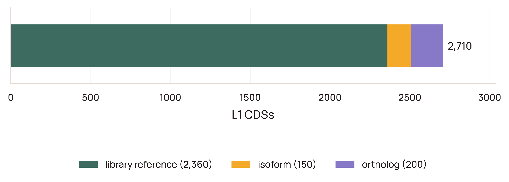

*Figure 1. The 2,710 CDSs by candidate set. A reference is the gene's chosen reference protein;
an isoform is an alternative human protein of the same gene; an ortholog is its mouse or
cynomolgus counterpart. Unit: CDS; values are counts. Drawn by [`brief_numbers.py`](brief_numbers.py)
from the library's tables. How isoforms and orthologs were chosen is in
[section 4](#4-isoforms-and-orthologs).*

**Size.** The 2,360 reference CDSs cover 2,369 genes; [section 3](#3-proteoforms-one-reference-protein-per-gene)
explains the 9 genes without one. CDSs are a median 1,401 nt long (range 186–5,139). With the
153-nt tag cassette, and the Igκ leader where one is used, the coding sequence as ordered is a
median 1,620 nt (396–5,292), and the full insert, which adds a constant 131 nt of cloning
sites, Kozak, barcode and readout sequence, a median 1,751 nt (527–5,423), over the 3,255
ordered constructs ([`l1_insert_lengths.py`](../l1_insert_lengths.py)). Finished vectors are
8,004–12,900 bp, within the packaging limit in [section 8](#8-the-vector-promoter-and-selection-marker).

**Constructs per CDS.** A CDS tagged at its N- or C-terminus is ordered as one construct. A CDS
tagged inside an extracellular loop may be ordered as two or three constructs, one per candidate
site ([section 5](#5-tag-placement)); 373 CDSs are, giving 955 of the 3,255 constructs. All
constructs are pooled together.

**Barcode swapping in the pool.** The two genomes packaged in one lentiviral particle can
recombine: reverse transcriptase switches template between them, and where the two share
identical sequence the switch can place one construct's barcode beside the other's ORF.
[Walton et al. (2024)](https://pubmed.ncbi.nlm.nih.gov/38558968/) fit this as a per-base switch
rate of 5.3 × 10⁻⁴ per bp of shared sequence
([`seqtools.barcode_swap_rate`](../../../../src/deliverome_analysis/seqtools.py)). That fit is a
rate for a particle that carries both constructs. In a pool, a construct's co-packaged partner
is any given other construct with probability equal to that construct's share of the pool
(median 1 in 11,000), so the risk a specific pair poses to the library is the per-pair rate
times that share. Two kinds of shared sequence matter:

- *Sequence shared by specific pairs.* Two constructs of one CDS share the native sequence from
  the later tag site to the barcode (median 363 nt). Co-packaged, they would swap at a median
  16%; in the pool, a median 0.001% of the cells carrying one construct's barcode carry its
  sibling. Summed over every specific pair (siblings, isoforms, orthologs, paralogs), the median
  is 0.06% of a barcode's cells. A swap here gives the right protein tagged at the other site.
- *Sequence shared by every construct.* The 153-nt tag cassette is encoded identically in all
  2,942 N-terminally and internally tagged constructs, and every insert ends in the same short
  tail before the barcode. Because any construct can be the partner, these terms apply to every
  barcode. A switch inside the cassette joins one construct's N-terminal part to another's tag
  and C-terminal part, a fusion protein that is neither parent.

| Outcome | Where the switch lands | Modeled share of integrants |
|---|---|---:|
| another construct's intact protein | the tail every insert shares before the barcode | 1.2% |
| a fusion or truncation | the shared tag cassette | 4.1% |
| either, from a specific partner | native coding sequence or cassette | 0.2% |
| **a protein other than the one the barcode names** | | **5.5%** |

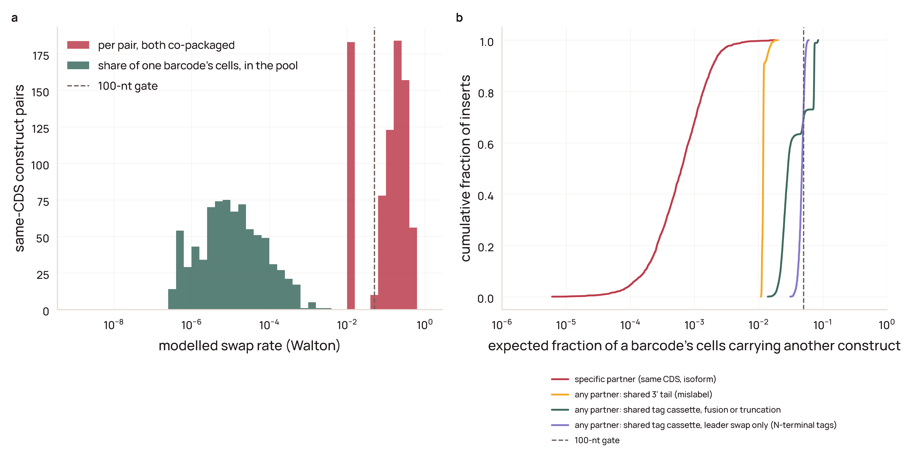

*Figure 2. Barcode swapping modeled with the Walton et al. fit. (a) The 791 pairs of constructs
of one CDS: the swap rate if both share a particle, and the fraction of one construct's cells
carrying its sibling once each pair's chance of sharing a particle in the pool is included.
Unit: construct pair; n = 791. (b) For each of the 3,255 constructs, the expected fraction of
cells carrying its barcode that carry another construct, by source. Unit: construct; cumulative
distribution. Dashed line: the rate at the 100-nt gate. Every particle is assumed to carry two
different constructs, an upper bound for a pooled transfection. Drawn by
[`l1_swap_pool_model.py`](../l1_swap_pool_model.py).*

These are upper bounds from a model, not measurements: they assume every particle carries two
different constructs, and that a 153-nt block recombines at the per-base rate measured over
kilobases of constant vector. Sequencing ORF and barcode together from transduced cells would
measure them. The per-pair rate is still the right test for whether two constructs could be
confused, which is why the library keeps a 100-nt limit on sequence shared before the barcode
([section 7](#7-domestication-linker-encoding-and-synthesis-compliance)). The cassette term is
the largest, and whether to recode the cassette before ordering is one of the decisions in
[section 12](#12-decisions-we-would-like-reviewers-to-weigh-in-on).

## 2. Genes: from the surfaceome universe to 2,369

Genes come from the accessible-surfaceome catalog, release 1.3.0
([Carlson & Smallegan, 2026](https://doi.org/10.5281/zenodo.23445521); CC0, also in the reviewer
bundle at `s3/external/accessible-surfaceome/release-1.3.0/`), which records for each gene the
evidence that it reaches the cell surface, its membrane architecture and its predicted topology.
A gene enters the library if it passes every gate of the filter in
[`final_library.py`](../../../sprint1/s1e3-surface-library-filters/final_library.py), applied in
the order below. Each gate's genes, with the value it tested, are listed in
[`gate_lists/`](gate_lists/README.md).

| Gate | Rule | Why | Genes excluded |
|---|---|---|---:|
| Surface evidence | in the catalog's canonical or likely surface tier | the catalog's curated call that the protein reaches the surface | [2,297](gate_lists/01_surface_evidence.tsv) |
| Accessibility | not called inaccessible from outside the cell | the tag must be reachable by an antibody | [0](gate_lists/02_accessibility.tsv) |
| Surface fraction | mostly at the surface, or mixed | a protein mostly held inside the cell gives little surface signal | [362](gate_lists/03_surface_fraction.tsv) |
| Anchored | at least one transmembrane helix, or GPI-anchored | an unanchored protein is secreted, not displayed | [141](gate_lists/04_anchored.tsv) |
| Co-receptor | no obligate partner, or every obligate partner has a median ≥ 5 TPM across the 1,206 Human Protein Atlas (HPA) v23 cell lines ([Jin et al., 2023](https://pubmed.ncbi.nlm.nih.gov/37669926/)) | a protein that needs a partner the host cell lacks would fail for reasons unrelated to itself | [160](gate_lists/05_coreceptor.tsv) |
| Expression | not flagged as low-expressed, or ≥ 5 TPM somewhere in GTEx v10 tissues ([GTEx Consortium, 2020](https://pubmed.ncbi.nlm.nih.gov/32913098/)), HPA v23 tissues ([Uhlén et al., 2015](https://pubmed.ncbi.nlm.nih.gov/25613900/)) or cell lines, or TCGA tumors ([Vivian et al., 2017](https://pubmed.ncbi.nlm.nih.gov/28398314/)) | a protein expressed in no tissue, tumor or cell line has no cell a binder could be used on | [81](gate_lists/06_expression.tsv) |
| Localization | the catalog's surface call does not rest on the protein being secreted, intracellular, inner-leaflet anchored, presented only as an MHC peptide, or displayed only as part of a complex (a complex member with its own transmembrane helix whose partners pass the co-receptor rule is kept) | in each of these cases the protein's own sequence is not displayed on the outer surface | [7](gate_lists/07_localization.tsv) |
| ORF size | canonical ORF ≤ 5,000 nt | lentiviral packaging (below); genes over it are excluded from L1 | [100](gate_lists/08_orf_size.tsv) |
| Ectodomain | ≥ 30 extracellular residues (GPI-anchored proteins exempt) | below that there is no domain to display | [50](gate_lists/09_ectodomain.tsv) |

Genes that pass every gate make up the core of [2,134](gate_lists/10_tier_core.tsv). Three
further groups enter by their own rule, because each has direct evidence of surface expression
that the gates miss:

| Tier | Rule | Genes |
|---|---|---:|
| Little-studied UniProt surface proteins | UniProt places the protein at the cell surface, fewer than 100 papers describe it, the catalog does not already call it canonical, and it is membrane-anchored, reaches 5 TPM somewhere and has an ORF ≤ 5,000 nt. The catalog's surface call rests on literature, so for little-studied proteins UniProt's annotation stands in | [139](gate_lists/11_tier_low_literature_uniprot.tsv) |
| GPCRs with measured surface display | GPCRs the gates exclude whose anti-HA surface staining is ≥ 1,000 a.u. in a pooled HEK293T screen of the human GPCRome ([Tedman et al., 2026](https://pubmed.ncbi.nlm.nih.gov/42736269/)) | [85](gate_lists/12_tier_screen_validated_gpcr.tsv) |
| Surface pool on overexpression | proteins the catalog calls mostly intracellular that have a functional plasma-membrane pool when overexpressed (the DLL3, GLUT4 and FcRn pattern); only the surface-fraction gate excludes them | [12](gate_lists/13_tier_overexpression_surface.tsv) |

**The ORF cap.** The vector carries 4,115 bp between the LTRs besides the insert, so a 5,000-nt
ORF packages at about 9.4 kb once the tag cassette, cloning sites and barcode region are added,
the upper end of what L1 orders (the longest packaged genome is 9,387 nt). Lentiviral titer falls
3–4-fold per extra kilobase and packaging fails near 10 kb
([Sweeney & Vink, 2021](https://pubmed.ncbi.nlm.nih.gov/34095341/)). The cap keeps 100 genes out
of L1 (canonical proteins of 1,682 to 14,507 residues); a separate library, L2, holds truncation
constructs for 23 of them. The cap is tested on the catalog's canonical sequence, so one built CDS
exceeds it: NRXN2's catalog record is the 666-residue β form, while the reference built is the
1,712-residue α form, a 5,139-nt ORF ([`orf_size_cap.py`](../orf_size_cap.py),
[`orf_size_cap_genes.tsv`](../orf_size_cap_genes.tsv)).

The filter passes 2,370 genes. One, EPPIN, is then removed
([`gene_list_exclusions.tsv`](../gene_list_exclusions.tsv)): it entered only because the catalog
calls it GPI-anchored, but UniProt carries no GPI annotation, NetGPI calls all five human forms
unanchored, DeepTMHMM finds no helix, and EPPIN reaches the sperm surface through its partners in
the eppin complex. That leaves **2,369 genes**. The gene list is fixed: a later catalog release
changes it only through a dated, recorded addition or removal.

### How each gate is decided

Every gate reads fields of the gene's catalog record; the filter runs no predictors. Each is
evaluated on the gene's UniProt canonical sequence (UniProtKB 2026_03;
[UniProt Consortium, 2025](https://pubmed.ncbi.nlm.nih.gov/39552041/)), not on the protein the
library builds, which for a minority of genes is a different form ([section 3](#3-proteoforms-one-reference-protein-per-gene)).
[`GATE_METHODS.md`](../GATE_METHODS.md) gives each gate's field or predictor, version, threshold
and data location, and [`gene_gate_outcomes.tsv`](../gene_gate_outcomes.tsv) records, for each of
the 5,332 catalog genes, the gate that excluded it or the tier it entered by. Gates stop at a
gene's first failure, so a gene excluded early is recorded as not reached, rather than failed, by
the later gates.

**Anchoring.** A transmembrane helix is DeepTMHMM's call on the canonical sequence. A GPI anchor
is the catalog's curated architecture call, not a predictor score. The GPI prediction used to
place tags ([section 5](#5-tag-placement)) is a separate attribute.

**Co-receptor.** Which genes need a partner, and which partner, come from the catalog record.
Our reviewed corrections sit on top and are applied first:

| Correction | Scope | Effect | File |
|---|---|---|---|
| Reviewed partner rules | 6 genes: ATP1B3, CDC50A, P2RX6, HFE, ATP8B1, CDC50B | replace the catalog's partner list with the partners actually required | [`coreceptor_rules.py`](../../../sprint1/s1e3-surface-library-filters/coreceptor_rules.py) |
| Reviewed calls | 146 genes; 26 shown to reach the surface without a heterologous partner | those 26 pass the gate; all 26 are in the library (among them ITGB1, ITGAV, ITGB3, ATP1A1, CD74) | `coreceptor_calls.tsv` |
| Partner names resolved | 143 genes | free-text partners (e.g. "ATP4B-like beta subunit") mapped to gene symbols so their expression can be looked up | `coreceptor_rationales.json` |

Both files are in the reviewer bundle, as the gene filter read them, under
`s3/processed/sprint4/s4e9-orf-design-fg-panel/library-design/pipeline-inputs/2026-11-02/s1e3/`.
A partner that still cannot be matched to an expression value is left out of the test rather than
counted against the gene. The cell-line median is computed per gene from HPA v23's
`rna_celline.tsv` (20,162 genes × 1,206 lines), because HPA's own per-gene summary gives only a
maximum, and a maximum says a gene is expressed in some line, not that a typical host expresses it.

**Expression data.** Both expression gates read tables compiled from public releases:

| Table | What it holds | Built from | In the reviewer bundle |
|---|---|---|---|
| `genomewide_expression_tpm.csv` | per-gene maximum TPM in each source, for genes reaching 10 TPM somewhere | GTEx v10 gene medians, HPA v23 tissue and cell-line TPM, TCGA tumors from the UCSC Xena TOIL recompute, HGNC symbols | `s3/external/expression-tpm/deliverome-internal-5a1416ea/` |
| `genomewide_expression_tpm_rederived.csv` | the same maxima without the 10-TPM floor, so genes between 5 and 10 TPM keep their value | the same releases, rebuilt by [`build_expression_reference.py`](../../../sprint1/s1e3-surface-library-filters/pipeline/build_expression_reference.py) | `s3/external/expression-tpm/rederived-2026-08-04/` |
| `hpa_celline_per_gene.csv` | per-gene median TPM across the 1,206 HPA cell lines | HPA v23 `rna_celline.tsv` | as above |

Each file's SHA-256 is in [`bundle_manifest.tsv`](bundle_manifest.tsv). The cell-line medians
equal those recomputed from HPA v23's `rna_celline.tsv` for every gene; that file is pinned in the
bundle at `s3/external/hpa/v23/rna_celline.tsv.zip`.

**Tier rules.** "Membrane-anchored" in the little-studied UniProt tier is the anchoring test
above. That tier applies only the conditions in its row, so a gene it admits can have an
ectodomain below the 30-residue minimum.

### Testing the gates against published surface proteomics

A survey of published cell-surface proteomics selects proteins by how often studies detect them,
independently of this filter, so it checks the gates from outside. It is browsable per protein in
the [surface-proteomics viewer](https://dev.surfaceome.deliverome.org/surface-proteomics/). The
survey sorts publications into three kinds and counts, per protein, how many of each detect it:

| Kind | Method | Publications |
|---|---|---:|
| surface | labeling of intact cells (biotinylation or glycan capture) | 84 |
| membrane | membrane fractionation of lysed cells | 77 |
| global | whole-lysate glycoproteomes | 18 |

A protein enters the challenge set when it passes two tests:

1. **Recurrence.** At least 20 surface-labeling publications detect it, about a quarter of them,
   so no single study or lab can put a protein in.
2. **Surface specificity.** Surface labeling detects it more consistently than membrane
   fractionation does. The measure is the log-odds
   lod = logit((k<sub>surface</sub> + 0.5)/(N<sub>surface</sub> + 1)) − logit((k<sub>membrane</sub> + 0.5)/(N<sub>membrane</sub> + 1)),
   where k is the number of publications of that kind detecting the protein and N the number of
   publications of that kind (the 0.5 and 1 keep a zero count finite). A protein must have
   lod > 0.5, so its odds of detection by surface labeling are at least 1.65 times its odds by
   fractionation. Fractionation is the background because it captures every membrane, including
   ER, Golgi and mitochondrial membranes; a protein enriched over it is enriched at the intact
   cell surface. TFRC, detected by 81 of 84 surface and 67 of 77 fractionation publications, has
   lod 1.29; calnexin, detected by 60 and 71, has lod −1.49.

394 proteins pass both tests, and **51 are in neither L1 nor L2**. Using the whole-lysate
publications as the background instead would give 1,150 and 843, and it fails in both directions:
the 18 glycoproteomes detect few proteins of any kind, so intracellular proteins such as ACTB and
calnexin pass, while surface glycoproteins they detect well, such as KIT and DPP4, fail.

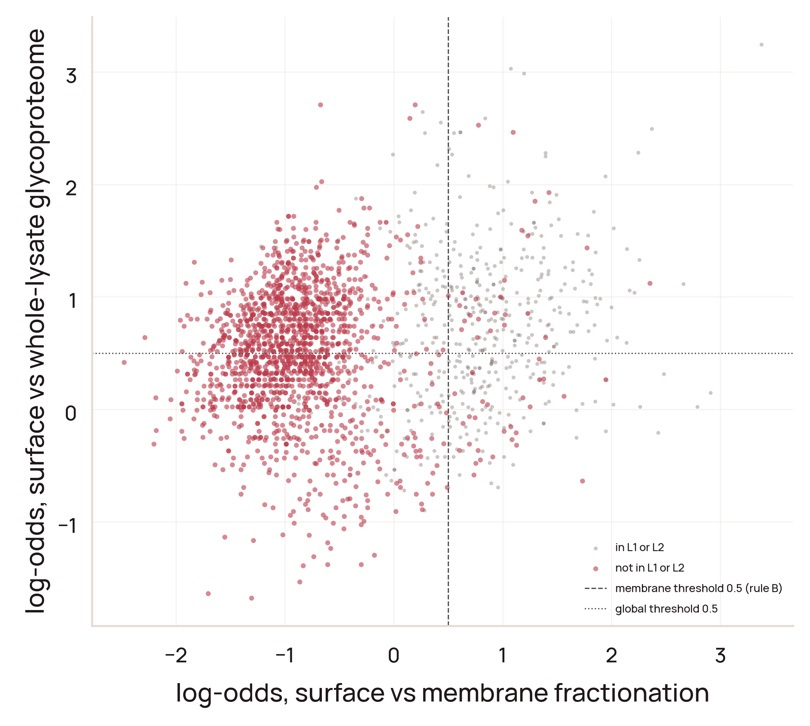

*Figure 3. Each point is a protein detected by at least 20 surface-labeling publications
(n = 2,108). Gray: in L1 or L2; red: in neither. Dashed line: the 0.5 cutoff on the
log-odds against membrane fractionation (394 proteins to its right); dotted line: the same cutoff
against whole-lysate glycoproteomes. Drawn by
[`surface_proteomics_logodds_compare.py`](../surface_proteomics_logodds_compare.py).*

Every one of the 51 fails at least one gate, or has no catalog record. Counted once each, at the
first gate failed: 19 lack surface evidence in the catalog, 16 have ORFs over 5,000 nt, 6 have no
catalog record, 4 have no transmembrane helix or GPI anchor, 3 are mostly intracellular and 3 need
a partner the host may lack (per gene in
[`surface_proteomics_gap_candidates.tsv`](../surface_proteomics_gap_candidates.tsv)). The lists and
the code that builds them are in `scratch/becca/s3e8-library-gap/`, and rerunning that code on the
survey data reproduces them exactly.

**Candidates for addition.** Taking the survey as direct evidence of surface display, 15 of the
51 pass the tests that still apply to a construct: ORF ≤ 5,000 nt, the co-receptor gate, at least
one DeepTMHMM transmembrane helix or a GPI anchor, and an ectodomain of at least 30 residues.
FAM234B, MYORG and TMEM94 pass all but the co-receptor test, which cannot be run without a catalog
record.

| Gene | ORF (nt) | TM helices | Extracellular residues |
|---|---:|---:|---:|
| C1orf159 | 1,143 | 1 | 130 |
| CBARP | 2,118 | 1 | 46 |
| CSF1 | 1,665 | 1 | 464 |
| FAM171B | 2,481 | 1 | 325 |
| FAM234A | 1,659 | 1 | 483 |
| LNPEP | 3,078 | 1 | 894 |
| MFAP3 | 1,089 | 1 | 127 |
| PRRT3 | 2,946 | 7 | 490 |
| RNF149 | 1,203 | 1 | 168 |
| SLC22A23 | 2,061 | 12 | 168 |
| SLC45A4 | 2,307 | 12 | 80 |
| SUSD5 | 1,890 | 1 | 539 |
| SV2A | 2,229 | 12 | 172 |
| TM2D1 | 624 | 2 | 124 |
| TMEM248 | 945 | 2 | 224 |

These are not yet in the library. Each would go through the same design steps as every other
gene, starting with its reference protein ([section 3](#3-proteoforms-one-reference-protein-per-gene)),
so anchoring and ectodomain must be rechecked on the protein actually built. Several, such as
C1orf159 and LNPEP, are called mostly intracellular by the catalog, which predicts weak surface
display even from a correct construct.

### Well-known surface proteins the gates exclude

Absence from the library does not mean a protein is absent from the cell surface. The gate that
most often separates the two is the co-receptor gate, because a subunit that reaches the surface
only inside an obligate complex cannot be displayed by expressing it alone in a cell that lacks
the other subunits. The gate asks whether each partner is ubiquitous; L1 is screened first in K562,
so the sharper question is whether K562 expresses the partner.
[`coreceptor_host_line.py`](../coreceptor_host_line.py) asks both of the 168 genes decided by the
partner rule that pass every other gate; 48 of them are in the library.

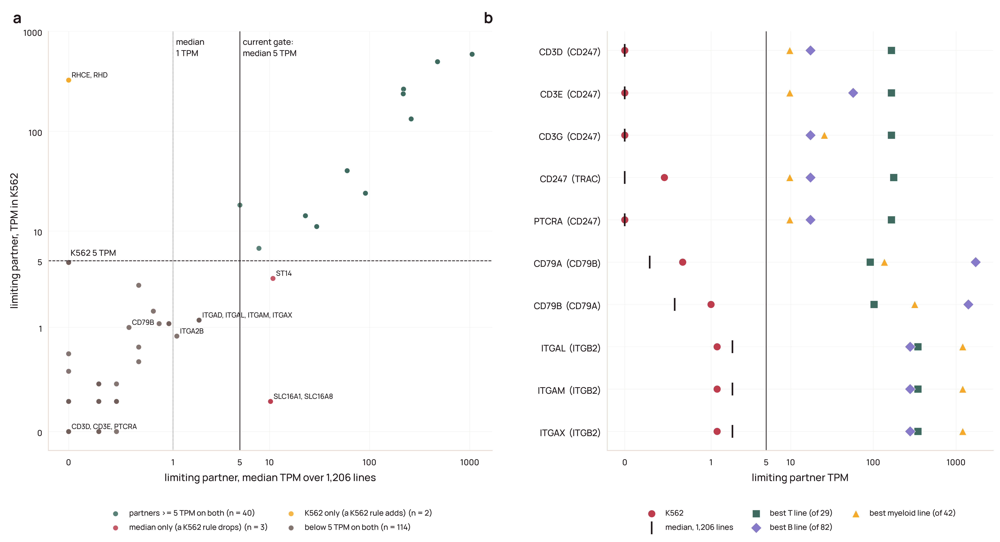

*Figure 4. (a) 159 of the 168 genes, each placed at its limiting partner (the partner with the
lowest value); 5 genes whose only partner is themselves and 4 with no resolvable partner are left
out. Solid line: the current gate; dashed line: 5 TPM in K562; dotted line: a median of 1 TPM.
(b) The antigen-receptor subunits and β2 integrins at their lowest partner for each measure; 29
T-lymphoid, 82 B-lymphoid and 42 myeloid leukemia lines, by HPA's disease subtype. Each value is
one HPA v23 TPM per line. Drawn by [`coreceptor_host_line.py`](../coreceptor_host_line.py).*

| Gene | Obligate partners | Partner TPM in K562 | Why the ORF alone is not displayed |
|---|---|---|---|
| CD3D, CD3E, CD3G, CD247 | the other CD3 chains, and the TCR α and β chains | CD247 0.0, TRAC 0.2, CD3E 0.4 | each chain reaches the surface only in the assembled TCR–CD3 complex |
| CD79A, CD79B | each other, and membrane immunoglobulin | CD79A 1.0, CD79B 0.4, IGHM 1.9 | without CD79A, surface IgM is lost and the receptor's chains stay inside the cell |
| B2M | the MHC class I heavy chains | — | it has no transmembrane helix and reaches the surface only as the class I light chain |

These partners are present in their own lineages: CD247 is at least 5 TPM in 27 of 29 T-cell
lines, and CD79A and CD79B in 74 of 82 B-cell lines. A T- or B-cell host would display these
subunits; K562 would not, at any threshold.

How the rule's threshold and host line change membership:

| Rule | Adds | Drops |
|---|---|---|
| median ≥ 2 instead of 5 | — | — |
| median ≥ 1 | ITGA2B, ITGAD, ITGAL, ITGAM, ITGAX | — |
| every partner ≥ 5 TPM in K562, instead of the median | RHCE, RHD | SLC16A1, SLC16A8, ST14 |
| the median rule, or every partner ≥ 5 TPM in K562 | GRIN1, KCND2, RHCE, RHD | — |

Lowering the median admits only integrin α chains whose β partner is restricted to blood cells:
ITGB2 is at least 5 TPM in 409 of the 1,206 lines (142 of the 203 blood-cancer lines) but 1.2 TPM
in K562. Testing K562 directly admits RHD and RHCE, whose partner RHAG is erythroid (327 TPM in
K562), and GRIN1 and KCND2. Two features of the partner lists limit any such rule. Some lists name
alternatives rather than requirements: SLC16A1 needs BSG or EMB, and K562 has BSG at 498 TPM, but
the gate requires every listed partner. Seven genes are known to need this either/or reading. And
3 of the 620 free-text partner names resolve to the wrong gene, though none changes an outcome.
Per-gene values and each rule's outcome are in
[`coreceptor_host_line_genes.tsv`](../coreceptor_host_line_genes.tsv) and
[`coreceptor_host_line_options.tsv`](../coreceptor_host_line_options.tsv).

### CDSs that need a host accessory factor

Some receptors reach the plasma membrane of a heterologous cell only when an accessory protein from their native cell type is also expressed. The library is screened first in K562. A CDS whose factor K562 lacks will read as failing to display for a reason unrelated to the CDS. The co-receptor gate does not catch these cases: it tests only partners the catalog lists, and the catalog lists an accessory factor for just 2 of the 179 reference olfactory receptors (ORs) in L1 (OR4S2: `RTP1S`, which the gate could not resolve; OR5B21: RTP1 and RTP2, which failed the gate). Both entered through the screen-validated GPCR tier instead.

#### Which families depend on a factor

| Family in L1 | Factor | What the factor does in heterologous cells | Evidence covers |
|---|---|---|---|
| Odorant receptors (OR) | RTP1 or RTP2; REEP1 weaker | RTP1 and RTP2 promote OR cell-surface expression in HEK293T, and REEP1 has a weaker effect ([Saito et al., 2004](https://pubmed.ncbi.nlm.nih.gov/15550249/)). A short RTP1 isoform, RTP1S, gives robust surface expression ([Zhuang & Matsunami, 2007](https://pubmed.ncbi.nlm.nih.gov/17387175/)). The standard OR surface-expression protocol co-expresses RTPs ([Zhuang & Matsunami, 2008](https://pubmed.ncbi.nlm.nih.gov/18772867/)). Some ORs reach the surface without RTPs ([Sharma et al., 2017](https://pubmed.ncbi.nlm.nih.gov/28262096/)) | the family; the need varies by receptor |
| Bitter taste receptors (TAS2R) | RTP3 or RTP4 | TAS2Rs show only marginal surface expression in HEK293T. RTP and REEP co-expression changes the responses of some TAS2Rs and improves surface localization by biotinylation, and TAS2R16 co-immunoprecipitates with RTP3 and RTP4 ([Behrens et al., 2006](https://pubmed.ncbi.nlm.nih.gov/16720576/)) | some receptors; which ones is not established for L1's |
| CHRNA7 | NACHO (TMEM35A) | α7 does not assemble into functional pentamers in cell lines. NACHO promotes α7 folding, Golgi maturation and surface expression ([Gu et al., 2016](https://pubmed.ncbi.nlm.nih.gov/26875622/)) | this receptor |
| GABA-A α subunits (GABRA1, 2, 4, 6) | a β subunit (GABRB1–3) | single subunits are retained in the ER, and α1 reaches the surface only with β2 ([Connolly et al., 1996](https://pubmed.ncbi.nlm.nih.gov/8550630/)) | α1 tested; extended to the other α subunits by family |

Three further families were checked and are **not** counted:

- **Sweet and umami receptors (TAS1R1–3):** REEP2 enhances their responses but does not increase their surface expression ([Ilegems et al., 2010](https://pubmed.ncbi.nlm.nih.gov/20943918/)).
- **Na,K-ATPase α subunits (ATP1A1–4):** they need a β subunit to mature ([Geering, 2008](https://pubmed.ncbi.nlm.nih.gov/18695395/)), but K562 expresses ATP1B3 at 111 TPM.
- **TAARs and the VN1Rs:** no accessory factor turned up in the literature checked.

#### What K562 expresses

Human Protein Atlas (HPA) v23 cell-line TPM. HPA has no HEK293T line, so HEK293 stands in for it. A factor counts as present at ≥ 5 TPM, the co-receptor gate's bar.

| Factor | K562 TPM | HEK293 TPM |
|---|---:|---:|
| RTP1, RTP2, RTP3, RTP4 | 0.0 each | 0.0 each |
| REEP1 | 0.2 | 7.2 |
| REEP2 | 0.4 | 20.3 |
| TMEM35A (NACHO) | 0.0 | 0.2 |
| GABRB1 / GABRB2 / GABRB3 | 0.0 / 0.0 / 0.8 | 0.0 / 0.1 / 2.3 |

#### How many CDSs, and by which route they entered

**213 of the 2,710 active L1 CDSs** (7.9%) depend on a factor that K562 lacks. The table splits them by family and by the route their gene used to enter the library. The routes are the core gates, the low-literature UniProt tier (139 genes, which skips the co-receptor gate) and the screen-validated GPCR tier (anti-HA surface immunostaining ≥ 1,000 a.u. in [Tedman et al., 2026](https://pubmed.ncbi.nlm.nih.gov/42736269/)). Orthologs take the route of their human gene. The rightmost three columns place each CDS's gene against the 1,000 a.u. bar in that screen:

| Family | CDSs | Core | Low-literature tier | Screen-validated tier | Screen ≥ 1,000 a.u. | Screen < 1,000 a.u. | Not in screen |
|---|---:|---:|---:|---:|---:|---:|---:|
| OR (179 reference, 7 ortholog) | 186 | 55 | 55 | 76 | 83 | 100 | 3 |
| TAS2R | 22 | 21 | 1 | 0 | 2 | 19 | 1 |
| GABRA | 4 | 4 | 0 | 0 | — | — | 4 |
| CHRNA7 | 1 | 1 | 0 | 0 | — | — | 1 |
| **Total** | **213** | **81** | **56** | **76** | **85** | **119** | **9** |

**What the GPCR screen already measured.** Tedman et al. expressed each GPCR with an N-terminal HA tag from a single landing-pad locus in pooled HEK293T. Beyond the Bxb1 recombinase used for integration, they co-expressed no RTP, REEP or other accessory factor. They report that most taste, vomeronasal and olfactory receptors show minimal surface staining, and attribute this to HEK293T lacking the OR trafficking machinery. HEK293 also has no RTP1–4 transcript, so the screen tests these receptors under the same factor-free condition K562 would give.

The screen measured 204 of the 213. The other nine are the GABRA subunits and CHRNA7, which are not GPCRs, plus OR51C1 (reference and ortholog), OR8G3 and TAS2R45.

85 of the 204 measured CDSs reach 1,000 a.u. That bar sits at the median of class A GPCRs in the screen (1,125 a.u.; 54% of class A receptors reach it). Only 21% of ORs reach it (median 823 a.u.) and 7% of taste receptors (median 439 a.u.). The 85 break down as follows:

- the 76 screen-validated ORs, which entered the library because of this measurement;
- seven core ORs: OR1D2, OR1E1, OR1E2, OR2H1, OR51B5, OR51E1 and OR52B6;
- two core TAS2Rs: TAS2R9 and TAS2R10.

For 150 of the 213, the screen's ORF is the same Ensembl transcript as the L1 CDS. For the remainder, the screen tested a different transcript (or, for orthologs, the human receptor), so its value is a proxy.

On this evidence, **128 CDSs are expected to fail to display in K562 for want of a factor**: the 119 below 1,000 a.u. and the 9 unmeasured. The 85 that display in factor-free HEK293T are expected to display in K562 as well, if the two hosts behave alike. Whether they do is untested.

**Also flagged, not counted:** 10 CDSs are heteromer subunits whose obligate partner the catalog does not list, so the co-receptor gate never tested it: CHRNA4, CHRNA6 (reference and ortholog), CHRNB3, GABRE, GABRP, GRIK4, SCNN1A (reference and isoform) and SCNN1D. Each named partner is ≤ 0.8 TPM in K562. The literature for these subunits has not been checked.

#### Options

| Option | What it takes | Consequences |
|---|---|---|
| **1. Express the factors in the K562 host.** Make a stable K562 line expressing RTP1S and RTP2, with REEP1 optional, before transducing the library. Alternatively, co-transduce the factors. | Build and validate a new host line, for example by checking surface display of a few RTP-dependent ORs against parental K562. Covering TAS2Rs would add RTP3/RTP4, CHRNA7 would add NACHO, and the GABRA subunits would need a β subunit. | Addresses the largest group (186 ORs) on the evidence of [Saito et al., 2004](https://pubmed.ncbi.nlm.nih.gov/15550249/) and [Zhuang & Matsunami, 2007](https://pubmed.ncbi.nlm.nih.gov/17387175/), both in HEK293T rather than K562. Changes the host for all 2,710 CDSs, so the effect of the factors on non-OR CDSs becomes a new unknown that needs a parental-K562 comparison. Co-transduction instead of a stable line adds cell-to-cell variation in factor dose. Does not reach the GABRA subunits or CHRNA7 unless their partners are added too. |
| **2. Screen these CDSs in a separate sub-pool or host.** Pool the factor-dependent CDSs on their own and screen them in a factor-expressing line, either engineered K562 or HEK293T with RTP1S. | A second transduction and sort arm. The library, constructs and order stay as they are, and splitting happens at pooling. | The main K562 screen keeps one host and an interpretable denominator. The sub-pool's readout is in a different host or background, so its display calls do not compare directly with the main screen's. Costs one extra screen arm. |
| **3. Analyze separately and keep them out of the "fails to display" denominator.** Keep all 213 in the K562 pool, flag them, and report their display apart from the rest. | No wet-lab change, only a flag column in the analysis. | No cost now. The 128 predicted to fail add almost no information on display competence while occupying ~4.7% of the library. The 85 that displayed in factor-free HEK293T test whether K562 matches HEK293T for these receptors. Leaves open whether a non-displaying OR is unable to display or is only waiting for RTPs. |

Option 3 can be combined with 1 or 2. Under that combination, the 213 are analyzed apart in the first K562 screen and then rescreened in a factor-expressing host.

#### Provenance

| Item | Location |
|---|---|
| Analysis code | [`accessory_factor_dependence.py`](../accessory_factor_dependence.py) |
| Per-CDS table | [`accessory_factor_dependence.tsv`](../accessory_factor_dependence.tsv) |
| Factor TPM | [`accessory_factor_dependence_factors.tsv`](../accessory_factor_dependence_factors.tsv) (HPA v23 `rna_celline.tsv`, in the bundle at `s3/external/hpa/v23/`) |
| GPCR screen | Tedman et al. supplementary data, in the bundle at `s3/external/tedman-gpcr-surface-screen/2025-09-19/` |
| Entry routes | [`gate_lists/`](gate_lists/README.md) tables 10–13 |
| Gene identity | joined on Ensembl gene ID from `gene_resolver` (MyGene). Where MyGene also returns alternate-haplotype loci, the primary-assembly ID that HPA measures is kept |

## 3. Proteoforms: one reference protein per gene

Each gene is built as one reference protein, chosen by
[`select_reference.py`](../../../../scratch/becca/appris-principal/select_reference.py). The
library needs a coding sequence to synthesize, so the reference must come from an annotated
transcript; UniProt's canonical entry is a protein chosen for annotation (often the longest or
best-studied form) and does not say which transcript is expressed. Two transcript-level
annotations are designed for this: MANE Select, a single representative transcript per gene
agreed between NCBI and Ensembl ([Morales et al., 2022](https://pubmed.ncbi.nlm.nih.gov/35388217/)),
and the APPRIS principal isoform, chosen from structural, functional and conservation evidence
([Rodriguez et al., 2022](https://pubmed.ncbi.nlm.nih.gov/34755885/)). Both are taken from
Ensembl 115 ([Dyer et al., 2025](https://pubmed.ncbi.nlm.nih.gov/39656687/); APPRIS release
e115v50). The two are compared on the protein they encode, not the transcript ID, because
several transcripts often encode one protein. Where both exist they agree on 2,172 of 2,283
genes; they disagree on 111 (4.9%).

| Step | Rule | Genes |
|---|---|---:|
| 1 | MANE Select and the APPRIS principal encode the same protein: take it | 2,172 |
| 2 | only one of the two exists: take it | 77 |
| 2 | neither exists: take the UniProt canonical protein | 9 |
| 3 | they encode different proteins: look for observed evidence at the residues that distinguish them, and take the form with strong evidence; otherwise take MANE | 111 |

Strong evidence is at least 3 peptides unique to one form in PeptideAtlas human build 607
([Desiere et al., 2006](https://pubmed.ncbi.nlm.nih.gov/16381952/)), on residues that distinguish
the two forms, the best seen in at least 10 samples, and none for the other form. Translation
evidence from GENCODE Ribo-seq ORFs ([Mudge et al., 2022](https://pubmed.ncbi.nlm.nih.gov/35831657/);
phase 1 on GENCODE v35, phase 2 on v45) is recorded but does not decide. Of the 111 disagreements,
9 have strong evidence for MANE and none for APPRIS, so all 111 take MANE. We default to MANE
because 74 of the 111 carry APPRIS's lowest-confidence principal label, so preferring APPRIS would
side with it exactly where it is least sure. The 20 genes with weak evidence for either form are
flagged for review. The PeptideAtlas query responses and the six Ribo-seq
ORF files are pinned in the reviewer bundle as the bytes the selection read
(`s3/external/peptideatlas/build-607/` and `s3/external/gencode-riboseq-orfs/fetched-2026-11-01/`),
each with its SHA-256 in [`bundle_manifest.tsv`](bundle_manifest.tsv).

Eighteen genes take a named exception, because the form the rules pick would not be displayed as
intended:

| Genes | Why the rules' pick is not built | Built instead |
|---|---|---|
| ACHE, BCAN, CD55, CD58, NCAM1, TFPI | the pick has no GPI anchor (NetGPI) | the anchored form: a non-canonical isoform for ACHE (P22303-2), BCAN (Q96GW7-2), CD58 (P19256-2), NCAM1 (P13591-3) and TFPI (P10646-2), and the canonical P08174 for CD55, where APPRIS had picked a transcript encoding secreted DAF |
| MICA | the pick lacks the transmembrane helix | the anchored form |
| KIR2DS4, OR12D1, OR5AL1 | the pick is the disrupted copy on the primary assembly (below) | an intact copy on an alternative or patch scaffold (OR11H7 reaches its patch copy without an exception, through the protein match) |
| CD200R1L, LRRC37B, CACHD1, ADGRF3, RGMB, LMLN | the pick starts after the gene's signal peptide, so it would not enter the secretory pathway | the form with the signal peptide |
| DISP2, TSPAN10 | the pick is an APPRIS-only model that truncates the protein (DISP2 leaves 217 canonical residues unaligned; TSPAN10 keeps 3 of 4 transmembrane helices) | the UniProt canonical protein |

A pick that topology calls signal-peptide-only or globular is also rejected, unless it is
GPI-anchored. Anchoring is called per form, not per gene, so a non-canonical form is never assumed to be
unanchored. NetGPI 1.1 scores each form of a GPI gene separately, and 101 of the 157 GPI
genes carry two or more anchored forms. For 10 genes NetGPI finds the anchor only on a form
other than the first-choice reference; the six above are the ones where that changes the
built protein. In the isoform cohort, an alternative form of a GPI gene enters only if it
keeps the anchor (NetGPI's call on that form, or, where NetGPI has none, retention of the
reference's C-terminal anchor region), so the GPI isoforms drawn are anchored forms.

Across the 2,369 genes the reference comes from **MANE for 2,274, APPRIS for 66, UniProt
canonical for 11, and a named exception for 18**. For 206 genes the reference is not the UniProt
canonical sequence, so a record fetched by UniProt accession can describe a different protein;
every downstream record is therefore matched to the built protein by sequence
([section 5](#5-tag-placement)). For 44 genes the UniProt canonical protein is not the
translation of any Ensembl 115 transcript, so there would be no native CDS to build it from.

| Reference against UniProt canonical | Genes |
|---|---:|
| genes with a UniProt canonical sequence | 2,362 |
| reference identical to it | 2,156 |
| reference differs | 206 |
| — MANE and APPRIS agree with each other on the different protein | 121 |
| — canonical longer than the reference | 128 |
| — canonical shorter | 63 |
| — same length, residues differ | 15 |

Data: [`reference_vs_uniprot_summary.json`](../reference_vs_uniprot_summary.json), from
[`reference_vs_uniprot.py`](../reference_vs_uniprot.py).


*Figure 5. How each of the 2,369 genes got its reference protein: one bar per step outcome,
colored by the source finally taken. The 18 named exceptions are too few to see at this scale.
Unit: gene; values are counts, log scale. Drawn by [`brief_numbers.py`](brief_numbers.py).*

### Genes without a buildable reference copy

The 2,369 genes have 2,360 reference CDSs. The 9 genes without one of their own fall into two
groups, and 4 further genes are built from a copy outside the primary assembly. Every gate reads
the catalog record and its UniProt protein, which describe the intact protein, and no gate asks
whether the reference genome carries a working allele; that is how these genes entered.
Per gene: [`genes_without_reference_cds.tsv`](../genes_without_reference_cds.tsv), from
[`genes_without_reference_cds.py`](../genes_without_reference_cds.py).

**Protein already built under a paralog (4).** Each has a reference and a CDS, but its protein is
identical, residue for residue, to a paralog's, so it is built once:

| Gene | Entered by | Built as |
|---|---|---|
| OPN1MW2, OPN1MW3 | core gates (copies in the X-linked opsin array) | OPN1MW |
| OR2A42 | little-studied UniProt tier | OR2A1 |
| UPK3BL2 | little-studied UniProt tier | UPK3BL1 |

**No intact copy anywhere in Ensembl 115 (5).** The GRCh38 primary assembly carries an
inactivating allele, Ensembl annotates the transcript `protein_coding_LoF`, there is no MANE
transcript, and APPRIS's principal is that defective transcript. A CDS is accepted only if it
translates to the intact protein, so none is built.

| Gene | Entered by | Defect in every Ensembl 115 copy |
|---|---|---|
| FCGR2C | core gates | stop at codon 57 |
| OR8J2 | little-studied UniProt tier | stop at codon 64, on the primary and two patch copies |
| OR10AC1 | little-studied UniProt tier | frameshift: 97 of 325 residues align |
| OR52P1 | little-studied UniProt tier | frameshift: 191 of 321 residues align |
| OR4Q2 | GPCR screen tier (1,116 a.u.) | frameshift on the primary copy; the patch copy is 1 residue short of UniProt |

**Built from an intact copy on another scaffold (4).** GRCh38 represents most loci by one
haplotype and adds alternative haplotypes and patches where that haplotype is unrepresentative.
At these four loci the primary haplotype carries the inactivating allele and another scaffold
carries a copy identical to UniProt, which is built:

| Gene | Entered by | Primary-assembly copy | Built from |
|---|---|---|---|
| KIR2DS4 | core gates | frameshift | alternative KIR haplotype |
| OR12D1 | little-studied UniProt tier | frameshift, 8 internal stops | alternative MHC haplotype |
| OR5AL1 | GPCR screen tier (1,114 a.u.) | frameshift, 10 internal stops | patch scaffold |
| OR11H7 | core gates | stop at codon 227 | patch scaffold |

Eight of the 13 are olfactory receptors, and the catalog's own text calls 6 of them pseudogenes or
segregating pseudogenes, but that text is not a gate. The two from the GPCR screen displayed at
the surface there, which shows that the intact protein can reach the surface, not that the
reference genome expresses it. How common the intact allele is in people is not tested.

**What is checked for every CDS.** [`check_library_transcripts.py`](../check_library_transcripts.py)
asks the same questions of all 2,710 CDSs from the pinned files:

| Check | Result |
|---|---|
| whole codons, a terminal stop, no internal stop | all 2,710 |
| translation equals the designed protein | all 2,710 |
| CDS equals its pinned Ensembl transcript base for base | 2,699; the other 11 differ only by a recorded edit (3 start codons replaced, 5 upstream trims, 3 stops added) |
| source transcript is `protein_coding` | 2,706; CD300H and OR8G3 come from transcripts labeled loss-of-function, and CD58's GPI form and one TRPV1 isoform from transcripts labeled for nonsense-mediated decay, all four translating without a stop |
| human CDS identical to a reviewed UniProt protein | 2,384 of 2,510 |
| human CDS built from a copy off the primary assembly | 14: the 4 above, 9 genes absent from the primary assembly (KIR2DL2, KIR2DL5A, KIR2DS2, KIR2DS5, KIR3DS1, OR8U8, OR8U9, OR9G9, TAS2R45) and MICA |

## 4. Isoforms and orthologs

Both panels are seeded draws stratified by membrane-architecture class, because a uniform
draw follows the library's composition and returns very few of the rare architectures whose
tag placement is least certain. A gene's class is read from its reference protein's DeepTMHMM
v1 topology, and every isoform takes its gene's class, not one computed on its own sequence:

| Class | Rule, applied in this order |
|---|---|
| GPI | the gene is in the GPI set, whatever its helix count |
| multipass | two or more TM helices |
| type I | one TM helix, a signal peptide, N-terminus extracellular |
| type II | one TM helix, no signal peptide, N-terminus cytoplasmic |
| type III | one TM helix, no signal peptide, N-terminus extracellular |

Type III follows UniProt's "single-pass type III" (a signal anchor that places the
N-terminus outside), so it is single-pass by definition; some textbooks use "type III" for
multipass proteins, which is not the sense here. Two further outcomes of the rule are empty in
L1: one helix in any other combination, and no helix without GPI. Seven library genes have no
topology in the inputs the sampler read and are unclassified (KIR2DS4, KIR3DL3, LYNX1,
OR12D1, OR5AL1, SLC67A1, TMC4).

| Class | Library genes | Cohort forms | Gate-passing forms | Panel forms | Uniform expectation | Panel / uniform |
|---|---:|---:|---:|---:|---:|---:|
| type I | 834 | 899 | 381 | 61 | 71.9 | 0.85 |
| type II | 126 | 108 | 49 | 17 | 8.7 | 1.95 |
| type III | 33 | 24 | 11 | 5 | 2.1 | 2.43 |
| GPI | 146 | 82 | 42 | 16 | 7.4 | 2.15 |
| multipass | 1,223 | 778 | 316 | 51 | 59.9 | 0.85 |

The uniform expectation is what 100 forms drawn at random from the observed tier plus 50 from
the prediction-only tier would give, using the cohort's class shares in each tier; computed
over the gate-passing forms instead, the ratios are 0.85, 1.83, 2.42, 2.03 and 0.86. The
draw roughly doubles type II, type III and GPI and gives up about 15% of type I and
multipass. Type III remains the thinnest stratum (5 forms from 4 genes), because the cohort
holds only 24 type III forms.

Two splits are not strata today. Multipass genes divide into 667 with an extracellular
N-terminus (GPCRs among them) and 553 with a cytoplasmic one, which decides whether a
residue-1 tag can sit outside the cell; the panel's 49 multipass genes are 18 and 31. Only
one type II gene has a C-terminal tail of 30 residues or fewer after its helix, the shape of
a tail-anchored protein, so that split would be empty in practice.

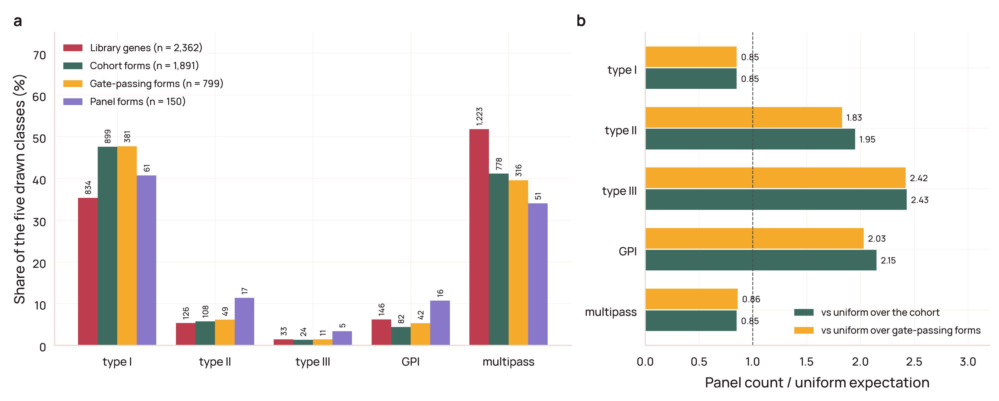

*Figure 6. (a) Share of the five drawn classes among library genes (n = 2,362 classified), isoform-cohort
forms (n = 1,891), forms passing the isoform gate of record (n = 799) and panel forms (n = 150);
bar labels are counts. (b) Panel count divided by the count a uniform draw would give, over
the cohort and over the gate-passing forms; the dashed line marks 1. One value per class; no
error bars, since the panel is a single seeded draw. Regenerated by
[`isoform_architecture_classes.py`](../isoform_architecture_classes.py) from the pinned panel
inputs.*

| Panel | CDSs | Draw | Composition |
|---|---:|---|---|
| Isoforms | 150 (133 genes) | seed 20261009; 100 with observed evidence (mass spectrometry or Ribo-seq) + 50 prediction-only (TRIFID above 0.5, no observed evidence) | type I 61, multipass 51, type II 17, GPI 16, type III 5 |
| Orthologs | 200 | 100 mouse (seed 20261011) + 100 cyno (seed 20261012), each split 50/50 into "near" and "diverged" bands at a fixed sequence-correspondence score to the human library protein (0.8644 mouse, 0.9595 cyno) | multipass 81, type I 54, GPI 28, type II 28, type III 9 |

In both panels a drawn form the library cannot use is replaced by continuing the same seeded
draw within its own stratum, so every valid pick keeps its place and the panel regenerates from
code.

**An ortholog is built only beside a built human CDS of its gene**, and never in place of one.
An ortholog asks whether the human design transfers across species,
which has no answer without the human CDS; where the human CDS is held, its orthologs are
held with it. `l1_completeness.py` fails if a mouse or cyno CDS is built while no human
CDS of its gene is.

**Isoform forms pass a gate before the draw** (
[`gate_isoform_cohort.py`](../gate_isoform_cohort.py) → `isoform_gate.tsv`). A form is drawable
only if it starts at a native ATG supported by an exact Ensembl 115 CDS, and keeps its gene
reference's signal peptide, N-terminal orientation and first transmembrane helix, all judged by
DeepTMHMM v1 on the form's own sequence. Every cohort form now has a DeepTMHMM v1 prediction on its own sequence: the 955 proteins that
lacked one were predicted for this review and added to the topology snapshot as a new, separately
versioned set of rows. With them, 1,685 of the 1,894 cohort forms pass (640 of 795 observed,
1,045 of 1,099 prediction-only). Of the 931 forms that previously failed only for want of a
prediction, 883 pass and 48 fail on a defect. The 209 failures are all defects: the form
loses the reference's signal peptide (66), lacks the sequence of the reference's first TM
helix (52), has no Ensembl 115 transcript encoding it exactly (43), does not start with Met
(23), turns the N-terminus to the other side of the membrane (16), has its first TM helix no
longer called membrane (5), or has a CDS record that does not translate to it (4). The new
predictions agree residue for residue with an earlier v1 run on the 863 proteins the two runs
share.

The panel of record was drawn against the earlier gate, under which 931 forms were
unverifiable. None of its 150 picks changes on that account: the 20 picks the earlier gate
replaced fail the complete gate on a defect as well. What changes is the pool its
replacements are drawn from, which grows from 802 to 1,685 forms and from 550 to 865 genes
with a drawable form; how that moves the panel is in the next paragraph.

A pick that fails the gate, duplicates another CDS's
protein or is encoded by no transcript is replaced by continuing the seeded draw: 32 of the
150 picks were replaced this way (`isoform_panel_replacements.tsv`). There is no length floor:
a 50% floor was considered and rejected because it would also remove isoforms kept on evidence.

**The isoform universe spans the library.** It is built by enumerating every UniProt and
Ensembl 115 protein of each gene on the library list, so it is not limited to the April 2026
`surfaceome_expressed` query set. That set (1,775 of the 2,369 library genes) bounded the
original ortholog pool, not the isoform universe: the isoform cohort holds 333 forms of 183
genes outside it, and 26 of the panel's 133 genes are outside it. The one library gene the
universe lacked is SLC67A1 (formerly SLC22A18), added to the library after the
universe was built. The April files did feed one decision: the cohort's membrane tests read
DeepTMHMM labels looked up by UniProt accession, and compared each form with the universe's
first-choice reference rather than with the protein the library builds.

A fresh rebuild removes both dependencies. It reruns the universe, mass-spectrometry,
translation and APPRIS evidence steps with their original code and pinned releases (UniProt
2026-10-11, Ensembl 115, APPRIS e115v50, PeptideAtlas build 607, OpenProt 2.2) over the
current 2,369 library genes, and judges every form that clears the evidence bar by DeepTMHMM
v1 on its own sequence against the gene's built reference protein. 2,111 forms of 1,010 genes
clear the evidence bar; 1,899 forms of 946 genes remain after the membrane tests, which
exclude 184 forms that lose the reference's membrane anchoring and 27 forms of GPI genes that
do not keep the anchor. The rebuilt cohort contains all 1,894 forms of the cohort of record
plus 5 new ones (three NCAM1 forms, which become alternative forms once NCAM-120 is the built
reference, and two SLC67A1 forms). 13 forms in it are identical to their gene's built
reference protein and are refused at the draw, as the sampler refuses reference forms. 1,690
of the 1,899 pass the isoform gate, and 866 genes have a drawable form.

Within the cohort every library gene is accounted for: all 451 library genes with a
non-canonical UniProt isoform but no form in the cohort of record have scored rows, and the
cohort's own rules exclude each one (`audit_isoform_coverage.py`, which fails on an
unexplained absence). For 399 of those genes every alternative form is below the evidence bar,
which requires a diagnostic peptide, a positive OpenProt translation score or a TRIFID score
above 0.5; the other 52 include forms excluded for lost surface anchoring. Lack of evidence is
not evidence that an isoform is absent.

**A proposed redraw, not adopted.** The existing sampler, run unchanged (seed 20261009, the
same strata and class floors, the same rejection list) on the rebuilt cohort and its gate,
keeps 118 of the 150 picks of record and changes 32
(`isoform_panel_proposed_changes.tsv`). 30 of the 32 are slots the panel of record filled by
replacement: the replacement draw continues the seeded sequence over every passing candidate
in its stratum, so a pool grown from 802 to 1,690 passing forms fills those slots with
different forms. The other 2 (CACNA2D3, PRSS8) are original GPI picks that move because the
three NCAM1 forms join the GPI strata. Class composition is unchanged (type I 61, multipass
51, type II 17, GPI 16, type III 5); the panel spans 137 genes instead of 133. Adopting it
needs a decision, then: pin the new topology snapshot and the rebuilt cohort as panel
inputs; rerun the panel reconciliation, which assigns design ids to the 32 new picks,
replaces any pick with no encoding transcript or a protein duplicating another member, and
withdraws the 32 forms leaving the panel; then tag placement, fold and refold checks,
barcodes and a new order for the changed constructs. Drawing only on the complete gate,
without the rebuilt cohort, gives a similar result (120 of 150 kept).

**Orthologs are drawn from every library gene, and admitted only with a supported coding
sequence.** The pool is the Ensembl Compara 116 one-to-one, high-confidence mouse and cyno
orthologs of all 2,369 library genes (3,643 sampleable gene–species representatives). A form is
eligible only if its coding sequence has a native ATG start, supported start and stop
coordinates, a terminal stop and no internal stop, and translates exactly to the selected
protein; no start or stop is repaired, with four recorded exceptions: the cyno CHRM3, CCR5,
OR3A2 and NIPAL4 models start 27–214 codons upstream of the Met aligned to human Met1 and are
the only cyno models of those genes, so each is restarted at that native Met (5′ trim, no codon
edited; `ortholog_start_trims.tsv`, the decision log). Among a gene's eligible mouse forms the APPRIS principal
(APPRIS 2026_08.v50 for Ensembl 116) ranks first; cyno has no APPRIS dataset, so no form is
preferred on that ground. Every one of the 200 CDSs matches its pinned Ensembl source file,
the four restarts as a 5′ suffix of it
([`ORTHOLOG_CDS_POLICY.md`](../ORTHOLOG_CDS_POLICY.md)).

Coding completeness is not domain equivalence, so each drawn form is compared with the human
library protein for signal peptide, TM helices, N-terminal orientation, GPI anchor and Pfam 39.0
domains ([`ORTHOLOG_CORRESPONDENCE_REVIEW.md`](../ORTHOLOG_CORRESPONDENCE_REVIEW.md)). A form
that loses a human feature across an insertion or deletion is replaced by the next
architecture-conserving form in the same seeded draw and stratum. Eleven are replaced this way;
for example, cyno SLC8A1 loses TM6–10 and its C-terminal exchanger domain, cyno IL31RA its signal
peptide and N-terminal 142 residues, and cyno MS4A10 its TM1, which flips its orientation. Six
forms are kept as drawn because the comparison does not show a lost feature:

| Form | Comparison | Why it is kept |
|---|---|---|
| cyno MARCO; mouse TMIGD1, IGSF1, TMPRSS7 | a human Pfam domain is not detected | the aligned span carries no insertion or deletion, so the miss is more likely detection than loss |
| mouse OR10G6 | lacks the human protein's first 21 residues | DeepTMHMM calls those residues a signal peptide; all 7 helices are kept |
| mouse CACHD1 | the mouse form has a signal peptide | the human library form is the one without it, so another mouse form would not match better |

The adopted panel and each form's source are in
[`ortholog_panel_adopted.tsv`](../ortholog_panel_adopted.tsv), built by
[`adopt_ortholog_cds_policy.py`](../adopt_ortholog_cds_policy.py), which `library_pipeline.py`
replays from the pinned draw.

Barcode-swap screening ([section 7](#7-domestication-linker-encoding-and-synthesis-compliance)) does not apply between a gene's CDSs: an isoform
shares its parent's sequence by construction (median overlap 1,071 nt over 2,150 pairs, none
under 100 nt), so a swap-tract bar would remove the panels entirely.

**Identical proteins.** Four genes encode exactly the same protein as a paralog: OPN1MW2 and
OPN1MW3 (as OPN1MW), OR2A42 (as OR2A1) and UPK3BL2 (as UPK3BL1). One CDS is built per protein,
under the first symbol.

## 5. Tag placement

### Placements

Each CDS gets one placement, from the DeepTMHMM topology of its own designed protein, matched by
sequence rather than accession: an isoform can gain or lose helices, so the gene's canonical
topology says nothing certain about the built form. The first placement that applies is taken:

| Placement | Rule | Rests on | CDSs |
|---|---|---|---:|
| N after SP | the residue after the signal peptide is extracellular | predicted cleavage site | 1,285 |
| N at residue 1, multipass | N-terminus extracellular, no signal peptide, >1 TM | a cleavable Igκ leader ahead of the tag on 564 of 565 | 565 |
| N at residue 1, single-pass (type III) | same, 1 TM | topogenesis argument; untested | 44 |
| C-terminal | C-terminus extracellular | topology only | 208 |
| internal | neither terminus extracellular, or GPI-anchored with an ecto-C call | needs a loop or ectodomain site | 608 |

**Why a leader at residue 1.** A protein with an extracellular N-terminus and no signal peptide
relies on its first transmembrane helix to carry the N-terminus across the membrane. A 51-residue
cassette ahead of that helix may stop it doing so, so the multipass CDSs carry the murine Igκ
leader ahead of the cassette; the leader is cleaved in the ER and leaves the tag at the mature
N-terminus. A cleavable signal peptide helps some GPCRs move their N-terminus across the ER
membrane ([Guan et al., 1992](https://pubmed.ncbi.nlm.nih.gov/1331042/);
[Andersson et al., 2003](https://pubmed.ncbi.nlm.nih.gov/12920192/)), but none of that work used
a 51-residue tag: the GPCR surface screen that
supports the GPCRs' display used leaderless tags, and the L1 constructs that test the leader
have no data yet. The one multipass CDS without the leader is CRHR2, whose N-terminal pseudo
signal peptide is uncleaved ([Rutz et al., 2006](https://pubmed.ncbi.nlm.nih.gov/16766521/)), so
behind a leader it would become an untested internal hydrophobic segment; the GPCR screen
displayed it leader-free at 2,385 a.u. Type III CDSs carry the tag alone except where a specific
risk was found ([`TYPE3_NTERM.md`](../TYPE3_NTERM.md)).

**GPI-anchored proteins are tagged at the N-terminus.** A GPI anchor replaces the C-terminus at
the ω-site, so a C-terminal tag would be cleaved off; a tag right after the signal peptide is the
standard for GPI proteins and is used for 186 of the 191 CDSs of GPI-anchored genes. The 5
exceptions are tagged internally. BST2 is a type II protein with a C-terminal GPI anchor, so its N-terminus is
cytoplasmic, and its extracellular C-terminal call is overridden by the ω-site. EFNA1, LYPD6,
MDGA2 and PRND failed the refold check with an N-terminal tag while an internal loop site passed.

A short list of placement overrides, each with its evidence, is in `lane_overrides.tsv`: MFSD2A
(both CDSs) and AQP12B move to internal; GLP2R moves to N after SP, with an Igκ leader replacing
its predicted signal peptide (residues 1–66); SLC68A1 moves to C-terminal. Shedding risk is
recorded but never moves a placement, because none of the CDSs at proteolytic risk has a usable
loop to move to.

A site is written as `insert_after_residue` *n*, 1-based on the designed protein: the cassette
goes after codon *n*.

**The cassette is the full 51 aa at every placement, including right after Met1.** Without its
leading `GGGGS`, SpyTag003's hydrophobic `VPHIVMV` sits directly behind Met-Arg, the shape of a
signal peptide. DeepTMHMM called a cleavable signal peptide inside SpyTag003 on 12 of the 62
type III CDSs tested with a trimmed cassette, which would remove the SpyTag003 epitope and leave
ALFA. The calls fall as the spacer after Met1 grows: none 12, S 7, G 7, GS 3, GG 2, GGS 0, the
full `GGGGS` 0 ([`TYPE3_NTERM.md`](../TYPE3_NTERM.md); raw calls in the bundle at
`s3/processed/sprint4/s4e9-orf-design-fg-panel/type3-nterm/type3_spacer_test.v1.3line`). These
are topology-predictor calls, not SignalP, so they mark a risk rather than show a cleavage.


*Figure 7. Tag placement for every CDS, by candidate set. Unit: CDS; n = 2,710; values are
counts. Topology: DeepTMHMM, matched on the built protein. Drawn by
[`brief_numbers.py`](brief_numbers.py) from `l1_tag_paths.tsv`.*

**Internal placement.** By the run between two transmembrane helices, the median internal CDS
has 51 extracellular residues to work with and 33 have no such run of at least 8. By any
extracellular run, only 7 CDSs of five genes have nothing of 8 residues: TMEM139 ×2, TMEM169,
TMEM268, TMEM86A and TMEM86B ×2. Five of those are tagged in a shorter loop that passes the
membrane-side and refold checks, one TMEM139 CDS is a [snorkel](#appendix-terms), and TMEM169 is
held ("Snorkels", below). BST2 reports no inter-helix run only because it has a single helix and
a 137-residue ectodomain.

### Topology

DeepTMHMM v1 (1.0.24) is the topology of record, chosen over v2 because v1 recalls 99.5% of
signal peptides against v2's 92.9%; v2 is kept alongside and not substituted. A v1 row is
selected by its tool-version stamp, not by the presence of a per-residue string, because v2
rows carry a v1-alphabet back-projection that differs from genuine v1 output. Every active
CDS has a v1 row for its exact sequence: 2,173 from the human canonical cohort, 210 from
human isoforms, 197 from the ortholog cohorts, and 130 run on the designed ORFs themselves.

**How often the topology call disagrees with experiment.** Script and per-CDS table:
[`topology_vs_experiment.py`](../topology_vs_experiment.py),
[`topology_vs_experiment.tsv`](../topology_vs_experiment.tsv). The UniProt 2026_04 topology
features and TOPDB v3.3 it reads are pinned on S3 at dated keys, listed with their SHA-256 in
[`topology_vs_experiment_inputs.json`](../topology_vs_experiment_inputs.json); they are not yet in
the reviewer bundle.

Every L1 member's tag placement comes from the DeepTMHMM v1 topology of its own designed protein. Each placement puts the cassette on a segment v1 calls extracellular: the first mature residue (N after SP), residue 1 (N at residue 1, multipass or single-pass type III), the last residue (C-terminal), or a chosen loop (internal, one to three loop arms per member). This section measures, per placement, how often experiment puts that segment on the other side of the membrane.

#### What counts as experimental evidence

| Source | What is used | What is not used |
|---|---|---|
| UniProtKB/Swiss-Prot, release 2026_04, human and mouse entries with topology features | `TOPO_DOM`, `TRANSMEM` and `INTRAMEM` features carrying ECO:0000269 (experimental, usually a PubMed citation) or ECO:0007744 (structure-derived, usually a PDB citation) | Features resting only on ECO:0000305 (curator inference), ECO:0000250 (by similarity) or ECO:0000255 (sequence analysis) |
| TOPDB v3.3, which includes the PDBTM structure-derived sides | Per-region experimental constraints: structures, N-glycosylation, reporter fusions, chemical labeling, epitope insertion, proteolysis | TOPDB's own topology line (a constrained prediction); "Other" entries (annotated motifs); structures of soluble fragments with no membrane-embedded segment, whose side TOPDB labels anyway (the VEGFR1 kinase domain is labeled extracellular) |

Evidence is matched to a member by protein sequence, never by accession. An identical sequence is an exact match (827 of the 1,083 members with a call). Otherwise the member is aligned to the same gene's human or mouse entry (identity at least 60%), and a call is kept only if no helix is gained or lost upstream of the site, since that would flip everything downstream.

A site is called from the experimental regions that overlap its own membrane-free segment. Each independent item (one PDB entry, one paper) gets one vote, and a side needs two-thirds of the votes. Partial annotation is common: an entry often supports some segments experimentally and gives the rest by similarity. A site on an unsupported segment is recorded as having no call; sides are never carried across helices from a supported segment elsewhere. Segments with experimental regions on both sides are recorded as conflicts.

A site that experiment places inside a helix is discordant in its own right. Where it lies within 3 residues of the helix end and the rest of the loop is experimentally outside, it is recorded as concordant, flagged "helix end", because the cassette sits at the junction of the loop that is being tested.

#### Concordance per placement

| Placement | Members | With an experimental call | Concordant | Discordant | Discordant, % (95% CI) | Wrong side | Site inside a helix |
|---|---:|---:|---:|---:|---:|---:|---:|
| N after SP | 1,285 | 536 | 533 | 3 | 0.6 (0.2–1.6) | 2 | 1 |
| N at residue 1, multipass | 565 | 205 | 205 | 0 | 0.0 (0.0–1.8) | 0 | 0 |
| N at residue 1, single-pass (type III) | 44 | 10 | 9 | 1 | 10 (1.8–40) | 1 | 0 |
| C-terminal | 208 | 77 | 77 | 0 | 0.0 (0.0–4.8) | 0 | 0 |
| Internal | 608 | 255 | 251 | 4 | 1.6 (0.6–4.0) | 0 | 4 |
| All | 2,710 | 1,083 | 1,075 | 8 | 0.7 (0.4–1.5) | 3 | 5 |

An internal member counts as discordant if any of its loop arms is. Per arm, 427 of 1,027 internal arms have a call: 423 concordant (12 of them at a helix end), 4 inside a helix, none on the wrong side; 3 further arms have conflicting evidence. Of the 608 internal members, 50 have no loop site to test (29 snorkel-only, 5 held, 20 with no internal arm in the construct table).

The rest of each v1 call agrees with experiment as closely. Among members whose N-terminus has an experimental side, v1 puts it on the other side for 7 of 971; for the C-terminus, 13 of 651. Four of those members (both MFSD2A members, SLC41A2, SLC68A1) already carry a placement override, and experiment agrees with the override in every case. The other nine C-terminal disagreements are all N-after-SP members. Two are CATSPERH and PDCD1LG2, listed below. In the other seven (ADGRB3, BMPR2, IL6ST, LYVE1, MET, PLXNC1, PTPRC), a cytoplasmic tail is assigned outside by a single N-glycosylation site from a high-throughput glycoproteomics study. These do not affect the N-terminal tag. They show how unreliable a call from a single evidence item can be.

#### What the measurement means for each placement

| Placement | What it shows | Limit |
|---|---|---|
| N after SP | The v1 side of the mature N-terminus is wrong for about 1 in 200 members with evidence. The real failure mode here is a "signal peptide" that is an uncleaved anchor (CATSPERH), not an inverted protein. | Evidence covers 42% of members; most is glycosylation and structure of well-studied receptors. |
| N at residue 1, multipass | No disagreements in 205; the upper bound is below 2%. | GPCRs dominate both the members and the evidence. |
| N at residue 1, type III | One disagreement in 10, resting on a single micelle NMR structure whose side TOPDB assigns by similarity. | Ten members is too few to estimate a rate; the interval spans 2–40%. |
| C-terminal | No disagreements in 77; upper bound about 5%. | Only 77 of 208 members have a call. |
| Internal | No loop arm is on the wrong side. The disagreements are boundary disagreements: four arms sit 4–10 residues inside a helix that structures place in the membrane, though the loop they border is outside. | Arms are chosen on loops; the evidence tests side, not whether the cassette folds into the loop. |

These rates are measured on the 40% of members that have experimental topology, which are the well-studied proteins that topology predictors are trained and benchmarked on. They are therefore likely optimistic for the remaining 60%. The spot-check inversions that prompted this measurement (MFSD2A, SLC68A1, AQP12B, SLC41A2, VTCN1, TRPV1) are all members whose placement is already set by a placement override. Where experiment covers them, it agrees with the override, so they do not appear as discordances against the current placement.

#### Discordant members and recommended actions

These are recommendations, not applied. No library table, construct or order has been changed.

| Gene | Design id | Placement | DeepTMHMM v1 says | Experiment says | Evidence | Recommendation |
|---|---|---|---|---|---|---|
| CATSPERH | l1-p0239 | N after SP | Residues 1–22 are a cleaved signal peptide; tag after residue 22 is extracellular; C-terminus inside | Residues 17–38 are TM helix 1 with the N-terminus cytoplasmic; the tag site (residue 23) sits 6 residues inside that helix; C-terminus extracellular | Mouse CatSper cryo-EM, mapped to the human member at 74% identity ([Lin et al., 2021](https://pubmed.ncbi.nlm.nih.gov/34225353/)) | Review. If the human protein shares the mouse topology, move to C-terminal. CATSPERH is already held, so nothing is ordered with the current site. |
| KCNE2 | l1-p1001 | N at residue 1, type III | N-terminus outside | N-terminus inside | One solution NMR structure in micelles (PDB 2m0q); TOPDB assigns its sides by similarity | Keep. The evidence is a single structure with an inferred side. |
| PDCD1LG2 | l1-p1633 | N after SP | Mature N-terminus outside | Inside | One structure (PDB 8j3v) | Keep. PD-L2's N-terminal domain is its extracellular receptor-binding domain; a single structure's side assignment does not outweigh that. |
| SEL1L2 | l1-p1779 | N after SP | Mature N-terminus outside (lumenal) | Inside | One ubiquitination site from a mass-spectrometry survey of MCF-7 cells ([Denis et al., 2007](https://pubmed.ncbi.nlm.nih.gov/17370265/)) | Keep. One proteomics PTM site does not establish the side of a 640-residue domain. |
| ABCC4 | l1-p0010 | Internal (loop arm after residue 751) | Loop outside | Site 4 residues inside an experimental helix; rest of the loop outside | 8 cryo-EM entries via UniProt | Review the arm position. Shift the cassette a few residues into the loop. |
| SLC12A5 | l1-p1835 | Internal (loop_2 arm after residue 219) | Loop outside | Site 8 residues inside an experimental helix; rest of the loop outside | KCC2 cryo-EM ([Chi et al., 2021](https://pubmed.ncbi.nlm.nih.gov/33199848/)), mapped | Review the arm position. The best arm is not tested. |
| SLC12A6 | l1-p1836 | Internal (loop_best arm after residue 306) | Loop outside | Site 10 residues inside an experimental helix; rest of the loop outside | KCC3 cryo-EM ([Chi et al., 2021](https://pubmed.ncbi.nlm.nih.gov/33199848/)) | Review the arm position. Move the cassette into the loop proper. |
| XPR1 | l1-p2354 | Internal (loop_best arm after residue 436) | Loop outside | Site 6 residues inside an experimental helix; rest of the loop outside | 21 cryo-EM entries via UniProt | Review the arm position. Its loop_3 arm (after 503) is at the helix end and concordant. |

Flagged but concordant (keep): 12 loop arms sit 0–3 residues inside an experimental helix end of an extracellular loop (BEST1, CALHM4, GJB1, GJC3 ×2, GJD4, KCNQ1, SLC2A7, XPR1, CD9, SLC15A2 ×2). Three arms have structures split between the loop and the helix (ATP1A3 loop_2, GJB1 loop_best, PANX3 loop_3). CRHR2 (N at residue 1, multipass) carries a UniProt signal-peptide annotation at residues 1–19, but [Rutz et al., 2006](https://pubmed.ncbi.nlm.nih.gov/16766521/) show that segment is not cleaved, which is why it is built without the Igκ leader.

Methods: [`topology_vs_experiment.py`](../topology_vs_experiment.py). Per-CDS, per-site and summary tables are `topology_vs_experiment.tsv`, `topology_vs_experiment_sites.tsv` and `topology_vs_experiment_summary.tsv` beside it; the evidence snapshots it reads are recorded with their S3 keys in `topology_vs_experiment_inputs.json`.

### GPI anchors

GPI anchoring is called per protein form, not per gene, because the anchored form is not always
the reference (ACHE's canonical form is not anchored; isoform P22303-2 is). The GPI set combines
NetGPI 1.1 ([Gíslason et al., 2021](https://doi.org/10.1016/j.crbiot.2021.01.001)), run on every
reference and alternative form, with the catalog's GPI curation:

| Basis | Genes | In the GPI set |
|---|---:|---|
| NetGPI calls a form anchored | 138 | yes |
| curated GPI; NetGPI's negative call is low-confidence | 15 | yes |
| curated GPI; NetGPI confidently calls it unanchored (CFC1, CRIPTO, GML, RAET1G) | 4 | yes, curation kept |
| NetGPI calls every form unanchored and curation does not list it | 2 | no |

That gives 157 GPI genes with 191 L1 CDSs. By topology 190 would be tagged after the signal
peptide and 1 (BST2) at the C-terminus; the placements in "Placements" above move BST2 and four
others to internal sites. The set is in [`gpi_set.tsv`](../gpi_set.tsv); NetGPI's raw output is
committed with the proteoform-selection code.

### Structure models

Choosing an internal site reads per-residue confidence, solvent accessibility and secondary
structure from a structure model, and the tag checks fold each construct. A model fetched from
AlphaFold DB ([Varadi et al., 2024](https://pubmed.ncbi.nlm.nih.gov/37933859/); model_v6) by
accession can be of a different form than the one built, so each was compared residue for residue
with the CDS's designed protein:

| Verdict | CDSs | Meaning |
|---|---:|---|
| identical | 2,391 | the model is of exactly this protein |
| contained | 27 | the built protein is a subsequence of the modeled one |
| different | 189 | the model is another form; its numbering cannot be carried onto the construct |

Most of the 189 are references whose built form is not the UniProt canonical (section 3), and a
length test would miss them: 19 are the same length as their model. These counts cover the 2,607
CDSs with an AlphaFold DB model. Because of this, site choice and every tag check use models of
the built sequence itself: every ordered construct is folded as its own tagged protein with
ColabFold 1.6.2 ([Mirdita et al., 2022](https://pubmed.ncbi.nlm.nih.gov/35637307/); AlphaFold2
weights, [Jumper et al., 2021](https://pubmed.ncbi.nlm.nih.gov/34265844/)), including the 189 and
the 61 ortholog CDSs with no AlphaFold DB model.

### The literature sites behind the internal-site ranker

A CDS that needs an internal tag gets its residue from a site ranker. The ranker is trained on
internal tag insertions from published papers, collected by a literature-retrieval agent: 176
sites on 127 proteins. Each of the 176 was then read against its cited paper to ask whether the
paper places a tag at that residue, in human canonical numbering:

| Verdict | Sites | Meaning |
|---|---:|---|
| confirmed exact | 125 | the paper places the tag at the cited residue |
| confirmed shifted | 23 | the paper places it at another residue, mostly because it numbers a mouse ortholog (14 of 23); all five ABCB1 sites are +4 |
| region only | 11 | the paper supports the loop or domain, not one residue |
| not supported | 17 | 7 cite a paper that tagged a different gene or showed the site intracellular, 5 are numbered in a species that cannot be mapped to the human residue, 5 are terminal tags filed as internal |

The confirmed sites, one row per protein and residue, form the **gold standard**: 156 sites on
113 proteins, each at the paper's residue. Of the 148 confirmed exact or shifted sites, 142
enter it: five are positions where the paper shows the tagged construct failed (kept as
candidate negatives), and one shifted SDC4 site lands on SDC4's other site. Fourteen sites come
from outside the 176: six from papers the agent had filed under the wrong gene (KCNK3 214 and
five GABA-A subunit sites: GABRA5 35, GABRA6 23, GABRG1 39, GABRG2 43 and GABRG3 21), and eight
from literature rows the agent collected without placing them in the training set (last
paragraph). For 120 of the
156 sites the paper shows surface display, for 4 it shows that the tag does not reach the surface,
and for 75 it shows that the protein still functions. The 22 region-level sites are kept separately as
region labels. The per-site audit with each paper's supporting quote, the gold standard, the
failed and added sites and the region labels are in the reviewer bundle at `s3/processed/scratch/becca/tag-site-corpus-audit/`.

**The models.** Every trained model below is a random forest (800 trees, depth 4). It reads 13
numeric per-residue features and three one-hot categories:

| Feature group | Features | Source |
|---|---|---|
| structure model | pLDDT and relative solvent accessibility, each at the residue and over a 5-residue window | the CDS's AlphaFold model |
| disorder | AlphaFold-derived disorder at the residue and over 5- and 15-residue windows | the same model |
| sequence | Kyte–Doolittle hydropathy and Pro/Gly fraction over 7 residues; Cys count within 10 | sequence |
| N-glycosylation | sequon at the residue, distance to the nearest sequon, sequons within 10 | sequence |
| categories | secondary structure; topology class (type I, II or III single-pass; multipass with both termini inside; other multipass); region class (ordered or disordered) | the model and DeepTMHMM v1 |

Features are z-scored within each protein, so the model ranks residues *within* a protein rather
than across proteins. Scores are averaged over ±2 residues before picking. Each published site is
trained against 200 unlabeled extracellular residues from the same proteins. A further 2,141
**hard negatives** are residues where an insertion is known or expected to do harm: buried core,
disulfide-bonded Cys, N-glycosylated or sequon Asn, junctions that do not tolerate a domain
insertion in published scans, and ligand contacts in deposited structures. They are weighted ×5.
Three variants are compared:

| Model | Positives | Hard negatives |
|---|---|---|
| **L1 site ranker** (v5; the model that placed L1's internal sites) | the 176 sites as the agent collected them | ×5 |
| ranker, hard negatives not up-weighted | the same 176 | ×1 |
| ranker retrained on confirmed sites | the gold standard; residues within 10 of any site the agent cited, and inside region labels, are neither positive nor negative | ×5 |

Four positive-unlabeled (PU) variants are also scored: bagged PU learning
([Mordelet & Vert, 2014](https://doi.org/10.1016/j.patrec.2013.06.010)), 50 forests of the
ranker's estimator, each fitted on the positives against a fresh draw of one unlabeled
extracellular residue per positive, alone or with all 2,141 hard negatives added to every bag as
fixed negatives.

The comparison also covers three published insertion-site predictors, taken as stored with no
training: ProDomino, EpicTope and INDELi-E. Three single features serve as naive baselines:
disorder, solvent accessibility and low pLDDT.

**How performance is measured.** Each model ranks every extracellular residue of a protein. The
median protein has 134 extracellular residues to choose among. Truth is the gold standard: the 149 sites on 108 proteins
whose residue is extracellular in the feature table. Three measures are used:

- **Top pick within 10 residues:** the highest-scoring residue lies within 10 residues of a
  confirmed site. Ten residues is the scale of a loop segment, and the window the ranker's
  training already excludes around each published site.
- **Any of top 3 within 10:** the same test for three picks at least 11 residues apart. Up to
  three constructs are built per internal CDS, so this is the measure that matches the order.
- **Rank of the best confirmed residue:** where the best-scoring confirmed residue falls, as a
  fraction of the protein's extracellular residues.

A trained model scores a protein only from a fit that never saw it. Five-fold cross-validation
holds out whole genes, and is repeated holding out whole HGNC gene groups (all KCNK channels, all
GABA-A subunits and so on in one fold), so that a close paralog in training cannot stand in for
the protein being scored. Intervals are 95% bootstrap intervals over proteins. Comparisons
against the L1 ranker are paired on the proteins both models score, with an exact sign test on
the proteins where only one of the two succeeds.

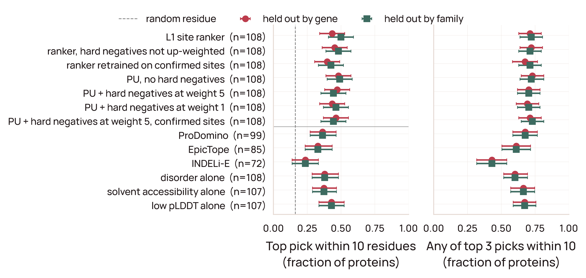

*Figure 8. The fraction of proteins whose top pick (left) or any of whose top three picks (right) lies within 10
residues of a confirmed site. Unit: protein; n per model in the label (a published predictor
scores only the proteins it was run on). Points are means; bars are 95% bootstrap intervals
over proteins. Red circles: genes held out; green squares: HGNC gene groups held out. The two
are identical for the untrained predictors and baselines. The dashed line is a random residue
(0.163). Truth: 149 confirmed sites on 108 proteins. Regenerated by
[`tag_site_model_benchmark.py`](../tag_site_model_benchmark.py).*

| Model | Proteins | Top pick within 10 (gene / family held out) | Any of top 3 within 10 (gene / family) | Mean per-protein AUROC (gene) |
|---|---:|---|---|---:|
| **L1 site ranker** | 108 | **0.435 / 0.500** | **0.713 / 0.722** | 0.750 |
| ranker, hard negatives not up-weighted | 108 | 0.454 / 0.481 | 0.722 / 0.713 | 0.759 |
| ranker retrained on confirmed sites | 108 | 0.398 / 0.426 | 0.676 / 0.713 | 0.757 |
| PU, bagged, no hard negatives | 108 | 0.481 / 0.491 | 0.731 / 0.722 | 0.773 |
| PU + hard negatives ×5 | 108 | 0.472 / 0.444 | 0.704 / 0.704 | 0.744 |
| PU + hard negatives ×1 | 108 | 0.435 / 0.463 | 0.694 / 0.704 | 0.737 |
| PU + hard negatives ×5, retrained on confirmed sites | 108 | 0.463 / 0.444 | 0.713 / 0.731 | 0.756 |
| ProDomino | 99 | 0.364 | 0.677 | 0.771 |
| EpicTope | 85 | 0.329 | 0.612 | 0.741 |
| INDELi-E | 72 | 0.236 | 0.431 | 0.479 |
| low pLDDT alone | 107 | 0.430 | 0.673 | 0.777 |
| solvent accessibility alone | 107 | 0.374 | 0.664 | 0.755 |
| disorder alone | 108 | 0.380 | 0.602 | 0.722 |
| random residue | 108 | 0.163 | — | 0.5 |

What the table supports:

- **The L1 ranker puts one of its three picks within 10 residues of a confirmed site for 71–72%
  of held-out proteins, and its top pick for 44–50%.** A random residue does so for 16%. Holding
  out whole gene groups does not lower any score, so paralogs that straddle a fold do not inflate
  the estimate. The 0.065 gap between the two splits for the same model comes from which proteins
  share a fold. Differences smaller than that are not resolved here.
- **It beats the published predictors on the top pick.** Paired on the same proteins it beats
  EpicTope (0.47 vs 0.33 on 85 proteins; 20 proteins only the ranker gets right, 8 only EpicTope;
  p = 0.04 gene-held-out, p < 0.001 family-held-out) and INDELi-E (0.44 vs 0.24 on 72). Against
  ProDomino it leads (0.46 vs 0.36 on 99; 20 vs 11) at p = 0.15 holding out genes and p = 0.005
  holding out gene groups. On the top three the ranker and ProDomino are within one interval
  (0.72 vs 0.68). INDELi-E's stored scores are saturated on most residues, so its result says
  little about the method.
- **It is not shown to beat low pLDDT alone.** Low pLDDT, a single feature, picks within 10 of a
  confirmed site for 0.43 of proteins against the ranker's 0.44 (12 vs 11 proteins only one gets
  right). On the top three the ranker leads, 0.72 against 0.67 (p = 0.30). The ranker's
  measurable gain over a well-chosen single feature is small.
- **No PU variant is shown to beat the L1 ranker, with or without hard negatives.** Paired on
  the same proteins, every PU variant is within one interval of the ranker on the top pick and
  the top three (sign tests p ≥ 0.07 on both splits). Adding hard negatives to PU lowers its mean
  AUROC (0.773 to 0.744 genes held out, p = 0.06; 0.775 to 0.756 families held out, p = 0.04):
  in each bag the hard negatives outnumber the unlabeled draw about twelve to one, so these
  variants are close to positives against hard negatives. Like the ranker, every PU variant beats
  EpicTope on the top pick, and plain PU beats ProDomino on it (0.505 vs 0.364 on 99 proteins,
  p = 0.016 genes held out); on the top three and on AUROC none is separated from ProDomino.
  These are many uncorrected tests, so a single p-value near 0.05 is weak evidence.
- **Neither label correction nor hard-negative weighting is shown to help.** Retraining on the
  confirmed sites scores no better on those sites (0.398 vs 0.435 top pick; 7 vs 11 proteins only
  one gets right, p = 0.48). Removing the ×5 weight moves 3 to 5 proteins in each direction. The
  corrected labels are the better record. On this evidence they are not a better predictor, and
  the ranker that placed L1's sites is the one trained on the 176 as collected.

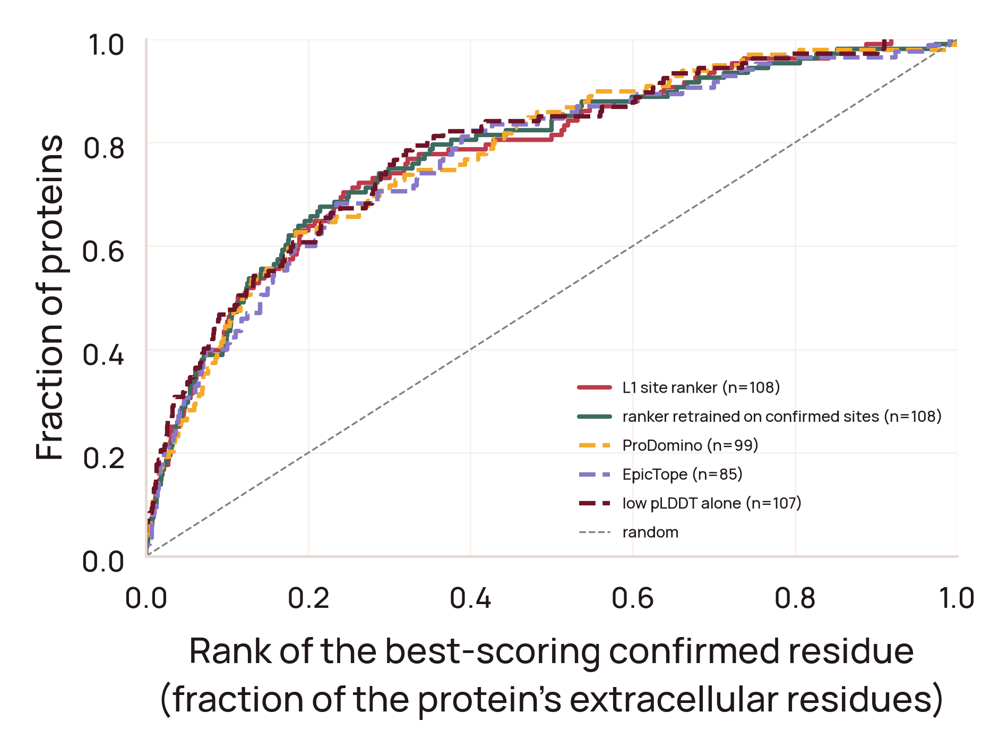

*Figure 9. For each protein, the rank of its best-scoring confirmed residue among its
extracellular residues, as a fraction (0 = the top pick), cumulated over proteins. Unit: protein;
n per model in the legend. HGNC gene groups held out for the trained models. The diagonal is a
random ranking. INDELi-E, disorder alone and solvent accessibility alone are omitted for
legibility; their values are in the table above. Regenerated by
[`tag_site_model_benchmark.py`](../tag_site_model_benchmark.py).*

The curves of the trained models, ProDomino, EpicTope and low pLDDT nearly coincide: for half the
proteins the best confirmed residue ranks in the top 11–14% of extracellular residues under each
of them. The models separate at the very top of the list, which is the part an order uses.

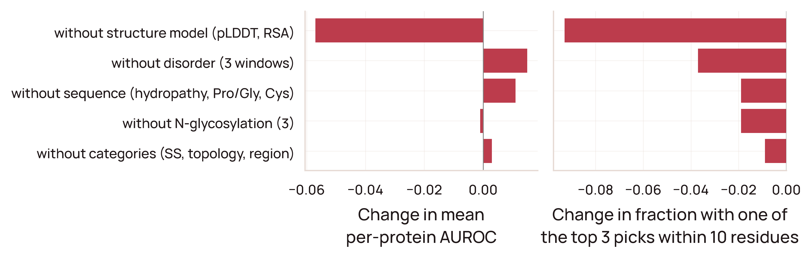

*Figure 10. Change in mean per-protein AUROC (left) and in the fraction of proteins with one of the top three picks
within 10 residues of a confirmed site (right) when one feature group is removed from the L1
ranker and the ranker is refitted, genes held out. Unit: protein, n = 108. One fit per group. With
the full ranker at 0.750 and 0.713, changes under about 0.04 are within fold-to-fold noise.
Regenerated by [`tag_site_model_benchmark.py`](../tag_site_model_benchmark.py).*

The structure-model features (pLDDT and solvent accessibility) carry the ranker. Without them,
AUROC falls from 0.750 to 0.693 and the top-three hit rate from 0.713 to 0.620. Removing any other
group moves either measure by 0.04 or less. This agrees with low pLDDT alone performing close to the full model.

Two limits on these numbers. First, the ranker's features, estimator and hard-negative weight were
chosen by cross-validation on these same proteins, so its scores carry some selection optimism
that the untrained published predictors do not. Second, there is no external test set. The
prospective test is display of the ordered L1 sites in the pooled screen.

**How L1's internal sites were chosen.** For each CDS on the internal placement, the L1 ranker
scores every extracellular junction of the CDS's own structure model. The site is the
highest-ranked junction that passes three checks: (1) the membrane-side gate places it outside
the membrane, (2) no known ligand contact lies within 2 residues of either flanking residue, and
(3) the tagged CDS passes refold. A site that fails moves to the next passing rank. Of the 531
CDSs tagged in a loop, 507 carry the rank-1 site, 23 the rank-2 and 1 the rank-3. The number of
loop constructs per CDS (one to three) comes from the ranker's absolute-scale companion model.
That model is the same random forest on unscaled features, and it scores how a CDS's best region
compares with the regions where a published internal tag works.

The audit also read the 15 literature rows the agent collected outside the 176. Six that carried no residue were pinned
to one from the paper (CFTR 891, NRXN1 371, TRPV1 606, NRG3 275, SLC12A5 248, SLC4A2 862), ABCC1
4 is confirmed, ITGB7 23 shifts to 42, CNR1 25 is unsupported and six stay region only. The public
tag-site table of the accessible-surfaceome database carries these verdicts since 2026-11-05, so
ABCB1's sites, for example, are served at 105, 324, 740, 745 and 965. The eight with a confirmed
residue are in the gold standard and in the retrained model above; none enters the L1 ranker or
any L1 site.

### Which side of the membrane each internal site is on

DeepTMHMM v1 labels each residue inside or outside the cell, and it can be wrong about a whole
loop. Each internal site is therefore also checked against the CDS's own structure model
placed in a membrane. The placement is TMDET's (a published method that fits the membrane
slab to a structure) where TmAlphaFold, TMDET's precomputed set for AlphaFold DB models, holds
the CDS (440 CDSs), and otherwise a fit to the model's own helix axes (139), which lands a
median 7.8° and 2.3 Å from TMDET where both exist. Each tag junction gets a height above the
membrane mid-plane:

| Verdict | Height of the junction | Why that cut-off |
|---|---|---|
| pass | ≥ 14.0 Å | the shallowest published internal tag with surface display shown (CNR1 after residue 179), among 88 such sites in multipass proteins |
| review | 11.7–14.0 Å | within 2.3 Å of the pass line, the helix-axis fit's median error |
| fail, membrane core | −13.0 to 11.7 Å | 13.0 Å is TMDET's median hydrophobic half-thickness |
| fail, cytoplasmic | < −13.0 Å | beyond the hydrophobic core on the inside |

The check was calibrated on an earlier set of internal-site picks: 1,070 sites (1,064 picks of
the internal-site ranker and 6 hand-selected loop constructs). 967 pass and 48 fail: 13 are cytoplasmic (DeepTMHMM v1 merged
two helices and the loop between them, as in the anoctamins, or put a whole short loop on the
wrong side), 30 sit in the membrane core (loops that barely leave the bilayer, such as aquaporin
and Kir pore loops, or junctions at the base of a loop that does reach outside), and 5 sit on a
partner interface. A further 42 are for review, 2 are held for low model confidence and 11
cannot be scored. A failed site is replaced by the next passing candidate, and a CDS left with no
passing loop site is tagged by a snorkel. The site ranker now requires this check's per-residue
mask and stops on a CDS without one. DeepTMHMM remains the topology of record; the check is a
separate layer on top of it ([`membrane-side-gate/`](../membrane-side-gate/README.md)).

### Why each placement puts the tag where it does

Each placement below states its rule, the reason for it, the alternative rejected, the measured
counts and the known weak spots. Every count is computed by [`rung_numbers.py`](rung_numbers.py),
which assigns each decision row to exactly one named rule and stops if a row fits none.

**The refold check, and how far to trust it.** Each tagged construct is folded with ColabFold
([Mirdita et al., 2022](https://pubmed.ncbi.nlm.nih.gov/35637307/)) and compared with a model of
the untagged protein, to ask whether the 51-residue insertion is predicted to disturb the
protein's fold. The comparison uses lDDT, the local distance difference test
([Mariani et al., 2013](https://pubmed.ncbi.nlm.nih.gov/23986568/)): for each residue, the
fraction of its distances to nearby residues (within 15 Å) that are preserved between the two
models, from 0 (nothing preserved) to 1 (identical local geometry). It needs no superposition, so
a tag that swings away from the protein does not by itself lower the score. A construct passes
if the native region keeps its structure (lDDT ≥ 0.85 over confidently modeled native residues),
the residues within 15 of the site keep theirs (lDDT ≥ 0.7), and neither epitope is buried or
packed against the protein. The bars were set so that 17 untagged proteins, refolded with the
same settings, all pass (their native lDDT was 0.897–1.000), so they measure how far the folding
settings alone move a model. Tested against insertions whose outcome is published, the check does
not tell working sites from failing ones (section 6, "How well the refold check predicts
display"), so a pass or a fail below is a weak signal, not a prediction of display.

#### N after the signal peptide (1,285 CDSs on the placement)

The decision table holds 1,310 rows; 1,307 are decided at this placement (1,272 built and 35 with no
N-terminal construct), and 1,285 remain on the placement once 22 CDSs move to an internal site and 1 to the
residue-1 multipass placement.

**Rule.** The cassette goes after the signal peptide's cleavage site and before the folded domain
begins, following the interval rule used for N-terminal tags on signal-peptide GPCRs in the deep
receptor scanning screen ([Tedman et al., 2026](https://pubmed.ncbi.nlm.nih.gov/42736269/);
`nterm/admissible_interval.py`). Three steps decide the site:

1. *Where cleavage happens.* The later of the DeepTMHMM and SignalP 6.0
   ([Teufel et al., 2022](https://pubmed.ncbi.nlm.nih.gov/34980915/)) cleavage calls, because a
   cassette inside the signal peptide would be cleaved off with it.
2. *Where structure begins.* Three per-residue disorder predictions each mark the first run of
   five ordered residues after cleavage: metapredict
   ([Emenecker et al., 2021](https://pubmed.ncbi.nlm.nih.gov/34480923/)), NetSurfP-3.0
   ([Høie et al., 2022](https://pubmed.ncbi.nlm.nih.gov/35648435/)), and AlphaFold's own
   confidence read as disorder (1 − pLDDT/100; low pLDDT marks disordered regions,
   [Tunyasuvunakool et al., 2021](https://pubmed.ncbi.nlm.nih.gov/34293799/); this is plain
   1 − pLDDT, not the published AlphaFold-disorder method, which also uses solvent accessibility).
   The AlphaFold track is read from the AlphaFold DB model of the gene's accession, so for a CDS
   whose protein differs from the modeled one it describes another form; taking the median of the
   three tracks limits the effect. Candidate sites run
   from the residue after cleavage to the median of the three onsets plus 2, and never more than
   20 residues past cleavage.
3. *Whether the tagged protein is still cleaved.* Each candidate is re-predicted with SignalP 6
   on the tagged protein, because the cassette is the one change that can break cleavage. Only
   sites where SignalP still cuts upstream of the cassette survive.

Each CDS reaches one outcome, recorded with the rule that decided it in `nterm/nterm_decisions.tsv`:

| How the CDS was decided | Construct | CDSs |
|---|---|---:|
| a surviving site lies before the predicted fold | own signal peptide | 510 |
| surviving sites lie only inside the fold; the most disordered one is taken | own signal peptide | 314 |
| SignalP moves the cut on the tagged protein, but it stays upstream of the cassette | own signal peptide | 41 |
| ortholog whose SignalP call is accepted from the human protein's run, at a surviving site | own signal peptide | 47 |
| decided in a second SignalP run (below) | own signal peptide | 38 |
| site moved past a UniProt N-terminal propeptide to the mature N-terminus | own signal peptide | 52 |
| the first site failed the refold check; the next surviving site is taken | own signal peptide | 19 |
| every surviving site fails the refold check; built and flagged | own signal peptide | 19 |
| no site survives with the own signal peptide; the Igκ leader replaces it and keeps cleavage | Igκ leader | 105 |
| the own signal peptide is weak (cleavage-site probability below 0.5) | Igκ leader | 49 |
| only DeepTMHMM calls a signal peptide, and a second source (UniProt or DeepTMHMM v2) confirms a cleaved one | Igκ leader | 48 |
| the same, with the second source placing the cleavage elsewhere | Igκ leader | 11 |
| decided in a second SignalP run (below) | Igκ leader | 18 |
| the first Igκ form failed the refold check; the next is taken | Igκ leader | 1 |
| no form passes refold | none (held) | 23 |
| no tagged form, with either signal peptide, keeps a cleavage site | none (held) | 3 |
| the mature N-terminus after a propeptide has no passing form | none (held) | 3 |
| only DeepTMHMM calls a signal peptide and no second source confirms it | none (held) | 5 |
| ortholog whose human protein is not built | none (held) | 1 |
| no form keeps cleavage; moved to an internal site | moved | 2 |
| the segment is a first transmembrane helix, not a signal peptide; moved to residue 1 | moved | 1 |

*A second SignalP run* scored further candidate forms (additional sites, and Igκ forms) for CDSs
that had no passing form after the first run, and for proteins added after it; it is the same
predictor and rule.

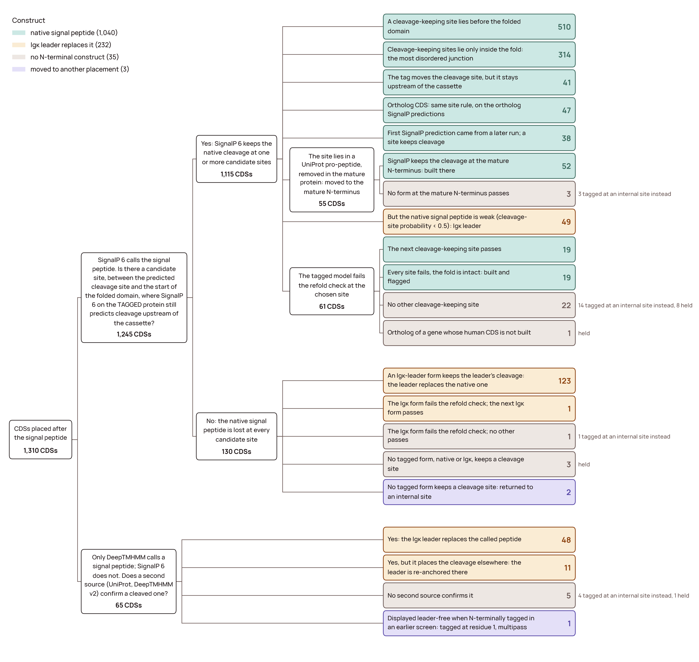

*Figure 11. How each CDS assigned to the after-the-signal-peptide placement reaches its outcome.
Unit: CDS; n = 1,310 decision-table rows (1,307 decided here, 3 moved to another placement). White
boxes are the questions, in the order the decision code applies them, each with the number of
CDSs reaching it. Colored boxes are outcomes by construct: own signal peptide (1,040), Igκ leader
replacing it (232), no N-terminal construct (35; 22 of them tagged at an internal site instead and
13 held) and moved (3). Counts are measured from `nterm/nterm_decisions.tsv`. Drawn by
[`signal_peptide_figures.py`](signal_peptide_figures.py).*

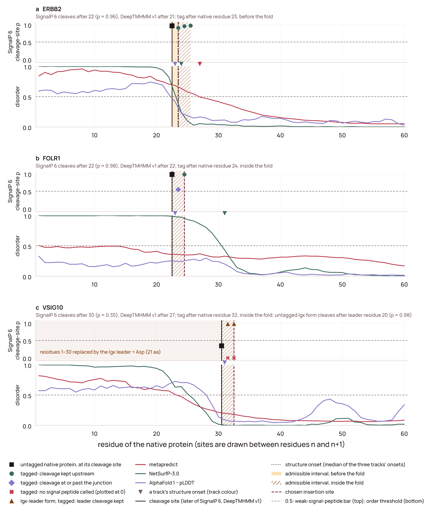

*Figure 12. The rule on three CDSs, over the first 60 residues: ERBB2 (a; own signal peptide, site
before the fold), FOLR1 (b; own signal peptide, the only cleavage-keeping sites inside the fold)
and VSIG10 (c; own signal peptide lost at every site, Igκ leader in its place). Upper track:
SignalP 6 cleavage-site probability, one value per protein (the untagged protein, black square;
the tagged protein at each candidate site, circles where cleavage stays upstream of the cassette,
diamonds where it moves to or past it, crosses where no signal peptide is called); per-residue
SignalP outputs were not saved, so no per-residue curve is shown. Lower track: the three disorder
predictions, with ▼ at each one's structure onset. Solid line: cleavage site; dotted line: median
onset; shading: candidate interval (hatched where it lies inside the fold); red dashed line: the
chosen site. Drawn by [`signal_peptide_figures.py`](signal_peptide_figures.py).*

1,272 are built (1,040 native, 232 Igκ) and 35 have no N-terminal construct: 22 of these are tagged at
an internal ectodomain site instead and 13 are held.

**Why.** The region just after cleavage is extracellular by construction, is usually
disordered, and needs no loop-level structure scoring. Placing the tag before the fold leaves
the folded domain untouched.

**Rejected.** Tagging at residue 1, before the signal peptide (the tag is cleaved off with
it); the cleavage residue itself, so the cassette forms the mature N-terminus (none of Tedman's
signal-peptide constructs does this); trusting the native cleavage call without re-predicting
the tagged protein.

**Weak spots.**

| Weak spot | CDSs | What would settle it |
|---|---:|---|
| The only cleavage-keeping sites lie inside the predicted fold | 513 of 1,272 built | display measured in the pooled screen; each passed refold |
| Refold counted as a pass on a borderline lDDT (within 0.01 of the bar): CIST1, FOLR1, LYVE1, SLITRK2, SMO, SNORC | 6 | the 0.85 bar is an open item (cover note) |
| Cleavage is a SignalP 6 prediction, not a measurement | all | N-terminal sequencing or a shift on a blot for a sample |
| No N-terminal construct | 35 (13 held, 22 tagged at an internal site instead) | a redesign, or an internal site |

#### Signal peptides and the Igκ leader

The murine Igκ leader (`METDTLLLWVLLLWVPGSTG`) plus Asp is the library's one heterologous
signal peptide. It is used in three situations, each decided by named code, and never
otherwise. 804 CDSs carry it. The N-after-SP rules are set out in full, with every
SignalP run, in the companion [N-terminal placement brief](nterm/BRIEF.md) and
[`nterm/BUILD_OPTIONS.md`](nterm/BUILD_OPTIONS.md).

**When only DeepTMHMM v1 calls the signal peptide.** For a CDS whose signal peptide DeepTMHMM
v1 calls and SignalP 6 does not, the Igκ swap needs a second source: a curated UniProt SIGNAL
feature or a DeepTMHMM v2 signal peptide that confirms a cleaved peptide. Without one there is
no N-terminal construct; where the segment is a signal anchor or a first TM helix rather than a
cleaved peptide, the CDS is routed to the placement that segment implies (multipass or
internal). The rule and each CDS's evidence are in the companion N-terminal placement brief,
"CDSs whose signal peptide only DeepTMHMM v1 calls" ([nterm/BRIEF.md](nterm/BRIEF.md)).

**Why the trigger is re-prediction, not native confidence.** For N after SP the Igκ swap is
triggered when no tagged candidate keeps a SignalP 6 cleavage upstream of the cassette, not
when the native signal peptide is weak. Over the 1,101 re-predicted CDSs, 160 have no
candidate that keeps cleavage, and 96 of those have a native cleavage-site probability of 0.9
or more, so a confidence threshold would miss most failures; and 14 of the 32 CDSs below 0.5
keep cleavage at some candidate, so a threshold would replace signal peptides that work
(`nterm/nterm_build_options.json`, `native_cleavage_confidence_vs_outcome`). The same run
compared three site rules: the first mature residue keeps cleavage for 757 CDSs, the most
disordered residue in the first 20 for 758, and the re-prediction-gated choice for 941.

**Weak signal peptides.** A second trigger sits beside the re-prediction. VSIG10 (`l1-p2333`) is the example: SignalP 6 is sure it has a signal peptide
(probability 0.9998) but unsure where it is cleaved (cleavage-site probability 0.35), and it is
built Igκ + tag. A native construct is *weak* when SignalP 6's cleavage-site probability is below 0.5
on the native protein or on the built tagged form; 53 native constructs meet it
([`nterm/weak_sp.py`](nterm/weak_sp.py)). The leader replaces residues 1..*c*, *c* being the
later of the DeepTMHMM v1 and SignalP 6 cleavage calls, so it removes at most a few mature
residues rather than leaving signal-peptide residues behind, and the cassette stays after the
same native residue. A swap stands only if SignalP keeps the leader's cleavage on the Igκ form.

| Outcome | CDSs |
|---|---:|
| Igκ swap, refold passes | 47 |
| Igκ swap built and flagged: refold fails on packed epitope residues (ICAM4, LYPD1) | 2 |
| native kept and flagged: the two cleavage calls differ by more than 5 residues, too uncertain to delete on (TMEM81, MXRA8, IL1RAPL2) | 3 |
| native kept: SignalP moves the cleavage on the Igκ form (KIAA0319) | 1 |

The 0.5 threshold is provisional ([`nterm/nterm_decisions.tsv`](nterm/nterm_decisions.tsv),
`weak_sp_flag`). It is a second trigger, not a
replacement for re-prediction, because native confidence alone misses most failures (above).

| Placement | Igκ | Without | Criterion (code) |
|---|---:|---:|---|
| N after SP | 232 | 1,040 native | `nterm_decide.py` rule 4: SignalP 6 calls the native signal peptide lost at every candidate site with the tag in place, while the Igκ-tagged form keeps the leader's cleavage (105, with 18 more from the round-2 run and 1 as a refold fallback); a weak predicted cleavage site, probability below 0.5 (49); or only DeepTMHMM v1 calls a signal peptide and a second source confirms a cleaved one (48) or re-anchors it (11). Those six rules are the 232. The Igκ swap replaces the native residues `1..c` |
| residue 1, multipass | 564 | 1 | `build_l1_multipass_arms.design_for`: 502 of the 503 GPCRs by default (on Aashish Manglik's suggestion), non-GPCRs by a literature verdict per family (54), as their reviewed family (5), or after a lane check (SLC61A1 ×2, TSPO2). The one CDS without the leader is CRHR2: its N-terminal pseudo signal peptide is not cleaved and stays in the mature receptor (Rutz et al., 2006), so behind a leader it would become an extra internal hydrophobic segment; the GPCR screen displayed it leader-free at 2,385 a.u. |
| residue 1, type III | 8 | 36 tag alone | `build_l1_type3_arms.design_for`: the ordered form lacks its gene's signal peptide (IGSF5, 1); a native N-tail of ≤ 20 residues, which the 51-aa cassette would push past the point where signal-anchor insertion changes (2); a flank-charge difference ≤ 1, i.e. weak positive-inside drive for N-out (3); KLB's internal signal-like segment (2). Every other type III CDS is a genuine type III with no identified risk and carries the tag alone |

**Why.** At residue 1 nothing but Met precedes the cassette, so the protein's first
transmembrane helix must carry 51 aa of tag across the membrane. A cleaved leader gives the
tagged N-terminus its own ER-targeting signal and removes that dependence. For N after SP the
leader is used only where the native signal is predicted to fail or is weak, because it changes the
mature N-terminus by one residue (the Asp) and replaces sequence that is native.

**Rejected.** Igκ for every CDS (changes the native start of 1,040 CDSs whose own signal
peptide is predicted to work); tag alone for all residue-1 CDSs (rests on unassisted
translocation of the cassette); a second, leaderless construct of each GPCR as a within-gene
leader test (L1 builds one design per terminally tagged CDS).

**Weak spots.** L1 holds no within-gene contrast of leader against no leader, so the leader's effect on display is assumed, not measured, for the 564
multipass CDSs that carry it; the cited GPCR literature never tested a 51-aa cassette behind a leader.
For N after SP, an Igκ swap rests on SignalP's response to an engineered junction (the
cassette directly after the cleavage site) that SignalP was not trained on. The type III rules rest on topogenesis arguments with no tagged type III
CDS yet measured. 572 ordered constructs were folded as the mature chain after the leader,
not as the precursor, on the assumption that the leader is cleaved.

#### Internal loops (608 CDSs on the placement; 588 built, 20 held)

Three counts for this placement appear in this brief and they measure different things. **608** is
the CDSs topology places on the internal placement (`l1_tag_paths.tsv`). **588** of those carry
at least one ordered construct, between them 1,061 loop constructs, and **20** are held because no construct of
any kind passes. **583** is the row count of the ranker's decision table
(`l1_internal_decisions.tsv`), which was written in the decision round before the construct rule and
covers 582 of the 608; the remaining 26 reached the placement afterwards. Where a number below has
583 as its denominator, it is the decision round's, not the order's.

**Rule.** A CDS whose neither terminus is extracellular is tagged inside an extracellular
loop. The site is the top-ranked junction of tag-site model v5 that (1) the membrane-side gate
places outside the membrane (above), (2) has no known ligand contact within 2 residues of
either residue flanking the junction (residues *n*−2 to *n*+3 for a site after *n*; the
"±2 contact veto" below), and (3) passes refold with the cassette inserted. A rank-1 site that fails refold
moves to the next passing rank.

**The ranker.** The site ranker and its features are described above ("The literature sites
behind the internal-site ranker"). It was chosen over four other training policies by 5-fold
cross-validation grouped by gene on the 176 sites as collected (`compare_internal_policies.py`):

| Policy | Top-1 within 10 residues | Top-3 within 10 | First pick in the right loop | A top-3 pick within 2 of a ligand contact |
|---|---:|---:|---:|---:|
| positives only (v4's frame) | 0.467 | 0.704 | 0.694 | 0.122 |
| v5: + hard negatives at weight 5 | 0.491 | 0.712 | 0.726 | 0.156 |
| bagged PU random forest | 0.457 | 0.706 | 0.699 | 0.133 |
| **v5 + ±2 contact veto (shipped)** | **0.491** | **0.714** | **0.726** | **0** |

The veto removes ligand-contact picks at no cost to the published sites, so it ships on top of
v5. Contacts come from three sources: deposited structures with a ligand (D1), ligands
transferred from close homologs, and a literature pass (437 CDSs; the other 146 were vetoed
on the first two only). The veto moved 10 sites.

**Counts.** 531 CDSs are tagged in a loop, all passing refold: 507 at the rank-1 site, 23 at
rank 2 and 1 at rank 3; the ranker rates 444 of them medium and 87 low confidence. Two of them,
ENTPD2 (human and cyno), moved here from N after SP because the N-terminal segment is
a signal anchor, not a cleaved signal peptide. 1 more
(SLC44A1) is designed on a mask whose orientation the gate could not confirm. 28 are snorkels
and 22 are held (next part), and 1 (SLC68A1) moves to the C-terminal placement on experimental
topology (UniProt Q14CX5; [Anzai & Matsumura, 2019](https://pubmed.ncbi.nlm.nih.gov/31615651/)). Against v4, of the 530 sites
designed, 277 are identical, 143 within 10 residues, 72 further away and 38 on sequences v4
never designed (`l1_internal_sites_vs_v4.tsv`).

**Rejected.** v4 (no hard negatives; lower on every tolerated-site metric), the bagged PU forest
(lower first-pick accuracy), and v1 topology alone without the membrane-side gate (48 of the 1,070 sites it was calibrated on
fail it).

**Weak spots.**

| Weak spot | Size | What would settle it |
|---|---|---|
| The ranker finds the published residue at top 1 in under 5% of proteins; it is reliable at the loop (73%) and the 10-residue window (49%), not the residue | all 531 | display of the ordered sites in the pooled screen |
| For 4 training proteins (NRXN1, ASIC1, SLC4A11, SLC9A6) the features were numbered on a different isoform: 5 of 176 positives and 858 of 35,650 rows (174 of the 2,141 hard negatives) | v5 itself | retrain in L2; deferred because redrawing the negatives would move picks on proteins whose features did not change |
| The same numbering gap hit 11 L1 CDSs; they are redesigned on corrected features, 7 sites change, and each new site passes the gate and refold (`isoform_fix_redesign.tsv`) | 11 | none needed |
| The literature pass on ligand contacts did not reach 146 CDSs | 146 | finishing the pass before the order (an open item in the cover note) |
| Orientation of SLC44A1's loops unconfirmed by the gate | 1 | a structure-based topology check |

#### How many constructs an internal CDS gets

**Rule.** An internal CDS is ordered as one to three *constructs*. A construct is
one tagged insert: a *loop construct* puts the cassette after one residue of an extracellular loop; a
*snorkel construct* appends a transmembrane module and the cassette to the cytoplasmic C-terminus
(next part). The number of constructs follows the *order rule*, which compares the CDS's best
region with the regions where a published internal tag works. A region's *ceiling* is v5's
best absolute score anywhere in an extracellular region that passes the membrane-side gate.
The bar is the ceilings of the 143 regions that host a published internal tag, scored out of
fold: median 0.695, 25th percentile 0.557.

| CDS's best region | Constructs | Why |
|---|---|---|
| clears the median, no other region within 10% of it | 1 | one clear choice |
| clears the median, the runner-up region within 10% | 2 | two regions the model cannot separate |
| below the median | 3 | nothing clears the bar, so hedge |
| every candidate loop below the 25th percentile of published loops | 2 loop constructs + 1 snorkel construct | no loop scores well enough to rely on alone, so a snorkel is built beside the two best loops |

Every construct passes the same three checks as a single site (gate, ±2 ligand-contact veto, refold).
A second or third loop construct lies in another region or at least 25 residues from the others, so
it is an independent test, and a CDS never has more than three constructs. The count shrinks when
fewer constructs pass. A snorkel is never a CDS's only construct: a CDS whose loops all fail refold
keeps its best contact-clean, gate-passing loop construct beside the snorkel, flagged "loop construct fails
refold"; a CDS with no such loop is held. The thresholds are provisional; another bar would
change the 1/2/3 split, not which constructs pass. Each construct keeps a permanent identifier and its role (`loop_best`, `loop_2`, `loop_3`, `snorkel_companion`) in
[`l1_internal_arm_decisions.tsv`](../../../sprint5/s5e13-tag-site-benchmarking/l1_internal_arm_decisions.tsv), written by
[`l1_internal_arms.py`](../../../sprint5/s5e13-tag-site-benchmarking/l1_internal_arms.py).

**Which hard negatives the ranker trains on.** The rule calls for ligand, co-receptor
and homomer sites to count as places a tag should not go. Model v6 adds them to v5's training
frame as hard negatives (literature ligands with structure evidence, protein-partner and
homomer interfaces), the added classes at weight 2.5 and the D1-derived classes at 5, with the
five positives v5 had numbered on another isoform corrected
([`hard_negative_benchmark.py`](../../../sprint5/s5e13-tag-site-benchmarking/hard_negative_benchmark.py)). The benchmark cannot separate v6 from v5 (within-10 top-3, gene-grouped
folds, 95% intervals of every difference include zero):

| Training negatives | Within-10 top-3 (gene / family folds) | Published sites a veto on the added contacts would remove |
|---|---:|---:|
| v5's classes | 0.709 / 0.703 | 2 (ligand contacts) |
| + literature ligands | 0.711 / 0.709 | 0 |
| + protein-partner interfaces | 0.701 / 0.701 | 10 |
| + partner and homomer interfaces | 0.709 / 0.706 | 17 |
| all of these (v6) | 0.706 / 0.709 | 17 |

v6 is trained and pinned
([`tag_site_model_v6.py`](../../../sprint5/s5e13-tag-site-benchmarking/tag_site_model_v6.py)),
and the sites are kept from v5. The two score the same, yet v6 moves the rank-1 site of 198 of
575 CDSs, so which residue within a permissive region these features pick is weakly determined;
moving 198 sites, each needing a new refold, on no measured gain is a cost without evidence.
Where v6 prefers a different *region* from v5, the two models disagree about where a tag is
tolerated rather than about a residue, so that region's site is added as a further construct.

**How each kind of contact acts on a site.** A contact is a residue that touches a ligand, a
partner protein or another copy of the same protein. A site counts as near a contact when the
contact lies within residues *n*−2 to *n*+3 of a construct after residue *n*. The contact's source
decides how hard it acts:

| Contact | Action |
|---|---|
| ligand contact from a deposited structure, or transferred from a close homolog | hard veto: the site is never built |
| a protein-ligand partner: a secreted human partner with no transmembrane segment (such as SHH on PTCH1) | hard veto |
| a protein-partner or homomer interface in a structure; a literature ligand or homomer contact without a structure | soft veto: the site is replaced by a clean site within 10% of its score in the same region; dropped if the junction residue is itself an interface residue and the CDS keeps another clean construct; otherwise kept and flagged |
| a literature partner contact | flag only |

The partner and homomer veto is soft because, in the hard-negative benchmark, a hard veto on
protein-partner contacts would remove 10 of the 176 published sites and one on partner and
homomer contacts 17, against 2 for deposited-structure ligand contacts. Those are sites where a
tag is known to work, so a hard veto there would be wrong about a tenth of the evidence. Homomer
contacts are known only where an assembly structure exists, so their absence is not evidence of
no interface. Each construct records its nearest ligand, partner and homomer contact with its source
and evidence.

#### Snorkels: when no loop site works

**A snorkel is never a CDS's only construct.** Each of the 109 snorkel constructs in
the order sits beside at least one loop construct of the same CDS ([section 5](#5-tag-placement), "How many constructs an
internal CDS gets"). The rule below is how a CDS comes to need a snorkel at all.

**Rule.** A CDS falls back from a loop to a snorkel only when no designed loop site is left:
every designed site fails refold (24 CDSs), or every one sits in the ligand-contact window
(3), or the CDS has no N-after-SP form and the gate finds no confident helices (NRG2, 1). A
low ranker score never triggers it: the ranker's `snorkel_candidate` flag (best loop below the
25th percentile of published loops) is advisory. It is set on 84 of the 531 loop CDSs, which
keep their loop because it passes refold, and on only 7 of the 28 snorkels. A snorkel also needs
a cytoplasmic C-terminus: DeepTMHMM v1 ends inside, and either the membrane-side gate confirms
the CDS's face from its structure or at least 3 K/R sit in the 15 residues after the last
helix (`l1_internal_decisions.py`, `_cyto_c_terminus`). The snorkel is the Brown-style module built by `snorkel_design.py`: an 11-residue Gly/Ser
linker, the 11 juxtamembrane residues and the transmembrane helix of mouse PDGFRB in reversed
topology, a 7-residue linker, then the library's cassette, appended to the cytoplasmic
C-terminus ([Brown et al., 2013](https://pubmed.ncbi.nlm.nih.gov/24023844/)). The tag is
displayed outside on a helix of its own and does not touch the protein's loops.

**Why.** Small multipass proteins (tetraspanins, MS4A, claudin-like) often have loops too short
or too buried to take 51 aa without disturbing the fold; the snorkel was designed for exactly
these.

**Holds.** A snorkel construct is itself refolded. The order carries 109 snorkel constructs, 108 of which
pass; in the earlier snorkel-only decision round, 22 of the 50 constructs refolded then failed. A
CDS is held only when no construct of any kind is left: 20 internal CDSs are held, on 19 genes
(CLRN3, EMP1–3, MS4A2, MS4A6A, MS4A7 ×2, MS4A10, MS4A13, NRG2, PANX1, PLLP, PMP22, SLC1A4,
TM4SF1, TM4SF5, TMEM169, TMEM174, TSPAN12). A pre-registered test asked whether a longer first
linker rescues such constructs: lengthening it from 11 to 30 residues rescued 0 of 5 failing constructs and
turned both passing controls into failures (criterion: at least 3 of 5 rescued with both
controls passing; `snorkel_spacer_test.json`).

**Rejected.** Ordering a loop site that fails refold; the snorkel for every internal CDS
(adds a helix the protein does not have, which a loop site avoids); the 30-residue linker.

**Weak spots.** Most held internal CDSs fail on native-region lDDT below 0.85, which the
spacer test attributes to the module packing against a small four-helix bundle, so the 0.85
bar decides most of them. A
snorkel reports surface delivery of the protein but sits apart from it, so it says nothing
about the loop's own accessibility.

#### C-terminal (208 CDSs)

**Rule.** A CDS whose C-terminus is extracellular and N-terminus cytoplasmic (DeepTMHMM v1
on the ordered protein; 168 single-pass type II, 40 multipass) gets the cassette after its last
residue, before the native stop. Its construct therefore ends in the cassette, so its linker
codons are diversified per CDS ([section 7](#7-domestication-linker-encoding-and-synthesis-compliance)). Edge cases, each a recorded rule in
`l1_cterm_decisions.tsv`:

| Case | Rule | CDSs |
|---|---|---:|
| GPI-anchored with an extracellular C-terminus | the ω-site cleavage removes the C-terminus, so the CDS moves to internal | 1 (BST2) |
| The terminus ends inside a confidently predicted fold | kept: the cassette's own `GGGGS` spaces the tag, and the most buried termini have no stalk long enough to take the cassette | 36 |
| UniProt records processing that cuts or releases the ectodomain (5 of them by furin) | kept at the C-terminus with the native sequence, so the tag reports the uncut, surface-resident fraction; ITM2B, where furin removes only a 23-aa peptide, is tagged before its furin site instead | 29 |
| UniProt puts the C-terminus in the cytoplasm against DeepTMHMM v1 and v2 | kept where UniProt's annotation is itself a prediction and both DeepTMHMM versions call it extracellular (LYSMD3, LYSMD4, SLC24A1, TMEM222; flagged in the decision log); moved off this placement where the cytoplasmic call rests on experiment (SLC41A2: N-terminus out, C-terminus in, 11 TM spans by [Sahni et al., 2007](https://pubmed.ncbi.nlm.nih.gov/16984228/), now tagged at residue 1 of the multipass placement) or on UniProt's type I topology (VTCN1 and its cynomolgus CDS, now on internal loops) | 4 kept, 3 moved |
| Weak C-out call: an extracellular tail under 5 residues, or DeepTMHMM v2 calls no TM helix, puts the C-terminus in the cytoplasm or has no row | kept on DeepTMHMM v1, the topology of record, unless another source places the C-terminus inside; TRPV1 (`l1-p2528`) is tagged on an internal loop instead, as DeepTMHMM v2 and the canonical channel both put its C-terminus in the cytoplasm | 13 kept, 1 moved (BRICD5 is held for its refold) |
| Tagged refold fails | a stalk site in the type II stalk if one passes refold (KLRF1, HPN), held if not (CD70, BRICD5, CD209, SCARA5, and the PLVAP isoform, which has no stalk) | 12 decided |
| Experimental topology contradicts the internal call | SLC68A1 moves here from internal (UniProt Q14CX5, both termini extracellular) | 1 |
| Stop context | TAA kept with the library's shared `CC` pad | all |

Snorkel constructs are also C-terminal appends, so 310 constructs end in the cassette: 201 C-terminal,
109 snorkel. (The swap-risk measure in [section 7](#7-domestication-linker-encoding-and-synthesis-compliance) counts 317 *CDSs* whose cassette ends the
ORF, which is a different denominator: 208 C-terminal CDSs plus the 109 snorkel constructs.)

**Why.** For these proteins the C-terminus is the one free, extracellular end, and a terminal
tag disturbs no loop.

**Rejected.** Tagging before a furin site by default (it would report the shed stub, not the
protein); mutating the furin site (keeps on the surface a protein that natively leaves it);
building a failed C-terminal fold anyway.

**Weak spots.** The C-terminal call rests on topology alone, with no published tag for most of
these proteins. 36 termini end inside a predicted fold and are kept on the linker argument;
their refolds pass but display is untested. Four CDSs are held on this placement, all because
their C-terminal or stalk refold fails: BRICD5, CD209, CD70 and SCARA5. The CDSs whose
C-terminus may be cytoplasmic were redesigned onto another placement rather than held, and are in
the order: VTCN1 (human `l1-p2342`, cyno `l1-p2628`) and TRPV1 (`l1-p2528`) on internal loops,
SLC41A2 (`l1-p1957`) at residue 1 of a multipass protein.

## 6. Where every CDS stands


Each tagged construct is folded with ColabFold and compared with its untagged native model.
A construct **fails** if any of these holds: the native fold's lDDT is below 0.85, or the
lDDT at the site is below 0.70; an epitope's relative solvent accessibility is below 0.25, or
5 or more epitope residues pack confidently against the protein; the cassette forms a
confident helix of 10 or more residues outside ALFA; or, for type III CDSs, the first TM
helix is shorter than 15 residues in the tagged model where the native model's is at least 15. Signal-peptide state is reported, not scored. A failure
moves the construct to its next site that passes the same checks; where none does, the CDS keeps
its design with the failure recorded against it, never silently.

| Placement | CDSs | Built (ordered) | Held | Refold of the ordered construct |
|---|---:|---:|---:|---|
| N after SP | 1,285 | 1,272 | 13 | 1,243 pass; 5 more fall within 0.01 of a bar and are counted as pass by a recorded rule; 24 fail on packed epitope residues, each built and flagged with a recorded disposition |
| N at residue 1, multipass | 565 | 565 | 0 | 493 pass; 72 fail, each kept as built with a recorded disposition |
| N at residue 1, type III | 44 | 44 | 0 | 40 pass; 4 fail (a confident SpyTag003 helix), kept with a recorded disposition |
| C-terminal | 208 | 204 | 4 | 199 pass (197 C-terminal, 2 stalk sites); ITM2B before its furin site and 4 C-terminal constructs fail, each with a recorded decision |
| internal (CDSs) | 608 | 588 | 20 | 1,061 loop constructs and 109 snorkel constructs: 1,144 pass, 26 fail, each built and flagged so that no CDS's only construct is a snorkel |
| **All with a tag path** | **2,710** | **2,673** | **37** | **3,119 pass, 136 fail (95.8% pass, of 3,255 constructs; the 136 include the 5 borderline N-after-SP constructs); every failure has a recorded disposition** |

A *built* CDS has a tagged construct for its placement that passes the build checks and is in
the order of record; a *held* CDS is decided, with a recorded reason, but has no construct that
passes refold, so it is not ordered. The 37 held CDSs, by placement:

| Placement | Held | CDSs |
|---|---:|---|
| N after SP | 13 | CATSPERH, CD52, ERVV-2, GYPB, GYPE, IL12RB1 (cyno; ortholog rule), MUC21, NRN1, NRN1 (cyno), SLC39A6, TMEM210, TMEM210 (cyno), TMEM210 (mouse) |
| C-terminal | 4 | BRICD5, CD209, CD70, SCARA5 (C-terminal and stalk refolds both fail) |
| internal | 20 | CLRN3, EMP1, EMP2, EMP3, MS4A10, MS4A13, MS4A2, MS4A6A, MS4A7, MS4A7 (mouse), NRG2, PANX1, PLLP, PMP22, SLC1A4, TM4SF1, TM4SF5, TMEM169, TMEM174, TSPAN12 |

A separate review of every built internal construct against the literature and UniProt
annotations rejects the only tag-site construct of 9 internal CDSs (CNGA3, GJB2, KCNA3, KCNC3,
KCNJ2, KCNK4, SCNN1A ×2, TRPM5; three of them keep only a snorkel). They are counted as built
above and remain in the order until that is decided (cover note).

Every count here is from the order of record and [`l1_consistency.py`](../l1_consistency.py), which fails if a built construct that fails refold has no recorded disposition
([`l1_consistency_summary.json`](../l1_consistency_summary.json)).

**Each fold is the protein ordered.** An independent check starts from the order of record:
it translates each of the 3,255 constructs, finds the fold of that exact protein, verifies the
model file's SHA-256 and compares the residues present in the model with the ordered protein
([`fold_order_check.py`](fold_order_check.py), [`fold_order_check.tsv`](../fold_order_check.tsv)).
All 3,255 match residue for residue, 572 of them as the mature chain after the 20-residue Igκ
leader, and every model file matches its recorded SHA-256. The fold list is the refold table at
`541c6c18` ([`tag_refold_structures.tsv`](../tag_refold_structures.tsv)).

**Type III, final.** All 44 type III constructs are folded: 40 pass, IGSF5's Igκ construct among
them. The other 4 are flagged because SpyTag003 forms a confident helix in the model. Their
designs are kept as built, and the flags are recorded against them (`type3_decisions.tsv`).

### How well the refold check predicts display

The refold check had been calibrated only on untagged proteins, so it was tested against
insertions whose outcome is published. Script and tables:
[`refold_check_validation.py`](../refold_check_validation.py) and the
`refold_check_validation_*.tsv` tables beside it.

#### What the check measures

The refold check folds each tagged L1 construct with ColabFold (alphafold2_ptm model 1,
3 recycles, no relaxation, the native protein's MSA with the cassette as gap columns) and
compares it with a model of the untagged protein. A construct passes unless the native region
loses fold (Cα lDDT of confidently modeled native residues < 0.85), the 30 residues around the
insertion lose fold (site lDDT < 0.70), SpyTag003 or ALFA is buried (mean relative SASA < 0.25)
or packed on the protein (≥ 5 epitope residues in confident contact), or the cassette forms an
extra confident helix. Those thresholds were set on 17 untagged L1 proteins refolded with the
same settings, so they say how far the settings alone move a model; they had never been tested
against constructs whose outcome is known. A pass therefore asks only whether AlphaFold2 still
folds the native domain around a 51-residue insertion, and AlphaFold2 tends to do that whatever
is inserted.

#### How it was validated

The L1 cassette (51 aa: `GGGGS`–SpyTag003–`GGGGSGGGGS`–`P`–ALFA–`P`–`GGGGS`) was inserted into
the human canonical protein at four kinds of site, and each tagged protein was folded and scored
exactly as an internal-loop L1 construct, with `score_tagged_folds.py` unchanged:

| Class | Sites (proteins) | Definition |
|---|---:|---|
| Literature site works | 131 (97) | a confirmed internal site in the corpus-audit gold standard where the paper shows surface display or function |
| Literature site failed | 9 (7) | the 5 sites where the paper shows the tagged construct failed (NFASC ×2, SLC6A3 ×2, TRPV1), plus the 4 gold-standard sites shown not to reach the surface (LRRC8A, PTH1R, SHISA9, SMO) |
| Decoy: buried core | 75 (75) | in the same protein, the most buried confidently modeled helix or strand residue of the extracellular region (relative SASA < 0.05, pLDDT ≥ 80 in the AlphaFold DB model), more than 10 residues from any literature-cited site |
| Decoy: ranker hard negative | 48 (48) | in the same protein, one residue the internal-site ranker trains against at 5× weight (buried core, disulfide Cys, N-glycan, junction or ligand contact), more than 10 residues from any cited site; 48 of the 75 drawn were folded before the compute cap |

Each tagged model was scored against the protein's AlphaFold DB model, as production scores most
members; scoring against our own untagged refold instead gives the same conclusions (tables carry
both). Discrimination is reported as pass rate per class and as AUROC, the probability that a
working site scores better than a failing or decoy site, with 95% intervals from resampling
proteins.

#### Result

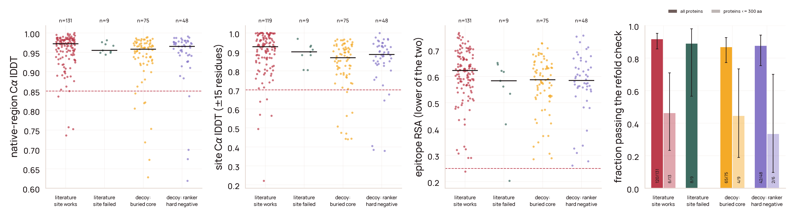

*Figure 13. Each point is one tagged protein (one insertion site); black bars are medians; dashed
lines are the check's thresholds. Right: fraction of sites passing, all proteins (solid) and
proteins of 300 residues or fewer (pale), with Wilson 95% intervals; labels give pass/total.
Regenerated by [`refold_check_validation.py`](../refold_check_validation.py).*

| | Works | Failed | Buried-core decoy | Hard-negative decoy |
|---|---:|---:|---:|---:|
| Pass, all proteins | 120/131 (92%) | 8/9 (89%) | 65/75 (87%) | 42/48 (88%) |
| Pass, proteins > 300 aa | 114/118 (97%) | 8/9 | 61/66 (92%) | 40/42 (95%) |
| Pass, proteins ≤ 300 aa | 6/13 (46%) | none tested | 4/9 | 2/6 |

| Score | AUROC, works vs failed (n = 131 vs 9) | AUROC, works vs buried-core decoy (131 vs 75) |
|---|---:|---:|
| Pass/fail verdict | 0.51 (0.44–0.68) | 0.53 (0.49–0.56) |
| Native-region lDDT | 0.59 (0.46–0.73) | 0.63 (0.58–0.68) |
| Site lDDT | 0.60 (0.45–0.73) | 0.69 (0.62–0.75) |
| Epitope exposure (lower RSA of the two) | 0.66 (0.46–0.84) | 0.61 (0.54–0.67) |

**The verdict does not discriminate.** Working sites, failed sites and decoys pass at the same
rate, about 9 in 10, and the verdict's AUROC is 0.51–0.53 against every negative class.

**The continuous lDDT scores carry a weak signal for gross disruption only.** Within a protein,
the working site keeps a higher native-region lDDT than the buried-core decoy in 63 of the 72
untied proteins, but the decoys' median native lDDT is still 0.96, so the 0.85 bar sits below
nearly all of the difference. Against the nine known failures no score separates the classes;
every interval spans 0.5. Those failures were mostly expression, maturation or labeling failures
of small insertions (single non-canonical amino acids, tetracysteine motifs), a mechanism a
structure prediction is not expected to see.

**In small proteins the check fails half of the sites that work.** Of 13 working sites in proteins
of 300 residues or fewer, 7 fail, including PMP22 after residue 125 (native lDDT 0.75) and CD52
after residue 29 (0.76). CD52's untagged refold scores 0.755 against its AlphaFold DB model, so
its failure is the fold settings on a 61-residue protein, not the tag. Decoys in the same small
proteins fail at the same rate (6 of 15 pass).

**Limits.** Nine known failures cannot bound the check's sensitivity; decoys are presumed
failures, not observed ones; and most literature sites were shown with tags shorter than 51
residues, so a working site is good evidence, not proof, that this cassette works there. The
known failures are all in proteins longer than 300 residues, so the small-protein result rests
on working sites and decoys only.

#### What this means for L1

| Decision | Bearing of the result |
|---|---|
| The 37 held CDSs (no construct passes refold) | 22 of their 32 distinct genes are 300 residues or shorter, the size range where the check fails 7 of 13 working literature sites and passes and fails decoys at the same rate. PMP22 and CD52, both held, fail at sites the literature shows work. A refold failure there is not evidence the construct fails. |
| The 136 built constructs flagged as failing refold | A flag is weak evidence: the check fails 8% of working sites and 13% of decoys, a likelihood ratio of about 1.6. This set gives no basis for expecting a flagged construct to display worse than an unflagged one. |
| Sites rerouted after a failed first arm | The reroute is not supported or contradicted by this result: both sites would have passed or failed at rates the check cannot tell apart. |

**Proposed, not adopted (an open decision in the [cover note](COVER_NOTE.md)):** stop using the refold verdict to hold
CDSs. Build each CDS held only for refold at its highest-ranked site that passes the other build
checks, flagged, and let the pooled display screen decide; keep the 136 built-and-flagged
constructs as ordered, with the flag reported as a low-weight annotation rather than a predicted
failure. Keep the refold models as a record and keep the epitope-burial and cassette-helix
readouts as annotations, but do not tune the thresholds on this set: no threshold separates
working sites from the nine known failures, and a stricter lDDT bar would hold more small proteins
without evidence that they fail.

## 7. Domestication, linker encoding and synthesis compliance

**Domestication.** Every ORF is cleared of BbsI (the Fragmid assembly enzyme), Esp3I (the
shuttle enzyme) and BsaI (not cleared from the backbone) by synonymous edits only, with no
codon optimization, so the protein is kept and native codon usage changes only at those
sites. Across L1, 8,201 codons change in 2,389 CDSs (median 3 codons, maximum 20); 321
need none (`l1_domestication_edits.tsv`). The edits create 471 new ATG trinucleotides, 51
`GT[AG]AG` splice-donor motifs and 2 poly(A) signals; no stage claims these motifs, and they
are left in place (`l1_domestication_barcode_audit.json`). Every vector
carries exactly two Esp3I sites, the inward-pointing pair that lets the barcoded construct move
to another backbone in one reaction.

**Two reasons a codon may differ from the native sequence, and one it never does.** A codon
changes only to remove an enzyme site (domestication, above) or to make a construct synthesizable
(below); both keep the protein. A coding sequence is never recoded to differ from another
CDS's: two CDSs may share any length of protein-coding sequence, and the barcode-swap risk
between them is handled by the cassette's diversified linkers alone.

**Synthesis compliance.** The synthesis vendor (Twist) scored the first, untagged L1 draft:
2,290 Low, 316 Medium, 104 High and 25 refused (13 near-matches to the Tn5 transposon end
sequence, 11 over-GC 100-bp windows, 1 long tandem repeat in CLEC4M's neck region). Each
tagged construct as ordered is checked against local rules calibrated on those calls, which
reproduce all 25 refusals and err strict elsewhere; they approximate the vendor's, which are
not published. Where a construct misses a target, the fewest synonymous codon changes clear it:
every 50-bp window at or below 80% GC (75% where it spans the cassette's end), no near-match to
the Tn5 end, and no exact repeat of 40 nt or near-repeat of 100 nt within the construct (a
synthesis limit on the construct itself, not a comparison with other CDSs). Met1, the cassette and its
flanking codons, an Igκ leader and the signal peptide are never changed. 790 of the 3,255
tagged constructs ordered (37 CDSs are held, [section 6](#6-where-every-cds-stands)) change, by 5,312 codons;
afterwards 2,294 score Low, 938 Medium and 23 High by the local rules, none refused, and no
provisional barcode occurs inside any construct. The 23 High constructs are native N-after-SP constructs
with a 50-bp window of 90–98% GC inside the protected signal-peptide codons, which the recoder
may not change (an open item, in the cover note). Recoding also leaves one residual of its own:
**14 constructs carry a new Type IIS site the recoder does not screen for** (AarI, PaqCI, BtgZI or
SapI). Only Esp3I and BsaI are screened, because they are the enzymes the assembly uses; the
four above are recorded library-wide as a known risk in the cover note rather than designed around. **The recoded constructs are the order of record**:
`l1_order_inserts_recoded.fasta` (SHA-256 `20e8f275…`; in the reviewer bundle at
`s3/processed/sprint4/s4e9-orf-design-fg-panel/synthesis/2026-11-15-final-e/`), built from every
placement's construct table at commit `541c6c18`, with every changed codon in
`synthesis_recodes.tsv` ([`synthesis_compliance.py`](../synthesis_compliance.py)). A vendor
re-quote of that file is the real test.

**Why the linkers are recoded.** For an N-terminal or internal CDS the cassette lies
upstream of the ORF's own C-terminus, so it never enters the swap tract; two such CDSs
share only the 21–24-nt tail before the barcode (a 2-nt pad and a 19-nt primer handle, after
each ORF's native stop codon, which is TGA, TAA or TAG) plus whatever C-terminal codons their ORFs share. For the 317 CDSs whose
cassette ends the ORF (208 C-terminal and 109 snorkel constructs) the cassette is the last coding sequence before that tail, so one shared encoding
would give every pair a 51-aa identical stretch. We limit the swap tract to 100 nt (5.0%
predicted swapping on the Walton et al. fit, for a particle carrying both constructs; what that
means in the pool is in [section 1](#1-what-l1-is-for)), preferring 80.

| Encoding of the C-terminal cassette | C-terminal CDSs: median / max tract | CDSs over 100 nt (all 2,710) |
|---|---:|---:|
| one shared cassette (p003 codons) | 186 / 2,529 nt | 549 |
| every codon recoded, end unique in last 9 nt | encoder exhausts after 34 of 317 CDSs | — |
| every codon recoded, last 15-nt block unique | 36 / 36 nt | 232 |
| **linkers only recoded, last 15-nt block unique (issued)** | **36 / 36 nt** | **232** |

SpyTag003 and P-ALFA-P keep p003's codons, which are the ones shown to display; only the four
`GGGGS` blocks are recoded. Recoding the tags too buys nothing (36 nt either way). The
terminal 15-nt block must be unique per CDS because short end rules run out of distinct
ends well before 241 CDSs. Encodings are issued in seeded batches and pinned (ten batches,
378 encodings, some held by CDSs no longer active), so adding a CDS cannot redraw
an issued one.

All 232 CDSs still over the bar are explained by their ORFs, not the cassette: most are
same-gene isoform/ortholog pairs sharing a C-terminus, and the rest are different genes with
shared 3' coding sequence (clustered protocadherins, close paralogs such as olfactory receptors
and KIR2DS2/KIR2DS4). Each different-gene family is accepted by name, and a library test fails on
any new one. Shared protein-coding sequence is never recoded to shorten a tract; the diversified linker is the only swap protection. That cannot help a pair whose
cassette is N-terminal, because the shared stretch then runs from after the cassette to the
barcode and never includes the linker. For those constructs the cassette is still identical
sequence with different sequence on both sides, so a template switch inside it joins one
construct's N-terminal part to another's tag and C-terminal part. That is the largest modeled
swap term in the library ([section 1](#1-what-l1-is-for)), and whether to recode the cassette
in N-terminal and internal constructs is open ([section 12](#12-decisions-we-would-like-reviewers-to-weigh-in-on)). One C-terminal
CDS, SLC41A2, needs a synonymous last-codon change (GAC→GAT) to avoid creating an Esp3I
site at the cassette junction.


*Figure 14. Fraction of CDSs whose worst-partner shared tract exceeds a given length, with
one shared cassette (maroon) and with the issued linker-only encodings (teal). Unit: CDS;
n = 2,710; each CDS counted once at its longest tract to any other CDS; dashed line,
the 100-nt gate. The curves separate where C-terminal CDSs sit and converge in the tail,
which is ORF-encoded shared sequence the cassette cannot change. Data: `l1_swap_risk.tsv`.
Regenerated by [`brief_numbers.py`](brief_numbers.py).*

## 8. The vector: promoter and selection marker

Every CDS is built into one lentiviral vector, p0039, which runs
`EFS promoter – insert – IRES2 – PuroR – WPRE` between the LTRs. The construct (Kozak, ORF with
its tag cassette and stop, barcode and readout block) replaces a 195-bp cloning site and stuffer
directly after the 212-bp EFS promoter. Two choices in that layout decide how strongly each CDS is
expressed and which cells survive selection, and one of them is still open.

**Selection is coupled to the ORF through the IRES.** Puromycin resistance is translated from
the same transcript as the CDS, so a cell survives selection only if it transcribes the
ORF. The layout follows from P-0008, a TfR1 construct with the same EFS–TFRC–tag unit but
PuroR driven by its own SV40 promoter and no IRES, which gave puromycin-resistant cells with
low TfR1 expression. A separate selection promoter lets a cell survive while transcribing the
ORF poorly, and in a pooled screen those cells would read as CDSs that fail to reach the
surface. The cost of the IRES is that selection depends on the CDS's own transcript, so
a CDS that is transcribed weakly is also selected weakly, and will be underrepresented
after puromycin rather than present and dark.

**EFS is the current promoter; EF1a is the alternative under consideration.** A promoter
comparison (data in `s5e11-promoter-series/`) drove the
TfR1–barcode–IRES2–mScarlet3–P2A–PuroR cassette in four cell types, 72 h after transduction and
before puromycin. mScarlet3 sits after the IRES, so it reports how much bicistronic transcript a
cell makes, not TfR1 display. Each point is one well per virus volume.

| Readout | EFS (P-0003) | EF1a (P-0011) | PGK (P-0012) |
|---|---|---|---|
| Promoter length | 212 bp | 1,179 bp (includes intron A) | not used here |
| mScarlet3 geometric mean of positive cells, relative to EFS at the same volume | 1 | 3.6–4.0× (HEK293T), 1.7–2.4× (HeLa), 1.7–2.2× (Nalm6) | 0.29–0.64× |
| % mScarlet3-positive per µL virus, HEK293T (slope of a linear fit) | 1.24 | 1.03 | 0.71 |
| Area covered by cells after 48 h puromycin, HEK293T at 35 µL, relative to no puromycin (one image each) | 65% | 87% | 32% |

K562 has no EFS well, so it is left out of the ratio. Each cell type's positive gate is set on
its own untransduced well, so ratios compare within a cell type only.

Read together, EF1a does not transduce more cells, but the cells it does transduce make several
times more transcript, and more of them survive puromycin. Under the IRES coupling above, that
matters most for weakly transcribed CDSs, which EFS may lose at selection. The costs of
switching are specific:

| Consideration | EFS | EF1a |
|---|---|---|
| Packaged genome | as in [section 10](#10-how-the-library-is-ordered) | 967 bp longer for every CDS; at the 2- to 3.5-fold per kb discussed in [section 10](#10-how-the-library-is-ordered) that is a 2- to 3.4-fold titer cost across the whole library, on top of the length spread between CDSs |
| Splicing | no intron | intron A sits upstream of every ORF; the splice-donor screen of the barcode region ([section 9](#9-the-barcode-and-readout-region-and-the-assays-it-could-support)) was run against the EFS context only |
| Type IIS sites in the promoter | none of BbsI, Esp3I, BsaI | none of BbsI, Esp3I, BsaI (checked in the P-0011 map) |
| Expression evidence | the promoter p003 was characterized with | mScarlet3 only; no surface-tag readout yet |

**The promoter can change after the order.** Each construct is flanked by its own Esp3I sites (the
shuttle enzyme, [section 7](#7-domestication-linker-encoding-and-synthesis-compliance)), which leave `GACC` and `TCAG` overhangs, so the synthesized constructs can be moved into an EF1a
destination with the same slot without resynthesis. What is fixed at synthesis is the vector
the vendor builds them into first.

**Still open.** The comparison has not measured surface display of the tag, has one well per condition,
and its day-7 post-selection readout is not yet analyzed. A side-by-side of a few library
CDSs of differing expression, EFS versus EF1a, scored for surface tag after selection, would
decide whether the switch is worth the titer.

## 9. The barcode and readout region, and the assays it could support

Every construct ends in the same readout block, transcribed from the EFS promoter upstream of the
IRES:

| Element | Sequence | Source |
|---|---|---|
| 5′ handle | `AGTCGTTAGCTGCCGTTCC` | [Tycko et al., 2020](https://pubmed.ncbi.nlm.nih.gov/33326746/), subpool-3 amplification primer (JT-832) |
| Barcode | 20 nt, one per CDS | the library's barcode pool ([below](#how-the-barcodes-were-designed)); a block of 3,200 is reserved for L1 and assigned to CDSs when the order is frozen |
| Gap | `GGATCTGGAC` | 10 nt |
| RT site | `CCTTTGGGCAAGCACACGTC` | lentiGuide-BC 3′ site (Feldman et al. 2019), one base changed |
| 10x Capture Sequence 1 | `GCTTTAAGGCCGGTCCTAGCAA` | 10x Feature Barcoding |

### How the barcodes were designed

The barcode is transcribed. It sits between the ORF stop and the IRES, an intercistronic region
that behaves like a 3′ UTR for the first cistron, so a barcode that presents a
microRNA target site can have its own transcript repressed. That failure mode is the reason the
sequence is designed rather than drawn at random: it produces a barcode-specific expression
penalty on one CDS, which at the bench is almost indistinguishable from that protein being a
weak surface expressor.

The pool is 30,000 barcodes of 20 nt, generated deterministically from a fixed seed by
[`generate_barcodes.py`](../../../sprint1/s1e2-fragmid-vector-design/generate_barcodes.py) into
[`barcodes_20nt_30k.tsv`](../../../sprint1/s1e2-fragmid-vector-design/barcodes_20nt_30k.tsv), so
the file reproduces from the script alone. Seven rules are applied, each recorded with its
source and whether we checked that source ourselves in
[`barcode_filter_stack.py`](../../../sprint1/s1e2-fragmid-vector-design/barcode_filter_stack.py):

| Rule | Why | Source |
|---|---|---|
| GC 40–60% | amplification and sequencing behavior | Hawkins/FREE, Shiroguchi |
| no homopolymer run above 2 | miscalls and indels in homopolymers | Hawkins/FREE |
| no `ATG` anywhere | a spurious start codon in the readout region | ours |
| no `AATAAA`, and none of its 18 single-base point mutants | a polyadenylation signal would truncate the transcript | [Vainberg Slutskin et al., 2018](https://pubmed.ncbi.nlm.nih.gov/29410437/) |
| no 3-bp non-overlapping self-complementarity | hairpins | Hawkins/FREE |
| no conserved microRNA 6-mer seed target site (207 sites) | the repression described above | TargetScanHuman 8.0 |
| no `GT[AG]AG` splice-donor core | a cryptic donor here would splice out the IRES and the selection marker | ours |

Two of these are worth a reviewer's attention. The microRNA rule rejects 6-mer seed matches
rather than the 7mer-m8 sites a target-prediction tool reports, and since every 7mer-m8 site
contains its 6-mer core, the 6-mer rule rejects a strict superset — deliberately stricter than
the precedent it comes from. The splice-donor rule is ours and has no published precedent; it
exists because the barcode sits upstream of an IRES in the same transcript.

**There is no UMI in the construct.** L1 is screened as a pool, and barcode counts from sorted
populations are read from PCR of integrated or transcribed barcodes, so amplification bias is
a real source of noise. A unique molecular identifier added in the first PCR primer at library
preparation removes that bias without occupying construct sequence, so the 20 nt stay with the
barcode.

**L1 barcodes differ by at least 3 substitutions.** The full 30,000-barcode pool has no designed
minimum distance, but L1's barcodes are drawn under the in situ prefix screen below, which keeps
every pair at Hamming distance 3 or more over the first 10 bases, and so over all 20. A read
with one substitution error is therefore assigned unambiguously; insertions and deletions are
not guarded against.

Three assays could read it. Each is checked here against the sequences in `build_constructs.py`,
because what the fragment carries when it is ordered decides which of them stay possible.

**Optical pooled screening (in situ sequencing).** Feldman et al. read lentiGuide-BC barcodes
in fixed cells by in situ reverse transcription, padlock gap-fill and sequencing by synthesis
([Feldman et al., 2019](https://pubmed.ncbi.nlm.nih.gov/31626775/)). Three of their elements
differ from ours:

- *Why today's layout is weak for optical screening.* The 10-nt gap after the barcode
  (`GGATCTGGAC`) is not from lentiGuide-BC, where Feldman has a 17-nt padlock construct in that
  position. Ours came in with the p003 map with no recorded reason; read as codons it is GGA TCT GGA (Gly-Ser-Gly), so it
  may be a linker or cloning scar (inferred, not documented). With only 10 nt before the RT
  site, a padlock construct on that side would have to run into the RT site and pair with
  primer-made cDNA. Feldman's construct sits directly after the barcode and ends where his RT primer
  begins, with no overlap.
- *The adopted 3′ flank.* Feldman's padlock constructs match neither of our earlier flanks, and
  his RT site cannot be copied verbatim. The flank we adopt replaces the 30-nt gap plus
  RT site (`GGATCTGGACCCTTTGGGCAAGCACACGTC`) with his RT-side padlock construct, verbatim,
  followed by his RT site with one base changed. **The order of record predates this choice**
  and carries the earlier flank, so the constructs are regenerated against the adopted flank
  before they are ordered; it lengthens the readout region by 7 bp and changes no coding
  sequence.

| Element (transcript sense) | Earlier flank | Adopted |
|---|---|---|
| After the barcode | 10-nt gap `GGATCTGGAC` | Feldman's 17-nt padlock construct `ACTGGCTATTCATTCGC` (Addgene #127168) |
| RT site | `CCTTTGGGCAAGCACACGTC` (C at 9) | `CCTTTGGGAAAGCACACGTC` (A at 9) |
| RT primer | none ordered | `GACGTGTGCTTTCCCAAAGG`, with Feldman's LNA positions |
| Barcode to CS1 | 30 nt | 37 nt; the ORF-to-barcode distance is unchanged |

  Why an A at position 9 (RT site and the construct before it, primer3 at 50 mM Na⁺, no Mg²⁺):

| Base 9 | Splice-donor motif | Hairpin with the construct | Added miRNA seed 7-mer | RT-site Tm |
|---|---|---|---|---:|
| T (Feldman) | `GGG·GTAAG`, in the packaged transcript | Tm 42.5 °C, ΔG −0.38 | none | 53.4 °C |
| C (today) | none | `GGGC`/`GCCC` stem, Tm 62.2 °C, ΔG −2.13 | miR-636 | 56.7 °C |
| A (proposed) | none | Tm 43.4 °C, ΔG −0.36 | none | 54.0 °C |

  Feldman's own primer would bind the A site with one A:A mismatch, so the matched primer above
  is ordered instead. The padlock then needs one new construct, on the barcode-proximal 15 nt of the
  Tycko handle (`GTTAGCTGCCGTTCC`, 45.7 °C nearest-neighbor at 50 mM Na⁺, against 46.1 °C for
  Feldman's RT-side construct); the handle itself does not change. Feldman's other construct
  (`GTGTTCAATCAACATTCC`) is in no deposited plasmid map: it enters with his cloned barcode
  construct, so it is inferred, not shown, to sit directly 5′ of his barcode. It does not occur in
  L1. Seven-mers on the fixed flank that match human miRNA seeds remain: `ACTGGCT`
  (miR-575/4676-5p), `CTATTCA` (miR-5585-3p), `CTTTGGG` (miR-186-3p) and `AAGCACA`
  (miR-218-5p, broadly conserved), the last two present today as well. The flank carries no
  `GT[AG]AG` and no BbsI, Esp3I or BsaI site, and the construct and the construct-plus-RT region occur
  nowhere else in the backbone or the 2,710 L1 ORFs as a 15-mer. A draft map of one CDS
  with the new flank is
  [`p0039_AXL_vector_feldman3p_DRAFT.gb`](../p0039_AXL_vector_feldman3p_DRAFT.gb); it
  differs from `p0039_AXL_vector.gb` only in this flank (+7 bp). Priming RT from CS1 instead
  stays an alternative that needs no RT site at all, but it is untested: a PubMed and a
  Consensus search (2026-11-08) found no published optical screen that uses a 10x capture
  sequence as the in situ RT primer. In the proposed layout CS1 sits 37 nt from the barcode,
  which does not affect 10x capture, since read 2 of the feature library starts from the
  handle-side primer.
- *The new junction changes which barcodes can be used.* Screening the barcode pool in its full
  context (handle + barcode + flank + CS1 + shuttle) for BbsI, Esp3I and BsaI sites, splice-donor
  motifs and conserved miRNA seed 7-mers that span either barcode junction:

| Flank | Barcodes passing (of 28,506) | Failing: seed across a junction / Type IIS / splice donor | Drawable at prefix distance 3 over 10 nt |
|---|---:|---|---:|
| Earlier flank | 23,807 | 4,339 / 88 / 272 | 3,856 |
| Adopted | 21,394 | 6,911 / 201 / 0 | 3,741 |
| Both, the rule L1's block was drawn under | 19,950 | 8,196 / 88 / 272 | 3,665 |

  The adopted flank loses 3,857 barcodes that pass under the earlier one and gains 1,444 that fail it, and still
  leaves room for all 2,710 CDSs under the prefix screen. The junction seed screen is
  part of `reserve_barcodes.py`, which takes the 3′ flank as
  `--three-prime {current,t9a-draft}` and reports these counts with `--pool-stats`. The
  failure counts are by first reason only (enzyme, then splice donor, then seed), so a barcode
  failing two screens is counted once.
- *Two barcodes already assigned would fail the junction seed screen:* CNR1
  (`GAGAGTAGTCAAGCACCAAG`, completing `AAGGGAT`) and TFRC (`TGTCTCTCTCAGCTTCTCTC`, completing
  `GTTCCTG`). Both are kept as assigned; every new L1 barcode must pass the
  screen.
- *L1 barcodes pass under both the earlier and the adopted 3′ flank*, so none had to be redrawn
  when the flank was chosen (`l1_screens_pass` in `reserve_barcodes.py`;
  `--three-prime both`). That leaves 19,950 pool barcodes, of which 3,665 can be drawn at
  prefix distance 3 over 10 nt, enough for all 2,710 CDSs.
- *A block of 3,200 barcodes is reserved for L1* in the shared barcode registry, drawn in pool
  order under every screen in this section, under both flanks, plus an RNA-binding-protein motif
  screen of the barcode and its junctions: no Pumilio element (`TGTA[ACT]ATA`), AU-rich element
  (`ATTTA`), CPEB element (`TTTTAT`, `TTTTAAT`), poly(A) signal (`AATAAA`, `ATTAAA`) or pair of
  CFIm25 sites (`TGTA`) within 50 nt ([`reserve_l1_block.py`](../reserve_l1_block.py),
  [`l1_barcode_block_provisional.tsv`](../l1_barcode_block_provisional.tsv)). The block is
  larger than L1 so that CDSs added before the order draw from it; CDSs receive their
  barcodes when the order is frozen, and unused barcodes are released. 444 barcodes that meet
  the same screens remain in the pool for other constructs.
- *What exists today, and what does not.* Barcode selection is a set of screens and a reserved
  block, not yet an assignment:

  | Part | State | Where |
  |---|---|---|
  | Screens every L1 barcode must pass: Type IIS, splice donor and miRNA seeds across both junctions under both 3′ flanks; prefix distance 3 over 10 nt; the RNA-binding-protein motifs above | exists, tested | `reserve_barcodes.py`, `barcode_prefix_screen.py`, `reserve_l1_block.py`, `rbp_motif_screen.py` |
  | A provisional block of 3,200 barcodes passing every screen | exists; every row `provisional`, none assigned | `l1_barcode_block_provisional.tsv` |
  | Assignment of one barcode to each CDS | **does not exist**: no code yet maps a barcode to a CDS; every ordered construct carries a 20-N placeholder | deferred to the order freeze. The 3′ flank it waited on is now chosen, and L1's reserved block was drawn under the stricter rule that satisfies both flanks, so it stands unchanged |
- *In situ sequencing reads only the first 9–12 bases.* Over the barcode pool, barcodes are unique
  over 20 nt but not over short prefixes, and drawing L1's barcodes at random would leave
  identical prefixes:

| Bases read | Pool (28,506): prefix collisions | Random 2,735 drawn (measured before 25 CDSs were retired) | Best 2,735 a screen can draw from the pool |
|---:|---:|---|---|
| 8 | 13,967 identical pairs | always identical pairs | minimum distance 2 (detects one error) |
| 10 | 1,244 | always identical pairs | minimum distance 3 (corrects one error) |
| 12 | 111 | identical pairs in 12 of 20 draws | minimum distance 4 |

  L1's barcodes are drawn under a prefix-distance screen: every barcode drawn stays at least 3 substitutions from every other barcode in use over its
  first 10 bases, which corrects one in situ read error and which the pool satisfies for all
  2,710 CDSs ([`barcode_prefix_screen.py`](../barcode_prefix_screen.py), tested in CI). It
  costs nothing for sequencing. This assumes the readout starts at the
  barcode's 5′ end, as Feldman's does.

  Expression is expected but untested: like lentiGuide-BC, where the barcode sits in the Pol II
  selection transcript, ours sits in the EFS transcript upstream of the IRES.

**10x 3′ Feature Barcoding.** The 3′ v3 Feature Barcoding gel beads carry the reverse complement
of CS1, so the RNA must carry `GCTTTAAGGCCGGTCCTAGCAA` in sense
([Replogle et al., 2020](https://pubmed.ncbi.nlm.nih.gov/32231336/)). Our EFS transcript does,
30 nt downstream of the barcode, so the orientation is right. What is untested is capture of an
internal site in a long Pol II mRNA; Replogle et al. placed CS1 in a short sgRNA stem loop.

**T7 in situ transcription (ZOMBIE and similar).** Not possible as designed: no T7 promoter is
present. One could be added inside the Esp3I-flanked unit in two places:

| Placement | Effect | Scan of the junctions (BbsI, Esp3I, BsaI; splice donor `GT[AG]AG`) |
|---|---|---|
| Sense, between the stop and the Tycko handle | adds 20 nt between ORF and barcode, small against the distances that drive template switching; the in situ RNA is sense, so the RT site above still works | clean |
| Antisense, after CS1, reading back across the barcode | adds no ORF–barcode distance; the in situ RNA is antisense, so RT needs a primer on the handle instead | no enzyme site, but the promoter core reads `ATA·GTGAGT` in the Pol II transcript, a near-consensus splice donor that the `CTCAC` core makes unavoidable; a T3 promoter does the same |

The sense placement is the only clean one, at a cost of about 1% more template switching from
the added 20 nt.

## 10. How the library is ordered

**Plates.** Every active CDS is ordered as purified plasmid in IDTE buffer (10 mM Tris,
0.1 mM EDTA, pH 8.0), stored at −80 °C, in 96-well V-bottom plates, in
order of the ordered construct's length (tagged and synthesis-recoded, as Twist makes it),
shortest first, so each plate holds constructs of similar length. The plate position belongs
to the ordered construct, not to the CDS: one CDS may be ordered as two or three constructs
([section 5](#5-tag-placement)), each with its own plasmid number, so the well is assigned per plasmid, with plate
and well (column-major, A01, B01, …) in [`l1_order_plan.tsv`](l1_order_plan.tsv) and
[`l1_insert_numbering.tsv`](../l1_insert_numbering.tsv). The numbering follows the library until
the order freeze, so it is regenerated if a construct is added or retired before then.
The 2,673 built CDSs fill 34 plates per set with their 3,255 constructs (the last plate holds
87); the 37 held CDSs have no construct and no plate.

**Amounts.** 4 µg is ordered per CDS and 3 µg assumed delivered, normalized to
100 ng/µL (30 µL), and split into three plate sets with the same layout:

| Plate set | Plates | Volume per well | DNA per CDS at 100 ng/µL |
|---|---:|---:|---:|
| Pooling A, B | 2 × 34 | 5 µL each | 0.5 µg each |
| Stock | 28 | 20 µL | 2.0 µg |

100 ng/µL is an assumption, and the vendor may deliver less. The volumes are fixed, so a lower
concentration lowers the DNA in every well in proportion:

| Delivered concentration | DNA per pooling well | DNA per stock well | One pool, all CDSs (3.5-fold per kb weighting) |
|---:|---:|---:|---:|
| 100 ng/µL | 0.5 µg | 2.0 µg | 211.9 µg |
| 75 ng/µL | 0.375 µg | 1.5 µg | 158.9 µg |
| 50 ng/µL | 0.25 µg | 1.0 µg | 105.9 µg |

The pooling weights are relative, so which CDSs need extra DNA does not change with
concentration; only the size of each pool does.

**Why pool by length.** Longer lentiviral genomes give lower functional titer. Comparing
packaged genomes of 3.9, 6.9 and 10.1 kb, Sweeney and Vink found titer fell 3–4-fold per extra
kilobase while physical particle yield stayed constant; the loss is shallower below about 7 kb
(about 2-fold per kb from their infectivity data) and steeper near 10 kb, where packaging
itself fails ([Sweeney & Vink, 2021](https://pubmed.ncbi.nlm.nih.gov/34095341/)). Moon et al.
offset it in a pooled lentiviral library by pooling 0.2 × 3.5<sup>L/1000</sup> pmol of each
plasmid, L the effector length ([Moon et al., 2026](https://pubmed.ncbi.nlm.nih.gov/42031729/));
their dropout fell from 48.7% to 4.2%, though the same library also changed its barcoding, so
the gain cannot be credited to pooling alone. Our backbone is constant, so differences in
construct length (527–5,423 nt, median 1,751) are differences in packaged
length. At 3.5-fold per kb, the model predicts the longest CDS transduces
about 100× less efficiently than the median one and 461× less than the shortest.

**How the weighting is applied.** Each CDS's pooled amount follows the factor in pmol,
converted to mass with its own vector length, and is scaled so a CDS with a 4.3-kb construct
fills exactly one pooling well (500 ng at 100 ng/µL) per pool:

- The 86 constructs whose weighted amount exceeds one well (those over about 4.3 kb)
  are ordered with extra DNA (68.4 µg extra in total at 3.5-fold per kb, up to 8.6 µg ordered
  for the longest).
- Every other CDS needs less than a well, down to 30 nL for the shortest at
  3.5-fold per kb, which cannot be pipetted by hand. Because the plates are length-ordered, each
  of pooling plates 1–32 is diluted to one concentration and a fixed 5 µL is pooled from every
  well; that lands each CDS within the error in the table below of its own target. The plate
  concentrations are in [`l1_order_pooling_plates.tsv`](l1_order_pooling_plates.tsv).
- The last two plates (183 constructs, the long tail) are pooled well by well at each CDS's
  own volume.

| Fold lower titer per kb | Longest vs median | Longest vs shortest | Extra DNA for constructs > 4.3 kb | Largest single order | Pooling-plate dilutions | Worst within-plate error |
|---|---:|---:|---:|---:|---:|---:|
| 2.0× | 13× | 30× | 33.0 µg | 5.9 µg | 6.1–58 ng/µL | 1.13× (1.22× on plate 1) |
| 2.5× | 29× | 89× | 45.6 µg | 6.8 µg | 2.8–50 ng/µL | 1.17× (1.29× on plate 1) |
| 3.5× | 100× | 461× | 68.4 µg | 8.6 µg | 0.8–39 ng/µL | 1.24× (1.40× on plate 1) |


*Figure 15. Volume of each CDS pooled per pool, at 100 ng/µL, against its synthesized-construct
length, under three assumed per-kb titer losses. Unit: ordered construct; n = 3,255. Dashed lines: one
5-µL pooling well and the 4.3-kb construct threshold; dotted line: 0.5 µL, the smallest volume
worth pipetting by hand. Data: `l1_order_plan.tsv`. Regenerated by
[`order_plan.py`](order_plan.py).*

**The factor is not measured for our vectors, and it matters.** Between 2- and 3.5-fold per kb
the correction for the longest CDS against the median ranges from 13× to 100×, so an
overcorrection would make the long CDSs the overrepresented ones. Our packaged genomes
(tag cassette included) span 4,434–9,387 nt, median 5,646. Over that range Sweeney and Vink's
reported fold changes imply about 1.9–2.7-fold per kb, below Moon et al.'s 3.5, and no
Deliverome dataset yet supports a fitted slope. A 91-clone pilot that pools a length-spanning
subset equimolar and compares plasmid with integrated barcode counts would pin the factor to
about ×/÷1.1 before the full pool is made; if pooling cannot wait, 2-fold per kb is the
better-supported weighting. A cheaper first test is already on the bench: the 16 P-series
plasmids in the next pool (p0022–p0035, p0037, p0048) use the same backbone and span
5,063–8,435 nt packaged, over which 2-fold per kb predicts a 10-fold titer drop from the
shortest (FOLR1) to the longest (HEG1) and 3.5-fold predicts 68-fold. Their per-construct
barcode counts in plasmid and integrated DNA fit the slope directly, though gene-specific effects
are not separated from length with 16 genes. Pilot design and evidence:
`scratch/becca/l1-length-titer/` (question 5, [section 12](#12-decisions-we-would-like-reviewers-to-weigh-in-on)).

**Experimental plan before the library is pooled.** The per-kb factor is measured on four
plasmids we already have, built on the L1 backbone, two at each end of the length range:

| Plasmid | Gene | Packaged length (nt) |
|---|---|---:|
| p0028 | FOLR1 | 5,063 |
| p0032 | MS4A1 | 5,183 |
| p0023 | ERBB2 | 8,057 |
| p0022 | HEG1 | 8,435 |

- Virus is made from each plasmid on the same day by the same protocol, from equal pmol of
  transfer plasmid, in three replicate preps.
- Titer is read as integrated copies (qPCR or ddPCR) at low MOI, not as mScarlet3-positive
  cells, because the reporter also depends on how well each ORF expresses.
- The slope of log titer against packaged length gives the factor. Across the ~3.3 kb between
  the pairs, 2-fold per kb predicts a ~10-fold drop and 3.5-fold per kb a ~60–70-fold drop.
- Two plasmids per end matter more than a fifth plasmid in the middle: with one per end a
  single gene's own titer effect is indistinguishable from length, while a pair that disagrees
  shows it. Four plasmids call the right factor about as often as five (about 90% at 2-fold
  construct-to-construct scatter, 77% at 3.2-fold), and two about 83% and 72%.
- The order plan is then recomputed with `FACTOR` in `order_plan.py` set to the measured value before
  the pooling plates are diluted. The 91-clone pilot is kept for the case where the four
  disagree with each other by more than the factor they are meant to measure.

## 11. Reproducibility: what is pinned, and the one permanent limit

The pipeline ([`library_pipeline.py`](../library_pipeline.py)) lists 30 stages, from the gene
list through proteoform selection, panels, CDS records, constructs, topology, tag paths,
cassette encodings, CDS numbering and every placement's tagged constructs, to a consistency gate,
synthesis compliance, and five checks on the inputs themselves (the saved placement builds and the saved S3 inputs, the pinned git commits, the saved
structure models and the external sources, below). [`REBUILD.md`](../REBUILD.md) is the one
procedure for rebuilding the order from zero. [`CODE_MAP.md`](../CODE_MAP.md) maps each
stage to its script and the tables it writes, and gives every other script in the folder a
status, including the one-off scripts kept only as the record of how an output was made. `verify` reruns each one offline from pinned inputs and compares it
with the published record. Nothing is rebuilt from today's sources: each stage must reproduce
what the library actually used.

**A clean rebuild reproduces the order.** On 2026-11-14 a fresh clone of `main` at `f5222462`
(this order of record merged), with empty download and structure-model caches, ran every stage:
30 of 30 reproduced, including synthesis compliance against the placement builds on `main`, and the
order plan regenerated its tables byte for byte. The tag-placement construct builds (N-terminal,
multipass, type III, internal) are read as committed records by the synthesis stage, and
their saved copies on S3 are checked by the `rung_builds` stage; each builder's own `--check`
rebuilds it. Only the C-terminal constructs are rebuilt inside `verify`.

To rerun it, clone the review repository, which carries the same paths and records the source
commit it was exported from in `EXPORT_MANIFEST.json`:

```bash
git clone https://github.com/Deliverome-Project/l1-library-review.git && cd l1-library-review
uv sync --locked
export DELIVEROME_ANALYSIS_S3_CACHE=$(mktemp -d)
cd analysis/sprint4/s4e9-orf-design-fg-panel
uv run --locked python library_pipeline.py verify
(cd reviewer-package && uv run --locked python order_plan.py)   # then git diff: no change
```

**Saved inputs, not only pins.** That rebuild downloaded 3,104 objects (2.58 GB, 2,736 in the
external and 368 in the processed bucket, among them the archived AlphaFold DB models and the
ColabFold models), and those are exactly the pipeline's inputs. Copies of third-party data among them (GENCODE Ribo-seq ORFs, PeptideAtlas
and MyGene responses, UniProt query results) are held in the append-only external bucket under
`{source}/{version}/` keys, copied byte for byte from where they were first saved
([`upstream_copies.tsv`](../upstream_copies.tsv)), and the pipeline reads them there. Each is
listed with its SHA-256 in `library_pipeline_inputs_saved.tsv`, and the `saved_inputs` stage
fails if any is missing or changed ([`pipeline_input_manifest.py`](../pipeline_input_manifest.py)).
Tool versions, the lockfile hashes and the git commits the stages replay at are recorded beside
it. Every git commit a stage replays at must be a commit on `main` (`pinned_refs` stage).

**Every external source, with its saved copy.** [`external_inputs.tsv`](../external_inputs.tsv)
lists each external source a script reads (33 rows: UniProt, Ensembl, MyGene, AlphaFold DB,
TmAlphaFold, NetGPI, the D1 prediction tables, the licensed predictors and the Modal images),
with the version used, the saved copy and its SHA-256. A test fails if any script in the folder
makes a network call that is not listed, and the `external_inputs` stage fails if any saved
copy is missing or changed. The AlphaFold DB models the design read (the structure payload and
the refold natives) are archived write-once under `external://alphafold-db/v6/`, each with its
SHA-256 (`tag_refold_afdb_archive.tsv`), and the
`structure_models` stage fails if any model the design read is not there
([`pin_structure_models.py`](../pin_structure_models.py)). The archived copies are the ones the
refold verdicts were scored against where those survived; the rest were downloaded from the same
versioned (`model_v6`) URLs, and two independent downloads agreed byte for byte on 1,910 models. What cannot be saved is recorded instead:

| Source | Why it cannot be saved | What is recorded |
|---|---|---|
| DeepTMHMM 1.0.24, SignalP 6.0+h | licensed (DTU), not redistributable | every package and weight file's SHA-256, so a licensed copy can be checked; all predictions are saved |
| ColabFold 1.6.2 image, AlphaFold2 weights, ColabFold MSA server | a container pulled by tag; weights fetched at build; MSAs from a live server | the image digest as of 2026-11-13 and the weight hashes for the tagged refolds; the 2026-10 payload folds have neither. Every model used is saved with its SHA-256 (the ColabFold models among the saved pipeline inputs, the tagged refolds in `tag_refold_structures.tsv`) |
| MyGene.info for two upstream steps (`screen_reference_forms.py`, `nterm_res1_multipass.py`) | the raw responses were cached only on the machine that ran them | the resolved Ensembl ids in each step's committed output |
| NetSurfP-3.0, TMDET (via TmAlphaFold) | no version record was kept | their outputs, saved (D1 rows; the gate's input bundle) |
| The vendor's synthesis rules | not published | the vendor's report on the first draft |

**Steps outside `verify`.** Three design steps are not pipeline stages; their outputs are
committed records that the pipeline reads:

| Step | Why it cannot rerun from a clean clone | Its record |
|---|---|---|
| Membrane-side gate (`membrane-side-gate/`) | fetched its inputs at run time from the tag-site API, the UniProt REST API, AlphaFold DB and TmAlphaFold; those 4,408 inputs are now checksummed into a saved bundle, so it reruns from a clean clone after `pin_inputs.py restore` (rerun on the 2026-11-12 snapshot of record: 0 of 583 calls change) | `membrane-side-gate/*.tsv` |
| Tag refolding and scoring (`tag_refold/`) | runs ColabFold on Modal; scoring reads the tagged models from S3 and the native AlphaFold DB models from the `external://alphafold-db/v6/` archive | models and scores on S3 under `predicted-structures/tagged/`, each with its SHA-256 in `tag_refold_structures.tsv`; `fold_order_check.py` re-checks every ordered protein against them |
| Placement construct builds other than C-terminal (`build_l1_*_arms.py`) | rebuilt by their own `--check`, not by `verify`; the synthesis stage reads them from git at a pinned commit | `constructs_l1_*.tsv`, `.fasta` |

**Pinned releases.** Every release the design rests on is in the reviewer bundle whole, not
only the files the replay reads, so a reviewer can inspect it. Each bundled file carries its
release, version, source URL and SHA-256 in [`bundle_manifest.tsv`](bundle_manifest.tsv); the
full table, with sizes and sources, is [`pinned_releases.md`](pinned_releases.md).

| Release | Version | Pinned on | In the bundle (`s3/external/…`) | Public? |
|---|---|---|---|---|
| Ensembl | 115 (human, mouse, cyno CDS, peptides, GTFs; Compara homologies) | 2026-10-11 | `ensembl/release-115/` | yes |
| Ensembl | 116 (mouse, cyno CDS, peptides, GTFs; Compara homologies) | 2026-11-05 | `ensembl/release-116/` | yes |
| UniProtKB | 2026_03 tables and REST features; 2026_04 accession queries | 2026-10-11 | `uniprot/` | yes |
| APPRIS | e115v50 principal; 2026_06.v50 full annotations with TRIFID; 2026_08.v50 mouse | 2026-10-08 | `appris/` | yes |
| OpenProt | 2.2 | 2026-11-02 | `openprot/2.2/` | yes |
| PeptideAtlas | human build 607, replayed in the original query batches | 2026-11-02 | `peptideatlas/build-607/` | public data, our queries |
| GENCODE Ribo-seq ORFs | phase 1 all; phase 2 primary and comprehensive | 2026-11-01 | pipeline-input snapshot (`s3/processed/…`) | yes |
| Pfam | 39.0 | 2026-11-07 | `pfam/39.0/` | yes |
| accessible-surfaceome | release 1.3.0 (Zenodo) | 2026-11-02 | `accessible-surfaceome/release-1.3.0/` | yes |
| accessible-surfaceome | commit f9c73691: FASTAs, DeepTMHMM tables, ortholog cohorts | 2026-11-02 | `accessible-surfaceome/f9c73691/` | repository files, shared in the bundle |
| DeepTMHMM | 1.0.24 / 1.0 academic; six topology snapshots, of record `2026-11-12-cyno-restarts` | 2026-10-15 | `accessible-surfaceome/topology/` | predictions run by us |
| NetGPI | 1.1, run through the DTU Health Tech web service in `short` output format | 2026-11-06 | the raw output is committed at `scratch/becca/appris-principal/netgpi_gpi_human_predictions.txt`; the set it feeds is `gpi_set.tsv` | 918 predictions over 148 genes: one reference form per gene, plus 770 alternative forms (UniProt isoforms and Ensembl transcripts) across 126 of them. A positive call is taken as it comes; a cutoff of 0.55 applies only to a reference form's negative, below which curation stands |
| Expression | Deliverome-compiled TPM (GTEx v10, HPA, TCGA) | 2026-11-02 | `expression-tpm/` | internal compilation |
| GPCR surface screen | Tedman et al. 2026, supplementary table | 2026-08-14 | `tedman-gpcr-surface-screen/` | published |
| MyGene.info | the responses of 2026-11-02, replayed | 2026-11-02 | pipeline-input snapshot (`s3/processed/…`) | resolves gene symbols to Ensembl ids for the expression join, so a symbol that has been renamed still finds its TPM row. The gene-list stage replays these responses and fails if the resolver reaches the network, so the symbol mapping is fixed rather than whatever MyGene returns today |
| Twist complexity report | the vendor's scoring of the first L1 draft | 2026-11-12 | `twist/l1-complexity/2026-11-12/` | vendor output |

**The bundle.** Every release above is held whole, not only the objects the replay reads, together
with every S3 file this brief cites: 3,366 files, each with its release, version, source URL and
SHA-256 in [`bundle_manifest.tsv`](bundle_manifest.tsv) ([`pinned_releases.md`](pinned_releases.md)
summarizes them by release). It is published as release
[`bundle-2026-11-20`](https://github.com/Deliverome-Project/l1-library-review/releases/tag/bundle-2026-11-20)
of the review repository in two parts: `l1-reviewer-bundle-2026-11-20.tar.gz`, the 3,120 files the
replay reads (1.36 GB, SHA-256 `8bdb0006…`), and `l1-pinned-releases-2026-11-20.tar`, the rest of
every pinned release (246 files, 1.65 GB, SHA-256 `56bd5618…`). It is not committed here: raw and
reference inputs live in S3 by design, and the files exceed what this repository holds.

**The permanent limit.** The isoform-universe step built Python sets whose iteration order
follows the interpreter's string-hash seed, and the original run did not record its seed.
The rerun reproduces every row of the 1,894-row cohort table and its gene order. What it
cannot fix is bounded from the record itself, not from any one run: only the 662 Ensembl-only
rows of genes with several such rows may change order within their gene, and only the 193
shortlist forms (of 1,527) that have a same-length sibling translation may change sequence.
The committed shortlist FASTA and DeepTMHMM output therefore remain the record of what was
predicted, and the verifier asserts that every difference in a rerun falls inside those two
sets, so its result is the same under any hash seed. Two further inputs are reconstructions, each the
only variant that reproduces the record: the PeptideAtlas cache replayed in its original four
fill batches, and a curated GPI attribute taken as of 2026-10-11.

## 12. Decisions we would like reviewers to weigh in on

Questions 1, 2, 5 and 7 are choices already made that we want challenged; 3, 4, 6, 8 and 9
are open. Work still in progress before L1 is ordered is tracked in the accompanying
[cover note](COVER_NOTE.md) and as issues on the review repository.

| # | Question | Why it matters | What would resolve it |
|---:|---|---|---|
| 1 | **MANE by default for the 111 disagreements.** | 82 have no distinguishing evidence either way; a different default would change their proteoform. | Reviewer view on the default, or targeted evidence for the 20 flagged genes. |
| 2 | **N-terminal tagging at residue 1 for type III single-pass proteins** (44 CDSs: 36 carry the cassette alone, 8 also carry the Igκ leader). | A type III protein's single helix carries the whole orientation decision, and a 51-aa cassette changes the charge balance it reads, so the placement rests on a topogenesis argument rather than on data. The Igκ leader is added only where a specific risk is identified: the ordered form lacks the gene's own signal peptide (1 CDS), a native N-terminal tail of 20 residues or fewer (2), a flank-charge difference of 1 or less, meaning weak positive-inside drive (3), and KLB's internal signal-like segment (2). The other 36 have no identified risk and are tagged at residue 1 with no leader. | A small panel testing N-terminal against loop placement on type III proteins, and whether the 36 without a leader should have one. |
| 3 | **Five library genes with no intact copy in Ensembl 115** (FCGR2C, OR8J2, OR10AC1, OR52P1, OR4Q2; [section 3](#3-proteoforms-one-reference-protein-per-gene)). | They pass the gene filter but are absent from L1, so any per-gene coverage figure is 5 short. FCGR2C has a known intact (ORF) allele carried by a minority of people ([Breunis et al., 2007](https://pubmed.ncbi.nlm.nih.gov/17827395/)). | Build the intact UniProt allele by correcting the stop codons (FCGR2C, OR8J2) or the frameshifts, or record each as an exclusion. |
| 4 | **Isoform panel against a complete topology gate** ([section 4](#4-isoforms-and-orthologs)). | The panel of record was drawn when 931 cohort forms had no DeepTMHMM v1 prediction and so could not be drawn. Every form now has one; 1,685 of 1,894 pass, and a redraw with the same seed, strata and floors over the rebuilt cohort keeps 118 of the 150 picks and changes 32 replacement-filled slots. | Keep the panel as drawn, or adopt the proposed redraw (32 CDSs change, with design ids, barcodes and the order to follow). |
| 5 | **How strongly to weight the pool by length** ([section 10](#10-how-the-library-is-ordered)). | The ordering plan is computed at Moon et al.'s 3.5-fold lower titer per kb (up to about 100× more of the longest construct than the median); Sweeney and Vink's data imply about 2-fold per kb over our 4.4–9.4-kb packaged range, and an overcorrection inverts the bias. | Whether the four-plasmid titer test planned before pooling ([section 10](#10-how-the-library-is-ordered)) is enough to set the factor. |
| 6 | **EFS or EF1a as the library promoter, and selection through the IRES** ([section 8](#8-the-vector-promoter-and-selection-marker)). | Two coupled choices. Puromycin resistance is translated from the CDS's own transcript, so a cell survives only if it transcribes the ORF; the alternative, a separate SV40 promoter on PuroR, was built as P-0008 and gave puromycin-resistant cells with low TfR1 expression, which in a pool would read as CDSs that fail to reach the surface. The cost of the coupling is the mirror image: a weakly transcribed CDS is weakly selected and goes missing after puromycin rather than appearing dark. On the promoter itself, EF1a gave 1.7–4.0-fold more IRES-reporter signal than EFS but adds 967 bp, about a 2-fold titer cost, to every CDS. The promoter data does not measure what the library measures: mScarlet3 sits after the IRES and reports bicistronic transcript rather than surface display, it was read 72 h after transduction and before selection, the puromycin-survival row is one image per condition, K562 had no EFS well and is left out of the ratio, and each cell type's gate is set on its own untransduced well, so the ratios compare only within a cell type. | Surface-tag readout after selection for a few CDSs, EFS against EF1a; or reviewer experience with either promoter, and with IRES-coupled against separately driven selection, for pooled ORF libraries. |
| 7 | **The Igκ leader on 804 CDSs** ([section 5](#5-tag-placement), "Signal peptides and the Igκ leader"). | 564 of 565 residue-1 multipass CDSs (every GPCR but CRHR2) and 8 type III CDSs carry the murine Igκ leader ahead of the cassette; 232 N-after-SP CDSs have their own signal peptide replaced by it because SignalP 6 predicts the tagged native peptide is no longer cleaved. The GPCR default rests on a mechanism argument; the screen whose GPCRs displayed their tag used leaderless HA after Met1, and the panel constructs that test the leader (CCR5, OR51E2, CNR1, each with and without) have no data yet. The CDSs that do not carry it give the decision its shape: 1,040 N-after-SP CDSs keep their own signal peptide, 36 type III CDSs have no identified topogenesis risk, and 1 multipass CDS is tagged without a leader, while the C-terminal and internal placements never involve one because the tag is not at the N-terminus. So the leader is added where a CDS's own N-terminus cannot do the job, and withheld wherever it can. | Whether the leader should be the default for multipass CDSs before the panel constructs read out, and whether a SignalP prediction on an engineered junction is enough to replace a native signal peptide. |
| 8 | **One encoding of the tag cassette in 2,942 N-terminal and internal constructs** ([section 1](#1-what-l1-is-for), [section 7](#7-domestication-linker-encoding-and-synthesis-compliance)). | Any two of these constructs share a 153-nt identical block with different sequence on both sides, so a template switch inside it makes a fusion protein that the barcode does not report. The Walton et al. fit puts that at about 4.1% of integrants, the largest modeled swap term, as an upper bound: it assumes every particle carries two different constructs and that a short block recombines at the per-base rate measured over constant vector. Recoding the four `GGGGS` linkers per construct, as on the C-terminal placement, would leave a 75-nt shared core (about 3.6%); recoding every codon, about 1.8%. | Whether to recode the cassette before ordering, or accept the risk and measure it by long-read sequencing of ORF and barcode from transduced cells. |
| 9 | **The co-receptor gate tests partner expression across all cell lines, not in the screening line** ([section 2](#2-genes-from-the-surfaceome-universe-to-2369)). | A partner that is ubiquitous may still be absent from K562, and one restricted to a lineage may be present in it. Adding "or every partner at least 5 TPM in K562" to the current rule would admit GRIN1, KCND2, RHCE and RHD and drop nothing; seven genes list alternative partners that the rule wrongly requires together. | Whether to restate the gate against the screening line(s), and how to encode alternative partners. |

## 13. Protein-level choices (reversible)

The choices below each concern a single protein. Each is recorded, keyed by design id, with
who decided, the evidence and the alternative rejected (the `decided_by`, `reason` and
`rejected_alternative` columns of the construct tables), so any one can be reversed on its own.
The thresholds that decide what is built are listed for sign-off in the [cover note](COVER_NOTE.md).

### Choices made

| Choice | Design ids | Evidence | Alternative rejected |
|---|---|---|---|
| ABCC3 isoform O15438-5 rejected | l1-p3119 | 572 of 1,527 aa: lacks the second membrane domain and the second nucleotide-binding domain an ABC transporter needs | keep it as an observed isoform |
| OPN3 isoform ENST00000469376 rejected | l1-p2477 | ends after helix 4: lacks TM5–7, including the retinal-binding TM7 lysine | keep it |
| CLEC7A Q9BXN2-9 and SLC6A11 P48066-2 rejected | l1-p2420, l1-p2511 | 77 aa with no C-type lectin domain; 208 aa with 3 of 12 TM | keep them |
| NECTIN2 ENST00000917943 rejected | l1-p2470 | the mature protein is identical to the reference (one signal-peptide residue deleted) | keep it |
| No length floor in the isoform gate | all isoforms | a 50% floor would also remove forms kept on evidence (HLA-G at 46% of its reference); the short SLC9D1 and KCNN2 forms are out on their own defects (a 126-aa internal fragment with no TM helix; a channel lacking S1–S5), not on length | a plain ≥50% rule |
| DISP2 and TSPAN10 use the UniProt canonical | l1-p0513, l1-p2284 | the previous forms are APPRIS-only Ensembl models: DISP2's leaves 217 canonical residues unaligned, and TSPAN10's keeps 3 of 4 TM | keep the APPRIS-only models |
| LMLN uses the canonical Q96KR4 | l1-p1106 | the previous 452-aa form starts 232 aa downstream and lacks the signal peptide; the canonical keeps the 43-aa signal peptide and its GPI ω-site | isoform 3 (adds an unexplained 37-aa insertion) |
| EPHA6 starts at the signal-peptide Met | l1-p0578 | no Ensembl 115 transcript encodes Q9UF33 exactly; trimming 94 upstream codons gives the canonical protein from the same transcript | keep the extension |
| OR8G3 starts ATG instead of GTG | l1-p1525 | matches UniProt P0DMU2 (310 aa); the same rule as SLC22A17 and TRPV6 | prepend an extra Met |
| Four cyno orthologs restart at the native Met aligned to human Met1 (CHRM3, CCR5, OR3A2, NIPAL4) | l1-p2938, l1-p2959, l1-p2963, l1-p2962 | each Ensembl 116 model starts 27–214 aa upstream, on the extracellular N-terminus where the tag goes, and is the only cyno model; restarted proteins are 95–99% identical to human. DeepTMHMM v1 places each N-terminus outside the cell. These are recorded exceptions to the rule that an ortholog's CDS is never repaired | replace each with the next ortholog drawn, which drops the gene |
| MFSD2A to the internal placement | l1-p1213, l1-p2466 | mouse and chicken cryo-EM structures ([Cater et al., 2021](https://pubmed.ncbi.nlm.nih.gov/34135507/); [Wood et al., 2021](https://pubmed.ncbi.nlm.nih.gov/34349262/)) put both termini inside; v1 inverts it | N at residue 1 |
| AQP12B to the internal placement | l1-p0128 | the aquaporin fold puts both termini in the cytoplasm; v1's extra helix is weak | N at residue 1 |
| GLP2R to N after SP, cleaved after residue 66 | l1-p0724 | the mouse signal peptide aligns to human 43–66, and DeepTMHMM v2 calls 1–66 | N at residue 1 |
| ATRN and NRG2 stay on the internal placement: ATRN tagged after residue 1038, NRG2 by a snorkel | l1-p0163, l1-p1321 | no tagged form of either keeps a SignalP 6 cleavage site. ATRN's second v1 helix lies in a propeptide (29–83) that is cleaved, and 1038 is in its ectodomain (84–1279). NRG2 has no cleavable signal peptide, and its ectodomain chain (112–404) is shed, so a tag there would be released | N after SP, which leaves both with no construct |
| SLC61A1 keeps N at residue 1 | l1-p1994, l1-p3105 | DeepTMHMM v1 and v2, SignalP 6 and the AlphaFold model agree on an extracellular N-terminus. The other view is that the 12-TM MFS fold is N-in, with UniProt placing TM1 at 1–21 | move to internal |
| SLC44A1, TMC2 and TSPO2 keep their placements | l1-p1961, l1-p2158, l1-p2302 | v1 and v2 agree for SLC44A1 and TMC2; TSPO2 has no experimental topology, so the topology of record stands | C-terminal |

## Materials and provenance

| Element | Location | Status |
|---|---|---|
| Full design record | [`../README.md`](../README.md) | committed |
| Pipeline and verifier | [`../library_pipeline.py`](../library_pipeline.py) | committed; 30 stages; a clean clone of `main` at `f5222462` reproduced all 30 and the order plan tables byte for byte on 2026-11-14 |
| Saved inputs | `../library_pipeline_inputs_saved.tsv` (3,104 objects, SHA-256 each) and `.json` (tools with versions, hashes and install sources, lockfiles, git refs); `../external_inputs.tsv` (every external source and its saved copy) | committed; checked by the `saved_inputs` and `external_inputs` stages |
| Pinned-input manifests | `../library_pipeline_inputs.json`, `../reproduce_isoform_universe_inputs.json`, `scratch/becca/appris-principal/panel_inputs.json` | committed, SHA-256 per input |
| Tag paths | `../l1_tag_paths.tsv`, [`../TAG_PATHS.md`](../TAG_PATHS.md) | committed |
| Cassette encodings and swap risk | `../l1_cassette_encodings.tsv`, `../l1_swap_risk.tsv`, `../l1_swap_risk_summary.json` | committed |
| Model-vs-protein check | `../proteoform_match.tsv` | committed |
| Reviewer bundle | [`bundle_manifest.tsv`](bundle_manifest.tsv) (3,366 files, SHA-256 and release each; [`pinned_releases.md`](pinned_releases.md)) | shared in full as a dated release asset of the review repository (`bundle-2026-11-20`, two tarballs: the files the replay reads, and the rest of every pinned release and cited file) |
| Audited tag-site positives (S5E13 ranker) | `audit.tsv`, `gold_standard.tsv`, `failed_sites.tsv`, `added_sites.tsv`, `region_labels.tsv`, `corpus_audit_corpus.tsv` (paths in [section 5](#5-tag-placement)) | in the reviewer bundle; audit is [PR 236](https://github.com/Deliverome-Project/deliverome-analysis/pull/236) |
| Order plan: plate map, volumes, pooling weights | [`order_plan.py`](order_plan.py) → [`l1_order_plan.tsv`](l1_order_plan.tsv), [`l1_order_pooling_plates.tsv`](l1_order_pooling_plates.tsv), `l1_order_plan_summary.json` | committed; not yet sent to a vendor |
| Promoter comparison (EFS, EF1a, PGK) | `s5e11-promoter-series`: `gmfi_fold_change.tsv`, `dose_response_fits.tsv`, `puro_survival.tsv` | committed; day-7 readout pending |
| Numbers and figures in this brief | [`brief_numbers.py`](brief_numbers.py) → [`brief_numbers.json`](brief_numbers.json), `figures/` | committed |

## Decision log

| Date | Was | Now | Why | Decided by / implemented by |
|---|---|---|---|---|
| 2026-11-21 | The refold check was presented as a build check calibrated on 17 untagged proteins | It is reported as tested against published insertions and found not to discriminate (AUROC 0.51–0.53); holding CDSs on it is an open decision | an independent review of the design asked whether the check had been validated | brief review (`refold_check_validation.py`) |
| 2026-11-21 | Topology and host requirements were stated without measurement | DeepTMHMM placements checked against experimental topology (0.7% of 1,083 discordant); 213 CDSs found to need a host factor K562 lacks | the same review | brief review (`topology_vs_experiment.py`, `accessory_factor_dependence.py`) |
| 2026-11-20 | The brief used internal terms (rung, ladder, cut, retired) and narrated sessions, dates and pull requests in the body | Plain placement and step names; history only in this log | Becca's review comments ("don't use terms like rungs", "LLM-ey fluff") | Becca / brief review |
| 2026-11-20 | Section 1 read the per-pair swap rate (median 16.1%) as the library's risk | The pool model: a median 0.001% of a barcode's cells carry its sibling; the shared tag cassette, at up to 4.1% fusion integrants, is the largest term (question 8) | Becca: the per-pair rate does not apply at low per-construct pooling | Becca / swap-risk analysis (`l1_swap_pool_model.py`) |
| 2026-11-20 | Genes over 5,000 nt described as routed to L2 | Excluded from L1; 23 of the 100 have L2 truncation constructs | the L2 construct list | Becca / reference-copy analysis (`orf_size_cap.py`) |
| 2026-11-20 | Isoform panel described as drawn from the 1,775-gene April pool, with 931 forms unverifiable for want of a topology call | The isoform universe spans all 2,369 genes (the April set bounded only the ortholog pool); every form now has a DeepTMHMM call and 1,685 of 1,894 pass; a redraw is proposed, not adopted (question 4) | Becca: "address this first", "fix this fresh" | Becca / isoform analysis (`regate_isoform_forms.py`, `rebuild_isoform_cohort.py`) |
| 2026-11-20 | `gene_gate_outcomes.tsv` marked the 236 tier entrants as excluded | They read in_library with the tier they entered by | the table contradicted the gene list | brief review |
| 2026-11-20 | The tag-site section reported the ranker on the labels as collected | It reports every model on the confirmed sites, held out by gene and by gene family, against published predictors and single-feature baselines | Becca: "note the confirmed sites and models … features … performance via figures" | Becca / tag-site benchmark (`tag_site_model_benchmark.py`) |
| 2026-11-20 | [section 2](#2-genes-from-the-surfaceome-universe-to-2369) reported the core as **2,133** genes at the gate step, and the filter as passing **2,369** | The gates pass **2,134** genes, the filter passes **2,370** (core 2,134 plus the three tiers), and **2,369** is the library that remains once EPPIN is removed | EPPIN passes every gate — its architecture annotation is how it got in — so 2,133 is the count after the removal and not at it. Two independent checks give 2,134: the per-gene table counts 2,134 passing every gate before the exclusions file is applied, and the gate table's own exclusion counts sum with 2,134 to the 5,332-gene cohort | Becca / l1-core-count |
| 2026-11-19 | [section 1](#1-what-l1-is-for) opened by saying L1 answers how surface display depends on tag position | [section 1](#1-what-l1-is-for) is "What L1 is for": express 2,710 tagged CDSs and find out which display, then what the set does support — within-gene comparison across proteoform and species, and tag position only where one CDS carries more than one construct | the terminal placements carry a single design per CDS and the paired-leader test was dropped because the pair would swap barcodes in one pool, so the brief opened by promising a comparison its own swap arithmetic had already ruled out | Becca / l1-brief-narrative |
| 2026-11-19 | The 3′ flank was a draft proposal, and L1 drew barcodes under the stricter rule that satisfies both the earlier flank and the proposed one, so the choice could be deferred | The proposed flank is adopted: Feldman's 17-nt RT-side padlock construct verbatim, then his RT site with A at position 9, with the matched RT primer ordered. The order of record carries the earlier flank, so the constructs are regenerated against the adopted one before they are ordered — 7 bp longer in the readout region, no coding sequence changed. The reserved block of 3,200 was drawn under the both-flanks rule and stands unchanged | A at position 9 avoids both the splice-donor motif that Feldman's own T creates in the packaged transcript and the hairpin our C creates with the construct, at an unchanged RT-site melting temperature; adopting it makes optical pooled screening possible without a second change, which synthesis would have made impossible | Becca / l1-brief-narrative |
| 2026-11-16 | The S3E8 challenge set cited sweep-v15 (44 candidates, commit `1209a865`), of which 9 carried no surfaceome record and were published as "not evaluated". The per-gene table was assembled by hand, and its gate counts had drifted from the file it described (the brief said 4 genes fail the anchored gate where the file said 1). | Sweep-v16 (42 candidates, commit `3fb584ea`, SHA-256 `ab6a1c9b…`, verified), with **a stated failing gate for every one of the 42** and none unevaluated. The table is now generated by [`s3e8_gap_gate_reasons.py`](../s3e8_gap_gate_reasons.py) from two committed inputs, and the counts come from that file. Candidates join on `uniprot_accession`: the sweep output carries UniProt entry-name mnemonics for `TMM94`, `F234B` and `K1549`, so a symbol join drops TMEM94, FAM234B and KIAA1549. | The 9 unevaluated rows were an artifact of `api.deliverome.org` being unreachable, not of missing data; the records were read instead from the `workers.dev` origin while the zone was blocked. F2 and PLAU left the candidate set in v16 and were both among the 9, so **no gate conclusion changed**: all 35 rows published at v15 re-derive byte-identically from the rebuilt script. | Becca (adopt v16) / l1-order-merge-handoff |
| 2026-11-15 | Sections 5, 8, 11 and 13 still described the pre-construct library (one construct per CDS, `l1-mNNNN` numbering), while [section 12](#12-decisions-we-would-like-reviewers-to-weigh-in-on)'s census described `2026-11-15-final-e`, with nothing telling the reviewer which was live. [section 13](#13-protein-level-choices-reversible) also ended in a "Corrections to this brief" table whose own corrected values had gone stale again | The placement sections, the pooling prose and the open questions are regenerated against `final-e`: 20 internal CDSs held and not 22 (MS4A1, SLC35G2 and TMEM204 are ordered), 109 snorkel constructs and not 28, 310 constructs ending in the cassette and not 229, 208 C-terminal CDSs (168 single-pass, 40 multipass) and not 213, the gene counts regenerated against the frozen list, and the three internal-placement counts (608 placed, 588 built, 583 decided) each given its denominator. The corrections table is removed; its content is the body's present tense | a document whose authoritative table and whose explanatory sections describe two different libraries misleads a reviewer about what is in the order, and a corrections table decays faster than the body it corrects | audit by the brief-audit session (`BRIEF_AUDIT-2026-11-15.md`) / coordinator |
| 2026-11-15 | [section 2](#2-genes-from-the-surfaceome-universe-to-2369) stated the co-receptor gate's rule but named no protein it excludes, so a reviewer meeting the absence of CD3, CD79 or B2M had no way to tell a deliberate exclusion from an oversight | [section 2](#2-genes-from-the-surfaceome-universe-to-2369) carries the worked example: the TCR–CD3 chains, CD79A and CD79B, and B2M, each with its obligate partners and the reason its own ORF is not displayable; B2M additionally fails the anchored gate | absence from the library is not a claim about surface localization, and the co-receptor gate is where the two most often come apart; the gate turns on the host cell lacking the partner, not on the protein | Becca (the exclusion reason must be citable from the brief) / coordinator |
| 2026-11-15 | Interim cut `2026-11-14-final-d` (SHA-256 1ee73f40…; 2,621 constructs, one per CDS, numbered by CDS id), now superseded | Order of record `2026-11-15-final-e` (SHA-256 20e8f275…) cut at 541c6c18 (main 8d447a91 merged): 3,255 constructs of 2,673 built CDSs (2,300 with one construct, 164 with two, 209 with three) and 37 held (N after SP 13, C-terminal 4, internal 20); 790 constructs recoded by 5,312 codons; fold check 3,255 of 3,255; refold 3,119 pass and 136 fail, every failure with a recorded disposition; 34 plates, the last holding 87; plate positions per construct (`l1-iNNNN`), permanent construct ids (`l1-pNNNN-aK`), CDSs named by design id; barcodes 3,644 reserved | an internal CDS may carry 2 or 3 constructs and a snorkel never alone; orthologs only beside a built human CDS; the weak-signal-peptide Igκ rule; the rescue round | Becca (rules) and the coordinator / ranker-pu-segment, l1-integration, nterm-reviewer-package (constructs), l1-reviewer-package (cut) |
| 2026-11-14 | Order of record `2026-11-14-final-c` (SHA-256 8c5fdc3a…, from `main` at 903f9135; 2,625 constructs, 85 held), now superseded | Interim cut `2026-11-14-final-d` (SHA-256 1ee73f40…; not the order to place: multi-construct internal CDSs, the ortholog rule and a rescue round land after it) cut at 4532a4d6 in the pull request that carries the C-terminal follow-up: 2,621 constructs, 727 recoded by 4,502 synonymous codons (1,940 Low and 681 Medium afterwards); fold check 2,621 of 2,621; refold 2,534 pass and 87 fail, every failure with a recorded disposition; 2,621 built and 89 held (N after SP 1,250 / 58; multipass 563 / 0; type III 44 / 0; C-terminal 204 / 9; internal 560 / 22); 28 plates, the last holding 29. The follow-up holds SLC41A2 (experimental C-in topology), TRPV1 l1-p2528 (DeepTMHMM v2 and the canonical channel put the C-terminus inside) and VTCN1 human and cyno (UniProt's type I topology), and flags LYSMD3, LYSMD4, SLC24A1 and TMEM222 | a C-out call contradicted by experiment or by an independent source is not built on the C-terminal placement; the cut lands with the construct change in one merge | coordinator / l1-cterm-build (follow-up), l1-reviewer-package (cut) |
| 2026-11-14 | Order of record built from the draft integration branch (496d3482, not on `main`; 2,678 constructs, b426e433); CDS ids and plates by untagged construct length | Order of record `2026-11-14-final-c` (SHA-256 8c5fdc3a…) built from `main` at 903f9135, after every placement PR and mouse IL17RC's refold: 2,625 constructs, 727 recoded by 4,502 synonymous codons (1,944 Low and 681 Medium afterwards, none refused or High); fold check 2,625 of 2,625; refold 2,538 pass and 87 fail, every failure with a recorded disposition; 2,625 built and 85 held (N after SP 1,250 / 58; multipass 563 / 0; type III 44 / 0; internal 560 / 22; C-terminal 208 / 5); ids, plates and pooling weights by ordered construct length on 28 plates, the 85 held CDSs numbered `l1-m2626`–`l1-m2710` with no plate; against `main`'s numbering 2,702 of 2,710 CDS ids and 1,712 plate assignments change. It supersedes two earlier cuts from `main`, kept: `2026-11-14-final` (b6ce7bc9…, cdb78068) and `2026-11-14-final-b` (dd65ff76…, d6ab5093, made before IL17RC was built). Re-cut by `final_cut.py` | `main` alone must rebuild the order; plates are filled with what the vendor makes, which is the tagged, recoded construct | coordinator under Becca's 2026-11-12 delegation (independent audit, 2026-11-14) / l1-reviewer-package |
| 2026-11-14 | Swaps resting on DeepTMHMM v2 alone counted as 19 (and 16 by the coordinator) | 18: the count had included CNNM2, which is re-anchored to DeepTMHMM v2's cleavage site with a cited paper (de Baaij et al. 2012), not confirmed by v2 alone; the 18 are named in [section 12](#12-decisions-we-would-like-reviewers-to-weigh-in-on). The `structure_models` stage reports the 73 AlphaFold DB models its owner lists as not yet archived as a counted exception and fails on any other; the `external_inputs` stage lists the new `sp_disagree_review.py` UniProt snapshot | counts come from the tables; a check that fails on a known, listed gap hides new gaps | l1-reviewer-package, at the coordinator's request |
| 2026-11-14 | External inputs pinned by release name; AlphaFold DB models read live by the C-terminal review and the refold scoring | Every external source listed with its saved copy and SHA-256 (`external_inputs.tsv`, test and stage); every AlphaFold DB model the design read archived write-once under `external://alphafold-db/v6/` (one archive, kept by the refold session; coordinator, 2026-11-14) and checked by a stage; one rationale per placement in [section 5](#5-tag-placement), every count from `rung_numbers.py`; `CODE_MAP.md` maps stages to scripts and tables | Becca's bar: "fully reproducible in 5 years or more with all inputs pinned and saved so we aren't relying on external" | Becca (bar), coordinator / l1-reviewer-package |
| 2026-11-14 | `select_reference.py` applied MANE-over-APPRIS precedence before the evidence pass, so strong APPRIS evidence could never move a gene | precedence applied after the evidence pass; no gene changes (none has strong APPRIS evidence), pinned by protein hash in `reference_selection_sequences.tsv` | the code did not do what the ladder says | l1-proteoform-audit, under Becca's delegation ([PR 323](https://github.com/Deliverome-Project/deliverome-analysis/pull/323)) |
| 2026-11-14 | 11 internal CDSs (ABCA8, ANO2, ASIC1, BEST3, CLRN1, KCNH6, P2RX5, SCNN1D, SLC22A24, SLC4A11, TMEM181) placed with per-residue features numbered on a different isoform | Redesigned on the corrected numbering: ANO2 l1-p0111 571→868, BEST3 l1-p0178 267→268, CLRN1 l1-p0433 51→53, SCNN1D l1-p1773 339→651, SLC4A11 l1-p1972 534→545, TMEM181 l1-p2181 110→55, SLC22A24 l1-p1884 snorkel→loop site 59; ABCA8, ASIC1 and KCNH6 keep their sites and P2RX5 stays a snorkel; every new site passes the membrane-side gate and refold (`isoform_fix_redesign.tsv`). Internal placement: 529 loop, 28 snorkel, 22 held, 1 orientation unconfirmed, 1 routed to C-terminal | A proteoform-numbering fix in the feature exporter never reached these CDSs' features; the rejected alternative was keeping the misnumbered sites | coordinator under Becca's delegation / Claude Code session ranker-pu-segment ([PR 331](https://github.com/Deliverome-Project/deliverome-analysis/pull/331), verdicts [PR 333](https://github.com/Deliverome-Project/deliverome-analysis/pull/333)) |
| 2026-11-13 | SLC68A1 (TMEM180, l1-p1995) on the internal placement, site after residue 446 | C-terminal placement, a plain C-terminal tag | UniProt Q14CX5 (sequence identical) records experimental topology with both termini extracellular (C-terminal segment 486–517) and 430–466 cytoplasmic ([Anzai & Matsumura, 2019](https://pubmed.ncbi.nlm.nih.gov/31615651/)); DeepTMHMM v1 calls the reverse, and the internal site lay in the cytoplasmic segment | l1-reviewer-package, under Becca's 2026-11-12 delegation, on ranker-pu-segment's proposal / construct built by l1-cterm-build |
| 2026-11-13 | CDS ids (`l1-mNNNN`) appeared as a join key in design and audit tables | Design ids (`l1-pNNNN`) are the only join key. CDS ids are plate positions, current only in the renumbering map, the order plan, the renumbered records and the placement construct tables. 20 dated audit and screen tables keep the CDS id of their day and are not re-keyed until the order freeze (list in the experiment README); a test checks every table with CDS ids also carries a design id | Rewriting dated records changes pinned checksums for no change in content, and ids move at every membership change until the freeze. Rejected: re-key everything now; freeze ids early with gaps | coordinator, under Becca's 2026-11-12 delegation / l1-reviewer-package |
| 2026-11-13 | 2,735 active CDSs: 25 expression-rescue CDSs, each beside its own reference, to test whether an Igκ leader restores display | 2,710 active CDSs, one design per gene, one pool; the 25 rescue CDSs retired, their genes carried by their references ([section 1](#1-what-l1-is-for), `rescue_one_arm.tsv`) | Each pair shared 1.1–2.9 kb up to the barcode (predicted ~35% swap) that the diversified linker cannot shorten; Becca: "we are pooling the whole L1 library together. why resuce pairs no i think we should make a single choice for each L1" | Becca / l1-nterm-res1-multipass (choices, #312), l1-reviewer-package (manifest, renumber, order plan) |
| 2026-11-13 | Proposal to recode the rescue constructs' receptor 3′ ends so none shares 80 nt with its reference | Withdrawn: shared protein-coding sequence is accepted; swap protection is the diversified linker only; Twist synthesis recodes stay | Becca: "sharing bases if that's the prot seq is fine I just want to diversify the linker since these proteins are at low abundance in the pool" | Becca, 2026-11-13 / l1-nterm-res1-multipass reverts #312's CDS changes; brief by l1-reviewer-package |
| 2026-11-13 | Brief described the design as of 2026-11-10, with stale counts; inputs pinned but not inventoried | Every count checked against the code and corrected (the decision log); 24-stage pipeline with a saved-input check of the 99 objects it reads; a clean clone reproduced the order plan byte for byte; overnight decisions summarized in the decision log | Becca's overnight request: the brief must match the code, and the design must be reproducible from saved inputs | l1-reviewer-package (delegated by Becca 2026-11-12) / Claude Code session l1-reviewer-package |
| 2026-11-12 | Protein-level calls queued for Becca | Decided by the design sessions under her delegation and listed in the decision log with evidence and the rejected alternative; cyno CHRM3, NIPAL4 and OR3A2 restarted once their DeepTMHMM v1 rows were published (topology snapshot `2026-11-12-cyno-restarts`); ATRN and NRG2 kept on the internal placement | Becca: "use your best judgment to complete a new and improved evidence based l1 completely by the morning" | Becca (delegation) / the deciding session named in each table row; applied and written up by l1-reviewer-package ([PR 283](https://github.com/Deliverome-Project/deliverome-analysis/pull/283)) |
| 2026-11-02 | No external-facing summary of L1 | This brief and a credential-free reviewer package | External review of the design before ordering | Becca / Claude Code session l1-reviewer-package ([PR 243](https://github.com/Deliverome-Project/deliverome-analysis/pull/243)) |
| 2026-11-04 | Package shipped from the analysis repository | A private review repository with the full bundle as a release asset, internal inputs included | Reviewers need only this design's code; Becca approved sharing every bundled input | Becca / l1-reviewer-package (PR 243) |
| 2026-11-04 | Order-blocking issues listed among the review questions | Moved to a separate cover note; the brief keeps three design questions | The brief describes the design; the cover note tracks work in progress and changes as issues close (Becca) | Becca / l1-reviewer-package (PR 243) |
| 2026-11-10 | Ortholog panel drawn from the April 2026 pool with Compara 115 (seed 20261011 for both species); a CDS-gated Compara 116 redraw held for review; five plate sets (Addgene 15 µL, three 3-µL pools, backup) | The Compara 116 CDS-gated draw over all library genes adopted, with the 11 correspondence replacements and the 6 ambiguous forms kept as drawn (18 CDSs kept, 126 moved from L2, 56 new, 182 retired); three plate sets (two 5-µL pools and a 20-µL stock), with DNA shown at 75 and 50 ng/µL as well; broken-genome genes moved to [section 3](#3-proteoforms-one-reference-protein-per-gene); TRIFID defined | Becca: adopt the reviewed panel; plate volumes; the brief must read in order for a first-time reviewer | Becca / correspondence review by l1-ortholog-corresp ([PR 273](https://github.com/Deliverome-Project/deliverome-analysis/pull/273)); adoption and plate sets by l1-reviewer-package ([PR 283](https://github.com/Deliverome-Project/deliverome-analysis/pull/283)) |
| 2026-11-11 | Leading `GGGGS` of the cassette proposed for removal at residue 1, where only Met1 precedes SpyTag003 | Full 51-aa cassette kept at every placement | Without the spacer DeepTMHMM v1 calls a signal peptide cleaved inside SpyTag003 on 12 of 62 type III tag-alone CDSs; the full cassette draws none | Becca, 2026-11-11 ("keep full") / spacer test by l1-nterm-type3 ([PR 282](https://github.com/Deliverome-Project/deliverome-analysis/pull/282)); brief by l1-reviewer-package (PR 283) |
| 2026-11-11 | Internal sites taken from DeepTMHMM v1 outside residues alone | Each site gated on the CDS's model placed in a membrane (TMDET, or a helix-axis fit), with cut-offs from published sites and TMDET; the ranker requires the gate's mask; a snorkel offered for tiny-loop CDSs, posed as a reviewer question at the time | Becca: no shipped site on the cytoplasmic side or in the membrane core | Becca / l1-membrane-side-gate ([PR 291](https://github.com/Deliverome-Project/deliverome-analysis/pull/291)); ranker change by ranker-pu-segment ([PR 245](https://github.com/Deliverome-Project/deliverome-analysis/pull/245)); brief by l1-reviewer-package (PR 283) |
| 2026-11-10 | Gene gates and added tiers stated in summary; expression-rescue CDSs named but not defined | Every gate states its exact rule; the three tiers carry their rules and gene counts (core 2,134, low-literature 139, screen-validated GPCR 85, overexpression surface 12); expression-rescue CDSs defined in [section 1](#1-what-l1-is-for); 3,200 L1 barcodes reserved provisionally | Becca: the brief must stand alone for a first-time reviewer | Becca / l1-reviewer-package (PR 283) |
| 2026-11-10 | Vector layout and promoter not described | [section 10](#10-how-the-library-is-ordered) records the IRES-coupled selection and the EFS-versus-EF1a comparison from S5E11; EFS kept for now, posed as the promoter question for reviewers | P-0008 (separate SV40-puro) gave low TfR1 expression; EF1a is brighter but longer (Becca) | Becca / l1-reviewer-package (PR 283) |
| 2026-11-08 | Barcode 3′ flank: 10-nt gap + RT site with C at position 9; reservation screened enzymes and splice donors only | Proposed (draft): Feldman's 17-nt padlock construct + his RT site with A at position 9; reservation also rejects miRNA seeds across either barcode junction, and L1 barcodes must pass under both candidate flanks until one is chosen; CNR1 and TFRC keep their barcodes | Feldman's construct and primer then transfer unchanged, A avoids both the splice donor (T) and the construct hairpin (C); junction seeds are the one place a barcode screened alone can gain a site | Becca (proposal; flank not yet chosen) / l1-reviewer-package (PR 243 brief, PR 283 code) |
| 2026-11-07 | Barcode region described only for amplicon sequencing | Checked for optical pooled screening, 10x Feature Barcoding and T7 in situ transcription; prefix-distance screen (distance 3 over 10 bases) added to barcode reservation | Keep optical pooled screening, 10x capture and in situ transcription possible before synthesis fixes the fragment | Becca / l1-reviewer-package (PR 243) |
| 2026-11-07 | Isoform gap described as 359 unexamined genes; one ortholog panel | All 451 isoform absences explained by the cohort rules; a CDS-gated Compara 116 ortholog redraw exists for review, not adopted | Audits merged on main (#257, #262) | Becca / audit sessions ([PR 257](https://github.com/Deliverome-Project/deliverome-analysis/pull/257), [PR 262](https://github.com/Deliverome-Project/deliverome-analysis/pull/262)); brief by l1-reviewer-package (PR 243) |
| 2026-11-07 | No ordering plan | Plates by construct length (CDS ids `l1-m…` in plate order), 4 µg ordered / 3 µg assumed at 100 ng/µL in Addgene, three pooling and one backup plate sets; length-weighted pooling after Moon et al., with extra DNA for constructs over 4.3 kb | Becca's ordering plan; longer packaged genomes give lower titer | Becca / l1-reviewer-package (PR 243); CDS ids by l1-renumber ([PR 272](https://github.com/Deliverome-Project/deliverome-analysis/pull/272)) |
| 2026-11-05 | Panels described as drawn from library genes | Recorded as drawn from the April 2026 pool (1,775 of 2,369 genes), kept as drawn, and posed as reviewer question 4 | Becca: record the gap and keep the panels | Becca / l1-reviewer-package (PR 243) |
| 2026-11-05 | 8 library genes without a CDS | KIR2DS4, OR12D1, OR5AL1 built from intact alternative-haplotype transcripts (`l1-p2740`–`l1-p2742`); 5 remain | Becca: the intact protein exists in Ensembl 115; the KIR2DS2/KIR2DS4 125-nt overlap accepted as a paralog pair | Becca / l1-p2740-2742 patch session (PR 243) |

### Decisions taken in the 2026-11-12/13 review

Kept for their rationale and attribution. **These counts are those of 2026-11-13**;
the construct rule and the `2026-11-15-final-e` cut came after, so sections 1–13 carry the
live figures.


| Area | Decision | Decided by |
|---|---|---|
| Proteoforms | DISP2, TSPAN10 and LMLN take the UniProt canonical; OR8G3 an ATG start; EPHA6 a start trim ([section 3](#3-proteoforms-one-reference-protein-per-gene)) | l1-proteoform-audit |
| Proteoforms | ABCC3, OPN3, CLEC7A and SLC6A11 isoforms rejected as fragments, NECTIN2's as a duplicate | l1-reviewer-package, l1-proteoform-audit |
| Orthologs | cyno CHRM3, CCR5, OR3A2 and NIPAL4 restart at the native Met aligned to human Met1, after their DeepTMHMM v1 rows were run ([section 4](#4-isoforms-and-orthologs)) | l1-proteoform-audit and the ortholog correspondence review, independently |
| One design per CDS | L1 is ordered and screened as one pool, so no gene carries two constructs of one protein. The 25 expression-rescue CDSs (l1-p2361–l1-p2385) are retired; each gene keeps its library reference, built with its placement's default: Igκ + tag for the 23 residue-1 multipass GPCRs (the same mature protein as the retired rescue CDS), the native-signal-peptide site for ADGRD2, and the Igκ swap of the predicted signal peptide for GLP2R (`rescue_one_arm.tsv`). Pooling the pairs apart was not adopted. Verbatim: "we are pooling the whole L1 library together. why resuce pairs no i think we should make a single choice for each L1" | **Becca, 2026-11-13**; per-gene choices by l1-nterm-res1-multipass; retired in the manifest by l1-reviewer-package |
| Rescue constructs | the protein-coding sequence is never recoded to break sequence shared with another CDS; swap protection comes from the diversified cassette linkers alone. A proposed 3′ recode of the 25 rescue constructs was withdrawn, verbatim: "sharing bases if that's the prot seq is fine I just want to diversify the linker since these proteins are at low abundance in the pool" | **Becca, 2026-11-13** (overruling l1-reviewer-package's proposal, made on l1-cterm-build's audit finding) |
| Lanes | MFSD2A ×2 and AQP12B internal; GLP2R N after SP; SLC61A1 stays at residue 1 (Igκ + tag); ATRN internal after 1038; NRG2 snorkel; SLC68A1 (TMEM180) C-terminal, because experimental topology puts both termini outside the cell ([Anzai & Matsumura, 2019](https://pubmed.ncbi.nlm.nih.gov/31615651/)), the reverse of DeepTMHMM v1 | l1-reviewer-package; ranker-pu-segment for ATRN and NRG2 |
| N-terminal sites | 62 constructs moved out of N-terminal pro-peptides to the mature N-terminus; 191 Igκ swaps where the native signal peptide fails | nterm-reviewer-package |
| Internal sites | 47 snorkels for internal CDSs without a passing loop site, including MS4A7 and P2RX5 | ranker-pu-segment; built by l1-cterm-build |
| Multipass | Igκ + tag for the GPCRs (Becca, 2026-11-10) and 58 non-GPCRs; 70 refold failures kept as built and flagged | l1-nterm-res1-multipass |
| Synthesis | 790 of 3,255 constructs recoded for synthesis (5,312 codons); the recoded constructs are the order of record ([section 7](#7-domestication-linker-encoding-and-synthesis-compliance)) | l1-reviewer-package |
| Domestication | sites for enzymes no cloning step uses (AarI/PaqCI, BtgZI, SapI) and motifs created by edits are left in place | l1-cterm-build |
| Records | pinned decision tables are published under dated keys and never updated in place, after an in-place update broke a pinned input overnight | l1-cterm-build, ranker-pu-segment |

## Appendix: terms

Defined where the argument needs them above; collected here for reference.

| Term | Meaning here |
|---|---|
| Candidate set | Why a CDS exists: `library_reference` (the gene's reference proteoform), `isoform`, or `ortholog` (mouse or cynomolgus) ([section 1](#1-what-l1-is-for)). |
| Proteoform | The exact protein sequence a CDS encodes. It is the designed CDS translated, which is not always the gene's UniProt canonical sequence. |
| Fragmid | A modular Golden Gate (BbsI) part system for lentiviral vectors ([McGee et al., 2024](https://pubmed.ncbi.nlm.nih.gov/38484704/)). Our vector is assembled from Fragmid-style parts, which is why BbsI must not cut inside an ORF. |
| p003 | Our first built and expressed construct: TfR1 (TFRC) carrying the tag cassette on its extracellular C-terminus, upstream of an IRES-driven selection marker. Its tag codons and junction grammar are the template every CDS reuses. |
| Tag cassette | 51 aa: `GGGGS`–SpyTag003–`GGGGSGGGGS`–P-ALFA-P–`GGGGS`. SpyTag003 is captured covalently by SpyCatcher; ALFA (here flanked by prolines, "P-ALFA v1.5-P") is bound by the anti-ALFA nanobody. Both were detected on the cell surface with p003. |
| Placement | The position a CDS's tag cassette goes, assigned from topology alone: N-terminal after the signal peptide, N-terminal at residue 1, C-terminal, or internal (a loop between transmembrane helices). |
| Snorkel | A fallback construct for a CDS with no usable extracellular loop: a reversed transmembrane helix (mouse PDGFRB) plus the cassette appended to a cytoplasmic C-terminus, so the tag is displayed outside on a helix of its own without entering any loop ([Brown et al., 2013](https://pubmed.ncbi.nlm.nih.gov/24023844/)). A 106-aa append ending in the 51-aa cassette. It is never a CDS's only construct. |
| Igκ leader | The murine immunoglobulin κ-chain V-J2-C signal peptide, placed ahead of the cassette so the construct is targeted to the ER when the CDS's own N-terminus cannot do it. Used for every GPCR on the residue-1 multipass placement, for type III CDSs at risk, and in place of a native signal peptide that the tagged form would lose. |
| Built, held | A *built* CDS has a construct in the order of record; a *held* CDS is decided but has no construct that passes refold, so it is not ordered ([section 6](#6-where-every-cds-stands)). |
| Refold | Folding the tagged protein with ColabFold and comparing it with the untagged model; its pass/fail checks are listed in [section 5](#5-tag-placement) and [section 6](#6-where-every-cds-stands). |
| Rank 1, rank 2 | The ranker's first and second choice of internal site for a CDS; a site that fails refold is replaced by the next rank that passes. |
| Hard negative, PU | A *hard negative* is a residue where a tag is known or expected to do harm, used as a weighted negative in training; *PU* (positive-unlabeled) learning treats unlabeled residues as negatives drawn at random. |
| Snorkel candidate | The ranker's advisory flag for a CDS whose best loop scores below the 25th percentile of published loops; it does not trigger a snorkel ([section 5](#5-tag-placement)). |
| Membrane mask | The membrane-side check's per-residue call of which residues are extracellular, from the CDS's structure model placed in a membrane. |
| D1 | The Cloudflare database behind the accessible-surfaceome service, which holds the per-residue features and predictions the ranker reads; the rows used are saved ([section 11](#11-reproducibility-what-is-pinned-and-the-one-permanent-limit)). |
| Barcode | A 20-nt sequence downstream of the ORF, read by sequencing to identify which CDS a cell carries. |
| Swap tract | The longest stretch of sequence a CDS shares with any other CDS, measured up to its barcode. During reverse transcription a template switch inside a shared stretch can attach one CDS's barcode to another's ORF. |
| Domestication | Removing BbsI, Esp3I and BsaI recognition sites from an ORF by synonymous substitutions only. |
| TRIFID | APPRIS's machine-learning score, from 0 to 1, of how likely a splice isoform is to be functionally important. It was trained on isoforms detected in large-scale proteomics ([Pozo et al., 2021](https://pubmed.ncbi.nlm.nih.gov/34046593/)) and APPRIS assigns it to every transcript ([Rodriguez et al., 2022](https://pubmed.ncbi.nlm.nih.gov/34755885/)). It is a prediction, not an observation: isoforms admitted on TRIFID alone are the isoform panel's "prediction-only" CDSs. Scores come from APPRIS 2026_06.v50 for Ensembl 115 (in the reviewer bundle at `s3/external/appris/2026_06.v50/e115v50/homo_sapiens/`, pinned by SHA-256). |

## References

- [Moon et al., 2026](https://pubmed.ncbi.nlm.nih.gov/42031729/). A combinatorial domain
  screening platform reveals epigenetic effector interactions for transcriptional perturbation.
  Nat Commun 17. doi:10.1038/s41467-026-72227-9.
- [Tedman et al., 2026](https://pubmed.ncbi.nlm.nih.gov/42736269/). Efficient experimental
  characterization of the GPCRome via deep receptor scanning. Nat Commun 17.
  doi:10.1038/s41467-026-76564-7.
- [Andersson et al., 2003](https://pubmed.ncbi.nlm.nih.gov/12920192/). Membrane assembly of the
  cannabinoid receptor 1: impact of a long N-terminal tail. Mol Pharmacol 64:570–577.
  doi:10.1124/mol.64.3.570.
- [Anzai & Matsumura, 2019](https://pubmed.ncbi.nlm.nih.gov/31615651/). Topological analysis of
  TMEM180, a newly identified membrane protein that is highly expressed in colorectal cancer
  cells. Biochem Biophys Res Commun 520:566–572. doi:10.1016/j.bbrc.2019.10.070.
- [Pozo et al., 2021](https://pubmed.ncbi.nlm.nih.gov/34046593/). Assessing the functional
  relevance of splice isoforms. NAR Genom Bioinform 3:lqab044. doi:10.1093/nargab/lqab044.
- [Rodriguez et al., 2022](https://pubmed.ncbi.nlm.nih.gov/34755885/). APPRIS: selecting
  functionally important isoforms. Nucleic Acids Res 50:D54–D59. doi:10.1093/nar/gkab1058.
- [Brown et al., 2013](https://pubmed.ncbi.nlm.nih.gov/24023844/). Snorkel: an epitope tagging
  system for measuring the surface expression of membrane proteins. PLoS One 8:e73255.
  doi:10.1371/journal.pone.0073255.
- [Feldman et al., 2019](https://pubmed.ncbi.nlm.nih.gov/31626775/). Optical pooled screens in
  human cells. Cell 179:787–799. doi:10.1016/j.cell.2019.09.016.
- [Replogle et al., 2020](https://pubmed.ncbi.nlm.nih.gov/32231336/). Combinatorial single-cell
  CRISPR screens by direct guide RNA capture and targeted sequencing. Nat Biotechnol 38:954–961.
- [Tycko et al., 2020](https://pubmed.ncbi.nlm.nih.gov/33326746/). High-throughput discovery and
  characterization of human transcriptional effectors. Cell 183:2020–2035.
  doi:10.1016/j.cell.2020.11.024.
- [Sweeney & Vink, 2021](https://pubmed.ncbi.nlm.nih.gov/34095341/). The impact of lentiviral
  vector genome size and producer cell genomic to gag-pol mRNA ratios on packaging efficiency
  and titre. Mol Ther Methods Clin Dev 21:574–584.
- [Breunis et al., 2007](https://pubmed.ncbi.nlm.nih.gov/17827395/). Copy number variation of
  the activating FCGR2C gene predisposes to idiopathic thrombocytopenic purpura. Blood
  111:1029–1038.
- [McGee et al., 2024](https://pubmed.ncbi.nlm.nih.gov/38484704/). Modular vector assembly
  enables rapid assessment of emerging CRISPR technologies. Cell Genomics 4:100519.
