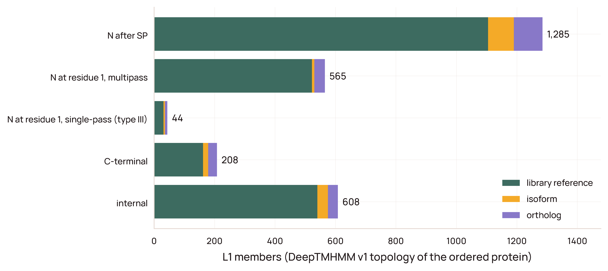

# The L1 surface-protein ORF library: design brief for external review

L1 is the first tranche of Deliverome's barcoded library of cell-surface protein open
reading frames (ORFs): 2,735 active members, each a human, mouse or cynomolgus proteoform
with an epitope-tag cassette placed where it should be displayed outside the cell, cloned
into a common lentiviral vector and identified by a DNA barcode. Nothing in L1 has been
ordered. This brief sets out how each member was chosen and built, what is pinned so the
design can be rerun, and the decisions we would like reviewers to weigh in on. It describes
the design as of **2026-11-05**; issues still being worked on before the order are listed
separately in the [cover note](COVER_NOTE.md).

Every count below is measured by [`brief_numbers.py`](brief_numbers.py) from the library's
own tables and written to [`brief_numbers.json`](brief_numbers.json); the reviewer package
([`README.md`](README.md)) reruns the pipeline and checks those numbers. Unless a count says
otherwise it refers to **tranche L1, active members** (members not retired as duplicates),
with topology from **DeepTMHMM v1**.

## Terms used throughout

| Term | Meaning here |
|---|---|
| Member | One construct in the library: a gene's chosen proteoform, its designed coding sequence (CDS), tag cassette and barcode. Named `l1-pNNNN`. A gene can have several members (its reference plus an isoform or ortholog). |
| Tranche | L1 is the set ordered first; L2 (4,279 active members) is designed by the same pipeline and not yet ordered. |
| Candidate set | Why a member exists: `library_reference` (the gene's reference proteoform), `isoform`, `ortholog` (mouse or cyno), or `expression_rescue` (a re-engineered arm of a poorly expressed receptor). |
| Proteoform | The exact protein sequence a member encodes. It is the designed CDS translated, which is not always the gene's UniProt canonical sequence. |
| Fragmid | A modular Golden Gate (BbsI) part system for lentiviral vectors ([McGee et al., 2024](https://pubmed.ncbi.nlm.nih.gov/38484704/)). Our vector is assembled from Fragmid-style parts, which is why BbsI must not cut inside an ORF. |
| p003 | Our first built and expressed construct: TfR1 (TFRC) carrying the tag cassette on its extracellular C-terminus, upstream of an IRES-driven selection marker. Its tag codons and junction grammar are the template every member reuses. |
| Tag cassette | 51 aa: `GGGGS`–SpyTag003–`GGGGSGGGGS`–P-ALFA-P–`GGGGS`. SpyTag003 is captured covalently by SpyCatcher; ALFA (here flanked by prolines, "P-ALFA v1.5-P") is bound by the anti-ALFA nanobody. Both were detected on the cell surface with p003. |
| Rung | The position a member's tag cassette goes, assigned from topology alone: N-terminal after the signal peptide, N-terminal at residue 1, C-terminal, or internal (a loop between transmembrane helices). |
| Barcode | A 20-nt sequence downstream of the ORF, read by sequencing to identify which member a cell carries. |
| Swap tract | The longest stretch of sequence a member shares with any other member, measured up to its barcode. During reverse transcription a template switch inside a shared stretch can attach one member's barcode to another's ORF. |
| Domestication | Removing BbsI, Esp3I and BsaI recognition sites from an ORF by synonymous substitutions only. |

## 1. The question the library answers

Which human cell-surface proteins, expressed one at a time from a common vector, reach the
plasma membrane and display an extracellular tag, and how does that depend on the proteoform,
the species and the tag position? Answering it pooled needs three properties from every
member: it is a real surface-anchored protein in the form that is expressed, its tag sits on
the extracellular side, and its barcode cannot be confused with another member's.

| Candidate set | L1 active members | What it adds |
|---|---:|---|
| library reference | 2,360 | one reference proteoform per library gene |
| isoform | 150 | alternative human proteoforms of 137 genes |
| ortholog | 200 | 100 mouse + 100 cyno proteoforms |
| expression rescue | 25 | Igκ-leader and recoded arms of poorly expressed GPCRs |
| **total** | **2,735** | 7 further members were retired as duplicate proteins |

The 2,360 references cover 2,369 library genes. Of the 9 genes without a reference member,
4 are paralogs whose identical protein is built under another symbol (OPN1MW2, OPN1MW3,
OR2A42, UPK3BL2; section 4), and 5 have no member because the human reference genome
(GRCh38) carries a broken copy and Ensembl 115 has no intact one. Ensembl 115 annotates their
primary-assembly transcripts as `protein_coding_LoF`, so none has a MANE Select transcript, the
ladder took the APPRIS principal (that broken transcript), and CDS resolution refuses any
transcript that does not translate to an intact protein. Each is compared with its reviewed
UniProt entry, which describes the intact protein, by
[`unbuildable_genes.py`](unbuildable_genes.py):

| Gene | Defect in the GRCh38 copy | Intact copy in Ensembl 115 |
|---|---|---|
| FCGR2C | premature stop at codon 57 (UniProt Q), plus one residue difference | none |
| OR8J2 | premature stop at codon 64 (UniProt R) | none |
| OR10AC1, OR52P1 | frameshift: under two thirds of the protein aligns | none |
| OR4Q2 | frameshift and compensating frameshift (121 residues out of frame) | a patch-scaffold transcript, 1 residue short of UniProt |

Three further genes had the same defect but an intact copy, identical to UniProt, on an
alternative-haplotype or patch scaffold of Ensembl 115. They are built from it, through a
named override (section 3): KIR2DS4 (`l1-p2740`, alternative KIR haplotype), OR12D1
(`l1-p2741`, alternative MHC haplotype) and OR5AL1 (`l1-p2742`, patch scaffold).
[`check_reference_allele_lof.py`](../../../../scratch/becca/appris-principal/check_reference_allele_lof.py)
recomputes from the pinned files that each primary copy is loss-of-function (3, 8 and 10
internal stops) and that the transcript built equals the UniProt protein
(`reference_allele_lof_evidence.tsv`). Member CDS have a median
length of 1,386 nt; finished vectors are 7,753–12,706 bp (median 8,953).

## 2. Genes: from the surfaceome universe to 2,369

Genes come from the accessible-surfaceome catalog, release 1.3.0
([Zenodo doi:10.5281/zenodo.23445521](https://doi.org/10.5281/zenodo.23445521)), which
records per gene the evidence that it reaches the cell surface, its membrane architecture and
its DeepTMHMM v1 topology. A gene enters the library if it passes every gate of the cohort
filter ([`final_library.py`](../../../sprint1/s1e3-surface-library-filters/final_library.py)):

| Gate | Rule | Why |
|---|---|---|
| Surface evidence | in the catalog's `canonical` or `likely` surface tier | the catalog's own curated surface call |
| Accessibility | `surface_accessibility` is not `no` | the protein must be reachable from outside |
| Specificity | `surface_dominant` or `mixed` | mostly intracellular proteins would read as non-expressors |
| Anchored | at least one transmembrane helix, or GPI-anchored | a secreted protein cannot be displayed |
| Co-receptor | no obligate partner, or every partner expressed (median cell-line TPM ≥ 5) | an obligate partner that the host cell lacks would fail the member for reasons unrelated to it |
| Expression | maximum TPM ≥ 5 in the expression reference | an unexpressed gene has no use case |
| Localization | the surface call is not a non-surface reason | excludes, e.g., ER residents |
| ORF size | ≤ 5,000 nt | synthesis and packaging limit; larger genes go to truncation (L2) |
| Ectodomain | ≥ 30 extracellular residues (GPI proteins exempt) | below that there is no domain to display |

Three named additions are included as flagged tiers rather than merged: low-literature
UniProt-surface genes, GPCRs with screen-validated surface expression from a published GPCR
surface-expression screen (the Tedman 2025 table, recorded in the s4e9 inputs), and
overexpression-surface rescues (the DLL3/GLUT4/FcRn pattern).

Rerun over release 1.3.0 the filter passes **2,370** genes. One is removed by a recorded
exclusion: EPPIN, which every source except one curated attribute calls not GPI-anchored and
which reaches the sperm surface only through a protein complex. The library's gene list is
the frozen 2,368-gene root plus dated additions; SLC67A1 is the one addition, admitted because
release 1.3.0 calls 12 TM helices on its canonical where the earlier cohort had none. The
library is therefore **2,369 genes**. Genes are appended, never re-derived, so an addition
cannot renumber an existing member.

## 3. Proteoforms: one reference per gene, chosen by a ladder

A gene's reference proteoform is chosen by
[`select_reference.py`](../../../../scratch/becca/appris-principal/select_reference.py),
trying each rung in turn. Agreement is tested on the protein sequence, never the transcript
ID, because several transcripts commonly encode one protein.

| Rung | Rule | Genes |
|---|---|---:|
| 1 | MANE Select and the APPRIS principal isoform encode the same protein | 2,172 |
| 2 | only one of the two exists: take it (APPRIS only) | 77 |
| 2 | neither exists: UniProt canonical | 9 |
| 3 | they disagree: look for observed evidence at the residues that distinguish them | 111 |
| | — strong evidence for MANE | 9 |
| | — weak evidence for MANE | 13 |
| | — weak evidence for APPRIS | 7 |
| | — no evidence | 82 |
| 4 | without strong evidence, default to MANE | (all 111 above) |

"Evidence" is PeptideAtlas build 607 peptides observed in at least 10 samples and GENCODE
Ribo-seq ORF translations. Only strong evidence can move a gene off MANE, and none of the 111
disagreements has strong evidence for APPRIS, so all 111 stay on MANE. We default to MANE
because 74 of the 111 disagreements carry APPRIS's lowest-confidence principal label
(`PRINCIPAL:4`), so "APPRIS wins" would side with APPRIS exactly where it is least sure.
Twenty genes with weak evidence either way are flagged for review.

Ten genes carry a named override that takes precedence: six GPI-anchored proteins whose
anchor sits on a non-canonical form (ACHE, BCAN, CD55, CD58, NCAM1, TFPI); MICA, whose
ladder pick lost its transmembrane helix; and KIR2DS4, OR12D1 and OR5AL1, whose ladder pick
is the loss-of-function copy in GRCh38 (section 1). A soluble-form guard also rejects a pick that
topology calls signal-peptide-only or globular, unless it is GPI-anchored.

The source finally taken, across 2,369 genes: **MANE 2,277, APPRIS 71, UniProt canonical
11, named override 10**. For 214 genes the reference differs from the UniProt-canonical
accession the library used before this ladder, which is why every downstream record is
matched on sequence rather than accession (section 5).

*Figure 1. How each of the 2,369 library genes got its reference proteoform. One bar per
ladder outcome; color is the source finally taken (the 10 named overrides are 6 within
"MANE = APPRIS" and 4 within "APPRIS only", too thin to see at this scale). Unit: gene;
n = 2,369; values are counts, log scale. Data: `library-design/reference_selection.tsv`.
Regenerated by [`brief_numbers.py`](brief_numbers.py).*

## 4. Isoforms and orthologs

Both panels are seeded, class-stratified draws, balanced across membrane architecture
(type I, type II, type III, GPI, multipass) rather than uniform, because a uniform draw loses
the rare architectures whose placement is least certain.

| Panel | Members | Draw | Composition |
|---|---:|---|---|
| Isoforms | 150 (137 genes) | seed 20261009; 100 with observed evidence (mass spectrometry or Ribo-seq) + 50 prediction-only | type I 61, multipass 51, type II 17, GPI 16, type III 5 |
| Orthologs | 200 | seed 20261011; 100 mouse + 100 cyno, each split 50/50 into "near" and "diverged" bands at the median sequence correspondence to human (0.864 mouse, 0.962 cyno) | type I 66, multipass 72, GPI 28, type II 26, type III 8 |

A drawn form the library cannot use is replaced by continuing the same seeded draw within
its own stratum, so every valid pick keeps its place and the panel regenerates from code.
Thirteen picks were replaced: one isoform that is its gene's reference, one ortholog identical
to human, one isoform whose designed protein duplicates another member's, and ten forms that
no transcript encodes.

**The pool both panels were drawn from is narrower than the library.** The isoform and ortholog
universes were built from an April 2026 query set (the expression-filtered
`surfaceome_expressed` list behind accessible-surfaceome commit f9c73691), which holds 1,775 of
the 2,369 library genes; the other 594 were never queried. Checked against the pinned Ensembl
Compara 115 homology dumps by a pipeline stage of its own (`check_universe_coverage.py`):

| | Mouse | Cyno |
|---|---:|---:|
| Library genes with a one-to-one, high-confidence ortholog in Compara 115 | 1,870 | 1,848 |
| … in the list the panel drew from | 1,452 | 1,432 |
| … never queried | 418 | 416 |
| Recorded pairs that are not one-to-one high-confidence | 0 of 1,972 | 0 of 1,927 |

For isoforms, the universe does cover every library gene: all 451 library genes with a
non-canonical UniProt isoform but no member in the isoform cohort have scored rows, and the
cohort's own rules exclude each one (`audit_isoform_coverage.py`, which fails on an
unexplained absence). For 399 of those genes, every alternate form is below the evidence bar,
which requires a diagnostic peptide, a positive OpenProt translation score or an APPRIS TRIFID
score above 0.5. The other 52 include forms excluded for lost surface anchoring. Lack of evidence
is not evidence that an isoform is absent.

**A replacement ortholog panel is drawn but not adopted.** A redraw over the full library
gene list uses Ensembl Compara 116 one-to-one, high-confidence pairs (3,643 sampleable
gene-species representatives) and admits an ortholog form only if its coding sequence is
supported: a native ATG start, supported start and stop coordinates, a terminal stop, no
internal stop, and a translation identical to the selected protein. Ranking prefers verified
APPRIS principal transcripts for mouse; cyno has no APPRIS dataset. It keeps the same seed,
quotas and band cutoffs, and fills all 200 slots with no shortfall, keeping 14 current picks
and replacing 186. Of the 186 forms it drops, 183 still pass the coding-sequence gate, so
those removals come from redrawing a wider pool, not from defects. The other three (cyno OPN3,
ADCY2 and PRRG1) lack a supported start. Coding completeness is not domain equivalence: some
drawn forms are much shorter than the human library protein (cyno SLC8A1 624 vs 973 aa,
IL31RA 598 vs 764), so each form was compared with the human library protein for signal
peptide, TM helices, orientation, GPI and Pfam domains: 183 of 200 keep the human architecture,
11 lose a feature and should be replaced by the next conserving form in the same seeded draw
(cyno SLC8A1 loses TM6–10 and its C-terminal exchanger domain; cyno IL31RA its signal peptide
and N-terminal 142 residues; cyno MS4A10 TM1, which flips its orientation), and 6 need a decision
([review, draft](https://github.com/Deliverome-Project/deliverome-analysis/pull/273)). Until it is adopted,
the current panel is the ordered one, a valid seeded draw from the smaller April pool, with the
gap recorded (question 4, section 9;
[`ORTHOLOG_CDS_POLICY.md`](../ORTHOLOG_CDS_POLICY.md)).

Barcode-swap screening (section 6) does not apply between a gene's members: an isoform
shares its parent's sequence by construction (median overlap 1,071 nt over 2,150 pairs, none
under 100 nt), so a swap-tract bar would remove the panels entirely.

**Duplicate proteins.** Comparing translated designed CDS across the library found members
with different symbols, accessions or transcripts that encode the identical protein. One
member is kept per protein; 7 L1 members are retired (ACHE and CD177 isoforms identical to
or an allele of the reference; a cyno MMP16 identical to human; the paralogs OPN1MW2,
OPN1MW3, OR2A42 and UPK3BL2, whose proteins are built under OPN1MW, OR2A1 and UPK3BL1). Ids
are never renumbered.

## 5. Tag placement

### Rungs

Each member gets one rung from the DeepTMHMM v1 topology of **its own** designed protein,
matched by sequence hash, never by accession: a member's ordered form can differ in topology
from its gene's canonical (SLC9D1's ordered isoform has 3 TM helices against the canonical's
13). The ladder takes the first rung that applies:

| Rung | Rule | Rests on | Members |
|---|---|---|---:|
| N after SP | the residue after the signal peptide is extracellular | predicted cleavage site | 1,300 |
| N at residue 1, multipass | N-terminus extracellular, no signal peptide, >1 TM | the GPCR surface screen's validated N-terminal tags | 563 |
| N at residue 1, single-pass (type III) | same, 1 TM | topogenesis argument only; untested | 62 |
| C-terminal | C-terminus extracellular | topology only | 218 |
| internal | neither terminus extracellular, or GPI-anchored with an ecto-C call | needs a loop or ectodomain site | 567 |

A site is written as `insert_after_residue` *n*: 1-based on the member's designed protein, so
the cassette goes after codon *n*, at nucleotide 3*n* counted from the A of the start codon.

Two rules sit on top of the ladder. A GPI-anchored protein's C-terminus is removed at its
ω-site, so a C-terminal call for one is rerouted to internal; this touches 2 members, BST2
and RGMB. Shedding risk is recorded but never moves a rung, because none of the members at
proteolytic risk has a usable inter-TM loop to move to.

*Figure 2. Tag-placement rung for every L1 active member with a designed tag path, by
candidate set. Unit: member; n = 2,710 (the 25 expression-rescue arms carry their own
designs); values are counts. Topology: DeepTMHMM v1, matched on the ordered protein.
Data: `l1_tag_paths.tsv`. Regenerated by [`brief_numbers.py`](brief_numbers.py).*

The internal rung is the hard one. Space is rarely the limit: the median longest
extracellular run between two TM helices is 52 residues. Seven internal members have no such
run of at least 8 residues; for two of them (BST2, RGMB) the 0 is an artifact of the measure,
since they are single-pass GPI proteins with 137- and 394-residue ectodomains, leaving five
genuine no-site cases (TMEM139, TMEM169, TMEM268, TMEM86A, TMEM86B).

### Topology

DeepTMHMM v1 (1.0.24) is the topology of record, chosen over v2 because v1 recalls 99.5% of
signal peptides against v2's 92.9%; v2 is kept alongside and not substituted. A v1 row is
selected by its tool-version stamp, not by the presence of a per-residue string, because v2
rows carry a v1-alphabet back-projection that differs from genuine v1 output. Every active
member has a v1 row for its exact sequence: 2,155 from the human canonical cohort, 207 from
human isoforms, 188 from the ortholog cohorts, and 160 run on the designed ORFs themselves.

### GPI anchors

GPI anchoring is called per form, not per gene, because the anchored species is not always
the reference (ACHE's canonical is non-anchored while P22303-2 is anchored). The GPI set is
NetGPI 1.1 over reference and alternative forms, unioned with curation under a confidence
rule: 157 genes, of which 138 are NetGPI-anchored and 19 are curated GPI that NetGPI does
not call. 191 L1 members belong to GPI genes; 182 are N-terminal after the signal peptide,
7 N-terminal at residue 1, and 2 rerouted from C-terminal.

### Structure models

The site-scoring lanes that choose a concrete junction read pLDDT, solvent accessibility and
secondary structure from an AlphaFold model, so a member without a model cannot be scored.
Models come from AlphaFold DB where it has one and are otherwise folded from the designed CDS
with ColabFold 1.6.2 (same AlphaFold2 weights, MMseqs2 rather than JackHMMER alignments). Each
model is compared residue for residue with the member's designed protein, because a model
fetched by accession can be of a different proteoform:

| Verdict | Active L1 members | Meaning |
|---|---:|---|
| identical | 2,414 | the model is of exactly this protein |
| contained | 26 | our protein is a subsequence of the modeled one; needs an offset the lanes do not apply |
| different | 198 | the model is another proteoform; its numbering cannot be carried onto the construct |

191 of the 198 "different" are library references, the set resolved by gene symbol to a
canonical accession. A length test does not catch them: 22 have the same length as their
model. (These counts cover the 2,638 active members compared. The comparison table holds
2,645 L1 rows including retired members: 2,420 identical, 199 different, 26 contained. The
s4e9 record lists 25 further members with a model that were not compared, for lack of a
designed CDS or a returned sequence, for 2,670 with a model.)

### The literature positives behind the internal-site ranker

The rung says a member needs an internal site; the concrete residue is proposed by a
separate site ranker (experiment S5E13), trained on 176 internal tag insertions that a
literature-retrieval agent collected from published papers. Each of the 176 was read against
its paper ([audit, PR 236](https://github.com/Deliverome-Project/deliverome-analysis/pull/236);
procedure in `scratch/becca/tag-site-corpus-audit/README.md` on that branch):

| Verdict | Positives | Meaning |
|---|---:|---|
| confirmed exact | 125 | the paper places the tag at the cited residue |
| confirmed shifted | 23 | the paper places it at another residue, mostly because it numbers a mouse ortholog (14 of 23); all five ABCB1 sites are +4 |
| region only | 11 | the paper supports the loop or domain, not one residue |
| not supported | 17 | 7 cite a paper that tagged a different gene or showed the site intracellular, 5 are numbered in a species that cannot be mapped to the human residue, 5 are terminal tags filed as internal |

The per-site audit, with each paper's quote, is
`processed://scratch/becca/tag-site-corpus-audit/audit.tsv`. The corrected training set used by
the S5E13 retrain (PR 232), `processed://sprint5/s5e13-tag-site-benchmarking/corpus_audit_corpus.tsv`,
was built before two region-only sites (MMP14, TMEM123) were resolved and holds 146 positives
at the paper's residue, 13 region labels and the 17 dropped.

The audit's confirmed sites, one row per protein and residue, form a gold standard
(`gold_standard.tsv`): 156 sites on 113 proteins, 120 of them on 93 proteins with surface
display shown, 4 shown not to reach the surface and 75 with function shown; it covers 108 of
the 127 training proteins. It excludes five confirmed positions where the paper shows the
construct failed (`failed_sites.tsv`, kept as candidate negatives) and adds six real sites from
papers the agent had filed under the wrong gene (KCNK3 214 and five GABA-A subunits:
GABRA5 35, GABRA6 23, GABRG1 39, GABRG2 43, GABRG3 21; `added_sites.tsv`). The 22 region-level
sites are in `region_labels.tsv`, 19 of them with a candidate window on the human canonical
sequence (16 proteins). All of these files are under
`processed://scratch/becca/tag-site-corpus-audit/` and in the reviewer bundle.

The audit also read the 15 live literature rows outside the training set (`in_training = 0`):
6 that carried no residue were pinned to one from the paper (CFTR 891, NRXN1 371, TRPV1 606,
NRG3 275, SLC12A5 248, SLC4A2 862), ABCC1 at 4 is confirmed, ITGB7 23 shifts to 42, CNR1 25 is
unsupported, and 6 stay region only; the 176-row table above is unchanged by them. The live
tag-site API was corrected to these verdicts on 2026-11-05, as version `2026-11-05-lit-audit`
([accessible-surfaceome PR 459](https://github.com/Deliverome-Project/accessible-surfaceome/pull/459)):
178 rows written and 18 withdrawn, so ABCB1's sites, for example, are now served at 105, 324,
740, 745 and 965. Nothing in the L1 tag paths depends on these
sites.

## 6. Domestication and the cassette's linker encoding

**Domestication.** Every ORF is cleared of BbsI (the Fragmid assembly enzyme), Esp3I (the
shuttle enzyme) and BsaI (not cleared from the backbone) by synonymous edits only, with no
codon optimization, so the protein and native codon usage are kept. Across L1, the median
member needs 3 edits (maximum 20); 330 need none. Every vector carries exactly two Esp3I
sites, the inward-pointing pair that lets the barcoded insert move to another backbone in one
reaction.

**Why the linkers are recoded.** For an N-terminal or internal member the cassette lies
upstream of the ORF's own C-terminus, so it never enters the swap tract; two such members
share only the constant 24-nt tail before the barcode (stop codon, a 2-nt pad and a 19-nt
primer handle) plus whatever C-terminal codons their ORFs share. For the 218 C-terminal
members the cassette is the last coding sequence before that tail, so one shared encoding
would give every pair a 51-aa identical stretch. We gate the swap tract at 100 nt (5.0%
predicted swapping on the fit we use), preferring 80.

| Encoding of the C-terminal cassette | C-terminal members: median / max tract | Members over 100 nt (all 2,710) |
|---|---:|---:|
| one shared cassette (p003 codons) | 181 / 2,529 nt | 484 |
| every codon recoded, end unique in last 9 nt | encoder exhausts after 60 of 218 members | — |
| every codon recoded, last 15-nt block unique | 36 / 36 nt | 266 |
| **linkers only recoded, last 15-nt block unique (issued)** | **36 / 36 nt** | **266** |

SpyTag003 and P-ALFA-P keep p003's codons, which are the ones shown to display; only the four
`GGGGS` blocks are recoded. Recoding the tags too buys nothing (36 nt either way). The
terminal 15-nt block must be unique per member because a 9-nt rule allows only 60 distinct
ends and a 12-nt rule 180, both fewer than 218. The 218 encodings are issued in two seeded
batches and pinned, so adding a member cannot redraw an issued one.

All 266 members still over the bar are explained by their ORFs, not the cassette: 211 are
same-gene isoform/ortholog pairs sharing a C-terminus, and 55 are different genes with shared
3' coding sequence (clustered protocadherins, close paralogs such as olfactory receptors and
KIR2DS2/KIR2DS4). Each different-gene family is accepted by name, and a library test fails on
any new one. One C-terminal
member, SLC41A2, needs a synonymous last-codon change (GAC→GAT) to avoid creating an Esp3I
site at the cassette junction.

*Figure 3. Fraction of members whose worst-partner shared tract exceeds a given length, with
one shared cassette (maroon) and with the issued linker-only encodings (teal). Unit: member;
n = 2,710; each member counted once at its longest tract to any other member; dashed line,
the 100-nt gate. The curves separate where C-terminal members sit and converge in the tail,
which is ORF-encoded shared sequence the cassette cannot change. Data: `l1_swap_risk.tsv`.
Regenerated by [`brief_numbers.py`](brief_numbers.py).*

## 7. Reproducibility: what is pinned, and the one permanent limit

The pipeline ([`library_pipeline.py`](../library_pipeline.py)) lists 15 stages from gene list
to cassette. `verify` reruns each one offline from pinned inputs and compares it with the
published record; on 2026-11-05 all 15 reproduce. Nothing is rebuilt from today's sources:
each stage must reproduce what the library actually used.

| Source | Version pinned | Public? |
|---|---|---|
| accessible-surfaceome | release 1.3.0 (Zenodo) | yes |
| accessible-surfaceome | commit f9c73691: FASTAs, DeepTMHMM tables, ortholog cohorts | repository files, shared in the bundle |
| Ensembl | release 115: human, mouse, cyno CDS and peptides; human GTF | yes |
| UniProt | release 2026_03 tables (downloaded 2026-10-11) and REST features | yes |
| APPRIS | e115v50 principal isoforms; 2026_06.v50 scores | yes |
| OpenProt | 2.2 | yes |
| PeptideAtlas | human build 607, replayed in the original query batches | public data, our queries |
| GENCODE Ribo-seq ORFs | phase 1 all; phase 2 primary and comprehensive | yes |
| MyGene.info | responses of 2026-11-02 | public data, our queries |
| Expression | Deliverome-compiled TPM table (GTEx v10, HPA, TCGA) | internal compilation |
| DeepTMHMM | 1.0.24, topology snapshot 2026-11-01 | predictions run by us |
| NetGPI | 1.1 predictions | predictions run by us |
| GPCR surface screen | supplementary table, 2025-09-19 | published |

**The permanent limit.** The isoform-universe step built Python sets whose iteration order
follows the interpreter's string-hash seed, and the original run did not record its seed.
The rerun reproduces every row of the 1,894-row cohort table and its gene order, but 420–450
rows come back in a different order within their gene, and the 1,527-form topology shortlist
picks a different same-length translation for 78–95 forms. The committed shortlist FASTA and
DeepTMHMM output therefore remain the record of what was predicted, and the verifier allows
exactly these differences and no others. Two further inputs are reconstructions, each the
only variant that reproduces the record: the PeptideAtlas cache replayed in its original four
fill batches, and a curated GPI attribute taken as of 2026-10-11.

## 8. How the library is ordered

**Plates.** Every active member is ordered as purified plasmid in IDTE buffer (10 mM Tris,
0.1 mM EDTA, pH 8.0), stored at −80 °C, in 96-well V-bottom plates, in
order of synthesized-insert length, shortest first, so each plate holds members of similar
length. Each member gets an order number in that order, `L1-O0001` to `L1-O2735`, with its
plate and well (column-major, A01, B01, …) in [`l1_order_plan.tsv`](l1_order_plan.tsv). The member
ids themselves will be renumbered into this order when membership is frozen for the order, by
a pipeline stage that gives each active member a new id `l1-m0001`… in plate order, keeps the
old `l1-pNNNN` id as `design_id`, and records the mapping
([draft](https://github.com/Deliverome-Project/deliverome-analysis/pull/272)); until it merges,
the order number carries the plate position. 2,735 members fill 29 plates per set.

**Amounts.** 4 µg is ordered per member and 3 µg assumed delivered, normalized to
100 ng/µL (30 µL), and split into five plate sets with the same layout:

| Plate set | Plates | Volume per well | DNA per member |
|---|---:|---:|---:|
| Addgene deposit | 29 | 15 µL | 1.5 µg |
| Pooling A, B, C | 3 × 29 | 3 µL each | 0.3 µg each |
| Backup | 29 | the rest, 6 µL | 0.6 µg |

**Why pool by length.** Longer lentiviral genomes give lower functional titer. Comparing
packaged genomes of 3.9, 6.9 and 10.1 kb, Sweeney and Vink found titer fell 3–4-fold per extra
kilobase while physical particle yield stayed constant; the loss is shallower below about 7 kb
(about 2-fold per kb from their infectivity data) and steeper near 10 kb, where packaging
itself fails ([Sweeney & Vink, 2021](https://pubmed.ncbi.nlm.nih.gov/34095341/)). Moon et al.
offset it in a pooled lentiviral library by pooling 0.2 × 3.5L/1000 pmol of each
plasmid, L the effector length ([Moon et al., 2026](https://pubmed.ncbi.nlm.nih.gov/42031729/));
their dropout fell from 48.7% to 4.2%, though the same library also changed its barcoding, so
the gain cannot be credited to pooling alone. Our backbone is constant, so differences in
insert length (276–5,229 nt, median 1,476) are differences in packaged
length. At 3.5-fold per kb, the model predicts the longest member transduces
110× less efficiently than the median one and 495× less than the shortest.

**How the weighting is applied.** Each member's pooled amount follows the factor in pmol,
converted to mass with its own vector length, and is scaled so a member with a 4.3-kb insert
fills exactly one pooling well (300 ng) per pool:

- The 53 members with inserts over 4.3 kb need more than one well per pool, so
  they are ordered with extra DNA (26.7 µg extra in total at 3.5-fold per kb, up to
  6.9 µg ordered for the longest).
- Every other member needs less than a well, down to 13 nL for the shortest at
  3.5-fold per kb, which cannot be pipetted by hand. Because the plates are length-ordered, each
  of pooling plates 1–27 is diluted to one concentration and a fixed 3 µL is pooled from every
  well; that lands each member within the error in the table below of its own target. The plate
  concentrations are in [`l1_order_pooling_plates.tsv`](l1_order_pooling_plates.tsv).
- The last two plates (143 members, the long tail) are pooled well by well at each member's
  own volume.

| Fold lower titer per kb | Longest vs median | Longest vs shortest | Extra DNA for inserts > 4.3 kb | Largest single order | Pooling-plate dilutions | Worst within-plate error |
|---|---:|---:|---:|---:|---:|---:|
| 2.0× | 14× | 31× | 13.3 µg | 5.3 µg | 5.0–51 ng/µL | 1.16× (1.25× on plate 1) |
| 2.5× | 31× | 94× | 18.2 µg | 5.8 µg | 2.2–42 ng/µL | 1.21× (1.33× on plate 1) |
| 3.5× | 110× | 495× | 26.7 µg | 6.9 µg | 0.6–32 ng/µL | 1.29× (1.45× on plate 1) |

*Figure 4. Volume of each member pooled per pool, at 100 ng/µL, against its synthesized-insert
length, under three assumed per-kb titer losses. Unit: member; n = 2,735. Dashed lines: one
3-µL pooling well and the 4.3-kb insert threshold; dotted line: 0.5 µL, the smallest volume
worth pipetting by hand. Data: `l1_order_plan.tsv`. Regenerated by
[`order_plan.py`](order_plan.py).*

**The factor is not measured for our vectors, and it matters.** Between 2- and 3.5-fold per kb
the correction for the longest member against the median ranges from 14× to 110×, so an
overcorrection would make the long members the overrepresented ones. Our packaged genomes
(tag cassette included) span 4,434–9,387 nt, median 5,634. Over that range Sweeney and Vink's
reported fold changes imply about 1.9–2.7-fold per kb, below Moon et al.'s 3.5, and no
Deliverome dataset yet supports a fitted slope. A 91-clone pilot that pools a length-spanning
subset equimolar and compares plasmid with integrated barcode counts would pin the factor to
about ×/÷1.1 before the full pool is made; if pooling cannot wait, 2-fold per kb is the
better-supported weighting. A cheaper first test is already on the bench: the 16 P-series
plasmids in the next pool (p0022–p0035, p0037, p0048) use the same backbone and span
5,063–8,435 nt packaged, over which 2-fold per kb predicts a 10-fold titer drop from the
shortest (FOLR1) to the longest (HEG1) and 3.5-fold predicts 68-fold. Their per-construct
barcode counts in plasmid and integrated DNA fit the slope directly, though gene-specific effects
are not separated from length with 16 genes. Pilot design and evidence:
[`scratch/becca/l1-length-titer/`](https://github.com/Deliverome-Project/deliverome-analysis/pull/271)
(question 5, section 9).

## 9. Decisions we would like reviewers to weigh in on

Questions 1, 2, 4 and 5 are choices already made that we want challenged; the third is open. Everything
still being worked on before L1 is ordered is tracked, with its owner and status, in the
accompanying [cover note](COVER_NOTE.md) and as issues on the review repository, so this brief
can stay a description of the design.

| # | Question | Why it matters | What would resolve it |
|---:|---|---|---|
| 1 | **MANE by default for the 111 disagreements.** | 82 have no distinguishing evidence either way; a different default would change their proteoform. | Reviewer view on the default, or targeted evidence for the 20 flagged genes. |
| 2 | **N-terminal tagging at residue 1 for type III single-pass proteins** (62 members). | Rests on a topogenesis argument only: the single helix carries the whole orientation decision, and a 51-aa cassette changes the charge balance it reads. | A small panel testing N-terminal versus loop placement on type III proteins. |
| 3 | **Five library genes with no intact copy in Ensembl 115** (FCGR2C, OR8J2, OR10AC1, OR52P1, OR4Q2; section 1). | They pass the gene filter but are absent from L1, so any per-gene coverage figure is 5 short. FCGR2C has a known intact (ORF) allele carried by a minority of people ([Breunis et al., 2007](https://pubmed.ncbi.nlm.nih.gov/17827395/)). | Build the intact UniProt allele by correcting the stop codons (FCGR2C, OR8J2) or the frameshifts, or record each as an exclusion. |
| 4 | **Isoform and ortholog panels drawn from a 1,775-gene April pool** (section 4). | 418 mouse and 416 cyno orthologs, and 92 genes' isoforms, could never be drawn, so the panels say nothing about those genes' forms. | Reviewer view on keeping the panels as drawn (the current decision) versus rebuilding both universes over the 2,369 library genes and redrawing with the same seeds and strata, which would change many members. |
| 5 | **How strongly to weight the pool by length** (section 8). | The ordering plan is computed at Moon et al.'s 3.5-fold lower titer per kb (up to 110× more of the longest member than the median); Sweeney and Vink's data imply about 2-fold per kb over our 4.4–9.4-kb packaged range, and an overcorrection inverts the bias. | Whether the 91-clone pilot is worth running before the pool, or whether to pool at 2-fold per kb now. |

## Materials and provenance

| Element | Location | Status |
|---|---|---|
| Full design record | [`../README.md`](../README.md) | committed |
| Pipeline and verifier | [`../library_pipeline.py`](../library_pipeline.py) | committed; 15/15 stages reproduce 2026-11-05 |
| Pinned-input manifests | `../library_pipeline_inputs.json`, `../reproduce_isoform_universe_inputs.json`, `scratch/becca/appris-principal/panel_inputs.json` | committed, SHA-256 per input |
| Tag paths | `../l1_tag_paths.tsv`, [`../TAG_PATHS.md`](../TAG_PATHS.md) | committed |
| Cassette encodings and swap risk | `../l1_cassette_encodings.tsv`, `../l1_swap_risk.tsv`, `../l1_swap_risk_summary.json` | committed |
| Model-vs-protein check | `../proteoform_match.tsv` | committed |
| Reviewer bundle | [`bundle_manifest.tsv`](bundle_manifest.tsv) (85 files, SHA-256 each) | shared in full as a dated release asset of the review repository (current: `bundle-2026-11-05-r6`) |
| Audited tag-site positives (S5E13 ranker) | `audit.tsv`, `gold_standard.tsv`, `failed_sites.tsv`, `added_sites.tsv`, `region_labels.tsv`, `corpus_audit_corpus.tsv` (paths in section 5) | in the reviewer bundle; audit is [PR 236](https://github.com/Deliverome-Project/deliverome-analysis/pull/236) |
| Order plan: plate map, volumes, pooling weights | [`order_plan.py`](order_plan.py) → [`l1_order_plan.tsv`](l1_order_plan.tsv), [`l1_order_pooling_plates.tsv`](l1_order_pooling_plates.tsv), `l1_order_plan_summary.json` | committed; not yet sent to a vendor |
| Numbers and figures in this brief | [`brief_numbers.py`](brief_numbers.py) → [`brief_numbers.json`](brief_numbers.json), `figures/` | committed |

## Decision log

| Date | Was | Now | Why |
|---|---|---|---|
| 2026-11-02 | No external-facing summary of L1 | This brief and a credential-free reviewer package | External review of the design before ordering |
| 2026-11-04 | Package shipped from the analysis repository | A private review repository with the full bundle as a release asset, internal inputs included | Reviewers need only this design's code; Becca approved sharing every bundled input |
| 2026-11-04 | Order-blocking issues listed among the review questions | Moved to a separate cover note; the brief keeps three design questions | The brief describes the design; the cover note tracks work in progress and changes as issues close (Becca) |
| 2026-11-07 | Isoform gap described as 359 unexamined genes; one ortholog panel | All 451 isoform absences explained by the cohort rules; a CDS-gated Compara 116 ortholog redraw exists for review, not adopted | Becca |
| 2026-11-07 | No ordering plan | Plates by insert length (order numbers `L1-O…`), 4 µg ordered / 3 µg assumed at 100 ng/µL in Addgene, three pooling and one backup plate sets; length-weighted pooling after Moon et al., with extra DNA for inserts over 4.3 kb | Becca |
| 2026-11-05 | Panels described as drawn from library genes | Recorded as drawn from the April 2026 pool (1,775 of 2,369 genes), kept as drawn, and posed as reviewer question 4 | Becca: record the gap and keep the panels |
| 2026-11-05 | 8 library genes without a member | KIR2DS4, OR12D1, OR5AL1 built from intact alternative-haplotype transcripts (`l1-p2740`–`l1-p2742`); 5 remain | Becca: the intact protein exists in Ensembl 115; the KIR2DS2/KIR2DS4 125-nt overlap accepted as a paralog pair |

## References

- [Moon et al., 2026](https://pubmed.ncbi.nlm.nih.gov/42031729/). A combinatorial domain
  screening platform reveals epigenetic effector interactions for transcriptional perturbation.
  Nat Commun 17. doi:10.1038/s41467-026-72227-9.
- [Sweeney & Vink, 2021](https://pubmed.ncbi.nlm.nih.gov/34095341/). The impact of lentiviral
  vector genome size and producer cell genomic to gag-pol mRNA ratios on packaging efficiency
  and titre. Mol Ther Methods Clin Dev 21:574–584.
- [Breunis et al., 2007](https://pubmed.ncbi.nlm.nih.gov/17827395/). Copy number variation of
  the activating FCGR2C gene predisposes to idiopathic thrombocytopenic purpura. Blood
  111:1029–1038.
- [McGee et al., 2024](https://pubmed.ncbi.nlm.nih.gov/38484704/). Modular vector assembly
  enables rapid assessment of emerging CRISPR technologies. Cell Genomics 4:100519.
