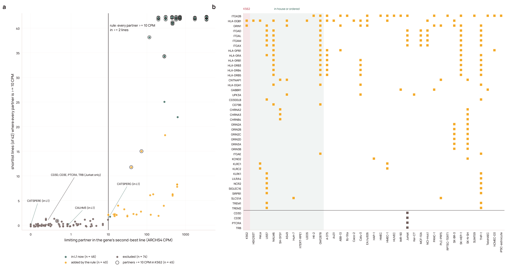

# Co-receptor gate against the screening lines

The co-receptor gate (`library/l1/surface-filters/final_library.py`,
`coreceptor_ok`) keeps a gene that needs an obligate partner only if every partner it can measure
has a **median** TPM ≥ 5 across the 1,206 Human Protein Atlas (HPA) cell lines. A median over 1,206
lines asks whether the partner is ubiquitous. The library is screened in a short list of lines,
K562 first, so the question that matters for a screen is different: is the partner expressed in a
line we will screen in? This page answers that question for K562 and for the cell-line panel
shortlist, and sets out what each candidate rule would add or drop. The gate's threshold is
unchanged. Its partner lookup is corrected, which changes no outcome (see Free-text partners).

Regenerated by [`coreceptor_host_line.py`](coreceptor_host_line.py). Outputs are at the experiment
root and in `processed://sprint4/s4e9-orf-design-fg-panel/`:

| File | Contents |
|---|---|
| `coreceptor_host_line_genes.tsv` | one row per gene the partner rule decides: partners; limiting-partner TPM (median, K562, best T, B and myeloid line); the number and names of shortlist lines where every partner clears 5 TPM; outcome under each rule |
| `coreceptor_host_line_partners.tsv` | one row per listed partner string: resolution status, any symbol fix, Ensembl ID, TPM in each context, lines ≥ 5 TPM |
| `coreceptor_host_line_options.tsv` | each candidate rule: genes kept, and the genes it adds or drops relative to the current gate |
| `coreceptor_host_line_line_pass.tsv` | per gene and threshold (5, 10 TPM), pass (1) or fail (0) in each of the 42 shortlist lines: HPA for its 29, ARCHS4 at the calibrated CPM cut for the other 13 |
| `coreceptor_rule_additions_proposed.tsv` | the 26 genes the adopted rule adds, in the `gene_list_additions.tsv` shape plus evidence: partners, the lines where they are present, which of those are in house or ordered |
| `coreceptor_host_line_trios.tsv` | every K562 + two-line set, with the genes covered and the genes added beyond K562 at each threshold |
| `figures/coreceptor_host_line.png` | the figure below |

## Inputs

| Input | Source |
|---|---|
| Cell-line TPM | HPA 23.0 (released 2023-06-19, Ensembl 109) `rna_celline.tsv.zip`, pinned at `external://human-protein-atlas/2023-05/rna_celline.tsv.zip` (SHA-256 `e5b11779…`; the same bytes are also at `external://hpa/v23/`). The file in the v23 archive is byte-identical to the one HPA serves today under release 26.0. Its per-gene medians equal the gate's own table (`hpa_celline_per_gene.csv`, `ba9735fa…`) for every gene, so the gate was built from HPA v23. |
| Screening shortlist | the 42 candidate lines of the cell-line panel experiment (`panel.py`, `candidates()`). HPA v23 has 29 of them. Four are matched under another HPA name for the same Cellosaurus line: HEK293 for HEK293T (the parental line, as the panel experiment also reads it), BJ1-hTERT for BJ-5ta, Hep 3B2.1-7 for HEP3B and SUM159PT for SUM159. HPA lacks the other 13: GM12878, IMR-90, HUVEC, BEAS-2B, HK-2, AB8-13, hCMEC-D3, HMEC-1, EA.hy926, TeloHAEC, iPSC-astrocyte, HMEC and Ker-CT. |
| Expression for the 13 lines HPA lacks | the panel experiment's ARCHS4 v2.5 consensus, pinned append-only at `external://archs4/v2.5/cell-line-panel-consensus/2026-09-04/rnaseq_consensus_archs4.parquet` with its retained-sample list and a PROVENANCE.md (SHA-256 `a3a789ac…`; copied unchanged from `processed://scratch/becca/cell-line-selection/`; log2(CPM + 1), gene symbols × 52 lines, all 42 shortlist lines included). Partners are reached through their Ensembl ID and HPA v23's name for it, so a renamed gene (CDC50A, which ARCHS4 calls TMEM30A) still joins; every partner of the 168 genes is measured. CPM is not TPM, so `coreceptor_host_line_archs4_calibration.tsv` compares HPA TPM ≥ t with ARCHS4 CPM ≥ c over the 29 shared lines and 20,067 genes; the cut with the highest Cohen's κ is used: 5 TPM ↔ 7 CPM (κ 0.83, 91% agreement) and 10 TPM ↔ 15 CPM (κ 0.76, 89%). Log-scale correlation between the two sources is 0.92. |
| Lines in house or on order | the 12 the panel experiment's README lists (K562, HEK293T and HeLa in house; U937, NALM6, SH-SY5Y, A549, HuH-7, hTERT-RPE1, U2OS, HK-2 and GM12878 ordered). HPA has 10 of them; HK-2 and GM12878 are missing. |
| Lineage of each line | HPA v23 `rna_celline_description.tsv.zip`, pinned at `external://hpa/v23/rna_celline_description.tsv.zip`, using its disease subtype: T lymphoid (29 lines), B lymphoid (82, excluding myeloma) and myeloid leukemia (42: acute myeloid lines plus HMC-1). Lines HPA leaves without a subtype are assigned from Cellosaurus. K562 is kept out of all three groups. |
| Genes and partners | the gene filter rerun offline over surfaceome release 1.3.0 (`library_pipeline.run_gene_filter`, which reproduces the 2,370-gene filter output) |
| Partner identity | `gene_resolver` (MyGene, the same configuration the catalog uses), joined to HPA on Ensembl gene ID; aliases of one gene collapse to a single partner. Free-text names MyGene gets wrong are mapped by the gate's own `PARTNER_SYMBOL_FIXES`. The resolver's response is committed in `coreceptor_host_line_mygene/`. |

A gene passes **in a given line** when, in that line, every partner it requires is ≥ 5 TPM. Where
the partners are alternatives, one member of each group is enough (see Partner lists). A shortlist
rule counts the lines in which the gene passes. That is stricter than taking each partner's best
line separately, because the partners have to be present together in the same line.

## Which genes the question touches

The partner rule decides 305 genes. The other genes needing a partner are settled either by a
reviewed accession or by the allowlist. Of the 305, **168 pass every other gate**, so the co-receptor
gate alone decides whether they are in. 48 of those 168 are in today: 43 because every partner
clears 5, and 5 whose only partner is the gene itself (BDKRB1, OTOP1, OTOP2, OTOP3, PCDHGB7).
Every one of the 48 passes in at least 19 of the 29 shortlist lines.

**a**, the 163 genes that pass every other gate and need a partner other than themselves; 160 are
plotted, and ADAM2, CD180 and PCDHA8 are left out because none of their listed partners resolves to
a gene. Each point is one gene. x: the CPM of the gene's limiting partner in its second-best line,
where the limiting partner is the lowest required partner, counting one per group of alternatives.
y: the number of the 42 shortlist lines in which every required partner is ≥ 10 CPM, with a small
fixed vertical jitter so integer counts do not overlap. The rule passes a gene exactly when x is
≥ 10 CPM, so the vertical line is the rule. Color gives status: in L1 now (46, including CALHM3,
CATSPERE and CATSPERG, which are in L1 through another route although this gate fails or barely
passes them), added by the rule (40), and excluded (74). A ring marks a gene whose partners are
≥ 10 CPM in K562, the first screening line (45). **b**, the 40 added genes and the four TCR–CD3
subunits the rule excludes. A square marks each line in which every required partner is ≥ 10 CPM.
Columns run K562 (red band), then lines in house or on order (gray band), then the other shortlist
lines with at least one square. Each value is one ARCHS4 v2.5 per-line consensus: the median
log2(CPM + 1) of the line's retained control samples. HLA calls depend on read mapping; the
HLA-DQB1 square in K562 rests on HLA-DQA1 at 10.4 CPM in an MHC class II–negative line. Regenerated
by [`coreceptor_host_line.py`](coreceptor_host_line.py) from
`external://archs4/v2.5/cell-line-panel-consensus/2026-09-04/`.

The sections that follow keep the analysis that led to the decision, including the HPA-based
comparisons; the Decision section gives the adopted rule.

## What each rule would add or drop

Relative to the 48 kept now, among the 168. "Alternatives" means the curated reading in Partner
lists below.

| Rule | Kept | Adds | Drops |
|---|---:|---|---|
| current: all partners, median ≥ 5 | 48 | — | — |
| median ≥ 2 | 48 | — | — |
| median ≥ 1 | 53 | ITGA2B, ITGAD, ITGAL, ITGAM, ITGAX | — |
| median ≥ 10 | 46 | — | HS3ST2, IL17RC |
| K562 ≥ 5, alternatives | 51 | GRIN1, KCND2, RHCE, RHD | ST14 |
| median ≥ 5 **or** K562 ≥ 5, alternatives | 52 | GRIN1, KCND2, RHCE, RHD | — |
| ≥ 5 TPM in ≥ 2 shortlist lines, alternatives | 75 | 27 genes (below) | — |
| ≥ 5 TPM in ≥ 2 shortlist lines **or** in K562, alternatives | 77 | the 27, plus RHCE and RHD | — |
| ≥ 10 TPM in ≥ 2 shortlist lines, alternatives | 67 | 19 of the 27 | — |
| ≥ 5 TPM in ≥ 1 shortlist line, alternatives | 93 | 45, including CD3D, CD3E, PTCRA, TRB and CD79B (Jurkat or NALM-6 alone) | — |
| ≥ 5 TPM in ≥ 2 in-house or ordered lines, alternatives | 57 | CNTNAP1, GABRB1, GRIN1, ITGAD, ITGAL, ITGAM, ITGAX, KLRK1, UPK3A | — |
| ≥ 10 TPM in ≥ 2 of the 29 HPA lines **or** ≥ 10 in K562 | 69 | 21 | — |
| **≥ 10 TPM in ≥ 2 of all 42 lines (HPA 29 + ARCHS4 13) or ≥ 10 in K562** | **76** | **28** | — |
| ≥ 5 TPM in ≥ 2 of all 42 lines or in K562 | 82 | 34 | — |
| ARCHS4 alone, 42 lines, CPM equivalent of ≥ 10 TPM in ≥ 2 | 73 | 25 | — |

**What the 13 extra lines add (≥ 10 TPM rule).** Of the 28, 21 pass on the HPA lines alone. The
other seven come from the ARCHS4 lines. GM12878, the B-lymphoblastoid line on order, brings in
five of them: CD79B (CD79A and IGHM, 323 CPM), HLA-DQA1 and HLA-DQB1 (154 and 356 CPM), ITGAE
(ITGB7, 407 CPM) and GRIN1 (39 CPM). GM12878 is the second line for CD79B after NALM-6, so a BCR
subunit passes the 2-line floor here. GABBR1 comes in through TeloHAEC and IMR-90 (GABBR2, 108 and
70 CPM), and SCNN1B through Ker-CT (16 CPM) plus MCF-10A. ARCHS4 alone, scored over all 42 lines as a
cross-check, agrees on most adds. It disagrees on the HLA-DRB loci, GRIN2A–D, KCNJ8/11 and CATSPER,
which ARCHS4 would admit and HPA does not; HLA quantification depends strongly on how reads map to
the reference alleles.

The genes the "≥ 2 shortlist lines or K562" rule adds, and where their partners are present:

| Genes | Lines (of 29) | Lines where every partner is ≥ 5 TPM | In house or ordered |
|---|---:|---|---:|
| ITGAD, ITGAL, ITGAM, ITGAX (ITGB2) | 9 | U2OS, Jurkat, U-937, NALM-6, THP-1, HepG2, NCI-H441, MCF-10A, PANC-1 | 3 |
| ITGA2B (ITGB3) | 7 | hTERT-RPE1, BJ-5ta, SK-N-SH, RPTEC/TERT1, SUM159, A-375, PANC-1 | 1 |
| UPK3A (UPK1B) | 7 | A549, Caco-2, Calu-3, RPTEC/TERT1, PLC/PRF/5, HuH-7, PANC-1 | 2 |
| CNTNAP1 (CNTN1) | 6 | A431, A549, SK-N-SH, SH-SY5Y, PLC/PRF/5, HAP1 | 2 |
| GRIN1 (any GluN2/3) | 6 | **K562**, THP-1, SK-BR-3, A549, PLC/PRF/5, PANC-1 | 2 |
| KLRK1 (HCST) | 4 | Jurkat, U-937, NALM-6, THP-1 | 2 |
| HLA-DPB1, CHRNB4, SLC51A, LILRA4 | 4 | see the genes table | 1 each |
| KCND2 (a KChIP or DPP) | 3 | **K562**, RPTEC/TERT1, HAP1 | 1 |
| TREM1, TREM2, SIGLEC16, SIRPB1, NCR2, CD300LB (TYROBP) | 2 | U-937, THP-1 | 1 |
| CHRNA2, CHRNA3 | 2 | SK-N-SH, SH-SY5Y | 1 |
| GABRB1 | 2 | U2OS, HuH-7 | 2 |
| ABCC8 (KCNJ11) | 2 | HEK293, Jurkat | 1 |
| HLA-DRA | 2 | HEK293, THP-1 | 1 |
| HLA-DQA1, SCNN1G | 2 | THP-1 and Calu-3; NCI-H441 and MCF-10A | 0 |
| RHCE, RHD (RHAG) | 1 | **K562** only (RHAG 327 TPM) | 1 |

- **The median rule is the wrong question for a screening library.** Its threshold has no effect
  between 2 and 5, so tuning it changes nothing. A shortlist rule asks the question that matters
  directly, keeps all 48 current genes, and adds 27–29 genes whose partners are present in lines on
  the panel.
- **Most added genes cannot be displayed in K562.** Of the 29, only GRIN1, KCND2, RHCE and RHD have
  their partners in K562. The other 25 depend on U-937 or THP-1 (the β2 integrins, the six
  DAP12-paired receptors, LILRA4, KLRK1), on the neuroblastoma pair (CHRNA2, CHRNA3, CHRNB4) or on
  epithelial lines. In a K562 screen these 25 would be expected negatives. A shortlist rule makes
  sense if L1 will be screened in those lines too, and each screen's analysis then needs the
  per-gene line list (`curated_shortlist_lines_ge5_names`) to separate expected negatives from hits.
- **"≥ 2 lines" deliberately misses K562-only genes.** RHD and RHCE pass in K562 alone, so the
  "or in K562" clause is what admits them in the first screening line.
- **Requiring only 1 line admits the antigen-receptor subunits.** CD3D, CD3E, PTCRA and TRB pass in
  Jurkat alone (CD247 83 TPM, TRAC 324 TPM), and CD79B in NALM-6 alone. The 2-line floor keeps
  each added gene from resting on one line's single measurement.
- **The six DAP12-paired receptors sit at the K562 threshold.** TYROBP is 4.8 TPM in K562, so their
  K562 status turns on a single measurement just below 5.

## Which two lines to add to K562

The table below was computed with HPA for 29 lines and ARCHS4 for 13. `coreceptor_host_line_trios.tsv`
now uses the adopted source (ARCHS4, 10 CPM), and ranks U937 + GM12878 first among lines in house
or ordered (68), then U937 + NALM6 (66), then GM12878 + SH-SY5Y (65).

A gene counts as covered by a set of lines when every partner it needs is present (≥ 10 TPM, or
the ARCHS4 equivalent) in at least one line of the set. The table scores every K562 + two-line set
from the 42 shortlist lines against the 163 genes that pass every other gate and have a partner
other than themselves. K562 alone covers 43.

| K562 + | Covered (≥ 10) | Beyond K562 | Covered (≥ 5) | Both lines in house or ordered |
|---|---:|---:|---:|---|
| **U937 + GM12878** | **68** | **25** | **70** | yes |
| THP-1 + GM12878 | 68 | 25 | 70 | no |
| Jurkat + GM12878 | 66 | 23 | 69 | no |
| SH-SY5Y + GM12878 | 63 | 20 | 67 | yes |
| A549 + GM12878, HEK293T + GM12878 | 62 | 19 | 65, 64 | yes |

The best set uses two lines already on order. U937 adds the six DAP12-paired receptors, LILRA4,
KLRK1 and ST14. GM12878 adds CD79B, the MHC class II chains, ITGAE, ITGA2B and GRIN1. Both add the
β2 integrins. THP-1 adds the same genes as U937. Three caveats apply:

- GM12878 is scored from ARCHS4 rather than HPA.
- Four of its additions are the HLA-DRB loci, including DRB3, DRB4 and DRB5. These genes exist
  only on some haplotypes, and read mapping blurs them, so they count for less than the rest.
- The ranking counts partner presence only, not how easily each line transduces or screens.

## Partner lists mix three kinds of entry

The gate requires **every** measurable partner to pass. A gene's partner list, however, can contain
three different kinds of entry, and only one of them fits that reading:

| Kind | Example | Fits "every partner" |
|---|---|---|
| obligate subunits of one complex | CD3E: CD3D, CD3G, CD247, TRAC | yes |
| alternatives, any one of which suffices | SLC16A1: BSG or EMB; ST14: SPINT1 or SPINT2; GRIN1: any GluN2 or GluN3 | no |
| aliases of one gene | RAMP1: CLR and CALCRL; TREM1: DAP12 and TYROBP | harmless once the aliases collapse |

Reading every list as "any partner" does not fix this: it admits CD3E, PTCRA, TRB, the sarcoglycans
and GP1BA/GP9, whose partners form a single complex. The script instead scores a short list of
genes whose partners are alternatives (`ALTERNATIVES`), with the gene needing one partner from each
group. The list covers SLC16A1, SLC16A8, ST14, GRIN1, KCND2, GABRA5 and GABRB1, and was drawn up
from the partner biology of the genes where the two readings disagree. It has not been reviewed.
Without it, a K562 rule would drop SLC16A1 and SLC16A8 for lacking EMB (0.1 TPM), even though
K562 has their other partner, BSG, at 498 TPM.

## Free-text partners

Of 620 listed partner strings, 544 resolve to one gene, 6 are the gene itself, 5 are ambiguous and
65 do not resolve. The unresolved strings include `TCRβ`, `TRBC` (two genes, TRBC1 and TRBC2),
`IgG`, `MD1`, the CatSper auxiliary subunits written as Greek letters, `SUR2A`/`SUR2B`, `APH1`,
`tapasin`, `peptide` and `unknown`. The gate drops an unresolved partner rather than failing the
gene. Five free-text names resolved to the **wrong** gene, both in the gate's lookup and in
MyGene's, and the gate now maps them to the intended gene (`final_library.PARTNER_SYMBOL_FIXES`):

| Listed partner | Looked up as | Mapped to | Gene |
|---|---|---|---|
| `CLR` | DCLK3 | CALCRL | RAMP1, RAMP2, RAMP3 |
| `IgM` | CD40LG | IGHM | CD79B |
| `mIg` | CXCL9 (alias MIG) | IGHM | CD79A |
| `CD16` | FCGR3B (GPI-anchored, neutrophil) | FCGR3A | TYROBP |
| `TCRα` | nothing | TRAC | CD3D |

No gate outcome changes: each intended partner is itself below the threshold (CALCRL median 0.1,
IGHM 0.3, TRAC 0.1 TPM). The pipeline's gene-list check (`library_pipeline.py verify --stage
gene_list`) still yields the 2,369 library genes.

## Decision: ARCHS4 for all 42 lines at 10 CPM (Becca, 2026-11-22)

A gene that needs obligate partners passes when every required partner, counting one per group
of alternatives, is ≥ 10 CPM in the ARCHS4 panel consensus in at least 2 of the 42 shortlist
lines. There is no separate K562 clause. 10 CPM was chosen over the κ-optimal 15 CPM: κ is flat
across 10–20 CPM (0.732, 0.758, 0.755 in `coreceptor_host_line_archs4_calibration.tsv`), so the
15 CPM optimum is not meaningful at that resolution. At 15 CPM the TYROBP-paired receptors dropped
only because U937 reads 14.4 CPM in ARCHS4, against 31.8 TPM in HPA.

| | Genes |
|---|---:|
| current members kept | 48 of 48 |
| added | 40 |
| dropped | 0 |

The 40 additions are the 25 the 15 CPM rule gave, plus 15. CATSPERG also passes, but it is already in L1 through another route, as are CALHM3 and CATSPERE, which fail the gate; additions count only genes not yet in the library.

| Genes | Second-best line (CPM) | Lines | Caveat |
|---|---:|---|---|
| TREM1, TREM2, SIGLEC16, SIRPB1, NCR2, CD300LB (TYROBP) | 14.4 | U937, THP-1 | — |
| GRIN2A, GRIN2B, GRIN2C, GRIN2D, GRIN3A, GRIN3B (GRIN1) | 14.7 | SK-BR-3, SK-N-SH | none in house or ordered; six genes rest on one partner in two lines |
| KCND2 (a KChIP or DPP) | 13.8 | SK-N-SH, HAP-1 | none in house or ordered |
| KLRC1, KLRC2 (KLRD1) | 10.0 | HeLa, HMEC-1 | second line exactly at the cut |

Flags in `coreceptor_rule_additions_proposed.tsv`:
- **`near_cut`, 18 genes** whose second-best line is under 20 CPM (2× the cut): all 15 above, plus
  KLRK1, SLC51A and HLA-DQA1.
- **`hla_locus`, 8 genes:** HLA-DPB1, -DQA1, -DQB1, -DRA, -DRB1, -DRB3, -DRB4 and -DRB5. HLA
  quantification depends on read mapping, and DRB3, DRB4 and DRB5 are haplotype-specific.
- **Displayable in K562:** GRIN1, and HLA-DQB1. The HLA-DQB1 call rests on HLA-DQA1 at 10.4 CPM
  in K562, which is MHC class II-negative, so it is probably a mapping artifact.
- **No qualifying line in house or ordered (8):** GABBR1, GRIN2A–D, GRIN3A, GRIN3B and KCND2.

**Partner lookup.** The gate's `PARTNER_SYMBOL_FIXES` now also maps the CatSper subunits written as
Greek letters (β, γ, δ, ε, in either form) to CATSPERB, CATSPERG, CATSPERD and CATSPERE. Without
this, CATSPER2 passed on CATSPER1 alone, because its `CATSPERdelta` partner was dropped as
unresolvable, and CATSPERD is 0 CPM in both lines. θ is left unresolved, because TMEM249 resolves
to CATSPERQ while CATSPERT is a different gene. No gate outcome changes, and the gene-list check
still gives 2,369.

The 40 enter the gene list only when they are appended to `gene_list_additions.tsv`; that step is
coordinated with the library rebuild and has not been taken here. At 10 CPM the best K562 + two
in-house lines is U937 + GM12878 again (68 of 163 genes; K562 alone covers 45).

The 15 CPM result (25 additions) remains an options row, labeled as replaced.

The earlier recommendations below led to this decision.

## Recommendation

1. **Replace the median with a screening-line rule:** a gene passes when, counting one partner per
   group of alternatives, every partner is ≥ 10 TPM in at least 2 of the 42 shortlist lines (HPA where
   it has the line, ARCHS4 at 15 CPM otherwise), or ≥ 10 TPM in K562. That keeps all 48 current genes
   (the closest, IL17RC, clears in 11 HPA lines) and adds 28, all of which pass every other gate. At
   5 TPM the same rule adds 34; the 6 extra are near-threshold (ABCC8, CHRNA2, CHRNA3, GABRB1, KCND2,
   SCNN1G). The gene list is fixed, so these would enter as dated additions.
2. **If L1 will be screened only in the lines in house or on order,** use those lines instead of
   the shortlist: 9 additions (CNTNAP1, GABRB1, GRIN1, ITGAD, ITGAL, ITGAM, ITGAX, KLRK1, UPK3A),
   plus RHCE and RHD through the K562 clause.
3. **Carry each gene's displaying lines into the screen analysis,** so that a gene with no partner
   in the screened line is read as an expected negative, not a hit failure. ST14 belongs in this
   category for K562 (its HAI partners are 3.3–3.9 TPM there).
4. **The TCR–CD3 subunits stay out; CD79B comes in.** CD3D, CD3E, PTCRA and TRB have their
   partners only in Jurkat, below the 2-line floor. CD79B has them in NALM-6 and GM12878, both on
   the order, so the 42-line rule admits it; CD79A fails other gates either way.
5. **Confirm the alternatives list** before these numbers become a gate.
