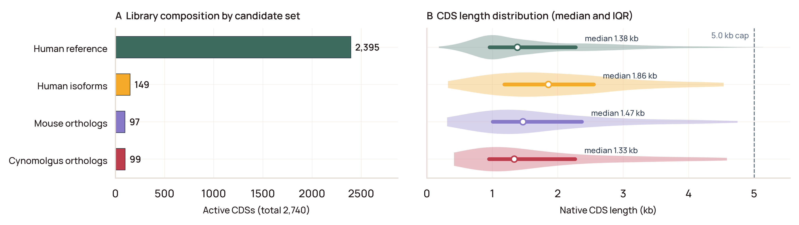
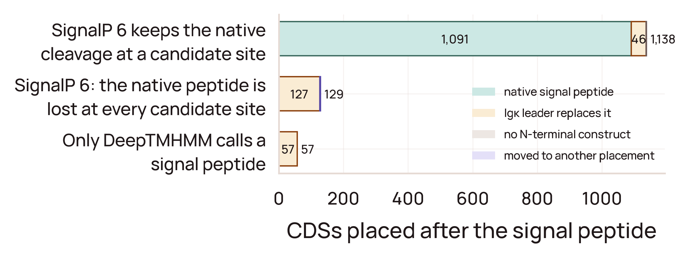
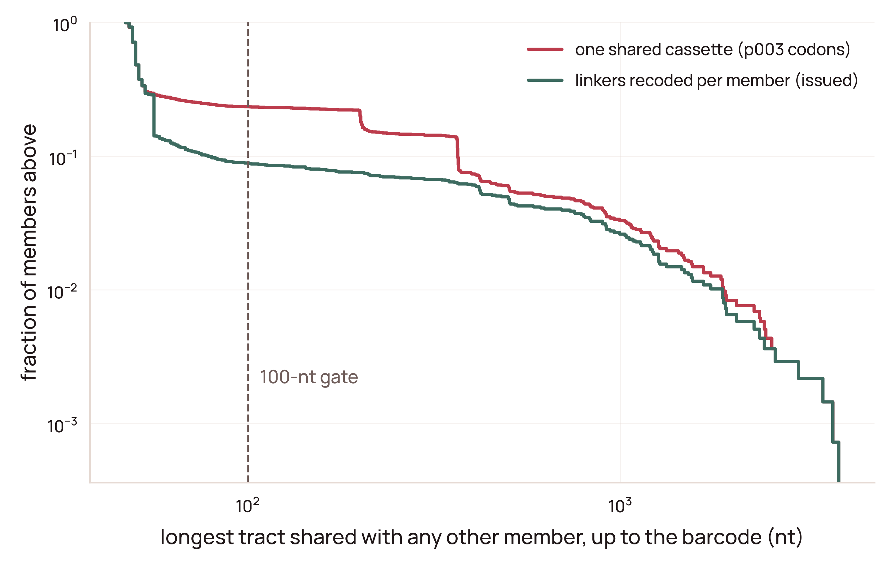

# The L1 surface-protein ORF library: design brief for external review

L1 is a pooled, barcoded lentiviral library of human cell-surface protein coding sequences
(CDSs) — plus stratified human isoform and mouse/cynomolgus ortholog panels — in which each
protein carries a 51-aa dual-epitope tag cassette placed on an extracellular face. The library
has not yet been ordered. This brief documents how every gene, proteoform, tag site, vector
element and barcode was selected and verified so reviewers can audit or reproduce the design,
and highlights the open decisions we most want challenged
([Decisions we would like reviewers to weigh in on](#decisions-we-would-like-reviewers-to-weigh-in-on)).

Every count in this brief is computed directly from the library's tables
([`brief_numbers.py`](brief_numbers.py)), and [`run_review.py`](run_review.py) recomputes them
offline from pinned inputs ([section 11](#11-reproducibility-what-is-pinned-and-the-one-permanent-limit)).

## Executive summary

L1 is a single pooled lentiviral library expressing human cell-surface proteins (plus stratified
isoform and mouse/cynomolgus ortholog panels): near-term to map surface display and internalization
across cell lines, medium-term to run trafficking and delivery screens, while remaining compatible
with optical pooled screening (in situ sequencing) and 10x Feature Barcoding from the same
integrated constructs.

| Dimension | Design | Details |
|---|---|---|
| **Construct & vector** | 51-aa dual-epitope tag (`GGGGS`–SpyTag003–`GGGGSGGGGS`–`P`–ALFA–`P`–`GGGGS`) in `p0039` (`EFS – insert – IRES2 – PuroR – WPRE`, one transcript using Fragmid's domesticated `IRES2_v1`, Esp3I-shuttled); **3,384** constructs for **2,743** of the **2,762** active CDSs (`19` held) | [Section 1](#1-the-library-construct-and-vector) |
| **Barcodes & readout** | 20-nt barcodes (Levenshtein ≥ 3, Hamming ≥ 4 across 30k pool; adopted ISS standard **12-nt prefix, Hamming ≥ 3**, leaving +8,896 extra barcodes while L1's 3,384 constructs satisfy the stricter 10-nt `d ≥ 3`); sense T7 promoter directly before `JT832` (0-nt spacer; 7 nt before the 15-nt padlock arm), Feldman padlock arm + T9A RT site, 10x CS1 | [Section 2](#2-the-barcode-and-readout-region-and-the-assays-it-could-support) |
| **Template-switching risk** | Linkers and snorkel modules diversified per construct; SpyTag003/ALFA keep validated `p003` codons (modeled upper bounds: 3.0% fusions from the shared tags, 2.2% from the constant pre-barcode tail with T7, **5.5%** total) | [Section 3](#3-barcode-swapping-in-the-pool), [Section 9](#9-domestication-linker-encoding-and-synthesis-compliance) |
| **Gene selection** | Nine sequential gates from `accessible-surfaceome` v1.3.0 + 3 evidence tiers (2,369 genes), plus 48 active dated additions (32 under the 42-line co-receptor rule after dropping MHC class II; 16 from `2026-11-23-abundance-v8` surface proteomics): **2,417** genes; ORF cap 5,000 nt | [Section 4](#4-genes-from-the-surfaceome-universe-to-2417) |
| **Proteoforms & panels** | One reference CDS per gene (`2,412` built; MANE Select from Ensembl 115 GTF / APPRIS + PeptideAtlas evidence + `31` named overrides), plus `150` isoforms (relaxed topology gate + fragment guard) and `200` mouse/cyno orthologs stratified by membrane class | [Section 5](#5-proteoforms-one-reference-protein-per-gene), [Section 6](#6-isoforms-and-orthologs) |
| **Topology & tag placement** | DeepTMHMM v1.0.24 on every built sequence (<1% experimental discordance); placed after SP (`1,322` built, `231` Igκ-swapped), at residue 1 on extracellular-N multipass (`567` of `568` behind Igκ; only `CRHR2` leader-free) and type III (`9` of `43` behind Igκ), at C-terminus (`216` built), or in an extracellular loop (`594` built: `1,090` loop arms + `145` C-terminal *snorkels*) | [Section 7](#7-tag-placement-topology-and-placement-rules) |
| **Internal-site ranking, refold & QC** | Audited 156-site ranker + TMDET membrane-side gate + 100% literature ligand-contact screen (`556/556` internal genes); 100% ColabFold refold coverage (`3,384/3,384` folded; `94.0%` pass; binary verdicts flag rather than hold); steric clashes and matched `own_ref` lDDT drove 25+ pre-freeze site upgrades | [Section 8](#8-internal-site-ranking-refold-validation-and-build-status) |
| **Domestication & synthesis** | Esp3I/BsaI/BbsI domestication, per-construct linker/snorkel diversification, and **High/Not-Accepted-only** synthesis compliance (`207` inserts / `810` codons recoded; all `3,160` Low/Medium inserts untouched; `0` Not Accepted, `24` High in protected SP codons) | [Section 9](#9-domestication-linker-encoding-and-synthesis-compliance) |
| **Ordering & pooling** | **36** 96-well plates sorted by construct length; length-weighted pooling (factor to be measured on 4 backbone-matched plasmids before pooling) | [Section 10](#10-how-the-library-is-ordered) |
| **Reproducibility & choices** | 30-stage offline `verify` pipeline from SHA-256-pinned inputs and public R2 / release bundles; reversible protein-level choices logged by design id | [Section 11](#11-reproducibility-what-is-pinned-and-the-one-permanent-limit), [Section 12](#12-protein-level-choices-reversible) |

The brief is organized vector-first: **sections 1–3** cover the construct, vector, readout/barcode
block, and pooled barcode-swapping risk; **sections 4–8** cover gene curation, proteoform and panel
selection, tag placement, internal-site ranking, refold validation, and build status; and
**sections 9–12** cover domestication, ordering/pooling, reproducibility, and reversible
protein-level choices. The **10 decisions** we most want reviewers to weigh in on are collected
below (**Q1–Q2 open before order freeze; Q3–Q10 decided in the current `2026-11-23-pre-freeze` cut —
challenge us**).

**Looking at a CDS, and giving feedback.** Each library member has a page on the development
surfaceome viewer, [dev.surfaceome.deliverome.org/l1-review/](https://dev.surfaceome.deliverome.org/l1-review/)
(every protein name and L1 design ID in the rendered brief links directly to its viewer page):
the protein built, its predicted topology, the tag site and its alternatives, and the native and
tagged structure models. To comment on a construct, open it, type your name, choose *site looks
right*, *concern* or *suggest another site* (with the residue, or a click on the structure), add a
comment and submit. No account or token is needed. As a thank-you for your review time, we will
award $500 each to the five most useful reviews.

## Decisions we would like reviewers to weigh in on

**Questions 1–2 remain open before order freeze.** **Questions 3–10** record decisions already built
into the `2026-11-23-pre-freeze` cut (`3,384` constructs across `2,743` built CDSs) that we want
reviewers to challenge. Remaining pre-freeze operational items are tracked in the accompanying
[cover note](COVER_NOTE.md).

| # | Status | Question | Why it matters | What would resolve it |
|---:|---|---|---|---|
| 1 | **Open** | **Promoter: EFS (current) vs. EF1a**, with IRES2–PuroR selection chosen ([section 1](#the-vector-backbone-promoter-and-selection-marker)). | Coupling PuroR through `IRES2_v1` eliminates the 40–89% SpyCatcher-negative silencing seen with separate SV40–PuroR (`P-0008`). Across HEK293T, K562 and Nalm6 on TfR1, EF1a yields 1.5–2.7× higher surface SpyCatcher display and more Spy+ cells (88–95% vs 53–87%) with comparable 37 °C/4 °C ratio separation (2.9–11.8×), but ~6–13 pp lower `% internalized` than EFS, +967 bp packaged length (2–3.4× library-wide titer cost), and a 948-bp upstream intron A. All data so far are on TfR1 in `IRES2–mScarlet3–P2A–PuroR` (not `p0039`'s direct `IRES2–PuroR`) at unmatched virus volumes. | Matched-MOI testing of dim-to-moderate library ORFs in direct `IRES2–PuroR` (EFS vs. EF1a); or your experience weighing EF1a's display gain against its ~1-kb titer cost and intron A splicing risk. |
| 2 | **Open** | **T7 promoter 0-nt spacer before `JT832` for optical pooled screening** ([section 2](#2-the-barcode-and-readout-region-and-the-assays-it-could-support)). | The sense T7 promoter (`TAATACGACTCACTATAGGG`) sits directly before `JT832` (`STOP · CC · T7 · JT832`, +20 nt to the shared pre-barcode tail, ~1 pp modeled swapping). T7 initiates at `GGG` with a **0-nt spacer** before `JT832`, giving **3 nt** (`GGG`) upstream of full `JT832` and **7 nt** (`GGGAGTC`) upstream of the 15-nt padlock arm (`GTTAGCTGCCGTTCC`), compared with 60–65 nt in PerturbView/NIS-Seq. Because the readout block is synthesized into every plasmid, this geometry cannot change after ordering. | Your experience with T7 in situ transcription and padlock hybridization at 3–7 nt 5′ overhang, or whether a single-copy pilot before freeze is worth adding a short spacer. |
| 3 | Decided | **MANE Select default where MANE and APPRIS disagree** ([section 5](#5-proteoforms-one-reference-protein-per-gene)). | Of 177 MANE/APPRIS protein disagreements, 21 have strong PeptideAtlas support for MANE and 0 for APPRIS alone, while 123 have no distinguishing peptides; MANE is the NCBI/Ensembl clinical consensus whereas 82 disagreements carry APPRIS's lowest-confidence labels. Among the 14 dual-observed GTF-MANE genes, `APP, GRIN1, KCNMA1, NFASC, SIRPA` switched to MANE and 9 (`ADGRG6, ATP1A3, CSPG5, DPP10, DPP6, KCNQ2, ROBO2, SLC12A3, SLC4A7`) stay on APPRIS on PeptideAtlas evidence. | Your view on defaulting to MANE Select, or biological context arguing to flip any of the 14 dual-observed genes or 33 weak-evidence genes. |
| 4 | Decided | **Segregating human LoF genes: 4 restored alleles (`FCGR2C, OR10AC1, OR8J2, SIGLEC16`) + 1 patch form (`OR4Q2`); `OR52P1` dropped** ([section 5](#genes-without-a-buildable-reference-copy)). | Every Ensembl 115 copy (including patch scaffolds) of `FCGR2C, OR10AC1, OR8J2, SIGLEC16` and `OR52P1` carries an inactivating stop or frameshift. We built the four exact/high-confidence intact human alleles (`OR4Q2` unedited from its screen-validated patch; `FCGR2C` codon-57 ORF; `OR10AC1` 73% intact allele, 0 diffs; `OR8J2` ~6% allele, 0 diffs; `SIGLEC16` 481-aa DAP12-dependent allele, ~22% global / ~40–50% EUR carriers, 0 diffs) and dropped `OR52P1` (5 unphased residue diffs vs. `Q8NH57`). | Your view on restoring polymorphic human LoF alleles in a pooled surfaceome library (`OR8J2` 6% frequency; `SIGLEC16` DAP12 dependence). |
| 5 | Decided | **Isoform panel strata (150 forms, 6 classes) and relaxed topology gate** ([section 6](#6-isoforms-and-orthologs)). | Seeded draw of 150 forms across six membrane classes (multipass split into 19 N-out, 32 N-in). We relaxed reference N-terminal-side and TM1 matching (since each isoform receives its own DeepTMHMM v1 tag placement) while adding a short-fragment guard (`<25%` of reference, or `<100 aa` and `<50%` of reference). Isoforms are not split into near/diverged similarity bands. | Your view on the six strata, relaxing reference N-term/TM1 matching, and whether a near/diverged similarity split is worth its cost in panel size. |
| 6 | Decided | **Igκ leader on 807 CDSs and residue-1 tagging of type III proteins** ([section 7](#7-tag-placement-topology-and-placement-rules)). | `567/568` residue-1 multipass CDSs (all except `CRHR2`, whose uncleaved pseudo-SP displayed leader-free), `9/43` type III CDSs with an identified topogenesis risk (`34` carry tag alone), and `231/1,322` N-after-SP CDSs whose native SP is predicted lost/weak carry the murine Igκ leader (`1,091` keep native SP). Multipass GPCR display data used leaderless tags, and type III topogenesis rests on charge/length rules rather than a tagged type III panel. | Whether Igκ should be the multipass default before panel controls read out, whether SignalP re-prediction on an engineered junction justifies swapping a native SP, and whether leaderless type III constructs need a leader. |
| 7 | Decided | **Keep `p003` tag codons (linkers & snorkels diversified) and accept 2 native-ORF paralog pairs > 100 nt** ([section 3](#3-barcode-swapping-in-the-pool), [section 9](#9-domestication-linker-encoding-and-synthesis-compliance)). | Per-construct linker/snorkel diversification holds modeled recombination to a 5.5% upper bound (`3.0%` from shared validated `p003` SpyTag003/ALFA codons, `2.2%` constant tail, `0.3%` specific partners) without introducing untested tag recodings. Dropping MHC class II eliminated `HLA-DRB1/DRB3` (208 nt), leaving only `OR9G1/OR9G9` (102 nt) and `FCGR2A/FCGR2C` (174 nt) above 100 nt from native 3′ ORF homology, accepted as covariates and tracked by long-read QC. | Your experience with actual vs. modeled recombination over ~45–48 nt shared epitope tracts, and accepting those two native-ORF paralog pairs. |
| 8 | Decided | **Drop all 8 MHC class II chains; keep 31 K562-negative co-receptor genes and 216 chaperone-dependent CDSs in the main pool** ([section 4](#well-known-surface-proteins-excluded-or-host-dependent)). | Dropping the 8 MHC-II chains (`HLA-DPB1, DQA1, DQB1, DRA, DRB1/3/4/5`) avoids obligate αβ/CD74/HLA-DM dependence, allele confounding, and the 208-nt swap pair. The remaining 31 K562-negative co-receptor genes (β2 integrins, DAP12 myeloid receptors, `CD79B`, `GABBR1`, NMDA/nAChR, `KLR*`) and 216 host-chaperone-dependent CDSs (`OR`, `TAS2R`, `GABRA`, `CHRNA7`) stay in the main pool and are excluded from the K562 display denominator until screened in lineage-matched hosts. | Whether any of the 31 co-receptor-dependent genes or chaperone-dependent families should instead move to a separate sub-pool. |
| 9 | Decided | **Synthesis compliance: recode High and Not Accepted inserts only** ([section 9](#9-domestication-linker-encoding-and-synthesis-compliance)). | To preserve native codon usage, all `3,160` Low and Medium inserts stay untouched; only the `224` High and Not Accepted inserts are minimally recoded (`207` inserts / `810` codons — an 86% reduction from recoding Medium too), leaving **`0` Not Accepted** and **`24` High** (all in protected native SP codons, which remain manufacturable with vendor review). | Whether leaving `24` protected-SP inserts at Twist `High` complexity (pending vendor quote) is preferable to recoding native signal-peptide codons. |
| 10 | Decided | **Length-weighted pooling factor** ([section 10](#10-how-the-library-is-ordered)). | Ordering volumes are computed at Moon et al.'s 3.5× lower titer per kb (~100× more of the longest construct than the median), while Sweeney & Vink's data imply ~2× per kb over our 4.6–9.5 kb packaged range; an overcorrection inverts the bias. | Whether our planned 4-plasmid backbone-matched titer test ([section 10](#10-how-the-library-is-ordered)) is sufficient to set the pooling factor before diluting the plates. |

## 1. The library, construct, and vector

### What is in the library

L1 has **2,762** designed CDSs. **2,743** of them have at least one construct in the order, which
holds **3,384** constructs (one plasmid each); the other **19** are held with no construct
([section 8](#where-every-cds-stands)). Every terminally tagged CDS is one construct, while an
internally tagged CDS may be ordered at two or three sites (including a C-terminal *snorkel*
companion, [section 7](#7-tag-placement-topology-and-placement-rules)), which **399** CDSs are,
accounting for **1,040** constructs under the order rule (one construct when a single loop region
clears the published-tag median with no close runner-up; two when a second region is within 10%;
three when no region clears the median).

**Size.** CDSs are a median 1,406 nt long (range 186–5,139; shortest is CD52, a 61-aa GPI protein).
Adding the 153-nt tag cassette (and the Igκ leader where used) gives a median coding sequence of
1,599 nt (339–5,292), and adding the constant 158 nt of Esp3I sites, Kozak, barcode, and readout
block (Figure 2a) gives a median full insert of 1,757 nt (497–5,450;
[`l1_insert_lengths.py`](../l1_insert_lengths.py), [`l1_order_plan.tsv`](l1_order_plan.tsv)).
Finished vectors span 7,974–12,927 bp, within the lentiviral packaging cap
([section 4](#4-genes-from-the-surfaceome-universe-to-2417)).

| Candidate set | What it is | CDSs |
|---|---|---:|
| Reference | the gene's chosen reference protein ([section 5](#5-proteoforms-one-reference-protein-per-gene)) | 2,412 |
| Isoform | an alternative human protein of the same gene | 150 |
| Ortholog | the gene's mouse or cynomolgus counterpart | 200 |



*Figure 1. The CDSs by candidate set. Unit: CDS; values are counts. Drawn by
[`brief_numbers.py`](brief_numbers.py) from the library's tables. How isoforms and orthologs were
chosen is in [section 6](#6-isoforms-and-orthologs).*

| Where the tag goes | CDSs |
|---|---:|
| after the signal peptide | 1,327 |
| after Met1 of a multipass protein (behind the Igκ leader for 567 of 568; only `CRHR2` is leader-free because its N-terminal pseudo-SP is uncleaved and displayed leader-free, caught by our systematic multipass SP screen in [section 7](#7-tag-placement-topology-and-placement-rules)) | 568 |
| after Met1 of a single-pass type III protein | 43 |
| at the C-terminus | 219 |
| in an extracellular loop | 605 |
| **total** | **2,762** |

Each CDS is counted once, at the placement its DeepTMHMM v1 topology calls for
([`l1_tag_paths.tsv`](../l1_tag_paths.tsv)); build status and construct counts per placement are in
[section 8](#where-every-cds-stands).

### The construct


*Figure 2a. One construct. Top, not to scale: the barcoded insert between its two Esp3I sites,
with the three tag positions and the number of CDSs tagged at each (N-terminal counts the
after-signal-peptide, multipass and type III placements together), followed by the 3-nt stop
codon plus a shared 2-nt `CC` spacer (`stop + CC pad`, 5 nt total) and the readout block: a
sense T7 promoter, the 5′ handle the barcode is amplified with (primer JT832),
the 20-nt barcode, Feldman's 17-nt padlock construct, his RT site with T→A at position 9 (T9A),
and the 10x Capture Sequence 1. Below, to scale from cPPT to the 3′ LTR: that insert in the
library vector p0039, EFS–insert–IRES2–PuroR on one transcript, the library's chosen design. In
grey, the alternative not used: PuroR from its own SV40 promoter with no IRES (the P-0050
layout). Deliverome scientists saw TfR1 silencing in the SV40-puro TfR1 construct (P-0008):
puromycin-resistant cells with low TfR1 expression. AXL is the example ORF; only the ORF and the
cassette position differ between constructs. Coordinates are read from two full GenBank maps,
[`l1_example_AXL_ires_puro.gb`](../l1_example_AXL_ires_puro.gb) (10,473 bp) and
[`l1_example_AXL_sv40_puro.gb`](../l1_example_AXL_sv40_puro.gb) (10,153 bp). Drawn by
[`plot_l1_construct_schematic.py`](../plot_l1_construct_schematic.py).*

The tag cassette is 51 amino acids, `GGGGS`–SpyTag003–`GGGGSGGGGS`–`P`–ALFA–`P`–`GGGGS`. SpyCatcher
binds SpyTag003 covalently and normalizes for expression; an anti-ALFA nanobody labels the same
protein and can be released from whatever stays on the surface, which is what the internalization
readout measures.


*Figure 2b. The internalization screen the library serves first. SpyCatcher labels every tagged
protein; after uptake at 37 °C the anti-ALFA nanobody is released from the cell surface by a
reducing agent or protease, so the ALFA signal left, normalized to SpyCatcher, reports
internalization; cells are sorted on it and their barcodes sequenced. A schematic, not data.
Drawn by [`fig_internalization_assay.py`](../../../../library/l1/figures/fig_internalization_assay.py).*

### The vector: backbone, promoter and selection marker

**Backbone.** p0039 is our insert-agnostic EFS–IRES2–PuroR destination vector
(`pAG Lenti_236083_EFS_IRES_puro_insert_agnostic`, 7,672 bp). Its name and our vector-design
record ([vector-design record](../../../sprint1/s1e2-fragmid-vector-design/README.md)) trace it to the
lentiviral parent plasmid pAG Lenti CMV Empty Puro ([Addgene #236083](https://www.addgene.org/236083/)); the exact sequence is
[`p0039_EFS_IRES_puro_backbone.gb`](../p0039_EFS_IRES_puro_backbone.gb) (GenBank). Two full maps
of one member, AXL, show a finished construct in each layout of Figure 2a:
[`l1_example_AXL_ires_puro.gb`](../l1_example_AXL_ires_puro.gb), the library layout, and
[`l1_example_AXL_sv40_puro.gb`](../l1_example_AXL_sv40_puro.gb), the SV40-puro alternative. They
are worked examples built by [`l1_example_vector_maps.py`](../l1_example_vector_maps.py), not
registered constructs: they carry no P-number, and the barcode is the 20-N placeholder.

Every construct goes into one lentiviral vector, p0039, which runs
`EFS promoter – insert – IRES2 – PuroR – WPRE` between the LTRs. The construct (Kozak, ORF with
its tag cassette and stop, barcode and readout block) replaces a 195-bp cloning site and stuffer
directly after the 212-bp EFS promoter. To keep the backbone Golden Gate–compatible, p0039 uses
Fragmid's domesticated `IRES2_v1` (`pF_AA333`; [McGee et al., 2024](https://pubmed.ncbi.nlm.nih.gov/38484704/)),
which carries three single-base edits relative to classic EMCV IRES2 (Addgene #100673) to remove
two BbsI sites (`137 T→G`, `236 A→C`) and one ApaLI site (`480 G→A`). Folding and 79-isolate
conservation checks ([`ires_domestication_analysis.py`](../../../sprint1/s1e2-fragmid-vector-design/ires_domestication_analysis.py),
[`ires_domestication_edits.tsv`](../../../sprint1/s1e2-fragmid-vector-design/ires_domestication_edits.tsv))
find the structural perturbation within random and natural EMCV variation with the eIF4G J–K
platform and initiator AUG intact; `IRES2_v1` functionally drives `mScarlet3–P2A–PuroR` in our
promoter-series constructs below, though no head-to-head comparison against undomesticated
Addgene #100673 has been run. Two choices in that layout decide how strongly each CDS is expressed and
which cells survive selection, and one of them is still open.

**Selection is coupled to the ORF through the IRES; this is the layout L1 uses.** Puromycin
resistance is translated from the same transcript as the CDS, so a cell survives selection only
if it transcribes the ORF. The alternative, PuroR from its own SV40 promoter with no IRES, is not
used because Deliverome scientists saw TfR1 silencing with it: P-0008, a TfR1 construct with the
same EFS–TFRC–tag unit and that SV40-driven PuroR, gave puromycin-resistant cells with low TfR1
expression (40–89% SpyCatcher-negative across HEK293T, K562 and Nalm6 below). A separate selection
promoter lets a cell survive while transcribing the ORF poorly, and in a pooled screen those cells
would read as CDSs that fail to reach the surface. The cost of the IRES is that selection depends
on the CDS's own transcript, so a CDS that is transcribed weakly is also selected weakly, and will
be underrepresented after puromycin rather than present as a tag-negative cell.

**EFS is the current promoter; EF1a is the alternative under consideration.** We compared
promoters driving the `TFRC–SpyTag003–ALFA–barcode–IRES2–mScarlet3–P2A–PuroR` cassette across
four cell types at 72 h before selection, and then measured post-selection **surface tag display
and internalization** (30 min dual labeling at 4 °C or 37 °C with non-cleavable
SpyCatcher-3CYS-CF488A and TCEP-strippable ALFAnb-SS-CF640R, ± TCEP) across HEK293T, K562 and
Nalm6 in two independent assay runs (one well per condition per run; the HEK293T TCEP strip
failed in the first run and succeeded in the repeat).

*Pre-selection transcript and survival (72 h mScarlet3 flow; 48 h puromycin brightfield in HEK293T at 35 µL):*

| Readout | EFS (`P-0003` / `p003`) | EF1a (`P-0011`) | PGK (`P-0012`) |
|---|---|---|---|
| Promoter length | 212 bp | 1,179 bp (includes 948-bp intron A) | not used here |
| 72 h mScarlet3 geometric mean of positive cells, relative to EFS at the same volume | 1× | 3.6–4.0× (HEK293T), 1.7–2.4× (HeLa), 1.7–2.2× (Nalm6) | 0.29–0.64× |
| % mScarlet3-positive per µL virus, HEK293T (slope of a linear fit) | 1.24 | 1.03 | 0.71 |
| Area covered by cells after 48 h puromycin, HEK293T at 35 µL, relative to no puromycin (one image each) | 65% | 87% | 32% |

*Post-selection surface tag display and TfR1 internalization (repeat run; K562 and Nalm6 first-run `% internalized` in parentheses; gMFI and ratios over live SpyCatcher+ cells, n = 1 well per condition per run):*

| Cell line & construct (virus vol) | % Spy+ (4 °C / 37 °C, no TCEP) | SpyCatcher gMFI, 37 °C no TCEP | Protected ALFA gMFI, 37 °C +TCEP | 4 °C strip residual | % internalized, 37 °C | Median ALFA/Spy ratio, 37 °C / 4 °C +TCEP (fold sep.) |
|---|---|---|---|---|---|---|
| **HEK293T** EFS (`P-0003`, 10 µL) | 73% / 83% | 20.1k (12.5k live) | 12.7k (38× WT live) | 10.7% | **41%** | 0.72 / 0.24 (**2.9×**) |
| **HEK293T** EF1a (`P-0011`, 4 µL) | **92% / 95%** | **39.4k** (33.6k live) | **16.7k** (67× WT live) | **8.6%** | **34%** | 0.52 / 0.16 (**3.3×**) |
| HEK293T SV40-puro (`P-0008`, 4 µL) | 39% / 60% | 9.9k (4.2k live) | 8.0k (15× WT live) | 9.9% | 41% | 0.91 / 0.26 (3.5×) |
| **K562** EFS (`L-0019` stable line) | 53% / 76% | 8.0k | 7.9k (14× WT pos) | 22.2% | **53%** (57%) | 0.98 / 0.36 (**2.7×**) |
| **K562** EF1a (`P-0011`, 15 µL) | **88% / 92%** | **19.4k** | **15.3k** (27× WT pos) | **14.5%** | **45%** (44%; 4 µL: **50%**) | 0.78 / 0.24 (**3.2×**) |
| K562 SV40-puro (`P-0008`, 15 µL) | 21% / 45% | 5.1k | 3.8k (7× WT pos) | 23.4% | 41% (42%) | 0.76 / 0.36 (2.1×) |
| **Nalm6** EFS (`P-0003`, 100 µL) | 77% / 87% | 9.4k (7.0k live) | 4.2k (17× WT live) | ~0.0% | **36%** (26%) | 0.52 / 0.04 (**11.8×**) |
| **Nalm6** EF1a (`P-0011`, 60 µL) | **90% / 94%** | **13.8k** (11.8k live) | **3.8k** (18× WT live) | **0.4%** | **23%** (23%) | 0.35 / 0.03 (**10.9×**) |
| Nalm6 SV40-puro (`P-0008`, 60 µL) | 11% / 27% | 2.8k (1.1k live) | 1.4k (3× WT live) | −5.6% | 41% (35%) | 0.58 / 0.06 (9.1×) |

K562 has no fresh `P-0003` transduction, so the older `P-0003` stable line `L-0019` stands in for
EFS; virus volumes also differed across constructs (EF1a received less virus than EFS in both
HEK293T and Nalm6). Across all three cell lines, EF1a yields a higher fraction of surface-labeled
cells (88–95% vs 53–87% Spy+) and 1.5–2.7× higher SpyCatcher surface signal than EFS, while
`P-0008` (uncoupled SV40–PuroR) leaves 40–89% of puromycin-resistant cells below the SpyCatcher
gate. EF1a supports clean TCEP stripping at 4 °C and comparable or slightly better 37 °C/4 °C
stripped ALFA/Spy ratio separation (2.9–11.8× across lines), but consistently reports a modestly
lower `% internalized` for TfR1 than EFS (34% vs 41% in HEK293T; 44–45% vs 53–57% in K562 at
15 µL, rising to 50% at 4 µL; 23% vs 26–36% in Nalm6) — including within expression-matched
SpyCatcher bins. The trade-offs between the two promoters are specific:

| Consideration | EFS | EF1a |
|---|---|---|
| Packaged genome | as in [section 10](#10-how-the-library-is-ordered) | 967 bp longer for every CDS; at the 2- to 3.5-fold per kb discussed in [section 10](#10-how-the-library-is-ordered) that is a 2- to 3.4-fold titer cost across the whole library, on top of the length spread between CDSs |
| Splicing | no intron | 948-bp intron A sits upstream of every ORF (carrying native upstream ATGs and an internal donor); the splice-donor screen of the barcode region ([section 2](#2-the-barcode-and-readout-region-and-the-assays-it-could-support)) was run against the EFS context only, and cryptic splicing into diverse ORFs is untested |
| Surface display & internalization (TfR1, post-selection) | 53–87% Spy+, 36–57% internalized across HEK293T, K562 and Nalm6 | 88–95% Spy+, 1.5–2.7× higher SpyCatcher gMFI, clean 4 °C strip and comparable 37 °C/4 °C ratio separation, but ~6–13 percentage points lower `% internalized` than EFS |

**The promoter can change after the order.** Each construct is flanked by its own Esp3I sites (the
shuttle enzyme, [section 9](#9-domestication-linker-encoding-and-synthesis-compliance)), which leave `GACC` and `AAAG` overhangs, so the synthesized constructs can be moved into an EF1a
destination with the same slot without resynthesis. What is fixed at synthesis is the vector
the vendor builds them into first.

**Still open.** Post-selection surface display and internalization are now measured for both EFS
and EF1a across HEK293T, K562 and Nalm6, but only on one bright receptor (TfR1), in the
`IRES2–mScarlet3–P2A–PuroR` reporter layout (not `p0039`'s shorter direct `IRES2–PuroR`), at
unmatched virus volumes and n = 1 well per condition per run. What remains to settle whether
EF1a's ~1.5–2.7× display gain is worth its ~2–3.4× library-wide titer cost is a matched-MOI test
of a small panel of dim-to-moderate library ORFs in the direct `IRES2–PuroR` backbone (EFS vs
EF1a), checking both surface-tag power and whether EF1a intron A introduces ORF-specific splicing
artifacts or alters internalization kinetics.

## 2. The barcode and readout region, and the assays it could support

Every construct ends in the same readout block, transcribed from the EFS promoter upstream of the
IRES:

| Element | Sequence | Source |
|---|---|---|
| T7 promoter | `TAATACGACTCACTATAGGG` | T7 class III promoter, −17 to +3, sense; lets T7 RNA polymerase copy the barcode region in fixed cells (below) |
| 5′ handle | `AGTCGTTAGCTGCCGTTCC` | [Tycko et al., 2020](https://pubmed.ncbi.nlm.nih.gov/33326746/), subpool-3 amplification primer (JT-832) |
| Barcode | 20 nt, one per construct | the library's barcode pool ([below](#how-the-barcodes-were-designed)); 3,644 are provisionally reserved for L1 (3,200 initial block + 444 extension), covering all 3,384 constructs with 260 to spare, and assigned at order freeze |
| Padlock arm | `ACTGGCTATTCATTCGC` | lentiGuide-BC, verbatim (Feldman et al. 2019; Addgene #127168) |
| RT site | `CCTTTGGGAAAGCACACGTC` | lentiGuide-BC RT site with T→A at position 9 (below) |
| 10x Capture Sequence 1 | `GCTTTAAGGCCGGTCCTAGCAA` | 10x Feature Barcoding |

The block sits after the stop codon and a 2-nt pad, so 44 nt separate the start of the stop codon
from the barcode and 37 nt separate the barcode from CS1. The insert ends at CS1, so the vector
backbone and its Golden Gate junction are the ones every earlier construct used
([`build_constructs.l1_readout`](../build_constructs.py)).

### How the barcodes were designed

The barcode is transcribed. It sits between the ORF stop and the IRES, an intercistronic region
that behaves like a 3′ UTR for the first cistron, so a barcode that presents a
microRNA target site can have its own transcript repressed. That failure mode is the reason the
sequence is designed rather than drawn at random: it produces a barcode-specific expression
penalty on one CDS, which at the bench is almost indistinguishable from that protein being a
weak surface expressor.

The pool is 30,000 barcodes of 20 nt, generated deterministically from a fixed seed by
[`generate_barcodes.py`](../../../sprint1/s1e2-fragmid-vector-design/generate_barcodes.py) into
[`barcodes_20nt_30k.tsv`](../../../sprint1/s1e2-fragmid-vector-design/barcodes_20nt_30k.tsv), so
the file reproduces from the script alone. Seven rules are applied, each recorded with its
source and whether we checked that source ourselves in
[`barcode_filter_stack.py`](../../../sprint1/s1e2-fragmid-vector-design/barcode_filter_stack.py):

| Rule | Why | Source |
|---|---|---|
| GC 40–60% | amplification and sequencing behavior | Hawkins/FREE, Shiroguchi |
| no homopolymer run above 2 | miscalls and indels in homopolymers | Hawkins/FREE |
| no `ATG` anywhere | a spurious start codon in the readout region | ours |
| no `AATAAA`, and none of its 18 single-base point mutants | a polyadenylation signal would truncate the transcript | [Vainberg Slutskin et al., 2018](https://pubmed.ncbi.nlm.nih.gov/29410437/) |
| no 3-bp non-overlapping self-complementarity | hairpins | Hawkins/FREE |
| no conserved microRNA 6-mer seed target site (207 sites) | the repression described above | TargetScanHuman 8.0 |
| no `GT[AG]AG` splice-donor core | a cryptic donor here would splice out the IRES and the selection marker | ours |
| no BbsI, Esp3I/BsmBI or BsaI sites (both strands) | avoids cloning-enzyme cuts inside barcodes (palindromic 6-cutters are already excluded by the 3-bp self-complementarity rule) | ours |
| min Levenshtein distance ≥ 3 and min Hamming distance ≥ 4 | corrects one substitution or single-base indel over the full 20-nt barcode | [Vainberg Slutskin et al., 2018](https://pubmed.ncbi.nlm.nih.gov/29410437/); Hawkins/FREE |

Two of these are worth your attention. The microRNA rule rejects 6-mer seed matches
rather than the 7mer-m8 sites a target-prediction tool reports, and since every 7mer-m8 site
contains its 6-mer core, the 6-mer rule rejects a strict superset — deliberately stricter than
the precedent it comes from. The splice-donor rule is ours and has no published precedent; it
exists because the barcode sits upstream of an IRES in the same transcript.

**There is no UMI in the construct.** L1 is screened as a pool, and barcode counts from sorted
populations are read from PCR of integrated or transcribed barcodes, so amplification bias is
a real source of noise. A unique molecular identifier added in the first PCR primer at library
preparation removes that bias without occupying construct sequence, so the 20 nt stay with the
barcode.

**Error-correction guarantees: full 20-nt pool vs. short in situ prefix.** Across the full 20-nt
barcode, every pair in the 30,000-barcode pool satisfies **Levenshtein distance ≥ 3 and Hamming
distance ≥ 4** ([`generate_barcodes.py`](../../../sprint1/s1e2-fragmid-vector-design/generate_barcodes.py)),
so full-length amplicon reads unambiguously correct one substitution or single-base indel. Because
in situ sequencing reads only the first 10–12 bases (and random draws from the 28,506-barcode pool
produce identical prefixes: 1,244 identical 10-nt pairs and 111 identical 12-nt pairs across the
pool), L1's reserved barcodes are additionally drawn under a prefix-distance screen
([`barcode_prefix_screen.py`](../barcode_prefix_screen.py), tested in CI) enforcing **Hamming
distance ≥ 3 over the first 10 bases**, correcting one substitution error in a 10-cycle ISS read
(assuming readout starts at the barcode's 5′ end, as in Feldman et al.).

Three assays could read it. Each is checked here against the sequences in
[`build_constructs.py`](../build_constructs.py), because what the fragment carries when ordered
decides which assays stay possible.

**Optical pooled screening (in situ sequencing).** Feldman et al. read lentiGuide-BC barcodes
in fixed cells by in situ reverse transcription, padlock gap-fill and sequencing by synthesis
([Feldman et al., 2019](https://pubmed.ncbi.nlm.nih.gov/31626775/)). Three of their elements
differ from ours:

- *Why the p003 layout was weak for optical screening.* The 10-nt gap after the barcode
  (`GGATCTGGAC`) is not from lentiGuide-BC, where Feldman has a 17-nt padlock arm in that
  position. Ours came in with the p003 map with no recorded reason; read as codons it is GGA TCT GGA (Gly-Ser-Gly), so it
  may be a linker or cloning scar (inferred, not documented). With only 10 nt before the RT
  site, a padlock arm on that side would have to run into the RT site and pair with
  primer-made cDNA. Feldman's padlock arm sits directly after the barcode and ends where his RT primer
  begins, with no overlap.
- *The adopted 3′ flank.* Feldman's padlock arms match neither of our earlier flanks, and
  his RT site cannot be copied verbatim. The flank we adopt replaces the 30-nt gap plus
  RT site (`GGATCTGGACCCTTTGGGCAAGCACACGTC`) with his RT-side padlock arm, verbatim,
  followed by his RT site with one base changed. Every L1 insert is built with it; it lengthens
  the readout region by 7 bp (the T7 promoter, under *T7 in situ transcription* below, adds
  20 more before the handle) and changes no coding sequence. Plasmids ordered before L1 keep the
  earlier flank.

| Element (transcript sense) | Earlier flank | Adopted |
|---|---|---|
| After the barcode | 10-nt gap `GGATCTGGAC` | Feldman's 17-nt padlock arm `ACTGGCTATTCATTCGC` (Addgene #127168) |
| RT site | `CCTTTGGGCAAGCACACGTC` (C at 9) | `CCTTTGGGAAAGCACACGTC` (A at 9) |
| RT primer | none ordered | `GACGTGTGCTTTCCCAAAGG`, with Feldman's LNA positions |
| Barcode to CS1 | 30 nt | 37 nt; the ORF-to-barcode distance is unchanged |

  Why an A at position 9 (RT site and the padlock arm before it, primer3 at 50 mM Na⁺, no Mg²⁺):

| Base 9 | Splice-donor motif | Hairpin with the padlock arm | Added miRNA seed 7-mer | RT-site Tm |
|---|---|---|---|---:|
| T (Feldman) | `GGG·GTAAG`, in the packaged transcript | Tm 42.5 °C, ΔG −0.38 | none | 53.4 °C |
| C (earlier) | none | `GGGC`/`GCCC` stem, Tm 62.2 °C, ΔG −2.13 | miR-636 | 56.7 °C |
| A (adopted) | none | Tm 43.4 °C, ΔG −0.36 | none | 54.0 °C |

  Feldman's own primer would bind the A site with one A:A mismatch, so the matched primer above
  replaces it. The padlock then needs one new arm, on the barcode-proximal 15 nt of the
  Tycko handle (`GTTAGCTGCCGTTCC`, 45.7 °C nearest-neighbor at 50 mM Na⁺, against 46.1 °C for
  Feldman's RT-side arm); the handle itself does not change. Feldman's other arm
  (`GTGTTCAATCAACATTCC`) is in no deposited plasmid map: it enters with his cloned barcode
  cassette, so it is inferred, not shown, to sit directly 5′ of his barcode. It does not occur in
  L1. Seven-mers on the fixed flank that match human miRNA seeds remain: `ACTGGCT`
  (miR-575/4676-5p), `CTATTCA` (miR-5585-3p), `CTTTGGG` (miR-186-3p) and `AAGCACA`
  (miR-218-5p, broadly conserved), the last two present today as well. The flank carries no
  `GT[AG]AG` and no BbsI, Esp3I or BsaI site, and no 15-mer of the padlock arm or the
  arm-plus-RT region occurs anywhere else in the backbone or the 3,384 L1 inserts. A full map of
  one CDS with the adopted readout (T7 promoter, handle, barcode slot, padlock arm, RT site, CS1)
  is [`l1_example_AXL_ires_puro.gb`](../l1_example_AXL_ires_puro.gb), built by
  [`l1_example_vector_maps.py`](../l1_example_vector_maps.py). Priming RT from CS1 instead
  stays an alternative that needs no RT site at all, but it is untested: a PubMed and a
  Consensus search (2026-11-08) found no published optical screen that uses a 10x capture
  sequence as the in situ RT primer. In the adopted layout CS1 sits 37 nt from the barcode,
  which does not affect 10x capture, since read 2 of the feature library starts from the
  handle-side primer.
- *The new junction changes which barcodes can be used.* Screening the barcode pool in its full
  context (handle + barcode + flank + CS1 + shuttle) for BbsI, Esp3I and BsaI sites, splice-donor
  motifs and conserved miRNA seed 7-mers that span either barcode junction:

| Flank | Barcodes passing (of 28,506) | Failing: seed across a junction / Type IIS / splice donor | Drawable at prefix distance 3 over 10 nt |
|---|---:|---|---:|
| Earlier flank | 23,807 | 4,339 / 88 / 272 | 3,856 |
| Adopted | 21,394 | 6,911 / 201 / 0 | 3,741 |
| Both, the rule L1's block was drawn under | 19,950 | 8,196 / 88 / 272 | 3,665 |

  The adopted flank loses 3,857 barcodes that pass under the earlier one and gains 1,444 that fail it, and still
  leaves room for all 3,384 constructs under the prefix screen. The T7 promoter sits upstream of
  the 19-nt handle, beyond the reach of every junction screen, so it changes none of these
  counts. The junction seed screen is
  part of [`reserve_barcodes.py`](../../../sprint1/s1e2-fragmid-vector-design/reserve_barcodes.py), which takes the 3′ flank as
  `--three-prime {current,t9a-draft}` and reports these counts with `--pool-stats`. The
  failure counts are by first reason only (enzyme, then splice donor, then seed), so a barcode
  failing two screens is counted once.
- *Two barcodes already assigned would fail the junction seed screen:* CNR1
  (`GAGAGTAGTCAAGCACCAAG`, completing `AAGGGAT`) and TFRC (`TGTCTCTCTCAGCTTCTCTC`, completing
  `GTTCCTG`). Both are kept as assigned; every new L1 barcode must pass the
  screen.
- *L1's reserved block (3,644 barcodes) passes every screen under both 3′ flanks*, drawn in pool
  order (`l1_screens_pass` in [`reserve_barcodes.py`](../../../sprint1/s1e2-fragmid-vector-design/reserve_barcodes.py),
  [`reserve_l1_block.py`](../reserve_l1_block.py)): Type IIS, splice donor, conserved miRNA 7-mer
  seeds across both junctions, 10-nt prefix Hamming ≥ 3, and RNA-binding-protein motifs (no
  Pumilio `TGTA[ACT]ATA`, AU-rich `ATTTA`, CPEB `TTTTAT`/`TTTTAAT`, poly(A) `AATAAA`/`ATTAAA`, or
  CFIm25 `TGTA` pair within 50 nt). The 3,644 provisional rows
  ([`l1_barcode_block_provisional.tsv`](../l1_barcode_block_provisional.tsv), 3,200 +
  [`l1_barcode_block_extension_2026-11-15.tsv`](../l1_barcode_block_extension_2026-11-15.tsv), 444)
  cover all **3,384** constructs with **260** to spare; constructs receive their barcodes at order
  freeze and unused rows are released. While L1's block exhausts the strict 10-nt `d ≥ 3` screen
  under both flanks, Hamming ≥ 3 over 10 nt is strictly stronger than over 11–12 nt, so L1
  imposes zero capacity penalty for longer ISS prefixes. Under the adopted Feldman T9A 3′ flank
  plus RBP screen, 17,914 pool barcodes remain available after assigning L1's 3,384 constructs:

| ISS prefix | Min Hamming `d` | Extra barcodes keeping L1 fixed | Combined total (vs fresh redraw) | Notes |
|---:|---:|---:|---:|---|
| 10 nt | 3 | +322 | 3,726 (3,716) | L1 alone runs in 10 cycles with full 1-error correction |
| 11 nt | 3 | +3,994 | 7,398 (7,375) | Zero capacity loss vs fresh redraw |
| **12 nt** | **3** | **+8,896** | **12,300 (12,293)** | Adopted default for future reservations (Feldman 12-cycle SBS; >35,000 with a second 20-nt pool) |
| 10 nt | 2 | +9,759 | 13,163 (13,165) | Error detection only (discards 1-error reads) |

  We retain `d ≥ 3` rather than `d ≥ 2` for cell yield: at 1–3% per-cycle in situ SBS error rates,
  1-error correction rescues **9–23% of cells at 10 cycles** and **11–26% at 12 cycles** while
  keeping 2-error miscorrection below 0.06% at 12 cycles. Future reservations default to **12-nt
  `d ≥ 3`** in [`barcode_prefix_screen.py`](../barcode_prefix_screen.py), while L1's 3,384
  constructs already clear the stricter 10-nt `d ≥ 3` screen.
- *Current state of barcode assignment:* screens and the 3,644-barcode provisional block exist and
  are tested in CI ([`reserve_barcodes.py`](../../../sprint1/s1e2-fragmid-vector-design/reserve_barcodes.py),
  [`barcode_prefix_screen.py`](../barcode_prefix_screen.py),
  [`reserve_l1_block.py`](../reserve_l1_block.py), [`rbp_motif_screen.py`](../rbp_motif_screen.py),
  [`l1_barcode_block_provisional.tsv`](../l1_barcode_block_provisional.tsv),
  [`l1_barcode_block_extension_2026-11-15.tsv`](../l1_barcode_block_extension_2026-11-15.tsv));
  concrete one-to-one assignment replaces the 20-N placeholder when the order freezes. Expression
  of the intercistronic barcode is expected (as in lentiGuide-BC) but not yet directly measured.

**10x 3′ Feature Barcoding.** The 3′ v3 Feature Barcoding gel beads carry the reverse complement
of CS1, so the RNA must carry `GCTTTAAGGCCGGTCCTAGCAA` in sense
([Replogle et al., 2020](https://pubmed.ncbi.nlm.nih.gov/32231336/)). Our EFS transcript does,
37 nt downstream of the barcode, so the orientation is right. What is untested is capture of an
internal site in a long Pol II mRNA; Replogle et al. placed CS1 in a short sgRNA stem loop.

**T7 in situ transcription.** Each L1 insert carries a T7 promoter in sense, between the stop
codon's pad and the 5′ handle. In fixed cells, T7 RNA polymerase then makes many sense copies of
the handle, barcode and readout region per integrant, independent of how strongly the cell
transcribes the CDS, and Feldman's RT primer, padlock and sequencing primer read those copies
unchanged. In situ T7 transcription ahead of padlock readout raised barcode assignment
1.6–2.9-fold in iNeurons, macrophages and T cells, with the promoter built into the U6 promoter
just upstream of the guide ([Kudo et al., 2025](https://doi.org/10.1038/s41587-024-02391-0)); NIS-Seq used an inverted
promoter downstream of the guide for four genome-scale screens
([Fandrey et al., 2025](https://doi.org/10.1038/s41587-024-02516-5)); and single genomic copies
were detected in 85% of cells by FISH on the T7 product
([Askary et al., 2020](https://doi.org/10.1038/s41587-019-0299-4)).

| Placement considered | Effect | Scan of the junctions (BbsI, Esp3I, BsaI; splice donor `GT[AG]AG`) |
|---|---|---|
| **Sense, between the stop and the handle (adopted)** | adds 20 nt to the sequence every insert shares before its barcode; the in situ RNA is sense, so the RT site, padlock and sequencing primer above read it | clean |
| Antisense, after CS1, reading back across the barcode | adds nothing before the barcode, but the RNA is antisense, so RT would need a primer on the handle and the padlock arm on that side would bind the primer itself | no enzyme site, but the promoter core reads `ATA·GTGAGT` in the Pol II transcript, a near-consensus splice donor that the `CTCAC` core makes unavoidable; a T3 promoter does the same |

What the adopted placement costs and leaves untested:

- *Template switching.* The 20 added nt lengthen the tail every pair of inserts shares, which
  raises the modeled share of integrants whose barcode names the wrong protein by about one
  percentage point ([section 3](#3-barcode-swapping-in-the-pool);
  [`swap_t7_scenario.py`](../swap_t7_scenario.py)).
- *Motifs in the transcript.* The pad, promoter and handle carry no `GT[AG]AG` and no BbsI, Esp3I
  or BsaI site. They carry four 7-mers matching human miRNA seeds, none from a conserved family
  (miR-3174, poorly conserved; miR-489-5p, miR-6883-3p and miR-921, unassigned in TargetScan 8.0).
- *Geometry with no precedent ([question 2](#decisions-we-would-like-reviewers-to-weigh-in-on)).*
  The construct keeps `STOP · CC · T7 · JT832` with a **0-nt spacer** between T7's `GGG`
  initiation site and `JT832` (`AGTCGTTAGCTGCCGTTCC`). That leaves **3 nt** (`GGG`) of T7 RNA
  upstream of full `JT832` and **7 nt** (`GGGAGTC`) upstream of the 15-nt padlock arm
  (`GTTAGCTGCCGTTCC`), compared with 60–65 nt in published PerturbView and NIS-Seq designs;
  whether this reads as cleanly at single copy is to be checked in a pilot before relying on it.
- *Fixation.* The T7 reaction needs methanol–acetic acid fixation or a de-crosslinked PFA
  fixation, and the first of these quenched fluorescent proteins in Askary et al., so mScarlet3
  and any live phenotype are imaged first.

## 3. Barcode swapping in the pool

The two genomes packaged in one lentiviral particle can recombine: reverse transcriptase switches
template between them, and where the two share identical sequence the switch can place one
construct's barcode beside the other's ORF.
[Walton et al. (2024)](https://pubmed.ncbi.nlm.nih.gov/38558968/) fit this as a per-base switch
rate *k* = 5.3 × 10⁻⁴ per bp of shared sequence, so a particle carrying two constructs that share
an identical block of *L* bp gives a discordant barcode with probability
*Y*(*L*) = ½ (1 − e^(−2*kL*)) ([`seqtools.barcode_swap_rate`](../../../../src/deliverome_analysis/seqtools.py)).
That is a rate for a particle that carries both constructs. In the pool, a construct's
co-packaged partner is any other construct with probability equal to that construct's share of the
pool. The pool has 3,384 constructs, so the average share is 1 in 3,384, but the
pool is length-weighted (3.5× more per kilobase, to offset the lower titer of long
constructs; [section 10](#10-how-the-library-is-ordered)), so long constructs take a much larger
share and the median construct's share is 1 in 12,135.

**The bottom line.** The share of integrants whose barcode names a protein other than the one they
carry, as an upper bound (every particle assumed to carry two different constructs). Without codon
diversification, at most 6.9% of integrants would carry a barcode naming the wrong protein.
Diversifying the linkers, as ordered, lowers that to 5.5%, and recoding the tags as well would lower
it to 2.4%. The rest is the 2.2% from the constant tail before the barcode, which no recoding can
remove.


*Figure 3. The share of integrants whose barcode names a protein other than the one they carry,
as an upper bound (every particle carries two different constructs), modeled under our 3.5× per kb
length-weighted pool (every partner, including specific partners, weighted by its molar pool share
in [`l1_order_plan.tsv`](l1_order_plan.tsv)) and split by where the shared sequence lies: the
constant tail before the barcode (T7 promoter included), the tag cassette, and specific partners
(siblings, isoforms, orthologs, paralogs, and any other pair sharing ≥20 nt). Top, no codon
diversification (6.9%); middle, the order of record with the linkers diversified (5.5%); bottom,
tags recoded too (2.4%). Unit: integrant; n = 3,384 constructs. Each bar is one value from the
pooled model ([`l1_swap_pool_model.py`](../l1_swap_pool_model.py), Walton et al. 2024 fit), not
a mean of measurements. The bottom bar is a scenario, not the order: recoded tags have not been
shown to display. Scenarios: [`swap_nothing_diversified_scenario.py`](../swap_nothing_diversified_scenario.py),
[`swap_tags_recoded_scenario.py`](../swap_tags_recoded_scenario.py). Drawn by
[`plot_swap_bottom_line.py`](../plot_swap_bottom_line.py).*


| Shared sequence | Present in | No codon diversification | Order of record: linkers diversified | Tags diversified too |
|---|---|---:|---:|---:|
| the constant tail between stop codon and barcode, T7 promoter included | every pair | 2.2% | 2.2% | 2.2% |
| the tag cassette | every pair | 4.4% | 3.0% (the two tags only) | 0.03% |
| native sequence or cassette shared by a specific partner | siblings, isoforms, orthologs, paralogs | 0.27% | 0.30% | 0.22% |
| **total** | | **6.9%** | **5.5%** | **2.4%** |

All three columns are computed on the current order with the 3.5× per kb length-weighted pool
and the T7 promoter ([section 2](#2-the-barcode-and-readout-region-and-the-assays-it-could-support)),
which adds 20 nt to the shared pre-barcode tail and roughly doubles the tail term (from 1.2% to
2.2%; [`swap_t7_scenario.py`](../swap_t7_scenario.py)). The tail (a 2-nt `CC` pad, 20-nt T7
promoter, and 19-nt primer handle) cannot be diversified because every barcode is amplified and
read through it. In the order of record, SpyTag003 (48 nt) and P-ALFA-P (45 nt) keep validated
`p003` codons while the four `GGGGS` linkers are synonymously diversified per construct
([section 9](#9-domestication-linker-encoding-and-synthesis-compliance)). Typical construct pairs
share only the two fixed tags separately (48 and 45 nt). Recoding the tags as well cuts the
longest shared cassette stretch to 51 nt and drops the cassette term to 0.03%
([`swap_tags_recoded_scenario.py`](../swap_tags_recoded_scenario.py)), at the cost of using
untested tag codons ([question 7](#decisions-we-would-like-reviewers-to-weigh-in-on)).

**Specific partners and length weighting.** [`l1_swap_pool_model.py`](../l1_swap_pool_model.py)
scans actual sequence identity all-vs-all across all 3,384 constructs (not just annotated paralogs
or same-CDS siblings): every pair sharing any 24-mer seen in rare inserts (113,547 specific
pairs) is evaluated exactly by summing *Y*(*L*) over every maximal identical block ≥20 nt
upstream of the barcode, weighted by each partner's molar pool share under our default 3.5× per
kb length weighting ([`l1_order_plan.tsv`](l1_order_plan.tsv)), and counted whenever the
recombined product does not encode *b*'s protein. Two constructs of one CDS share a median 320 nt
(14.4% per co-packaged pair), but multiplied by a partner's pool share (median 1 in 12,135) that
contributes ~0.0016% per pair; summed across all specific partners (siblings, isoforms, orthologs,
paralogs and any other sequence-similar constructs), the median is 0.11% of a barcode's cells and
0.30% of the library (0.21% chimeras, 0.09% mislabels). Because long constructs receive larger
molar pool shares under the 3.5× per kb default weighting, specific-partner impurity rises with
insert length: the median is 0.14% of a barcode's cells in the longest quarter of constructs and 0.09%
in the shortest (Spearman 0.31 against insert length). The 15 barcodes above 1% are all long
multi-construct families of 4.5–5.0 kb: PTCH1 (internal sites on the human gene and its mouse
ortholog), TRPM2 (human and cyno) and ADGRL2 (three isoforms); the highest is 2.8%. A milder
weighting (2× per kb instead of our 3.5× per kb default) would roughly halve those, while leaving
the library-wide term around 0.2% either way — well below the 3.0% from the shared tags — so the
long families are flagged as our watch list for long-read QC. Per-construct and per-pair numbers:
[`l1_swap_pool_model.tsv`](../l1_swap_pool_model.tsv),
[`l1_swap_pool_model_summary.json`](../l1_swap_pool_model_summary.json).

These are upper bounds from a model, not measurements: they assume every particle carries two
different constructs, that a 45–83-nt block recombines at the per-base rate measured over
kilobases of constant vector, and that construct representation matches input molar ratios. In
practice, surface proteins expressed in HEK293T packaging cells during lentivirus production can
also incorporate into or neutralize/interfere with viral particles; both template switching and
construct-level packaging effects will be measured empirically (via long-read ORF–barcode
sequencing and transduced-cell barcode representation; [section 10](#10-how-the-library-is-ordered)).
The per-pair rate is still the right test for whether two constructs could be confused, which is
why the library keeps a 100-nt limit on sequence shared before the barcode
([section 9](#9-domestication-linker-encoding-and-synthesis-compliance)).

## 4. Genes: from the surfaceome universe to 2,417

Genes come from the accessible-surfaceome catalog, release 1.3.0
([Carlson & Smallegan, 2026](https://doi.org/10.5281/zenodo.23445521); CC0; release files indexed
in [`README.md`](https://pub-e53f37f6fe6b4745829c2066350fe26f.r2.dev/external/accessible-surfaceome/release-1.3.0/README.md)
and [`deep-dive-preset-membership.tsv`](https://pub-e53f37f6fe6b4745829c2066350fe26f.r2.dev/external/accessible-surfaceome/release-1.3.0/deep-dive-preset-membership.tsv)
on our public bucket), which records for each gene the
evidence that it reaches the cell surface, its membrane architecture and its predicted topology.
That evidence and the catalog's per-gene calls (surface tier, surface fraction, localization,
architecture) are written by the catalog's LLM agents from the literature and databases, in one
deep dive per gene; they are curated calls, not measurements.
A gene enters the library if it passes every gate of the filter in
[`final_library.py`](../../../sprint1/s1e3-surface-library-filters/final_library.py), applied in
the order below (starting from the 5,332-gene catalog). Each gate's remaining and excluded gene
lists, with the exact value tested and row counts matching the numbers below, are in
[`gate_lists/`](gate_lists/README.md), and every catalog gene's outcome is one row of
[`gene_gate_outcomes.tsv`](../gene_gate_outcomes.tsv). Genes added to the filter's output by a
dated decision, each with its evidence, are in
[`gene_list_additions.tsv`](../gene_list_additions.tsv).

| Gate | Rule | Why | Genes remaining | Genes excluded (examples) |
|---|---|---|---:|---:|
| Surface evidence | in the catalog's canonical or likely surface tier (as called by the catalog's LLM-written deep dives; no gene failed the subsequent accessibility check) | the call that the protein reaches the surface | [3,035](gate_lists/01_surface_evidence_passed.tsv) | [2,297](gate_lists/01_surface_evidence_excluded.tsv) (e.g. A2ML1, AADACL2, AATK) |
| Surface fraction | mostly at the surface, or mixed | a protein mostly held inside the cell gives little surface signal | [2,673](gate_lists/03_surface_fraction_passed.tsv) | [362](gate_lists/03_surface_fraction_excluded.tsv) (e.g. ABCA2, ABCA4, ABCB6) |
| Anchored | ≥1 transmembrane helix (DeepTMHMM v1 on the canonical sequence) or GPI-anchored (catalog curation; manual GPI review also removes EPPIN below) | an unanchored protein is secreted, not displayed | [2,532](gate_lists/04_anchored_passed.tsv) | [141](gate_lists/04_anchored_excluded.tsv) (e.g. AAMP, ADAMTS5, AGRN) |
| Co-receptor | no obligate partner, or every required partner (one per group of alternatives) ≥ 10 CPM in ≥ 2 of the [42 screening-shortlist lines](../coreceptor_host_line_line_pass.tsv) (ARCHS4 v2.5 consensus; [Lachmann et al., 2018](https://pubmed.ncbi.nlm.nih.gov/29636450/)) | a protein that needs a partner the host cell lacks would fail for reasons unrelated to itself | [2,372](gate_lists/05_coreceptor_passed.tsv) | [160](gate_lists/05_coreceptor_excluded.tsv) (e.g. ABCC8, ABCC9, ABCG5; 32 active additions later re-admitted under the ARCHS4 shortlist rule below after dropping MHC class II) |
| Expression | passes unless **both** flagged low-expressed in the catalog **and** < 5 TPM everywhere in GTEx v10 ([GTEx Consortium, 2020](https://pubmed.ncbi.nlm.nih.gov/32913098/)), HPA v23 ([Uhlén et al., 2015](https://pubmed.ncbi.nlm.nih.gov/25613900/)), or TCGA ([Vivian et al., 2017](https://pubmed.ncbi.nlm.nih.gov/28398314/)) — all 625 flagged genes reaching ≥ 5 TPM pass | a protein expressed in no tissue, tumor or cell line has no cell a binder could be used on | [2,291](gate_lists/06_expression_passed.tsv) | [81](gate_lists/06_expression_excluded.tsv) (e.g. CLRN2, GALR3, GPR31) |
| Localization | surface call does not rest solely on being secreted, intracellular, inner-leaflet anchored, MHC-presented, or complex-only without qualifying partners | in each case the protein's own sequence is not displayed on the outer surface | [2,284](gate_lists/07_localization_passed.tsv) | [7](gate_lists/07_localization_excluded.tsv) (all 7: BSND, DCHS2, FXYD1, KCNK15, NCSTN, SGCE, SGCZ) |
| ORF size | canonical ORF ≤ 5,000 nt | lentiviral packaging (below); genes over it are excluded from L1 | [2,184](gate_lists/08_orf_size_passed.tsv) | [100](gate_lists/08_orf_size_excluded.tsv) (e.g. ABCA1, ABCA7, ADGRV1, CACNA1A) |
| Ectodomain | ≥ 30 extracellular residues (DeepTMHMM v1; GPI-anchored proteins exempt) | below that there is no domain to display | [2,134](gate_lists/09_ectodomain_passed.tsv) | [50](gate_lists/09_ectodomain_excluded.tsv) (e.g. CMTM2, CMTM4, CMTM6, FXYD2) |

**How the co-receptor gate was updated.** The original frozen filter
([`final_library.py`](../../../sprint1/s1e3-surface-library-filters/final_library.py)) required
every listed partner to have median ≥ 5 TPM across all 1,206 HPA cell lines, which removed the 160
genes in [`05_coreceptor_excluded.tsv`](gate_lists/05_coreceptor_excluded.tsv). We subsequently
replaced that criterion with the ARCHS4 v2.5 42-line screening-shortlist rule shown above (every
required partner ≥ 10 CPM in ≥ 2 of the [42 shortlist lines](../coreceptor_host_line_line_pass.tsv),
counting interchangeable subunits once). Rather than re-cutting the frozen root filter, the **32**
active genes passing that rule (after dropping the 8 MHC class II chains, [below](#well-known-surface-proteins-excluded-or-host-dependent))
enter as dated additions ([`gene_list_additions.tsv`](../gene_list_additions.tsv)).

**How the gates read the catalog.** Every gate reads fields of the gene's catalog record on its
UniProt canonical sequence (UniProtKB 2026_03;
[UniProt Consortium, 2025](https://pubmed.ncbi.nlm.nih.gov/39552041/)), not on the built proteoform
([section 5](#5-proteoforms-one-reference-protein-per-gene)).
[`GATE_METHODS.md`](../GATE_METHODS.md) gives each gate's field, version, threshold and data
location, and [`gene_gate_outcomes.tsv`](../gene_gate_outcomes.tsv) records each of the 5,332
catalog genes' outcome. For anchoring, transmembrane helices come from DeepTMHMM v1 and GPI
anchoring from the catalog's curated call, refined by manual review (EPPIN removed after manual
inspection below; tag-placement GPI calls in [section 7](#7-tag-placement-topology-and-placement-rules) combine catalog
curation, NetGPI 1.1 and manual overrides in [`gpi_set.tsv`](../gpi_set.tsv)).

**Co-receptor review and expression tables.** Catalog partner requirements are refined by three
reviewed overrides applied before the partner-expression check, and expression gates read pinned
GTEx v10 / HPA v23 / TCGA tables:

| Input / override | Scope & effect | File |
|---|---|---|
| Reviewed partner rules | 6 genes (`ATP1B3, CDC50A, P2RX6, HFE, ATP8B1, CDC50B`) where the catalog listed interchangeable alternative subunits flatly and the filter treated them as all required simultaneously; rules specify which alternative group is actually needed | [`coreceptor_rules.py`](../../../sprint1/s1e3-surface-library-filters/coreceptor_rules.py) |
| Manual co-receptor literature review | 146 genes flagged as co-receptor-dependent in the catalog were reviewed individually; 26 were confirmed to reach the surface without a heterologous partner (e.g. ITGB1, ITGAV, ITGB3, ATP1A1, CD74), so they bypass the co-receptor gate and enter L1 | [`coreceptor_calls.tsv`](https://github.com/Deliverome-Project/deliverome-surfaceome-library-v1/blob/main/data/processed/sprint4/s4e9-orf-design-fg-panel/library-design/pipeline-inputs/2026-11-02/s1e3/coreceptor_calls.tsv) |
| Partner symbol resolution | 143 genes where free-text catalog partner names (e.g. "ATP4B-like beta subunit") were mapped to HGNC symbols for expression lookup | [`coreceptor_rationales.json`](https://github.com/Deliverome-Project/deliverome-surfaceome-library-v1/blob/main/data/processed/sprint4/s4e9-orf-design-fg-panel/library-design/pipeline-inputs/2026-11-02/s1e3/coreceptor_rationales.json) |
| Compiled expression tables | Per-gene max TPM across GTEx v10, HPA v23 and TCGA ([`build_expression_join.py`](../../../sprint1/s1e3-surface-library-filters/build_expression_join.py)), plus HPA v23 cell-line medians recomputed from raw [HPA v23 `rna_celline.tsv`](https://pub-e53f37f6fe6b4745829c2066350fe26f.r2.dev/external/hpa/v23/rna_celline.tsv.zip) in [`data/external/expression-tpm/`](https://github.com/Deliverome-Project/deliverome-surfaceome-library-v1/tree/main/data/external/expression-tpm) (GTEx v10 and TCGA raw releases are not yet pinned separately) | [`genomewide_expression_tpm.csv`](https://github.com/Deliverome-Project/deliverome-surfaceome-library-v1/blob/main/data/external/expression-tpm/deliverome-internal-5a1416ea/genomewide_expression_tpm.csv), [`genomewide_expression_tpm_rederived.csv`](https://github.com/Deliverome-Project/deliverome-surfaceome-library-v1/blob/main/data/external/expression-tpm/rederived-2026-08-04/genomewide_expression_tpm_rederived.csv), [`hpa_celline_per_gene.csv`](https://github.com/Deliverome-Project/deliverome-surfaceome-library-v1/blob/main/data/external/expression-tpm/rederived-2026-08-04/hpa_celline_per_gene.csv) |

An unresolved partner is skipped when another partner resolves; a gene whose only listed partner
cannot be resolved fails (e.g. WLS, whose catalog entry lists its cargo "WNT ligands"). Under the
adopted ARCHS4 v2.5 42-line shortlist rule, agreement with HPA v23 ≥ 10 TPM across the 29 shared
lines is flat from 10 to 20 CPM (Cohen's κ 0.73–0.76); 10 CPM is chosen because it retains
TYROBP-dependent myeloid receptors (14.4 CPM in U937 in ARCHS4; 31.8 TPM in HPA). Each input
file's SHA-256 is recorded in [`bundle_manifest.tsv`](bundle_manifest.tsv).

**The ORF cap.** The vector carries 4,087 bp from the 5′ LTR to the 3′ LTR besides the insert
(read from [`l1_example_AXL_ires_puro.gb`](../l1_example_AXL_ires_puro.gb)), so a 5,000-nt ORF
packages at about 9.4 kb once the 153-nt tag cassette and the constant 158 nt of the insert are
added, the upper end of what L1 orders. The longest insert, NRXN2's 5,450 nt (the one CDS over
the cap, below), packages at 9,537 nt. Lentiviral titer falls
3–4-fold per extra kilobase and packaging fails near 10 kb
([Sweeney & Vink, 2021](https://pubmed.ncbi.nlm.nih.gov/34095341/)). The cap keeps 100 genes out
of L1 (canonical proteins of 1,682 to 14,507 residues). The cap is tested on the catalog's canonical sequence, so one built CDS
exceeds it: NRXN2's catalog record is the 666-residue β form, while the reference built is the
1,712-residue α form, a 5,139-nt ORF ([`orf_size_cap.py`](../orf_size_cap.py),
[`orf_size_cap_genes.tsv`](../orf_size_cap_genes.tsv)).

**Entry tiers beyond the core.** Genes that pass every gate make up the core of
[2,134](gate_lists/10_tier_core.tsv). Three further groups enter by their own rule, because each
has direct evidence of surface expression that the gates miss:

| Tier | Rule | Genes |
|---|---|---:|
| Little-studied UniProt surface proteins | UniProt places the protein at the cell surface, fewer than 100 papers describe it, the catalog does not already call it canonical, and it is membrane-anchored (the anchoring test above), reaches 5 TPM somewhere and has an ORF ≤ 5,000 nt. The catalog's surface call rests on literature, so for little-studied proteins UniProt's annotation stands in | [139](gate_lists/11_tier_low_literature_uniprot.tsv) |
| GPCRs with measured surface display | GPCRs the gates exclude whose anti-HA surface staining is ≥ 1,000 a.u. in a pooled HEK293T screen of the human GPCRome ([Tedman et al., 2026](https://pubmed.ncbi.nlm.nih.gov/42736269/)); of these 85, 63 failed surface evidence (mostly sparse-literature olfactory/orphan GPCRs), 16 failed expression, 5 failed surface fraction, and 1 failed co-receptor | [85](gate_lists/12_tier_screen_validated_gpcr.tsv) |
| Surface pool on overexpression | Proteins classified from the catalog's saved LLM deep-dive rationales ([`oe_calls_136.tsv`](https://github.com/Deliverome-Project/deliverome-surfaceome-library-v1/blob/main/data/processed/sprint4/s4e9-orf-design-fg-panel/library-design/pipeline-inputs/2026-11-02/s1e3/oe_calls_136.tsv)) as mostly intracellular at baseline yet carrying a functional plasma-membrane pool when overexpressed (the DLL3, GLUT4 and FcRn pattern). These pass every other gate (including anchoring, ≥ 5 TPM expression, and ORF ≤ 5,000 nt) and fail only the surface-fraction gate | [12](gate_lists/13_tier_overexpression_surface.tsv) |

Note that the little-studied UniProt tier applies only the conditions listed in its row, so a
gene it admits can have an ectodomain below the 30-residue core minimum.

The filter passes 2,370 genes. One, EPPIN, is removed
([`gene_list_exclusions.tsv`](../gene_list_exclusions.tsv)): it entered only because the catalog
calls it GPI-anchored, whereas UniProt carries no GPI annotation, NetGPI calls all five human
forms unanchored, DeepTMHMM finds no helix, and EPPIN reaches the sperm surface only through
partners. That leaves 2,369 genes. Adding **48** active dated additions from evidence outside the
frozen filter — **32** under the screening-line co-receptor rule
([below](#well-known-surface-proteins-excluded-or-host-dependent)) and **16** detected recurrently
by published surface proteomics ([below](#testing-the-gates-against-published-surface-proteomics)) —
gives the library's **2,417 genes** ([`14_library_genes.tsv`](gate_lists/14_library_genes.tsv),
[`brief_numbers.json`](brief_numbers.json) `gene_list`). The list is fixed: a later catalog release
changes it only through a dated, recorded addition or removal.

### Testing the gates against published surface proteomics

A cross-method survey of published human cell-surface proteomics (snapshot
`2026-11-23-abundance-v8`: **103 counted intact-cell surface-labeling arms across 89
publications**, contrasted against **77 unlabeled membrane-fractionation controls**) selects
proteins by experimental detection independently of this filter, testing our gates from outside.
It is browsable per protein in the
[surface-proteomics viewer](https://dev.surfaceome.deliverome.org/surface-proteomics/).

We evaluate two complementary rules on membrane-anchored (TM/GPI) proteins (agreeing 100% with
DeepTMHMM/NetGPI on all outside-catalog hits):

- **Broad rule** (expression-conditioned surface vs. membrane Wald `z_expr_m > 2.0` across
  HPA-matched cell lines with `nTPM ≥ 5`; no biotin-amine filter, avoiding bias against
  lysine-poor multipass transporters/channels while keeping a `2/905` strict UniProt organelle
  leak rate and AUROC 0.943 on an organelle benchmark): **306** proteins qualify, **273 (89.2%)**
  are already in L1 or L2, and **33 are in neither L1 nor L2**.
- **Lineage-specific rule** (`k_s < 20`, detected in ≥ 35% of one lineage's counted publications
  [minimum 3], `lod_lineage > 1.2`, `lod_membrane > 0.3`, plus an orthogonal impermeable
  biotin-amine guard `lod_biotin > 0` and `biotin_publications ≥ 2` because small lineage cohorts
  are heavily glycocapture-dominated): **128** unique proteins qualify, **111 (86.7%)** are
  already in L1 or L2, 4 overlap the broad gap (`ANO9`, `CELSR3`, `KIAA1549L`, `TMEM117`), and
  **13 additional lineage-only proteins are in neither L1 nor L2**.

**Every one of the 46 combined gap proteins (33 broad, 13 lineage-only) has a recorded failing
gate**, with none left unexplained ([`s3e8_gap_gate_reasons.tsv`](../s3e8_gap_gate_reasons.tsv),
regenerated offline from [`s3e8_gap_candidates.tsv`](../s3e8_gap_candidates.tsv) and
[`s3e8_gap_evidence.json`](../s3e8_gap_evidence.json) by
[`s3e8_gap_gate_reasons.py`](../s3e8_gap_gate_reasons.py)). Each gene is counted once below under
the **first** gate it fails:

| Gate the protein fails first | Broad (33) | Lineage-only (13) | Type case |
|---|---:|---:|---|
| ORF over 5,000 nt — **routed to L2 truncation, not excluded** | 16 | 5 | `FAT4` (4,981 aa), `PIEZO1` (2,521 aa); `CR1` (2,039 aa) |
| Surface evidence: not in the canonical or likely tier | 15 | 2 | `FAM234A` (`low`), `SLC45A4` (12-TM); `KLRG2` (`low`, `surface_dominant`) |
| Co-receptor: an obligate partner the host line must also express | 1 | 3 | `ITGAL` (`ITGB2`); `CD3D`, `CD3G`, `PTPRCAP` |
| Specificity: mostly intracellular at steady state | 1 | 1 | `LNPEP`; `PCDH11X` |
| Anchored: no transmembrane helix and no GPI (DeepTMHMM) | 0 | 1 | `CLEC2B` (`tm_helix_count=0`) |
| Ectodomain: minimal extracellular domain (< 25 aa) | 0 | 1 | `SIT1` (18 aa ECD) |


*Figure 4. Log-odds of intact-cell surface detection against membrane fractionation (x-axis) vs.
whole-lysate glycoproteomes (y-axis) across recurring proteins (diagnostic comparison showing why
membrane fractionation rather than whole-lysate glycoproteomes is used as background). Drawn by
[`surface_proteomics_logodds_compare.py`](../surface_proteomics_logodds_compare.py).*

**16 outside-catalog additions built into L1 (14 broad + 2 lineage-only fitting under 5,000 nt).**
Across the 46 gap proteins, **18** sit outside the canonical/likely catalog: **16 broad** (6 clear
Benjamini–Hochberg `q_TM < 0.05`: `C1orf159`, `FAM234A`, `CSF1`, `SUSD5`, `TM2D1`, `TMEM117`; 14
fit under L1's 5,000-nt cap while `KIAA1549` and `KIAA1549L` [5,550 nt] exceed it) and **2
biotin-supported lineage-only** (`KLRG2` [1,230 nt], `RNF150` [1,317 nt]). Glyco-only organellar
leaks (`TLR9`, `SLC9A9`, `TMC8`, `CHST11`, `FAM234B`, `TMEM94`) and single-biotin endosomal/ER
edge cases (`TLR7`, `ANO5`) are excluded automatically. All **16 L1-fitting genes** are built in
the current cut (`ANO9`, `C1orf159`, `CSF1`, `FAM171B`, `FAM234A`, `KLRG2`, `MFAP3`, `MYORG`,
`RNF149`, `RNF150`, `SLC45A4`, `SUSD5`, `SV2A`, `TM2D1`, `TMEM117`, `TMEM248`), replacing six
earlier sweep-v20 candidates that no longer qualify under `abundance-v8` (`CBARP`, `FAM234B`,
`LNPEP`, `PRRT3`, `SLC22A23`, `TMEM94`). Each enters through the same reference-selection and
DeepTMHMM v1 tag-placement pipeline as every other gene ([section 5](#5-proteoforms-one-reference-protein-per-gene)).

**Candidates from our own surface labeling.** One unpublished HeLa surface-biotinylation
experiment of ours enriched 16 membrane-anchored proteins outside the catalog's surface tiers
(≥ 4-fold over input at q < 0.01 in ≥ 4 of 6 bead eluates). Scored with the same tests
([`hela_surface_labeling_candidates.tsv`](../hela_surface_labeling_candidates.tsv),
[`hela_surface_labeling_candidates.py`](../hela_surface_labeling_candidates.py)):

| Outcome | Proteins |
|---|---|
| pass, and among the 16 proteomics additions built above | CSF1, FAM234A, MFAP3, RNF149 |
| pass, not added: one unpublished experiment in one line (UniProt places SPPL2A and SYPL1 on endosomal or vesicle membranes) | AIG1, EVA1A, ITM2C, SECTM1, SPPL2A, SYPL1 |
| partner requirement not yet reviewed | HS6ST2 |
| fail | FRAS1 (ORF over 5,000 nt), WLS (co-receptor), COMT (under 30 extracellular residues), KIAA1549 (ORF size, co-receptor), COMTD1 (co-receptor, anchoring, ectodomain) |

### Well-known surface proteins excluded or host-dependent

Absence from L1 — or failure to display in a single host line — does not mean a protein is absent
from the cell surface. Two host-dependence mechanisms account for most well-known exceptions:
**obligate co-receptor complexes** (filtered by the co-receptor gate) and **trafficking accessory
factors** (not captured by the co-receptor gate).

**Obligate co-receptors.** A subunit that reaches the surface only inside an obligate complex
cannot display alone in a cell lacking its partners. Under our adopted screening-line rule, a gene
passes when every required partner (one per group of alternatives) is ≥ 10 CPM in ≥ 2 of the
[42 shortlist lines](../coreceptor_host_line_line_pass.tsv) (ARCHS4 v2.5 consensus).
[`coreceptor_host_line.py`](../coreceptor_host_line.py) evaluates all 163 genes that pass every
other gate and require a heterologous partner: 46 are already in L1, 40 clear the 42-line rule
(of which **32** enter L1 after we explicitly withdrew the 8 MHC class II chains below), and 74
remain excluded (plus 3 whose catalog partner names do not resolve to a gene).


*Figure 5. (a) 160 of the 163 genes (ADAM2, CD180 and PCDHA8 left out because their listed
partners do not resolve). x: CPM of the gene's limiting partner in its second-best line; y:
shortlist lines where every required partner is ≥ 10 CPM. Color: in L1 from root filter (46),
cleared the 42-line rule (40; 32 built after dropping 8 MHC-II chains), excluded (74); rings mark
genes whose partners are ≥ 10 CPM in K562 (45). (b) The 40 rule-passing genes and the four TCR–CD3
subunits excluded; squares mark lines with all required partners ≥ 10 CPM. Drawn by
[`coreceptor_host_line.py`](../coreceptor_host_line.py).*

Well-known complex subunits excluded from L1:

| Gene(s) | Obligate partners | Why excluded from L1 |
|---|---|---|
| `CD3D, CD3E, CD3G, CD247` | other CD3 chains and TCR α/β | Partners reach ≥ 10 CPM in only one shortlist line (Jurkat), below the ≥ 2-line cut |
| `HLA-DPB1, DQA1, DQB1, DRA, DRB1, DRB3, DRB4, DRB5` | obligate αβ pairing + CD74 / HLA-DM / CIITA | **Withdrawn ([question 8](#decisions-we-would-like-reviewers-to-weigh-in-on)):** single-chain MHC-II is allele-confounded even in B-cell lines and created our worst 208-nt swap pair (`HLA-DRB1/DRB3`) |
| `CD79A` | CD79B and membrane IgM | Fails another filter gate outside the co-receptor rule (by contrast, **CD79B** passes and is in L1 via NALM-6 and GM12878) |
| `B2M` | MHC class I heavy chains | Soluble light chain with no transmembrane helix (fails the anchoring gate) |

The **32 co-receptor additions built into L1** under the 42-line rule:

| Group | Genes |
|---|---|
| β2 and αE integrins, αIIb | `ITGA2B, ITGAD, ITGAL, ITGAM, ITGAX, ITGAE` |
| TYROBP/DAP12 myeloid receptors | `TREM1, TREM2, SIGLEC16, SIRPB1, NCR2, CD300LB` |
| NKG2 family | `KLRK1, KLRC1, KLRC2` |
| Ion channels and receptors | `CHRNA2, CHRNA3, CHRNB4, GRIN1, GRIN2A–D, GRIN3A, GRIN3B, KCND2, GABBR1` |
| Others | `CD79B, CNTNAP1, LILRA4, SLC51A, UPK3A` |

Because our first pooled screen is planned in **K562**, only `GRIN1` among these 32 has its
partners expressed in K562; the remaining **31** require a lineage-matched host (such as U937,
GM12878, or neuronal lines) and are flagged as expected negatives outside the K562 display
denominator ([`CORECEPTOR_HOST_LINE.md`](../CORECEPTOR_HOST_LINE.md),
[`coreceptor_host_line_genes.tsv`](../coreceptor_host_line_genes.tsv)).

**Host accessory factors in K562.** Unlike obligate co-receptors, trafficking chaperones are
rarely listed in the catalog (only 2 of L1's 182 reference olfactory receptors carry one), so the
co-receptor gate does not catch them. Four families in L1 depend on factors that K562 lacks (all
< 1 TPM in HPA v23):

| Family in L1 | Factor K562 lacks | What the factor does | CDSs (Core / Low-lit / Screen-val) | Factor-free HEK293T ≥ 1,000 / < 1,000 / unmeasured |
|---|---|---|---:|---:|
| Odorant receptors (OR) | RTP1/2 (REEP1 weaker) | Promotes OR ER exit and surface trafficking ([Saito et al., 2004](https://pubmed.ncbi.nlm.nih.gov/15550249/); [Zhuang & Matsunami, 2007](https://pubmed.ncbi.nlm.nih.gov/17387175/); some ORs traffic independently, [Sharma et al., 2017](https://pubmed.ncbi.nlm.nih.gov/28262096/)) | 189 (55 / 57 / 77) | 84 / 100 / 5 |
| Bitter taste receptors (TAS2R) | RTP3/4 | Improves surface localization for some TAS2Rs ([Behrens et al., 2006](https://pubmed.ncbi.nlm.nih.gov/16720576/)) | 22 (21 / 1 / 0) | 2 / 19 / 1 |
| GABA-A α subunits (`GABRA1, 2, 4, 6`) | a β subunit (`GABRB1–3`) | Single α subunits are retained in the ER without β ([Connolly et al., 1996](https://pubmed.ncbi.nlm.nih.gov/8550630/)) | 4 (4 / 0 / 0) | — / — / 4 |
| `CHRNA7` | NACHO (`TMEM35A`) | Promotes α7 pentamer folding and surface expression ([Gu et al., 2016](https://pubmed.ncbi.nlm.nih.gov/26875622/)) | 1 (1 / 0 / 0) | — / — / 1 |
| **Total** | | | **216 (81 / 58 / 77)** | **86 / 119 / 11** |

Three other families were reviewed and are **not** expected to be factor-limited in K562: sweet/umami
receptors (`TAS1R1–3`, where REEP2 alters signaling without increasing surface display;
[Ilegems et al., 2010](https://pubmed.ncbi.nlm.nih.gov/20943918/)), Na,K-ATPase α subunits
(`ATP1A1–4`, whose partner `ATP1B3` is expressed at 111 TPM in K562;
[Geering, 2008](https://pubmed.ncbi.nlm.nih.gov/18695395/)), and `TAAR`/`VN1R` receptors (no
obligate chaperone reported).

In total, **216 of the 2,762 active L1 CDSs (7.8%)** depend on a factor absent in K562. In
[Tedman et al. (2026)](https://pubmed.ncbi.nlm.nih.gov/42736269/) — which screened GPCRs in
factor-free HEK293T (also 0.0 TPM for RTP1–4) — 86 of the 205 measured CDSs still displayed at
≥ 1,000 a.u., while 119 fell below 1,000 a.u. Together with the 11 unmeasured CDSs, **130 CDSs**
are expected to fail display in K562 for lack of a host factor rather than construct defects (plus
10 unreviewed heteromer subunits whose unlisted partners are ≤ 0.8 TPM in K562). These CDSs stay
in the library and are flagged for separate analysis in K562
([`accessory_factor_dependence.py`](../accessory_factor_dependence.py),
[`accessory_factor_dependence.tsv`](../accessory_factor_dependence.tsv),
[`accessory_factor_dependence_factors.tsv`](../accessory_factor_dependence_factors.tsv)).

## 5. Proteoforms: one reference protein per gene

**From 2,417 library genes to 2,412 reference CDSs.** Every one of the **2,417** genes selected in
[section 4](#4-genes-from-the-surfaceome-universe-to-2417) goes through reference-proteoform
selection ([`select_reference.py`](../../../../library/l1/proteoform-selection/select_reference.py)),
producing **2,412 distinct reference CDSs**:

| Category | Genes | Reference CDSs | Why |
|---|---:|---:|---|
| Built as its own reference CDS | 2,412 | 2,412 | one chosen transcript-backed protein per gene |
| Identical protein already built under a paralog | 4 | 0 | `OPN1MW2`/`OPN1MW3` → `OPN1MW`, `OR2A42` → `OR2A1`, `UPK3BL2` → `UPK3BL1` (same protein residue for residue; built once) |
| Dropped: no intact Ensembl 115 copy and low-confidence allele restoration | 1 | 0 | `OR52P1` carries a double frameshift in Ensembl 115 with no patch copy, and restoring the frame leaves 5 unphased residue diffs vs. UniProt `Q8NH57` ([below](#genes-without-a-buildable-reference-copy)) |
| **Total** | **2,417** | **2,412** | *(the 2,762 total L1 CDSs add 150 isoforms + 200 orthologs in [section 6](#6-isoforms-and-orthologs))* |

### Quality checks on all 2,762 designed CDSs

[`check_library_transcripts.py`](../check_library_transcripts.py) verifies every one of L1's
**2,762 designed CDSs** (2,412 references + 150 isoforms + 200 orthologs) against its pinned
Ensembl 115 / 116 transcript and UniProt sequence
([`library_transcript_check.tsv`](../library_transcript_check.tsv)):

| Check | Result across all 2,762 CDSs |
|---|---|
| Whole codons, terminal stop, no internal stop | **2,762 / 2,762** |
| Translation equals the designed protein residue for residue | **2,762 / 2,762** |
| CDS matches its pinned Ensembl transcript base for base | **2,747 / 2,762**; the other **15** carry a recorded edit: 3 non-ATG starts replaced with ATG (`OR8G3, SLC22A17, TRPV6`), 5 upstream 5′ trims (human `EPHA6` restarted 94 codons in; cynomolgus `CHRM3, CCR5, OR3A2, NIPAL4` restarted at the Met aligned to human Met1), 3 terminal stops added where the alt-haplotype Ensembl record omits one (`KIR2DL5A, KIR2DS2, KIR2DS5`), and 4 segregating-LoF allele restorations (`FCGR2C, OR10AC1, OR8J2, SIGLEC16`; [`allele_restorations.tsv`](../allele_restorations.tsv)) |
| Source transcript biotype is `protein_coding` | **2,755 / 2,762**; the other **7** translate to intact proteins from our intronless CDSs (`CD58` GPI override [NMD]; `OR8G3` ATG edit [LoF]; `FCGR2C, OR10AC1, OR8J2, SIGLEC16` restored LoF alleles; `CD300H` reference pick [LoF]) |
| Human CDS identical to a reviewed UniProt protein | **2,436 / 2,562** human CDSs |
| Human CDS built from an alt-haplotype or patch scaffold | **15**: 5 primary-LoF loci built from intact alt/patch copies (`KIR2DS4, OR12D1, OR5AL1, OR11H7, OR4Q2`), 9 genes absent from the primary assembly (`KIR2DL2, KIR2DL5A, KIR2DS2, KIR2DS5, KIR3DS1, OR8U8, OR8U9, OR9G9, TAS2R45`), plus `MICA` |

**Why MANE Select vs. APPRIS?** Because the library synthesizes coding DNA, each reference must
come from an annotated transcript (UniProt's canonical entry is a protein-level annotation that
does not guarantee a matching Ensembl CDS). Two transcript-level standards exist:

- **MANE Select** ([Morales et al., 2022](https://pubmed.ncbi.nlm.nih.gov/35388217/)) is the
  single representative transcript per gene jointly agreed between NCBI RefSeq and Ensembl/GENCODE
  to serve as the clinical and genomic default, prioritizing biological expression support,
  full-length transcript completeness, and cross-database concordance. We read `MANE_Select` directly
  from the Ensembl 115 GTF ([Dyer et al., 2025](https://pubmed.ncbi.nlm.nih.gov/39656687/)), not
  from APPRIS's partial MANE column (which omits 775 of Ensembl 115's 19,276 MANE Select entries).
- **APPRIS principal** ([Rodriguez et al., 2022](https://pubmed.ncbi.nlm.nih.gov/34755885/),
  e115v50) selects a principal isoform from structural, functional-domain, and evolutionary
  conservation features, assigning confidence tiers `PRINCIPAL:1` (highest) down to `PRINCIPAL:5`.

When MANE Select and APPRIS agree on the encoded protein (92% of L1 genes), both standards point to
the same CDS. When they disagree, we check PeptideAtlas build 607 distinguishing peptides first;
if proteomics does not clearly favor APPRIS, we **default to MANE Select** for two reasons:
(1) across all disagreements with strong PeptideAtlas support, every single one (`21 / 21`) favors
MANE and none favors APPRIS alone; and (2) nearly half of all disagreements (`82 / 177`) carry
APPRIS's lowest-confidence principal labels, so defaulting to APPRIS would side with it precisely
where its structural/conservation call is weakest. Both source files are pinned on our public R2
bucket: [`Homo_sapiens.GRCh38.115.gtf.gz`](https://pub-e53f37f6fe6b4745829c2066350fe26f.r2.dev/external/ensembl/release-115/gtf/Homo_sapiens.GRCh38.115.gtf.gz)
(parsed by [`derive_mane_select.py`](../derive_mane_select.py) into [`mane_select_ensembl115.tsv`](https://github.com/Deliverome-Project/deliverome-surfaceome-library-v1/blob/main/data/processed/sprint4/s4e9-orf-design-fg-panel/library-design/mane_select_ensembl115.tsv),
EMBL-EBI unrestricted) and [`appris_homo_sapiens_e115v50.txt`](https://pub-e53f37f6fe6b4745829c2066350fe26f.r2.dev/external/appris/e115v50/appris_homo_sapiens_e115v50.txt)
(CC BY-NC-ND 4.0, SHA-256 in [`data_locations.tsv`](data_locations.tsv)).

### The selection ladder and automatic membrane-anchoring filter

MANE Select and the APPRIS principal are compared on the protein they encode, not the transcript
ID. Of the **2,417** library genes, 2,393 have both; they agree on **2,215** and disagree on **178**
(7.4%): 177 settled by the evidence rule below, and `NFASC`, where both forms have strong peptide
support.

| Step | Rule | Genes |
|---|---|---:|
| 1 | MANE Select and APPRIS principal encode the same protein: take it | 2,215 |
| 2 | Only one exists (in L1 always APPRIS principal): take it | 15 |
| 2 | Neither exists: take the UniProt canonical protein | 9 |
| 3 | They differ: take the form with strong PeptideAtlas support; otherwise default to MANE Select | 177 |
| 3 | Both have strong PeptideAtlas support (`NFASC`: MANE `O94856-9` has 78 unique peptides [20 in ≥ 10 samples, max 297] vs. APPRIS `O94856-3` with 64 unique [16 in ≥ 10 samples, max 177]; switched to MANE in this cut) | 1 |

Strong evidence requires **≥ 3 unique distinguishing peptides** in PeptideAtlas human build 607
(pinned 2026-11-02; [Deutsch et al., 2025](https://pubmed.ncbi.nlm.nih.gov/41490290/)), with at
least one peptide in ≥ 10 samples, and **0 unique peptides** for the other form (GENCODE Ribo-seq
ORFs, [Mudge et al., 2022](https://pubmed.ncbi.nlm.nih.gov/35831657/), are recorded alongside but
do not override). Of the 177 disagreements, 21 have strong evidence for MANE, 0 for APPRIS alone,
33 have weak evidence (25 MANE, 8 APPRIS), and 123 have no distinguishing peptides. PeptideAtlas
query responses (`data/external/peptideatlas/build-607/queries-2026-11-01/`) and Ribo-seq files
are pinned with SHA-256s in [`bundle_manifest.tsv`](bundle_manifest.tsv).

**Automatic non-surface isoform filter.** At every ladder rung, [`select_reference.py`](../../../../library/l1/proteoform-selection/select_reference.py)
checks exact-sequence DeepTMHMM 1.0.24 topology (from catalog canonical/isoform tables and
supplemental runs): if a candidate is called `SP` (secreted) or `GLOB` (no TM helix) on a non-GPI
gene, the ladder automatically skips that soluble splice form and steps down to the next
membrane-anchored candidate. Any candidate without a precomputed call receives its own DeepTMHMM v1
run during tag placement ([section 7](#7-tag-placement-topology-and-placement-rules)).

**Per-form GPI anchoring.** Anchoring is evaluated per proteoform because several genes (e.g.,
`ACHE, BCAN, CD58, NCAM1, TFPI`) have both GPI-anchored and transmembrane/secreted isoforms
([`build_gpi_set.py`](../build_gpi_set.py); **157 GPI genes** combining NetGPI 1.1 on 918 forms
[`netgpi_gpi_human_predictions.txt`](../../../../library/l1/proteoform-selection/netgpi_gpi_human_predictions.txt)
and curated [`gpi_anchored_genes.tsv`](../gpi_anchored_genes.tsv), detailed in
[section 7, GPI anchors](#gpi-anchors)).

### GTF-only MANE resolutions and the 31 manual overrides

Reading `MANE_Select` directly from the Ensembl 115 GTF surfaced 66 genes that had previously
fallen through to APPRIS because APPRIS's MANE column omitted them. Comparing PeptideAtlas build
607 distinguishing peptides across all 66 ([`mane_gtf_decisions_2026-11-22.tsv`](../mane_gtf_decisions_2026-11-22.tsv))
moved 47 genes cleanly to MANE Select (42 default switches where APPRIS lacked ≥ 10-sample support,
plus 5 dual-observed genes switched to MANE in this cut: `APP`, `GRIN1`, `KCNMA1`, `NFASC`,
`SIRPA`) and retained 11 on APPRIS on strong/abundant PeptideAtlas support (`ADGRL2`, `MS4A6A`,
plus 9 dual-observed genes flagged in [question 3](#decisions-we-would-like-reviewers-to-weigh-in-on):
`ADGRG6, ATP1A3, CSPG5, DPP10, DPP6, KCNQ2, ROBO2, SLC12A3, SLC4A7`).

In total, **31 genes** take a named override recorded in
[`reference_overrides.tsv`](../../../../library/l1/proteoform-selection/reference_overrides.tsv):

| Genes | Why the ladder's pick is not built | Built instead |
|---|---|---|
| `ACHE, BCAN, CD55, CD58, NCAM1, TFPI` (6) | ladder pick lacks a GPI anchor on a GPI-set gene | GPI-anchored proteoform (`P22303-2`, `Q96GW7-2`, `P08174`, `P19256-2`, `P13591-3`, `P10646-2`) |
| `MICA` (1) | ladder pick frameshifts mid-TM helix | anchored canonical `Q29983` (383 aa) |
| `KIR2DS4, OR12D1, OR5AL1` (3) | primary GRCh38 copy carries a frameshift (`protein_coding_LoF`) | intact alt/patch scaffold copy (`OR11H7` and `OR4Q2` also use intact patch copies) |
| `CD200R1L, LRRC37B, CACHD1, ADGRF3, RGMB, LMLN` (6) | ladder pick lacks the canonical signal peptide (or adds 41 aa upstream on `RGMB`) | signal-peptide-intact canonical form ([`l1_proteoform_decisions.tsv`](../l1_proteoform_decisions.tsv)) |
| `DISP2, TSPAN10` (2) | APPRIS-only Ensembl model truncates TM helices | UniProt canonical (`A7MBM2`, `Q9H1Z9`) |
| `PTPRM, LY6H` (2) | `PTPRM` deletion-junction peptides favor canonical (7 vs 0); `LY6H` MANE adds 21 aa upstream of SP | UniProt canonical / APPRIS (`P28827`, `O94772`) |
| `ADGRL2, MS4A6A` (2) | abundant PeptideAtlas support for APPRIS (4–5 peptides in ≥ 10 samples vs 0 for MANE) | APPRIS form (`O95490-2`, `Q9H2W1`) |
| `ADGRG6, ATP1A3, CSPG5, DPP10, DPP6, KCNQ2, ROBO2, SLC12A3, SLC4A7` (9) | both isoforms observed in PeptideAtlas or APPRIS has ≥ 10-sample support | APPRIS form kept on peptide support, flagged for reviewer challenge ([question 3](#decisions-we-would-like-reviewers-to-weigh-in-on)) |

Across all **2,417 library genes**, the final reference source is **MANE Select for 2,365, APPRIS
for 12, UniProt canonical for 9, and a named override for 31** (Figure 6).


*Figure 6. How each of the 2,417 genes got its reference protein: one bar per step outcome,
colored by the source finally taken. Unit: gene; values are counts, log scale. Drawn by
[`brief_numbers.py`](brief_numbers.py).*

### Auditing the 2,412 reference CDSs against UniProt canonical and PeptideAtlas

We audited all **2,412 built reference CDSs** against UniProt canonical and proteomics evidence:

| Audit layer | Scope | Result |
|---|---|---|
| **Exact match to UniProt canonical** ([`l1_proteoform_audit.tsv`](../l1_proteoform_audit.tsv)) | 2,412 references | **2,223 identical** to UniProt canonical; **188 differ** (every downstream tool matches built proteins by exact sequence, [section 8](#structure-models)) |
| **1. Automated structural/domain audit** ([`audit_l1_proteoforms.py`](../audit_l1_proteoforms.py)) | all 2,412 (188 differing) | checks fragments, lost SPs, ≥ 20 missing terminal aa, < 90% canonical aligned, TM count/orientation shifts, or lost Pfam domains → **55 flagged** (reviewed and logged in [`l1_proteoform_decisions.tsv`](../l1_proteoform_decisions.tsv)) |
| **2. Unflagged > 10% length-difference review** | 11 unflagged extensions | 9 reviewed individually and kept ([`PROTEOFORM_REVIEW_2026-11-22.md`](../PROTEOFORM_REVIEW_2026-11-22.md)); 2 (`SHISA6`, `TMEM273`) newly switched to MANE |
| **3. Full-isoform PeptideAtlas build 607 check** ([`proteoform_review_2026-11-22.tsv`](../proteoform_review_2026-11-22.tsv)) | 212 pre-MANE differing genes (726 UniProt accessions) | only 2 covered non-canonical references (`ACHE`, `MUC1`) have a ≥ 10-sample canonical-only peptide with none for ours — both intentional overrides |

**Why 46 genes cannot match UniProt canonical from Ensembl 115.** For 46 genes the UniProt canonical protein is not the
translation of any Ensembl 115 transcript: 9 are the same length and differ in residues
(UniProt's reference allele is not the GRCh38 allele), and 37 differ in length (a form
Ensembl does not annotate). Building the canonical for these would need a synthetic CDS, so the
Ensembl protein is built and every downstream record is matched to it by sequence
([`reference_vs_uniprot.py`](../reference_vs_uniprot.py)).

**Structural flags and unflagged length extensions.** Of the 188 references that differ from the
canonical, 55 trip one of these checks. Because automated checks look for canonical residues the
reference lacks rather than residues it adds, [`audit_l1_proteoforms.py`](../audit_l1_proteoforms.py)
records > 10% length differences without raising a flag, so 11 references with such a
difference trip no check (`GFRA4, GPM6B, HRH2, KCNC1, KCNN2, PCDH1, PCDH7, PLPPR2, SHISA6, TMEM273, TSPAN17`;
9 reviewed individually and kept, with `HRH2` and `GFRA4` low-confidence, plus `SHISA6` and `TMEM273` newly on MANE).

**Full-isoform PeptideAtlas check.** To check whether proteomics contradicted non-canonical picks,
we queried PeptideAtlas build 607 across 212 pre-MANE differing genes for every reviewed UniProt accession of each gene, the canonical and all
its isoforms (726 accessions) — capturing isoform-unique and deletion-junction peptides. Of
the 212, 32 have peptides only for our form, 34 only for the canonical, 67 for both and 79 for
neither. Of the 18 with a ≥ 10-sample canonical-only peptide and none for ours, 14 moved to
canonical, 2 (`GPNMB, SLC45A4`) moved to MANE, `ACHE` keeps its GPI isoform, and `MUC1` keeps its
synthesizable 273-aa form (the 980-aa canonical tandem-repeat array cannot be synthesized).

### Genes without a buildable reference copy

Fourteen library genes have no standalone intact coding sequence on the GRCh38 primary assembly
(gene gates in [section 4](#4-genes-from-the-surfaceome-universe-to-2417) read catalog and UniProt
records of the intact protein). They fall into three groups
([`genes_without_reference_cds.tsv`](../genes_without_reference_cds.tsv),
[`genes_without_reference_cds.py`](../genes_without_reference_cds.py)):

**1. Identical protein already built under a paralog (4 genes → 0 extra CDSs).** `OPN1MW2` and
`OPN1MW3` (built as `OPN1MW`), `OR2A42` (`OR2A1`), and `UPK3BL2` (`UPK3BL1`) encode 100% identical
proteins to a paralog already in L1 and are not duplicated.

**2. Primary GRCh38 copy broken, intact copy on an Ensembl 115 alt/patch scaffold (5 genes → all 5
built unedited).** At these five loci, an Ensembl 115 alt haplotype or patch scaffold carries an
intact `protein_coding` transcript:

| Gene | Entered by | Primary GRCh38 defect | Built unedited from Ensembl 115 scaffold |
|---|---|---|---|
| `KIR2DS4` | core gates | frameshift (3 stops) | `ENST00000617825` (alt KIR haplotype; exact UniProt `P43632`) |
| `OR12D1` | little-studied UniProt tier | frameshift (8 stops) | `ENST00000703726` (alt MHC haplotype; exact UniProt `P0DN82`) |
| `OR5AL1` | GPCR screen tier (1,114 a.u.) | frameshift (10 stops) | `ENST00000710330` (`HG2568_PATCH`; exact UniProt `P0C617`) |
| `OR11H7` | core gates | stop at codon 227 | `ENST00000708727` (`HG2526_HG2573_PATCH`; exact UniProt `Q8NGC8`) |
| `OR4Q2` | GPCR screen tier (1,116 a.u.) | frameshift (4 stops) | `ENST00000710368` (`HG2526_HG2573_PATCH`, `protein_coding`, 313 aa — displayed at 1,116.3 a.u. in Tedman et al., 2026; built unedited via [`allele_restorations.tsv`](../allele_restorations.tsv)) |

**3. No intact copy anywhere in Ensembl 115 (including patch scaffolds) — segregating human LoF
polymorphisms (5 genes → 4 high-confidence restorations built, 1 low-confidence gene dropped).**
We checked every primary, alt-haplotype, and patch scaffold transcript in Ensembl 115 for all five
genes: **none of the five has an intact patch copy**. Four have unambiguous, literature-backed or
0-mismatch human intact alleles and are restored by recorded edits in
[`allele_restorations.tsv`](../allele_restorations.tsv) (verified by
[`allele_restorations.py`](../allele_restorations.py)); the fifth (`OR52P1`) is dropped for low
sequence confidence ([question 4](#decisions-we-would-like-reviewers-to-weigh-in-on)):

| Gene | Ensembl 115 copies & defect | Status & confidence | Intact human allele & evidence |
|---|---|---|---|
| `FCGR2C` | primary only (`ENST00000466542`, no patch copy): stop at codon 57 | **Built (high confidence)** | Single-base edit `TAG → CAG` at codon 57 restores the functional human *FCGR2C-ORF* allele ([van der Heijden et al., 2012](https://pubmed.ncbi.nlm.nih.gov/22198951/); [Li et al., 2013](https://pubmed.ncbi.nlm.nih.gov/24353158/)); matches UniProt `P31995` except 1 common SNP (`Q83P`). |
| `OR10AC1` | primary + `HG708_PATCH`: both carry frameshift at codon 125 | **Built (high confidence)** | Single 1-bp deletion in a 4-G run (`rs34333193`; **73%** intact allele in gnomAD v4) restores UniProt `Q8NH08` **100% identically** (0 residue diffs). |
| `OR8J2` | primary + 2 patch/novel copies (`HG142_HG150_NOVEL_TEST`, `HG2568_PATCH`): **all three** carry stop at codon 64 | **Built (sequence exact; ~6% allele frequency)** | Single-base stop repair (`rs55684887`, `TGA → CGA` at codon 64) restores UniProt `Q8NGG1` **100% identically** (0 residue diffs). |
| `SIGLEC16` | primary only (`ENST00000602139`, no patch copy): 4-bp `TTCT` null deletion (*SIGLEC16P*) | **Built (high confidence; DAP12-dependent)** | Intact human functional *SIGLEC16* allele (~22% global / ~40–50% European carriers; Cao et al., 2008) restores UniProt `A6NMB1` (481 aa) **100% identically** (0 residue diffs); flagged outside K562 denominator for DAP12 dependence. |
| `OR52P1` | primary only (`ENST00000438474`, **no patch copy**): double frameshift (3 stops) | **Dropped (low confidence)** | Restoring both frameshifts (`rs34463490` del `T` + `rs10627966` ins `GAGC`) still left **5 unphased GRCh38 residue diffs** vs. UniProt `Q8NH57` (`N5H, L164F, I209T, S223I, G314E`), failing our high-confidence bar. |

*(Note: 8 of the 14 genes above are olfactory receptors, and 6 are described as segregating
pseudogenes in the catalog's text; that text is not a gate, and `OR4Q2` and `OR5AL1` both
displayed at > 1,100 a.u. in Tedman et al.'s HEK293T GPCR screen.)*

## 6. Isoforms and orthologs

Both panels are draws stratified by membrane-architecture class, because a uniform draw
follows the library's composition and returns very few of the rare architectures whose tag
placement is least certain. Each draw is seeded, so it regenerates exactly from code (the seeds
are in [section 11](#11-reproducibility-what-is-pinned-and-the-one-permanent-limit)).

**How an isoform reaches the draw.** Four steps, in order:

1. **Universe.** Every UniProt and Ensembl 115 protein of each library gene (described below).
2. **Cohort.** A form is kept if it has observed evidence or a TRIFID score above 0.5, and if it
   keeps its gene's membrane anchoring
   ([`isoform_cohorts.py`](../../../../library/l1/proteoform-selection/isoform_cohorts.py)). The
   cohort has two evidence tiers. A form is **observed** if PeptideAtlas build 607 holds a
   peptide that distinguishes it (strong or weak evidence; pinned isoform query pools in the
   review repository at
   [`data/external/peptideatlas/build-607/queries-2026-11-22-isoforms/peptideatlas_build607_pools.json`](https://github.com/Deliverome-Project/deliverome-surfaceome-library-v1/blob/main/data/external/peptideatlas/build-607/queries-2026-11-22-isoforms/peptideatlas_build607_pools.json),
   indexed with SHA-256 in [`data_locations.tsv`](data_locations.tsv)) or [OpenProt 2.2](https://www.openprot.org/)
   gives it a translation-evidence score above 0 (processed by
   [`openprot_evidence.py`](../../../../library/l1/proteoform-selection/openprot_evidence.py) into
   [`openprot_evidence_summary.json`](../../../../library/l1/proteoform-selection/openprot_evidence_summary.json);
   the 231 MB upstream table `human-openprot-2_2-refprots+altprots+isoforms-min_2_pep-uniprot2022_06_01.tsv.zip`
   is pinned in [`data_locations.tsv`](data_locations.tsv) and [`bundle_manifest.tsv`](bundle_manifest.tsv)).
   It is **prediction-only** if it has no observed evidence but a TRIFID score above 0.5. TRIFID
   is APPRIS's machine-learning score of an isoform's functional importance, trained on isoforms
   detected by proteomics ([Pozo et al., 2021](https://pubmed.ncbi.nlm.nih.gov/34046593/)); on
   our universe it ranks observed forms above unobserved ones with an AUC of 0.731. TRIFID scores
   are read from the APPRIS e115v50 release file
   [`appris_data.appris.txt`](https://pub-e53f37f6fe6b4745829c2066350fe26f.r2.dev/external/appris/2026_06.v50/e115v50/homo_sapiens/appris_data.appris.txt)
   (pinned with SHA-256 in [`data_locations.tsv`](data_locations.tsv) and
   [`bundle_manifest.tsv`](bundle_manifest.tsv); upstream at
   [APPRIS 2026_06.v50](https://apprisws.bioinfo.cnio.es/pub/releases/2026_06.v50/)).
3. **Gate.** The isoform gate ([`gate_isoform_cohort.py`](../gate_isoform_cohort.py); its
   verdicts on the rebuilt cohort are [`isoform_gate_rebuild.tsv`](../isoform_gate_rebuild.tsv)) admits a form only if it
   meets every criterion below, each judged by DeepTMHMM v1 on the form's own sequence.
4. **Draw.** The panel is drawn from the forms that pass, by class and tier.

| Gate criterion | Why it is applied |
|---|---|
| starts at a native ATG supported by an exact Ensembl 115 CDS | the CDS built is a native sequence, not a repaired one |
| keeps the reference's signal peptide (when the reference has one) | preserves ER targeting for N-after-SP isoforms |
| passes the short-fragment guard (`≥ 25%` of reference length, and not `< 100 aa` while `< 50%` of reference) | excludes severe partial fragments without imposing a blunt 50% floor that would drop valid shorter isoforms |

*Relaxing N-terminal-side and first-TM-helix matching (applied 2026-11-23; [question 5](#decisions-we-would-like-reviewers-to-weigh-in-on)).*
Earlier draws also required every isoform to match its reference's N-terminal side and first TM
helix, excluding 73 native-ATG isoforms. Because every drawn isoform already receives its own
independent DeepTMHMM v1 tag placement in [section 7](#7-tag-placement-topology-and-placement-rules),
we relaxed those two reference-matching checks while adding the short-fragment guard above
(passing **1,749 / 1,899** cohort forms in [`isoform_gate_2026_11_23.tsv`](../isoform_gate_2026_11_23.tsv))
and redrew the 150-form panel on the exact same six strata and seed
([`isoform_panel_redraw_2026-11-23.tsv`](../isoform_panel_redraw_2026-11-23.tsv)).

A gene's class is read from its reference protein's DeepTMHMM v1 topology, and every isoform
takes its gene's class, not one computed on its own sequence:

| Class | Rule, applied in this order |
|---|---|
| GPI | the gene is in the GPI set, whatever its helix count |
| multipass, N-terminus extracellular | two or more TM helices, N-terminus outside |
| multipass, N-terminus cytoplasmic | two or more TM helices, N-terminus inside |
| type I | one TM helix, a signal peptide, N-terminus extracellular |
| type II | one TM helix, no signal peptide, N-terminus cytoplasmic |
| type III | one TM helix, no signal peptide, N-terminus extracellular |

Type III follows UniProt's "single-pass type III" (a signal anchor that places the
N-terminus outside), so it is single-pass by definition; some textbooks use "type III" for
multipass proteins, which is not the sense here. Two further outcomes of the rule are empty in
L1: one helix in any other combination, and no helix without GPI. Classes are read from the
reference record the panel inputs pin, which covers the 2,368 frozen-root genes; six of those
have no topology in it and are unclassified (KIR2DS4, KIR3DL3, LYNX1, OR12D1, OR5AL1, TMC4), and
the 59 library genes not in it (SLC67A1 and the 58 genes of the two dated additions) are unclassified too. Their 5
cohort forms are not drawn.

| Class | Library genes | Cohort forms | Passing the gate | Panel forms (observed + prediction-only) | Uniform expectation | Panel / uniform |
|---|---:|---:|---:|---:|---:|---:|
| type I | 834 | 899 | 791 | 61 (43 + 18) | 71.8 | 0.85 |
| multipass, N-terminus extracellular | 672 | 286 | 260 | 19 (13 + 6) | 22.5 | 0.84 |
| multipass, N-terminus cytoplasmic | 551 | 492 | 442 | 32 (21 + 11) | 37.3 | 0.86 |
| type II | 126 | 108 | 102 | 17 (10 + 7) | 8.7 | 1.95 |
| GPI | 146 | 85 | 70 | 16 (10 + 6) | 7.7 | 2.09 |
| type III | 33 | 24 | 20 | 5 (3 + 2) | 2.1 | 2.43 |

The uniform expectation is what 100 forms drawn at random from the observed tier plus 50 from
the prediction-only tier would give, using the cohort's class shares in each tier; computed
over the gate-passing forms instead, the ratios are 0.86, 0.80, 0.86, 1.78, 2.27 and 2.32. The
draw roughly doubles type II, type III and GPI and gives up about 15% of type I and of each
multipass stratum. Type III remains the thinnest stratum (5 forms), because the cohort holds
only 24 type III forms.

**Multipass is two strata.** Multipass genes divide into 672 with an extracellular N-terminus
(GPCRs among them) and 551 with a cytoplasmic one. That side decides whether a residue-1 tag
can sit outside the cell, so each side gets its own quota. A tail-anchored split is not made:
only one type II gene has a C-terminal tail of 30 residues or fewer after its helix, so that
stratum would be empty in practice.

**Isoforms are not split by similarity.** They are stratified by class and evidence tier only,
not by how much of the reference each keeps. A two-band split like the orthologs' (near and
diverged, below) could be added within each class; it is an option, not adopted.


*Figure 7. (a) Share of the six drawn classes among library genes (n = 2,362 classified), rebuilt
isoform-cohort forms (n = 1,894), forms passing the isoform gate (n = 1,685) and panel forms (n = 150);
bar labels are counts. (b) Panel count divided by the count a uniform draw would give, over
the cohort and over the gate-passing forms; the dashed line marks 1. One value per class; no
error bars, since the panel is a single seeded draw. Regenerated by
[`isoform_architecture_classes.py`](../isoform_architecture_classes.py) from the pinned panel
inputs, the rebuilt cohort and gate, and the panel of record.*

| Panel | CDSs | Draw | Composition |
|---|---:|---|---|
| Isoforms | 150 (132 genes) | 100 observed + 50 prediction-only | type I 61, multipass N-terminus cytoplasmic 32, multipass N-terminus extracellular 19, type II 17, GPI 16, type III 5 |
| Orthologs | 200 | 100 mouse + 100 cyno, each split 50/50 into "near" and "diverged" bands (below) | multipass 81, type I 54, GPI 28, type II 28, type III 9 |

**Ortholog bands.** Each ortholog is scored against the exact human library protein: the
matching sequence blocks over the longer protein's length. "Near" is at or above the species'
cutoff (0.8644 mouse, 0.9595 cyno) and "diverged" below it. Each cutoff splits that species'
pool in half (mouse 931 near and 933 diverged forms, cyno 898 and 881), so it is in effect the
pool's median; both were fixed when the ortholog cohort was built and are kept unchanged. The
cyno cutoff is higher because cyno proteins are nearly identical to human, so a cyno form below
it is often a broken gene model rather than a diverged protein: 16.6% of cyno diverged forms
fail the architecture gate, against 0.8% of cyno near forms
([`ORTHOLOG_DRAW_POLICY_UPDATE.md`](../ORTHOLOG_DRAW_POLICY_UPDATE.md),
[`ORTHOLOG_CDS_POLICY.md`](../ORTHOLOG_CDS_POLICY.md)).

In both panels a drawn form the library cannot use is replaced by continuing the same seeded
draw within its own stratum, so every valid pick keeps its place and the panel regenerates from
code.

**An ortholog is built only beside a built human CDS of its gene**, and never in place of one.
An ortholog asks whether the human design transfers across species,
which has no answer without the human CDS; where the human CDS is held, its orthologs are
held with it. [`l1_completeness.py`](../l1_completeness.py) fails if a mouse or cyno CDS is built while no human
CDS of its gene is.

**Every cohort form is judged by the gate on its own prediction**
([`gate_isoform_cohort.py`](../gate_isoform_cohort.py)). Every cohort form has a DeepTMHMM v1
prediction on its own sequence: the 955 proteins that lacked one were predicted for this review
and added to the topology snapshot as a new, separately versioned set of rows. 1,690 of the
1,899 forms of the rebuilt cohort (below) pass (641 of 796 observed, 1,049 of 1,103
prediction-only). The 209 failures are all defects: the form
loses the reference's signal peptide (66), lacks the sequence of the reference's first TM
helix (52), has no Ensembl 115 transcript encoding it exactly (43), does not start with Met
(23), turns the N-terminus to the other side of the membrane (16), has its first TM helix no
longer called membrane (5), or has a CDS record that does not translate to it (4). The new
predictions agree residue for residue with an earlier v1 run on the 863 proteins the two runs
share.

A pick that fails the gate, duplicates another CDS's protein or is encoded by no transcript is
replaced by continuing the seeded draw: 27 of the 150 picks were replaced this way, among them
NCAM1 and KCNE3 forms that no transcript encodes
([`isoform_panel_redraw_2026-11-22.tsv`](../isoform_panel_redraw_2026-11-22.tsv)). There is no length floor:
a 50% floor was considered and rejected because it would also remove isoforms kept on evidence.

**The isoform universe spans the library.** It is built by enumerating every UniProt and
Ensembl 115 protein of each gene on the library list, so it is not limited to the April 2026
`surfaceome_expressed` query set. That set (1,775 of the 2,369 genes on the library list when
the universe was built) bounded the original ortholog pool, not the isoform universe: the
rebuilt isoform cohort holds 335 forms of 184 genes outside it, and 25 of the panel's 132 genes
are outside it. The one library gene the
universe lacked is SLC67A1 (formerly SLC22A18), added to the library after the
universe was built. The April files did feed one decision: the cohort's membrane tests read
DeepTMHMM labels looked up by UniProt accession, and compared each form with the universe's
first-choice reference rather than with the protein the library builds.

A fresh rebuild removes both dependencies. It reruns the universe, mass-spectrometry,
translation and APPRIS evidence steps with their original code and pinned releases (UniProt
2026-10-11, Ensembl 115, APPRIS e115v50, PeptideAtlas build 607, OpenProt 2.2) over the
2,369 genes on the library list before the 58 genes added on 2026-11-22 (the 40 co-receptor
and 18 surface-proteomics gap genes, which have no isoform forms in this build), and judges
every form that clears the evidence bar by DeepTMHMM
v1 on its own sequence against the gene's built reference protein. 2,111 forms of 1,010 genes
clear the evidence bar; 1,899 forms of 946 genes remain after the membrane tests, which
exclude 184 forms that lose the reference's membrane anchoring and 27 forms of GPI genes that
do not keep the anchor. The rebuilt cohort contains all 1,894 forms of the cohort of record
plus 5 new ones (three NCAM1 forms, which become alternative forms once NCAM-120 is the built
reference, and two SLC67A1 forms). 13 forms in it are identical to their gene's built
reference protein and are refused at the draw, as the sampler refuses reference forms. 1,690
of the 1,899 pass the isoform gate, and 866 genes have a drawable form.

Within the cohort every library gene is accounted for: all 451 library genes with a
non-canonical UniProt isoform but no form in the cohort of record have scored rows, and the
cohort's own rules exclude each one ([`audit_isoform_coverage.py`](../audit_isoform_coverage.py), which fails on an
unexplained absence). For 399 of those genes every alternative form is below the evidence bar,
which requires a diagnostic peptide, a positive OpenProt translation score or a TRIFID score
above 0.5; the other 52 include forms excluded for lost surface anchoring. Lack of evidence is
not evidence that an isoform is absent.

**The panel is drawn on the rebuilt cohort and its gate**, with multipass split by N-terminal
side. A form is replaced only when it loses a feature that decides display (the signal peptide,
the N-terminal side, the first TM helix or the membrane anchor) or cannot be built natively;
the gate already tests exactly these, so the narrower feature rule adopted for orthologs (below)
changes no isoform verdict. Against the panel drawn before on the earlier cohort and five
classes, 69 picks are kept and 81 are replaced. The change is concentrated in multipass (5 of
its 51 picks kept), whose slots are now two separate draws; the other strata change too,
because every stratum draws in turn from one seeded sequence, so a change in one shifts the
sample of every later stratum. No dropped pick fails the rebuilt gate; each is dropped only
because the draw changed. Per form:
[`panel_redraw_2026-11-22_changes.tsv`](../panel_redraw_2026-11-22_changes.tsv).

Six panel members became identical to their gene's reference when the MANE correction
([section 5](#5-proteoforms-one-reference-protein-per-gene)) moved the reference onto them
(ADGRB2, LSR, MUC13, PCDH9, STEAP3 and TMEM134), and are withdrawn as duplicates. Each slot is
refilled by continuing the same seeded sequence within its stratum after the whole draw, so no
other member moves: ITGA6, PAM and KIT (type I), TTYH1 (multipass, N-terminus extracellular),
and SLC12A2 and SLC4A7 (multipass, N-terminus cytoplasmic), all from the observed tier
([`panel_refill_2026-11-22_changes.tsv`](../panel_refill_2026-11-22_changes.tsv)). The counts
in this section are those of the panel after the refill.

**Orthologs are drawn from every library gene, and admitted only with a supported coding
sequence.** The pool is the Ensembl Compara 116 one-to-one, high-confidence mouse and cyno
orthologs of the 2,369 genes on the library list before the 2026-11-22 additions (3,643
sampleable gene–species representatives); the 58 genes added then have no orthologs in this
build. A form is
eligible only if its coding sequence has a native ATG start, supported start and stop
coordinates, a terminal stop and no internal stop, and translates exactly to the selected
protein; no start or stop is repaired, with four recorded exceptions: the cyno CHRM3, CCR5,
OR3A2 and NIPAL4 models start 27–214 codons upstream of the Met aligned to human Met1 and are
the only cyno models of those genes, so each is restarted at that native Met (5′ trim, no codon
edited; [`ortholog_start_trims.tsv`](../ortholog_start_trims.tsv), the decision log). Among a gene's eligible mouse forms the APPRIS principal
(APPRIS 2026_08.v50 for Ensembl 116) ranks first; cyno has no APPRIS dataset, so no form is
preferred on that ground. Every one of the 200 CDSs matches its pinned Ensembl source file,
the four restarts as a 5′ suffix of it
([`ORTHOLOG_CDS_POLICY.md`](../ORTHOLOG_CDS_POLICY.md)).

Coding completeness is not domain equivalence, so each drawn form is compared with the human
library protein for signal peptide, TM helices, N-terminal orientation, GPI anchor and Pfam 39.0
domains ([`ORTHOLOG_CORRESPONDENCE_REVIEW.md`](../ORTHOLOG_CORRESPONDENCE_REVIEW.md)). A form
that loses a human feature across an insertion or deletion is replaced by the next
architecture-conserving form in the same seeded draw and stratum. The rule counts only the
features that decide display: the signal peptide, the N-terminal side, the first TM helix and
the membrane anchor. A form that differs elsewhere, such as a later helix or a Pfam domain, is
kept, which keeps more diversity. Of the 200 drawn forms, 11 lose some human feature and 5 of
those lose a display feature and are replaced: cyno IL31RA (its signal peptide and N-terminal
142 residues), IL6R, ITGA10 and NFASC (the signal peptide), and MS4A10 (its TM1, which flips its
orientation). The other 6 are kept under this rule. Four are built as drawn: cyno FLT4 and
TMEM67, and mouse ADGRE5 and BTLA, which lose a Pfam domain across an indel (FLT4, ADGRE5,
BTLA) or their second helix (TMEM67).
Two stay on the replacement drawn for them:

| Form | What it lacks | Why it is held |
|---|---|---|
| cyno SLC8A1 | TM6–TM10 and the C-terminal exchanger domain | it keeps the signal peptide, N-terminal side, TM1 and anchor, so it would display, but it is not the human protein's fold; an open decision |
| cyno ADGRB2 | one TSP_1 repeat | no designed CDS encodes the form yet, so restoring it needs a new CDS record first |

Per form: [`ortholog_rule_2026-11-22.tsv`](../ortholog_rule_2026-11-22.tsv). Six further forms
are kept as drawn because the comparison does not show a lost feature:

| Form | Comparison | Why it is kept |
|---|---|---|
| cyno MARCO; mouse TMIGD1, IGSF1, TMPRSS7 | a human Pfam domain is not detected | the aligned span carries no insertion or deletion, so the miss is more likely detection than loss |
| mouse OR10G6 | lacks the human protein's first 21 residues | DeepTMHMM calls those residues a signal peptide; all 7 helices are kept |
| mouse CACHD1 | the mouse form has a signal peptide | the human library form is the one without it, so another mouse form would not match better |

The adopted panel and each form's source are in
[`ortholog_panel_adopted.tsv`](../ortholog_panel_adopted.tsv), built by
[`adopt_ortholog_cds_policy.py`](../adopt_ortholog_cds_policy.py), which
[`library_pipeline.py`](../library_pipeline.py) replays from the pinned draw; the four forms
restored under the display-feature rule, and the four replacements they retire, are applied on top
of it by [`ortholog_rule_2026_11_22.py`](../ortholog_rule_2026_11_22.py). Each restored form
replaces one of the same species, band and class, so the panel's composition is unchanged.

Barcode-swap screening ([section 9](#9-domestication-linker-encoding-and-synthesis-compliance))
applies to every pair, a gene's own CDSs included. An isoform shares its parent's sequence by
construction (median overlap 1,071 nt over 2,150 pairs, none under 100 nt), but same-gene pairs
are rare co-packaging partners, so their modeled contribution is small, part of the 0.25%
specific-partner term ([section 3](#3-barcode-swapping-in-the-pool)). A bar on shared-tract
length would remove the panels entirely, so none is applied.

## 7. Tag placement: topology and placement rules

### Topology

A protein's topology — which residues sit outside the cell, inside it, or in the membrane — determines where the tag cassette goes: after a cleaved signal peptide, at residue 1, at the C-terminus, or in an extracellular loop. DeepTMHMM v1 (1.0.24; [Hallgren et al., 2022](https://doi.org/10.1101/2022.04.08.487609)) is the topology of record, labeling every residue as signal peptide, outside, inside, or transmembrane helix (and the protein as a whole as signal peptide only, signal peptide plus helices, helices only, beta-barrel, or globular). Each call is matched to the built protein by sequence, not to the gene's canonical form. v1 is chosen over v2 because v1 recalls 99.5% of
signal peptides against v2's 92.9%; v2 is kept alongside and not substituted. A v1 row is
selected by its tool-version stamp, not by the presence of a per-residue string, because v2
rows carry a v1-alphabet back-projection that differs from genuine v1 output. Every active
CDS has a v1 row for its exact sequence: 2,236 from the human canonical cohort, 234 from
human isoforms, 197 from the ortholog cohorts, and 95 run on the designed ORFs themselves.

**How often the topology call disagrees with experiment.** Every CDS's placement puts the cassette
on a segment v1 calls outside the cell: the first residue after the signal peptide, residue 1,
the last residue, or a chosen loop (one to three loop sites for an internal CDS). Where a
structure or a labeling experiment shows which side that segment is on, we compare: how often does
experiment put the tagged segment inside the cell instead?

#### What counts as experimental evidence

| Source | What is used | What is not used |
|---|---|---|
| UniProtKB/Swiss-Prot, release 2026_04, human and mouse entries with topology features | `TOPO_DOM`, `TRANSMEM` and `INTRAMEM` features carrying ECO:0000269 (experimental, usually a PubMed citation) or ECO:0007744 (structure-derived, usually a PDB citation) | Features resting only on ECO:0000305 (curator inference), ECO:0000250 (by similarity) or ECO:0000255 (sequence analysis) |
| TOPDB v3.3, which includes the PDBTM structure-derived sides | Per-region experimental constraints: structures, N-glycosylation, reporter fusions, chemical labeling, epitope insertion, proteolysis | TOPDB's own topology line (a constrained prediction); "Other" entries (annotated motifs); structures of soluble fragments with no membrane-embedded segment, whose side TOPDB labels anyway (the VEGFR1 kinase domain is labeled extracellular) |

Evidence is matched to a member by protein sequence, never by accession. An identical sequence is an exact match (827 of the 1,083 members with a call). Otherwise the member is aligned to the same gene's human or mouse entry (identity at least 60%), and a call is kept only if no helix is gained or lost upstream of the site, since that would flip everything downstream.

A site is called from the experimental regions that overlap its own membrane-free segment. Each independent item (one PDB entry, one paper) gets one vote, and a side needs two-thirds of the votes. Partial annotation is common: an entry often supports some segments experimentally and gives the rest by similarity. A site on an unsupported segment is recorded as having no call; sides are never carried across helices from a supported segment elsewhere. Segments with experimental regions on both sides are recorded as conflicts.

A site that experiment places inside a helix is discordant in its own right. Where it lies within 3 residues of the helix end and the rest of the loop is experimentally outside, it is recorded as concordant, flagged "helix end", because the cassette sits at the junction of the loop that is being tested.

#### Concordance per placement

This comparison was run on an earlier build (2,710 CDSs), before the latest additions, MANE Select switches, and redrawn isoforms brought the library to 2,762 active CDSs, so its per-placement counts differ slightly from the placement table below.

| Placement | Members | With an experimental call | Concordant | Discordant | Discordant, % (95% CI) | Wrong side | Site inside a helix |
|---|---:|---:|---:|---:|---:|---:|---:|
| N after SP | 1,285 | 536 | 533 | 3 | 0.6 (0.2–1.6) | 2 | 1 |
| N at residue 1, multipass | 565 | 205 | 205 | 0 | 0.0 (0.0–1.8) | 0 | 0 |
| N at residue 1, single-pass (type III) | 44 | 10 | 9 | 1 | 10 (1.8–40) | 1 | 0 |
| C-terminal | 208 | 77 | 77 | 0 | 0.0 (0.0–4.8) | 0 | 0 |
| Internal | 608 | 255 | 251 | 4 | 1.6 (0.6–4.0) | 0 | 4 |
| All | 2,710 | 1,083 | 1,075 | 8 | 0.7 (0.4–1.5) | 3 | 5 |

An internal member counts as discordant if any of its loop arms is. Per arm, 427 of 1,027 internal arms have a call: 423 concordant (12 of them at a helix end), 4 inside a helix, none on the wrong side; 3 further arms have conflicting evidence. Of the 608 internal members, 50 have no loop site to test (29 snorkel-only, 5 held, 20 with no internal arm in the construct table).

The rest of each v1 call agrees with experiment as closely. Among members whose N-terminus has an experimental side, v1 puts it on the other side for 7 of 971; for the C-terminus, 13 of 651. Four of those members (both MFSD2A members, SLC41A2, SLC68A1) already carry a placement override, and experiment agrees with the override in every case. The other nine C-terminal disagreements are all N-after-SP members. Two are CATSPERH and PDCD1LG2, listed below. In the other seven (ADGRB3, BMPR2, IL6ST, LYVE1, MET, PLXNC1, PTPRC), a cytoplasmic tail is assigned outside by a single N-glycosylation site from a high-throughput glycoproteomics study. These do not affect the N-terminal tag. They show how unreliable a call from a single evidence item can be.

#### What the measurement means for each placement

| Placement | What it shows | Limit |
|---|---|---|
| N after SP | The v1 side of the mature N-terminus is wrong for about 1 in 200 members with evidence. The real failure mode here is a "signal peptide" that is an uncleaved anchor (CATSPERH), not an inverted protein. | Evidence covers 42% of members; most is glycosylation and structure of well-studied receptors. |
| N at residue 1, multipass | No disagreements in 205; the upper bound is below 2%. | GPCRs dominate both the members and the evidence. |
| N at residue 1, type III | One disagreement in 10, resting on a single micelle NMR structure whose side TOPDB assigns by similarity. | Ten members is too few to estimate a rate; the interval spans 2–40%. |
| C-terminal | No disagreements in 77; upper bound about 5%. | Only 77 of 208 members have a call. |
| Internal | No loop arm is on the wrong side. The disagreements are boundary disagreements: four arms sit 4–10 residues inside a helix that structures place in the membrane, though the loop they border is outside. | Arms are chosen on loops; the evidence tests side, not whether the cassette folds into the loop. |

These rates are measured on the 40% of members that have experimental topology, which are the well-studied proteins that topology predictors are trained and benchmarked on. They are therefore likely optimistic for the remaining 60%. The spot-check inversions that prompted this measurement (MFSD2A, SLC68A1, AQP12B, SLC41A2, VTCN1, TRPV1) are all members whose placement is already set by a placement override. Where experiment covers them, it agrees with the override, so they do not appear as discordances against the current placement.

#### Discordant members and recommended actions

These are recommendations, not applied. No library table, construct or order has been changed.

| Gene | Design id | Placement | DeepTMHMM v1 says | Experiment says | Evidence | Recommendation |
|---|---|---|---|---|---|---|
| CATSPERH | l1-p0239 | N after SP | Residues 1–22 are a cleaved signal peptide; tag after residue 22 is extracellular; C-terminus inside | Residues 17–38 are TM helix 1 with the N-terminus cytoplasmic; the tag site (residue 23) sits 6 residues inside that helix; C-terminus extracellular | Mouse CatSper cryo-EM, mapped to the human member at 74% identity ([Lin et al., 2021](https://pubmed.ncbi.nlm.nih.gov/34225353/)) | Review. If the human protein shares the mouse topology, move to C-terminal. CATSPERH is already held, so nothing is ordered with the current site. |
| KCNE2 | l1-p1001 | N at residue 1, type III | N-terminus outside | N-terminus inside | One solution NMR structure in micelles (PDB 2m0q); TOPDB assigns its sides by similarity | Keep. The evidence is a single structure with an inferred side. |
| PDCD1LG2 | l1-p1633 | N after SP | Mature N-terminus outside | Inside | One structure (PDB 8j3v) | Keep. PD-L2's N-terminal domain is its extracellular receptor-binding domain; a single structure's side assignment does not outweigh that. |
| SEL1L2 | l1-p1779 | N after SP | Mature N-terminus outside (lumenal) | Inside | One ubiquitination site from a mass-spectrometry survey of MCF-7 cells ([Denis et al., 2007](https://pubmed.ncbi.nlm.nih.gov/17370265/)) | Keep. One proteomics PTM site does not establish the side of a 640-residue domain. |
| ABCC4 | l1-p0010 | Internal (loop arm after residue 751) | Loop outside | Site 4 residues inside an experimental helix; rest of the loop outside | 8 cryo-EM entries via UniProt | Review the arm position. Shift the cassette a few residues into the loop. |
| SLC12A5 | l1-p1835 | Internal (loop_2 arm after residue 219) | Loop outside | Site 8 residues inside an experimental helix; rest of the loop outside | KCC2 cryo-EM ([Chi et al., 2021](https://pubmed.ncbi.nlm.nih.gov/33199848/)), mapped | Review the arm position. The best arm is not tested. |
| SLC12A6 | l1-p1836 | Internal (loop_best arm after residue 306) | Loop outside | Site 10 residues inside an experimental helix; rest of the loop outside | KCC3 cryo-EM ([Chi et al., 2021](https://pubmed.ncbi.nlm.nih.gov/33199848/)) | Review the arm position. Move the cassette into the loop proper. |
| XPR1 | l1-p2354 | Internal (loop_best arm after residue 436) | Loop outside | Site 6 residues inside an experimental helix; rest of the loop outside | 21 cryo-EM entries via UniProt | Review the arm position. Its loop_3 arm (after 503) is at the helix end and concordant. |

Flagged but concordant (keep): 12 loop arms sit 0–3 residues inside an experimental helix end of an extracellular loop (BEST1, CALHM4, GJB1, GJC3 ×2, GJD4, KCNQ1, SLC2A7, XPR1, CD9, SLC15A2 ×2). Three arms have structures split between the loop and the helix (ATP1A3 loop_2, GJB1 loop_best, PANX3 loop_3). CRHR2 (N at residue 1, multipass) carries a UniProt signal-peptide annotation at residues 1–19, but [Rutz et al., 2006](https://pubmed.ncbi.nlm.nih.gov/16766521/) show that segment is not cleaved, which is why it is built without the Igκ leader.

*Provenance:* computed by [`topology_vs_experiment.py`](../topology_vs_experiment.py), which writes the per-CDS, per-site and summary tables ([`topology_vs_experiment.tsv`](../topology_vs_experiment.tsv), [`topology_vs_experiment_sites.tsv`](../topology_vs_experiment_sites.tsv), [`topology_vs_experiment_summary.tsv`](../topology_vs_experiment_summary.tsv)). The UniProt 2026_04 topology features and TOPDB v3.3 it reads are saved at dated S3 keys with their SHA-256 in [`topology_vs_experiment_inputs.json`](../topology_vs_experiment_inputs.json); they are not yet in the reviewer bundle.

### Placements

Each CDS gets one placement, from the DeepTMHMM topology of its own designed protein, matched by
sequence rather than accession: an isoform can gain or lose helices, so the gene's canonical
topology says nothing certain about the built form. The first placement that applies is taken:

| Placement | Rule | Evidence | CDSs |
|---|---|---|---:|
| N after SP | the residue after the signal peptide is extracellular | predicted cleavage site | 1,327 |
| N at residue 1, multipass | N-terminus extracellular, no signal peptide, >1 TM | Igκ leader ahead of the tag on 567 of 568 | 568 |
| N at residue 1, single-pass (type III) | same, 1 TM | topogenesis argument, untested | 43 |
| C-terminal | C-terminus extracellular | topology only | 219 |
| internal | neither terminus extracellular; or a GPI protein with no signal-peptide call and only its C-terminus outside, which is cleaved at the ω-site (1 CDS) | needs a loop or ectodomain site | 605 |

**Which proteins are tagged at residue 1, and how we screen for hidden or pseudo signal peptides.**
Residue-1 placement covers proteins with an extracellular N-terminus and no DeepTMHMM v1 signal
peptide: multipass proteins (504 GPCRs + 64 non-GPCRs = **568** CDSs) and single-pass type III
proteins (**43**). Because the first transmembrane helix would otherwise have to translocate the
51-aa cassette across the ER membrane unassisted, 567 of 568 multipass CDSs carry the cleaved
murine Igκ leader ahead of the cassette. The single exception is **`CRHR2`** (`l1-p0475`), whose
N-terminal pseudo-signal peptide (residues 1–19) is uncleaved and stays in the mature receptor
([Rutz et al., 2006](https://pubmed.ncbi.nlm.nih.gov/16766521/)): placing Igκ ahead of it would
turn that hydrophobic stretch into an untested internal transmembrane-like segment, and Tedman et
al. displayed this exact transcript leader-free at 2,385 a.u. To ensure other hidden or pseudo
signal peptides do not slip through silently, [`nterm_res1_multipass.tsv`](../nterm_res1_multipass.tsv)
screens all **568** multipass CDSs against both UniProt `SIGNAL` features and DeepTMHMM v2 (`Flag
2: possible signal peptide at residue 1`). Only **5 of 568** tripped that screen (`CRHR2`,
`OR10G6`, `OR52L1`, `SMIM7`, `TLCD1`), and each was checked against primary literature and the
GPCR screen (`GLP2R`, whose N-terminal 1–66 is genuinely cleaved, moved off multipass onto
N-after-SP with Igκ replacing 1–66; `OR10G6` displayed leader-free at residue 1; `OR52L1`,
`SMIM7`, and `TLCD1` have signal-anchor/N-out profiles where Igκ safely places the tag outside;
only `CRHR2` has a documented uncleaved pseudo-SP). Type III CDSs carry the tag alone except
where a specific risk is flagged ([`TYPE3_NTERM.md`](../TYPE3_NTERM.md)).

**GPI-anchored proteins are tagged at the N-terminus.** A GPI anchor replaces the C-terminus at
the ω-site, so a C-terminal tag would be cleaved off; a tag right after the signal peptide is the
standard for GPI proteins and is the placement of 186 of the 191 CDSs of GPI-anchored genes
(one of them, an EFNA1 CDS, is held with no construct). The 5 exceptions are tagged internally. BST2 is a type II protein with a C-terminal GPI anchor, so its N-terminus is
cytoplasmic, and its extracellular C-terminal call is overridden by the ω-site. EFNA1, LYPD6
and PRND failed the refold check with an N-terminal tag, and MDGA2's signal peptide is called
only by DeepTMHMM v1 with no second source; each has an internal loop site that passes.

**Placement overrides.** Each override corrects a topology call that experiment or structure
contradicts ([`lane_overrides.tsv`](../lane_overrides.tsv), with the full evidence per CDS):

| CDS | Moved to | Why |
|---|---|---|
| MFSD2A (both CDSs) | internal | cryo-EM of the mouse and chicken protein puts the N-terminus in the cytoplasm, so a residue-1 tag would be inside |
| AQP12B | internal | the aquaporin fold puts both termini in the cytoplasm |
| GLP2R | N after SP, with the Igκ leader replacing residues 1–66 | v1 calls no signal peptide, but three independent lines say human residues 1–66 are cleaved: mouse Glp2r begins with a classical signal peptide that aligns to human 43–66; DeepTMHMM v2, run on the human protein, calls a signal peptide at 1–66; and the GPCR screen's tag after Met1 gave only 0.12× the median surface signal. A tag at residue 1 would be cut off with it |
| SLC68A1 | C-terminal | experimental topology puts the C-terminus outside, the reverse of DeepTMHMM v1 |
| SLC41A2 | N at residue 1, multipass | experimental topology puts the N-terminus outside and the C-terminus inside, the reverse of DeepTMHMM v1 and v2 |
| OR11H6, TMEM63B | N at residue 1, multipass | DeepTMHMM v1's signal peptide at residues 1–10 is not supported (SignalP 6 calls none; DeepTMHMM v2 and UniProt, or the cryo-EM structure for TMEM63B, put an extracellular N-terminus there), so swapping it would delete native extracellular residues |
| OR10G6 | N at residue 1, multipass | the GPCR screen displayed it with a tag right after Met1 and no leader, which a cleaved signal peptide would have removed |
| ENTPD2 (human and cyno) | internal | the predicted signal peptide is a signal anchor (the first TM helix), so replacing it with the Igκ leader would delete that helix |
| 22 CDSs with no passing construct on their terminal placement (20 after the signal peptide, 2 C-terminal) | internal | an internal loop site passes the membrane-side check and the tagged refold |

Shedding risk is recorded but never moves a placement, because none of the CDSs at proteolytic
risk has a usable loop to move to.

A site is written as `insert_after_residue` *n*, 1-based on the designed protein: the cassette
goes after codon *n*.

**The cassette is the full 51 aa at every placement, including right after Met1.** Without its
leading `GGGGS`, SpyTag003's hydrophobic `VPHIVMV` sits directly behind Met-Arg, the shape of a
signal peptide. DeepTMHMM called a cleavable signal peptide inside SpyTag003 on 12 of the 62
type III CDSs tested with a trimmed cassette, which would remove the SpyTag003 epitope and leave
ALFA. The calls fall as the spacer after Met1 grows: none 12, S 7, G 7, GS 3, GG 2, GGS 0, the
full `GGGGS` 0 ([`TYPE3_NTERM.md`](../TYPE3_NTERM.md); raw calls in the reviewer bundle). These
are topology-predictor calls, not SignalP, so they mark a risk rather than show a cleavage.


*Figure 8. Tag placement for every CDS, by candidate set. Unit: CDS; n = 2,762; values are
counts. Topology: DeepTMHMM, matched on the built protein. Drawn by
[`brief_numbers.py`](brief_numbers.py) from [`l1_tag_paths.tsv`](../l1_tag_paths.tsv).*

**Internal placement.** A CDS is tagged internally when neither terminus is outside the cell: both
termini cytoplasmic, which is almost always a multipass protein with an even number of helices,
or a GPI protein whose only outside segment is the C-terminus the ω-site removes. The placement
overrides above add a few more, among them the CDSs with no passing construct at their terminal
site that have an internal loop site that passes. The tag must then go into a stretch of the protein that v1 calls outside,
normally a loop between two transmembrane helices; how the site within it is picked is in
[Internal loops](#internal-loops-605-cdss-on-the-placement-594-built-11-held). The room
available varies: by the run between two transmembrane helices, the median internal CDS
has 51 extracellular residues to work with and 32 have no such run of at least 8. By any
extracellular run, only 7 CDSs of five genes have nothing of 8 residues: TMEM139 ×2, TMEM169,
TMEM268, TMEM86A and TMEM86B ×2. Six of those are tagged in a shorter loop that passes the
membrane-side check (four of them also carry a [snorkel](#appendix-terms), and one TMEM139 loop
construct fails refold and is flagged), and TMEM169 is held ("Snorkels", below). BST2 reports no inter-helix run only because it has a single helix and
a 137-residue ectodomain.

### GPI anchors

GPI anchoring is called per protein form, not per gene, because the anchored form is not always
the reference (ACHE's canonical form is not anchored; isoform P22303-2 is). The GPI set combines
NetGPI 1.1 ([Gíslason et al., 2021](https://doi.org/10.1016/j.crbiot.2021.01.001)), run on every
reference and alternative form, with the catalog's GPI curation ([`build_gpi_set.py`](../build_gpi_set.py)):

| Basis | Genes | In the GPI set |
|---|---:|---|
| NetGPI calls a form anchored | 138 | yes |
| curated GPI; NetGPI's negative call is low-confidence | 15 | yes |
| curated GPI; NetGPI confidently calls it unanchored (`CFC1, CRIPTO, GML, RAET1G`) | 4 | yes, resolved by primary literature (below) |
| NetGPI calls every form unanchored and curation does not list it | 2 | no |

That gives 157 GPI genes with 191 L1 CDSs. Primary literature settles all four NetGPI-negative
curated genes: `CFC1` ([Watanabe et al., 2007](https://pubmed.ncbi.nlm.nih.gov/18930707/)) and
`CRIPTO` ([Watanabe et al., 2007](https://pubmed.ncbi.nlm.nih.gov/27881714/)) are biochemically
proven GPI-anchored Nodal co-receptors; `RAET1G` is a rare **dual transmembrane + GPI-anchored**
NKG2D ligand with experimental GPI attachment at Gly218
([Bacon et al., 2004](https://pubmed.ncbi.nlm.nih.gov/15240696/);
[Eagle et al., 2009](https://pubmed.ncbi.nlm.nih.gov/19223974/);
[Fernández-Messina et al., 2010](https://pubmed.ncbi.nlm.nih.gov/20304922/)); and `GML` is a
canonical Ly-6/uPAR GPI-anchored gene ([Furuhata et al., 1996](https://pubmed.ncbi.nlm.nih.gov/8934543/);
[Kimura et al., 1997](https://pubmed.ncbi.nlm.nih.gov/9169150/)). All four sit on the N-after-SP
placement, so C-terminal ω-site cleavage leaves their N-terminal tags intact. By topology 190 of
the 191 GPI CDSs would be tagged after the signal peptide and 1 (`BST2`) at the C-terminus;
placement overrides move `BST2` and four others to internal sites ([`gpi_set.tsv`](../gpi_set.tsv)).

### Why each placement puts the tag where it does

Each placement below states its rule, the reason for it, the alternative rejected, the measured
counts and the known weak spots. Every count is computed by [`rung_numbers.py`](rung_numbers.py),
which assigns each decision row to exactly one named rule and stops if a row fits none.

**The refold check, and how far to trust it.** Each tagged construct is folded with ColabFold
([Mirdita et al., 2022](https://pubmed.ncbi.nlm.nih.gov/35637307/)) and compared with a model of
the untagged protein, to ask whether the 51-residue insertion is predicted to disturb the
protein's fold. The comparison uses lDDT, the local distance difference test
([Mariani et al., 2013](https://pubmed.ncbi.nlm.nih.gov/23986568/)): for each residue, the
fraction of its distances to nearby residues (within 15 Å) that are preserved between the two
models, from 0 (nothing preserved) to 1 (identical local geometry). It needs no superposition, so
a tag that swings away from the protein does not by itself lower the score. A construct passes
if the native region keeps its structure (lDDT ≥ 0.85 over confidently modeled native residues),
the residues within 15 of the site keep theirs (lDDT ≥ 0.7), and neither epitope is buried or
packed against the protein. The bars were set so that 17 untagged proteins, refolded with the
same settings, all pass (their native lDDT was 0.897–1.000), so they measure how far the folding
settings alone move a model. Tested against insertions whose outcome is published, the check does
not tell working sites from failing ones ([section 8, "How well the refold check predicts
display"](#how-well-the-refold-check-predicts-display)), so a pass or a fail below is a weak signal, not a prediction of display.

#### N after the signal peptide (1,327 CDSs on the placement)

The decision table holds **1,329** active rows: **1,327** remain on this placement (**1,322** built
and **5** held) and **2** (`ATRN`, `NRG2`) route to internal sites.

**Rule.** The cassette goes after the signal peptide's cleavage site and before the folded domain
begins, following the interval rule used for N-terminal tags on signal-peptide GPCRs in the deep
receptor scanning screen ([Tedman et al., 2026](https://pubmed.ncbi.nlm.nih.gov/42736269/);
[`nterm/admissible_interval.py`](nterm/admissible_interval.py)). Three steps decide the site:

1. *Where cleavage happens.* The later of the DeepTMHMM v1 and SignalP 6.0
   ([Teufel et al., 2022](https://pubmed.ncbi.nlm.nih.gov/34980915/)) cleavage calls, because a
   cassette inside the signal peptide would be cleaved off with it.
2. *Where structure begins.* Three per-residue disorder predictions each mark the first run of
   five ordered residues after cleavage: metapredict
   ([Emenecker et al., 2021](https://pubmed.ncbi.nlm.nih.gov/34480923/)), NetSurfP-3.0
   ([Høie et al., 2022](https://pubmed.ncbi.nlm.nih.gov/35648435/)), and AlphaFold's own
   confidence read as disorder (1 − pLDDT/100; low pLDDT marks disordered regions,
   [Tunyasuvunakool et al., 2021](https://pubmed.ncbi.nlm.nih.gov/34293799/)). Candidate sites run
   from the residue after cleavage to the median of the three onsets plus 2, and never more than
   20 residues past cleavage.
3. *Whether the tagged protein is still cleaved.* Each candidate is re-predicted with SignalP 6
   on the tagged protein, because the cassette is the one change that can break cleavage. Only
   sites where SignalP still cuts upstream of the cassette survive.

**What each CDS ends up with.** Of the 1,329 CDSs decided here, 1,091 keep their own signal
peptide, 231 have it replaced by the Igκ leader, 5 get no N-terminal construct and 2 route to an
internal site. The questions are asked in this order:

1. **Does the tagged protein still cut off its own signal peptide at some candidate site?**
   SignalP 6 is rerun with the cassette in place at each site: before the folded domain starts
   (512); only inside the folded domain, choosing the site that weakens cleavage least and is most
   disordered (331); cleavage shifts slightly but stays upstream of the tag (43); ortholog SignalP
   run (46); round-2 SignalP run on newly added/switched forms (55); or moved past a UniProt
   N-terminal propeptide (49).
2. **Does the chosen site pass the refold check?** If not, the next surviving site is taken (23).
   If none passes, the CDS is built at its best site and flagged (37): a refold failure flags a
   construct and never holds a CDS. The former N-term-only 0.01 borderline-lDDT exception has been
   **retired** so all placements follow one uniform threshold (`SNORC`, `SMO`, and `SLITRK2`
   shifted to passing sites; `CD300LB` rescued by a passing Igκ form; `CIST1` and `FOLR1` built
   and flagged).
3. **Is the native signal peptide weak** (SignalP cleavage probability < 0.5)? The Igκ leader
   replaces it (46).
4. **No site keeps native cleavage:** the Igκ leader replaces it at a site where the leader is
   still cut (104, plus 20 from round-2 SignalP and 3 refold fallbacks).
5. **Only DeepTMHMM v1 calls a signal peptide; SignalP 6 does not.** If UniProt or DeepTMHMM v2
   confirms a cleaved SP, Igκ replaces it (47 confirmed, 11 re-anchored); otherwise held (1:
   `CATSPERH`).

| Construct | CDSs | Of which |
|---|---:|---|
| own signal peptide | 1,091 | steps 1–2 |
| Igκ leader replaces it | 231 | steps 3–5 |
| no N-terminal construct (held) | 5 | no tagged form keeps any cleavage (3: `TMEM210` human, mouse, cyno), refold packs 13 epitope residues with no other SignalP form (1: `EFNA1` isoform), unconfirmed signal anchor (1: `CATSPERH`) |
| routed to internal | 2 | `ATRN`, `NRG2` |

*Provenance:* [`nterm/nterm_decisions.tsv`](nterm/nterm_decisions.tsv), written by
[`nterm/nterm_decide.py`](nterm/nterm_decide.py) and summarized in Figure 9
([`signal_peptide_figures.py`](signal_peptide_figures.py)).



*Figure 9. Outcomes for the after-the-signal-peptide placement: each bar shows the first decision
question a CDS reaches, split by the construct it ends with (own signal peptide, Igκ leader
replacing it, no N-terminal construct, or routed internal). Unit: CDS; values are counts from
[`nterm/nterm_decisions.tsv`](nterm/nterm_decisions.tsv). Drawn by
[`signal_peptide_figures.py`](signal_peptide_figures.py).*


*Figure 10. The rule on three CDSs, over the first 60 residues: ERBB2 (a; own signal peptide, site
before the fold), FOLR1 (b; own signal peptide, the only cleavage-keeping sites inside the fold)
and VSIG10 (c; own signal peptide lost at every site, Igκ leader in its place). Upper track:
SignalP 6 cleavage-site probability (untagged, black square; tagged candidates: circles keep
upstream cleavage, diamonds shift to/past cassette, crosses lose SP). Lower track: three disorder
predictions with ▼ at each structure onset; solid line, cleavage; dotted line, median onset;
red dashed line, chosen site. Drawn by [`signal_peptide_figures.py`](signal_peptide_figures.py).*

**Why / rejected.** Tagging after cleavage and before the fold preserves both ER translocation and
domain folding. We reject tagging before the SP (cleaved off), at the cleavage residue itself, or
without SignalP re-prediction on the tagged junction.

**Weak spots.** 530 of 1,322 built constructs have cleavage-keeping sites only inside the
predicted fold; 37 fail refold at every surviving site and are built flagged; cleavage is a
SignalP 6 prediction rather than N-terminal sequencing; and 5 CDSs have no N-terminal construct.

#### Signal peptides and the Igκ leader

Of the CDSs tagged after a signal peptide, 1,091 keep their own and
231 have it replaced by the Igκ leader; at residue 1, 567 multipass and 9 type III CDSs
carry the leader ahead of the tag.

**The approach.** Where a protein's own N-terminus lacks a signal peptide or loses cleavage when
tagged, L1 adds one borrowed leader ahead of the cassette: the murine Igκ leader
(`METDTLLLWVLLLWVPGSTG`, followed by Asp). It is used in three situations, each decided by named
code and never otherwise, and 807 CDSs carry it:

1. **After a signal peptide predicted lost or weak with the tag in place** (231 of 1,322 built;
   1,091 keep their own).
2. **At residue 1 of an extracellular-N multipass protein** by default (567 of 568; only `CRHR2`
   is leader-free after screening all 568 for hidden/pseudo SPs above).
3. **At residue 1 of a type III single-pass protein**, only where a specific topogenesis risk was
   flagged (9 of 43; 34 carry tag alone).

Each count below links to its CDS list ([`igk_leader_lists.py`](igk_leader_lists.py) →
[`igk_lists/`](igk_lists/README.md)):

| Placement | Igκ | Without | Criterion (code) |
|---|---:|---:|---|
| N after SP | 231: [native cleavage lost](igk_lists/nterm_igk_native_cleavage_lost.tsv), [weak](igk_lists/nterm_igk_weak_signal_peptide.tsv), [DeepTMHMM-only, confirmed](igk_lists/nterm_igk_deeptmhmm_only_cleaved_sp_confirmed.tsv), [re-anchored](igk_lists/nterm_igk_deeptmhmm_only_unconfirmed.tsv) | [1,091 native](igk_lists/nterm_native.tsv) | [`nterm_decide.py`](nterm/nterm_decide.py): native SP lost at every tagged site while Igκ keeps cleavage (104 + 20 round-2 + 3 refold fallbacks); weak cleavage probability < 0.5 (46); or DeepTMHMM-only SP confirmed (47) or re-anchored (11) by UniProt/v2 |
| residue 1, multipass | [567](igk_lists/multipass_igk_tag.tsv) | [1](igk_lists/multipass_tag_alone.tsv) | [`build_l1_multipass_arms.py`](../build_l1_multipass_arms.py): 503 of 504 GPCRs by default plus 64 non-GPCRs; only `CRHR2` is leader-free (uncleaved pseudo-SP, Rutz et al., 2006; displayed leader-free at 2,385 a.u.) |
| residue 1, type III | [9](igk_lists/type3_igk_tag.tsv) | [34 tag alone](igk_lists/type3_tag_alone.tsv) | [`build_l1_type3_arms.py`](../build_l1_type3_arms.py): ordered form lacks gene's SP (1), native N-tail ≤ 20 aa (3), flank-charge difference ≤ 1 (3), or `KLB` internal signal-like segment (2); all other 34 genuine type III CDSs carry tag alone |

Full N-after-SP rules and SignalP runs live in the companion [N-terminal placement brief](nterm/BRIEF.md)
and [`nterm/BUILD_OPTIONS.md`](nterm/BUILD_OPTIONS.md).

**Why the trigger is re-prediction, not native confidence.** For N after SP, the Igκ swap triggers
when no tagged candidate keeps SignalP 6 cleavage upstream of the cassette. Over the 1,064 re-predicted CDSs, 159 have no
candidate that keeps cleavage, and 95 of those have a native cleavage-site probability ≥ 0.9, so a
native-confidence cutoff alone would miss most failures. Comparing site rules on the same set, the
first mature residue keeps cleavage for 726 CDSs, the most
disordered residue in the first 20 for 728, and the re-prediction-gated choice for 905.
([`nterm/nterm_build_options.json`](nterm/nterm_build_options.json)).

**Weak signal peptides.** A second trigger catches ambiguous cut sites (SignalP cleavage-site
probability < 0.5 on native or built tagged form, e.g. `VSIG10` `l1-p2333`;
[`nterm/weak_sp.py`](nterm/weak_sp.py)): 46 swap to Igκ (44 pass refold, 2 flagged), 3 keep
native flagged because v1 and SignalP disagree by > 5 residues (`TMEM81, MXRA8, IL1RAPL2`), and 1
keeps native because SignalP shifts the Igκ cut (`KIAA0319`).

**Weak spots.** L1 holds no within-gene leader vs. leaderless contrast for the 567 multipass CDSs;
SignalP re-prediction evaluates an engineered junction it was not trained on; type III rules are
untested experimentally; and 576 Igκ-leader constructs (567 multipass + 9 type III) were folded as
the mature chain after leader cleavage.

#### Internal loops (605 CDSs on the placement; 594 built, 11 held)

Three counts appear here and measure different denominators: **605** CDSs sit on the internal
placement ([`l1_tag_paths.tsv`](../l1_tag_paths.tsv)); **594** carry at least one built construct
(**1,090** loop constructs + **145** snorkels = 1,235 constructs) and **11** are held; and **579**
is the earlier ranker decision-table row count
([`l1_internal_decisions.tsv`](../../../sprint5/s5e13-tag-site-benchmarking/l1_internal_decisions.tsv))
from before later additions and switches.

**Rule.** An internal CDS is tagged in an extracellular loop at the top-ranked junction that (1)
clears the TMDET membrane-side gate, (2) has no known ligand contact within ±2 residues of either
flanking residue (*n*−2 to *n*+3), and (3) passes refold. A rank-1 refold failure moves to the
next passing rank; where none passes, the best site is built and flagged.

**The ranker.** Chosen by 5-fold gene-grouped CV on the 176 collected sites
([`compare_internal_policies.py`](../../../sprint5/s5e13-tag-site-benchmarking/compare_internal_policies.py)):

| Policy | Top-1 within 10 residues | Top-3 within 10 | First pick in the right loop | A top-3 pick within 2 of a ligand contact |
|---|---:|---:|---:|---:|
| positives only (v4's frame) | 0.467 | 0.704 | 0.694 | 0.122 |
| v5: + hard negatives at weight 5 | 0.491 | 0.712 | 0.726 | 0.156 |
| bagged PU random forest | 0.457 | 0.706 | 0.699 | 0.133 |
| **v5 + ±2 contact veto (shipped)** | **0.491** | **0.714** | **0.726** | **0** |

The ±2 contact veto reads deposited ligand structures (D1), close-homolog transfers, and a now
**100% complete literature ligand-contact pass across all 556 internal genes** (finishing the
final 52 internal genes in this cut caught 4 hard ligand-contact vetoes: dropped `SLC1A3 @156`
[Zn²⁺ H156], `STEAP4 @234` [Fe³⁺-NTA R237], and `XKR8 @40` [PtdCho R42], and swapped `SLC6A2
@197 → @195` [cocaine/dopamine N198] to a clean 0-clash PASS site).

**Counts.** In the decision table, 541 CDSs are tagged in a loop (520 rank-1, 21 rank-2; 524 pass
refold, 17 flagged; 16 high, 417 medium, 108 low confidence), 1 (`SLC44A1`) has an unconfirmed
orientation mask, 24 fall back to a snorkel, 12 were held there, and 1 (`SLC68A1`) moves to
C-terminal on experimental topology ([Anzai & Matsumura, 2019](https://pubmed.ncbi.nlm.nih.gov/31615651/)).
Against v4, of the 530 sites
designed, 277 are identical, 143 within 10 residues, 72 further away and 38 on sequences v4
never designed ([`l1_internal_sites_vs_v4.tsv`](../../../sprint5/s5e13-tag-site-benchmarking/l1_internal_sites_vs_v4.tsv)).

**Weak spots.** Top-1 hits the published residue < 5% of the time (reliable at the loop [73%] and
10-aa window [49%], not the exact residue); 4 v5 training proteins (`NRXN1, ASIC1, SLC4A11,
SLC9A6`: 5 of 176 positives and 858 of 35,650 rows) were misnumbered on another isoform (retrain
deferred to L2; all 11 affected L1 CDSs were redesigned on corrected features,
[`isoform_fix_redesign.tsv`](../../../sprint5/s5e13-tag-site-benchmarking/isoform_fix_redesign.tsv));
and `SLC44A1`'s loop orientation remains unconfirmed by the gate.

#### How many constructs an internal CDS gets

**Rule.** Under the *order rule*, each internal CDS gets 1–3 constructs by comparing its best
extracellular region ceiling against the 143 published-tag regions (median 0.695, 25th percentile
0.557): **1 construct** if one region clears the median with no runner-up within 10%; **2** if a
second region is within 10%; **3** if no region clears the median; and **2 loops + 1 snorkel** if
every candidate loop falls below the 25th percentile (when C-terminus is cytoplasmic and the
snorkel passes refold). Second/third loop sites are separated by another loop or ≥ 25 residues. Of
the **594** built internal CDSs, **195** carry 1 construct, **157** carry 2, and **242** carry 3
(snorkel counted as a construct; [`l1_internal_arm_decisions.tsv`](../../../sprint5/s5e13-tag-site-benchmarking/l1_internal_arm_decisions.tsv),
[`l1_internal_arms.py`](../../../sprint5/s5e13-tag-site-benchmarking/l1_internal_arms.py)).

**Hard negatives and contact vetoes.** Adding literature ligands, protein-partner, and homomer
interfaces as v6 hard negatives ([`hard_negative_benchmark.py`](../../../sprint5/s5e13-tag-site-benchmarking/hard_negative_benchmark.py),
[`tag_site_model_v6.py`](../../../sprint5/s5e13-tag-site-benchmarking/tag_site_model_v6.py)) did
not separate v6 from v5 (0.706 vs 0.709 within-10 top-3), while a hard veto on partner/homomer
contacts would discard 17 of 176 known working sites (vs. 2 for ligand contacts). Accordingly,
deposited/homolog ligand contacts and secreted protein-ligand contacts act as a **hard ±2 veto**
(never built); structure partner/homomer interfaces and structure-free literature contacts act as
a **soft veto** (replaced by a clean site within 10% score, or flagged).

#### Snorkels: when no loop site works

**Why a snorkel.** When a protein's extracellular loops are too short or buried for a 51-aa
insertion (e.g., tetraspanins, MS4A, claudin-like bundles), a *snorkel* appends a reversed mouse
PDGFRB transmembrane helix plus the cassette (106 aa total; Figure 11b,
[`snorkel_design.py`](../../../sprint5/s5e13-tag-site-benchmarking/snorkel_design.py);
[Brown et al., 2013](https://pubmed.ncbi.nlm.nih.gov/24023844/)) to a cytoplasmic C-terminus,
displaying the tag outside without disturbing native loops.


*Figure 11. Schematic (not to scale). (a) Four-helix protein with both termini cytoplasmic tagged
in an extracellular loop. (b) Same protein with the 106-aa snorkel module appended to the
cytoplasmic C-terminus (11-aa Gly/Ser linker, 11-aa juxtamembrane + 26-aa reversed PDGFRB TM
helix, 7-aa linker, 51-aa cassette). Drawn by
[`plot_snorkel_schematic.py`](../plot_snorkel_schematic.py).*

**A snorkel is never a CDS's only construct.** Because a snorkel reports surface arrival rather
than native loop accessibility, every snorkel is paired with at least one loop construct of the
same CDS; any CDS with no usable loop construct is held. Snorkels enter when every candidate loop
scores below the 25th percentile (under the order rule, or as a fallback when loops fail refold /
hit ligand contacts; in the earlier decision round the advisory `snorkel_candidate` flag was set:
it is set on 71 of the 541 loop CDSs and on only 5 of the 24 snorkel fallbacks) and require a confirmed
cytoplasmic C-terminus ([`l1_internal_decisions.py`](../../../sprint5/s5e13-tag-site-benchmarking/l1_internal_decisions.py)).

**Counts and holds.** The order carries 145 snorkel constructs, 141 of which
pass refold (4 built flagged; in the earlier snorkel-only decision round,
6 of the 30 constructs refolded then failed). A pre-registered spacer test lengthening the first linker from 11 to 30 aa
rescued 0 of 5 failing snorkels and broke both passing controls
([`snorkel_spacer_test.json`](../../../sprint5/s5e13-tag-site-benchmarking/snorkel_spacer_test.json)),
so the 11-aa linker stands. **11 internal CDSs are held** for mechanistic failure or lack of any
usable loop construct (listed in [section 8](#where-every-cds-stands)).

#### C-terminal (219 CDSs; 216 built, 3 held)

**Rule.** A CDS whose C-terminus is extracellular and N-terminus cytoplasmic (DeepTMHMM v1 on the
ordered protein) gets the cassette after its last residue before the native stop, with per-CDS
diversified linkers ([section 9](#9-domestication-linker-encoding-and-synthesis-compliance)). Edge
cases are logged in [`l1_cterm_decisions.tsv`](../l1_cterm_decisions.tsv):

| Case | Rule | CDSs |
|---|---|---:|
| GPI-anchored C-out | ω-site cleavage removes the C-terminus → moved to internal | 1 (`BST2`) |
| Terminus ends inside a predicted fold | kept (`GGGGS` spaces the tag); `HPN` and `KLRF1` moved to passing stalk sites | 35 (2 moved to stalk) |
| UniProt records ectodomain shedding / furin cleavage | kept at C-terminus to report uncut surface-resident protein; `ITM2B` (23-aa Bri23 peptide cleaved by furin) tagged before furin site at residue 235 | 34 |
| UniProt predicts cytoplasmic C-term vs. DeepTMHMM v1+v2 C-out | primary literature confirmed C-out for `LYSMD3`, `LYSMD4`, and `SLC24A1` (kept C-term); `TMEM222` reference (`l1-p2190`) moved to multipass residue 1 (`R208` cytoplasmic); `SLC41A2` moved to multipass residue 1 ([Sahni et al., 2007](https://pubmed.ncbi.nlm.nih.gov/16984228/)); `VTCN1` (human + cyno) moved to internal loops | 3 kept, 4 moved |
| Weak C-out call (< 5-aa tail, v2 no TM/cyto/absent) | kept on v1 unless another source places C-term inside with no independent C-out support; **3 held** (`SLC1A6` isoform `l1-p3274`, `TMEM222` isoform `l1-p3289`, `TSPAN6` isoform `l1-p3320`); `TRPV1` moved to internal loop | 22 kept, 3 held, 1 moved |
| Tagged refold fails | stalk site if passing (`KLRF1`, `HPN`); otherwise kept at C-terminus and flagged (`BRICD5, CD209, CD70, MCEMP1, SCARA5, TNFSF18, EDA ×2, TMPRSS13`) | 11 decided |
| Experimental topology overrides internal call | `SLC68A1` moved here from internal (UniProt `Q14CX5`, both termini extracellular) | 1 |

Including the 145 C-terminal snorkel constructs, **358** constructs end in the cassette (`213`
C-terminal + `145` snorkel; the 3 stalk/furin constructs `HPN, KLRF1, ITM2B` do not).

## 8. Internal-site ranking, refold validation, and build status

### Structure models

Choosing an internal site reads per-residue confidence, solvent accessibility and secondary
structure from a structure model, and the tag checks fold each construct. A model fetched from
AlphaFold DB ([Varadi et al., 2024](https://pubmed.ncbi.nlm.nih.gov/37933859/); model_v6) by
accession can be of a different form than the one built, so each was compared residue for residue
with the CDS's designed protein:

| Verdict | CDSs | Meaning |
|---|---:|---|
| identical | 2,418 | the model is of exactly this protein |
| contained | 27 | the built protein is a subsequence of the modeled one |
| different | 177 | the model is another form; its numbering cannot be carried onto the construct |

Most of the 177 are references whose built form is not the UniProt canonical ([section 5](#5-proteoforms-one-reference-protein-per-gene)), and a
length test would miss them: 22 are the same length as their model. Across all **2,762** active
L1 CDSs, **100% (`2,762/2,762`) now have a native structure model** (`2,467` AlphaFold DB + `295`
ColabFold, 0 missing; [`library_manifest_l1.tsv`](../library_manifest_l1.tsv)). Every built
construct is folded as its own tagged protein with ColabFold 1.6.2
([Mirdita et al., 2022](https://pubmed.ncbi.nlm.nih.gov/35637307/); AlphaFold2 weights,
[Jumper et al., 2021](https://pubmed.ncbi.nlm.nih.gov/34265844/)).

### The literature sites behind the internal-site ranker

A CDS that needs an internal tag gets its residue from a site ranker. Production sites in L1 were
placed by model **v5** (trained on 176 agent-collected literature sites); we then audited every
site against its source paper to build a 156-site gold standard (149 extracellular), retrained the
same estimator on the confirmed sites, and benchmarked that retrained ranker against design
variants, published predictors and single-feature baselines, and v5's decided sites against it.

The **gold standard** is 156 internal tag sites on 113 proteins that published papers show at a
residue. A literature-retrieval agent collected the candidate sites (176 on 127 proteins), and a
reader confirmed each one against its cited paper and placed it at the paper's residue in human
canonical (UniProt) numbering. A site the paper supports only at the level of a loop or domain is
kept apart as a region label (22 regions). A site where the paper shows that the tagged construct
failed is kept apart as a candidate negative (5 sites). The paper shows surface display for 120
of the 156 sites, shows that the tag does not reach the surface for 4, and shows that the protein
still functions for 75.

These are the sites the public viewer shows as literature-validated. Each gene's page lists
them, for example
[ABCB1](https://dev.surfaceome.deliverome.org/ABCB1/) (sites after residues 105, 324, 740, 745
and 965), and the same rows are served at
`https://api.deliverome.org/surfaceome/v1/tag-sites/<GENE>`. The audit of every site with its
paper quote, the gold standard, the failed sites and the region labels are in the reviewer
bundle.

**The training set.** Of the 156 sites, 149 on 108 proteins sit on residues that DeepTMHMM v1
calls extracellular in the per-residue feature table, and these are the positives. Each
positive is trained against 200 unlabeled extracellular residues drawn at random from the same
proteins. No residue within 10 of a site the agent cited, or inside a region label, is used as
either class. The frame also holds 2,014 hard negatives (defined below):

| Protein class (DeepTMHMM v1 helices) | Proteins | Confirmed sites | Unlabeled residues | Hard negatives | L1 internal CDSs |
|---|---:|---:|---:|---:|---:|
| single-pass (1 TM) | 27 (25%) | 39 | 15,673 | 888 | 22 (3.6%) |
| multipass, 2–6 TM | 38 (35%) | 48 | 4,426 | 352 | 310 (51%) |
| multipass, 7+ TM | 37 (34%) | 56 | 6,701 | 579 | 273 (45%) |
| no TM helix (GPI-anchored and others) | 6 (6%) | 6 | 3,959 | 195 | 4 (0.7%) |
| all | 108 | 149 | 30,759 | 2,014 | 609 |

The training and test proteins are not the proteins L1 has to tag. A quarter of the confirmed
sites are on single-pass proteins, whose long ectodomains also contribute half the unlabeled
residues. 96% of the 609 L1 CDSs on the internal placement are multipass, because a
single-pass protein almost always takes its tag at a terminus. Each result below is therefore
also given reweighted to L1's class mix: each class's hit rate weighted by its share of L1
internal CDSs.

**Features.** All features are computed on the UniProt canonical sequence, numbered as
DeepTMHMM v1 numbers it, and read from the protein's AlphaFold DB model (version 6) where a
structure is needed. A window "±k" is the mean over the residue and k residues either side.

| Feature | Definition | Source |
|---|---|---|
| `plddt`, `plddt_w5` | AlphaFold per-residue confidence (pLDDT); at the residue, and ±5 | AlphaFold DB v6 model, Cα B-factor |
| `rsa`, `rsa_w5` | relative solvent accessibility; the stored value is already a ±12 mean, and `rsa_w5` averages it again over ±5 | DSSP (mkdssp, through Biopython) on the AlphaFold DB model, normalized by Biopython's default maximum-accessibility table; NetSurfP-3.0 where no model row exists (358 of 103,418 residues) |
| `disorder`, `disorder_w5`, `disorder_w15` | predicted disorder at the residue, ±5 and ±15 | metapredict 3.0.2, from sequence |
| `kd_hydropathy_w7` | mean Kyte–Doolittle hydropathy over ±7 (15 residues) | sequence; the Kyte–Doolittle scale is coded in the export script, not taken from a library |
| `pro_gly_frac_w7` | fraction of Pro and Gly over ±7 | sequence |
| `cys_in_w10` | number of Cys within ±10 | sequence |
| `glyc_sequon_here`, `dist_to_glyc`, `n_glyc_w10` | the residue is the Asn of an N-X-S/T sequon (X ≠ Pro); distance to the nearest sequon Asn; sequons within ±10 | sequence |
| `ss3` (one-hot) | predicted secondary structure: helix, strand or coil | NetSurfP-3.0, from sequence; it is run on the first 400 residues only, and residues beyond carry an empty category |
| `topology_class` (one-hot) | type I (signal peptide and one TM helix); type II (one TM, N-terminus cytoplasmic); type III (one TM, N-terminus extracellular, no signal peptide); multipass with both termini cytoplasmic; other multipass; no TM helix | DeepTMHMM v1 (1.0.24) |
| `region_class` (one-hot) | disordered if the metapredict score is ≥ 0.5, otherwise ordered surface | metapredict 3.0.2 |

UniProt's N-glycosylation annotations (CARBOHYD, "N-linked") are not a feature. They enter
training as hard negatives instead. Adding them as three more features, built the same way as the
sequon features (residue annotated, distance to the nearest, count within ±10), changed the
top-three hit rate from 0.676 to 0.694. Two proteins gained and none lost, so the change is not
distinguishable from no change (table below).

**Hard negatives.** A hard negative is an extracellular residue on a training protein where
an insertion is known or expected to do harm. They are weighted ×5 against the unlabeled
residues, so the model sees each one as five ordinary negatives:

| Class | Rule | Source |
|---|---|---|
| buried core | relative solvent accessibility < 0.1 and pLDDT ≥ 80 | the features above |
| disulfide Cys | both Cys of every UniProt disulfide bond (DISULFID), including interchain bonds | UniProt |
| N-glycosylated Asn | UniProt CARBOHYD positions annotated "N-linked" | UniProt |
| sequon Asn | the Asn of every N-X-S/T sequon (X ≠ Pro), annotated or not | sequence |
| insertion-intolerant junction | a junction classed intolerant in a published saturating domain-insertion scan of an ion channel: Kir2.1/KCNJ2 ([Coyote-Maestas et al., 2021](https://pubmed.ncbi.nlm.nih.gov/34880224/); [Macdonald et al., 2023](https://pubmed.ncbi.nlm.nih.gov/36829241/)), and ASIC1, KCNA3 and P2RX3 | per-junction tolerance tables |
| ligand contact | a residue that contacts a small molecule or peptide ligand in a deposited structure (heavy atoms within 5 Å where the contact is computed from coordinates) | BioLiP, PDBe chemical components, GPCRdb and IUPHAR, through the surfaceome contact tables (2026-11-05 release) |

Antibody epitopes, protein-partner interfaces and homomer interfaces are not hard negatives.
**Literature-curated ligand contacts are not in training either.** They act only at pick time, as
the ±2-residue contact veto described below. The hard negatives teach the model the ways an
insertion is known to fail, which the positives alone cannot show.

**The model.** The **confirmed-site ranker** is a random forest (800 trees, depth 4, at least
12 residues per leaf, classes balanced within each bootstrap sample) on the features above.
Before training and scoring, each numeric feature is z-scored within its protein. The ranker
therefore compares a residue with the rest of its own protein, which is the choice it has to
make. Each residue's score is then averaged with the scores of the two residues on either side.
This does not change what is picked: the pick is still one residue, the junction the cassette
goes after. The averaging favors a residue inside a run of good scores over an isolated
high-scoring one. Neither choice matters on this data (Figure 12): raw "global" features score
0.704 against 0.676 on the top three, and so does scoring without averaging, with the
proteins that change splitting 12 to 9 and 4 to 1.

**How performance is measured.** The ranker scores every extracellular residue of a protein;
the median protein has 134. Three measures, each per protein:

- **Any of the top 3 within 10 residues:** one of the three highest-scoring
  residues, taken at least 11 residues apart, lies within 10 residues of a confirmed site.
  Up to three constructs are ordered per internal CDS, so this is the measure that matches the
  order. Ten residues is the scale of a loop segment.
- **Top pick within 10 residues:** the same test for the single best residue, the site a CDS
  ordered as one construct gets. Both are reported throughout.
- **Rank of the best confirmed residue:** where the best-scoring confirmed residue falls among the
  protein's extracellular residues, as a fraction (0 is the top pick). The table gives the median over proteins.

A protein is scored only by a fit that never saw it, under two five-fold splits:

| Split | How proteins are grouped into folds |
|---|---|
| held out by gene | scikit-learn `GroupKFold` with the gene symbol as the group: every site of a gene is in one fold |
| held out by family | the same, with each gene's HGNC gene group as the group: the first group the HGNC REST service lists for the symbol, or the gene alone if it has none. All KCNK, all KCNJ and all GABA-A subunits each sit in one fold, so no close paralog in training can stand in for the protein being scored. The first-listed group is sometimes broad (ABCB1's is "CD molecules"), which makes this split stricter, not looser |

Intervals are 95% bootstrap intervals over proteins. Each comparison with the confirmed-site
ranker is paired on the proteins both models score, with an exact sign test on the proteins
where only one of the two succeeds.


*Figure 12. The fraction of proteins for which any of a model's top three picks (left), or its
top pick (right), lies within 10 residues of a confirmed site; the dashed line is a random
residue (0.163 unweighted, 0.191 at L1's class mix). Gold diamonds reweight the gene-held-out
result to L1's class mix, with stratified bootstrap intervals. Unit: protein; n per model in its label. A published predictor
scores only the proteins it was run on. Points are means; bars are 95% bootstrap intervals over
proteins. Red circles: genes held out; green squares: HGNC gene groups held out (identical for
the untrained rows). Every trained row is trained on the confirmed sites; each variant changes
one choice from the confirmed-site ranker. Published predictors are in bold. Truth: 149
confirmed sites on 108 proteins. Regenerated by
[`tag_site_ranker_confirmed.py`](../tag_site_ranker_confirmed.py).*

| Model | Proteins | **Any of top 3 within 10** (gene / family) | **Top pick within 10** (gene / family) | **Weighted to L1's class mix**: top 3 / top pick (gene) | Median rank of best confirmed residue (gene) | Mean per-protein AUROC (gene) |
|---|---:|---|---|---|---:|---:|
| confirmed-site ranker | 108 | **0.676 / 0.713** | 0.398 / 0.426 | 0.736 / 0.456 | 0.134 | 0.757 |
| global features | 108 | 0.704 / 0.694 | 0.407 / 0.426 | 0.745 / 0.447 | 0.123 | 0.772 |
| no smoothing (no ±2 averaging) | 108 | 0.704 / 0.704 | 0.389 / 0.444 | 0.751 / 0.416 | 0.134 | 0.752 |
| hard negatives ×1 | 108 | 0.667 / 0.722 | 0.380 / 0.463 | 0.723 / 0.429 | 0.139 | 0.756 |
| no hard negatives | 108 | 0.648 / 0.713 | 0.398 / 0.454 | 0.709 / 0.455 | 0.148 | 0.764 |
| + UniProt N-glycan features | 108 | 0.694 / 0.704 | 0.398 / 0.444 | 0.751 / 0.444 | 0.146 | 0.761 |
| **ProDomino** | 99 | 0.677 | 0.364 | 0.737 / 0.375 | 0.119 | 0.771 |
| **EpicTope** | 85 | 0.612 | 0.329 | 0.711 / 0.378 | 0.142 | 0.741 |
| **INDELi-E** | 72 | 0.431 | 0.236 | 0.395 / 0.194 | 0.289 | 0.479 |
| low pLDDT alone | 107 | 0.673 | 0.430 | 0.734 / 0.500 | 0.113 | 0.777 |
| solvent accessibility alone | 107 | 0.664 | 0.374 | 0.731 / 0.430 | 0.146 | 0.755 |
| disorder alone | 108 | 0.602 | 0.380 | 0.654 / 0.406 | 0.154 | 0.722 |
| random residue | 108 | — | 0.163 | — / 0.191 | 0.5 | 0.5 |

What the table supports:

- **The confirmed-site ranker puts one of its three picks within 10 residues of a confirmed
  site for 68–71% of held-out proteins, and its top pick for 40–43%, against 16% for a random
  residue. Reweighted to L1's class mix, the estimate for L1 is 74% for the top three (95%
  interval 63–83%) and 46% for the top pick (35–57%), against 19% for a random residue.** The
  reweighting raises both, because L1's internal CDSs are nearly all multipass, the class the
  ranker does best on. At L1's mix the ranker, ProDomino, EpicTope and low pLDDT alone are
  within 0.03 of each other on the top three (0.71–0.74). On the top pick the ranker scores
  0.46 against ProDomino's 0.38 and EpicTope's 0.38, and low pLDDT alone scores 0.50. All
  intervals overlap. Holding out whole gene groups does not lower the score, so paralogs that
  straddle a fold do not inflate it. The same model moves by up to 0.065 between the two splits.
  That gap comes only from which proteins share a fold, so smaller differences are not resolved.
- **No design choice is distinguishable.** These are global against within-protein features,
  averaging or not, hard negatives at ×5, ×1 or not at all, and the UniProt glycan features.
  On the top three each differs from the confirmed-site ranker by a net 1 to 3 proteins, and on
  the top pick by 0 to 4 (sign tests p ≥ 0.125 on both measures and both splits).
- **On the top three it ties ProDomino and low pLDDT alone.** Against ProDomino it scores 0.667
  vs 0.677 on 99 proteins (14 vs 15 proteins only one gets right). Against low pLDDT it scores
  0.682 vs 0.673 on 107 (8 vs 7). It leads EpicTope (0.671 vs 0.612 on 85; 14 vs 9, p = 0.40)
  without resolving the difference, and beats INDELi-E (0.694 vs 0.431 on 72; p < 0.001). The
  stored INDELi-E scores are saturated on most residues, so that result says little about the
  method.
- **On the top pick it leads the published predictors, but ties low pLDDT alone.** Paired on the
  same proteins it scores 0.414 vs 0.364 against ProDomino (19 vs 14 proteins only one gets right,
  p = 0.49; 0.444 vs 0.364, p = 0.22, with families held out). Against EpicTope it scores 0.435 vs
  0.329 (15 vs 6, p = 0.08; p = 0.02 with families held out), and against INDELi-E 0.417 vs 0.236
  (p = 0.02). Low pLDDT alone matches it: 0.402 vs 0.430 (8 vs 11) with genes held out, 0.430 vs
  0.430 with families held out. The ranker's top pick adds nothing measurable over the single
  most informative feature.
- **What hard negatives buy is not measured here.** The truth is a set of good sites, so this
  benchmark rewards finding them and cannot reward avoiding bad ones. The literature gives too
  few measured failures to test that: the 5 failed sites and the 4 that do not reach the surface.


*Figure 13. Left: the class composition of the gold-standard test proteins (n = 108) and of
L1's internal CDSs (n = 609), with counts above the bars. Middle and right: the top-3 and top-1 hit rates by protein class, from DeepTMHMM v1's helix count, with genes held out
for the confirmed-site ranker. Unit: protein; n in each bar. Bars are fractions; error bars are 95%
bootstrap intervals over proteins; black bars on the right mark a random residue. Regenerated by
[`tag_site_ranker_confirmed.py`](../tag_site_ranker_confirmed.py).*

Each cell is top 3 / top pick within 10 residues; a predictor's protein count is in brackets
where it scores fewer proteins than the ranker.

| Protein class | Proteins | Confirmed-site ranker | ProDomino | EpicTope | Low pLDDT alone | Random top pick |
|---|---:|---|---|---|---|---:|
| single-pass | 27 | 0.481 / 0.222 | 0.560 / 0.320 (25) | 0.318 / 0.182 (22) | 0.519 / 0.259 | 0.064 |
| multipass, 2–6 TM | 38 | 0.737 / 0.447 | 0.824 / 0.382 (34) | 0.714 / 0.357 (28) | 0.757 / 0.486 (37) | 0.198 |
| multipass, 7+ TM | 37 | 0.757 / 0.486 | 0.657 / 0.371 (35) | 0.742 / 0.419 (31) | 0.730 / 0.541 | 0.193 |
| no TM helix | 6 | 0.667 / 0.333 | 0.400 / 0.400 (5) | 0.500 / 0.250 (4) | 0.500 / 0.167 | 0.207 |

Single-pass proteins are the hard class for every method. A single-pass ectodomain is long and
folded, so a 10-residue window around a confirmed site covers 6% of its residues against about
20% of a multipass protein's loops. Single-pass proteins are also where the training set is
thinnest relative to the choices: 39 sites against 15,673 unlabeled residues. They are 22 of L1's 609 internal CDSs. In multipass
proteins, 96% of L1's internal CDSs, the ranker finds a confirmed segment for three in four. The class differences between
methods rest on 25 to 38 proteins per class, and no difference within a class is resolved.


*Figure 14. Change in the top-3 hit rate (left) and in mean per-protein AUROC (right) when one
feature group is removed and the confirmed-site ranker is refitted, with genes held out. Unit:
protein, n = 108; one fit per group. With the full model at 0.676 and 0.757, changes under
about 0.07 are within fold-to-fold noise. Regenerated by
[`tag_site_ranker_confirmed.py`](../tag_site_ranker_confirmed.py).*

The structure-model features carry the ranker. Without pLDDT and solvent accessibility, the
top-three rate falls from 0.676 to 0.611 and AUROC from 0.757 to 0.696. Every other group moves
either measure by 0.065 or less, in both directions. A model that locates the floppy, exposed
stretch of a loop therefore does about as well as anything tested.

Two limits. First, the features, estimator and hard-negative weight were chosen by
cross-validation on proteins that overlap these, so the scores carry some selection optimism that
the untrained published predictors do not. Second, there is no external test set. The
prospective test is display of the ordered L1 sites in the pooled screen.

**How L1's internal sites are selected.** 605 CDSs are on the internal placement: 594 carry at
least one construct (**1,090** loop constructs and **145** snorkel constructs), and 11 are held.
Production sites in this order follow `v8_prodomino` ([`design_l1_internal_v8_prodomino.py`](../design_l1_internal_v8_prodomino.py):
equal-weight within-protein rank of low pLDDT and ProDomino score, plus the TMDET membrane-side
gate, the ±2 ligand-contact veto across all 556 internal genes, the refold check, and the order
rule; [section 7](#internal-loops-605-cdss-on-the-placement-594-built-11-held)). Every new site
was refolded before building; refold failures are built and flagged, whereas mechanistic failures
(epitope packed on native domain, confident cassette helix, or buried SpyTag003) are not built.
The four newly added internal CDSs (`ANO9`, `TMEM117`, `CLDN18.2`, `KCNK2`) were scored with
Modal ProDomino and each carries two distinct-loop passing constructs.

The decided sites were ranked by the same estimator on the same features. It was trained on the
176 sites as the agent collected them, before the reader's check, rather than on the gold
standard. On the loop-tagged CDSs that the two rankers share features for, the decided site lies
within 10 residues of one of the confirmed-site ranker's top three picks for **482 of 492
(98%)**, and is itself one of those three for 218 (44%). The median per-CDS rank correlation
between the two rankers' scores is 0.96. The gold-standard ranker would put nearly every L1 loop
construct in the same segment.

Data: per-protein, per-class, paired, ablation, L1-agreement and construct-count tables at
the processed bucket under `tag-site-models/confirmed-ranker/2026-11-22/` in this design's folder; they are not yet in the reviewer bundle.

### Which side of the membrane each internal site is on

DeepTMHMM v1 labels each residue inside or outside the cell, and it can be wrong about a whole
loop. Each internal site is therefore also checked against the CDS's own structure model
placed in a membrane. The placement is TMDET's (a published method that fits the membrane
slab to a structure) where TmAlphaFold, TMDET's precomputed set for AlphaFold DB models, holds
the CDS (440 CDSs), and otherwise a fit to the model's own helix axes (139), which lands a
median 7.8° and 2.3 Å from TMDET where both exist. Each tag junction gets a height above the
membrane mid-plane:

| Verdict | Height of the junction | Why that cut-off |
|---|---|---|
| pass | ≥ 14.0 Å | the shallowest published internal tag with surface display shown (CNR1 after residue 179), among 88 such sites in multipass proteins |
| review | 11.7–14.0 Å | within 2.3 Å of the pass line, the helix-axis fit's median error |
| fail, membrane core | −13.0 to 11.7 Å | 13.0 Å is TMDET's median hydrophobic half-thickness |
| fail, cytoplasmic | < −13.0 Å | beyond the hydrophobic core on the inside |

The check was calibrated on an earlier set of internal-site picks: 1,070 sites (1,064 picks of
the internal-site ranker and 6 hand-selected loop constructs). 967 pass and 48 fail: 13 are cytoplasmic (DeepTMHMM v1 merged
two helices and the loop between them, as in the anoctamins, or put a whole short loop on the
wrong side), 30 sit in the membrane core (loops that barely leave the bilayer, such as aquaporin
and Kir pore loops, or junctions at the base of a loop that does reach outside), and 5 sit on a
partner interface. A further 42 fell in the review band (36 within 2.3 Å of the pass line, 6
whose membrane face could not be confirmed), 2 were held because the model is too uncertain
there (pLDDT below 50), and 11 could not be scored (no model, or a site numbered on a protein the
CDS no longer has). Those were candidate picks, not the order: a failed or uncertain site is
replaced by the next passing candidate, and a CDS left with no passing loop site is tagged by a
snorkel. In the last full check of ordered sites (2026-11-14, 558 internal and snorkel sites; [`ordered-sites-2026-11-14/`](../membrane-side-gate/ordered-sites-2026-11-14/)), 554 pass; the other 4 each
have a recorded decision: ATRN (after 1038) and NRG2 (snorkel) are single-pass proteins the check
cannot score, SLC44A1 (after 273) sits 26.8 Å out but on a membrane face the check could not
confirm, and TMEM134's snorkel flank is called cytoplasmic by both DeepTMHMM versions on a
low-confidence model.

ATRN and SLC44A1 are built and flagged, under the rule that a check flags and does not hold:
ATRN has no membrane to measure against, and SLC44A1's site is far from the membrane with only
the face call uncertain. NRG2 and TMEM134 are held for other reasons (["Snorkels"](#snorkels-when-no-loop-site-works), section 7). A
review-band or low-confidence site is used only when no passing site exists, and is flagged.
The site ranker requires this check's per-residue mask. 45 CDSs added or switched to a new
reference in the final rebuild had no mask row; their sites were picked from DeepTMHMM v1's
extracellular residues without the check, as each one's `reason` in
[`l1_internal_decisions.tsv`](../../../sprint5/s5e13-tag-site-benchmarking/l1_internal_decisions.tsv)
records, and the check is still to be run on them. DeepTMHMM remains the topology of record; the
check is a separate layer on top of it ([`membrane-side-gate/`](../membrane-side-gate/README.md)).

### How well the refold check predicts display

The refold check had been calibrated only on untagged proteins, so it was tested against
insertions whose outcome is published. Script and tables:
[`refold_check_validation.py`](../refold_check_validation.py) and the
`refold_check_validation_*.tsv` tables beside it.

#### What the check measures

The refold check folds each tagged L1 construct with ColabFold (alphafold2_ptm model 1,
3 recycles, no relaxation, the native protein's MSA with the cassette as gap columns) and
compares it with a model of the untagged protein. A construct passes unless the native region
loses fold (Cα lDDT of confidently modeled native residues < 0.85), the 30 residues around the
insertion lose fold (site lDDT < 0.70), SpyTag003 or ALFA is buried (mean relative SASA < 0.25)
or packed on the protein (≥ 5 epitope residues in confident contact), or the cassette forms an
extra confident helix. Those thresholds were set on 17 untagged L1 proteins refolded with the
same settings, so they say how far the settings alone move a model; they had never been tested
against constructs whose outcome is known. A pass therefore asks only whether AlphaFold2 still
folds the native domain around a 51-residue insertion, and AlphaFold2 tends to do that whatever
is inserted.

#### How it was validated

The L1 cassette (51 aa: `GGGGS`–SpyTag003–`GGGGSGGGGS`–`P`–ALFA–`P`–`GGGGS`) was inserted into
the human canonical protein at four kinds of site, and each tagged protein was folded and scored
exactly as an internal-loop L1 construct, with [`score_tagged_folds.py`](../tag_refold/score_tagged_folds.py) unchanged:

| Class | Sites (proteins) | Definition |
|---|---:|---|
| Literature site works | 131 (97) | a confirmed internal site in the corpus-audit gold standard where the paper shows surface display or function |
| Literature site failed | 9 (7) | the 5 sites where the paper shows the tagged construct failed (NFASC ×2, SLC6A3 ×2, TRPV1), plus the 4 gold-standard sites shown not to reach the surface (LRRC8A, PTH1R, SHISA9, SMO) |
| Decoy: buried core | 75 (75) | in the same protein, the most buried confidently modeled helix or strand residue of the extracellular region (relative SASA < 0.05, pLDDT ≥ 80 in the AlphaFold DB model), more than 10 residues from any literature-cited site |
| Decoy: ranker hard negative | 48 (48) | in the same protein, one residue the internal-site ranker trains against at 5× weight (buried core, disulfide Cys, N-glycan, junction or ligand contact), more than 10 residues from any cited site; 48 of the 75 drawn were folded before the compute cap |

Each tagged model was scored against the protein's AlphaFold DB model, as production scores most
members; scoring against our own untagged refold instead gives the same conclusions (tables carry
both). Discrimination is reported as pass rate per class and as AUROC, the probability that a
working site scores better than a failing or decoy site, with 95% intervals from resampling
proteins.

#### Result


*Figure 15. Each point is one tagged protein (one insertion site); black bars are medians; dashed
lines are the check's thresholds. Right: fraction of sites passing, all proteins (solid) and
proteins of 300 residues or fewer (pale), with Wilson 95% intervals; labels give pass/total.
Regenerated by [`refold_check_validation.py`](../refold_check_validation.py).*

| | Works | Failed | Buried-core decoy | Hard-negative decoy |
|---|---:|---:|---:|---:|
| Pass, all proteins | 120/131 (92%) | 8/9 (89%) | 65/75 (87%) | 42/48 (88%) |
| Pass, proteins > 300 aa | 114/118 (97%) | 8/9 | 61/66 (92%) | 40/42 (95%) |
| Pass, proteins ≤ 300 aa | 6/13 (46%) | none tested | 4/9 | 2/6 |

| Score | AUROC, works vs failed (n = 131 vs 9) | AUROC, works vs buried-core decoy (131 vs 75) |
|---|---:|---:|
| Pass/fail verdict (AFDB ref) | 0.51 (0.44–0.68) | 0.53 (0.49–0.56) |
| Native-region lDDT (AFDB ref → matched ColabFold `own_ref`) | 0.59 → 0.69 (0.52–0.81) | 0.63 → 0.78 (0.72–0.83) |
| Site lDDT (AFDB ref; ±8 `own_ref`) | 0.60 (0.45–0.73); ±8: 0.73 | 0.69 (0.62–0.75); ±8: 0.72 |
| Epitope exposure (lower RSA of the two) | 0.66 (0.46–0.84) | 0.61 (0.54–0.67) |
| Cassette–native contacting residues (`cassette_contact_res`) | 0.75 (0.46–0.96, p = 0.012) | 0.87 (0.80–0.92) |
| Cassette–native steric clashes (`<2.5 Å` heavy-atom pairs) | 0.73 (0.54–0.99, p = 0.004) | 0.80 (0.73–0.87) |

**Why the binary AFDB verdict looked uninformative (AUROC 0.51–0.53) — and what actually works.**
The old pass/fail rule fails in both directions at once:

- **Too loose on real problems:** Because ColabFold uses the native MSA, AlphaFold2 holds the
  native core rigid even when a tag is jammed into a buried helix — instead it crashes the
  unrelaxed tag atoms straight through the protein (median buried-core `lddt_confident` stays
  0.96 vs AFDB and 0.98 vs `own_ref`, so ~9 in 10 decoys and known failures pass the 0.85 cutoff).
- **Too noisy on small proteins:** Comparing our ColabFold model against AlphaFold DB introduces
  baseline drift on proteins ≤300 aa, falsely failing 7 of 13 working literature sites (for
  example, CD52 @29 scores 0.76 vs AFDB only because its untagged ColabFold fold scores 0.755 vs
  AFDB; against our own untagged fold `own_ref`, CD52 jumps to 0.92 PASS and small-protein false
  fails drop from 7/13 to 4/13).

Two metrics extracted from the **exact same refold PDBs** recover real, actionable signal:

- **Matched untagged reference (`own_ref`), especially within ±8 residues of the insert:** scoring
  tagged folds against our own untagged ColabFold fold lifts `lddt_confident` AUROC from 0.63 →
  0.78 on buried cores, 0.57 → 0.74 on hard negatives, and 0.59 → 0.69 on the 9 known failures
  (winning 64/72 untied proteins vs decoys and 3/3 paired proteins — NFASC, SLC6A3 and TRPV1,
  including TRPV1 @468 vs @464 four residues apart).
- **Tag–protein steric clashes (`<2.5 Å`) and crowding (`cassette_contact_res`):** unlike ΔpLDDT
  (which mostly duplicates static burial/RSA already in the site ranker: +0.025 on cores, ~0 on
  hard negatives in 5-fold grouped CV), clashes are uncorrelated with static features (ρ =
  0.00–0.38) and catch failures on exposed loops where static RSA gets only 0.55. `≥5` clash
  pairs flag 4/9 (44%) known failures and 25/75 (33%) buried-core decoys vs 6/131 (4.6%) working
  sites (9.7× enrichment; protein-level AUROC 0.73, p = 0.018; `≥8` clashes give 29× enrichment
  at 0.8% FPR).

**Limits.** Nine known failures (mostly short tags or ncAAs, and zero N-terminal, C-terminal or
snorkel validation constructs) still cannot calibrate a hard-hold cutoff; decoys are presumed
failures, not observed ones; and most literature sites used tags shorter than 51 residues.

#### What this means for L1

**TL;DR:** Binary AFDB refold pass/fail verdicts do not discriminate working from failing sites
(AUROC 0.51–0.53) and falsely fail small proteins (`≤300 aa`), so refold **flags rather than
holds** a construct. By contrast, **matched-reference (`own_ref`) lDDT** (AUROC 0.69–0.78) and
**tag–protein steric clashes (`<2.5 Å`, 9.7× enrichment at ≥5 clashes)** carry genuine signal and
drove **25 targeted pre-freeze site upgrades** in this cut:

- **21 zero-GPU internal upgrades** to already-folded passing, lower-clash sites — including
  `BACE1 @44 → @56` (moving out of its cleaved furin propeptide), `SLC6A2 @197 → @195` (clearing
  the cocaine/dopamine N198 contact), `SCNN1A @168`, `PTCH1 @301`, `SLC4A7 @777`, `FCAMR @296`,
  `OTOP2 @215`, `SLCO2A1 @437`, `SLC46A2 @436`, `TMEM204 @160`, `TRPA1 @895`, and `SLC44A3 @273`.
- **4 fresh Modal ColabFold clash/propeptide swaps:** `AREG @54 → @193` (post-ADAM17 stalk, 0
  clashes, `lddt_s=0.997`), `FZD1 @243 → @588` (0 clashes, 0 contacts), `OTOP3 @251 → @244`
  (clashes 6 → 2), and `SLC6A20 @532 → @536` (clashes 8 → 1).
- All continuous refold features (`own_ref` lDDT, `±8` lDDT, `cassette_contact_res`, `<2.5 Å`
  steric clashes, epitope protrusion) are retained as pre-registered covariates to calibrate an
  empirical L2 filter on the **3,384-construct** L1 display readout (including 399 multi-arm CDSs).

### Where every CDS stands

Each tagged construct is folded with ColabFold and compared with its untagged native model (failing
if native lDDT < 0.85, site lDDT < 0.70, epitope RSA < 0.25, ≥ 5 packed epitope residues, ≥ 10-aa
non-ALFA cassette helix, or type III TM1 < 15 aa). A failure moves to the next passing site; where
none passes, the CDS keeps its best design with the failure recorded and flagged.

| Placement | CDSs | Built | Held | Refold of the built constructs |
|---|---:|---:|---:|---|
| N after SP | 1,327 | 1,322 | 5 | 1,285 pass; 37 fail (uniform flag-not-hold; former 0.01 borderline exception retired) |
| N at residue 1, multipass | 568 | 568 | 0 | 497 pass; 71 fail (kept as built and flagged; [`multipass_refold_dispositions.tsv`](../multipass_refold_dispositions.tsv)) |
| N at residue 1, type III | 43 | 43 | 0 | 39 pass; 4 fail (confident SpyTag003 helix; kept as built, [`type3_decisions.tsv`](../type3_decisions.tsv)) |
| C-terminal | 219 | 216 | 3 | 216 constructs: 207 pass (205 C-terminal, 2 stalk), 9 fail (8 C-terminal, 1 `ITM2B` before furin); 0 pending |
| internal | 605 | 594 | 11 | 1,090 loop + 145 snorkel = 1,235 constructs: 1,153 pass (1,012 loop + 141 snorkel), 82 fail (78 loop + 4 snorkel); no CDS's only construct is a snorkel |
| **All with a tag path** | **2,762** | **2,743** | **19** | **3,384 constructs: 3,181 pass, 203 fail, 0 pending (94.0% pass); every failure is built and flagged** |

Three states are kept apart: **built** (tagged insert passes build checks), **in the order of
record** (present in the dated order file — every built CDS is), and **ordered** (sent to Twist —
nothing has been ordered yet). **19 CDSs are held** with no built construct:

| Placement | Held | CDSs | Reason |
|---|---:|---|---|
| N after SP | 3 | `TMEM210` (human, cyno, mouse) | no tagged form, native or Igκ, keeps a SignalP cleavage site |
| N after SP | 1 | `CATSPERH` | predicted SP is a signal anchor / TM1; route to C-terminal unbuilt |
| N after SP | 1 | `EFNA1` (isoform) | only SignalP-passing form packs 13 epitope residues on the native domain |
| internal | 4 | `NRG2, P2RX5, TMEM169, TMEM174` | no usable loop site (ligand contact on `P2RX5`; membrane-side gate rejects `TMEM169, TMEM174`; ectodomain shed on `NRG2`); a snorkel is never a CDS's only construct |
| internal | 1 | `PANX1` | best loop packs 8 epitope residues and snorkel fails refold |
| internal | 2 | `TMEM134`, `SLC22A9` (isoform) | only designed site fails mechanistically (11-aa cassette helix; 5 packed epitope residues) |
| internal | 4 | `P2RX6, TMEM238, ENTPD2`, `ENTPD2` (cyno) | every v8_prodomino site fails refold mechanistically (`ENTPD2` cyno held with human) |
| C-terminal | 3 | `SLC1A6` (isoform), `TMEM222` (isoform), `TSPAN6` (isoform) | C-terminal orientation unconfirmed: DeepTMHMM v2 or UniProt places C-terminus cytoplasmic with no independent C-out support |

Every count is verified in CI by [`l1_consistency.py`](../l1_consistency.py)
([`l1_consistency_summary.json`](../l1_consistency_summary.json), 0 mismatches).

**100% fold-to-order verification.** [`fold_order_check.py`](fold_order_check.py)
([`fold_order_check.tsv`](../fold_order_check.tsv)) starts from the recoded order FASTA:
it translates each of the 3,384 constructs, locates the fold of that exact protein, verifies its
SHA-256, and checks every residue. **0 constructs are pending.** All 3,384 folded
constructs match residue for residue, 576 of them as the mature chain after the 20-residue Igκ
leader, against [`tag_refold_structures.tsv`](../tag_refold_structures.tsv) at commit `e3336caf`.

## 9. Domestication, linker encoding and synthesis compliance

**Domestication.** Every ORF is cleared of BbsI (Fragmid assembly), Esp3I (shuttle), and BsaI by
synonymous edits only, preserving native codon usage everywhere else. Across L1's **2,762** CDSs,
8,419 codons change in 2,432 CDSs (median 3, max 20; 330 need none), creating 481 new ATGs, 53
`GT[AG]AG` splice-donor motifs, and 2 poly(A) signals (recorded and left in place;
[`audit_domestication_barcodes.py`](../audit_domestication_barcodes.py)). Every vector carries
exactly two inward-pointing Esp3I sites for single-reaction backbone shuttling. Only assembly and
shuttle enzymes (`BbsI`, `Esp3I`, `BsaI`) are screened — working as intended; non-assembly Type
IIS enzymes (`AarI/PaqCI`, `BtgZI`, `SapI`) are unused in our cloning workflow and simply
cataloged in [`l1_domestication_barcode_audit.json`](../l1_domestication_barcode_audit.json).

**Two reasons a native codon may change, and one it never does.** Native ORF codons change only
for domestication (above) or High/Not-Accepted synthesis compliance (below), always synonymously.
Native ORF sequence is never recoded to differ from another CDS; template-switching protection
comes from diversifying the tag linkers and snorkel modules alone.

**Synthesis compliance (High and Not Accepted only; [question 9](#decisions-we-would-like-reviewers-to-weigh-in-on)).**
Twist scored our first untagged L1 draft (2,290 Low, 316 Medium, 104 High, 25 Not Accepted: 13
Tn5-ME near-matches, 11 high-GC 100-bp windows, 1 long tandem repeat in `CLEC4M`). Local rules in
[`synthesis_compliance.py`](../synthesis_compliance.py) reproduce all 25 refusals and check every
tagged insert in the order of record:

- **Before recoding (3,384 inserts):** `2,432` Low, `728` Medium, `179` High, `45` Not Accepted.
- **Minimal-edit policy:** Because `Low` and `Medium` inserts are already accepted by Twist without
  special handling, **all 3,160 Low and Medium inserts stay 100% untouched native codons**. We
  synonymously recode **only the 224 High and Not Accepted inserts** (targeting 50-bp GC ≤ 80%,
  no Tn5-ME near-match, no ≥40-nt direct repeat or ≥100-nt near-repeat; never touching Met1, the
  cassette or its flanking codons, the Igκ leader, or native signal-peptide codons).
- **After recoding:** Only **207 inserts (810 codons across 167 CDSs** — an **86% reduction** from
  recoding Medium inserts too: 558 high-GC, 239 direct-repeat, 13 Tn5-ME;
  [`synthesis_recodes.tsv`](../synthesis_recodes.tsv)) change, yielding **`2,445` Low, `915`
  Medium, `24` High, and `0` Not Accepted**. None of the 3,644 provisional barcodes occurs inside
  any insert.
- **Why 24 High inserts remain:** Only `Not Accepted` is order-blocking (`0` remain). All 24
  remaining `High` inserts have a 90–98% GC 50-bp window inside protected native signal-peptide
  codons; `High` inserts remain manufacturable by Twist (subject to review / slightly longer
  turnaround), to be confirmed on the vendor re-quote of the recoded order FASTA
  (`l1_order_inserts_recoded.fasta`, tag `2026-11-23-pre-freeze`, SHA-256 `8796cc87…`, built from
  commit `e3336caf`).

**Linker and snorkel diversification.** Every construct's four `GGGGS` linkers are synonymously
diversified per construct so all **3,384 cassettes are unique** (checked in CI by
[`l1_pool_qc.py`](../l1_pool_qc.py)), while SpyTag003 (48 nt) and P-ALFA-P (45 nt) keep
validated `p003` codons across all constructs ([section 3](#3-barcode-swapping-in-the-pool)). Each
of the 145 snorkel constructs also carries its own diversified 55-aa module DNA
([`diversify_snorkel_modules.py`](../diversify_snorkel_modules.py); pairs share ≤ 29 nt):

| Constructs | In the order | `GGGGS` linkers | SpyTag003 & P-ALFA-P |
|---|---:|---|---|
| C-terminal tag, and snorkels | 361 | per construct ([`l1_cassette_encodings.tsv`](../l1_cassette_encodings.tsv); last 15 nt unique) | `p003` codons |
| N-terminal tag (after SP or residue 1) | 1,933 | per construct ([`l1_arm_cassette_encodings.tsv`](../l1_arm_cassette_encodings.tsv)) | `p003` codons |
| internal loop | 1,090 | per construct ([`l1_arm_cassette_encodings.tsv`](../l1_arm_cassette_encodings.tsv)) | `p003` codons |

For the 402 CDSs the swap model measures with a cassette that
ends the ORF (C-terminal placement plus snorkel-eligible CDSs), a shared cassette would create a
153-nt identical block directly before the barcode tail. Diversifying the linkers with unique
terminal 15-nt blocks drops C-terminal worst-partner tracts from 364 / 2,549 nt down to the 56-nt
floor (44-nt constant tail + ≤12 nt overlap), identical to recoding the whole cassette:

| Encoding of the C-terminal cassette | C-terminal CDSs: median / max tract | CDSs over 100 nt (all 2,762) |
|---|---:|---:|
| one shared cassette (p003 codons) | 364 / 2,549 nt | 647 |
| **linkers only recoded, last 15-nt block unique (issued)** | **56 / 56 nt** | **245** |

All **245** CDSs above our 100-nt gate are explained by native 3′ ORF homology (never recoded):
189 same-gene isoform/ortholog pairs and 56 different-gene paralogs (clustered protocadherins,
close olfactory receptors, `KIR2DS2/KIR2DS4`, plus `OR9G1/OR9G9` at 102 nt and `FCGR2A/FCGR2C` at
174 nt — all accepted by name in CI, after dropping MHC class II removed the 208-nt
`HLA-DRB1/HLA-DRB3` pair; [question 7](#decisions-we-would-like-reviewers-to-weigh-in-on)). One
shared N-terminal stretch remains that linkers do not reach: the 60-nt Igκ leader (single encoding
across 807 inserts; 576 constructs sharing Igκ + Asp + Met1 also differ in the cassette's first
15 nt, permitting `GGGGG` runs accepted by Twist).



*Figure 16. Fraction of CDSs whose worst-partner shared tract exceeds a given length, with
one shared cassette (maroon) and with the issued linker-only encodings (teal). Unit: CDS;
n = 2,762; each CDS counted once at its longest tract to any other CDS; dashed line,
the 100-nt gate. The curves separate where C-terminal CDSs sit and converge in the tail,
which is ORF-encoded shared sequence the cassette cannot change. Data: [`l1_swap_risk.tsv`](../l1_swap_risk.tsv).
Regenerated by [`brief_numbers.py`](brief_numbers.py).*

## 10. How the library is ordered

**Plates.** Every built construct is ordered as purified plasmid in IDTE buffer (10 mM Tris,
0.1 mM EDTA, pH 8.0), stored at −80 °C in 96-well low-binding plates (plate geometry — V-bottom vs.
skirted PCR plate — open before order), sorted shortest-first by synthesized construct length so
each plate holds similar-length inserts. Plate positions belong to individual constructs
(column-major A01, B01, … in [`l1_order_plan.tsv`](l1_order_plan.tsv) and
[`l1_insert_numbering.tsv`](../l1_insert_numbering.tsv)).
The 2,743 built CDSs fill 36 plates per set with their 3,384 constructs (the last plate holds
24); the 19 held CDSs have no construct and no plate.

**Amounts.** 4 µg is ordered per construct and 3 µg assumed delivered, normalized to 100 ng/µL
(30 µL), split into three identical 36-plate sets:

| Plate set | Plates | Volume per well | DNA per construct at 100 ng/µL |
|---|---:|---:|---:|
| Pooling A, B | 2 × 36 | 5 µL each | 0.5 µg each |
| Stock | 36 | 20 µL | 2.0 µg |

Delivered concentration scales total pool mass proportionally without changing relative pooling
weights (at 3.5×/kb weighting: **236.7 µg** per pool at 100 ng/µL, **177.5 µg** at 75 ng/µL,
**118.4 µg** at 50 ng/µL).

**Why pool by length.** Longer lentiviral genomes give lower functional titer:
[Sweeney & Vink (2021)](https://pubmed.ncbi.nlm.nih.gov/34095341/) saw 3–4× lower titer per kb
overall (~2×/kb below ~7 kb, steeper near 10 kb), while
[Moon et al. (2026)](https://pubmed.ncbi.nlm.nih.gov/42031729/) pooled 0.2 × 3.5<sup>L/1000</sup>
pmol per plasmid. Our inserts span 497–5,450 nt (median 1,757 nt), giving packaged genomes of
4,584–9,537 nt (median 5,844 nt). At 3.5×/kb, the longest construct requires ~102× more DNA than
the median (495× more than the shortest). Protein-specific packaging or neutralization effects in
HEK293T producer cells will be measured empirically from baseline transduced-cell sequencing.

**How the weighting is applied.** Each construct's pooled amount is scaled so a 4.3-kb insert fills
one 5-µL pooling well (500 ng at 100 ng/µL):

- The **104** constructs over 4.3 kb are ordered with extra DNA (`84.3 µg` extra total at 3.5×/kb,
  up to `8.8 µg` for the longest).
- Pooling **plates 1–34** are diluted to one plate-wide concentration and pooled at a fixed 5 µL
  per well ([`l1_order_pooling_plates.tsv`](l1_order_pooling_plates.tsv)); **plates 35–36**
  (**120** long-tail constructs) are pooled well-by-well.

| Fold lower titer per kb | Longest vs median | Longest vs shortest | Extra DNA for constructs > 4.3 kb | Largest single order | Pooling-plate dilutions | Worst within-plate error |
|---|---:|---:|---:|---:|---:|---:|
| 2.0× | 13× | 31× | 40.5 µg | 5.9 µg | 6.1–77 ng/µL | 1.20× (1.27× on plate 1) |
| 2.5× | 30× | 94× | 56.2 µg | 6.9 µg | 2.8–71 ng/µL | 1.27× (1.35× on plate 1) |
| 3.5× | 102× | 495× | 84.3 µg | 8.8 µg | 0.86–63 ng/µL | 1.37× (1.48× on plate 1) |


*Figure 17. Volume of each construct pooled per pool, at 100 ng/µL, against synthesized insert
length under three assumed per-kb titer losses. Unit: ordered construct; n = 3,384. Dashed lines:
one 5-µL pooling well and 4.3-kb threshold; dotted line: 0.5 µL hand-pipetting floor. Data:
[`l1_order_plan.tsv`](l1_order_plan.tsv). Regenerated by [`order_plan.py`](order_plan.py).*

**Pre-pooling 4-plasmid titer measurement ([question 10](#decisions-we-would-like-reviewers-to-weigh-in-on)).**
Because 2× vs. 3.5× per kb spans 13× to 102× for the longest constructs, we will measure the exact
slope on four existing L1-backbone plasmids spanning 3.3 kb before diluting the pooling plates:
`p0028` (`FOLR1`, 5,063 nt) and `p0032` (`MS4A1`, 5,183 nt) vs. `p0023` (`ERBB2`, 8,057 nt) and
`p0022` (`HEG1`, 8,435 nt), prepared in parallel from equal pmol in three replicates and titered
by low-MOI integrated-copy qPCR/ddPCR (not mScarlet3 fluorescence). We then set `FACTOR` in
[`order_plan.py`](order_plan.py) to the measured slope (keeping a 91-clone equimolar pilot as
fallback if construct scatter exceeds the length trend).

## 11. Reproducibility: what is pinned, and the one permanent limit

The pipeline ([`library_pipeline.py`](../library_pipeline.py)) runs 30 offline stages from pinned
inputs and compares every output with the published record ([`REBUILD.md`](../REBUILD.md),
[`CODE_MAP.md`](../CODE_MAP.md)).

**Order of record (`2026-11-23-pre-freeze`).** **3,384** constructs in one synthesis-recoded FASTA
(`processed://sprint4/s4e9-orf-design-fg-panel/synthesis/2026-11-23-pre-freeze/l1_order_inserts_recoded.fasta`,
SHA-256 `8796cc87…`, built from commit `e3336caf`), reading three SHA-256-pinned dated records:

| Record | Key | What it fixes |
|---|---|---|
| Reference selection | `library-design/reference-selection/2026-11-23-pre-freeze/` | one reference protein per gene (2,417 genes, MANE from Ensembl 115 GTF, 31 overrides) |
| DeepTMHMM v1 topology snapshot | `external://accessible-surfaceome/topology/2026-11-23-pre-freeze/topology.parquet` | topology of record for all 2,762 active CDSs (including relaxed-gate redrawn isoforms & new additions) |
| PeptideAtlas build 607 queries | `external://peptideatlas/build-607/queries-2026-11-22-mane-gtf/` | distinguishing-peptide evidence for MANE/APPRIS disagreements and additions |

To verify offline from the exported [review repository](https://github.com/Deliverome-Project/deliverome-surfaceome-library-v1)
(source commit recorded in [`EXPORT_MANIFEST.json`](https://github.com/Deliverome-Project/deliverome-surfaceome-library-v1/blob/main/EXPORT_MANIFEST.json), clean paths under `library/l1/orf-design/`):

```bash
git clone https://github.com/Deliverome-Project/deliverome-surfaceome-library-v1.git && cd deliverome-surfaceome-library-v1
uv sync --locked
export DELIVEROME_ANALYSIS_S3_CACHE=$(mktemp -d)
cd library/l1/orf-design
uv run --locked python library_pipeline.py verify -j 4
(cd reviewer-package && uv run --locked python order_plan.py)   # then git diff: no change
```

**Saved inputs and external sources.** Every pipeline input (3,104 S3 objects, 2.58 GB, SHA-256
verified in [`library_pipeline_inputs_saved.tsv`](../library_pipeline_inputs_saved.tsv) and
[`upstream_copies.tsv`](../upstream_copies.tsv)), every external source (45 rows in
[`external_inputs.tsv`](../external_inputs.tsv), verified by `external_inputs` stage), and every
AlphaFold DB v6 model the design read (archived write-once under `external://alphafold-db/v6/` in
[`tag_refold_afdb_archive.tsv`](../tag_refold_afdb_archive.tsv), verified by
[`pin_structure_models.py`](../pin_structure_models.py)) is pinned and checked in CI. Panel draws
use fixed seeds (`20261009` isoforms, `20261011` mouse, `20261012` cyno). Non-redistributable
inputs (DTU-licensed DeepTMHMM 1.0.24 & SignalP 6.0+h, ColabFold container digest, Twist report)
record exact package/output hashes. Three steps outside `verify` have committed records:
membrane-side gate ([`membrane-side-gate/`](../membrane-side-gate/README.md)), Modal ColabFold
refolds ([`tag_refold_structures.tsv`](../tag_refold_structures.tsv), re-verified by
[`fold_order_check.py`](fold_order_check.py)), and individual rung builders (`build_l1_*_arms.py --check`).

**Public bucket and reviewer bundle.** Publicly redistributable releases (Ensembl 115/116, AlphaFold
DB v6, UniProt, Pfam 39.0, HPA v23, accessible-surfaceome v1.3.0; 3.2 GB) are hosted on our public
R2 bucket (`https://pub-e53f37f6fe6b4745829c2066350fe26f.r2.dev/<bucket>/<key>`), small tables
(≤ 5 MB) live under `data/` in the review repository, and the full pinned bundle is published as
the [current reviewer-bundle release](https://github.com/Deliverome-Project/deliverome-surfaceome-library-v1/releases/latest)
([`data_locations.tsv`](data_locations.tsv), [`bundle_manifest.tsv`](bundle_manifest.tsv),
[`pinned_releases.md`](pinned_releases.md), [`public_data.py`](public_data.py)).

**The permanent limit.** The original isoform-universe run iterated Python sets without recording
`PYTHONHASHSEED`. Reruns reproduce all 1,894 cohort rows and gene order; only within-gene ordering
of 662 Ensembl-only rows and 193 same-length sibling translations can vary, so the committed
shortlist FASTA and DeepTMHMM output remain the record and `verify` asserts every difference lies
inside those two bounded sets.

## 12. Protein-level choices (reversible)

The choices below each concern a single protein. Each is recorded, keyed by design id, with
who decided, the evidence and the alternative rejected (the `decided_by`, `reason` and
`rejected_alternative` columns of the construct tables), so any one can be reversed on its own.
The thresholds that decide what is built are listed for sign-off in the [cover note](COVER_NOTE.md).

### Choices made

| Choice | Design ids | Evidence | Alternative rejected |
|---|---|---|---|
| ABCC3 isoform O15438-5 rejected | l1-p3119 | 572 of 1,527 aa: lacks the second membrane domain and the second nucleotide-binding domain an ABC transporter needs | keep it as an observed isoform |
| OPN3 isoform ENST00000469376 rejected | l1-p2477 | ends after helix 4: lacks TM5–7, including the retinal-binding TM7 lysine | keep it |
| CLEC7A Q9BXN2-9 and SLC6A11 P48066-2 rejected | l1-p2420, l1-p2511 | 77 aa with no C-type lectin domain; 208 aa with 3 of 12 TM | keep them |
| NECTIN2 ENST00000917943 rejected | l1-p2470 | the mature protein is identical to the reference (one signal-peptide residue deleted) | keep it |
| No length floor in the isoform gate | all isoforms | a 50% floor would also remove forms kept on evidence (HLA-G at 46% of its reference); the short SLC9D1 and KCNN2 forms fail the isoform gate on their own defects, not on length (SLC9D1's 126-aa form starts at ATA and loses the signal peptide; KCNN2's 231-aa form lacks the reference's first TM helix and puts its N-terminus on the other side) | a plain ≥50% rule |
| DISP2 and TSPAN10 use the UniProt canonical | l1-p0513, l1-p2284 | the previous forms are APPRIS-only Ensembl models: DISP2's leaves 217 canonical residues unaligned, and TSPAN10's keeps 3 of 4 TM | keep the APPRIS-only models |
| LMLN uses the canonical Q96KR4 | l1-p1106 | the previous 452-aa form starts 232 aa downstream and lacks the signal peptide; the canonical keeps the 43-aa signal peptide and its GPI ω-site | isoform 3 (adds an unexplained 37-aa insertion) |
| EPHA6 starts at the signal-peptide Met | l1-p0578 | no Ensembl 115 transcript encodes Q9UF33 exactly; trimming 94 upstream codons gives the canonical protein from the same transcript | keep the extension |
| OR8G3 starts ATG instead of GTG | l1-p1525 | matches UniProt P0DMU2 (310 aa); the same rule as SLC22A17 and TRPV6 | prepend an extra Met |
| Four cyno orthologs restart at the native Met aligned to human Met1 (CHRM3, CCR5, OR3A2, NIPAL4) | l1-p2938, l1-p2959, l1-p2963, l1-p2962 | each Ensembl 116 model starts 27–214 aa upstream, on the extracellular N-terminus where the tag goes, and is the only cyno model; restarted proteins are 95–99% identical to human. DeepTMHMM v1 places each N-terminus outside the cell. These are recorded exceptions to the rule that an ortholog's CDS is never repaired | replace each with the next ortholog drawn, which drops the gene |
| MFSD2A to the internal placement | l1-p1213 | mouse and chicken cryo-EM structures ([Cater et al., 2021](https://pubmed.ncbi.nlm.nih.gov/34135507/); [Wood et al., 2021](https://pubmed.ncbi.nlm.nih.gov/34349262/)) put both termini inside; v1 inverts it | N at residue 1 |
| AQP12B to the internal placement | l1-p0128 | the aquaporin fold puts both termini in the cytoplasm; v1's extra helix is weak | N at residue 1 |
| GLP2R to N after SP, with residues 1–66 replaced by the Igκ leader | l1-p0724 | v1 calls no signal peptide and SignalP 6 calls none; the mouse ortholog's signal peptide aligns to human 43–66, DeepTMHMM v2 run on the human protein calls 1–66, and a tag after Met1 displayed at 0.12× the screen median. v2 is cited because it was the cross-check that disagreed with v1 and prompted the review; the decision rests on all three. Because SignalP 6 does not recognize the native signal peptide, the Igκ leader replaces residues 1–66 rather than relying on them to be cleaved | N at residue 1 |
| ATRN and NRG2 stay on the internal placement: ATRN tagged after residue 1038; NRG2 held | l1-p0163, l1-p1321 | no tagged form of either keeps a SignalP 6 cleavage site. ATRN's second v1 helix lies in a propeptide (29–83) that is cleaved, and 1038 is in its ectodomain (84–1279). NRG2 has no cleavable signal peptide, and its ectodomain chain (112–404) is shed, so a tag there would be released; its only design is a snorkel, which is never a CDS's only construct, so NRG2 is held | N after SP, which leaves both with no construct |
| SLC61A1 keeps N at residue 1 | l1-p1994, l1-p3105 | DeepTMHMM v1 and v2, SignalP 6 and the AlphaFold model agree on an extracellular N-terminus. The other view is that the 12-TM MFS fold is N-in, with UniProt placing TM1 at 1–21 | move to internal |
| SLC44A1, TMC2 and TSPO2 keep their placements | l1-p1961, l1-p2158, l1-p2302 | v1 and v2 agree for SLC44A1 and TMC2; TSPO2 has no experimental topology, so the topology of record stands | C-terminal |

## Materials and provenance

| Element | Location | Status |
|---|---|---|
| Full design record | [`../README.md`](../README.md) | committed |
| Pipeline and verifier | [`../library_pipeline.py`](../library_pipeline.py), [`../REBUILD.md`](../REBUILD.md), [`../CODE_MAP.md`](../CODE_MAP.md) | committed; 30 stages (all downstream build, consistency, synthesis, pin, structure-model, and external-input stages + all 211 CI tests pass on `2026-11-23-pre-freeze`; historical upstream replay stages still pin the 2026-11-14 cut) |
| Saved inputs | [`../library_pipeline_inputs_saved.tsv`](../library_pipeline_inputs_saved.tsv) (3,104 objects, SHA-256 each) and [`.json`](../library_pipeline_inputs_saved.json) (tools with versions, hashes and install sources, lockfiles, git refs); [`../external_inputs.tsv`](../external_inputs.tsv) (every external source and its saved copy); [`../upstream_copies.tsv`](../upstream_copies.tsv) | committed; checked by the `saved_inputs` and `external_inputs` stages |
| Pinned-input manifests | [`../library_pipeline_inputs.json`](../library_pipeline_inputs.json), [`../reproduce_isoform_universe_inputs.json`](../reproduce_isoform_universe_inputs.json), [`panel_inputs.json`](../../../../library/l1/proteoform-selection/panel_inputs.json) | committed, SHA-256 per input |
| Tag paths | [`../l1_tag_paths.tsv`](../l1_tag_paths.tsv), [`../TAG_PATHS.md`](../TAG_PATHS.md) | committed |
| Cassette encodings and swap risk | [`../l1_cassette_encodings.tsv`](../l1_cassette_encodings.tsv), [`../l1_swap_risk.tsv`](../l1_swap_risk.tsv), [`../l1_swap_risk_summary.json`](../l1_swap_risk_summary.json) | committed |
| Model-vs-protein check | [`../proteoform_match.tsv`](../proteoform_match.tsv) | committed |
| Reviewer bundle | [`bundle_manifest.tsv`](bundle_manifest.tsv) (3,376 files, SHA-256 and release each; [`pinned_releases.md`](pinned_releases.md)) | shared in full as the [current reviewer-bundle release](https://github.com/Deliverome-Project/deliverome-surfaceome-library-v1/releases/latest) of the [review repository](https://github.com/Deliverome-Project/deliverome-surfaceome-library-v1) (two tarballs: the files the replay reads, and the rest of every pinned release and cited file) |
| Audited tag-site positives (internal-site ranker) | `audit.tsv`, `gold_standard.tsv`, `failed_sites.tsv`, `added_sites.tsv`, `region_labels.tsv`, `corpus_audit_corpus.tsv` (paths in [section 8](#the-literature-sites-behind-the-internal-site-ranker)) | in the reviewer bundle |
| Order plan: plate map, volumes, pooling weights | [`order_plan.py`](order_plan.py) → [`l1_order_plan.tsv`](l1_order_plan.tsv), [`l1_order_pooling_plates.tsv`](l1_order_pooling_plates.tsv), [`l1_order_plan_summary.json`](l1_order_plan_summary.json) | committed; not yet sent to a vendor |
| Promoter comparison (EFS, EF1a, PGK) | the promoter-series tables (in our analysis repository, not exported): `gmfi_fold_change.tsv`, `dose_response_fits.tsv`, `puro_survival.tsv` | committed; day-7 readout pending |
| Numbers and figures in this brief | [`brief_numbers.py`](brief_numbers.py) → [`brief_numbers.json`](brief_numbers.json), [`figures/`](figures/) | committed |
| Chronological decision log & superseded cuts | [`DECISION_LOG.md`](DECISION_LOG.md) | committed (moved out of the main brief for readability) |

## Appendix: terms

Defined where the argument needs them above; collected here for reference.

| Term | Meaning here |
|---|---|
| Candidate set | Why a CDS exists: `library_reference` (the gene's reference proteoform), `isoform`, or `ortholog` (mouse or cynomolgus) ([section 1](#1-the-library-construct-and-vector)). |
| Proteoform | The exact protein sequence a CDS encodes. It is the designed CDS translated, which is not always the gene's UniProt canonical sequence. |
| Fragmid | A modular Golden Gate (BbsI) part system for lentiviral vectors ([McGee et al., 2024](https://pubmed.ncbi.nlm.nih.gov/38484704/)). Our vector is assembled from Fragmid-style parts, which is why BbsI must not cut inside an ORF. |
| p003 | Our first built and expressed construct: TfR1 (TFRC) carrying the tag cassette on its extracellular C-terminus, upstream of an IRES-driven selection marker. Its tag codons and junction grammar are the template every CDS reuses. |
| Tag cassette | 51 aa: `GGGGS`–SpyTag003–`GGGGSGGGGS`–P-ALFA-P–`GGGGS`. SpyTag003 is captured covalently by SpyCatcher; ALFA (here flanked by prolines, "P-ALFA v1.5-P") is bound by the anti-ALFA nanobody. Both were detected on the cell surface with p003. |
| Placement | The position a CDS's tag cassette goes, assigned from topology alone: N-terminal after the signal peptide, N-terminal at residue 1, C-terminal, or internal (a loop between transmembrane helices). |
| Snorkel | A fallback construct for a CDS with no usable extracellular loop: a reversed transmembrane helix (mouse PDGFRB) plus the cassette appended to a cytoplasmic C-terminus, so the tag is displayed outside on a helix of its own without entering any loop ([Brown et al., 2013](https://pubmed.ncbi.nlm.nih.gov/24023844/)). A 106-aa append ending in the 51-aa cassette. It is never a CDS's only construct. |
| Igκ leader | The murine immunoglobulin κ-chain V-J2-C signal peptide, placed ahead of the cassette so the construct is targeted to the ER when the CDS's own N-terminus cannot do it. Used for every residue-1 multipass CDS but one (CRHR2), for type III CDSs at risk, and in place of a native signal peptide that the tagged form would lose. |
| Built, in the order of record, ordered, held | A *built* CDS has a tagged insert designed that passes the build checks; it is *in the order of record* when that insert is in the dated order file; it is *ordered* once that file is sent for synthesis (nothing yet); a *held* CDS has no built construct ([section 8](#where-every-cds-stands)). |
| Refold | Folding the tagged protein with ColabFold and comparing it with the untagged model; its pass/fail checks are listed and tested against published insertions in [section 8](#how-well-the-refold-check-predicts-display). |
| Rank 1, rank 2 | The ranker's first and second choice of internal site for a CDS; a site that fails refold is replaced by the next rank that passes. |
| Hard negative, PU | A *hard negative* is a residue where a tag is known or expected to do harm, used as a weighted negative in training; *PU* (positive-unlabeled) learning treats unlabeled residues as negatives drawn at random. |
| Snorkel candidate | The ranker's advisory flag for a CDS whose best loop scores below the 25th percentile of published loops; it does not trigger a snorkel ([section 7](#7-tag-placement-topology-and-placement-rules)). |
| Membrane mask | The membrane-side check's per-residue call of which residues are extracellular, from the CDS's structure model placed in a membrane. |
| D1 | The Cloudflare database behind the accessible-surfaceome service, which holds the per-residue features and predictions the ranker reads; the rows used are saved ([section 11](#11-reproducibility-what-is-pinned-and-the-one-permanent-limit)). |
| Barcode | A 20-nt sequence downstream of the ORF, read by sequencing to identify which CDS a cell carries. |
| Swap tract | The longest stretch of sequence a CDS shares with any other CDS, measured up to its barcode. During reverse transcription a template switch inside a shared stretch can attach one CDS's barcode to another's ORF. |
| Domestication | Removing BbsI, Esp3I and BsaI recognition sites from an ORF by synonymous substitutions only. |
| TRIFID | APPRIS's machine-learning score, from 0 to 1, of how likely a splice isoform is to be functionally important. It was trained on isoforms detected in large-scale proteomics ([Pozo et al., 2021](https://pubmed.ncbi.nlm.nih.gov/34046593/)) and APPRIS assigns it to every transcript ([Rodriguez et al., 2022](https://pubmed.ncbi.nlm.nih.gov/34755885/)). It is a prediction, not an observation: isoforms admitted on TRIFID alone are the isoform panel's "prediction-only" CDSs. Scores come from APPRIS 2026_06.v50 for Ensembl 115 (the file on our [public bucket](https://pub-e53f37f6fe6b4745829c2066350fe26f.r2.dev/external/appris/2026_06.v50/e115v50/homo_sapiens/appris_data.appris.txt), pinned by SHA-256 in [`data_locations.tsv`](data_locations.tsv)). |

## Key references

All cited papers link directly to PubMed or their DOI inline throughout the brief; the list below
collects the foundational methods and datasets that major design choices rest on.

- [Moon et al., 2026](https://pubmed.ncbi.nlm.nih.gov/42031729/). A combinatorial domain
  screening platform reveals epigenetic effector interactions for transcriptional perturbation.
  Nat Commun 17. doi:10.1038/s41467-026-72227-9.
- [Tedman et al., 2026](https://pubmed.ncbi.nlm.nih.gov/42736269/). Efficient experimental
  characterization of the GPCRome via deep receptor scanning. Nat Commun 17.
  doi:10.1038/s41467-026-76564-7.
- [Andersson et al., 2003](https://pubmed.ncbi.nlm.nih.gov/12920192/). Membrane assembly of the
  cannabinoid receptor 1: impact of a long N-terminal tail. Mol Pharmacol 64:570–577.
  doi:10.1124/mol.64.3.570.
- [Anzai & Matsumura, 2019](https://pubmed.ncbi.nlm.nih.gov/31615651/). Topological analysis of
  TMEM180, a newly identified membrane protein that is highly expressed in colorectal cancer
  cells. Biochem Biophys Res Commun 520:566–572. doi:10.1016/j.bbrc.2019.10.070.
- [Pozo et al., 2021](https://pubmed.ncbi.nlm.nih.gov/34046593/). Assessing the functional
  relevance of splice isoforms. NAR Genom Bioinform 3:lqab044. doi:10.1093/nargab/lqab044.
- [Rodriguez et al., 2022](https://pubmed.ncbi.nlm.nih.gov/34755885/). APPRIS: selecting
  functionally important isoforms. Nucleic Acids Res 50:D54–D59. doi:10.1093/nar/gkab1058.
- [Brown et al., 2013](https://pubmed.ncbi.nlm.nih.gov/24023844/). Snorkel: an epitope tagging
  system for measuring the surface expression of membrane proteins. PLoS One 8:e73255.
  doi:10.1371/journal.pone.0073255.
- [Feldman et al., 2019](https://pubmed.ncbi.nlm.nih.gov/31626775/). Optical pooled screens in
  human cells. Cell 179:787–799. doi:10.1016/j.cell.2019.09.016.
- [Replogle et al., 2020](https://pubmed.ncbi.nlm.nih.gov/32231336/). Combinatorial single-cell
  CRISPR screens by direct guide RNA capture and targeted sequencing. Nat Biotechnol 38:954–961.
- [Tycko et al., 2020](https://pubmed.ncbi.nlm.nih.gov/33326746/). High-throughput discovery and
  characterization of human transcriptional effectors. Cell 183:2020–2035.
  doi:10.1016/j.cell.2020.11.024.
- [Sweeney & Vink, 2021](https://pubmed.ncbi.nlm.nih.gov/34095341/). The impact of lentiviral
  vector genome size and producer cell genomic to gag-pol mRNA ratios on packaging efficiency
  and titre. Mol Ther Methods Clin Dev 21:574–584.
- [Breunis et al., 2007](https://pubmed.ncbi.nlm.nih.gov/17827395/). Copy number variation of
  the activating FCGR2C gene predisposes to idiopathic thrombocytopenic purpura. Blood
  111:1029–1038.
- [McGee et al., 2024](https://pubmed.ncbi.nlm.nih.gov/38484704/). Modular vector assembly
  enables rapid assessment of emerging CRISPR technologies. Cell Genomics 4:100519.
- [Walton et al., 2024](https://pubmed.ncbi.nlm.nih.gov/38558968/). CROPseq-multi: a universal
  solution for multiplexed perturbation in high-content pooled CRISPR screens. bioRxiv
  (preprint). doi:10.1101/2024.03.17.585235.
- [Kudo et al., 2025](https://pubmed.ncbi.nlm.nih.gov/39375449/). Multiplexed, image-based pooled
  screens in primary cells and tissues with PerturbView. Nat Biotechnol 43:1091–1100.
  doi:10.1038/s41587-024-02391-0.
- [Fandrey et al., 2025](https://pubmed.ncbi.nlm.nih.gov/39702735/). NIS-Seq enables
  cell-type-agnostic optical perturbation screening. Nat Biotechnol 43:1337–1347.
  doi:10.1038/s41587-024-02516-5.
- [Askary et al., 2020](https://pubmed.ncbi.nlm.nih.gov/31740838/). In situ readout of DNA
  barcodes and single base edits facilitated by in vitro transcription. Nat Biotechnol 38:66–75.
  doi:10.1038/s41587-019-0299-4.
