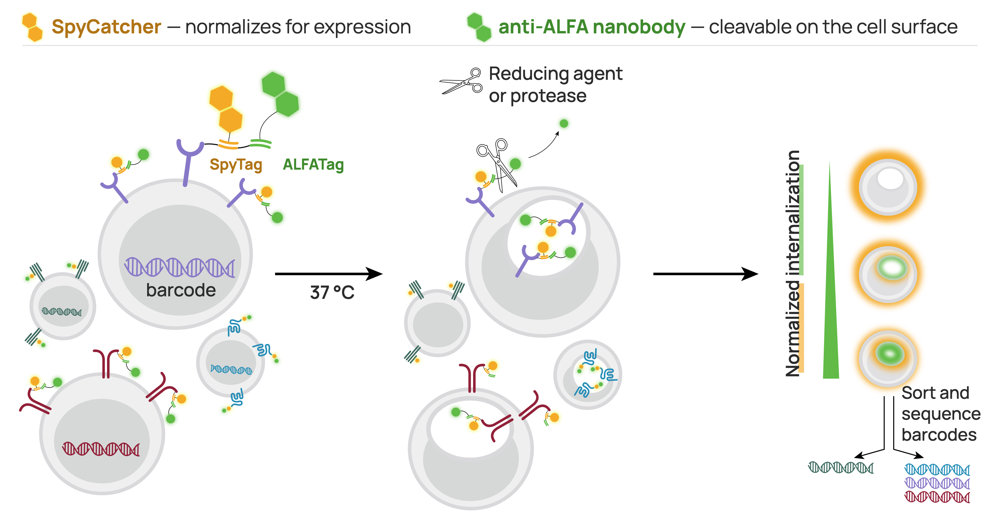
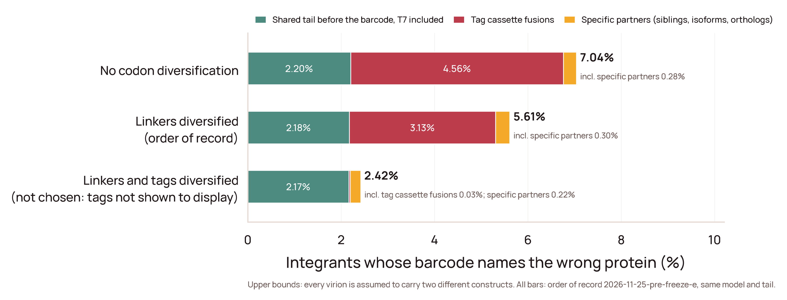
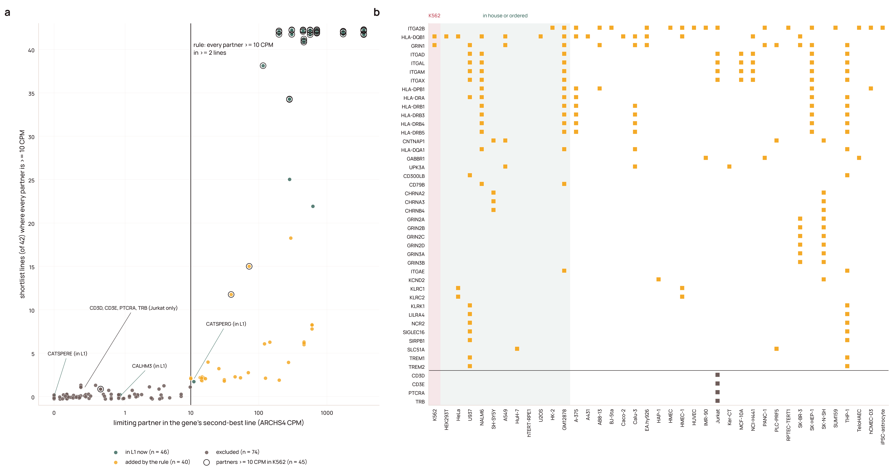
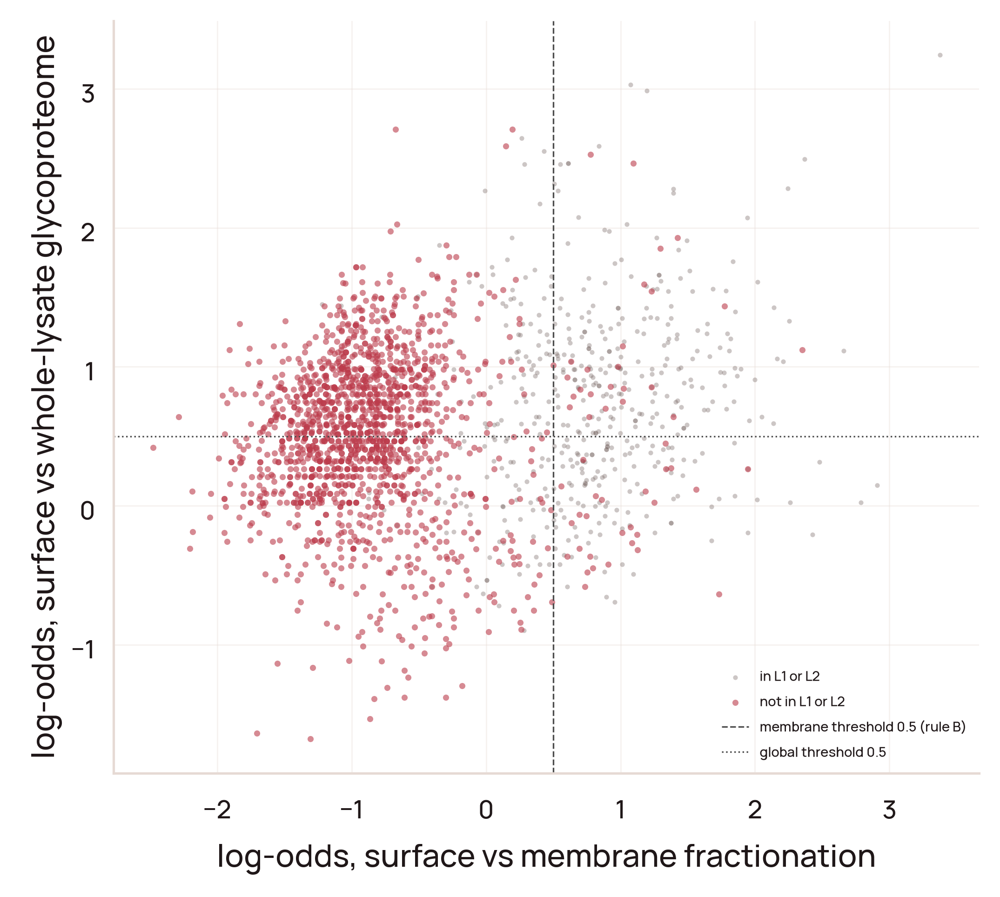
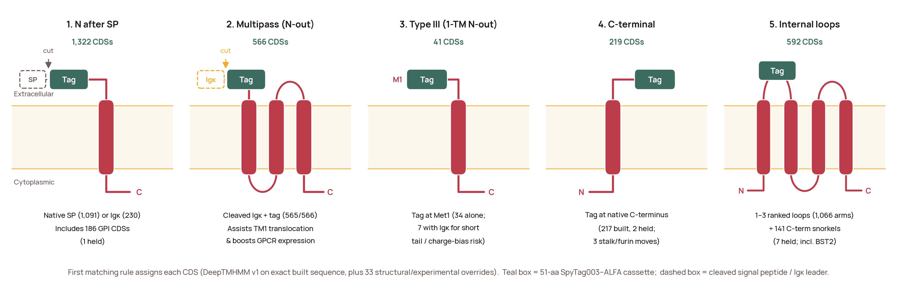
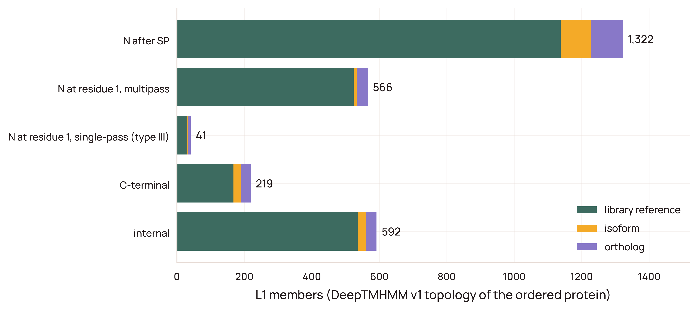
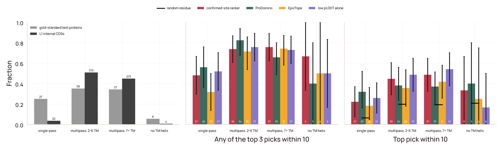
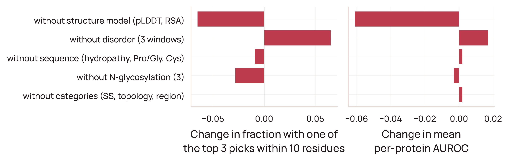
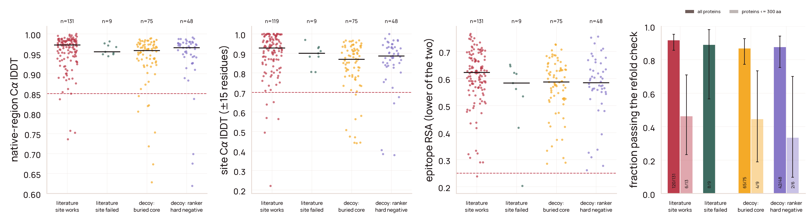

# The Deliverome v1 surface-protein ORF library: design brief for external review

The Deliverome **v1 surface-protein ORF library** (referred to as **L1** in construct IDs and tables) is a pooled, barcoded lentiviral library of human cell-surface protein coding sequences (CDSs) — plus stratified human isoform and mouse/cynomolgus ortholog panels — in which each protein carries a 51-aa dual-epitope tag cassette on an extracellular region (N-terminus, C-terminus, or extracellular loop). The library has not yet been ordered. We are building v1 as an open **community resource** that will be made available to both academia and industry, and we are working with Addgene to deposit both the pooled library and individual plasmids. This brief documents how every gene, proteoform, tag site, vector element and barcode was selected and verified so reviewers can audit or reproduce the design, and highlights the open decisions we most want input on before placing the order ([Decisions we would like reviewers to weigh in on](#decisions-we-would-like-reviewers-to-weigh-in-on)).

Every count in this brief is computed directly from the library's tables ([`brief_numbers.py`](brief_numbers.py)), and [`run_review.py`](run_review.py) recomputes them offline from pinned inputs ([section 11](#11-reproducibility-and-provenance)).

## Executive summary

The v1 library is a single pooled lentiviral library expressing human cell-surface proteins (plus stratified isoform and mouse/cynomolgus ortholog panels): near-term to map surface display and internalization across cell lines, medium-term to run trafficking and delivery screens, while remaining compatible with optical pooled screening (in situ sequencing) and 10x Genomics Feature Barcoding from the same integrated constructs.

| Dimension | Design | Details |
|---|---|---|
| **Construct & vector** | 51-aa dual-epitope tag (`GGGGS`–SpyTag003–`GGGGSGGGGS`–`P`–ALFA–`P`–`GGGGS`) currently designed in `p0039` (`EFS – insert – IRES2 – PuroR – WPRE`, one transcript using Fragmid's domesticated `IRES2_v1`, Esp3I-shuttled; EFS vs. EF1α promoter remains open); **3,352** constructs for **2,730** of the **2,740** active CDSs (`10` held) | [Section 1](#1-the-library-construct-and-vector) |
| **Barcodes & readout** | 20-nt barcodes (Levenshtein ≥ 3, Hamming ≥ 4 across 30k pool; adopted ISS standard **12-nt prefix, Hamming ≥ 3**, leaving +8,896 extra barcodes while v1's 3,352 constructs satisfy the stricter 10-nt `d ≥ 3`); sense T7 promoter directly before the 5′ PCR amplification primer binding site (`JT832`; [Tycko et al., 2020](https://pubmed.ncbi.nlm.nih.gov/33326746/)), padlock arm and T9A reverse-transcription site adapted from `lentiGuide-BC` ([Feldman et al., 2019](https://pubmed.ncbi.nlm.nih.gov/31626775/); [Addgene #127168](https://www.addgene.org/127168/)), and 10x Genomics Capture Sequence 1 (CS1) | [Section 2](#2-the-barcode-and-readout-region-and-the-assays-it-could-support) |
| **Template-switching risk** | Linkers and snorkel modules diversified per construct; SpyTag003/ALFA keep a single validated codon encoding (modeled upper bounds: 3.1% fusions from the shared tags, 2.2% from the constant pre-barcode tail with T7, **5.6%** total wrong-protein integrants, plus 2.0% SP-to-SP leader swaps = **7.6%** combined) | [Section 3](#3-barcode-swapping-in-the-pool), [Section 9](#9-domestication-linker-encoding-and-synthesis-compliance) |
| **Gene selection** | Nine sequential gates from `accessible-surfaceome` v1.3.0 + 3 evidence tiers enforcing the ≥ 30-aa ectodomain floor uniformly across all non-GPI tiers (2,349 genes after removing `EPPIN`), plus 50 active dated additions (32 under the 42-line co-receptor rule after dropping MHC class II; 18 from our [intact-cell surface proteomics meta-analysis](https://surfaceome.deliverome.org/surface-proteomics/)): **2,399** genes; ORF cap 5,000 nt | [Section 4](#4-genes-from-the-surfaceome-universe-to-2399-candidates) |
| **Proteoforms & panels** | One reference CDS per gene (`2,395` built — all 4 identical paralogs deduplicated, all 5 segregating LoF alleles including `OR52P1` from UniProt `Q8NH57` restored plus unedited patch `OR4Q2`; MANE Select from Ensembl 115 GTF / APPRIS + PeptideAtlas evidence + `31` named overrides), plus `149` membrane-anchored, non-fragment human isoforms (each tagged on its own topology) and `196` mouse/cynomolgus orthologs (`97` mouse, `99` cyno) stratified by membrane class and sequence-identity band (near vs. diverged) | [Section 5](#5-proteoforms-one-reference-protein-per-gene), [Section 6](#6-isoforms-and-orthologs) |
| **Topology & tag placement** | DeepTMHMM v1.0.24 ([Hallgren et al., 2022](https://doi.org/10.1101/2022.04.08.487609)) on every built sequence (`0.5%` discordant across `1,120` CDSs with experimental UniProt/TOPDB topology, [section 7](#7-tag-placement-topology-and-placement-rules)); placed after SP (`1,321` built, `230` Igκ-swapped), at residue 1 on extracellular-N multipass (`565` of `566` behind Igκ; only `CRHR2` leader-free) and type III (`7` of `41` behind Igκ), at C-terminus (`217` built), or in an extracellular loop (`585` built: `1,066` loop arms + `141` C-terminal *snorkels*, [Brown et al., 2013](https://pubmed.ncbi.nlm.nih.gov/24023844/)) | [Section 7](#7-tag-placement-topology-and-placement-rules) |
| **Internal-site ranking, refold & QC** | Audited 156-site ranker (`v8_prodomino` combining AlphaFold pLDDT and ProDomino, [Wolf et al., 2025](https://pubmed.ncbi.nlm.nih.gov/40759748/), + retained `v5` arms) + TMDET structure-based membrane-plane gate ([Tusnády et al., 2005](https://pubmed.ncbi.nlm.nih.gov/15539454/); TmAlphaFold, [Dobson et al., 2023](https://pubmed.ncbi.nlm.nih.gov/36318239/)) + literature ligand-contact screen across internal genes; 100% ColabFold ([Mirdita et al., 2022](https://pubmed.ncbi.nlm.nih.gov/35637307/)) refold coverage (`3,352/3,352` folded; `94.1%` pass; binary verdicts flag rather than hold after [refold check validation](#how-well-the-refold-check-predicts-display)); steric clashes, matched `own_ref` lDDT, and pre-order biological audits drove 39 site upgrades/drops with zero CDSs lost | [Section 8](#8-internal-site-ranking-refold-validation-and-build-status) |
| **Domestication & synthesis** | Native human codons preserved (no wholesale codon optimization); minimal synonymous edits for Esp3I/BsaI/BbsI domestication, per-construct linker/snorkel diversification, motif cleanup (`0` domestication/recoding poly(A) signals or 6-mer `GT[AG]AGT` splice donors remain), and High/Not-Accepted synthesis compliance only (`223` inserts / `798` codons recoded across `181` CDSs; `0` Not Accepted, `24` High warnings solely in protected native SP codons) | [Section 9](#9-domestication-linker-encoding-and-synthesis-compliance) |
| **Ordering & pooling** | **35** 96-well plates sorted by construct length; direct `100 ng/µL` (`2 µL`/well) subplate pooling (`2`–`4` subpools/plate) calibrated by a **6-plasmid** backbone-matched titer ladder before pooling | [Section 10](#10-how-the-library-is-ordered) |
| **Reproducibility & provenance** | 30-stage offline `verify` pipeline from SHA-256-pinned inputs, public R2 / release bundles, and structured per-construct decision logs in the GitHub review repo | [Section 11](#11-reproducibility-and-provenance) |

The brief is organized vector-first: **sections 1–3** cover the construct, vector, readout/barcode block, and pooled barcode-swapping risk; **sections 4–8** cover gene curation, proteoform and panel selection, tag placement, internal-site ranking, refold validation, and build status; and **sections 9–11** cover domestication/synthesis, ordering/pooling, and reproducibility/provenance. The **6 key decisions** we most want reviewers to weigh in on before order placement are collected below.

**Looking at a CDS, and giving feedback.** Each library member has a page on the surfaceome viewer, [surfaceome.deliverome.org/v1-review/](https://surfaceome.deliverome.org/v1-review/) (every protein name and L1 design ID in the rendered brief links directly to its viewer page): the protein built, its predicted topology, the tag site and its alternatives, and the native and tagged structure models. To comment on a construct, open it, type your name, choose *site looks right*, *concern* or *suggest another site* (with the residue, or a click on the structure), add a comment and submit. No account or token is needed. As a thank-you for your review time, we will award $500 each to the three most useful reviews.

## Decisions we would like reviewers to weigh in on

All six questions below remain open before order placement (`3,352` constructs across `2,730` built CDSs). Remaining operational items are tracked in the accompanying [cover note](COVER_NOTE.md).

| Question | Why it matters | What would resolve it |
|---|---|---|
| **1. Promoter: EFS (current baseline) vs. EF1α**, with IRES2–PuroR selection chosen ([section 1](#the-vector-backbone-promoter-and-selection-marker)). | **TL;DR:** The library is currently designed in EFS, but EF1α vs. EFS is open. On TfR1 across three cell lines, EF1α gives ~1.5–2.4× brighter SpyCatcher display and more Spy+ cells (92–95% vs. 76–87%), whereas EFS gives ~6–13 pp higher `% internalized` and a slightly shorter packaged genome (+967 bp for EF1α is a minor length difference). All data so far are on TfR1 in a fluorescent reporter layout rather than the library's direct `IRES2–PuroR` backbone. | Results from our broader pilot panel across receptor classes in direct `IRES2–PuroR` (EFS vs. EF1α), plus your experience trading higher expression against potential overexpression effects on trafficking and internalization. |
| **2. MANE Select default where MANE and APPRIS disagree** ([section 5](#5-proteoforms-one-reference-protein-per-gene)). | Of 178 MANE/APPRIS protein disagreements (177 single-winner/unresolved + 1 dual-strong `NFASC`), 21 have strong PeptideAtlas support for MANE and 0 for APPRIS alone, while 123 have no distinguishing peptides; MANE is the NCBI/Ensembl clinical consensus whereas 82 disagreements carry APPRIS's lowest-confidence labels. Among the 14 dual-observed genes, 5 (`APP, GRIN1, KCNMA1, NFASC, SIRPA`) use MANE and 9 (`ADGRG6, ATP1A3, CSPG5, DPP10, DPP6, KCNQ2, ROBO2, SLC12A3, SLC4A7`) stay on APPRIS on PeptideAtlas evidence. | Your view on defaulting to MANE Select, or biological context arguing to flip any of the 14 dual-observed genes or 33 weak-evidence genes. |
| **3. Isoform (149) and ortholog (196) panel stratification** ([section 6](#6-isoforms-and-orthologs)). | The 149 active human isoforms (150 drawn, minus 1 whose `<30 aa` parent gene `TMEM222` was retired) span **six membrane classes** (type I, type II, type III, GPI-anchored, multipass N-out, multipass N-in) from membrane-anchored, non-fragment alternative forms (`≥25%` of reference length, and if `<100 aa` then `≥50%` of reference length), each tagged on its own DeepTMHMM v1 topology. The 196 active orthologs (`97` mouse, `99` cynomolgus; 200 drawn minus 4 whose `<30 aa` parent genes were retired) are stratified by membrane class **and** split 50/50 into near vs. diverged sequence-identity bands. Isoforms are not currently stratified by divergence (89/150 drawn are within ≥95% of reference length). | Your view on the six membrane classes, whether isoforms should also be stratified into near vs. diverged bands like orthologs, and whether any specific isoforms or orthologs should be swapped. |
| **4. Murine Igκ signal peptide on 802 CDSs and residue-1 tagging of type III proteins** ([section 7](#7-tag-placement-topology-and-placement-rules)). | We prepend the cleavable murine Igκ signal peptide in three cases: `565/566` multipass proteins whose N-terminus is extracellular without a native signal peptide (all except `CRHR2`, which displayed leader-free), `7/41` single-pass **type III** proteins (extracellular N-terminus, no native SP) with predicted membrane-insertion risk (`34` carry tag alone), and `230/1,321` N-after-SP proteins whose native SP cleavage is predicted by SignalP 6 to be lost or weakened after adding the tag (`1,091` keep their native SP). | Whether Igκ should be the default on extracellular-N multipass proteins (we are testing three matched ±Igκ GPCR pairs before ordering), whether SignalP re-prediction across an engineered tag junction justifies replacing a native SP, and whether leaderless type III proteins need a leader. |
| **5. Preserving native human codons (no wholesale codon optimization)** ([section 9](#9-domestication-linker-encoding-and-synthesis-compliance)). | Rather than codon-optimizing the library, we keep native human codons across Low/Medium-complexity inserts and apply minimal synonymous edits only for Type IIS domestication, motif cleanup, or High/Not-Accepted synthesis blockers (`223` inserts / `798` codons edited). This leaves **`0` unmanufacturable inserts** and **`24` inserts carrying a synthesis-complexity warning solely inside protected native signal-peptide codons**, which we left unedited to avoid disrupting translation/cleavage. | Your experience preserving native human codons vs. codon-optimizing membrane-protein ORFs, and whether leaving those 24 protected signal-peptide warnings for vendor review is preferable to editing signal-peptide codons. |
| **6. Length-weighted pooling hypothesis** ([section 10](#10-how-the-library-is-ordered)). | Our packaged lentiviral genomes span 4.6–9.5 kb, where published estimates of titer drop per kb range from ~2× (Sweeney & Vink) to ~3.5× (Moon et al.). Overcorrecting would invert the length bias, whereas calibrated subplate pooling (`2`–`4` subpools/plate directly from `100 ng/µL` stocks) holds library-wide skew tightly bounded. | How much length-weighted pooling improves representation in pooled lentiviral screens over this size range, and whether our planned **6-plasmid** backbone-matched titer ladder ([section 10](#10-how-the-library-is-ordered)) is sufficient to calibrate it before pooling. |

## 1. The library, construct, and vector

### What is in the library

The v1 library has **2,740** designed CDSs. **2,730** of them have at least one construct in the order, which
holds **3,352** constructs (one plasmid each); the other **10** are held with no construct
([section 8](#where-every-cds-stands)). Every terminally tagged CDS is one construct, while an
internally tagged CDS may be ordered at two or three sites (including a C-terminal *snorkel*
companion, [Brown et al., 2013](https://pubmed.ncbi.nlm.nih.gov/24023844/); [section 7](#7-tag-placement-topology-and-placement-rules)), which **390** CDSs are,
accounting for **1,012** constructs under the order rule (one construct when a single loop region
clears the published-tag median with no close runner-up; two when a second region is within 10%;
three when no region clears the median).

**Size.** CDSs span 186–5,139 nt (shortest is CD52, a 61-aa GPI protein).
Adding the 153-nt tag cassette (and the Igκ leader where used) and the constant 158 nt of Esp3I sites, Kozak, barcode, and readout
block (Figure 2a) gives a median full insert of 1,769 nt (497–5,450;
[`l1_insert_lengths.py`](../l1_insert_lengths.py), [`l1_order_plan.tsv`](l1_order_plan.tsv)).
Finished vectors span 7,974–12,927 bp, within the lentiviral packaging cap
([section 4](#4-genes-from-the-surfaceome-universe-to-2399-candidates)).

| Candidate set | What it is | CDSs |
|---|---|---:|
| Reference | the gene's chosen reference protein ([section 5](#5-proteoforms-one-reference-protein-per-gene)) | 2,395 |
| Isoform | an alternative human protein of the same gene | 149 |
| Ortholog | the gene's mouse (97) or cynomolgus (99) counterpart | 196 |

*Figure 1. Library composition and native CDS length distribution by candidate set (2,740 active CDSs). (A) Counts split by human reference (2,395), human isoforms (149), mouse orthologs (97), and cynomolgus orthologs (99). (B) Native CDS length distributions (violin, interquartile bar, and median dot; dashed line marks the 5.0 kb ORF cap). Drawn by [`brief_numbers.py`](brief_numbers.py) from [`l1_tag_paths.tsv`](../l1_tag_paths.tsv). How isoforms and orthologs were chosen is in [section 6](#6-isoforms-and-orthologs).*

| Where the tag goes | CDSs |
|---|---:|
| after the signal peptide | 1,322 |
| after Met1 of a multipass protein (behind the Igκ leader for 565 of 566; only `CRHR2` is leader-free because its N-terminal pseudo-SP is uncleaved and displayed leader-free, caught by our systematic multipass SP screen in [section 7](#7-tag-placement-topology-and-placement-rules)) | 566 |
| after Met1 of a single-pass type III protein | 41 |
| at the C-terminus | 219 |
| in an extracellular loop | 592 |
| **total** | **2,740** |

Each CDS is counted once, at the placement its DeepTMHMM v1 topology calls for
([`l1_tag_paths.tsv`](../l1_tag_paths.tsv)); build status and construct counts per placement are in
[section 8](#where-every-cds-stands).

### The construct

*Figure 2a. One construct. Top, not to scale: the barcoded insert between its two Esp3I sites,
with the three tag positions and the number of CDSs tagged at each (N-terminal counts the
after-signal-peptide, multipass and type III placements together), followed by the 3-nt stop
codon plus a shared 2-nt `CC` spacer (`stop + CC pad`, 5 nt total) and the readout block: a
sense T7 promoter, the 5′ PCR amplification handle (`JT832`; [Tycko et al., 2020](https://pubmed.ncbi.nlm.nih.gov/33326746/)),
the 20-nt barcode, the 17-nt padlock arm and reverse-transcription (RT) site from `lentiGuide-BC`
([Feldman et al., 2019](https://pubmed.ncbi.nlm.nih.gov/31626775/); [Addgene #127168](https://www.addgene.org/127168/))
with a single `T→A` substitution at position 9 (`T9A`, which breaks a cryptic `GGG·GTAAG`
splice-donor motif in the packaged transcript while shifting RT-site Tm by only +0.6 °C;
[section 2](#2-the-barcode-and-readout-region-and-the-assays-it-could-support)), and the 10x
Genomics Capture Sequence 1 (CS1). Below, to scale from cPPT to the 3′ LTR: that insert in the
library vector p0039, EFS–insert–IRES2–PuroR on one transcript, the library's current baseline
design (EFS vs. EF1α remains open; below). In grey, the alternative not used: PuroR from its own
SV40 promoter with no IRES (the P-0050 layout). Deliverome scientists saw TfR1 silencing in the
SV40-puro TfR1 construct (P-0008): puromycin-resistant cells with low TfR1 expression. AXL is the
example ORF; only the ORF and the cassette position differ between constructs. Coordinates are read
from two full GenBank maps, [`l1_example_AXL_ires_puro.gb`](../l1_example_AXL_ires_puro.gb)
(10,473 bp) and [`l1_example_AXL_sv40_puro.gb`](../l1_example_AXL_sv40_puro.gb) (10,153 bp). Drawn
by [`plot_l1_construct_schematic.py`](../plot_l1_construct_schematic.py).*

The tag cassette is 51 amino acids, `GGGGS`–SpyTag003–`GGGGSGGGGS`–`P`–ALFA–`P`–`GGGGS`. SpyCatcher
binds SpyTag003 covalently and normalizes for expression; an anti-ALFA nanobody labels the same
protein and can be released from whatever stays on the surface, which is what the internalization
readout measures.

*Figure 2b. The internalization screen the library serves first. SpyCatcher labels every tagged
protein; after uptake at 37 °C the anti-ALFA nanobody is released from the cell surface by a
reducing agent or protease, so the ALFA signal left, normalized to SpyCatcher, reports
internalization; cells are sorted on it and their barcodes sequenced. A schematic, not data.
Drawn by [`fig_internalization_assay.py`](../../../../library/l1/figures/fig_internalization_assay.py).*

### The vector: backbone, promoter and selection marker

**Backbone.** p0039 is our insert-agnostic EFS–IRES2–PuroR destination vector
(`pAG Lenti_236083_EFS_IRES_puro_insert_agnostic`, 7,672 bp). Its name and our
[vector-design record](../../vector-design/README.md) trace it to the
lentiviral parent plasmid pAG Lenti CMV Empty Puro ([Addgene #236083](https://www.addgene.org/236083/)),
modified to be Golden Gate–compatible by domesticating the parent backbone's internal Esp3I sites
(`253 g→A`, `310 c→A`), replacing CMV with the 212-bp EFS promoter, and coupling puromycin
resistance via Fragmid's domesticated `IRES2_v1`; the exact sequence is
[`p0039_EFS_IRES_puro_backbone.gb`](../p0039_EFS_IRES_puro_backbone.gb) (GenBank). Two full maps
of one member, AXL, show a finished construct in each layout of Figure 2a:
[`l1_example_AXL_ires_puro.gb`](../l1_example_AXL_ires_puro.gb), the library layout, and
[`l1_example_AXL_sv40_puro.gb`](../l1_example_AXL_sv40_puro.gb), the SV40-puro alternative. They
are worked examples built by [`l1_example_vector_maps.py`](../l1_example_vector_maps.py), not
registered constructs: they carry no P-number, and the barcode is the 20-N placeholder.

Every construct goes into one lentiviral destination vector, p0039, which runs
`EFS promoter – insert – IRES2 – PuroR – WPRE` between the LTRs (currently designed in EFS, with
EFS vs. EF1α still open below). The construct (Kozak, ORF with its tag cassette and stop, barcode
and readout block) replaces a 195-bp cloning site and stuffer directly after the promoter. To keep
the backbone Golden Gate–compatible, p0039 uses Fragmid's domesticated `IRES2_v1` (`pF_AA333`;
[McGee et al., 2024](https://pubmed.ncbi.nlm.nih.gov/38484704/)), which carries three single-base
edits relative to the undomesticated EMCV IRES2 part from the EMMA mammalian modular toolkit
(`YCe1760 HC_Kan_IRES2_p8b`, [Addgene #100673](https://www.addgene.org/100673/);
[Martella et al., 2017](https://pubmed.ncbi.nlm.nih.gov/28418644/)) to remove two BbsI sites
(`137 T→G`, `236 A→C`) and one ApaLI site (`480 G→A`). Folding and 79-isolate conservation checks
([`ires_domestication_analysis.py`](../../vector-design/ires_domestication_analysis.py),
[`ires_domestication_edits.tsv`](../../vector-design/ires_domestication_edits.tsv))
find the structural perturbation within random and natural EMCV variation with the eIF4G J–K
platform and initiator AUG intact. In head-to-head flow cytometry comparing the domesticated
`IRES2_v1` (`P-0003`) directly against the undomesticated EMMA IRES2 (`P-0009`) in the same
EFS–TfR1–IRES2–mScarlet3–P2A–PuroR cassette, the domesticated IRES actually gave **higher
expression** across all tested lines (1.4–2.2× higher 72 h mScarlet3 gMFI in HEK293T, 3–7× in
HeLa, and 1.5–1.6× in Nalm-6; Figure 2c, Panel A), and ~2× higher post-selection surface
SpyCatcher display in HEK293T with matched 41% internalization. Below we summarize our experimental
comparison of the selection-marker layout (IRES-coupled vs. independent SV40 promoter) and promoter
choice (EFS vs. EF1α).

**Selection is coupled to the ORF through the IRES; this is the layout v1 uses.** Puromycin
resistance is translated from the same transcript as the CDS, so a cell survives selection only
if it transcribes the ORF. The alternative, PuroR from its own SV40 promoter with no IRES, is not
used because Deliverome scientists saw TfR1 silencing with it: P-0008, a TfR1 construct with the
same EFS–TFRC–tag unit and that SV40-driven PuroR, gave puromycin-resistant cells with low TfR1
expression (40–73% SpyCatcher-negative at 37 °C — and 61–89% at 4 °C — across HEK293T, K562 and
Nalm-6; Figure 2c, Panel B). A separate selection promoter lets a cell survive while transcribing
the ORF poorly, and in a pooled screen those cells would read as CDSs that fail to reach the
surface. The cost of the IRES is that selection depends on the CDS's own transcript, so a CDS that
is transcribed weakly is also selected weakly, and will be underrepresented after puromycin rather
than present as a tag-negative cell.

**Designed in EFS; EFS vs. EF1α remains an open decision.** We compared promoters driving the
`TFRC–SpyTag003–ALFA–barcode–IRES2–mScarlet3–P2A–PuroR` cassette across four cell types at 72 h
before selection (dropping PGK as consistently dimmest, 0.29–0.64× EFS), and then measured
post-selection **surface tag display and internalization** (30 min dual labeling at 4 °C or 37 °C
with non-cleavable SpyCatcher-3CYS-CF488A and TCEP-strippable ALFAnb-SS-CF640R, ± TCEP) across
HEK293T, K562 and Nalm-6 in two independent assay runs (one well per condition per run; the HEK293T
TCEP strip failed in the first run and succeeded in the repeat).

*Figure 2c. Promoter and selection-marker comparison on TfR1. (A) Pre-selection 72 h mScarlet3 gMFI
relative to PGK (dashed amber line = 1) across four virus doses (circles to diamonds) in HEK293T,
HeLa, Nalm-6, and K562; K562 lacked a fresh domesticated-IRES EFS well. Domesticated `IRES2_v1`
(maroon, current baseline) outperforms undomesticated EMMA `#100673` IRES2 (salmon) in every cell
line, and EF1α (teal) is brightest throughout (1.7–4.0× EFS). (B) Post-selection live SpyCatcher+
fraction at 37 °C (bars) and EF1α/EFS SpyCatcher gMFI fold-gain on Spy+ cells (top labels; 1.5–2.4×,
or 1.7–2.7× over all live cells). Uncoupled SV40–PuroR (grey) leaves 40–73% of puromycin-selected
cells SpyCatcher-negative. (C) Post-selection TfR1 `% internalized` at 37 °C (bars = repeat run;
hollow diamonds = first assay run where measured; n = 1 well per condition per run; K562 EFS uses
the stable line `L-0019`). Drawn by [`brief_numbers.py`](brief_numbers.py).*

Across all three cell lines, EF1α yields a higher fraction of surface-labeled cells (92–95% vs.
76–87% Spy+ at 37 °C) and 1.5–2.4× brighter SpyCatcher signal on positive cells (1.7–2.7× over all
live cells) than EFS, with clean 4 °C TCEP stripping (`0.4–14.5%` residual) and comparable or
slightly better 37 °C/4 °C stripped ALFA/Spy ratio separation (`3.3×` vs. `2.9×` in HEK293T;
`3.2×` vs. `2.7×` in K562; `10.9×` vs. `11.8×` in Nalm-6). However, EF1α consistently reports a
modestly lower `% internalized` for TfR1 than EFS (`34%` vs. `41%` in HEK293T; `45%` vs. `53%` in
K562 at 15 µL, rising to `50%` at 4 µL; `23%` vs. `36%` in Nalm-6) — including within
expression-matched SpyCatcher bins. The practical trade-offs between the two promoters are:

| Consideration | EFS (current baseline) | EF1α (open alternative) |
|---|---|---|
| Surface display & internalization (TfR1, post-selection) | 76–87% Spy+ at 37 °C; 36–57% internalized across HEK293T, K562 and Nalm-6 | 92–95% Spy+ at 37 °C; 1.5–2.4× higher SpyCatcher gMFI (clean 4 °C strip and comparable 37 °C/4 °C ratio separation), but ~6–13 pp lower `% internalized` than EFS |
| Packaged genome length *(minor)* | baseline ([section 10](#10-how-the-library-is-ordered)) | +967 bp longer per construct (minor relative to the 4.6–9.5 kb ORF length spread, though expected to reduce titer ~2–3× across the pool) |
| Upstream intron *(minor)* | no intron | carries the native 948-bp EF1α intron A upstream of the ORF (unlikely to be a major issue, though not yet tested across diverse ORFs) |

**The promoter can also change after the order.** Each construct is flanked by its own Esp3I sites
(the shuttle enzyme, [section 9](#9-domestication-linker-encoding-and-synthesis-compliance)), which
leave `GACC` and `AAAG` overhangs, so the synthesized constructs can be shuttled into an EF1α
destination with the same slot without resynthesis. What is fixed at synthesis is the vector the
library is built into first.

**Testing broader ORFs before ordering (still open).** All promoter data so far come from one
bright receptor (TfR1) in the `IRES2–mScarlet3–P2A–PuroR` reporter layout (not `p0039`'s direct
`IRES2–PuroR`) at unmatched virus volumes. Before placing the library order, we are testing a
broader arrayed pilot of **22 constructs across receptor classes and tag placements** in K562 —
including N-after-SP single-pass and GPI targets (`ERBB2`, `AXL`, `NECTIN4`, `FOLR1`, `VSIG10`,
plus `VSIG10` with Igκ replacing its native SP), internal-loop multipass proteins (`SLC2A4`,
`MS4A1`, `CCR5`, `AVPR2`), residue-1 GPCRs with and without the Igκ leader (`CNR1`, `CCR5`,
`OR51E2`, plus leaderless `ACKR3`, `AVPR2`), and the C-terminal `TFRC` benchmark — alongside
matched-MOI EFS vs. EF1α comparisons on dim-to-moderate library ORFs in the direct `IRES2–PuroR`
backbone. That pilot will directly test whether EF1α's display gain improves signal on dimmer
surface proteins without compromising internalization kinetics.

## 2. The barcode and readout region, and the assays it could support

Every construct ends in the same readout block, transcribed from the EFS promoter upstream of the
IRES:

| Element | Sequence | Source |
|---|---|---|
| T7 promoter | `TAATACGACTCACTATAGGG` | T7 class III promoter, −17 to +3, sense; lets T7 RNA polymerase copy the barcode region in fixed cells (below) |
| 5′ handle | `AGTCGTTAGCTGCCGTTCC` | [Tycko et al., 2020](https://pubmed.ncbi.nlm.nih.gov/33326746/), subpool-3 PCR amplification primer binding site (`JT-832`; constructs at [Addgene #28228872](https://www.addgene.org/browse/article/28228872/)) |
| Barcode | 20 nt, one per construct | the library's barcode pool ([below](#how-the-barcodes-were-designed)); 3,644 are provisionally reserved for L1 (3,200 initial block + 444 extension), covering all 3,352 constructs with 292 to spare, and assigned at order placement |
| Padlock arm | `ACTGGCTATTCATTCGC` | `lentiGuide-BC`, verbatim ([Feldman et al., 2019](https://pubmed.ncbi.nlm.nih.gov/31626775/); [Addgene #127168](https://www.addgene.org/127168/)) |
| RT site | `CCTTTGGGAAAGCACACGTC` | `lentiGuide-BC` RT site with `T→A` at position 9 (`T9A`, removing a `GGG·GTAAG` splice-donor motif with +0.6 °C Tm shift; below) |
| 10x Genomics Capture Sequence 1 (CS1) | `GCTTTAAGGCCGGTCCTAGCAA` | 10x Genomics Feature Barcoding |

The block sits after the stop codon and a 2-nt pad, so 44 nt separate the start of the stop codon
from the barcode and 37 nt separate the barcode from CS1. The insert ends at CS1, so the vector
backbone and its Golden Gate junction are the ones every earlier construct used
([`build_constructs.l1_readout`](../build_constructs.py)).

### How the barcodes were designed

The barcode is transcribed. It sits between the ORF stop and the IRES, an intercistronic region
that behaves like a 3′ UTR for the first cistron, so a barcode that presents a
microRNA target site can have its own transcript repressed. That failure mode is the reason the
sequence is designed rather than drawn at random: it produces a barcode-specific expression
penalty on one CDS, which at the bench is almost indistinguishable from that protein being a
weak surface expressor.

The initial pool is 30,000 barcodes of 20 nt (`barcodes_20nt_30k_asgenerated.tsv`), generated
deterministically from a fixed seed by
[`generate_barcodes.py`](../../vector-design/generate_barcodes.py) and
pruned of 1,494 post-hoc splice-donor hits into the 28,506-barcode active pool
[`barcodes_20nt_30k.tsv`](../../vector-design/barcodes_20nt_30k.tsv), so
the file reproduces from the script alone. Nine rules are applied (7 initial filters, the post-hoc
splice-donor filter, and the edit-distance rules), each recorded with its
source and whether we checked that source ourselves in
[`barcode_filter_stack.py`](../../vector-design/barcode_filter_stack.py):

| Rule | Why | Source |
|---|---|---|
| GC 40–60% | amplification and sequencing behavior | Hawkins/FREE, Shiroguchi |
| no homopolymer run above 2 | miscalls and indels in homopolymers | Hawkins/FREE |
| no `ATG` anywhere | a spurious start codon in the readout region | ours |
| no `AATAAA`, and none of its 18 single-base point mutants | a polyadenylation signal would truncate the transcript | [Vainberg Slutskin et al., 2018](https://pubmed.ncbi.nlm.nih.gov/29410437/) |
| no 3-bp non-overlapping self-complementarity | hairpins | Hawkins/FREE |
| no conserved microRNA 6-mer seed target site (207 sites) | the repression described above | TargetScanHuman 8.0 |
| no `GT[AG]AG` splice-donor core | a cryptic donor here would splice out the IRES and the selection marker | ours |
| no BbsI, Esp3I/BsmBI or BsaI sites (both strands) | avoids cloning-enzyme cuts inside barcodes (palindromic 6-cutters are already excluded by the 3-bp self-complementarity rule) | ours |
| min Levenshtein distance ≥ 3 and min Hamming distance ≥ 4 | corrects one substitution or single-base indel over the full 20-nt barcode | [Vainberg Slutskin et al., 2018](https://pubmed.ncbi.nlm.nih.gov/29410437/); Hawkins/FREE |

Two of these are worth your attention. The microRNA rule rejects 6-mer seed matches
rather than the 7mer-m8 sites a target-prediction tool reports, and since every 7mer-m8 site
contains its 6-mer core, the 6-mer rule rejects a strict superset — deliberately stricter than
the precedent it comes from. The splice-donor rule is ours and has no published precedent; it
exists because the barcode sits upstream of an IRES in the same transcript.

**There is no UMI in the construct.** L1 is screened as a pool, and barcode counts from sorted
populations are read from PCR of integrated or transcribed barcodes, so amplification bias is
a real source of noise. A unique molecular identifier added in the first PCR primer at library
preparation removes that bias without occupying construct sequence, so the 20 nt stay with the
barcode.

**Error-correction guarantees: full 20-nt pool vs. short in situ prefix.** Across the full 20-nt
barcode, every pair in the 30,000-barcode pool satisfies **Levenshtein distance ≥ 3 and Hamming
distance ≥ 4** ([`generate_barcodes.py`](../../vector-design/generate_barcodes.py)),
so full-length amplicon reads unambiguously correct one substitution or single-base indel. Because
in situ sequencing reads only the first 10–12 bases (and random draws from the 28,506-barcode pool
produce identical prefixes: 1,244 identical 10-nt pairs and 111 identical 12-nt pairs across the
pool), L1's reserved barcodes are additionally drawn under a prefix-distance screen
([`barcode_prefix_screen.py`](../barcode_prefix_screen.py), tested in CI) enforcing **Hamming
distance ≥ 3 over the first 10 bases**, correcting one substitution error in a 10-cycle ISS read
(assuming readout starts at the barcode's 5′ end, as in Feldman et al.).

Three assays could read it. Each is checked here against the sequences in
[`build_constructs.py`](../build_constructs.py), because what the fragment carries when ordered
decides which assays stay possible.

**Optical pooled screening (in situ sequencing).** Feldman et al. read lentiGuide-BC barcodes
in fixed cells by in situ reverse transcription, padlock gap-fill and sequencing by synthesis
([Feldman et al., 2019](https://pubmed.ncbi.nlm.nih.gov/31626775/)). Three of their elements
differ from ours:

- *Why the p003 layout was weak for optical screening.* The 10-nt gap after the barcode
  (`GGATCTGGAC`) is not from lentiGuide-BC, where Feldman has a 17-nt padlock arm in that
  position. Ours came in with the p003 map with no recorded reason; read as codons it is GGA TCT GGA (Gly-Ser-Gly), so it
  may be a linker or cloning scar (inferred, not documented). With only 10 nt before the RT
  site, a padlock arm on that side would have to run into the RT site and pair with
  primer-made cDNA. Feldman's padlock arm sits directly after the barcode and ends where his RT primer
  begins, with no overlap.
- *The adopted 3′ flank.* Feldman's padlock arms match neither of our earlier flanks, and
  his RT site cannot be copied verbatim. The flank we adopt replaces the 30-nt gap plus
  RT site (`GGATCTGGACCCTTTGGGCAAGCACACGTC`) with his RT-side padlock arm, verbatim,
  followed by his RT site with one base changed. Every L1 insert is built with it; it lengthens
  the readout region by 7 bp (the T7 promoter, under *T7 in situ transcription* below, adds
  20 more before the handle) and changes no coding sequence. Plasmids ordered before L1 keep the
  earlier flank.

| Element (transcript sense) | Earlier flank | Adopted |
|---|---|---|
| After the barcode | 10-nt gap `GGATCTGGAC` | Feldman's 17-nt padlock arm `ACTGGCTATTCATTCGC` (`lentiGuide-BC`, [Addgene #127168](https://www.addgene.org/127168/)) |
| RT site | `CCTTTGGGCAAGCACACGTC` (C at 9) | `CCTTTGGGAAAGCACACGTC` (A at 9) |
| RT primer | none ordered | `GACGTGTGCTTTCCCAAAGG`, with Feldman's LNA positions |
| Barcode to CS1 | 30 nt | 37 nt; the ORF-to-barcode distance is unchanged |

  We substitute `T→A` at position 9 (`T9A`) to remove the `GGG·GTAAG` splice-donor motif in Feldman's native RT site without creating the strong `GGGC`/`GCCC` hairpin (Tm 62.2 °C) or `miR-636` seed introduced by `T9C`; the change shifts the RT-site Tm by only +0.6 °C (53.4 °C → 54.0 °C; primer3 at 50 mM Na⁺, no Mg²⁺):

| Base 9 | Splice-donor motif | Hairpin with the padlock arm | Added miRNA seed 7-mer | RT-site Tm |
|---|---|---|---|---:|
| T (Feldman) | `GGG·GTAAG`, in the packaged transcript | Tm 42.5 °C, ΔG −0.38 | none | 53.4 °C |
| C (earlier) | none | `GGGC`/`GCCC` stem, Tm 62.2 °C, ΔG −2.13 | miR-636 | 56.7 °C |
| A (adopted) | none | Tm 43.4 °C, ΔG −0.36 | none | 54.0 °C |

  Feldman's own primer would bind the A site with one A:A mismatch, so the matched primer above
  replaces it. The padlock then needs one new arm, on the barcode-proximal 15 nt of the
  Tycko handle (`GTTAGCTGCCGTTCC`, 45.7 °C nearest-neighbor at 50 mM Na⁺, against 46.1 °C for
  Feldman's RT-side arm); the handle itself does not change. Feldman et al.'s other arm
  (`GTGTTCAATCAACATTCC`) is in no deposited plasmid map: it enters with their cloned barcode
  cassette, so it is inferred to sit directly 5′ of their barcode and does not occur in v1.
  Four fixed-flank 7-mers match human miRNA seeds in TargetScanHuman 8.0
  ([McGeary et al., 2019](https://pubmed.ncbi.nlm.nih.gov/31806698/)): `ACTGGCT`
  (miR-575/4676-5p), `CTATTCA` (miR-5585-3p), `CTTTGGG` (miR-186-3p), and `AAGCACA`
  (miR-218-5p, broadly conserved). The flank carries no `GT[AG]AG` splice donor and no BbsI,
  Esp3I, or BsaI site, and no 15-mer of the padlock arm or arm-plus-RT region occurs anywhere else
  in the backbone or the 3,352 v1 inserts. A full map of one CDS with the adopted readout
  (T7 promoter, handle, barcode slot, padlock arm, RT site, CS1) is
  [`l1_example_AXL_ires_puro.gb`](../l1_example_AXL_ires_puro.gb), built by
  [`l1_example_vector_maps.py`](../l1_example_vector_maps.py). Priming RT directly from CS1
  remains an untested alternative (no published optical screen uses a 10x capture sequence as an
  in situ RT primer). In the adopted layout CS1 sits 37 nt downstream of the barcode, leaving 10x
  feature-library read 2 (primed from the 5′ handle) unaffected.
- *Full-context barcode + flanking-junction screening.* Every barcode is screened not only internally
  but across its **full flanking context** (`5′ handle + 20-nt barcode + 3′ T9A flank + CS1 + shuttle`)
  for Type IIS sites (`BbsI`, `Esp3I`, `BsaI`), consensus splice donors (`GT[AG]AG`), RNA-binding-protein
  motifs (Pumilio `TGTA[ACT]ATA`, AU-rich `ATTTA`, CPEB `TTTTAT`/`TTTTAAT`, poly(A) `AATAAA`/`ATTAAA`,
  and CFIm25 `TGTA` pairs within 50 nt), and conserved miRNA seed matches spanning either barcode junction
  ([`reserve_barcodes.py`](../reserve_barcodes.py), [`rbp_motif_screen.py`](../rbp_motif_screen.py)).
  miRNA seed sites are taken from TargetScanHuman 8.0 (`miR_Family_Info.txt`, Species ID 9606;
  [McGeary et al., 2019](https://pubmed.ncbi.nlm.nih.gov/31806698/)), committed directly in the
  review repository at [`mirna_seed_sites.tsv`](../../vector-design/mirna_seed_sites.tsv):
  across all **2,064 human miRNA families** (`108` broadly conserved, `111` conserved, `220` poorly
  conserved, `1,625` unassigned), the **219 broadly conserved and conserved families** yield **207
  unique 6-mer seed sites** excluded from the base barcode pool (following the [Vainberg Slutskin et al., 2018](https://pubmed.ncbi.nlm.nih.gov/29410437/)
  criterion) and their 7-mer seeds are screened across both 5′ and 3′ barcode junctions. Under the
  adopted T9A 3′ flank, **21,394 of 28,506** pool barcodes pass junction screening (`6,911` fail a
  junction miRNA seed, `201` fail a junction Type IIS site, `0` fail splice donor; `3,741` drawable
  at 10-nt prefix `d ≥ 3`). The T7 promoter sits upstream of the 19-nt handle and does not touch
  either barcode junction.
- *Reserved v1 barcode block and ISS prefix distance.* The **3,644** reserved v1 barcodes
  ([`reserve_l1_block.py`](../reserve_l1_block.py)) pass every internal, flanking-junction, and RBP
  screen plus a 10-nt prefix Hamming distance `d ≥ 3`, covering all **3,352** constructs with
  **292** to spare (assigned one-to-one in place of the `20-N` placeholder at order freeze; unused
  rows are released). Keeping `d ≥ 3` enables 1-base error correction in situ (recovering ~9–26% of
  cells at 1–3% per-cycle SBS error rates with <0.06% miscorrection); extending future reservations
  to a **12-nt `d ≥ 3` prefix** in [`barcode_prefix_screen.py`](../barcode_prefix_screen.py) leaves
  +8,896 additional barcodes available alongside the 3,644 reserved block (`12,540` combined; `12,356`
  drawn greedily from scratch over the 21,394 T9A-passing pool) while v1's 3,352 constructs already satisfy
  the stricter 10-nt `d ≥ 3` rule. Intercistronic barcode expression is expected (as in
  `lentiGuide-BC`) but not yet directly measured.

**10x 3′ Feature Barcoding.** The 3′ v3 Feature Barcoding gel beads carry the reverse complement
of CS1, so the RNA must carry `GCTTTAAGGCCGGTCCTAGCAA` in sense
([Replogle et al., 2020](https://pubmed.ncbi.nlm.nih.gov/32231336/)). Our EFS transcript places CS1
in sense 37 nt downstream of the barcode. While Replogle et al. originally placed CS1 inside a
short Pol III sgRNA stem loop and subsequent direct-capture designs have embedded CS1 in Pol II
mRNA 3′ UTRs, capture efficiency of our longer ORF–IRES2–PuroR transcript at this internal position
has not yet been benchmarked empirically in this vector.

**T7 in situ transcription.** Each L1 insert carries a T7 promoter in sense, between the stop
codon's pad and the 5′ handle. In fixed cells, T7 RNA polymerase then makes many sense copies of
the handle, barcode and readout region per integrant, independent of how strongly the cell
transcribes the CDS, and Feldman's RT primer, padlock and sequencing primer read those copies
unchanged. In situ T7 transcription ahead of padlock readout raised barcode assignment
1.6–2.9-fold in iNeurons, macrophages and T cells, with the promoter built into the U6 promoter
just upstream of the guide ([Kudo et al., 2025](https://doi.org/10.1038/s41587-024-02391-0)); NIS-Seq used an inverted
promoter downstream of the guide for four genome-scale screens
([Fandrey et al., 2025](https://doi.org/10.1038/s41587-024-02516-5)); and single genomic copies
were detected in 85% of cells by FISH on the T7 product
([Askary et al., 2020](https://doi.org/10.1038/s41587-019-0299-4)). Placing the T7 promoter in
sense directly between the stop pad and the 5′ handle keeps all junctions clean of restriction
sites and splice donors (whereas an antisense promoter after CS1 introduces an unavoidable
`ATA·GTGAGT` splice-donor core in the Pol II transcript).

What this placement costs and leaves untested:

- *Template switching.* The 20 added nt lengthen the tail every pair of inserts shares, which
  raises the modeled share of integrants whose barcode maps to the wrong protein by about one
  percentage point ([section 3](#3-barcode-swapping-in-the-pool);
  [`swap_t7_scenario.py`](../swap_t7_scenario.py)).
- *Motifs in the transcript.* The pad, promoter and handle carry no `GT[AG]AG` and no BbsI, Esp3I
  or BsaI site. They carry four 7-mers matching human miRNA seeds, none from a conserved family
  (miR-3174, poorly conserved; miR-489-5p, miR-6883-3p and miR-921, unassigned in TargetScan 8.0).
- *Geometry with no precedent.*
  The construct keeps `STOP · CC · T7 · JT832` with a **0-nt spacer** between T7's `GGG`
  initiation site and `JT832` (`AGTCGTTAGCTGCCGTTCC`). That leaves **3 nt** (`GGG`) of T7 RNA
  upstream of full `JT832` and **7 nt** (`GGGAGTC`) upstream of the 15-nt padlock arm
  (`GTTAGCTGCCGTTCC`), compared with 60–65 nt in published PerturbView and NIS-Seq designs;
  whether this reads as cleanly at single copy is to be checked in a pilot before relying on it.

## 3. Barcode swapping in the pool

The two genomes packaged in one lentiviral particle can recombine: reverse transcriptase switches
template between them, and where the two share identical sequence the switch can place one
construct's barcode beside the other's ORF.
[Walton et al. (2024)](https://pubmed.ncbi.nlm.nih.gov/38558968/) fit this as a per-base switch
rate *k* = 5.3 × 10⁻⁴ per bp of shared sequence, so a particle carrying two constructs that share
an identical block of *L* bp gives a discordant barcode with probability
*Y*(*L*) = ½ (1 − e^(−2*kL*)) ([`seqtools.barcode_swap_rate`](../../../../src/deliverome_analysis/seqtools.py)).
That is a rate for a particle that carries both constructs. In the pool, a construct's
co-packaged partner is any other construct with probability equal to that construct's share of the
pool. The pool has 3,352 constructs, so the average share is 1 in 3,352, but the
pool is length-weighted (3.5× more per kilobase, to offset the lower titer of long
constructs; [section 10](#10-how-the-library-is-ordered)), so long constructs take a much larger
share and the median construct's share is 1 in 11,960.

**Modeled swap rates.** Assuming every virion packages two distinct constructs (an upper bound),
without codon diversification at most 7.0% of integrants would carry a barcode mapping to a
different protein than the encoded ORF. Diversifying the four `GGGGS` linkers, as ordered, lowers
that to 5.6%, and recoding the epitope tags as well would lower it to 2.4%. The remaining 2.2%
comes from the constant tail before the barcode, which cannot be recoded. In addition,
recombination inside the shared tag cassette between two cleavable-SP constructs swaps only the
cleaved leader (leaving the mature displayed protein intact); that leader-swap term is **2.0%**
on the order of record (`2.9%` without diversification, `0.02%` if tags are recoded), giving
**7.6%** combined if leader swaps are included.

*Figure 3. Upper-bound fraction of integrants whose barcode maps to a different protein than the
encoded ORF (assuming every virion carries two distinct constructs), modeled under our 3.5× per kb
length-weighted pool (every partner weighted by its molar pool share in
[`l1_order_plan.tsv`](l1_order_plan.tsv)) and split by where the shared sequence lies: the
constant tail before the barcode (T7 promoter included), the tag cassette, and specific partners
(siblings, isoforms, orthologs, paralogs, and any other pair sharing ≥20 nt). Top, no codon
diversification (7.0%); middle, the order of record with the `GGGGS` linkers diversified (5.6%);
bottom, tags recoded too (2.4%). SP-to-SP leader swaps (2.0% on the order of record) are tracked
separately. Unit: integrant; n = 3,352 constructs. Each bar is one value from the pooled model
([`l1_swap_pool_model.py`](../l1_swap_pool_model.py), [Walton et al., 2024](https://pubmed.ncbi.nlm.nih.gov/38558968/) fit), not a mean of
measurements. The bottom bar is a scenario, not the order: recoded tags have not been shown to
display. Scenarios: [`swap_nothing_diversified_scenario.py`](../swap_nothing_diversified_scenario.py),
[`swap_tags_recoded_scenario.py`](../swap_tags_recoded_scenario.py). Drawn by
[`plot_swap_bottom_line.py`](../plot_swap_bottom_line.py).*

| Shared sequence | Present in | No codon diversification | Order of record: `GGGGS` linkers diversified | Tags diversified too |
|---|---|---:|---:|---:|
| the constant tail between stop codon and barcode (T7 included) + C-terminal cassette mislabels* | every pair | 2.20% | 2.18% | 2.17% |
| the tag cassette (wrong-protein fusions) | every pair | 4.6% | 3.1% (the two tags only) | 0.03% |
| native sequence or cassette shared by a specific partner | siblings, isoforms, orthologs, paralogs | 0.28% | 0.30% | 0.22% |
| **total wrong-protein integrants** | | **7.0%** | **5.6%** | **2.4%** |
| *SP-to-SP leader swaps (same mature protein, tracked separately)* | *cleavable-SP pairs* | *2.9%* | *2.0%* | *0.02%* |
| *combined (wrong protein + SP-to-SP leader swap)* | | *9.9%* | *7.6%* | *2.4%* |

*\*The slight decrease from 2.20% → 2.18% → 2.17% comes from C-terminal-tagged constructs:
recombination inside a C-terminal tag cassette transfers an intact upstream ORF onto another
barcode (counted as a mislabel rather than a chimera), contributing 0.047% without diversification,
0.024% with diversified `GGGGS` linkers, and 0.0002% when tags are also recoded.*

All three columns are computed on the current order with the 3.5× per kb length-weighted pool
and the T7 promoter ([section 2](#2-the-barcode-and-readout-region-and-the-assays-it-could-support)),
which adds 20 nt to the shared pre-barcode tail and roughly doubles the tail term (from 1.2% to
2.2%; [`swap_t7_scenario.py`](../swap_t7_scenario.py)). The tail (a 2-nt `CC` pad, 20-nt T7
promoter, and 19-nt primer handle) cannot be diversified because every barcode is amplified and
read through it. In the order of record, SpyTag003 (48 nt) and P-ALFA-P (45 nt) keep validated
codons while the four `GGGGS` linkers are synonymously diversified per construct
([section 9](#9-domestication-linker-encoding-and-synthesis-compliance)). Typical construct pairs
share only the two fixed tags separately (48 and 45 nt). Recoding the tags as well cuts the
longest shared cassette stretch to 53 nt and drops the cassette term to 0.03%
([`swap_tags_recoded_scenario.py`](../swap_tags_recoded_scenario.py)), at the cost of using
untested tag codons.

**Specific partners and length weighting.** [`l1_swap_pool_model.py`](../l1_swap_pool_model.py)
evaluates every sequence-similar pair across all 3,352 constructs (weighted by molar pool share under 3.5×/kb weighting in
[`l1_order_plan.tsv`](l1_order_plan.tsv)). Same-CDS siblings share a median 317 nt (14.3% per
co-packaged pair), but multiplied by a partner's pool share (median 1 in 11,960) each contributes
~0.0016%. Summed across all specific partners, the median is 0.12% of a barcode's cells and
0.30% of the library (0.22% chimeras, 0.09% mislabels). Under 3.5×/kb weighting, specific-partner
impurity rises mildly with insert length — the median is 0.14% of a barcode's cells in the longest
quarter of constructs and 0.12% in the shortest (Spearman 0.24 against insert length). The 15
barcodes above 1% are all 4.5–5.0 kb multi-construct families (`PTCH1`, `TRPM2`, `ADGRL2`; highest
is 2.8%), which are flagged as our watch list for long-read QC
([`l1_swap_pool_model.tsv`](../l1_swap_pool_model.tsv),
[`l1_swap_pool_model_summary.json`](../l1_swap_pool_model_summary.json)).

These are upper bounds from a model, not measurements: they assume every particle carries two
different constructs, that a 45–83-nt block recombines at the per-base rate measured over
kilobases of constant vector, and that construct representation matches input molar ratios. In
practice, surface proteins expressed in HEK293T packaging cells during lentivirus production can
also incorporate into or neutralize/interfere with viral particles; both template switching and
construct-level packaging effects will be measured empirically (via long-read ORF–barcode
sequencing and transduced-cell barcode representation; [section 10](#10-how-the-library-is-ordered)).
The per-pair rate is still the right test for whether two constructs could be misassigned, which is
why the library keeps a 100-nt limit on sequence shared before the barcode
([section 9](#9-domestication-linker-encoding-and-synthesis-compliance)).

## 4. Genes: from the surfaceome universe to 2,399 candidates

Genes start from the 5,332-gene accessible-surfaceome catalog, release 1.3.0
([Carlson & Smallegan, 2026](https://doi.org/10.5281/zenodo.23445521); CC0; release files indexed
in [`README.md`](https://pub-e53f37f6fe6b4745829c2066350fe26f.r2.dev/external/accessible-surfaceome/release-1.3.0/README.md)
and [`deep-dive-preset-membership.tsv`](https://pub-e53f37f6fe6b4745829c2066350fe26f.r2.dev/external/accessible-surfaceome/release-1.3.0/deep-dive-preset-membership.tsv)
on our public bucket; gate definitions and cutoff derivations are detailed in [Carlson & Smallegan, 2026](https://doi.org/10.5281/zenodo.23445521)).
A gene enters the core set by passing nine sequential gates in
[`final_library.py`](../../surface-filters/final_library.py) (gate 02,
accessibility, excludes 0 genes and is folded into row 1 below), grouped below
by whether the gate reads the catalog's LLM-curated literature calls or deterministic sequence and
expression tables. Each gate's passing and excluded lists are in
[`gate_lists/`](gate_lists/README.md), every gene's outcome is in
[`gene_gate_outcomes.tsv`](../gene_gate_outcomes.tsv), and recorded additions/exclusions are in
[`gene_list_additions.tsv`](../gene_list_additions.tsv) and
[`gene_list_exclusions.tsv`](../gene_list_exclusions.tsv).

| Gate | Source | Rule | Remaining | Excluded (examples) |
|---|---|---|---:|---:|
| Surface evidence | Catalog LLM curation | canonical or likely surface tier (no gene failed the subsequent accessibility check) | [3,035](gate_lists/01_surface_evidence_passed.tsv) | [2,297](gate_lists/01_surface_evidence_excluded.tsv) (e.g. A2ML1, AADACL2, AATK) |
| Surface fraction | Catalog LLM curation | surface-dominant or mixed steady-state localization | [2,673](gate_lists/03_surface_fraction_passed.tsv) | [362](gate_lists/03_surface_fraction_excluded.tsv) (e.g. ABCA2, ABCA4, ABCB6) |
| Localization | Catalog LLM curation | not secreted-only, intracellular-only, inner-leaflet anchored, MHC-presented, or complex-only without qualifying partners | [2,284](gate_lists/07_localization_passed.tsv) | [7](gate_lists/07_localization_excluded.tsv) (all 7: BSND, DCHS2, FXYD1, KCNK15, NCSTN, SGCE, SGCZ) |
| Anchored | Deterministic (DeepTMHMM v1.0.24) + catalog GPI | ≥ 1 transmembrane helix on the canonical sequence or GPI-anchored ([`gpi_set.tsv`](../gpi_set.tsv), refined by NetGPI 1.1, [Gíslason et al., 2021](https://doi.org/10.1016/j.crbiot.2021.01.001); EPPIN removed below) | [2,532](gate_lists/04_anchored_passed.tsv) | [141](gate_lists/04_anchored_excluded.tsv) (e.g. AAMP, ADAMTS5, AGRN) |
| Co-receptor | Catalog LLM curation + deterministic expression | no obligate heterologous partner (after agent-reviewed partner rules below), or required partners expressed in screening cell lines (root filter: HPA v23 cell-line median ≥ 5 TPM; 32 additional genes admitted under the 42-line ARCHS4 v2.5 ≥ 10 CPM rule below) | [2,372](gate_lists/05_coreceptor_passed.tsv) | [160](gate_lists/05_coreceptor_excluded.tsv) (e.g. ABCC8, ABCC9, ABCG5; 32 re-admitted below) |
| Expression | Deterministic (GTEx v10, HPA v23, TCGA) | passes if explicitly marked not low-expressed in the catalog (`False`), or if ≥ 5 TPM across GTEx v10 ([GTEx Consortium, 2020](https://pubmed.ncbi.nlm.nih.gov/32913098/)), HPA v23 ([Uhlén et al., 2015](https://pubmed.ncbi.nlm.nih.gov/25613900/)), and TCGA ([Vivian et al., 2017](https://pubmed.ncbi.nlm.nih.gov/28398314/)) | [2,291](gate_lists/06_expression_passed.tsv) | [81](gate_lists/06_expression_excluded.tsv) (e.g. CLRN2, GALR3, GPR31) |
| ORF size | Deterministic (sequence) | canonical ORF ≤ 5,000 nt | [2,184](gate_lists/08_orf_size_passed.tsv) | [100](gate_lists/08_orf_size_excluded.tsv) (e.g. ABCA1, ABCA7, ADGRV1, CACNA1A) |
| Ectodomain | Deterministic (DeepTMHMM v1.0.24) | ≥ 30 total extracellular residues (GPI-anchored proteins exempt) | [2,134](gate_lists/09_ectodomain_passed.tsv) | [50](gate_lists/09_ectodomain_excluded.tsv) (e.g. CMTM2, CMTM4, CMTM6, FXYD2) |

*(Note: gates execute in the numbered order in `gate_lists/01`–`09`, so the counts in the table
reflect sequential filtering: 5,332 → 3,035 → 2,673 → 2,532 → 2,372 → 2,291 → 2,284 → 2,184 → 2,134.)*

**How the gates read the catalog and pinned inputs.** Every gate evaluates the gene's catalog record
on its UniProtKB 2026_03 canonical sequence ([UniProt Consortium, 2025](https://pubmed.ncbi.nlm.nih.gov/39552041/))
prior to proteoform selection in [section 5](#5-proteoforms-one-reference-protein-per-gene)
([`GATE_METHODS.md`](../GATE_METHODS.md)). Topology and GPI calls use DeepTMHMM 1.0.24 and
NetGPI 1.1 ([`gpi_set.tsv`](../gpi_set.tsv) and [`l1_tag_paths.tsv`](../l1_tag_paths.tsv), detailed in [section 7](#7-tag-placement-topology-and-placement-rules)).
Expression tables are pinned with SHA-256 checksums in [`bundle_manifest.tsv`](bundle_manifest.tsv):
ARCHS4 v2.5 consensus (`s3/external/archs4/v2.5/cell-line-panel-consensus/2026-09-04/`, [Lachmann et al., 2018](https://pubmed.ncbi.nlm.nih.gov/29636450/)),
raw HPA v23 cell-line & tissue TPM (`s3/external/hpa/v23/`), raw GTEx v10 median TPM
(`s3/external/gtex/v10/`), and the compiled GTEx v10 / HPA v23 / TCGA per-gene table
([`data/external/expression-tpm/`](https://github.com/Deliverome-Project/deliverome-surfaceome-library-v1/tree/main/data/external/expression-tpm),
built by [`build_expression_join.py`](../../surface-filters/build_expression_join.py)
from the public [UCSC Xena TCGA/TARGET/GTEx Toil RSEM matrix](https://toil-xena-hub.s3.us-east-1.amazonaws.com/download/TcgaTargetGtex_rsem_gene_tpm.gz),
`1.32 GB`, SHA-256 `a8c36cb16ef82eccb0b6e1e62a2af3ab9d54c1f56735bc9dfac4cbbe2391d4d`, archived on lab S3
outside the 2 GiB GitHub release cap).

**Co-receptor partner review and screening-line rule.** Before the co-receptor gate is evaluated
(so the 160 exclusions in [`05_coreceptor_excluded.tsv`](gate_lists/05_coreceptor_excluded.tsv)
already reflect these rules), three agent-assisted reviews refine catalog partner annotations:
(1) alternative-subunit rules for 6 genes (`ATP1B3, CDC50A, P2RX6, HFE, ATP8B1, CDC50B`) in
[`coreceptor_rules.py`](../../surface-filters/coreceptor_rules.py);
(2) per-gene review by agents of 146 partner-flagged genes, confirming 26 reach the surface without
a heterologous partner (e.g. `ITGB1, ITGAV, ITGB3, ATP1A1, CD74`;
[`coreceptor_calls.tsv`](https://github.com/Deliverome-Project/deliverome-surfaceome-library-v1/blob/main/data/processed/sprint4/s4e9-orf-design-fg-panel/library-design/pipeline-inputs/2026-11-02/s1e3/coreceptor_calls.tsv));
and (3) free-text partner symbol resolution for 143 genes
([`coreceptor_rationales.json`](https://github.com/Deliverome-Project/deliverome-surfaceome-library-v1/blob/main/data/processed/sprint4/s4e9-orf-design-fg-panel/library-design/pipeline-inputs/2026-11-02/s1e3/coreceptor_rationales.json)).
An unresolved partner is skipped when another partner resolves; a gene whose only listed partner
cannot be resolved is excluded (e.g. `WLS`, whose catalog entry lists its cargo `"WNT ligands"`).

To include obligate heteromers that display in at least two of our 42 candidate screening lines
(every required partner ≥ 10 CPM in ≥ 2 of the [42 shortlist lines](../coreceptor_host_line_line_pass.tsv)
in ARCHS4 v2.5; Cohen's κ 0.73–0.76 vs. HPA v23 ≥ 10 TPM, retaining `TYROBP`-dependent myeloid
receptors at 14.4 CPM in U937), **32** genes passing that rule enter v1 (`ITGA2B/D/L/M/X/E`,
`TREM1/2`, `SIGLEC16`, `SIRPB1`, `NCR2`, `CD300LB`, `KLRK1`, `KLRC1/2`, `CHRNA2/3`, `CHRNB4`,
`GRIN1/2A–D/3A/3B`, `KCND2`, `GABBR1`, `CD79B`, `CNTNAP1`, `LILRA4`, `SLC51A`, `UPK3A`), while the
8 MHC class II chains (`HLA-DPB1, DQA1, DQB1, DRA, DRB1/3/4/5`) are explicitly withheld (single-chain
MHC-II is allele-confounded and created a 208-nt swap pair) and TCR–CD3 (`CD3D/E/G, CD247`) reaches
≥ 10 CPM in only one shortlist line (Jurkat). In our planned **K562** first screen, 31 of those 32
(all except `GRIN1`) lack their partner in K562 and are flagged outside the K562 display denominator
([`coreceptor_host_line.py`](../coreceptor_host_line.py), [`coreceptor_host_line_genes.tsv`](../coreceptor_host_line_genes.tsv)).

*Figure 5. (a) 160 of 163 partner-dependent genes (3 unresolved partner names omitted): limiting
partner CPM in its second-best line vs. number of shortlist lines with every required partner ≥ 10 CPM
(46 in v1 from root filter, 40 clearing the 42-line rule [32 built after withdrawing 8 MHC-II chains],
74 excluded; rings mark partners ≥ 10 CPM in K562). (b) The 40 rule-passing genes and 4 excluded TCR–CD3
subunits across shortlist lines. Drawn by [`coreceptor_host_line.py`](../coreceptor_host_line.py).*

**The ORF cap.** The vector carries 4,087 bp between the 5′ and 3′ LTRs besides the insert
([`l1_example_AXL_ires_puro.gb`](../l1_example_AXL_ires_puro.gb)), so a 5,000-nt ORF packages at
~9.4 kb once the 153-nt tag cassette and 158-nt constant flank/readout block are added — the upper
end of what we order in v1. Lentiviral titer falls 3–4-fold per extra kilobase and packaging fails
near 10 kb ([Sweeney & Vink, 2021](https://pubmed.ncbi.nlm.nih.gov/34095341/); [Moon et al., 2026](https://pubmed.ncbi.nlm.nih.gov/42031729/)
similarly model a ~3.5× per kb length-titer penalty for pooled ORF libraries). The 5,000-nt cap
excludes 100 oversized genes (1,682–14,507 aa). Because the cap is evaluated on the catalog's
canonical sequence before proteoform selection ([section 5](#5-proteoforms-one-reference-protein-per-gene)),
one built CDS (`NRXN2`, α form, 5,139 nt; packaged genome 9,537 nt) slightly exceeds 5,000 nt
([`orf_size_cap.py`](../orf_size_cap.py), [`orf_size_cap_genes.tsv`](../orf_size_cap_genes.tsv)).

**Entry tiers beyond the core.** Genes passing all nine gates form the **2,134-gene core**
([`10_tier_core.tsv`](gate_lists/10_tier_core.tsv)). Three additional evidence tiers admit genes
with direct annotation or experimental support for cell-surface display:

| Tier | Rule | Genes |
|---|---|---:|
| Little-studied UniProt surface proteins | UniProtKB 2026_03 cell-surface subcellular location (`SL-0039` / plasma membrane; see [Carlson & Smallegan, 2026](https://doi.org/10.5281/zenodo.23445521)), < 100 papers, not already canonical in the catalog, membrane-anchored, ≥ 5 TPM in ≥ 1 tissue/line, ORF ≤ 5,000 nt, and ≥ 30 total extracellular residues (GPI exempt) | [119](gate_lists/11_tier_low_literature_uniprot.tsv) |
| GPCRs with measured surface display | GPCRs with anti-HA surface immunostaining ≥ 1,000 a.u. (the paper's autonomous surface-positive cutoff in factor-free HEK293T; [Tedman et al., 2026](https://pubmed.ncbi.nlm.nih.gov/42736269/)). Of these 85, 63 failed surface evidence (and also missed the little-studied UniProt tier due to lacking UniProt cell-surface annotation, < 5 TPM expression, or ≥ 100 papers), 16 failed expression, 5 failed surface fraction, and 1 failed co-receptor | [85](gate_lists/12_tier_screen_validated_gpcr.tsv) |
| Surface pool on overexpression | Proteins classified from catalog deep-dive rationales ([`oe_calls_136.tsv`](https://github.com/Deliverome-Project/deliverome-surfaceome-library-v1/blob/main/data/processed/sprint4/s4e9-orf-design-fg-panel/library-design/pipeline-inputs/2026-11-02/s1e3/oe_calls_136.tsv)) as mostly intracellular at baseline yet displaying a functional plasma-membrane pool when overexpressed (the `DLL3`, `GLUT4` [`SLC2A4`], and `FcRn` [`FCGRT`] pattern), passing every gate except surface fraction | [12](gate_lists/13_tier_overexpression_surface.tsv) |

**Uniform ≥ 30-aa ectodomain floor.** The ≥ 30-aa extracellular residue floor (GPI-anchored proteins
exempt) is enforced in [`final_library.py`](../../surface-filters/final_library.py)
on the core and little-studied UniProt tiers and verified uniformly across all non-GPI entry tiers
in CI (`0` active non-GPI reference genes below 30 aa; the 20 `<30 aa` little-studied UniProt genes
that originally slipped past an omitted `ecd_ok()` check — including `CATSPERH`, `CATSPERQ`,
`TMEM134`, `TMEM169`, `TMEM174`, `TMEM210`, `TMEM222`, and `TMEM238` — plus their 5 panel
derivatives are recorded in [`gene_list_exclusions.tsv`](../gene_list_exclusions.tsv) and retired).

**Total gene count (`2,399`).** Combining the four tiers gives **2,350** genes (`2,134` core + `119`
little-studied UniProt + `85` GPCR screen + `12` overexpression). Removing `EPPIN` (`−1`; catalog
called it GPI-anchored, but UniProt has no GPI call, NetGPI 1.1 calls all 5 human forms unanchored,
and DeepTMHMM 1.0.24 finds no TM helix) leaves **2,349** genes. Adding the **32** screening-line
co-receptor rescues above and **18** surface-proteomics additions below (`+50` total) yields the
library's **2,399 genes** ([`14_library_genes.tsv`](gate_lists/14_library_genes.tsv),
[`brief_numbers.json`](brief_numbers.json) `gene_list`).

### Independent validation against published surface proteomics

A cross-method survey of published human cell-surface proteomics (**103 counted intact-cell
surface-labeling arms across 89 publications**, contrasted against **77 unlabeled
membrane-fractionation controls**; browsable in the
[surface-proteomics viewer](https://surfaceome.deliverome.org/surface-proteomics/)) provides an
independent experimental benchmark of our gene gates. Two complementary enrichment rules are
evaluated across membrane-anchored (TM/GPI) proteins:

- **Broad rule:** expression-conditioned surface-vs.-membrane enrichment (`z_expr_m > 2.0` across
  HPA-matched cell lines with `nTPM ≥ 5`). No biotin-amine requirement is applied so lysine-poor
  multipass transporters and channels are not penalized, while keeping false-positive intracellular
  organelle leakage low (`2/905` strict UniProt organelle proteins; AUROC `0.943`). **306** proteins
  qualify (`273` [89.2%] already in the pre-addition filter; `33` outside).
- **Lineage-specific rule:** proteins detected in < 20 total publications but ≥ 35% of one
  lineage's publications (minimum 3), with `lod_lineage > 1.2`, `lod_membrane > 0.3`, and an
  impermeable biotin-amine check (`lod_biotin > 0`, ≥ 2 biotin publications) to guard small
  glycocapture-heavy cohorts. **128** proteins qualify (`111` [86.7%] already covered; `4` overlap
  the broad set and **13** additional lineage-only proteins sit outside the root filter).

Every one of the **46** recurring proteomics hits missed by the root filter (33 broad + 13
lineage-only) has a recorded gate outcome in the
[surface-proteomics gap table](../s3e8_gap_gate_reasons.tsv) (regenerated offline by the
[gap-audit script](../s3e8_gap_gate_reasons.py)). Of those 46, **18 buildable genes are added into
v1** — the **16** outside-catalog hits (`ANO9, C1orf159, CSF1, FAM171B, FAM234A, KLRG2, MFAP3,
MYORG, RNF149, RNF150, SLC45A4, SUSD5, SV2A, TM2D1, TMEM117, TMEM248`) plus the **2** `likely`-tier
hits under the 5,000-nt ORF cap that had only been blocked by `mostly_intracellular` steady-state
specificity (`LNPEP`, 3,078 nt, 81 surface-labeling pubs; `PCDH11X`, 4,044 nt, Neural/glioma
lineage hit) — leaving **28** excluded strictly by biophysical, obligate-partner, or ORF-cap limits
(including `IGF2R` at 7,476 nt, excluded on the 5,000-nt lentiviral packaging cap):

| First gate failed in root filter | Broad (33) | Lineage (13) | Status in v1 | Examples |
|---|---:|---:|---|---|
| ORF > 5,000 nt | 16 | 5 | Excluded (lentiviral packaging cap) | `FAT4`, `PIEZO1`, `CR1`, `IGF2R` (7,476 nt) |
| Surface evidence (not canonical/likely) | 15 | 2 | **16 added to v1** (`1` cytoplasmic `KIAA1549` excluded) | `FAM234A, SLC45A4, KLRG2, RNF150` |
| Surface fraction (mostly intracellular at steady state) | 1 | 1 | **Both added to v1** (not excluded for `likely`/specificity; only ORF cap enforced) | `LNPEP`, `PCDH11X` |
| Co-receptor (obligate partner) | 1 | 3 | `ITGAL` added via 42-line rule; 3 excluded | `CD3D, CD3G, PTPRCAP` |
| Anchored (no TM helix or GPI) | 0 | 1 | Excluded | `CLEC2B` |
| Ectodomain (< 30 aa) | 0 | 1 | Excluded | `SIT1` (18 aa ECD) |

*Figure 4. Diagnostic comparison of membrane fractionation vs. whole-lysate glycoproteomes as the
background for intact-cell surface proteomics (`n = 2,108` recurring proteins). (A) Surface vs.
membrane-fractionation log-odds (x-axis) against surface vs. whole-lysate glycoproteome log-odds
(y-axis), shaded where membrane log-odds > 0.5; 820 non-v1 proteins clear the lysate background
but fail the membrane background. (B, C) Marginal distributions showing clean separation of v1
surface proteins from non-v1 intracellular proteins under membrane fractionation (B) versus heavy
overlap under whole-lysate glycoproteomes (C). Drawn by
[`surface_proteomics_logodds_compare.py`](../surface_proteomics_logodds_compare.py).*

**Host trafficking accessory factors in K562.** Unlike obligate co-receptors, trafficking chaperones
are rarely annotated in the catalog, so four families in v1 depend on factors that K562 lacks (< 1 TPM
in HPA v23):

| Family in v1 | Factor K562 lacks | What the factor does | CDSs (Core / Low-lit / Screen-val) | Factor-free HEK293T ≥ 1,000 / < 1,000 / unmeasured |
|---|---|---|---:|---:|
| Odorant receptors (OR) | RTP1/2 (REEP1 weaker) | Promotes OR ER exit and surface trafficking ([Saito et al., 2004](https://pubmed.ncbi.nlm.nih.gov/15550249/); [Zhuang & Matsunami, 2007](https://pubmed.ncbi.nlm.nih.gov/17387175/); some ORs traffic independently, [Sharma et al., 2017](https://pubmed.ncbi.nlm.nih.gov/28262096/)) | 189 (55 / 57 / 77) | 84 / 100 / 5 |
| Bitter taste receptors (TAS2R) | RTP3/4 | Improves surface localization for some TAS2Rs ([Behrens et al., 2006](https://pubmed.ncbi.nlm.nih.gov/16720576/)) | 22 (21 / 1 / 0) | 2 / 19 / 1 |
| GABA-A α subunits (`GABRA1, 2, 4, 6`) | a β subunit (`GABRB1–3`) | Single α subunits are retained in the ER without β ([Connolly et al., 1996](https://pubmed.ncbi.nlm.nih.gov/8550630/)) | 4 (4 / 0 / 0) | — / — / 4 |
| `CHRNA7` | NACHO (`TMEM35A`) | Promotes α7 pentamer folding and surface expression ([Gu et al., 2016](https://pubmed.ncbi.nlm.nih.gov/26875622/)) | 1 (1 / 0 / 0) | — / — / 1 |
| **Total** | | | **216 (81 / 58 / 77)** | **86 / 119 / 11** |

In total, **216 of the 2,740 active v1 CDSs (7.9%)** depend on a factor absent in K562 (all listed
factors are `< 1 TPM` in K562, well below the script's `5 TPM` presence threshold; of 205
measured in factor-free HEK293T in [Tedman et al., 2026](https://pubmed.ncbi.nlm.nih.gov/42736269/), 86 still displayed at ≥ 1,000 a.u. and 119
fell below). These CDSs remain in the library and are flagged for separate analysis in K562
([`accessory_factor_dependence.py`](../accessory_factor_dependence.py),
[`accessory_factor_dependence.tsv`](../accessory_factor_dependence.tsv)).

## 5. Proteoforms: one reference protein per gene

Many surface genes express multiple biologically real proteoforms — we sample a dedicated 149-form
alternative-isoform panel in [section 6](#6-isoforms-and-orthologs) — but the core library requires
one canonical, transcript-backed coding sequence per gene. Every one of the **2,399** genes selected
in [section 4](#4-genes-from-the-surfaceome-universe-to-2399-candidates) goes through reference-proteoform
selection ([`select_reference.py`](../../../../library/l1/proteoform-selection/select_reference.py)),
producing **2,395 distinct reference CDSs**:

| Category | Genes | Reference CDSs | Why |
|---|---:|---:|---|
| Built as its own reference CDS | 2,395 | 2,395 | one chosen transcript-backed protein per gene (including all 5 restored segregating-LoF alleles below) |
| Identical protein already built under a paralog | 4 | 0 | `OPN1MW2`/`OPN1MW3` → `OPN1MW`, `OR2A42` → `OR2A1`, `UPK3BL2` → `UPK3BL1` (same protein residue for residue; built once) |
| **Total** | **2,399** | **2,395** | *(the 2,740 total v1 CDSs add 149 isoforms + 196 orthologs in [section 6](#6-isoforms-and-orthologs))* |

### Quality checks on all 2,740 designed CDSs

[`check_library_transcripts.py`](../check_library_transcripts.py) verifies every one of v1's
**2,740 designed CDSs** (2,395 references + 149 isoforms + 196 orthologs) against its pinned
Ensembl 115 / 116 transcript and UniProt sequence
([`library_transcript_check.tsv`](../library_transcript_check.tsv)):

| Check | Result across all 2,740 CDSs |
|---|---|
| Whole codons, terminal stop, no internal stop | **2,740 / 2,740** |
| Translation equals the designed protein residue for residue | **2,740 / 2,740** |
| CDS matches its pinned Ensembl transcript base for base | **2,724 / 2,740**; the other **16** carry a recorded edit: 3 non-ATG starts replaced with ATG (`OR8G3, SLC22A17, TRPV6`), 5 upstream 5′ trims (human `EPHA6` restarted 94 codons in; cynomolgus `CHRM3, CCR5, OR3A2, NIPAL4` restarted at the Met aligned to human Met1), 3 terminal stops added where the alt-haplotype Ensembl record omits one (`KIR2DL5A, KIR2DS2, KIR2DS5`), and 5 segregating-LoF allele restorations (`FCGR2C, OR10AC1, OR8J2, SIGLEC16, OR52P1`; [`allele_restorations.tsv`](../allele_restorations.tsv)) |
| Source transcript biotype is `protein_coding` | **2,732 / 2,740**; the other **8** translate to intact proteins from our intronless CDSs (`CD58` GPI override [NMD]; `OR8G3` ATG edit [LoF]; `FCGR2C, OR10AC1, OR8J2, SIGLEC16, OR52P1` restored LoF alleles; `CD300H` reference pick [LoF]) |
| Human CDS identical to a reviewed UniProt protein | **2,419 / 2,544** human CDSs |
| Human CDS built from an alt-haplotype or patch scaffold | **15**: 5 primary-LoF loci built from intact alt/patch copies (`KIR2DS4, OR12D1, OR5AL1, OR11H7, OR4Q2`), 9 genes absent from the primary assembly (`KIR2DL2, KIR2DL5A, KIR2DS2, KIR2DS5, KIR3DS1, OR8U8, OR8U9, OR9G9, TAS2R45`), plus `MICA` |

### Reference-selection ladder (`MANE Select → APPRIS principal → UniProt canonical`)

Because the library synthesizes coding DNA, each reference is selected from annotated transcripts
rather than protein-only UniProt canonical entries, using two transcript-level standards compared on
the exact protein they encode:

- **MANE Select** ([Morales et al., 2022](https://pubmed.ncbi.nlm.nih.gov/35388217/)): the single
  representative transcript per gene jointly agreed between NCBI RefSeq and Ensembl/GENCODE, read
  directly from the pinned Ensembl 115 GTF ([Dyer et al., 2025](https://pubmed.ncbi.nlm.nih.gov/39656687/);
  [`Homo_sapiens.GRCh38.115.gtf.gz`](https://pub-e53f37f6fe6b4745829c2066350fe26f.r2.dev/external/ensembl/release-115/gtf/Homo_sapiens.GRCh38.115.gtf.gz),
  parsed by [`derive_mane_select.py`](../derive_mane_select.py) into [`mane_select_ensembl115.tsv`](https://github.com/Deliverome-Project/deliverome-surfaceome-library-v1/blob/main/data/processed/sprint4/s4e9-orf-design-fg-panel/library-design/mane_select_ensembl115.tsv)).
- **APPRIS principal** ([Rodriguez et al., 2022](https://pubmed.ncbi.nlm.nih.gov/34755885/),
  e115v50; [`appris_homo_sapiens_e115v50.txt`](https://pub-e53f37f6fe6b4745829c2066350fe26f.r2.dev/external/appris/e115v50/appris_homo_sapiens_e115v50.txt)):
  a structural-domain and evolutionary-conservation principal call (`PRINCIPAL:1` highest to
  `PRINCIPAL:5` lowest).

The ladder follows **MANE Select → APPRIS principal → UniProt canonical** (unless mass-spectrometry
evidence strongly favors APPRIS), with an automatic DeepTMHMM 1.0.24 membrane-anchoring guard that
skips explicitly soluble (`SP`/`GLOB`) splice forms on non-GPI genes (on the current ladder, **0**
genes require automatic soluble-guard demotion; the **6** GPI-vs.-soluble cases are handled by
explicit overrides below). Across all **2,417** genes, MANE Select and APPRIS principal agree on
**2,215 (92%)** and disagree on **178 (7.4%)**:

| Step | Rule | Genes |
|---|---|---:|
| 1 | MANE Select and APPRIS principal encode the same protein: take it | 2,215 |
| 2 | Only one exists (always APPRIS principal here): take it | 15 |
| 2 | Neither exists: take the UniProt canonical protein | 9 |
| 3 | They differ: take the form with strong [PeptideAtlas](https://pubmed.ncbi.nlm.nih.gov/41490290/) build 607 (2025) support; otherwise default to MANE Select (**21** strong MANE, **0** strong APPRIS alone, **33** weak [`25` MANE, `8` APPRIS], **123** no distinguishing peptides → default MANE) | 177 |
| 3 | Both have strong PeptideAtlas support (`NFASC`: MANE `O94856-9` has 78 unique peptides [20 in ≥ 10 samples, max 297] vs. APPRIS `O94856-3` with 64 unique [16 in ≥ 10 samples, max 177]; MANE chosen) | 1 |

**Why default to MANE Select and how PeptideAtlas evidence is defined.** We define **strong**
PeptideAtlas human build 607 support ([Deutsch et al., 2025](https://pubmed.ncbi.nlm.nih.gov/41490290/))
as **≥ 3 unique proteotypic peptides** exclusively matching one form, **0** on the competing form,
and at least one peptide observed in **≥ 10 distinct PeptideAtlas samples** (PeptideAtlas counts
samples rather than studies; `≥ 10` sits cleanly in the gap between shallow hits [1–8 samples] and
robust hits [17–137 samples]); **weak** evidence is 1–2 exclusive peptides or `< 10` samples. In
practice, `≥ 3` peptides is not overly conservative: among the 8 weak-APPRIS disagreements, 5 rest
on a single peptide and 3 on two peptides (2–7 samples), and all strong unilateral hits (`21 / 21`)
favor MANE while nearly half of disagreements (`82 / 177`) carry APPRIS's lowest-confidence labels.
We also tested GENCODE Ribo-seq ORFs ([Mudge et al., 2022](https://pubmed.ncbi.nlm.nih.gov/35831657/)),
which provided **0 / 178** distinguishing calls because that catalog annotates non-canonical ORFs
(`uORF`, `dORF`, `intORF`) rather than competing canonical CDS exons. Query files are pinned in
[`bundle_manifest.tsv`](bundle_manifest.tsv).

**Per-form GPI anchoring** is evaluated per proteoform ([`build_gpi_set.py`](../build_gpi_set.py);
**157 GPI genes** combining NetGPI 1.1 on 918 forms and curated [`gpi_anchored_genes.tsv`](../gpi_anchored_genes.tsv),
detailed in [section 7, GPI anchors](#gpi-anchored-proteins-157-genes-191-l1-cdss)) because several genes (`ACHE, BCAN, CD58, NCAM1,
TFPI`) encode both GPI-anchored and transmembrane/secreted isoforms.

### The 31 explicit per-gene overrides ([`reference_overrides.tsv`](https://github.com/Deliverome-Project/deliverome-surfaceome-library-v1/blob/main/data/processed/sprint4/s4e9-orf-design-fg-panel/library-design/pipeline-inputs/2026-11-23-pre-freeze/reference_overrides.tsv))

Thirty-one genes take a recorded per-gene override in
[`reference_overrides.tsv`](../../../../library/l1/proteoform-selection/reference_overrides.tsv)
(labeled *"named"* in Figure 6):

| Genes | Why the ladder's pick is not built | Built instead |
|---|---|---|
| `ACHE, BCAN, CD55, CD58, NCAM1, TFPI` (6) | ladder pick lacks a GPI anchor on a GPI-set gene | GPI-anchored proteoform (`P22303-2`, `Q96GW7-2`, `P08174`, `P19256-2`, `P13591-3`, `P10646-2`) |
| `MICA` (1) | ladder pick frameshifts mid-TM helix | anchored canonical `Q29983` (383 aa) |
| `KIR2DS4, OR12D1, OR5AL1` (3) | primary GRCh38 copy carries a frameshift (`protein_coding_LoF`) | intact alt/patch scaffold copy (`OR11H7` and `OR4Q2` also use intact patch copies) |
| `CD200R1L, LRRC37B, CACHD1, ADGRF3, RGMB, LMLN` (6) | ladder pick lacks the canonical signal peptide (or adds 41 aa upstream on `RGMB`) | signal-peptide-intact canonical form ([`l1_proteoform_decisions.tsv`](../l1_proteoform_decisions.tsv)) |
| `DISP2, TSPAN10` (2) | APPRIS-only Ensembl model truncates TM helices | UniProt canonical (`A7MBM2`, `Q9H1Z9`) |
| `PTPRM, LY6H` (2) | `PTPRM` deletion-junction peptides favor canonical (7 vs 0); `LY6H` MANE adds 21 aa upstream of SP | UniProt canonical / APPRIS (`P28827`, `O94772`) |
| `ADGRL2, MS4A6A` (2) | abundant PeptideAtlas support for APPRIS (4–5 peptides in ≥ 10 samples vs. 0 in ≥ 10 samples for MANE) | APPRIS form (`O95490-2`, `Q9H2W1`) |
| `ADGRG6, ATP1A3, CSPG5, DPP10, DPP6, KCNQ2, ROBO2, SLC12A3, SLC4A7` (9) | both isoforms observed in PeptideAtlas or APPRIS has ≥ 10-sample support | APPRIS form kept on peptide support, flagged for reviewer input ([question 2](#decisions-we-would-like-reviewers-to-weigh-in-on)) |

Across the **2,417-gene reference-selection table** (from which the 20 `<30 aa` genes were later
retired and `LNPEP` + `PCDH11X` added under MANE Select to reach 2,399), the final reference source
is **MANE Select for 2,365, APPRIS for 12, UniProt canonical for 9, and an explicit override in
[`reference_overrides.tsv`](https://github.com/Deliverome-Project/deliverome-surfaceome-library-v1/blob/main/data/processed/sprint4/s4e9-orf-design-fg-panel/library-design/pipeline-inputs/2026-11-23-pre-freeze/reference_overrides.tsv)
(`named`) for 31** (Figure 6).

*Figure 6. How each gene in the reference-selection table (n = 2,417) got its reference protein:
one bar per step outcome, colored by the source finally taken (`named` = explicit per-gene override
in [`reference_overrides.tsv`](https://github.com/Deliverome-Project/deliverome-surfaceome-library-v1/blob/main/data/processed/sprint4/s4e9-orf-design-fg-panel/library-design/pipeline-inputs/2026-11-23-pre-freeze/reference_overrides.tsv)).
Unit: gene; values are counts, log scale. Drawn by [`brief_numbers.py`](brief_numbers.py).*

### TL;DR: auditing the 2,395 reference CDSs against UniProt canonical and PeptideAtlas

- **2,205 of 2,395** built references are **identical to UniProt canonical** ([`library_transcript_check.tsv`](../library_transcript_check.tsv); [`l1_proteoform_audit.tsv`](../l1_proteoform_audit.tsv));
  **190 differ** (including 46 genes where no Ensembl 115 transcript encodes the UniProt canonical
  protein — 9 same-length allele differences and 37 length differences; [`reference_vs_uniprot.py`](../reference_vs_uniprot.py)).
- **Automated structural audit** ([`audit_l1_proteoforms.py`](../audit_l1_proteoforms.py)): 55 of the
  188 non-canonical picks tripped a structural/SP/TM/Pfam check and 11 carried an unflagged > 10%
  length extension (audited on the 2,417-gene reference-selection table); every case was reviewed in [`l1_proteoform_decisions.tsv`](../l1_proteoform_decisions.tsv).
- **Full-isoform PeptideAtlas check** ([`proteoform_review_2026-11-22.tsv`](../proteoform_review_2026-11-22.tsv)):
  querying PeptideAtlas build 607 across all 726 reviewed UniProt accessions of 212 differing genes
  (`32` peptides only for our form, `34` only for canonical, `67` both, `79` neither) left only two
  non-canonical picks (`ACHE` GPI form and synthesizable 273-aa `MUC1`) with ≥ 10-sample
  canonical-only peptides, both intentional overrides. Every downstream tool matches built proteins
  by exact sequence ([section 8](#structure-models)).

### Genes without a buildable reference copy

Fourteen library genes have no standalone intact coding sequence on the GRCh38 primary assembly
(gene gates in [section 4](#4-genes-from-the-surfaceome-universe-to-2399-candidates) read catalog and UniProt
records of the intact protein). They fall into three groups
([`genes_without_reference_cds.tsv`](../genes_without_reference_cds.tsv),
[`genes_without_reference_cds.py`](../genes_without_reference_cds.py)):

**1. Identical protein already built under a paralog (4 genes → 0 extra CDSs).** `OPN1MW2` and
`OPN1MW3` (built as `OPN1MW`), `OR2A42` (`OR2A1`), and `UPK3BL2` (`UPK3BL1`) encode 100% identical
proteins to a paralog already in L1 and are not duplicated.

**2. Primary GRCh38 copy broken, intact copy on an Ensembl 115 alt/patch scaffold (5 genes → all 5
built unedited).** At these five loci, an Ensembl 115 alt haplotype or patch scaffold carries an
intact `protein_coding` transcript:

| Gene | Entered by | Primary GRCh38 defect | Built unedited from Ensembl 115 scaffold |
|---|---|---|---|
| `KIR2DS4` | core gates | frameshift (3 stops) | `ENST00000617825` (alt KIR haplotype; exact UniProt `P43632`) |
| `OR12D1` | little-studied UniProt tier | frameshift (8 stops) | `ENST00000703726` (alt MHC haplotype; exact UniProt `P0DN82`) |
| `OR5AL1` | GPCR screen tier (1,114 a.u.) | frameshift (10 stops) | `ENST00000710330` (`HG2568_PATCH`; exact UniProt `P0C617`) |
| `OR11H7` | core gates | stop at codon 227 | `ENST00000708727` (`HG2526_HG2573_PATCH`; exact UniProt `Q8NGC8`) |
| `OR4Q2` | GPCR screen tier (1,116 a.u.) | frameshift (4 stops) | `ENST00000710368` (`HG2526_HG2573_PATCH`, `protein_coding`, 313 aa — displayed at 1,116.3 a.u. in [Tedman et al., 2026](https://pubmed.ncbi.nlm.nih.gov/42736269/); built unedited via [`allele_restorations.tsv`](../allele_restorations.tsv)) |

**3. No intact copy anywhere in Ensembl 115 (including patch scaffolds) — segregating human LoF
polymorphisms (5 genes → all 5 restored and built).**
We checked every primary, alt-haplotype, and patch scaffold transcript in Ensembl 115 for all five
genes: **none of the five has an intact patch copy**. All five are restored by recorded edits in
[`allele_restorations.tsv`](../allele_restorations.tsv) (verified by
[`allele_restorations.py`](../allele_restorations.py)) to encode the intact UniProt human protein:

| Gene | Ensembl 115 copies & defect | Status | Intact human allele & evidence |
|---|---|---|---|
| `FCGR2C` | primary only (`ENST00000466542`, no patch copy): stop at codon 57 | **Built** | Single-base edit `TAG → CAG` at codon 57 restores the functional human *FCGR2C-ORF* allele ([van der Heijden et al., 2012](https://pubmed.ncbi.nlm.nih.gov/22198951/); [Li et al., 2013](https://pubmed.ncbi.nlm.nih.gov/24353158/)); matches UniProt `P31995` except 1 common SNP (`Q83P`). |
| `OR10AC1` | primary + `HG708_PATCH`: both carry 1-bp insertion at CDS nt 264–267 (codon 88–89; stop at codon 125) | **Built** | Single 1-bp deletion in a 4-G run (`rs34333193`; **73%** intact allele in gnomAD v4) restores UniProt `Q8NH08` **100% identically** (0 residue diffs). |
| `OR8J2` | primary + 2 patch/novel copies (`HG142_HG150_NOVEL_TEST`, `HG2568_PATCH`): **all three** carry stop at codon 64 | **Built** | Single-base stop repair (`rs55684887`, `TGA → CGA` at codon 64, ~6% intact allele) restores UniProt `Q8NGG1` **100% identically** (0 residue diffs). |
| `SIGLEC16` | primary only (`ENST00000602139`, no patch copy): 4-bp `TTCT` null deletion (*SIGLEC16P*) | **Built (DAP12-dependent)** | Intact human functional *SIGLEC16* allele (~22% global / ~40–50% European carriers; [Cao et al., 2008](https://pubmed.ncbi.nlm.nih.gov/18629938/)) restores UniProt `A6NMB1` (481 aa) **100% identically** (0 residue diffs); flagged outside K562 denominator for DAP12 dependence. |
| `OR52P1` | primary only (`ENST00000438474`, **no patch copy**): double frameshift (3 stops) | **Built (from UniProt `Q8NH57`)** | Fixes both GRCh38 frameshifts (`rs34463490` del `T` + `rs10627966` ins `GAGC`; ~60% intact allele) plus 5 coding substitutions to encode UniProt `Q8NH57` (321 aa) **100% identically** (0 residue diffs) while preserving ~98.5% native human codons. |

*(Note: 8 of the 14 genes above are olfactory receptors, and 6 are described as segregating
pseudogenes in the catalog's text; that text is not a gate, and `OR4Q2` and `OR5AL1` both
displayed at > 1,100 a.u. in Tedman et al.'s HEK293T GPCR screen.)*

## 6. Isoforms and orthologs

Both panels are draws stratified by membrane-architecture class, because a uniform draw
follows the library's composition and returns very few of the rare architectures whose tag
placement is least certain. Each draw is seeded, so it regenerates exactly from code (the seeds
are in [section 11](#11-reproducibility-and-provenance)).

**How an isoform reaches the draw.** Four steps, in order:

1. **Universe.** Every UniProt and Ensembl 115 protein of each library gene (described below).
2. **Cohort.** A form is kept if it has observed evidence or a TRIFID functional-importance score
   above 0.5 ([Pozo et al., 2021](https://pubmed.ncbi.nlm.nih.gov/34046593/) — APPRIS's ML score
   trained on proteomics-detected isoforms; on our universe it separates MS-observed from
   unobserved isoforms with AUC `0.731`) and keeps its gene's membrane anchoring
   ([`isoform_cohorts.py`](../../../../library/l1/proteoform-selection/isoform_cohorts.py)). The
   cohort has two evidence tiers: **observed** (a distinguishing PeptideAtlas build 607 peptide in
   [`peptideatlas_build607_pools.json`](https://github.com/Deliverome-Project/deliverome-surfaceome-library-v1/blob/main/data/external/peptideatlas/build-607/queries-2026-11-22-isoforms/peptideatlas_build607_pools.json),
   or an [OpenProt 2.2](https://www.openprot.org/) translation-evidence score > 0 from
   [`human-openprot-2_2-refprots+altprots+isoforms-min_2_pep-uniprot2022_06_01.tsv.zip`](https://www.openprot.org/p/download),
   processed by [`openprot_evidence.py`](../../../../library/l1/proteoform-selection/openprot_evidence.py),
   pinned in [`bundle_manifest.tsv`](bundle_manifest.tsv)) and **prediction-only** (no MS evidence,
   TRIFID > 0.5, read from
   [`appris_data.appris.txt`](https://pub-e53f37f6fe6b4745829c2066350fe26f.r2.dev/external/appris/2026_06.v50/e115v50/homo_sapiens/appris_data.appris.txt)).
3. **Gate.** The isoform gate ([`gate_isoform_cohort.py`](../gate_isoform_cohort.py); verdicts in
   [`isoform_gate_2026_11_23.tsv`](../isoform_gate_2026_11_23.tsv)) admits a form only if it meets
   all three criteria below, judged by DeepTMHMM v1 on the form's own sequence (passing **1,749 /
   1,899** cohort forms). Because every drawn isoform receives its own independent DeepTMHMM v1 tag
   placement in [section 7](#7-tag-placement-topology-and-placement-rules), isoforms are not
   restricted to match their reference's N-terminal orientation or first TM helix.
4. **Draw.** The 150-form panel ([`isoform_panel.tsv`](../isoform_panel.tsv)) is drawn from
   gate-passing forms across six membrane-architecture strata and both evidence tiers.

| Gate criterion | Purpose |
|---|---|
| starts at a native ATG supported by an exact Ensembl 115 CDS | ensures the built CDS is a native sequence, not a repaired one |
| keeps the reference's signal peptide (when the reference has one) | preserves ER targeting for N-after-SP isoforms |
| passes the short-fragment guard (`≥ 25%` of reference length, and not `< 100 aa` while `< 50%` of reference) | excludes severe partial fragments without a blunt 50% floor that would drop valid shorter isoforms (e.g. `HLA-G` at 46%) |

A gene's class is read from its reference protein's DeepTMHMM v1 topology, and every isoform
takes its gene's class, not one computed on its own sequence:

| Class | Rule, applied in this order |
|---|---|
| GPI | the gene is in the GPI set, whatever its helix count |
| multipass, N-terminus extracellular | two or more TM helices, N-terminus outside |
| multipass, N-terminus cytoplasmic | two or more TM helices, N-terminus inside |
| type I | one TM helix, a signal peptide, N-terminus extracellular |
| type II | one TM helix, no signal peptide, N-terminus cytoplasmic |
| type III | one TM helix, no signal peptide, N-terminus extracellular |

Type III follows UniProt's "single-pass type III" (a signal anchor that places the
N-terminus outside), so it is single-pass by definition; some textbooks use "type III" for
multipass proteins, which is not the sense here. Two further outcomes of the rule are empty in
L1: one helix in any other combination, and no helix without GPI. Classes are read from the
reference record the panel inputs pin, which covers the 2,368 frozen-root genes; six of those
have no topology in it and are unclassified (KIR2DS4, KIR3DL3, LYNX1, OR12D1, OR5AL1, TMC4), and
the 51 library genes not in it (SLC67A1 and the 50 net genes added after the frozen root) are unclassified too. Their 5
cohort forms are not drawn.

| Class | Library genes | Cohort forms | Passing the gate | Panel forms (observed + prediction-only) | Uniform expectation | Panel / uniform |
|---|---:|---:|---:|---:|---:|---:|
| type I | 834 | 899 | 817 | 61 (43 + 18) | 71.8 | 0.85 |
| multipass, N-terminus extracellular | 672 | 286 | 265 | 19 (13 + 6) | 22.5 | 0.84 |
| multipass, N-terminus cytoplasmic | 551 | 492 | 467 | 32 (21 + 11) | 37.3 | 0.86 |
| type II | 126 | 108 | 102 | 16 (10 + 6) | 8.7 | 1.84 |
| GPI | 146 | 85 | 70 | 16 (10 + 6) | 7.7 | 2.09 |
| type III | 33 | 24 | 23 | 5 (3 + 2) | 2.1 | 2.43 |

The uniform expectation is what 100 forms drawn at random from the observed tier plus 50 from
the prediction-only tier would give, using the cohort's class shares in each tier; computed
over the gate-passing forms instead, the ratios are 0.86, 0.82, 0.84, 1.78, 2.36 and 2.26. The
draw roughly doubles type II, type III and GPI and gives up about 15% of type I and of each
multipass stratum. Type III remains the thinnest stratum (5 forms), because the cohort holds
only 24 type III forms.

**Multipass is two strata.** Multipass genes divide into 672 with an extracellular N-terminus
(GPCRs among them) and 551 with a cytoplasmic one. That side decides whether a residue-1 tag
can sit outside the cell, so each side gets its own quota. A tail-anchored split is not made:
only one type II gene has a C-terminal tail of 30 residues or fewer after its helix, so that
stratum would be empty in practice.

**Isoforms are not split by similarity.** They are stratified by class and evidence tier only,
not by how much of the reference each keeps. A two-band split like the orthologs' (near and
diverged, below) could be added within each class; it is an option, not adopted.

*Figure 7. (a) Share of the six drawn classes among library genes (n = 2,362 classified), rebuilt
isoform-cohort forms (n = 1,894), forms passing the isoform gate (n = 1,744) and active panel forms (n = 149; 150 drawn before `TMEM222` retirement);
bar labels are counts. (b) Panel count divided by the count a uniform draw would give, over
the cohort and over the gate-passing forms; the dashed line marks 1. One value per class; no
error bars, since the panel is a single seeded draw. Regenerated by
[`isoform_architecture_classes.py`](../isoform_architecture_classes.py) from the pinned panel
inputs, the rebuilt cohort and gate, and the panel of record.*

| Panel | CDSs | Draw | Composition |
|---|---:|---|---|
| Isoforms | 150 (132 genes) | 100 observed + 50 prediction-only | type I 61, multipass N-terminus cytoplasmic 32, multipass N-terminus extracellular 19, type II 17, GPI 16, type III 5 |
| Orthologs | 200 | 100 mouse + 100 cyno, each split 50/50 into "near" and "diverged" bands (below) | multipass 81, type I 54, GPI 28, type II 28, type III 9 |

*(Table shows the seeded panel draws; enforcing the uniform ≥ 30-aa ectodomain floor subsequently
retired 1 Type II isoform of `TMEM222` → **149 active isoforms across 131 genes** [100 observed +
49 prediction-only, Type II 16] and 4 orthologs of `<30 aa` parent genes → **196 active
orthologs** [97 mouse + 99 cyno].)*

**Ortholog bands.** Each ortholog is scored against the exact human library protein: the
matching sequence blocks over the longer protein's length. "Near" is at or above the species'
cutoff (0.8644 mouse, 0.9595 cyno) and "diverged" below it. Each cutoff splits that species'
pool in half (mouse 931 near and 933 diverged forms, cyno 898 and 881), so it is in effect the
pool's median; both were fixed when the ortholog cohort was built and are kept unchanged. The
cyno cutoff is higher because cyno proteins are nearly identical to human, so a cyno form below
it is often a broken gene model rather than a diverged protein: 16.6% of cyno diverged forms
fail the architecture gate, against 0.8% of cyno near forms
([`ORTHOLOG_DRAW_POLICY_UPDATE.md`](../ORTHOLOG_DRAW_POLICY_UPDATE.md),
[`ORTHOLOG_CDS_POLICY.md`](../ORTHOLOG_CDS_POLICY.md)).

In both panels a drawn form the library cannot use is replaced by continuing the same seeded
draw within its own stratum, so every valid pick keeps its place and the panel regenerates from
code.

**An ortholog is built only beside a built human CDS of its gene**, and never in place of one.
Mouse (`100`) and cynomolgus (`100`) orthologs are **drawn independently** within their species
strata rather than paired per gene, spanning **193** unique human genes (`93` mouse-only, `93`
cyno-only, and `7` carrying both species). Because an ortholog tests whether the human design
transfers across species, wherever a human CDS is held its orthologs are held with it;
[`l1_completeness.py`](../l1_completeness.py) fails if any mouse or cyno CDS is built without a
human CDS of its gene.

**Isoform cohort and gate verdicts** ([`gate_isoform_cohort.py`](../gate_isoform_cohort.py),
[`isoform_gate_2026_11_23.tsv`](../isoform_gate_2026_11_23.tsv)). Enumerating every UniProt
(2026-10-11) and Ensembl 115 protein of the 2,369 frozen-root library genes (the 50 net genes added
after the frozen root have no isoform forms in this build) yields **2,111 forms of 1,010 genes**
above the evidence bar (PeptideAtlas build 607, OpenProt 2.2, or TRIFID > 0.5). Requiring
membrane anchoring against the gene's built reference removes 184 forms that lose membrane
anchoring, 27 GPI-gene forms that lose the GPI anchor, and 1 unjudgeable form lacking a built
reference, leaving **1,899 cohort forms across 946
genes** (451 library genes have a non-canonical UniProt isoform but no cohort form: 399 fall below
the evidence bar and 52 lose surface anchoring; verified by
[`audit_isoform_coverage.py`](../audit_isoform_coverage.py)). Thirteen cohort forms are identical
to their gene's built reference and are refused at the draw.

Every cohort form is evaluated on its own DeepTMHMM v1 prediction. Under the gate of record
(`--relax-nterm-tm1 --reject-short-fragments`), **1,749 of 1,899** cohort forms pass (**669 of 796**
observed, **1,080 of 1,103** prediction-only; **898 genes** have a drawable form). The 150
failures (by primary defect) are: lost reference signal peptide (66), no exact Ensembl 115
transcript (43), non-Met start (23), truncated short fragment (`< 25%` of reference length, or
`< 100 aa` while `< 50%` of reference length: 14), or CDS translation mismatch (4). Any drawn pick that fails the
gate, duplicates another built CDS, or lacks an exact transcript is replaced by continuing the
same seeded sequence within its stratum (27 of the 150 picks in the panel draw were replaced this
way; [`isoform_panel.tsv`](../isoform_panel.tsv)).

**Orthologs are drawn from every library gene, and admitted only with a supported coding
sequence.** The pool is the Ensembl Compara 116 one-to-one, high-confidence mouse and cyno
orthologs of the 2,369 genes on the library list before the 2026-11-22 additions (3,643
sampleable gene–species representatives); the 50 net genes added after the frozen root have no orthologs in this
build. A form is
eligible only if its coding sequence has a native ATG start, supported start and stop
coordinates, a terminal stop and no internal stop, and translates exactly to the selected
protein; no start or stop is repaired, with four recorded exceptions: the cyno CHRM3, CCR5,
OR3A2 and NIPAL4 models start 27–214 codons upstream of the Met aligned to human Met1 and are
the only cyno models of those genes, so each is restarted at that native Met (5′ trim, no codon
edited; [`ortholog_start_trims.tsv`](../ortholog_start_trims.tsv), the decision log). Among a gene's eligible mouse forms the APPRIS principal
(APPRIS 2026_08.v50 for Ensembl 116) ranks first; cyno has no APPRIS dataset, so no form is
preferred on that ground. Every one of the 200 CDSs matches its pinned Ensembl source file,
the four restarts as a 5′ suffix of it
([`ORTHOLOG_CDS_POLICY.md`](../ORTHOLOG_CDS_POLICY.md)).

Coding completeness is not domain equivalence, so each drawn form is compared with the human
library protein for signal peptide, TM helices, N-terminal orientation, GPI anchor and Pfam 39.0
domains ([`ORTHOLOG_CORRESPONDENCE_REVIEW.md`](../ORTHOLOG_CORRESPONDENCE_REVIEW.md)). A form
that loses a human feature across an insertion or deletion is replaced by the next
architecture-conserving form in the same seeded draw and stratum. The rule counts only the
features that decide display: the signal peptide, the N-terminal side, the first TM helix and
the membrane anchor. A form that differs elsewhere, such as a later helix or a Pfam domain, is
kept, which keeps more diversity. Of the 200 drawn forms, 11 lose some human feature and 5 of
those lose a display feature and are replaced: cyno IL31RA (its signal peptide and N-terminal
142 residues), IL6R, ITGA10 and NFASC (the signal peptide), and MS4A10 (its TM1, which flips its
orientation). The other 6 are kept under this rule. Four are built as drawn: cyno FLT4 and
TMEM67, and mouse ADGRE5 and BTLA, which lose a Pfam domain across an indel (FLT4, ADGRE5,
BTLA) or their second helix (TMEM67).
Two stay on the replacement drawn for them:

| Form | What it lacks | Why it is held |
|---|---|---|
| cyno SLC8A1 | TM6–TM10 and the C-terminal exchanger domain | it keeps the signal peptide, N-terminal side, TM1 and anchor, so it would display, but it is not the human protein's fold; an open decision |
| cyno ADGRB2 | one TSP_1 repeat | no designed CDS encodes the form yet, so restoring it needs a new CDS record first |

Six further forms are kept as drawn because the comparison does not show a lost feature:

| Form | Comparison | Why it is kept |
|---|---|---|
| cyno MARCO; mouse TMIGD1, IGSF1, TMPRSS7 | a human Pfam domain is not detected | the aligned span carries no insertion or deletion, so the miss is more likely detection than loss |
| mouse OR10G6 | lacks the human protein's first 21 residues | DeepTMHMM calls those residues a signal peptide; all 7 helices are kept |
| mouse CACHD1 | the mouse form has a signal peptide | the human library form is the one without it, so another mouse form would not match better |

The final adopted ortholog panel is in [`ortholog_panel_adopted.tsv`](../ortholog_panel_adopted.tsv).

Barcode-swap screening ([section 9](#9-domestication-linker-encoding-and-synthesis-compliance))
applies to every pair, a gene's own CDSs included. An isoform shares its parent's sequence by
construction (median overlap 1,071 nt over 2,150 pairs, none under 100 nt), but same-gene pairs
are rare co-packaging partners, so their modeled contribution is small, part of the 0.30%
specific-partner term ([section 3](#3-barcode-swapping-in-the-pool)). A bar on shared-tract
length would remove the panels entirely, so none is applied.

## 7. Tag placement: topology and placement rules

### Topology and experimental validation

A protein's membrane topology — which residues lie outside the cell, inside it, or across the
bilayer — determines where the 51-aa tag cassette can be displayed without disrupting translocation
or folding. **DeepTMHMM v1** (1.0.24; [Hallgren et al., 2022](https://doi.org/10.1101/2022.04.08.487609))
is our topology of record, matched by **exact sequence** (never by canonical accession, because
isoforms and orthologs can gain or lose helices). We use DeepTMHMM v1 over v2 for full-length
topology because v1 recalls 99.5% of signal peptides vs. v2's 92.9%, while **SignalP 6.0+h**
([Teufel et al., 2022](https://pubmed.ncbi.nlm.nih.gov/34980915/)) independently validates every
signal-peptide cleavage site. Every one of the **2,740** active CDSs has a DeepTMHMM v1 prediction
on its exact built sequence.

**Experimental topology concordance: 99.5% across 1,120 CDSs.** Across all **2,740** active CDSs,
**1,120** (`40.9%`: `1,042` human, `40` cynomolgus, `38` mouse) overlap experimental membrane-topology
annotations from UniProtKB/Swiss-Prot (`ECO:0000269` experimental and `ECO:0007744` structure-derived
features only) and TOPDB v3.3 (structures, glycosylation, fusions, chemical labeling, epitope
insertions, proteolysis — excluding similarity inferences and soluble fragments). Of those **1,120**
CDSs, **1,114 (99.5%) agree with DeepTMHMM v1** and only **6 (0.5%, 95% CI 0.2–1.2%) disagree**:
**3** on membrane side (each resting on a single weak/contradicted item: `KCNE2`, `PDCD1LG2`,
`SEL1L2`) and **3** internal loop sites sitting 4–10 residues inside an experimental helix boundary
(`ABCC4`, `SLC12A6`, `XPR1`, where `XPR1` also carries a concordant second arm; full breakdown in
[Supplemental Table S1](#supplemental-table-s1-topology-discordances-6-of-1120-cdss)). Identical
sequences match directly (`872/1,120`); remaining CDSs align at `≥ 60%` identity without upstream
helix gain/loss, with per-segment consensus requiring a two-thirds majority across deduplicated PDB
entries and papers ([`topology_vs_experiment.py`](../topology_vs_experiment.py),
[`topology_vs_experiment.tsv`](../topology_vs_experiment.tsv)).

| Placement | Members | With experimental evidence | Concordant | Discordant | Discordant, % (95% CI) | Wrong side | Site inside a helix |
|---|---:|---:|---:|---:|---:|---:|---:|
| N after SP | 1,322 | 558 | 556 | 2 | 0.4 (0.1–1.3) | 2 | 0 |
| N at residue 1, multipass | 566 | 208 | 208 | 0 | 0.0 (0.0–1.8) | 0 | 0 |
| N at residue 1, single-pass (type III) | 41 | 10 | 9 | 1 | 10.0 (1.8–40.4) | 1 | 0 |
| C-terminal | 219 | 82 | 82 | 0 | 0.0 (0.0–4.5) | 0 | 0 |
| Internal | 592 | 262 | 259 | 3 | 1.1 (0.4–3.3) | 0 | 3 |
| **All** | **2,740** | **1,120** | **1,114** | **6** | **0.5 (0.2–1.2)** | **3** | **3** |

*(Note: because the 40.9% with experimental evidence are enriched for well-studied receptors used to
train predictors, true error rates on the remaining 59.1% are likely modestly higher. Multi-item
structural or primary-literature consensus overrides DeepTMHMM v1 whenever they conflict, and
experiment agrees 100% with every override below.)*

### The five tag placements at a glance

Each CDS takes the **first placement rule that matches its topology** (Figure 8a, summary table
below). Every built construct is also checked by a tagged ColabFold refold against its untagged
structure (benchmarked in [section 8](#how-well-the-refold-check-predicts-display)); binary refold
verdicts flag rather than hold a CDS, except where the cassette packs directly onto a folded domain
or forms a spurious helix.

*Figure 8a. The five L1 tag-placement rules by membrane topology. Each CDS takes the first matching
rule from DeepTMHMM v1 on its exact built sequence (plus 33 structural/experimental overrides).
Teal box = 51-aa SpyTag003–ALFA cassette; dashed box = cleaved native signal peptide or murine Igκ
leader. Drawn from live tables by [`plot_placement_rules_schematic.py`](plot_placement_rules_schematic.py).*

| Placement | Topology rule | How the tag is built | Active CDSs (built / held) |
|---|---|---|---:|
| **1. N after SP** | Extracellular N-terminus with a cleavable signal peptide (includes 186 of 191 GPI CDSs) | After SP cleavage, verified by SignalP 6: native SP (`1,091`) or Igκ swap (`230`) | **1,322** (1,321 / 1) |
| **2. Multipass, residue 1** | Extracellular N-terminus, no SP, > 1 TM helix | Cleaved murine Igκ leader + cassette (`565/566`; only `CRHR2` leader-free) | **566** (566 / 0) |
| **3. Type III, residue 1** | Extracellular N-terminus, no SP, 1 TM helix | Cassette directly after Met1 (`34`), or behind Igκ (`7`) where topogenesis risk is flagged | **41** (41 / 0) |
| **4. C-terminal** | Extracellular C-terminus, cytoplasmic N-terminus | Cassette at native C-terminus (`214`), or moved to stalk/pre-furin site (`3`) | **219** (217 / 2) |
| **5. Internal loops (+ snorkels)** | Neither terminus freely extracellular (both ends cytoplasmic, C-GPI `BST2`, or terminal fallback) | 1–3 ranked extracellular loop sites (`1,066` arms) + C-terminal snorkel companions (`141`) | **592** (585 / 7) |

*Figure 8b. Tag placement counts split by candidate set (reference, isoform, ortholog; n = 2,740
active CDSs). Drawn by [`brief_numbers.py`](brief_numbers.py) from [`l1_tag_paths.tsv`](../l1_tag_paths.tsv).*

### Special cases handled uniformly: GPI anchors, topology overrides, and shedding

#### GPI-anchored proteins (157 genes, 191 L1 CDSs)

Most readers expect GPI-anchored proteins to be tagged at their free extracellular N-terminus — and
that is exactly what we do. Because GPI attachment cleaves off the C-terminal propeptide at the
ω-site, a C-terminal tag would be lost, whereas **nearly all GPI-anchored proteins have a cleavable
N-terminal signal peptide and a free extracellular N-terminus**. Consequently, **186 of our 191 GPI
CDSs** sit directly on the **N after SP** placement (`185` built; `1` `EFNA1` isoform `l1-p3238`
held because both its native-SP and Igκ N-terminal tags pack 13–14 epitope residues onto its folded
ephrin domain, `lDDT 0.776`, and it was not queued through the internal ranker).

Only **5 of the 191 GPI CDSs** are tagged in an internal extracellular loop instead:

- **`BST2` (tetherin):** a rare type II transmembrane + C-terminal GPI protein whose N-terminus is
  cytoplasmic and whose C-terminus is cleaved at the ω-site, leaving neither terminus available —
  so it is routed directly to a passing internal ectodomain loop (`@149`, ≥ 12 aa upstream of ω).
- **`EFNA1` (ref), `LYPD6`, `PRND`, and `MDGA2`:** moved from N-after-SP to passing internal loops
  because their N-terminal tags caused genuine folded-domain disruption — not floppy-tail noise
  (`EFNA1` packed 10 epitope residues onto its folded ephrin domain; `LYPD6` disrupted the
  disulfide-rich three-finger fold right after cleavage, `site lDDT 0.544`; `PRND` dropped native
  fold `lDDT` to `0.791`; and `MDGA2`'s SP had no second-predictor confirmation).

GPI anchoring is called **per protein form** (because genes such as `ACHE`, `BCAN`, `CD58`, `NCAM1`,
and `TFPI` encode both GPI and non-GPI forms), combining NetGPI 1.1
([Gíslason et al., 2021](https://doi.org/10.1016/j.crbiot.2021.01.001)) with catalog curation
([`build_gpi_set.py`](../build_gpi_set.py), [`gpi_set.tsv`](../gpi_set.tsv)). Primary literature
settled all four NetGPI-negative curated genes: `CFC1`
([Watanabe et al., 2007](https://pubmed.ncbi.nlm.nih.gov/18930707/)), `CRIPTO`
([Watanabe et al., 2007](https://pubmed.ncbi.nlm.nih.gov/27881714/)), `RAET1G` (dual TM + GPI at
Gly218: [Bacon et al., 2004](https://pubmed.ncbi.nlm.nih.gov/15240696/);
[Eagle et al., 2009](https://pubmed.ncbi.nlm.nih.gov/19223974/)), and `GML`
([Furuhata et al., 1996](https://pubmed.ncbi.nlm.nih.gov/8934543/)); all four are tagged after
their N-terminal signal peptide.

| GPI calling basis | Genes | In the GPI set |
|---|---:|---|
| NetGPI calls a form anchored | 138 | yes |
| curated GPI; NetGPI's negative call is low-confidence | 15 | yes |
| curated GPI; NetGPI confidently calls it unanchored (`CFC1, CRIPTO, GML, RAET1G`) | 4 | yes, resolved by primary literature above |
| NetGPI calls every form unanchored and curation does not list it | 2 | no |

That gives 157 GPI genes with 191 L1 CDSs.

#### Topology overrides and proteolytic shedding

Where structural biology or experimental topology contradicts DeepTMHMM v1, a recorded override in
[`lane_overrides.tsv`](../lane_overrides.tsv) (**33** active overrides total) moves the CDS to the
experimentally supported placement:

| Override group | CDSs | Concrete examples and reason |
|---|---|---|
| Experimental/structural topology reversal | 5 | `MFSD2A` & `AQP12B` → internal (both termini cytoplasmic by cryo-EM/aquaporin fold); `SLC68A1` → C-terminal (`Q14CX5` C-out); `SLC41A2` → multipass residue 1 ([Sahni et al., 2007](https://pubmed.ncbi.nlm.nih.gov/16984228/)); `GLP2R` → N after SP with Igκ replacing cleaved 1–66 |
| Signal-peptide correction | 5 | `OR11H6`, `TMEM63B`, `OR10G6` → multipass residue 1 (unsupported v1 SP call; cryo-EM or leader-free GPCR screen confirms intact N-tail); `ENTPD2` (human & cyno) → internal (predicted SP is TM1 signal anchor) |
| Terminal-tag failure rescued by an internal loop | 23 | 21 N-after-SP CDSs (incl. `CDH3`, `EFNA1`, `LYPD6`, `PRND`, `MDGA2`) and 2 C-terminal CDSs (`VTCN1` human & cyno) moved to passing internal loop sites |

**Proteolytic shedding and furin processing.** Ectodomain shedding annotations are recorded across
695 surfaceome genes (**527** active L1 genes / `658` CDSs in [`l1_tag_paths.tsv`](../l1_tag_paths.tsv)). For most shed receptors, there is no alternative membrane-anchored extracellular loop
that escapes cleavage, so the tag stays on the ectodomain to report intact surface-resident protein.
The one exception where cleavage removes a small terminal peptide while leaving the membrane
ectodomain intact is **`ITM2B`** (furin cleaves the 23-aa C-terminal Bri23 peptide): we relocate
its cassette upstream of the furin site (after residue 235) so the mature surface receptor retains
the tag.

### N-terminal placements and our Igκ signal-peptide policy

Three placements tag the N-terminus (`N after SP`, `multipass residue 1`, and `type III residue 1`).
Because all three share our policy on when to prepend the cleaved murine **Igκ leader**
(`METDTLLLWVLLLWVPGSTG`, followed by Asp), we present them together here. At every residue-1
placement we also retain the **full 51-aa cassette** (including its leading `GGGGS` spacer) so
SpyTag003's hydrophobic `VPHIVMV` core does not sit directly behind Met1 and trigger cryptic
signal-peptide cleavage (DeepTMHMM v1 called a false cleavage inside SpyTag003 on 12/62 trimmed
type III constructs vs. 0/62 with `GGGGS`; [`TYPE3_NTERM.md`](../TYPE3_NTERM.md)).

#### 1. N after the signal peptide (`1,322` CDSs on the placement: `1,321` built, `1` held)

The decision table tracks **1,324** rows: **1,322** stay on this placement (`1,091` native SP +
`230` Igκ swap + `1` held `EFNA1` isoform) and **2** (`ATRN`, `NRG2`) route to internal sites.

**Three-step site rule** (adapted from the signal-peptide GPCR screen of
[Tedman et al., 2026](https://pubmed.ncbi.nlm.nih.gov/42736269/);
[`nterm/admissible_interval.py`](nterm/admissible_interval.py)):

1. *Cleavage boundary:* take the later of DeepTMHMM v1 and SignalP 6.0 cleavage calls so the
   cassette is never cut off with the signal peptide.
2. *Fold onset:* combine three disorder predictors — metapredict
   ([Emenecker et al., 2021](https://pubmed.ncbi.nlm.nih.gov/34480923/)), NetSurfP-3.0
   ([Høie et al., 2022](https://pubmed.ncbi.nlm.nih.gov/35648435/)), and AlphaFold `1 − pLDDT/100`
   ([Tunyasuvunakool et al., 2021](https://pubmed.ncbi.nlm.nih.gov/34293799/)) — and search
   candidate positions from cleavage+1 to the median fold onset + 1 (last disordered residue
   `onset − 1` plus 2-aa tolerance, capped at 20 residues past cleavage, or past a UniProt
   N-terminal propeptide when annotated).
3. *Re-predict cleavage with the cassette in place:* run SignalP 6 on every tagged candidate and
   keep only sites where SignalP still cleaves upstream of the cassette.

**Why re-prediction matters (not native confidence alone).** Over the 1,064 re-predicted CDSs, 159 have no
candidate that keeps cleavage, and 95 of those have a native cleavage-site probability ≥ 0.9 — so
native confidence alone misses most tag-induced cleavage failures. On the same set, placing the tag
at cleavage+1 keeps cleavage for 726 CDSs, the most
disordered residue in the first 20 for 728, and the re-prediction-gated choice for 905.
([`nterm/nterm_build_options.json`](nterm/nterm_build_options.json)).

Of the 1,324 CDSs decided here, 1,091 keep their own signal
peptide, 230 have it replaced by the Igκ leader, 1 gets no N-terminal construct (`EFNA1` isoform)
and 2 route to internal sites (`ATRN`, `NRG2`; Figure 9 and worked examples in Figure 10):

- **Native SP kept (`1,091`):** cleavage preserved before the fold (`511`), inside the fold at the
  most disordered cleavage-keeping site (`331`), slightly shifted but still upstream (`43`),
  ortholog/round-2 SignalP runs (`46` + `56`), past a UniProt propeptide (`49`), at the next
  SignalP-passing site after an initial refold failure (`23`), or built and flagged when every
  surviving native site fails refold (`32` native-SP failures out of `37` total N-after-SP refold
  failures). Three ambiguous weak-SP calls (`TMEM81, MXRA8, IL1RAPL2`) and
  `KIAA0319` stay native and flagged.
- **Swapped to Igκ leader (`230`):** native cleavage lost at every tagged site (`104` + `20`
  round-2 + `3` refold fallbacks = `127`), weak SignalP 6 cleavage probability `< 0.5` on either
  the native or tagged sequence (`46`; [`nterm/weak_sp.py`](nterm/weak_sp.py)), or DeepTMHMM-only SP
  confirmed (`46`) or re-anchored (`11`) by UniProt/DeepTMHMM v2.

*Figure 9. Outcomes for the N-after-SP placement by first decision branch reached (native SP, Igκ
swap, held, or routed internal). Unit: CDS; from [`nterm/nterm_decisions.tsv`](nterm/nterm_decisions.tsv).
Drawn by [`signal_peptide_figures.py`](signal_peptide_figures.py).*

*Figure 10. Worked examples over the first 60 residues: `ERBB2` (a, native SP before fold), `FOLR1`
(b, cleavage-keeping site inside fold), and `VSIG10` (c, native cleavage lost everywhere → Igκ
swap). Upper track: SignalP 6 cleavage probability; lower track: three disorder predictors (▼ fold
onset; red dashed line, chosen site). Drawn by [`signal_peptide_figures.py`](signal_peptide_figures.py).*

#### 2. Multipass N-out at residue 1 (`566` CDSs: `566` built, `0` held)

**We decided to prepend the cleaved murine Igκ leader ahead of the cassette on extracellular-N
multipass proteins** (`505` GPCRs + `61` non-GPCRs = `566` CDSs; `565` carry Igκ). Two practical
reasons motivate this choice: (1) without a signal peptide, TM1 must translocate the added 51-aa
cassette across the ER membrane unassisted, and (2) prepending a cleavable leader such as Igκ
generally boosts surface expression of GPCRs and multipass receptors.

**Independent check for hidden or pseudo signal peptides.** Because DeepTMHMM v1 had to call *no*
signal peptide for a protein to land on this rung, we cross-checked all 566 members against
independent sources — **UniProt `SIGNAL` annotations and DeepTMHMM v2** — to catch cryptic or
pseudo signal peptides that v1 missed ([`nterm_res1_multipass.tsv`](../nterm_res1_multipass.tsv)).
Only **4 of 566** tripped that screen (`CRHR2`, `OR10G6`, `OR52L1`, `TLCD1`):

- **`CRHR2` (`l1-p0475`) is the sole leader-free multipass construct:** its N-terminal pseudo-signal
  peptide (residues 1–19) is uncleaved and stays in the mature receptor
  ([Rutz et al., 2006](https://pubmed.ncbi.nlm.nih.gov/16766521/)), and
  [Tedman et al. (2026)](https://pubmed.ncbi.nlm.nih.gov/42736269/) displayed this exact transcript
  leader-free at 2,385 a.u. Placing Igκ ahead of it would convert that hydrophobic stretch into an
  untested internal segment.
- `OR10G6`, `OR52L1`, and `TLCD1` have standard signal-anchor/N-out profiles where Igκ cleanly
  displays the tag outside (`GLP2R`, whose 1–66 *is* genuinely cleaved, was already moved to N after
  SP via [`lane_overrides.tsv`](../lane_overrides.tsv)).

#### 3. Single-pass type III at residue 1 (`41` CDSs: `41` built, `0` held)

Single-pass type III proteins insert N-out via their sole TM helix without a signal peptide. By
default, clean type III CDSs carry the **51-aa cassette directly after Met1** (`34` CDSs). We
prepend the cleaved **Igκ leader only on the `7` CDSs** where a concrete topogenesis risk is
flagged ([`TYPE3_NTERM.md`](../TYPE3_NTERM.md), [`build_l1_type3_arms.py`](../build_l1_type3_arms.py)):
ordered isoform lacks the gene's canonical SP (`1`: `IGSF5`), native N-tail ≤ 20 aa so the 51-aa
cassette pushes N-tail length past the signal-anchor translocation window (`1`: `PMEPA1`), weak
positive-inside flank-charge bias ≤ 1 (`3`: `TEX29` ×2, `TNFRSF17`), or an internal signal-like
segment where tag-alone flips cytosolic (`2`: `KLB` ×2).

#### Summary of Igκ leader usage (`802` CDSs)

Of the CDSs tagged after a signal peptide, 1,091 keep their own and
230 have it replaced by the Igκ leader; at residue 1, 565 multipass and 7 type III CDSs
carry the leader ahead of the tag. The murine Igκ leader is used only under these three named
code rules and never otherwise, and 802 CDSs carry it:

| Placement | Igκ | Without Igκ | Concrete rule (code) |
|---|---:|---:|---|
| N after SP | 230: [cleavage lost](igk_lists/nterm_igk_native_cleavage_lost.tsv), [weak SP](igk_lists/nterm_igk_weak_signal_peptide.tsv), [v1-only confirmed](igk_lists/nterm_igk_deeptmhmm_only_cleaved_sp_confirmed.tsv), [re-anchored](igk_lists/nterm_igk_deeptmhmm_only_unconfirmed.tsv) | [1,091 native](igk_lists/nterm_native.tsv) | [`nterm_decide.py`](nterm/nterm_decide.py): native cleavage lost at every tagged site (`127`), weak native or tagged SP `< 0.5` (`46`), or v1-only SP confirmed/re-anchored (`46` + `11`) |
| Multipass, residue 1 | [565](igk_lists/multipass_igk_tag.tsv) | [1](igk_lists/multipass_tag_alone.tsv) | [`build_l1_multipass_arms.py`](../build_l1_multipass_arms.py): default Igκ on extracellular-N multipass (`504` GPCR + `61` non-GPCR); only `CRHR2` leader-free |
| Type III, residue 1 | [7](igk_lists/type3_igk_tag.tsv) | [34 tag alone](igk_lists/type3_tag_alone.tsv) | [`build_l1_type3_arms.py`](../build_l1_type3_arms.py): Igκ only on flagged topogenesis risk (`IGSF5`, `PMEPA1`, `TEX29` ×2, `TNFRSF17`, `KLB` ×2); all 34 others carry tag alone |

*(Lists generated by [`igk_leader_lists.py`](igk_leader_lists.py) → [`igk_lists/`](igk_lists/README.md);
full SignalP details in [N-terminal placement brief](nterm/BRIEF.md). **Main N-terminal weak spots:**
531 of 1,321 N-after-SP builds have cleavage-keeping sites only inside the predicted fold; 37 fail
refold at every surviving site and are built flagged; SignalP evaluates engineered junctions it was
not trained on; L1 has no within-gene ±Igκ control on the 565 multipass CDSs [three matched pairs
are being piloted before ordering]; and the 572 residue-1 Igκ constructs were refolded as the mature
chain after leader cleavage.)*

### C-terminal placement (`219` CDSs: `217` built, `2` held)

**Rule.** A CDS with an extracellular C-terminus and cytoplasmic N-terminus (type II / C-out
multipass) receives the cassette immediately after its final residue before the native stop codon,
with per-construct diversified linkers ([section 9](#9-domestication-linker-encoding-and-synthesis-compliance)).
Edge cases are logged in [`l1_cterm_decisions.tsv`](../l1_cterm_decisions.tsv):

| Edge case | Decision | CDSs |
|---|---|---:|
| Terminus ends inside a predicted fold | Kept at C-terminus (`GGGGS` spaces the tag); `HPN` & `KLRF1` moved to passing stalk sites on refold | 36 (2 moved to stalk) |
| Furin cleavage removes C-terminal peptide | `ITM2B` (23-aa Bri23 peptide) moved upstream of furin site (residue 235); other shed ectodomains kept C-terminal | 34 (1 moved) |
| UniProt cyto vs. DeepTMHMM v1+v2 C-out | Primary literature confirmed C-out for `LYSMD3`, `LYSMD4`, `SLC24A1` (kept C-terminal; `SLC41A2` and `VTCN1` ×2 moved via overrides above) | 3 kept |
| Weak C-out call (< 5-aa tail, v2 no TM/cyto/absent) | Kept on v1 unless another source places C-terminus inside with no C-out support: **2 isoforms held** (`SLC1A6` `l1-p3274`, `TSPAN6` `l1-p3320`) | 22 kept, 2 held |
| Tagged refold fails | Stalk site if passing (`HPN`, `KLRF1`); otherwise kept at C-terminus (`BRICD5, CD209, CD70, MCEMP1, SCARA5, TNFSF18, EDA` ×2) or pre-furin (`ITM2B`) and flagged | 11 decided |

Including the `141` C-terminal snorkel companions below, **355** ordered constructs terminate in
the tag cassette (`214` C-terminal + `141` snorkel; the `3` stalk/pre-furin constructs `HPN`,
`KLRF1`, `ITM2B` do not).

### Internal loops and snorkels (`592` CDSs: `585` built, `7` held)

When neither terminus is freely extracellular (typically even-TM multipass proteins with both ends
cytoplasmic, plus `BST2` and the 23 terminal-fallback overrides), we insert the cassette into a
ranked extracellular loop ([section 8](#8-internal-site-ranking-refold-validation-and-build-status)).
Because the ≥ 30-aa ectodomain gate is now enforced uniformly across all non-GPI tiers, every
remaining internal CDS has a substantial extracellular region (minimum 89 aa among single/no-TM
members, median 51 aa inter-TM loop). Of the **592** internal CDSs, **585** carry at least one
built construct (**1,066** loop constructs + **141** snorkels = **1,207** constructs) and **7** are
held.

**Loop site rule.** An internal CDS is tagged at the highest-ranked extracellular junction that
(1) clears the TMDET membrane-side gate, (2) has no known ligand contact within ±2 residues of
either flanking residue (*n*−2 to *n*+3), (3) sits outside cleaved N-terminal propeptides and
≥ 12 residues upstream of any GPI ω-site, and (4) passes refold (mechanistic epitope-burial or
cassette-helix failures are never built). Deposited/homolog and literature-screened ligand contacts
act as a **hard ±2 veto** (catching `SLC1A3 @156`, `STEAP4 @234`, `XKR8 @40`, and swapping
`SLC6A2 @197 → @195`); protein-partner and homomer interfaces act as a **soft veto** (replaced if a
clean site scores within 10%, else flagged — a hard partner veto would discard 17/176 working
literature sites vs. 2/176 for ligand contacts).

**How many constructs an internal CDS gets (1–3).** Comparing each CDS's best region ceiling
against the 143 published-tag regions (median 0.695, 25th percentile 0.557): **1 construct** if
one region clears the median with no runner-up within 10%; **2** if a second region is within 10%;
**3** if no region clears the median; and **2 loops + 1 snorkel** if every candidate loop falls
below the 25th percentile (when the C-terminus is cytoplasmic and the snorkel passes refold).
Multiple loop sites on one CDS are separated by another loop or ≥ 25 residues. Across the **585**
built internal CDSs, **195** carry 1 construct, **158** carry 2, and **232** carry 3 (counting
snorkels; [`l1_internal_arm_decisions.tsv`](../../tag-site-benchmarking/l1_internal_arm_decisions.tsv)).

**Snorkels: companion constructs when loops are tight or buried.** For proteins whose extracellular
loops score below the 25th percentile (e.g. tetraspanins, MS4A, claudin-like bundles), a *snorkel*
appends a 106-aa reversed mouse PDGFRB transmembrane helix + cassette module to a confirmed
cytoplasmic C-terminus (Figure 11b; [Brown et al., 2013](https://pubmed.ncbi.nlm.nih.gov/24023844/);
[`snorkel_design.py`](../../tag-site-benchmarking/snorkel_design.py)). Because a
snorkel reports surface arrival rather than native loop accessibility, **a snorkel is never a CDS's
only construct**: every snorkel pairs with at least one loop construct of the same CDS, and any CDS
with no usable loop construct is held (`7` internal CDSs held; listed in
[section 8](#where-every-cds-stands)). The order carries 141 snorkel constructs, 137 of which
pass refold (`4` built flagged). Lengthening the first linker from 11 to 30 aa rescued 0 of 5
failing snorkels and broke both passing controls
([`snorkel_spacer_test.json`](../../tag-site-benchmarking/snorkel_spacer_test.json)),
so the 11-aa linker stands.

*Figure 11. Schematic (not to scale). (a) Four-helix protein with both termini cytoplasmic tagged
in an extracellular loop. (b) Same protein with the 106-aa snorkel module appended to the
cytoplasmic C-terminus (11-aa Gly/Ser linker, 11-aa juxtamembrane + 26-aa reversed PDGFRB TM
helix, 7-aa linker, 51-aa cassette). Drawn by
[`plot_snorkel_schematic.py`](../plot_snorkel_schematic.py).*

*(Main internal-loop weak spots: top-1 hits the exact published residue < 5% of the time — reliable
at the loop [73%] and 10-aa window [49%], not the single residue; and `SLC44A1`'s loop orientation
remains unconfirmed by the membrane-side gate [built and flagged].)*

## 8. Internal-site ranking, refold validation, and build status

When neither terminus can carry an extracellular tag (**592** CDSs, 96% multipass), we place the
cassette into an extracellular loop using structure-guided ranking (`v8_prodomino`, combining
AlphaFold low pLDDT and [ProDomino](https://pubmed.ncbi.nlm.nih.gov/40759748/)) gated by a 3D
membrane-plane check (TMDET) and ligand/disulfide/glycan vetoes. Three validation results govern how
we build and filter the final order:

1. **Internal-site ranking recovers a literature-validated loop for ~74% of multipass proteins in
   top-3 picks** (`46%` on top-1 vs. `19%` random) on an audited 156-site gold standard, driven
   primarily by local flexibility (pLDDT) and solvent exposure.
2. **Every built construct (`3,352 / 3,352`) is refolded with ColabFold, but binary AFDB pass/fail
   verdicts do not discriminate working from failing insertions** (AUROC `0.51–0.53`) and falsely
   penalize proteins ≤ 300 aa — so refold **flags rather than holds** constructs (except mechanistic
   epitope packing or cassette helices), while **matched untagged (`own_ref`) lDDT** (AUROC `0.69–0.78`)
   and **tag–protein steric clashes (`< 2.5 Å`, 6.5× enrichment)** capture genuine risk.
3. **Final build status:** **2,730 of 2,740** CDSs are built across **3,352 constructs** (`3,153`
   pass refold [`94.1%`], `199` built and flagged, `0` pending, **`10` held**), with **100%
   residue-for-residue match** between every folded model and the recoded synthesis FASTA.

### Structure models

Internal-site scoring reads per-residue confidence (pLDDT), solvent accessibility (RSA), and
membrane geometry from a native 3D model, and every ordered construct is then refolded as its own
tagged protein with ColabFold 1.6.2 ([Mirdita et al., 2022](https://pubmed.ncbi.nlm.nih.gov/35637307/);
AlphaFold2 weights, [Jumper et al., 2021](https://pubmed.ncbi.nlm.nih.gov/34265844/)).

Because an AlphaFold DB v6 model ([Varadi et al., 2024](https://pubmed.ncbi.nlm.nih.gov/37933859/))
fetched by accession can represent a different isoform than our built CDS (a length check alone
misses 23 same-length differences), every fetched model is compared residue for residue against the
built protein before use (checked on the 2,602-CDS AFDB match audit snapshot before later additions
brought active AFDB coverage to `2,421` identical + `27` contained = `2,448`):

| Verdict (fetched AlphaFold DB models) | CDSs | Meaning |
|---|---:|---|
| identical | 2,398 | the model is of exactly this protein |
| contained | 27 | the built protein is a subsequence of the modeled one |
| different | 177 | the model is another form; its numbering cannot be carried onto the construct |

Every `different` or missing CDS receives its own untagged ColabFold model, giving **100% native
structure coverage across all 2,740 active CDSs** (`2,448` AlphaFold DB v6 + `292` ColabFold, `0`
missing; [`library_manifest_l1.tsv`](../library_manifest_l1.tsv)).

### How L1 selects internal loop sites (and the 3D membrane-side gate)

Of **592** CDSs on the internal placement (`537` genes; `95.8%` multipass), **585** are built
(**`1,066` loop arms + `141` C-terminal snorkel companions = `1,207` constructs**) and **7** are
held (`532` built genes; `1,038` built arms come from `v8_prodomino` [`955` loop + `83` snorkel],
`168` retained from `v5` [`110` loop + `58` snorkel], and `1` from `v6`; `568` CDSs carry ≥ 1 `v8`
arm).

[`design_l1_internal_v8_prodomino.py`](../design_l1_internal_v8_prodomino.py) chooses loop sites in
four deterministic steps:

1. **3D membrane-side gate (TMDET / TmAlphaFold).** DeepTMHMM v1 can flip a short loop to the wrong
   side of the bilayer, so every internal CDS is placed in a 3D membrane slab with TMDET
   ([Tusnády et al., 2005](https://pubmed.ncbi.nlm.nih.gov/15539454/)) via TmAlphaFold
   ([Dobson et al., 2023](https://pubmed.ncbi.nlm.nih.gov/36318239/); 440 CDSs) or a helix-axis fit
   (139 CDSs; median 7.8° / 2.3 Å from TMDET). Candidate junctions are restricted to residues
   clearing the extracellular pass cutoff ([`l1_extracellular_mask_residues.tsv`](../membrane-side-gate/l1_extracellular_mask_residues.tsv)):

| Verdict | Height above membrane mid-plane | Basis for cutoff |
|---|---:|---|
| pass | ≥ 14.0 Å | shallowest published internal tag with demonstrated surface display (`CNR1 @179` across 88 multipass sites) |
| review | 11.7–14.0 Å | within 2.3 Å (helix-axis fit median error) of the pass line |
| fail, membrane core | −13.0 to 11.7 Å | 13.0 Å is TMDET's median hydrophobic half-thickness |
| fail, cytoplasmic | < −13.0 Å | beyond the hydrophobic core on the cytoplasmic side |

2. **Scoring (`v8_prodomino`).** Surviving extracellular residues are ranked by equal-weight
   within-protein rank of `-plddt_w5` (local AlphaFold flexibility) and **ProDomino**
   ([Wolf et al., 2025](https://pubmed.ncbi.nlm.nih.gov/40759748/)) insertion score, minus six
   Empirical-Bayes soft penalties for steric crowding (q75/q90), domain seams (6 Å / 8 Å), wide
   disulfide Cys (`n-2..n+3`), and buried core windows (`RSA < 0.1` & `pLDDT ≥ 80`), plus a soft
   penalty (`−0.05`) on literature partner/homomer interfaces.
3. **Hard biological vetoes & automated CI invariants.** Candidates are vetoed on flanking
   disulfide Cys (`0..+1`), split N-glycan sequons (`-1..0`), and deposited/homolog/literature
   ligand contacts (`n-2..n+3`; screened across all internal genes). Automated CI checks enforce
   four invariants across all **1,066** built loop arms: (1) zero cytoplasmic or membrane-core arms,
   (2) zero arms inside cleaved UniProt `PROPEP` propeptides, (3) ≥ 12 residues upstream of any GPI
   ω-site, and (4) ≥ 25 residues between same-loop arm pairs
   ([`membrane-side-gate/`](../membrane-side-gate/README.md); two edge cases are built and flagged:
   `ATRN @1038`, single-pass with no multipass slab, and `SLC44A1 @273`, 26.8 Å out with unconfirmed
   face).
4. **Construct count & refold screen.** A 5-feature logistic rule assigns 1–3 loop arms plus a
   C-terminal snorkel companion when loop confidence is low ([section 7](#internal-loops-and-snorkels-592-cdss-585-built-7-held)).
   Every candidate site is refolded before building; refold failures are built and flagged, whereas
   mechanistic failures (epitope packed on a native domain, spurious cassette helix, or buried
   SpyTag003) are rejected.

### Benchmarking internal-site ranking on 156 audited literature sites

To test how reliably sequence/structure rankers recover working internal tag sites — and how they
compare with published predictors and single-feature baselines — we audited every candidate site
collected by our literature agent (`176` sites on `127` proteins) directly against its source paper
in human canonical UniProt numbering ([`tag_site_ranker_confirmed.py`](../tag_site_ranker_confirmed.py)):

- **Gold standard (`156` confirmed sites on `113` proteins):** `120` with demonstrated surface
  display, `75` with preserved function, `4` shown not to reach the surface; `22` loop/domain-only
  citations are kept separate as region labels and `5` experimentally failed sites as known
  failures. These are the literature-validated sites shown on gene pages in the public viewer — for
  example [ABCB1](https://surfaceome.deliverome.org/ABCB1/) (sites `@105, 324, 740, 745, 965`; JSON
  endpoint [`/v1/tag-sites/ABCB1`](https://api.deliverome.org/surfaceome/v1/tag-sites/ABCB1)).
- **Training/evaluation frame (`149` DeepTMHMM-extracellular positives on `108` proteins):** paired
  with `200` random unlabeled extracellular residues per positive (excluding ±10 residues around any
  cited site or region label) plus `2,014` **hard negatives** weighted ×5: buried core (`RSA < 0.1`
  and `pLDDT ≥ 80`), UniProt disulfide Cys, UniProt N-glycan and N-X-S/T sequon Asn, saturating
  ion-channel insertion-intolerant junctions (`Kir2.1/KCNJ2`, `ASIC1`, `KCNA3`, `P2RX3`;
  [Coyote-Maestas et al., 2021](https://pubmed.ncbi.nlm.nih.gov/34880224/);
  [Macdonald et al., 2023](https://pubmed.ncbi.nlm.nih.gov/36829241/)), and structural ligand
  contacts (< 5 Å in [BioLiP2](https://pubmed.ncbi.nlm.nih.gov/37522378/), PDBe,
  [GPCRdb](https://pubmed.ncbi.nlm.nih.gov/43031550/), and
  [IUPHAR](https://pubmed.ncbi.nlm.nih.gov/37897341/)). Literature-curated contacts are held out of
  training and act only as pick-time vetoes.

| Protein class (DeepTMHMM v1 helices) | Benchmark proteins | Confirmed sites | Unlabeled residues | Hard negatives | L1 internal CDSs (`n = 592`) |
|---|---:|---:|---:|---:|---:|
| single-pass (1 TM) | 27 (25%) | 39 | 15,673 | 888 | 21 (3.5%) |
| multipass, 2–6 TM | 38 (35%) | 48 | 4,426 | 352 | 297 (50.2%) |
| multipass, 7+ TM | 37 (34%) | 56 | 6,701 | 579 | 270 (45.6%) |
| no TM helix (GPI and others) | 6 (6%) | 6 | 3,959 | 195 | 4 (0.7%) |
| **All** | **108** | **149** | **30,759** | **2,014** | **592** |

Because single-pass proteins represent 25% of benchmark proteins (and half of unlabeled residues) but
only **3.5%** of L1's internal CDSs (**96%** are multipass), we report every metric both unweighted
and **reweighted to L1's class mix**, evaluated under five-fold `GroupKFold` held out both **by
gene** and **by HGNC gene family** (preventing close paralogs from straddling train/test folds).

**Features & estimator.** The benchmarked **confirmed-site ranker** is a class-balanced random
forest (800 trees, depth 4, min leaf 12) over within-protein z-scored per-residue features (±2
score smoothing): AlphaFold DB v6 `pLDDT` (residue and ±5), DSSP relative solvent accessibility
(`rsa` and `rsa_w5`), [metapredict 3.0.2](https://pubmed.ncbi.nlm.nih.gov/34480923/) disorder
(residue, ±5, ±15, and disordered/ordered class), [NetSurfP-3.0](https://pubmed.ncbi.nlm.nih.gov/35648435/)
secondary structure (`ss3`), sequence hydropathy (`±7`), Pro/Gly fraction (`±7`), Cys count (`±10`),
N-glycan sequon indicators/distance, and DeepTMHMM v1 topology class.

*Figure 12. Fraction of held-out proteins where any of a model's top three picks (≥ 11 residues
apart, left) or its top pick (right) lies within 10 residues of a confirmed site (dashed line:
random extracellular residue, 0.163 unweighted / 0.191 at L1's class mix). Red circles: held out by
gene; green squares: held out by HGNC gene family; gold diamonds: reweighted to L1's class mix
(95% bootstrap intervals over proteins; published predictors in bold). Truth: 149 confirmed sites on
108 proteins. Regenerated by [`tag_site_ranker_confirmed.py`](../tag_site_ranker_confirmed.py).*

| Model | Proteins | **Top-3 within 10 aa** (gene / family) | **Top-1 within 10 aa** (gene / family) | **L1 class mix**: top-3 / top-1 | Median best rank | Mean AUROC |
|---|---:|---|---|---|---:|---:|
| confirmed-site ranker | 108 | **0.676 / 0.713** | 0.398 / 0.426 | **0.736 / 0.456** | 0.134 | 0.757 |
| global features (no z-score) | 108 | 0.704 / 0.694 | 0.407 / 0.426 | 0.745 / 0.447 | 0.123 | 0.772 |
| no ±2 smoothing | 108 | 0.704 / 0.704 | 0.389 / 0.444 | 0.751 / 0.416 | 0.134 | 0.752 |
| hard negatives ×1 / none | 108 | 0.667 / 0.648 *(gene)* | 0.380 / 0.398 *(gene)* | 0.723 / 0.709 *(top-3)* | 0.139 / 0.148 | 0.756 / 0.764 |
| + UniProt N-glycan features | 108 | 0.694 / 0.704 | 0.398 / 0.444 | 0.751 / 0.444 | 0.146 | 0.761 |
| **[ProDomino](https://pubmed.ncbi.nlm.nih.gov/40759748/)** | 99 | 0.677 | 0.364 | 0.737 / 0.375 | 0.119 | 0.771 |
| **[EpicTope](https://pubmed.ncbi.nlm.nih.gov/41816951/)** | 85 | 0.612 | 0.329 | 0.711 / 0.378 | 0.142 | 0.741 |
| **[INDELi-E](https://pubmed.ncbi.nlm.nih.gov/40097423/)** | 72 | 0.431 | 0.236 | 0.395 / 0.194 | 0.289 | 0.479 |
| low pLDDT alone | 107 | 0.673 | 0.430 | 0.734 / 0.500 | 0.113 | 0.777 |
| solvent accessibility alone | 107 | 0.664 | 0.374 | 0.731 / 0.430 | 0.146 | 0.755 |
| disorder alone | 108 | 0.602 | 0.380 | 0.654 / 0.406 | 0.154 | 0.722 |
| random residue | 108 | — | 0.163 | — / 0.191 | 0.500 | 0.500 |

**Key benchmark findings:**

- **~74% top-3 recovery at L1's multipass mix (46% top-1 vs. 19% random):** Holding out whole HGNC
  gene families does not reduce accuracy (`0.713` vs. `0.676`), ruling out paralog leakage. No
  random-forest modeling tweak (global vs. z-scored, smoothing, hard-negative weight, or explicit
  UniProt glycan features) changes top-3 or top-1 performance beyond fold-to-fold noise (all paired
  sign tests `p ≥ 0.125`).
- **Low pLDDT and ProDomino match the trained ranker — motivating `v8_prodomino`:** On top-3
  recovery, the confirmed-site ranker (`0.676`), **ProDomino** (`0.677`, paired `p > 0.5`), and
  **low pLDDT alone** (`0.673`) are tied (all `0.71–0.74` at L1's class mix; `EpicTope` trails
  slightly at `0.612`, while stored `INDELi-E` scores saturate on most residues). Combining
  `-plddt_w5` and ProDomino directly in `v8_prodomino` therefore captures the top two signals
  without overfitting small literature sets — and on earlier `v5`-decided CDSs, `v5` picks already
  land within 10 aa of the confirmed-site ranker's top three on **482 / 492 (98%)** of proteins
  (median rank correlation `0.96`).
- **Why hard negatives stay in the pipeline despite flat top-3 numbers:** Positive-only literature
  benchmarks measure finding good loops, not avoiding bad ones (there are only 9 published failed
  sites). Hard negatives and explicit pick-time vetoes guard against functional disruption (ligand
  pockets, disulfides, N-glycans) that positive hit rates cannot see.

*Figure 13. Left: protein-class mix of the gold-standard benchmark (n = 108) vs. L1's internal CDSs
(n = 592 in the current build; 609 in the benchmark snapshot). Middle and right: held-out top-3 and
top-1 hit rates by DeepTMHMM v1 helix class (95% bootstrap intervals; black bars mark random
residues). Regenerated by [`tag_site_ranker_confirmed.py`](../tag_site_ranker_confirmed.py).*

| Protein class | Proteins | Confirmed-site ranker | ProDomino | EpicTope | Low pLDDT alone | Random top-1 |
|---|---:|---|---|---|---|---:|
| single-pass (1 TM) | 27 | 0.481 / 0.222 | 0.560 / 0.320 (25) | 0.318 / 0.182 (22) | 0.519 / 0.259 | 0.064 |
| multipass, 2–6 TM | 38 | 0.737 / 0.447 | 0.824 / 0.382 (34) | 0.714 / 0.357 (28) | 0.757 / 0.486 (37) | 0.198 |
| multipass, 7+ TM | 37 | 0.757 / 0.486 | 0.657 / 0.371 (35) | 0.742 / 0.419 (31) | 0.730 / 0.541 | 0.193 |
| no TM helix | 6 | 0.667 / 0.333 | 0.400 / 0.400 (5) | 0.500 / 0.250 (4) | 0.500 / 0.167 | 0.207 |

*Figure 14. Change in held-out top-3 hit rate (left) and mean per-protein AUROC (right) when
removing one feature group at a time (n = 108; changes < 0.07 are within fold-to-fold noise).
Regenerated by [`tag_site_ranker_confirmed.py`](../tag_site_ranker_confirmed.py).*

Structure features (`pLDDT` and `RSA`) carry the model (Figure 14: removing them drops top-3 from
`0.676 → 0.611` and AUROC from `0.757 → 0.696`; every other group moves metrics by ≤ `0.065`).
Single-pass ectodomains are the hardest class for all methods because a 10-aa window covers only 6%
of a long folded ectodomain (vs. ~20% of multipass loops), whereas on multipass proteins (96% of L1
internal CDSs) the ranker hits a confirmed loop in ~3 of 4 proteins. *Limits:* hyperparameters were
selected on overlapping literature proteins and there is no independent prospective test set prior
to the v1 pooled screen itself. (Full benchmark tables are archived on S3 under
`tag-site-models/confirmed-ranker/2026-11-22/`.)

### How well the refold check predicts display

Every built L1 construct is folded as its tagged protein with ColabFold (`alphafold2_ptm` model 1,
3 recycles, unrelaxed, native MSA with cassette gap columns) and scored by
[`score_tagged_folds.py`](../tag_refold/score_tagged_folds.py) against its untagged structure. A
construct passes unless native-region Cα lDDT < 0.85, local ±15-aa site lDDT < 0.70, SpyTag003 or
ALFA relative SASA < 0.25, ≥ 5 epitope residues pack on the protein, or the cassette forms a
confident helix.

Because those thresholds were originally calibrated only on 17 untagged proteins, we benchmarked
them against **263** insertions of the exact 51-aa L1 cassette across four classes (scripts and
tables: [`refold_check_validation.py`](../refold_check_validation.py),
[`refold_check_validation_pass_rates.tsv`](../refold_check_validation_pass_rates.tsv),
[`refold_check_validation_auroc.tsv`](../refold_check_validation_auroc.tsv),
[`refold_check_clash_validation.py`](../refold_check_clash_validation.py),
[`refold_check_validation_clashes.tsv`](../refold_check_validation_clashes.tsv), and
[`refold_check_validation_clashes_auroc.tsv`](../refold_check_validation_clashes_auroc.tsv)):

| Benchmark class | Sites (proteins) | Definition |
|---|---:|---|
| Literature site works | 131 (97) | audited gold-standard internal site with demonstrated surface display or function |
| Literature site failed | 9 (7) | 5 published construct failures (`NFASC` ×2, `SLC6A3` ×2, `TRPV1`) + 4 sites shown not to reach the surface (`LRRC8A, PTH1R, SHISA9, SMO`) |
| Decoy: buried core | 75 (75) | most buried confident extracellular helix/strand residue (`RSA < 0.05`, `pLDDT ≥ 80`), > 10 aa from any cited site |
| Decoy: ranker hard negative | 48 (48) | hard-negative residue from the ranker frame (buried, disulfide, glycan, intolerant junction, or ligand contact), > 10 aa from any cited site |

*Figure 15. Left: per-construct refold metrics across the four benchmark classes (black bars:
medians; dashed lines: production thresholds). Right: pass rates overall (solid) and for proteins
≤ 300 aa (pale) with 95% Wilson intervals. Regenerated by
[`refold_check_validation.py`](../refold_check_validation.py).*

| Pass rate by protein length | Works | Failed | Buried-core decoy | Hard-negative decoy |
|---|---:|---:|---:|---:|
| All proteins | 120/131 (92%) | 8/9 (89%) | 65/75 (87%) | 42/48 (88%) |
| Proteins > 300 aa | 114/118 (97%) | 8/9 | 61/66 (92%) | 40/42 (95%) |
| Proteins ≤ 300 aa | 6/13 (46%) | none tested | 4/9 | 2/6 |

| Metric | AUROC, works vs. failed (131 vs. 9) | AUROC, works vs. buried-core decoy (131 vs. 75) |
|---|---:|---:|
| Binary pass/fail verdict (AFDB ref) | 0.51 (0.44–0.68) | 0.53 (0.49–0.56) |
| Native-region lDDT (AFDB ref → matched ColabFold `own_ref`) | 0.59 → **0.69** (0.52–0.81) | 0.63 → **0.78** (0.73–0.83) |
| Site lDDT (AFDB ref; ±8 `own_ref`* on `101 vs. 6` / `101 vs. 75`†) | 0.60 (0.45–0.73); ±8: **0.72** | 0.69 (0.62–0.75); ±8: 0.68 |
| Epitope exposure (lower RSA of SpyTag003 / ALFA) | 0.66 (0.46–0.84) | 0.61 (0.54–0.67) |
| Cassette–native contacting residues (`cassette_contact_res`*) | **0.75** (0.44–0.95, `p = 0.011`) | **0.87** (0.81–0.92) |
| Cassette–native steric clashes (`< 2.5 Å` heavy-atom pairs*) | **0.71** (0.47–0.94, `p = 0.017`) | **0.82** (0.75–0.88) |

*\*Reproduced offline by [`refold_check_clash_validation.py`](../refold_check_clash_validation.py) (`--report-only`) from [`refold_check_validation_clashes.tsv`](../refold_check_validation_clashes.tsv) and [`refold_check_validation_clashes_auroc.tsv`](../refold_check_validation_clashes_auroc.tsv). †30 working and 3 failed sites have no confident native residues within ±8 aa of the insertion and are omitted from the ±8 `own_ref` AUROC.*

**Why the binary AFDB verdict fails — and what actually works:**

- **Two opposite failure modes in the binary AFDB rule:** (1) *Too loose on real clashes:* using the
  native MSA causes AlphaFold2 to hold the native core rigid even when a tag is jammed into a buried
  helix, crashing unrelaxed tag atoms straight through the core (~87–89% of decoys and known
  failures pass `lDDT ≥ 0.85`). (2) *Too noisy on small proteins:* comparing ColabFold against AFDB
  introduces baseline drift on proteins ≤ 300 aa, falsely failing 7/13 working sites (e.g., `CD52
  @29` scores `0.76` vs. AFDB purely from untagged drift, jumping to `0.92 PASS` against our own
  untagged fold `own_ref`).
- **Two continuous metrics from the exact same PDBs carry genuine signal:**
  1. **Matched untagged reference (`own_ref`) lDDT** lifts AUROC from `0.63 → 0.78` on buried cores,
     `0.57 → 0.74` on hard negatives, and `0.59 → 0.69` on known failures (`64/72` untied proteins
     vs. decoys and `3/3` paired proteins: `NFASC`, `SLC6A3`, `TRPV1`), while cutting small-protein
     false fails from `7/13 → 4/13`.
  2. **Tag–protein steric clashes (`< 2.5 Å`) and crowding (`cassette_contact_res`)** are orthogonal
     to static ranker features (`ρ = 0.00–0.38`) and catch exposed-loop failures where static RSA
     scores only `0.55`: `≥ 5` clash pairs flag `4/9` (`44%`) known failures vs. `9/131` (`6.9%`)
     working sites (**6.5× enrichment**, `p = 0.017`; `≥ 8` clashes give **14.6× enrichment** at
     `1.5%` FPR).
- **Policy for v1 (and limits):** With only 9 observed literature failures (mostly shorter tags and
  zero terminal/snorkel controls), we do not hard-hold CDSs on binary AFDB refold verdicts; refold
  **flags rather than holds** (except mechanistic epitope burial or cassette helices on internal
  sites). Steric clashes and `own_ref` lDDT guided targeted site upgrades across the internal panel
  and are recorded as pre-registered continuous covariates to calibrate an empirical filter on the
  **3,352-construct** v1 readout.

### Where every CDS stands

| Placement | CDSs | Built | Held | Refold of the built constructs |
|---|---:|---:|---:|---|
| N after SP | 1,322 | 1,321 | 1 | 1,284 pass; 37 fail (built and flagged) |
| N at residue 1, multipass | 566 | 566 | 0 | 495 pass; 71 fail (built and flagged; [`multipass_refold_dispositions.tsv`](../multipass_refold_dispositions.tsv)) |
| N at residue 1, type III | 41 | 41 | 0 | 37 pass; 4 fail (built and flagged; [`type3_decisions.tsv`](../type3_decisions.tsv)) |
| C-terminal | 219 | 217 | 2 | 217 constructs: 208 pass (206 C-terminal, 2 stalk), 9 fail (8 C-terminal, 1 `ITM2B` before furin); 0 pending |
| internal | 592 | 585 | 7 | 1,066 loop + 141 snorkel = 1,207 constructs: 1,129 pass (992 loop + 137 snorkel), 78 fail (74 loop + 4 snorkel); no CDS's only construct is a snorkel |
| **All with a tag path** | **2,740** | **2,730** | **10** | **3,352 constructs: 3,153 pass, 199 fail, 0 pending (94.1% pass); every failure is built and flagged** |

Every built CDS is in the order of record (nothing has been ordered yet), and **10 CDSs are held**
with no built construct (down from 19 after enforcing the ≥ 30-aa ectodomain gate, which retired
`CATSPERH`, `TMEM134`, `TMEM169`, `TMEM174`, `TMEM210` ×3, `TMEM222` isoform, and `TMEM238`):

| Placement | Held | CDSs | Reason |
|---|---:|---|---|
| N after SP | 1 | `EFNA1` (isoform `l1-p3238`) | both native-SP and Igκ N-terminal forms pack 13–14 epitope residues on the folded ephrin domain (`lDDT 0.776`) |
| internal | 2 | `NRG2`, `P2RX5` | no usable loop site (ligand contact on `P2RX5`; ectodomain shed on `NRG2`); a snorkel is never a CDS's only construct |
| internal | 1 | `PANX1` | best loop packs 8 epitope residues and snorkel fails refold |
| internal | 1 | `SLC22A9` (isoform) | only designed site fails mechanistically (5 packed epitope residues) |
| internal | 3 | `P2RX6`, `ENTPD2` (human & cyno) | every candidate site fails refold mechanistically (`ENTPD2` cyno held with human) |
| C-terminal | 2 | `SLC1A6` (isoform), `TSPAN6` (isoform) | C-terminal orientation unconfirmed (DeepTMHMM v2 or UniProt places C-terminus cytoplasmic with no independent C-out support) |

Every count is verified in CI by [`l1_consistency.py`](../l1_consistency.py) (0 mismatches), and
[`fold_order_check.py`](fold_order_check.py) translates each of the 3,352 constructs from the
recoded order FASTA to confirm **100% residue-for-residue fold-to-order match** (**0 pending**;
All 3,352 folded constructs match residue for residue, 572 of them as the mature chain after the
20-residue Igκ leader; [`fold_order_check.tsv`](../fold_order_check.tsv)).

## 9. Domestication, linker encoding and synthesis compliance

**Domestication and motif cleanup.** Every ORF is cleared of `BbsI`, `Esp3I`
(shuttle), and `BsaI` by synonymous edits only, preserving native codon usage everywhere else.
Across v1's **2,740** CDSs, 8,405 codons change in 2,423 CDSs (median 3, max 20; 317 need none;
[`audit_domestication_barcodes.py`](../audit_domestication_barcodes.py)). Every vector carries
exactly two inward-pointing `Esp3I` sites for single-reaction backbone shuttling; non-assembly
Type IIS enzymes (`AarI/PaqCI`, `BtgZI`, `SapI`) are unused in our workflow and simply cataloged
in [`l1_domestication_barcode_audit.json`](../l1_domestication_barcode_audit.json).

Auditing those 8,405 domestication edits for inadvertently created sequence motifs found **2**
poly(A) hexamers (`ATTAAA` in `KLRB1` and `SLC46A1`, spanning 4 inserts), **9** 6-mer consensus
splice donors (`GT[AG]AGT` in `EPHA1`, `FGFR1` ×2, `NRG1` ×3, `OR4F6`, `OR56B1`, and `PLPPR1`,
spanning 10 inserts), and **13** early (`≤ 60 nt`) internal ATGs. Rather than leaving those
hazardous motifs in place, [`synthesis_compliance.py`](../synthesis_compliance.py) swaps all
**18** fixable motif codons (all `4/4` poly(A) inserts, all `10/10` 6-mer splice-donor inserts,
and `4` fixable early-ATG inserts: `EPHA10`, `HTR1B`, `KCNE3` ×2) to common synonymous human
codons (`≥ 24%` usage), and [`seqtools.domesticate()`](../../../../src/deliverome_analysis/seqtools.py)
is now hardened to avoid creating `AATAAA`, `ATTAAA`, or `GT[AG]AGT` at source. As a result,
**0** domestication- or recoding-introduced poly(A) signals and **0** 6-mer `GT[AG]AGT` splice
donors remain anywhere in the 3,352 ordered inserts (the remaining 44 5-mer-only `GT[AG]AG[ACG]`
motifs lack the consensus +6 `T`, and the remaining internal out-of-frame ATGs sit downstream of a
strong Kozak start where elongating ribosomes read through them normally, just as in native human
ORFs).

**Synthesis compliance (High and Not Accepted only; [question 5](#decisions-we-would-like-reviewers-to-weigh-in-on)).**
We are evaluating Twist alongside other synthesis vendors; we used Twist's complexity scorer on
our first untagged draft as a stringent local benchmark (`2,290` Low, `316` Medium, `104` High,
`25` Not Accepted: 13 Tn5-ME near-matches, 11 high-GC 100-bp windows, 1 long tandem repeat in
`CLEC4M`). Local rules in [`synthesis_compliance.py`](../synthesis_compliance.py) reproduce all 25
refusals and screen every tagged insert in the final order:

- **Before recoding (3,352 inserts):** `2,407` Low, `722` Medium, `179` High, `44` Not Accepted.
- **Minimal-edit policy:** Because `Low` and `Medium` inserts are already manufacturable without
  special handling, **native codons are kept untouched on all Low and Medium inserts** except for
  the `17` (`13` Low + `4` Medium) inserts receiving a single synonymous domestication motif swap
  above. For synthesis complexity, we synonymously recode **only High and Not Accepted inserts**
  (`206` of `223` edited — `162` High + `44` Not Accepted; the other `17` High inserts have zero
  editable codons outside protected native SPs), targeting 50-bp GC < 90% (≤ 88%), no Tn5-ME
  near-match, no ≥40-nt exact direct repeat, and no ≥100-nt near-repeat.
- **After recoding:** **223 inserts total (`206` High/Not-Accepted + `17` Low/Medium motif swaps;
  798 codons across 181 CDSs** — `528` high-GC, `239` direct-repeat, `13` Tn5-ME, plus the `18`
  motif-cleanup codons above; [`synthesis_recodes.tsv`](../synthesis_recodes.tsv)) change, yielding
  **`2,420` Low, `908` Medium, `24` High, and `0` Not Accepted**
  ([`synthesis_compliance.tsv`](../synthesis_compliance.tsv)).
- **Why 24 High inserts remain:** Only `Not Accepted` is order-blocking (`0` remain). All 24
  remaining `High` inserts have a 90–98% GC 50-bp window strictly inside protected native
  signal-peptide codons; we left those unedited to avoid disrupting ER targeting/cleavage and will
  confirm manufacturability on vendor re-quoting across candidate vendors.

**Checks enforced on every recoded insert (verified offline in CI):**

1. **Exact protein identity:** 0 nonsynonymous changes; every translated insert matches its
   ColabFold structure residue for residue ([`fold_order_check.tsv`](../fold_order_check.tsv)).
2. **Common human codons only:** Every replacement codon has human usage `≥ 10%` (actual recoded
   codons: min `0.13`, median `0.27`, `0` rare codons).
3. **Zero harmful motifs introduced:** Rejects any edit that creates a `BbsI`/`Esp3I`/`BsaI` site,
   a poly(A) signal (`AATAAA`/`ATTAAA`), a 6-mer consensus splice donor (`GT[AG]AGT`), or a
   Tn5-ME near-match.
4. **Protected regions byte-identical:** Never touches Met1, the 51-aa tag cassette (±1 flanking
   codon), Igκ leaders, native signal peptides (+3 codons), wrappers, or readout region.
5. **No barcode collisions:** 0 of the 3,644 provisional barcodes occur anywhere inside any insert
   (both strands).

**Linker and snorkel diversification.** As modeled in
[section 3](#3-barcode-swapping-in-the-pool), every construct's four `GGGGS` linkers are
synonymously diversified so all **3,352 cassettes are unique** (checked in CI by
[`l1_pool_qc.py`](../l1_pool_qc.py); terminal 15-nt blocks unique across C-terminal and snorkel
constructs, dropping worst-partner C-terminal tracts to the 56-nt floor), while SpyTag003 (48 nt)
and P-ALFA-P (45 nt) retain validated `p003` codons. Each of the 141 snorkel constructs also
carries its own diversified 55-aa module DNA ([`diversify_snorkel_modules.py`](../diversify_snorkel_modules.py);
pairs share ≤ 29 nt). All **245** CDSs exceeding our 100-nt shared-tract gate arise from native 3′
ORF homology (same-gene isoform/ortholog pairs and paralogs, including `OR9G1/OR9G9` at
102 nt and `FCGR2A/FCGR2C` at 174 nt; [`l1_swap_risk.tsv`](../l1_swap_risk.tsv)), which is never
recoded.

## 10. How the library is ordered

**Plates and target DNA amounts.** Every built construct is ordered as purified plasmid in IDTE
buffer (10 mM Tris, 0.1 mM EDTA, pH 8.0) at a target concentration of **100 ng/µL**, stored at
−80 °C in 96-well low-binding plates (V-bottom vs. skirted PCR plate open before ordering) and
sorted shortest-first by synthesized insert length so each plate holds similar-length inserts
([`l1_order_plan.tsv`](l1_order_plan.tsv)). The **2,730** built CDSs fill **35** plates with
their **3,352** constructs (plate 35 holds 88); the 10 held CDSs are not ordered.

Total DNA ordered per construct depends on the chosen synthesis vendor's prep tiers: **`4 µg`**
(`3 µg` assumed delivered = 30 µL at 100 ng/µL: two 5-µL pooling plates + one 20-µL stock plate)
is the **minimum baseline** modeled below, while we prefer **`8–10 µg` per construct** where
vendor pricing/tiers allow. Notably, even under the steepest 3.5×/kb pooling slope, the longest
single construct requires at most **`8.8 µg`** ordered (`6.6 µg` delivered):

- **If ordering at `8–10 µg` per construct across the board:** **0** constructs need extra DNA
  top-ups (every construct fits within a single uniform vendor tier).
- **If ordering at the `4 µg` minimum baseline:** Only the **105** constructs over 4.3 kb exceed a
  single 5-µL pooling well (`40.6–84.3 µg` extra delivered / `54.1–112.4 µg` extra ordered across
  2.0×–3.5×/kb). Rather than ordering 105 bespoke custom DNA masses, a **single fixed top-up tier**
  (e.g. ordering **10 µg** for all 105 constructs `> 4.3 kb`, or `+3 µg` for `4.3–4.9 kb` and
  `+6 µg` for `> 4.9 kb`) covers every long construct cleanly with minimal ordering overhead.

Delivered concentration scales total master-pool mass proportionally without changing relative
pooling weights (at 3.5×/kb: **236.9 µg** per pool at 100 ng/µL, **177.7 µg** at 75 ng/µL,
**118.4 µg** at 50 ng/µL).

**Length-weighted pooling strategy (direct `100 ng/µL`, `2 µL`/well subplate pooling).** Because
longer lentiviral genomes package at lower functional titer (~2×/kb in
[Sweeney & Vink, 2021](https://pubmed.ncbi.nlm.nih.gov/34095341/) to ~3.5×/kb in
[Moon et al., 2026](https://pubmed.ncbi.nlm.nih.gov/42031729/); see
[section 4](#4-genes-from-the-surfaceome-universe-to-2399-candidates)), our 497–5,450 nt inserts (packaged
genomes 4.6–9.5 kb; plasmids 8.0–12.9 kb) span **31×–495×** in molar weight (**50×–801×** in DNA
mass/volume once plasmid molecular weight is included) between shortest and longest inserts:

| Assumed titer drop per kb | Longest vs. median (`pmol` / `ng`) | Longest vs. shortest (`pmol` / `ng`) | Extra DNA `> 4.3 kb` at 4 µg base (delivered / ordered) | Largest single order |
|---|---:|---:|---:|---:|
| 2.0× | 13× / 18× | 31× / 50× | 40.6 µg / 54.1 µg | 5.9 µg |
| 2.5× | 29× / 41× | 94× / 152× | 56.2 µg / 74.9 µg | 6.9 µg |
| 3.5× | 101× / 141× | 495× / 801× | 84.3 µg / 112.4 µg | 8.8 µg |

Rather than diluting individual wells across 35 plates to custom ng/µL concentrations or
hand-pipetting sub-µL volumes, we pool **directly from the `100 ng/µL` stock plates at a uniform
`2 µL` per well** (multichannel pipette) into **`K` contiguous length-ordered subpools per 96-well
plate** (`K = 1` full plate = 12 cols, `K = 2` half-plates = 6 cols each, or `K = 4`
quarter-plates = 3 cols each), and then combine those subpool tubes into the master pool at each
subpool's geometric-mean target volume (diluting 1:10 only the few shortest subpool tubes that
would otherwise be `< 2 µL` into the master pool). This eliminates all per-well dilution and
per-well cherry-picking while keeping total library-wide skew tightly bounded:

| Strategy (at `100 ng/µL`, `2 µL`/well; evaluated at `3.5×/kb`) | Subpool tubes | Worst construct vs. ideal | **Total library skew (max / min)** | 95% of constructs within | Master-pool transfer range (tubes `< 2 µL` needing 1:10 dil.) |
|---|---:|---:|---:|---:|---|
| No length weighting (equimolar) | 35 | ~100× | **495×** (molar) | — | uniform |
| **1 pool / plate** (all 35 plates) | 35 | 1.95× (plate 35) | **3.80×** | 1.20× | 3.6–1,045 µL (`0` tubes `< 2 µL`) |
| **2 subpools / plate** *(recommended)* | 70 | 1.64× (plate 35) | **2.71×** | 1.08× | 1.7–620 µL (`1` tube `< 2 µL`; `0` at ≤2.5×/kb) |
| **4 subpools / plate** | 140 | 1.46× (plate 35) | **2.12×** | 1.04× | 0.8–350 µL (`27` tubes `< 2 µL`; `0` at ≤2.5×/kb) |

At `2.0×/kb` or `2.5×/kb`, `2 subpools/plate` drops total library max/min skew to
**`1.78×`–`2.10×`** (95% of constructs within **`1.05×`–`1.06×`**) with **0** tubes below 2 µL.
Taking `2 µL`/well covers plates 1–32 directly; plates 33–35 (the longest 3 plates) contribute
slightly larger uniform well volumes matching the high-mass tail. Thus **`2 subpools/plate` (70 tubes)**
hits the sweet spot — keeping 95% of constructs within **`1.08×`** of ideal with just one extra
multichannel pass per plate — and `4 subpools/plate` pushes 95% within **`1.04×`** if desired.

*Figure 17. (A) Expected representation vs. ideal across insert length (`n = 3,352` constructs)
comparing equimolar pooling under a 3.5×/kb titer drop (crimson, 495× span), guessing 3.5×/kb if
the true slope is 2.0×/kb (amber dashed, 16× overcorrection — showing why pre-pooling slope
calibration matters), and calibrated 2-subpool/plate pooling (teal).
(B) Per-construct discretization error (`realized / ideal` DNA) across all 35 length-ordered stock
plates at `2 µL`/well from `100 ng/µL`, comparing 1, 2, and 4 subpools/plate at 3.5×/kb. Data:
[`l1_order_plan.tsv`](l1_order_plan.tsv), [`l1_order_plan_summary.json`](l1_order_plan_summary.json).
Regenerated by [`order_plan.py`](order_plan.py).*

**Pre-pooling 6-plasmid titer ladder ([question 6](#decisions-we-would-like-reviewers-to-weigh-in-on)).**
As Figure 17A shows, subplate discretization error is tiny compared with guessing the
wrong titer slope (`16×` overcorrection if we pool at 3.5×/kb when true loss is 2.0×/kb). Before
pooling the library, we will measure the empirical slope across **six evenly spaced existing
L1-backbone plasmids** spanning **3.15 kb** (excluding `HEG1`):

| Plasmid | Gene | Packaged genome (`nt`) | Plasmid size (`bp`) |
|---|---|---:|---:|
| `p0028` | `FOLR1` | 5,063 | 8,535 |
| `p0043` | `CCR5` | 5,411 | 8,883 |
| `p0027` | `NECTIN4` | 5,822 | 9,294 |
| `p0037` | `TFRC` | 6,572 | 10,044 |
| `p0024` | `AXL` | 6,974 | 10,446 |
| `p0029` | `PTPRC` | 8,210 | 11,682 |

(Optionally adding `p0023` [`ERBB2`, 8,057 nt] as a second long-end replicate.) Each plasmid will
be packaged in parallel from equimolar input in three replicates and titered by low-MOI
integrated-copy qPCR/ddPCR; we then set `FACTOR` in [`order_plan.py`](order_plan.py)
to the measured slope and generate the final subpool mixing sheet.

## 11. Reproducibility and provenance

Full build instructions, SHA-256-pinned manifests, offline verification commands, and structured
per-construct decision logs (`decided_by`, `reason`, and `rejected_alternative` columns for every
reversible protein-level choice, plus [`DECISION_LOG.md`](DECISION_LOG.md)) live in the public
GitHub review repository
([Deliverome-Project/deliverome-surfaceome-library-v1](https://github.com/Deliverome-Project/deliverome-surfaceome-library-v1);
see [`README.md`](README.md), [`REBUILD.md`](../REBUILD.md), [`CODE_MAP.md`](../CODE_MAP.md),
[`EXPORT_MANIFEST.json`](https://github.com/Deliverome-Project/deliverome-surfaceome-library-v1/blob/main/EXPORT_MANIFEST.json),
and [`bundle_manifest.tsv`](bundle_manifest.tsv)). Public external datasets (Ensembl 115/116,
AlphaFold DB v6, UniProt, Pfam 39.0, HPA v23, accessible-surfaceome v1.3.0; `2,932` files / `2.86 GB`
on public R2 + `0.66 GB` Pfam-A at EBI = `3.52 GB` public, `4.95 GB` total bundle) are mirrored on
our public R2 bucket (`https://pub-e53f37f6fe6b4745829c2066350fe26f.r2.dev/<bucket>/<key>`), and
the full pinned reviewer bundle is published as the
[latest GitHub release](https://github.com/Deliverome-Project/deliverome-surfaceome-library-v1/releases/latest).

**Order of record (`2026-11-25-pre-freeze-e`).** **3,352** constructs across **2,730** built CDSs
(`10` held) in one synthesis-recoded FASTA (`l1_order_inserts_recoded.fasta`), verified end-to-end
by offline CI ([`run_review.py`](run_review.py), [`order_plan.py`](order_plan.py),
[`fold_order_check.py`](fold_order_check.py), [`l1_consistency.py`](../l1_consistency.py),
[`synthesis_compliance.py`](../synthesis_compliance.py) `--check`, and biological-invariant tests).

**Note on upstream `PYTHONHASHSEED` (safe to order as-is).** One early upstream script
([`isoform_universe.py`](../../../../library/l1/proteoform-selection/isoform_universe.py), run before
panel freezes) iterated Python sets without fixing
`PYTHONHASHSEED`, which can permute the row order of Ensembl-only isoforms in that intermediate
table without changing the set of genes, forms, or summaries. Because every downstream isoform
pick, CDS sequence, tag site, and recoded insert is SHA-256-pinned and 100% deterministic, **this
affects zero ordered constructs and does not need to be rerun before ordering**.

### Supplemental Table S1: Topology discordances (6 of 1,120 CDSs)

| Gene | Placement | DeepTMHMM v1 says | Experiment says | Evidence | Disposition |
|---|---|---|---|---|---|
| `KCNE2` | N at res 1 (type III) | N-terminus outside | N-terminus inside | One micelle NMR structure (`2m0q`), side inferred by similarity | Keep (single weak item) |
| `PDCD1LG2` | N after SP | Mature N-terminus outside | Inside | One PDB side annotation (`8j3v`) | Keep (contradicts extracellular PD-L2 Ig domain) |
| `SEL1L2` | N after SP | Mature N-terminus outside | Inside | One MCF-7 ubiquitination PTM ([Denis et al., 2007](https://pubmed.ncbi.nlm.nih.gov/17370265/)) | Keep (single PTM site) |
| `ABCC4` | Internal (`@751`) | Loop outside | 4 aa inside experimental helix; rest of loop outside | 8 cryo-EM entries | Flagged (boundary) |
| `SLC12A6` | Internal (`@306`) | Loop outside | 10 aa inside experimental helix; rest of loop outside | KCC3 cryo-EM ([Chi et al., 2021](https://pubmed.ncbi.nlm.nih.gov/33199848/)) | Flagged (boundary) |
| `XPR1` | Internal (`@436`) | Loop outside | 6 aa inside experimental helix; rest of loop outside | 21 cryo-EM entries | Flagged (`@503` arm concordant) |

## Key references

All cited papers link directly to PubMed or their DOI inline throughout the brief; the list below
collects the foundational methods and datasets that major design choices rest on.

- [Moon et al., 2026](https://pubmed.ncbi.nlm.nih.gov/42031729/). A combinatorial domain
  screening platform reveals epigenetic effector interactions for transcriptional perturbation.
  Nat Commun 17. doi:10.1038/s41467-026-72227-9.
- [Tedman et al., 2026](https://pubmed.ncbi.nlm.nih.gov/42736269/). Efficient experimental
  characterization of the GPCRome via deep receptor scanning. Nat Commun 17.
  doi:10.1038/s41467-026-76564-7.
- [Andersson et al., 2003](https://pubmed.ncbi.nlm.nih.gov/12920192/). Membrane assembly of the
  cannabinoid receptor 1: impact of a long N-terminal tail. Mol Pharmacol 64:570–577.
  doi:10.1124/mol.64.3.570.
- [Anzai & Matsumura, 2019](https://pubmed.ncbi.nlm.nih.gov/31615651/). Topological analysis of
  TMEM180, a newly identified membrane protein that is highly expressed in colorectal cancer
  cells. Biochem Biophys Res Commun 520:566–572. doi:10.1016/j.bbrc.2019.10.070.
- [Pozo et al., 2021](https://pubmed.ncbi.nlm.nih.gov/34046593/). Assessing the functional
  relevance of splice isoforms. NAR Genom Bioinform 3:lqab044. doi:10.1093/nargab/lqab044.
- [Rodriguez et al., 2022](https://pubmed.ncbi.nlm.nih.gov/34755885/). APPRIS: selecting
  functionally important isoforms. Nucleic Acids Res 50:D54–D59. doi:10.1093/nar/gkab1058.
- [Brown et al., 2013](https://pubmed.ncbi.nlm.nih.gov/24023844/). Snorkel: an epitope tagging
  system for measuring the surface expression of membrane proteins. PLoS One 8:e73255.
  doi:10.1371/journal.pone.0073255.
- [Feldman et al., 2019](https://pubmed.ncbi.nlm.nih.gov/31626775/). Optical pooled screens in
  human cells. Cell 179:787–799. doi:10.1016/j.cell.2019.09.016.
- [Replogle et al., 2020](https://pubmed.ncbi.nlm.nih.gov/32231336/). Combinatorial single-cell
  CRISPR screens by direct guide RNA capture and targeted sequencing. Nat Biotechnol 38:954–961.
- [Tycko et al., 2020](https://pubmed.ncbi.nlm.nih.gov/33326746/). High-throughput discovery and
  characterization of human transcriptional effectors. Cell 183:2020–2035.
  doi:10.1016/j.cell.2020.11.024.
- [Sweeney & Vink, 2021](https://pubmed.ncbi.nlm.nih.gov/34095341/). The impact of lentiviral
  vector genome size and producer cell genomic to gag-pol mRNA ratios on packaging efficiency
  and titre. Mol Ther Methods Clin Dev 21:574–584.
- [Breunis et al., 2007](https://pubmed.ncbi.nlm.nih.gov/17827395/). Copy number variation of
  the activating FCGR2C gene predisposes to idiopathic thrombocytopenic purpura. Blood
  111:1029–1038.
- [McGee et al., 2024](https://pubmed.ncbi.nlm.nih.gov/38484704/). Modular vector assembly
  enables rapid assessment of emerging CRISPR technologies. Cell Genomics 4:100519.
- [Walton et al., 2024](https://pubmed.ncbi.nlm.nih.gov/38558968/). CROPseq-multi: a universal
  solution for multiplexed perturbation in high-content pooled CRISPR screens. bioRxiv
  (preprint). doi:10.1101/2024.03.17.585235.
- [Kudo et al., 2025](https://pubmed.ncbi.nlm.nih.gov/39375449/). Multiplexed, image-based pooled
  screens in primary cells and tissues with PerturbView. Nat Biotechnol 43:1091–1100.
  doi:10.1038/s41587-024-02391-0.
- [Fandrey et al., 2025](https://pubmed.ncbi.nlm.nih.gov/39702735/). NIS-Seq enables
  cell-type-agnostic optical perturbation screening. Nat Biotechnol 43:1337–1347.
  doi:10.1038/s41587-024-02516-5.
- [Askary et al., 2020](https://pubmed.ncbi.nlm.nih.gov/31740838/). In situ readout of DNA
  barcodes and single base edits facilitated by in vitro transcription. Nat Biotechnol 38:66–75.
  doi:10.1038/s41587-019-0299-4.
- [Martella et al., 2017](https://pubmed.ncbi.nlm.nih.gov/28418644/). EMMA: an extensible mammalian
  modular assembly toolkit for the rapid design and production of diverse expression vectors.
  ACS Synth Biol 6:1380–1392. doi:10.1021/acssynbio.7b00016.
- [Tusnády et al., 2005](https://pubmed.ncbi.nlm.nih.gov/15539454/). TMDET: web server for
  detecting transmembrane regions of proteins by using their 3D coordinates. Bioinformatics
  21:1276–1277. doi:10.1093/bioinformatics/bti121.
- [Dobson et al., 2023](https://pubmed.ncbi.nlm.nih.gov/36318239/). TmAlphaFold database: membrane
  localization and evaluation of AlphaFold2 predicted alpha-helical transmembrane protein
  structures. Nucleic Acids Res 51:D517–D522. doi:10.1093/nar/gkac928.
- [Hallgren et al., 2022](https://doi.org/10.1101/2022.04.08.487609). DeepTMHMM predicts alpha and
  beta transmembrane proteins using deep neural networks. bioRxiv. doi:10.1101/2022.04.08.487609.
- [Teufel et al., 2022](https://pubmed.ncbi.nlm.nih.gov/34980915/). SignalP 6.0 predicts all five
  types of signal peptides using protein language models. Nat Biotechnol 40:1023–1025.
  doi:10.1038/s41587-021-01156-3.
- [Gíslason et al., 2021](https://doi.org/10.1016/j.crbiot.2021.01.001). Prediction of GPI-anchored
  proteins with pointer neural networks (NetGPI). Curr Res Biotechnol 3:6–13.
  doi:10.1016/j.crbiot.2021.01.001.
- [Wolf et al., 2025](https://pubmed.ncbi.nlm.nih.gov/40759748/). Rational engineering of allosteric
  protein switches by in silico prediction of domain insertion sites (ProDomino). Nat Methods
  22:1849–1859. doi:10.1038/s41592-025-02741-z.
- [Zinski et al., 2026](https://pubmed.ncbi.nlm.nih.gov/41816951/). EpicTope: predicting and
  validating non-disruptive epitope tagging sites. Development. doi:10.1242/dev.204502.
- [Topolska et al., 2025](https://pubmed.ncbi.nlm.nih.gov/40097423/). Deep indel mutagenesis reveals
  the impact of amino acid insertions and deletions on protein stability and function (INDELi). Nat
  Commun 16:2589. doi:10.1038/s41467-025-57510-5.
- [Jumper et al., 2021](https://pubmed.ncbi.nlm.nih.gov/34265844/). Highly accurate protein
  structure prediction with AlphaFold. Nature 596:583–589. doi:10.1038/s41586-021-03819-2.
- [Varadi et al., 2024](https://pubmed.ncbi.nlm.nih.gov/37933859/). AlphaFold Protein Structure
  Database in 2024. Nucleic Acids Res 52:D368–D375. doi:10.1093/nar/gkad1011.
- [Mirdita et al., 2022](https://pubmed.ncbi.nlm.nih.gov/35637307/). ColabFold: making protein
  folding accessible to all. Nat Methods 19:679–682. doi:10.1038/s41592-022-01488-1.
