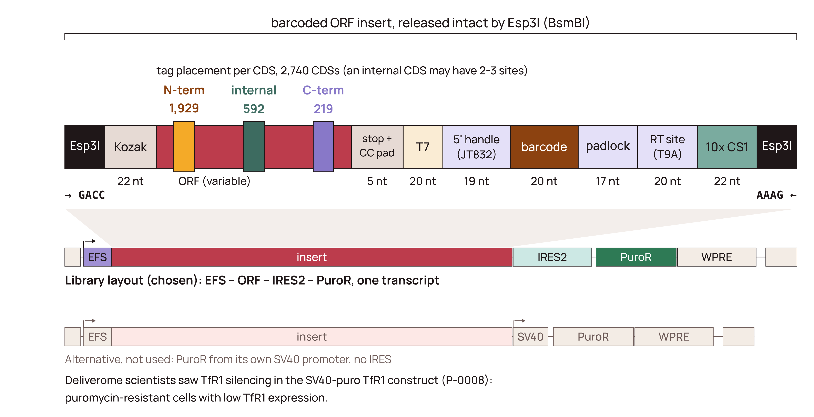
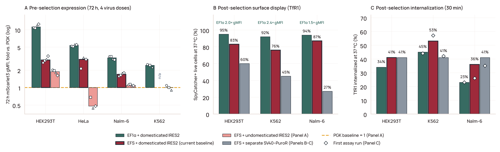
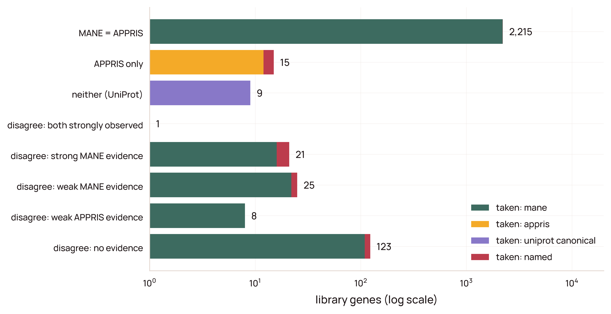
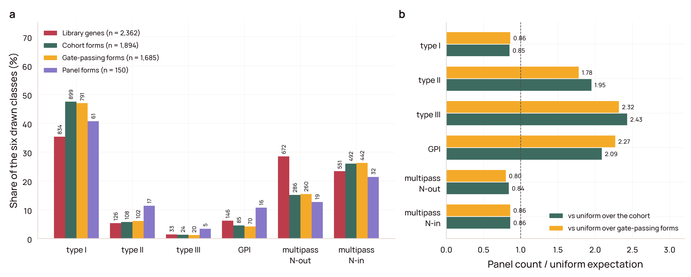
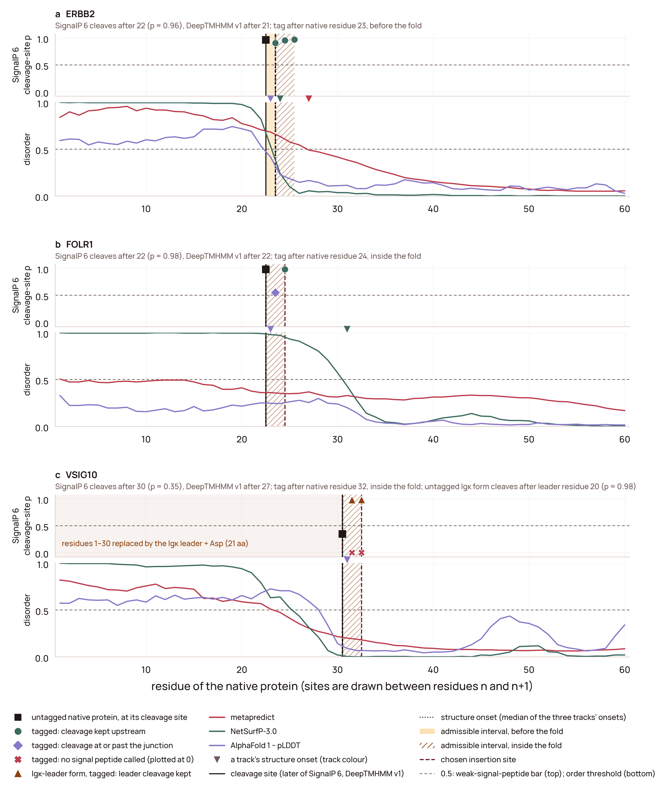
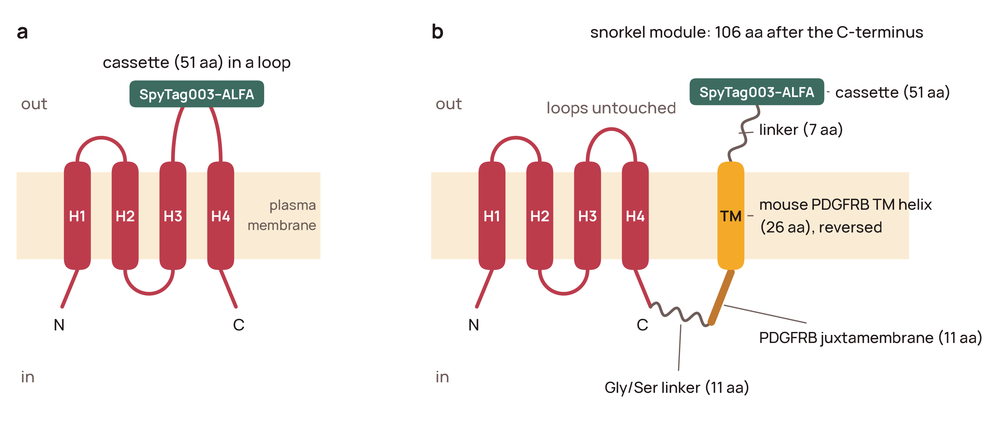
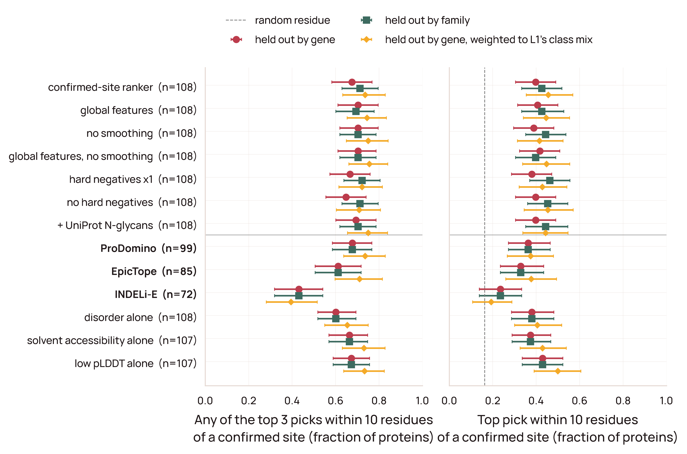
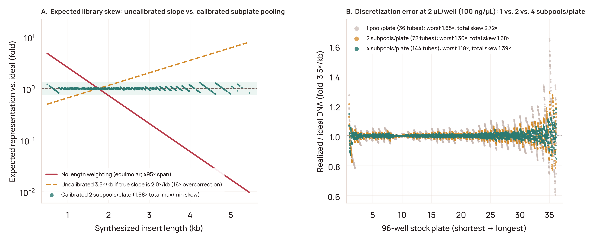

# The Deliverome v1 surface-protein ORF library: design brief for external review

The Deliverome **v1 surface-protein ORF library** (referred to as **L1** in construct IDs and tables) is a pooled, barcoded lentiviral library of human cell-surface protein coding sequences (CDSs) — plus stratified human isoform and mouse/cynomolgus ortholog panels — in which each protein carries a 51-aa dual-epitope tag cassette on an extracellular region (N-terminus, C-terminus, or extracellular loop). The library has not yet been ordered. We are building v1 as an open **community resource** that will be made available to both academia and industry, and we are working with Addgene to deposit both the pooled library and individual plasmids. This brief documents how every gene, proteoform, tag site, vector element and barcode was selected and verified so reviewers can audit or reproduce the design, and highlights the open decisions we most want input on before placing the order ([Decisions we would like reviewers to weigh in on](#decisions-we-would-like-reviewers-to-weigh-in-on)).

Every count in this brief is computed directly from the library's tables ([`brief_numbers.py`](brief_numbers.py)), and [`run_review.py`](run_review.py) recomputes them offline from pinned inputs ([section 11](#11-reproducibility-and-provenance)).

## Executive summary

The v1 library is a single pooled lentiviral library expressing human cell-surface proteins (plus stratified isoform and mouse/cynomolgus ortholog panels): near-term to map surface display and internalization across cell lines, medium-term to run trafficking and delivery screens, while remaining compatible with optical pooled screening (in situ sequencing) and 10x Genomics Feature Barcoding from the same integrated constructs.

| Dimension | Design | Details |
|---|---|---|
| **Construct & vector** | 51-aa dual-epitope tag (`GGGGS`–SpyTag003–`GGGGSGGGGS`–`P`–ALFA–`P`–`GGGGS`) currently designed in `p0039` (`EFS – insert – IRES2 – PuroR – WPRE`, one transcript using Fragmid's domesticated `IRES2_v1`, Esp3I-shuttled; EFS vs. EF1α promoter remains open); **3,375** constructs for **2,743** of the **2,762** active CDSs (`19` held) | [Section 1](#1-the-library-construct-and-vector) |
| **Barcodes & readout** | 20-nt barcodes (Levenshtein ≥ 3, Hamming ≥ 4 across 30k pool; adopted ISS standard **12-nt prefix, Hamming ≥ 3**, leaving +8,896 extra barcodes while v1's 3,375 constructs satisfy the stricter 10-nt `d ≥ 3`); sense T7 promoter directly before the 5′ PCR amplification primer binding site (`JT832`; [Tycko et al., 2020](https://pubmed.ncbi.nlm.nih.gov/33326746/)), padlock arm and T9A reverse-transcription site adapted from `lentiGuide-BC` ([Feldman et al., 2019](https://pubmed.ncbi.nlm.nih.gov/31626775/); [Addgene #127168](https://www.addgene.org/127168/)), and 10x Genomics Capture Sequence 1 (CS1) | [Section 2](#2-the-barcode-and-readout-region-and-the-assays-it-could-support) |
| **Template-switching risk** | Linkers and snorkel modules diversified per construct; SpyTag003/ALFA keep a single validated codon encoding (modeled upper bounds: 3.1% fusions from the shared tags, 2.2% from the constant pre-barcode tail with T7, **5.6%** total wrong-protein integrants, plus 2.0% SP-to-SP leader swaps = **7.6%** combined) | [Section 3](#3-barcode-swapping-in-the-pool), [Section 9](#9-domestication-linker-encoding-and-synthesis-compliance) |
| **Gene selection** | Nine sequential gates from `accessible-surfaceome` v1.3.0 + 3 evidence tiers (2,369 genes), plus 48 active dated additions (32 under the 42-line co-receptor rule after dropping MHC class II; 16 from our [intact-cell surface proteomics meta-analysis](https://dev.surfaceome.deliverome.org/surface-proteomics/)): **2,417** genes; ORF cap 5,000 nt | [Section 4](#4-genes-from-the-surfaceome-universe-to-2417-candidates) |
| **Proteoforms & panels** | One reference CDS per gene (`2,412` built; MANE Select from Ensembl 115 GTF / APPRIS + PeptideAtlas evidence + `31` named overrides), plus `150` membrane-anchored, non-fragment human isoforms (each tagged on its own topology) and `200` mouse/cynomolgus orthologs (`100` each) stratified by membrane class and sequence-identity band (near vs. diverged) | [Section 5](#5-proteoforms-one-reference-protein-per-gene), [Section 6](#6-isoforms-and-orthologs) |
| **Topology & tag placement** | DeepTMHMM v1.0.24 on every built sequence (`0.6%` discordant across `1,120` CDSs with experimental UniProt/TOPDB topology, [section 7](#7-tag-placement-topology-and-placement-rules)); placed after SP (`1,322` built, `231` Igκ-swapped), at residue 1 on extracellular-N multipass (`567` of `568` behind Igκ; only `CRHR2` leader-free) and type III (`9` of `43` behind Igκ), at C-terminus (`216` built), or in an extracellular loop (`594` built: `1,081` loop arms + `145` C-terminal *snorkels*, [Brown et al., 2013](https://pubmed.ncbi.nlm.nih.gov/24023844/)) | [Section 7](#7-tag-placement-topology-and-placement-rules) |
| **Internal-site ranking, refold & QC** | Audited 156-site ranker (`v8_prodomino` + retained `v5` arms) + TMDET structure-based membrane-plane gate ([Tusnády et al., 2005](https://pubmed.ncbi.nlm.nih.gov/15539454/); TmAlphaFold, [Dobson et al., 2023](https://pubmed.ncbi.nlm.nih.gov/36318239/)) + literature ligand-contact screen across internal genes (548 internal genes, 539 built); 100% ColabFold refold coverage (`3,375/3,375` folded; `94.0%` pass; binary verdicts flag rather than hold); steric clashes, matched `own_ref` lDDT, and pre-order biological audits drove 39 site upgrades/drops with zero CDSs lost | [Section 8](#8-internal-site-ranking-refold-validation-and-build-status) |
| **Domestication & synthesis** | Native human codons preserved (no wholesale codon optimization); minimal synonymous edits for Esp3I/BsaI/BbsI domestication, per-construct linker/snorkel diversification, motif cleanup (`0` domestication/recoding poly(A) signals or 6-mer `GT[AG]AGT` splice donors remain), and High/Not-Accepted synthesis compliance only (`223` inserts / `798` codons recoded across `181` CDSs; `0` Not Accepted, `24` High warnings solely in protected native SP codons) | [Section 9](#9-domestication-linker-encoding-and-synthesis-compliance) |
| **Ordering & pooling** | **36** 96-well plates sorted by construct length; direct `100 ng/µL` (`2 µL`/well) subplate pooling (`2`–`4` subpools/plate) calibrated by a **6-plasmid** backbone-matched titer ladder before pooling | [Section 10](#10-how-the-library-is-ordered) |
| **Reproducibility & provenance** | 30-stage offline `verify` pipeline from SHA-256-pinned inputs, public R2 / release bundles, and structured per-construct decision logs in the GitHub review repo | [Section 11](#11-reproducibility-and-provenance) |

The brief is organized vector-first: **sections 1–3** cover the construct, vector, readout/barcode block, and pooled barcode-swapping risk; **sections 4–8** cover gene curation, proteoform and panel selection, tag placement, internal-site ranking, refold validation, and build status; and **sections 9–11** cover domestication/synthesis, ordering/pooling, and reproducibility/provenance. The **6 key decisions** we most want reviewers to weigh in on before order placement are collected below.

**Looking at a CDS, and giving feedback.** Each library member has a page on the surfaceome viewer, [surfaceome.deliverome.org/v1-review/](https://surfaceome.deliverome.org/v1-review/) (every protein name and L1 design ID in the rendered brief links directly to its viewer page): the protein built, its predicted topology, the tag site and its alternatives, and the native and tagged structure models. To comment on a construct, open it, type your name, choose *site looks right*, *concern* or *suggest another site* (with the residue, or a click on the structure), add a comment and submit. No account or token is needed. As a thank-you for your review time, we will award $500 each to the three most useful reviews.

## Decisions we would like reviewers to weigh in on

All six questions below remain open before order placement (`3,375` constructs across `2,743` built CDSs). Remaining operational items are tracked in the accompanying [cover note](COVER_NOTE.md).

| Question | Why it matters | What would resolve it |
|---|---|---|
| **1. Promoter: EFS (current baseline) vs. EF1α**, with IRES2–PuroR selection chosen ([section 1](#the-vector-backbone-promoter-and-selection-marker)). | **TL;DR:** The library is currently designed in EFS, but EF1α vs. EFS is open. On TfR1 across three cell lines, EF1α gives ~1.5–2.4× brighter SpyCatcher display and more Spy+ cells (92–95% vs. 76–87%), whereas EFS gives ~6–13 pp higher `% internalized` and a slightly shorter packaged genome (+967 bp for EF1α is a minor length difference). All data so far are on TfR1 in a fluorescent reporter layout rather than the library's direct `IRES2–PuroR` backbone. | Results from our broader pilot panel across receptor classes in direct `IRES2–PuroR` (EFS vs. EF1α), plus your experience trading higher expression against potential overexpression effects on trafficking and internalization. |
| **2. MANE Select default where MANE and APPRIS disagree** ([section 5](#5-proteoforms-one-reference-protein-per-gene)). | Of 177 MANE/APPRIS protein disagreements, 21 have strong PeptideAtlas support for MANE and 0 for APPRIS alone, while 123 have no distinguishing peptides; MANE is the NCBI/Ensembl clinical consensus whereas 82 disagreements carry APPRIS's lowest-confidence labels. Among the 14 dual-observed genes, 5 (`APP, GRIN1, KCNMA1, NFASC, SIRPA`) use MANE and 9 (`ADGRG6, ATP1A3, CSPG5, DPP10, DPP6, KCNQ2, ROBO2, SLC12A3, SLC4A7`) stay on APPRIS on PeptideAtlas evidence. | Your view on defaulting to MANE Select, or biological context arguing to flip any of the 14 dual-observed genes or 33 weak-evidence genes. |
| **3. Isoform (150) and ortholog (200) panel stratification** ([section 6](#6-isoforms-and-orthologs)). | The 150 human isoforms are drawn across **six membrane classes** (type I, type II, type III, GPI-anchored, multipass N-out, multipass N-in) from membrane-anchored, non-fragment alternative forms (`≥25%` of reference length, or `≥100 aa` / `≥50%`), each tagged on its own DeepTMHMM v1 topology. The 200 orthologs (`100` mouse, `100` cynomolgus) are stratified by membrane class **and** split 50/50 into near vs. diverged sequence-identity bands. Isoforms are not currently stratified by divergence (89/150 are within ≥95% of reference length). | Your view on the six membrane classes, whether isoforms should also be stratified into near vs. diverged bands like orthologs, and whether any specific isoforms or orthologs should be swapped. |
| **4. Murine Igκ signal peptide on 807 CDSs and residue-1 tagging of type III proteins** ([section 7](#7-tag-placement-topology-and-placement-rules)). | We prepend the cleavable murine Igκ signal peptide in three cases: `567/568` multipass proteins whose N-terminus is extracellular without a native signal peptide (all except `CRHR2`, which displayed leader-free), `9/43` single-pass **type III** proteins (extracellular N-terminus, no native SP) with predicted membrane-insertion risk (`34` carry tag alone), and `231/1,322` N-after-SP proteins whose native SP cleavage is predicted by SignalP 6 to be lost or weakened after adding the tag (`1,091` keep their native SP). | Whether Igκ should be the default on extracellular-N multipass proteins (we are testing three matched ±Igκ GPCR pairs before ordering), whether SignalP re-prediction across an engineered tag junction justifies replacing a native SP, and whether leaderless type III proteins need a leader. |
| **5. Preserving native human codons (no wholesale codon optimization)** ([section 9](#9-domestication-linker-encoding-and-synthesis-compliance)). | Rather than codon-optimizing the library, we keep native human codons across Low/Medium-complexity inserts and apply minimal synonymous edits only for Type IIS domestication, motif cleanup, or High/Not-Accepted synthesis blockers (`223` inserts / `798` codons edited). This leaves **`0` unmanufacturable inserts** and **`24` inserts carrying a synthesis-complexity warning solely inside protected native signal-peptide codons**, which we left unedited to avoid disrupting translation/cleavage. | Your experience preserving native human codons vs. codon-optimizing membrane-protein ORFs, and whether leaving those 24 protected signal-peptide warnings for vendor review is preferable to editing signal-peptide codons. |
| **6. Length-weighted pooling hypothesis** ([section 10](#10-how-the-library-is-ordered)). | Our packaged lentiviral genomes span 4.6–9.5 kb, where published estimates of titer drop per kb range from ~2× (Sweeney & Vink) to ~3.5× (Moon et al.). Overcorrecting would invert the length bias, whereas calibrated subplate pooling (`2`–`4` subpools/plate directly from `100 ng/µL` stocks) holds library-wide skew within `1.4×–1.7×`. | How much length-weighted pooling improves representation in pooled lentiviral screens over this size range, and whether our planned **6-plasmid** backbone-matched titer ladder ([section 10](#10-how-the-library-is-ordered)) is sufficient to calibrate it before pooling. |

## 1. The library, construct, and vector

### What is in the library

The v1 library has **2,762** designed CDSs. **2,743** of them have at least one construct in the order, which
holds **3,375** constructs (one plasmid each); the other **19** are held with no construct
([section 8](#where-every-cds-stands)). Every terminally tagged CDS is one construct, while an
internally tagged CDS may be ordered at two or three sites (including a C-terminal *snorkel*
companion, [Brown et al., 2013](https://pubmed.ncbi.nlm.nih.gov/24023844/); [section 7](#7-tag-placement-topology-and-placement-rules)), which **399** CDSs are,
accounting for **1,040** constructs under the order rule (one construct when a single loop region
clears the published-tag median with no close runner-up; two when a second region is within 10%;
three when no region clears the median).

**Size.** CDSs are a median 1,406 nt long (range 186–5,139; shortest is CD52, a 61-aa GPI protein).
Adding the 153-nt tag cassette (and the Igκ leader where used) gives a median coding sequence of
1,599 nt (339–5,292), and adding the constant 158 nt of Esp3I sites, Kozak, barcode, and readout
block (Figure 2a) gives a median full insert of 1,751 nt (497–5,450;
[`l1_insert_lengths.py`](../l1_insert_lengths.py), [`l1_order_plan.tsv`](l1_order_plan.tsv)).
Finished vectors span 7,974–12,927 bp, within the lentiviral packaging cap
([section 4](#4-genes-from-the-surfaceome-universe-to-2417-candidates)).

| Candidate set | What it is | CDSs |
|---|---|---:|
| Reference | the gene's chosen reference protein ([section 5](#5-proteoforms-one-reference-protein-per-gene)) | 2,412 |
| Isoform | an alternative human protein of the same gene | 150 |
| Ortholog | the gene's mouse or cynomolgus counterpart | 200 |

*Figure 1. Library composition and native CDS length distribution by candidate set (2,762 active CDSs). (A) Counts split by human reference (2,412), human isoforms (150), mouse orthologs (100), and cynomolgus orthologs (100). (B) Native CDS length distributions (violin, interquartile bar, and median dot; dashed line marks the 5.0 kb ORF cap). Drawn by [`brief_numbers.py`](brief_numbers.py) from [`l1_tag_paths.tsv`](../l1_tag_paths.tsv). How isoforms and orthologs were chosen is in [section 6](#6-isoforms-and-orthologs).*

| Where the tag goes | CDSs |
|---|---:|
| after the signal peptide | 1,327 |
| after Met1 of a multipass protein (behind the Igκ leader for 567 of 568; only `CRHR2` is leader-free because its N-terminal pseudo-SP is uncleaved and displayed leader-free, caught by our systematic multipass SP screen in [section 7](#7-tag-placement-topology-and-placement-rules)) | 568 |
| after Met1 of a single-pass type III protein | 43 |
| at the C-terminus | 219 |
| in an extracellular loop | 605 |
| **total** | **2,762** |

Each CDS is counted once, at the placement its DeepTMHMM v1 topology calls for
([`l1_tag_paths.tsv`](../l1_tag_paths.tsv)); build status and construct counts per placement are in
[section 8](#where-every-cds-stands).

### The construct

*Figure 2a. One construct. Top, not to scale: the barcoded insert between its two Esp3I sites,
with the three tag positions and the number of CDSs tagged at each (N-terminal counts the
after-signal-peptide, multipass and type III placements together), followed by the 3-nt stop
codon plus a shared 2-nt `CC` spacer (`stop + CC pad`, 5 nt total) and the readout block: a
sense T7 promoter, the 5′ PCR amplification handle (`JT832`; [Tycko et al., 2020](https://pubmed.ncbi.nlm.nih.gov/33326746/)),
the 20-nt barcode, the 17-nt padlock arm and reverse-transcription (RT) site from `lentiGuide-BC`
([Feldman et al., 2019](https://pubmed.ncbi.nlm.nih.gov/31626775/); [Addgene #127168](https://www.addgene.org/127168/))
with a single `T→A` substitution at position 9 (`T9A`, which breaks a cryptic `GGG·GTAAG`
splice-donor motif in the packaged transcript while shifting RT-site Tm by only +0.6 °C;
[section 2](#2-the-barcode-and-readout-region-and-the-assays-it-could-support)), and the 10x
Genomics Capture Sequence 1 (CS1). Below, to scale from cPPT to the 3′ LTR: that insert in the
library vector p0039, EFS–insert–IRES2–PuroR on one transcript, the library's current baseline
design (EFS vs. EF1α remains open; below). In grey, the alternative not used: PuroR from its own
SV40 promoter with no IRES (the P-0050 layout). Deliverome scientists saw TfR1 silencing in the
SV40-puro TfR1 construct (P-0008): puromycin-resistant cells with low TfR1 expression. AXL is the
example ORF; only the ORF and the cassette position differ between constructs. Coordinates are read
from two full GenBank maps, [`l1_example_AXL_ires_puro.gb`](../l1_example_AXL_ires_puro.gb)
(10,473 bp) and [`l1_example_AXL_sv40_puro.gb`](../l1_example_AXL_sv40_puro.gb) (10,153 bp). Drawn
by [`plot_l1_construct_schematic.py`](../plot_l1_construct_schematic.py).*

The tag cassette is 51 amino acids, `GGGGS`–SpyTag003–`GGGGSGGGGS`–`P`–ALFA–`P`–`GGGGS`. SpyCatcher
binds SpyTag003 covalently and normalizes for expression; an anti-ALFA nanobody labels the same
protein and can be released from whatever stays on the surface, which is what the internalization
readout measures.

*Figure 2b. The internalization screen the library serves first. SpyCatcher labels every tagged
protein; after uptake at 37 °C the anti-ALFA nanobody is released from the cell surface by a
reducing agent or protease, so the ALFA signal left, normalized to SpyCatcher, reports
internalization; cells are sorted on it and their barcodes sequenced. A schematic, not data.
Drawn by [`fig_internalization_assay.py`](../../../../library/l1/figures/fig_internalization_assay.py).*

### The vector: backbone, promoter and selection marker

**Backbone.** p0039 is our insert-agnostic EFS–IRES2–PuroR destination vector
(`pAG Lenti_236083_EFS_IRES_puro_insert_agnostic`, 7,672 bp). Its name and our
[vector-design record](../../vector-design/README.md) trace it to the
lentiviral parent plasmid pAG Lenti CMV Empty Puro ([Addgene #236083](https://www.addgene.org/236083/)),
modified to be Golden Gate–compatible by domesticating the parent backbone's internal Esp3I sites
(`253 g→A`, `310 c→A`), replacing CMV with the 212-bp EFS promoter, and coupling puromycin
resistance via Fragmid's domesticated `IRES2_v1`; the exact sequence is
[`p0039_EFS_IRES_puro_backbone.gb`](../p0039_EFS_IRES_puro_backbone.gb) (GenBank). Two full maps
of one member, AXL, show a finished construct in each layout of Figure 2a:
[`l1_example_AXL_ires_puro.gb`](../l1_example_AXL_ires_puro.gb), the library layout, and
[`l1_example_AXL_sv40_puro.gb`](../l1_example_AXL_sv40_puro.gb), the SV40-puro alternative. They
are worked examples built by [`l1_example_vector_maps.py`](../l1_example_vector_maps.py), not
registered constructs: they carry no P-number, and the barcode is the 20-N placeholder.

Every construct goes into one lentiviral destination vector, p0039, which runs
`EFS promoter – insert – IRES2 – PuroR – WPRE` between the LTRs (currently designed in EFS, with
EFS vs. EF1α still open below). The construct (Kozak, ORF with its tag cassette and stop, barcode
and readout block) replaces a 195-bp cloning site and stuffer directly after the promoter. To keep
the backbone Golden Gate–compatible, p0039 uses Fragmid's domesticated `IRES2_v1` (`pF_AA333`;
[McGee et al., 2024](https://pubmed.ncbi.nlm.nih.gov/38484704/)), which carries three single-base
edits relative to the undomesticated EMCV IRES2 part from the EMMA mammalian modular toolkit
(`YCe1760 HC_Kan_IRES2_p8b`, [Addgene #100673](https://www.addgene.org/100673/);
[Martella et al., 2017](https://pubmed.ncbi.nlm.nih.gov/28418644/)) to remove two BbsI sites
(`137 T→G`, `236 A→C`) and one ApaLI site (`480 G→A`). Folding and 79-isolate conservation checks
([`ires_domestication_analysis.py`](../../vector-design/ires_domestication_analysis.py),
[`ires_domestication_edits.tsv`](../../vector-design/ires_domestication_edits.tsv))
find the structural perturbation within random and natural EMCV variation with the eIF4G J–K
platform and initiator AUG intact. In head-to-head flow cytometry comparing the domesticated
`IRES2_v1` (`P-0003`) directly against the undomesticated EMMA IRES2 (`P-0009`) in the same
EFS–TfR1–IRES2–mScarlet3–P2A–PuroR cassette, the domesticated IRES actually gave **higher
expression** across all tested lines (1.4–2.2× higher 72 h mScarlet3 gMFI in HEK293T, 3–7× in
HeLa, and 1.5–1.6× in Nalm-6; Figure 2c, Panel A), and ~2× higher post-selection surface
SpyCatcher display in HEK293T with matched 41% internalization. Below we summarize our experimental
comparison of the selection-marker layout (IRES-coupled vs. independent SV40 promoter) and promoter
choice (EFS vs. EF1α).

**Selection is coupled to the ORF through the IRES; this is the layout v1 uses.** Puromycin
resistance is translated from the same transcript as the CDS, so a cell survives selection only
if it transcribes the ORF. The alternative, PuroR from its own SV40 promoter with no IRES, is not
used because Deliverome scientists saw TfR1 silencing with it: P-0008, a TfR1 construct with the
same EFS–TFRC–tag unit and that SV40-driven PuroR, gave puromycin-resistant cells with low TfR1
expression (40–73% SpyCatcher-negative at 37 °C — and 61–89% at 4 °C — across HEK293T, K562 and
Nalm-6; Figure 2c, Panel B). A separate selection promoter lets a cell survive while transcribing
the ORF poorly, and in a pooled screen those cells would read as CDSs that fail to reach the
surface. The cost of the IRES is that selection depends on the CDS's own transcript, so a CDS that
is transcribed weakly is also selected weakly, and will be underrepresented after puromycin rather
than present as a tag-negative cell.

**Designed in EFS; EFS vs. EF1α remains an open decision.** We compared promoters driving the
`TFRC–SpyTag003–ALFA–barcode–IRES2–mScarlet3–P2A–PuroR` cassette across four cell types at 72 h
before selection (dropping PGK as consistently dimmest, 0.29–0.64× EFS), and then measured
post-selection **surface tag display and internalization** (30 min dual labeling at 4 °C or 37 °C
with non-cleavable SpyCatcher-3CYS-CF488A and TCEP-strippable ALFAnb-SS-CF640R, ± TCEP) across
HEK293T, K562 and Nalm-6 in two independent assay runs (one well per condition per run; the HEK293T
TCEP strip failed in the first run and succeeded in the repeat).

*Figure 2c. Promoter and selection-marker comparison on TfR1. (A) Pre-selection 72 h mScarlet3 gMFI
relative to PGK (dashed amber line = 1) across four virus doses (circles to diamonds) in HEK293T,
HeLa, Nalm-6, and K562; K562 lacked a fresh domesticated-IRES EFS well. Domesticated `IRES2_v1`
(maroon, current baseline) outperforms undomesticated EMMA `#100673` IRES2 (salmon) in every cell
line, and EF1α (teal) is brightest throughout (1.7–4.0× EFS). (B) Post-selection live SpyCatcher+
fraction at 37 °C (bars) and EF1α/EFS SpyCatcher gMFI fold-gain on Spy+ cells (top labels; 1.5–2.4×,
or 1.7–2.7× over all live cells). Uncoupled SV40–PuroR (grey) leaves 40–73% of puromycin-selected
cells SpyCatcher-negative. (C) Post-selection TfR1 `% internalized` at 37 °C (bars = repeat run;
hollow diamonds = first assay run where measured; n = 1 well per condition per run; K562 EFS uses
the stable line `L-0019`). Drawn by [`brief_numbers.py`](brief_numbers.py).*

Across all three cell lines, EF1α yields a higher fraction of surface-labeled cells (92–95% vs.
76–87% Spy+ at 37 °C) and 1.5–2.4× brighter SpyCatcher signal on positive cells (1.7–2.7× over all
live cells) than EFS, with clean 4 °C TCEP stripping (`0.4–14.5%` residual) and comparable or
slightly better 37 °C/4 °C stripped ALFA/Spy ratio separation (`3.3×` vs. `2.9×` in HEK293T;
`3.2×` vs. `2.7×` in K562; `10.9×` vs. `11.8×` in Nalm-6). However, EF1α consistently reports a
modestly lower `% internalized` for TfR1 than EFS (`34%` vs. `41%` in HEK293T; `45%` vs. `53%` in
K562 at 15 µL, rising to `50%` at 4 µL; `23%` vs. `36%` in Nalm-6) — including within
expression-matched SpyCatcher bins. The practical trade-offs between the two promoters are:

| Consideration | EFS (current baseline) | EF1α (open alternative) |
|---|---|---|
| Surface display & internalization (TfR1, post-selection) | 76–87% Spy+ at 37 °C; 36–57% internalized across HEK293T, K562 and Nalm-6 | 92–95% Spy+ at 37 °C; 1.5–2.4× higher SpyCatcher gMFI (clean 4 °C strip and comparable 37 °C/4 °C ratio separation), but ~6–13 pp lower `% internalized` than EFS |
| Packaged genome length *(minor)* | baseline ([section 10](#10-how-the-library-is-ordered)) | +967 bp longer per construct (minor relative to the 4.6–9.5 kb ORF length spread, though expected to reduce titer ~2–3× across the pool) |
| Upstream intron *(minor)* | no intron | carries the native 948-bp EF1α intron A upstream of the ORF (unlikely to be a major issue, though not yet tested across diverse ORFs) |

**The promoter can also change after the order.** Each construct is flanked by its own Esp3I sites
(the shuttle enzyme, [section 9](#9-domestication-linker-encoding-and-synthesis-compliance)), which
leave `GACC` and `AAAG` overhangs, so the synthesized constructs can be shuttled into an EF1α
destination with the same slot without resynthesis. What is fixed at synthesis is the vector the
library is built into first.

**Testing broader ORFs before ordering (still open).** All promoter data so far come from one
bright receptor (TfR1) in the `IRES2–mScarlet3–P2A–PuroR` reporter layout (not `p0039`'s direct
`IRES2–PuroR`) at unmatched virus volumes. Before placing the library order, we are testing a
broader arrayed pilot of **22 constructs across receptor classes and tag placements** in K562 —
including N-after-SP single-pass and GPI targets (`ERBB2`, `AXL`, `NECTIN4`, `FOLR1`, `VSIG10`,
plus `VSIG10` with Igκ replacing its native SP), internal-loop multipass proteins (`SLC2A4`,
`MS4A1`, `CCR5`, `AVPR2`), residue-1 GPCRs with and without the Igκ leader (`CNR1`, `CCR5`,
`OR51E2`, plus leaderless `ACKR3`, `AVPR2`), and the C-terminal `TFRC` benchmark — alongside
matched-MOI EFS vs. EF1α comparisons on dim-to-moderate library ORFs in the direct `IRES2–PuroR`
backbone. That pilot will directly test whether EF1α's display gain improves signal on dimmer
surface proteins without compromising internalization kinetics.

## 2. The barcode and readout region, and the assays it could support

Every construct ends in the same readout block, transcribed from the EFS promoter upstream of the
IRES:

| Element | Sequence | Source |
|---|---|---|
| T7 promoter | `TAATACGACTCACTATAGGG` | T7 class III promoter, −17 to +3, sense; lets T7 RNA polymerase copy the barcode region in fixed cells (below) |
| 5′ handle | `AGTCGTTAGCTGCCGTTCC` | [Tycko et al., 2020](https://pubmed.ncbi.nlm.nih.gov/33326746/), subpool-3 PCR amplification primer binding site (`JT-832`; constructs at [Addgene #28228872](https://www.addgene.org/browse/article/28228872/)) |
| Barcode | 20 nt, one per construct | the library's barcode pool ([below](#how-the-barcodes-were-designed)); 3,644 are provisionally reserved for L1 (3,200 initial block + 444 extension), covering all 3,375 constructs with 269 to spare, and assigned at order placement |
| Padlock arm | `ACTGGCTATTCATTCGC` | `lentiGuide-BC`, verbatim ([Feldman et al., 2019](https://pubmed.ncbi.nlm.nih.gov/31626775/); [Addgene #127168](https://www.addgene.org/127168/)) |
| RT site | `CCTTTGGGAAAGCACACGTC` | `lentiGuide-BC` RT site with `T→A` at position 9 (`T9A`, removing a `GGG·GTAAG` splice-donor motif with +0.6 °C Tm shift; below) |
| 10x Genomics Capture Sequence 1 (CS1) | `GCTTTAAGGCCGGTCCTAGCAA` | 10x Genomics Feature Barcoding |

The block sits after the stop codon and a 2-nt pad, so 44 nt separate the start of the stop codon
from the barcode and 37 nt separate the barcode from CS1. The insert ends at CS1, so the vector
backbone and its Golden Gate junction are the ones every earlier construct used
([`build_constructs.l1_readout`](../build_constructs.py)).

### How the barcodes were designed

The barcode is transcribed. It sits between the ORF stop and the IRES, an intercistronic region
that behaves like a 3′ UTR for the first cistron, so a barcode that presents a
microRNA target site can have its own transcript repressed. That failure mode is the reason the
sequence is designed rather than drawn at random: it produces a barcode-specific expression
penalty on one CDS, which at the bench is almost indistinguishable from that protein being a
weak surface expressor.

The pool is 30,000 barcodes of 20 nt, generated deterministically from a fixed seed by
[`generate_barcodes.py`](../../vector-design/generate_barcodes.py) into
[`barcodes_20nt_30k.tsv`](../../vector-design/barcodes_20nt_30k.tsv), so
the file reproduces from the script alone. Seven rules are applied, each recorded with its
source and whether we checked that source ourselves in
[`barcode_filter_stack.py`](../../vector-design/barcode_filter_stack.py):

| Rule | Why | Source |
|---|---|---|
| GC 40–60% | amplification and sequencing behavior | Hawkins/FREE, Shiroguchi |
| no homopolymer run above 2 | miscalls and indels in homopolymers | Hawkins/FREE |
| no `ATG` anywhere | a spurious start codon in the readout region | ours |
| no `AATAAA`, and none of its 18 single-base point mutants | a polyadenylation signal would truncate the transcript | [Vainberg Slutskin et al., 2018](https://pubmed.ncbi.nlm.nih.gov/29410437/) |
| no 3-bp non-overlapping self-complementarity | hairpins | Hawkins/FREE |
| no conserved microRNA 6-mer seed target site (207 sites) | the repression described above | TargetScanHuman 8.0 |
| no `GT[AG]AG` splice-donor core | a cryptic donor here would splice out the IRES and the selection marker | ours |
| no BbsI, Esp3I/BsmBI or BsaI sites (both strands) | avoids cloning-enzyme cuts inside barcodes (palindromic 6-cutters are already excluded by the 3-bp self-complementarity rule) | ours |
| min Levenshtein distance ≥ 3 and min Hamming distance ≥ 4 | corrects one substitution or single-base indel over the full 20-nt barcode | [Vainberg Slutskin et al., 2018](https://pubmed.ncbi.nlm.nih.gov/29410437/); Hawkins/FREE |

Two of these are worth your attention. The microRNA rule rejects 6-mer seed matches
rather than the 7mer-m8 sites a target-prediction tool reports, and since every 7mer-m8 site
contains its 6-mer core, the 6-mer rule rejects a strict superset — deliberately stricter than
the precedent it comes from. The splice-donor rule is ours and has no published precedent; it
exists because the barcode sits upstream of an IRES in the same transcript.

**There is no UMI in the construct.** L1 is screened as a pool, and barcode counts from sorted
populations are read from PCR of integrated or transcribed barcodes, so amplification bias is
a real source of noise. A unique molecular identifier added in the first PCR primer at library
preparation removes that bias without occupying construct sequence, so the 20 nt stay with the
barcode.

**Error-correction guarantees: full 20-nt pool vs. short in situ prefix.** Across the full 20-nt
barcode, every pair in the 30,000-barcode pool satisfies **Levenshtein distance ≥ 3 and Hamming
distance ≥ 4** ([`generate_barcodes.py`](../../vector-design/generate_barcodes.py)),
so full-length amplicon reads unambiguously correct one substitution or single-base indel. Because
in situ sequencing reads only the first 10–12 bases (and random draws from the 28,506-barcode pool
produce identical prefixes: 1,244 identical 10-nt pairs and 111 identical 12-nt pairs across the
pool), L1's reserved barcodes are additionally drawn under a prefix-distance screen
([`barcode_prefix_screen.py`](../barcode_prefix_screen.py), tested in CI) enforcing **Hamming
distance ≥ 3 over the first 10 bases**, correcting one substitution error in a 10-cycle ISS read
(assuming readout starts at the barcode's 5′ end, as in Feldman et al.).

Three assays could read it. Each is checked here against the sequences in
[`build_constructs.py`](../build_constructs.py), because what the fragment carries when ordered
decides which assays stay possible.

**Optical pooled screening (in situ sequencing).** Feldman et al. read lentiGuide-BC barcodes
in fixed cells by in situ reverse transcription, padlock gap-fill and sequencing by synthesis
([Feldman et al., 2019](https://pubmed.ncbi.nlm.nih.gov/31626775/)). Three of their elements
differ from ours:

- *Why the p003 layout was weak for optical screening.* The 10-nt gap after the barcode
  (`GGATCTGGAC`) is not from lentiGuide-BC, where Feldman has a 17-nt padlock arm in that
  position. Ours came in with the p003 map with no recorded reason; read as codons it is GGA TCT GGA (Gly-Ser-Gly), so it
  may be a linker or cloning scar (inferred, not documented). With only 10 nt before the RT
  site, a padlock arm on that side would have to run into the RT site and pair with
  primer-made cDNA. Feldman's padlock arm sits directly after the barcode and ends where his RT primer
  begins, with no overlap.
- *The adopted 3′ flank.* Feldman's padlock arms match neither of our earlier flanks, and
  his RT site cannot be copied verbatim. The flank we adopt replaces the 30-nt gap plus
  RT site (`GGATCTGGACCCTTTGGGCAAGCACACGTC`) with his RT-side padlock arm, verbatim,
  followed by his RT site with one base changed. Every L1 insert is built with it; it lengthens
  the readout region by 7 bp (the T7 promoter, under *T7 in situ transcription* below, adds
  20 more before the handle) and changes no coding sequence. Plasmids ordered before L1 keep the
  earlier flank.

| Element (transcript sense) | Earlier flank | Adopted |
|---|---|---|
| After the barcode | 10-nt gap `GGATCTGGAC` | Feldman's 17-nt padlock arm `ACTGGCTATTCATTCGC` (`lentiGuide-BC`, [Addgene #127168](https://www.addgene.org/127168/)) |
| RT site | `CCTTTGGGCAAGCACACGTC` (C at 9) | `CCTTTGGGAAAGCACACGTC` (A at 9) |
| RT primer | none ordered | `GACGTGTGCTTTCCCAAAGG`, with Feldman's LNA positions |
| Barcode to CS1 | 30 nt | 37 nt; the ORF-to-barcode distance is unchanged |

  We substitute `T→A` at position 9 (`T9A`) to remove the `GGG·GTAAG` splice-donor motif in Feldman's native RT site without creating the strong `GGGC`/`GCCC` hairpin (Tm 62.2 °C) or `miR-636` seed introduced by `T9C`; the change shifts the RT-site Tm by only +0.6 °C (53.4 °C → 54.0 °C; primer3 at 50 mM Na⁺, no Mg²⁺):

| Base 9 | Splice-donor motif | Hairpin with the padlock arm | Added miRNA seed 7-mer | RT-site Tm |
|---|---|---|---|---:|
| T (Feldman) | `GGG·GTAAG`, in the packaged transcript | Tm 42.5 °C, ΔG −0.38 | none | 53.4 °C |
| C (earlier) | none | `GGGC`/`GCCC` stem, Tm 62.2 °C, ΔG −2.13 | miR-636 | 56.7 °C |
| A (adopted) | none | Tm 43.4 °C, ΔG −0.36 | none | 54.0 °C |

  Feldman's own primer would bind the A site with one A:A mismatch, so the matched primer above
  replaces it. The padlock then needs one new arm, on the barcode-proximal 15 nt of the
  Tycko handle (`GTTAGCTGCCGTTCC`, 45.7 °C nearest-neighbor at 50 mM Na⁺, against 46.1 °C for
  Feldman's RT-side arm); the handle itself does not change. Feldman et al.'s other arm
  (`GTGTTCAATCAACATTCC`) is in no deposited plasmid map: it enters with their cloned barcode
  cassette, so it is inferred to sit directly 5′ of their barcode and does not occur in v1.
  Four fixed-flank 7-mers match human miRNA seeds in TargetScanHuman 8.0
  ([McGeary et al., 2019](https://pubmed.ncbi.nlm.nih.gov/31806698/)): `ACTGGCT`
  (miR-575/4676-5p), `CTATTCA` (miR-5585-3p), `CTTTGGG` (miR-186-3p), and `AAGCACA`
  (miR-218-5p, broadly conserved). The flank carries no `GT[AG]AG` splice donor and no BbsI,
  Esp3I, or BsaI site, and no 15-mer of the padlock arm or arm-plus-RT region occurs anywhere else
  in the backbone or the 3,375 v1 inserts. A full map of one CDS with the adopted readout
  (T7 promoter, handle, barcode slot, padlock arm, RT site, CS1) is
  [`l1_example_AXL_ires_puro.gb`](../l1_example_AXL_ires_puro.gb), built by
  [`l1_example_vector_maps.py`](../l1_example_vector_maps.py). Priming RT directly from CS1
  remains an untested alternative (no published optical screen uses a 10x capture sequence as an
  in situ RT primer). In the adopted layout CS1 sits 37 nt downstream of the barcode, leaving 10x
  feature-library read 2 (primed from the 5′ handle) unaffected.
- *Full-context barcode + flanking-junction screening.* Every barcode is screened not only internally
  but across its **full flanking context** (`5′ handle + 20-nt barcode + 3′ T9A flank + CS1 + shuttle`)
  for Type IIS sites (`BbsI`, `Esp3I`, `BsaI`), consensus splice donors (`GT[AG]AG`), RNA-binding-protein
  motifs (Pumilio `TGTA[ACT]ATA`, AU-rich `ATTTA`, CPEB `TTTTAT`/`TTTTAAT`, poly(A) `AATAAA`/`ATTAAA`,
  and CFIm25 `TGTA` pairs within 50 nt), and conserved miRNA seed matches spanning either barcode junction
  ([`reserve_barcodes.py`](../reserve_barcodes.py), [`rbp_motif_screen.py`](../rbp_motif_screen.py)).
  miRNA seed sites are taken from TargetScanHuman 8.0 (`miR_Family_Info.txt`, Species ID 9606;
  [McGeary et al., 2019](https://pubmed.ncbi.nlm.nih.gov/31806698/)), committed directly in the
  review repository at [`mirna_seed_sites.tsv`](../../vector-design/mirna_seed_sites.tsv):
  across all **2,064 human miRNA families** (`108` broadly conserved, `111` conserved, `220` poorly
  conserved, `1,625` unassigned), the **219 broadly conserved and conserved families** yield **207
  unique 6-mer seed sites** excluded from the base barcode pool (following the Slutskin et al., 2018
  criterion) and their 7-mer seeds are screened across both 5′ and 3′ barcode junctions. Under the
  adopted T9A 3′ flank, **21,394 of 28,506** pool barcodes pass junction screening (`6,911` fail a
  junction miRNA seed, `201` fail a junction Type IIS site, `0` fail splice donor; `3,741` drawable
  at 10-nt prefix `d ≥ 3`). The T7 promoter sits upstream of the 19-nt handle and does not touch
  either barcode junction.
- *Reserved v1 barcode block and ISS prefix distance.* The **3,644** reserved v1 barcodes
  ([`reserve_l1_block.py`](../reserve_l1_block.py)) pass every internal, flanking-junction, and RBP
  screen plus a 10-nt prefix Hamming distance `d ≥ 3`, covering all **3,375** constructs with
  **269** to spare (assigned one-to-one in place of the `20-N` placeholder at order freeze; unused
  rows are released). Keeping `d ≥ 3` enables 1-base error correction in situ (recovering ~9–26% of
  cells at 1–3% per-cycle SBS error rates with <0.06% miscorrection); extending future reservations
  to a **12-nt `d ≥ 3` prefix** in [`barcode_prefix_screen.py`](../barcode_prefix_screen.py) leaves
  +8,896 additional barcodes available (12,300 combined) while v1's 3,375 constructs already satisfy
  the stricter 10-nt `d ≥ 3` rule. Intercistronic barcode expression is expected (as in
  `lentiGuide-BC`) but not yet directly measured.

**10x 3′ Feature Barcoding.** The 3′ v3 Feature Barcoding gel beads carry the reverse complement
of CS1, so the RNA must carry `GCTTTAAGGCCGGTCCTAGCAA` in sense
([Replogle et al., 2020](https://pubmed.ncbi.nlm.nih.gov/32231336/)). Our EFS transcript places CS1
in sense 37 nt downstream of the barcode. While Replogle et al. originally placed CS1 inside a
short Pol III sgRNA stem loop and subsequent direct-capture designs have embedded CS1 in Pol II
mRNA 3′ UTRs, capture efficiency of our longer ORF–IRES2–PuroR transcript at this internal position
has not yet been benchmarked empirically in this vector.

**T7 in situ transcription.** Each L1 insert carries a T7 promoter in sense, between the stop
codon's pad and the 5′ handle. In fixed cells, T7 RNA polymerase then makes many sense copies of
the handle, barcode and readout region per integrant, independent of how strongly the cell
transcribes the CDS, and Feldman's RT primer, padlock and sequencing primer read those copies
unchanged. In situ T7 transcription ahead of padlock readout raised barcode assignment
1.6–2.9-fold in iNeurons, macrophages and T cells, with the promoter built into the U6 promoter
just upstream of the guide ([Kudo et al., 2025](https://doi.org/10.1038/s41587-024-02391-0)); NIS-Seq used an inverted
promoter downstream of the guide for four genome-scale screens
([Fandrey et al., 2025](https://doi.org/10.1038/s41587-024-02516-5)); and single genomic copies
were detected in 85% of cells by FISH on the T7 product
([Askary et al., 2020](https://doi.org/10.1038/s41587-019-0299-4)). Placing the T7 promoter in
sense directly between the stop pad and the 5′ handle keeps all junctions clean of restriction
sites and splice donors (whereas an antisense promoter after CS1 introduces an unavoidable
`ATA·GTGAGT` splice-donor core in the Pol II transcript).

What this placement costs and leaves untested:

- *Template switching.* The 20 added nt lengthen the tail every pair of inserts shares, which
  raises the modeled share of integrants whose barcode maps to the wrong protein by about one
  percentage point ([section 3](#3-barcode-swapping-in-the-pool);
  [`swap_t7_scenario.py`](../swap_t7_scenario.py)).
- *Motifs in the transcript.* The pad, promoter and handle carry no `GT[AG]AG` and no BbsI, Esp3I
  or BsaI site. They carry four 7-mers matching human miRNA seeds, none from a conserved family
  (miR-3174, poorly conserved; miR-489-5p, miR-6883-3p and miR-921, unassigned in TargetScan 8.0).
- *Geometry with no precedent.*
  The construct keeps `STOP · CC · T7 · JT832` with a **0-nt spacer** between T7's `GGG`
  initiation site and `JT832` (`AGTCGTTAGCTGCCGTTCC`). That leaves **3 nt** (`GGG`) of T7 RNA
  upstream of full `JT832` and **7 nt** (`GGGAGTC`) upstream of the 15-nt padlock arm
  (`GTTAGCTGCCGTTCC`), compared with 60–65 nt in published PerturbView and NIS-Seq designs;
  whether this reads as cleanly at single copy is to be checked in a pilot before relying on it.

## 3. Barcode swapping in the pool

The two genomes packaged in one lentiviral particle can recombine: reverse transcriptase switches
template between them, and where the two share identical sequence the switch can place one
construct's barcode beside the other's ORF.
[Walton et al. (2024)](https://pubmed.ncbi.nlm.nih.gov/38558968/) fit this as a per-base switch
rate *k* = 5.3 × 10⁻⁴ per bp of shared sequence, so a particle carrying two constructs that share
an identical block of *L* bp gives a discordant barcode with probability
*Y*(*L*) = ½ (1 − e^(−2*kL*)) ([`seqtools.barcode_swap_rate`](../../../../src/deliverome_analysis/seqtools.py)).
That is a rate for a particle that carries both constructs. In the pool, a construct's
co-packaged partner is any other construct with probability equal to that construct's share of the
pool. The pool has 3,375 constructs, so the average share is 1 in 3,375, but the
pool is length-weighted (3.5× more per kilobase, to offset the lower titer of long
constructs; [section 10](#10-how-the-library-is-ordered)), so long constructs take a much larger
share and the median construct's share is 1 in 12,213.

**Modeled swap rates.** Assuming every virion packages two distinct constructs (an upper bound),
without codon diversification at most 7.1% of integrants would carry a barcode mapping to a
different protein than the encoded ORF. Diversifying the four `GGGGS` linkers, as ordered, lowers
that to 5.6%, and recoding the epitope tags as well would lower it to 2.4%. The remaining 2.2%
comes from the constant tail before the barcode, which cannot be recoded. In addition,
recombination inside the shared tag cassette between two cleavable-SP constructs swaps only the
cleaved leader (leaving the mature displayed protein intact); that leader-swap term is **2.0%**
on the order of record (`2.9%` without diversification, `0.02%` if tags are recoded), giving
**7.6%** combined if leader swaps are included.

*Figure 3. Upper-bound fraction of integrants whose barcode maps to a different protein than the
encoded ORF (assuming every virion carries two distinct constructs), modeled under our 3.5× per kb
length-weighted pool (every partner weighted by its molar pool share in
[`l1_order_plan.tsv`](l1_order_plan.tsv)) and split by where the shared sequence lies: the
constant tail before the barcode (T7 promoter included), the tag cassette, and specific partners
(siblings, isoforms, orthologs, paralogs, and any other pair sharing ≥20 nt). Top, no codon
diversification (7.1%); middle, the order of record with the `GGGGS` linkers diversified (5.6%);
bottom, tags recoded too (2.4%). SP-to-SP leader swaps (2.0% on the order of record) are tracked
separately. Unit: integrant; n = 3,375 constructs. Each bar is one value from the pooled model
([`l1_swap_pool_model.py`](../l1_swap_pool_model.py), Walton et al. 2024 fit), not a mean of
measurements. The bottom bar is a scenario, not the order: recoded tags have not been shown to
display. Scenarios: [`swap_nothing_diversified_scenario.py`](../swap_nothing_diversified_scenario.py),
[`swap_tags_recoded_scenario.py`](../swap_tags_recoded_scenario.py). Drawn by
[`plot_swap_bottom_line.py`](../plot_swap_bottom_line.py).*

| Shared sequence | Present in | No codon diversification | Order of record: `GGGGS` linkers diversified | Tags diversified too |
|---|---|---:|---:|---:|
| the constant tail between stop codon and barcode (T7 included) + C-terminal cassette mislabels* | every pair | 2.20% | 2.18% | 2.17% |
| the tag cassette (wrong-protein fusions) | every pair | 4.6% | 3.1% (the two tags only) | 0.03% |
| native sequence or cassette shared by a specific partner | siblings, isoforms, orthologs, paralogs | 0.28% | 0.30% | 0.22% |
| **total wrong-protein integrants** | | **7.1%** | **5.6%** | **2.4%** |
| *SP-to-SP leader swaps (same mature protein, tracked separately)* | *cleavable-SP pairs* | *2.9%* | *2.0%* | *0.02%* |
| *combined (wrong protein + SP-to-SP leader swap)* | | *9.9%* | *7.6%* | *2.4%* |

*\*The slight decrease from 2.20% → 2.18% → 2.17% comes from C-terminal-tagged constructs:
recombination inside a C-terminal tag cassette transfers an intact upstream ORF onto another
barcode (counted as a mislabel rather than a chimera), contributing 0.045% without diversification,
0.024% with diversified `GGGGS` linkers, and 0.0001% when tags are also recoded.*

All three columns are computed on the current order with the 3.5× per kb length-weighted pool
and the T7 promoter ([section 2](#2-the-barcode-and-readout-region-and-the-assays-it-could-support)),
which adds 20 nt to the shared pre-barcode tail and roughly doubles the tail term (from 1.2% to
2.2%; [`swap_t7_scenario.py`](../swap_t7_scenario.py)). The tail (a 2-nt `CC` pad, 20-nt T7
promoter, and 19-nt primer handle) cannot be diversified because every barcode is amplified and
read through it. In the order of record, SpyTag003 (48 nt) and P-ALFA-P (45 nt) keep validated
codons while the four `GGGGS` linkers are synonymously diversified per construct
([section 9](#9-domestication-linker-encoding-and-synthesis-compliance)). Typical construct pairs
share only the two fixed tags separately (48 and 45 nt). Recoding the tags as well cuts the
longest shared cassette stretch to 56 nt and drops the cassette term to 0.03%
([`swap_tags_recoded_scenario.py`](../swap_tags_recoded_scenario.py)), at the cost of using
untested tag codons.

**Specific partners and length weighting.** [`l1_swap_pool_model.py`](../l1_swap_pool_model.py)
evaluates every sequence-similar pair across all 3,375 constructs (113,014 pairs sharing any rare
24-mer, weighted by molar pool share under 3.5×/kb weighting in
[`l1_order_plan.tsv`](l1_order_plan.tsv)). Same-CDS siblings share a median 302 nt (13.7% per
co-packaged pair), but multiplied by a partner's pool share (median 1 in 12,213) each contributes
~0.0016%. Summed across all specific partners, the median is 0.12% of a barcode's cells and
0.30% of the library (0.22% chimeras, 0.09% mislabels). Under 3.5×/kb weighting, specific-partner
impurity rises mildly with insert length — the median is 0.14% of a barcode's cells in the longest
quarter of constructs and 0.12% in the shortest (Spearman 0.23 against insert length). The 15
barcodes above 1% are all 4.5–5.0 kb multi-construct families (`PTCH1`, `TRPM2`, `ADGRL2`; highest
is 2.8%), which are flagged as our watch list for long-read QC
([`l1_swap_pool_model.tsv`](../l1_swap_pool_model.tsv),
[`l1_swap_pool_model_summary.json`](../l1_swap_pool_model_summary.json)).

These are upper bounds from a model, not measurements: they assume every particle carries two
different constructs, that a 45–83-nt block recombines at the per-base rate measured over
kilobases of constant vector, and that construct representation matches input molar ratios. In
practice, surface proteins expressed in HEK293T packaging cells during lentivirus production can
also incorporate into or neutralize/interfere with viral particles; both template switching and
construct-level packaging effects will be measured empirically (via long-read ORF–barcode
sequencing and transduced-cell barcode representation; [section 10](#10-how-the-library-is-ordered)).
The per-pair rate is still the right test for whether two constructs could be misassigned, which is
why the library keeps a 100-nt limit on sequence shared before the barcode
([section 9](#9-domestication-linker-encoding-and-synthesis-compliance)).

## 4. Genes: from the surfaceome universe to 2,417 candidates

Genes start from the 5,332-gene accessible-surfaceome catalog, release 1.3.0
([Carlson & Smallegan, 2026](https://doi.org/10.5281/zenodo.23445521); CC0; release files indexed
in [`README.md`](https://pub-e53f37f6fe6b4745829c2066350fe26f.r2.dev/external/accessible-surfaceome/release-1.3.0/README.md)
and [`deep-dive-preset-membership.tsv`](https://pub-e53f37f6fe6b4745829c2066350fe26f.r2.dev/external/accessible-surfaceome/release-1.3.0/deep-dive-preset-membership.tsv)
on our public bucket; gate definitions and cutoff derivations are detailed in Carlson & Smallegan, 2026).
A gene enters the core set by passing eight sequential gates in
[`final_library.py`](../../surface-filters/final_library.py), grouped below
by whether the gate reads the catalog's LLM-curated literature calls or deterministic sequence and
expression tables. Each gate's passing and excluded lists are in
[`gate_lists/`](gate_lists/README.md), every gene's outcome is in
[`gene_gate_outcomes.tsv`](../gene_gate_outcomes.tsv), and recorded additions/exclusions are in
[`gene_list_additions.tsv`](../gene_list_additions.tsv) and
[`gene_list_exclusions.tsv`](../gene_list_exclusions.tsv).

| Gate | Source | Rule | Remaining | Excluded (examples) |
|---|---|---|---:|---:|
| Surface evidence | Catalog LLM curation | canonical or likely surface tier (no gene failed the subsequent accessibility check) | [3,035](gate_lists/01_surface_evidence_passed.tsv) | [2,297](gate_lists/01_surface_evidence_excluded.tsv) (e.g. A2ML1, AADACL2, AATK) |
| Surface fraction | Catalog LLM curation | surface-dominant or mixed steady-state localization | [2,673](gate_lists/03_surface_fraction_passed.tsv) | [362](gate_lists/03_surface_fraction_excluded.tsv) (e.g. ABCA2, ABCA4, ABCB6) |
| Localization | Catalog LLM curation | not secreted-only, intracellular-only, inner-leaflet anchored, MHC-presented, or complex-only without qualifying partners | [2,284](gate_lists/07_localization_passed.tsv) | [7](gate_lists/07_localization_excluded.tsv) (all 7: BSND, DCHS2, FXYD1, KCNK15, NCSTN, SGCE, SGCZ) |
| Anchored | Deterministic (DeepTMHMM v1.0.24) + catalog GPI | ≥ 1 transmembrane helix on the canonical sequence or GPI-anchored (`gpi_set.tsv`, refined by NetGPI 1.1; EPPIN removed below) | [2,532](gate_lists/04_anchored_passed.tsv) | [141](gate_lists/04_anchored_excluded.tsv) (e.g. AAMP, ADAMTS5, AGRN) |
| Co-receptor | Catalog LLM curation + deterministic expression | no obligate heterologous partner (after agent-reviewed partner rules below), or required partners expressed in screening cell lines (root filter: HPA v23 cell-line median ≥ 5 TPM; 32 additional genes admitted under the 42-line ARCHS4 v2.5 ≥ 10 CPM rule below) | [2,372](gate_lists/05_coreceptor_passed.tsv) | [160](gate_lists/05_coreceptor_excluded.tsv) (e.g. ABCC8, ABCC9, ABCG5; 32 re-admitted below) |
| Expression | Deterministic (GTEx v10, HPA v23, TCGA) | passes unless **both** flagged low-expressed in the catalog **and** < 5 TPM across GTEx v10 ([GTEx Consortium, 2020](https://pubmed.ncbi.nlm.nih.gov/32913098/)), HPA v23 ([Uhlén et al., 2015](https://pubmed.ncbi.nlm.nih.gov/25613900/)), and TCGA ([Vivian et al., 2017](https://pubmed.ncbi.nlm.nih.gov/28398314/)) | [2,291](gate_lists/06_expression_passed.tsv) | [81](gate_lists/06_expression_excluded.tsv) (e.g. CLRN2, GALR3, GPR31) |
| ORF size | Deterministic (sequence) | canonical ORF ≤ 5,000 nt | [2,184](gate_lists/08_orf_size_passed.tsv) | [100](gate_lists/08_orf_size_excluded.tsv) (e.g. ABCA1, ABCA7, ADGRV1, CACNA1A) |
| Ectodomain | Deterministic (DeepTMHMM v1.0.24) | ≥ 30 total extracellular residues (GPI-anchored proteins exempt) | [2,134](gate_lists/09_ectodomain_passed.tsv) | [50](gate_lists/09_ectodomain_excluded.tsv) (e.g. CMTM2, CMTM4, CMTM6, FXYD2) |

*(Note: gates execute in the numbered order in `gate_lists/01`–`09`, so the counts in the table
reflect sequential filtering: 5,332 → 3,035 → 2,673 → 2,532 → 2,372 → 2,291 → 2,284 → 2,184 → 2,134.)*

**How the gates read the catalog and pinned inputs.** Every gate evaluates the gene's catalog record
on its UniProtKB 2026_03 canonical sequence ([UniProt Consortium, 2025](https://pubmed.ncbi.nlm.nih.gov/39552041/))
prior to proteoform selection in [section 5](#5-proteoforms-one-reference-protein-per-gene)
([`GATE_METHODS.md`](../GATE_METHODS.md)). Topology and GPI calls use DeepTMHMM 1.0.24 and
NetGPI 1.1 (`gpi_set.tsv` and `l1_tag_paths.tsv`, detailed in [section 7](#7-tag-placement-topology-and-placement-rules)).
Expression tables are pinned with SHA-256 checksums in [`bundle_manifest.tsv`](bundle_manifest.tsv):
ARCHS4 v2.5 consensus (`s3/external/archs4/v2.5/cell-line-panel-consensus/2026-09-04/`, [Lachmann et al., 2018](https://pubmed.ncbi.nlm.nih.gov/29636450/)),
raw HPA v23 cell-line TPM (`s3/external/hpa/v23/rna_celline.tsv.zip`), and the compiled GTEx v10 /
HPA v23 / TCGA per-gene table ([`data/external/expression-tpm/`](https://github.com/Deliverome-Project/deliverome-surfaceome-library-v1/tree/main/data/external/expression-tpm),
built by [`build_expression_join.py`](../../surface-filters/build_expression_join.py);
GTEx v10 and HPA v23 are the current releases, and archiving the standalone raw GTEx/TCGA source
dumps alongside the compiled table is tracked in the cover note).

**Co-receptor partner review and screening-line rule.** Before the co-receptor gate is evaluated
(so the 160 exclusions in [`05_coreceptor_excluded.tsv`](gate_lists/05_coreceptor_excluded.tsv)
already reflect these rules), three agent-assisted reviews refine catalog partner annotations:
(1) alternative-subunit rules for 6 genes (`ATP1B3, CDC50A, P2RX6, HFE, ATP8B1, CDC50B`) in
[`coreceptor_rules.py`](../../surface-filters/coreceptor_rules.py);
(2) per-gene review by agents of 146 partner-flagged genes, confirming 26 reach the surface without
a heterologous partner (e.g. `ITGB1, ITGAV, ITGB3, ATP1A1, CD74`;
[`coreceptor_calls.tsv`](https://github.com/Deliverome-Project/deliverome-surfaceome-library-v1/blob/main/data/processed/sprint4/s4e9-orf-design-fg-panel/library-design/pipeline-inputs/2026-11-02/s1e3/coreceptor_calls.tsv));
and (3) free-text partner symbol resolution for 143 genes
([`coreceptor_rationales.json`](https://github.com/Deliverome-Project/deliverome-surfaceome-library-v1/blob/main/data/processed/sprint4/s4e9-orf-design-fg-panel/library-design/pipeline-inputs/2026-11-02/s1e3/coreceptor_rationales.json)).
An unresolved partner is skipped when another partner resolves; a gene whose only listed partner
cannot be resolved is excluded (e.g. `WLS`, whose catalog entry lists its cargo `"WNT ligands"`).

To include obligate heteromers that display in at least two of our 42 candidate screening lines
(every required partner ≥ 10 CPM in ≥ 2 of the [42 shortlist lines](../coreceptor_host_line_line_pass.tsv)
in ARCHS4 v2.5; Cohen's κ 0.73–0.76 vs. HPA v23 ≥ 10 TPM, retaining `TYROBP`-dependent myeloid
receptors at 14.4 CPM in U937), **32** genes passing that rule enter v1 (`ITGA2B/D/L/M/X/E`,
`TREM1/2`, `SIGLEC16`, `SIRPB1`, `NCR2`, `CD300LB`, `KLRK1`, `KLRC1/2`, `CHRNA2/3`, `CHRNB4`,
`GRIN1/2A–D/3A/3B`, `KCND2`, `GABBR1`, `CD79B`, `CNTNAP1`, `LILRA4`, `SLC51A`, `UPK3A`), while the
8 MHC class II chains (`HLA-DPB1, DQA1, DQB1, DRA, DRB1/3/4/5`) are explicitly withheld (single-chain
MHC-II is allele-confounded and created a 208-nt swap pair) and TCR–CD3 (`CD3D/E/G, CD247`) reaches
≥ 10 CPM in only one shortlist line (Jurkat). In our planned **K562** first screen, 31 of those 32
(all except `GRIN1`) lack their partner in K562 and are flagged outside the K562 display denominator
([`coreceptor_host_line.py`](../coreceptor_host_line.py), [`coreceptor_host_line_genes.tsv`](../coreceptor_host_line_genes.tsv)).

*Figure 5. (a) 160 of 163 partner-dependent genes (3 unresolved partner names omitted): limiting
partner CPM in its second-best line vs. number of shortlist lines with every required partner ≥ 10 CPM
(46 in v1 from root filter, 40 clearing the 42-line rule [32 built after withdrawing 8 MHC-II chains],
74 excluded; rings mark partners ≥ 10 CPM in K562). (b) The 40 rule-passing genes and 4 excluded TCR–CD3
subunits across shortlist lines. Drawn by [`coreceptor_host_line.py`](../coreceptor_host_line.py).*

**The ORF cap.** The vector carries 4,087 bp between the 5′ and 3′ LTRs besides the insert
([`l1_example_AXL_ires_puro.gb`](../l1_example_AXL_ires_puro.gb)), so a 5,000-nt ORF packages at
~9.4 kb once the 153-nt tag cassette and 158-nt constant flank/readout block are added — the upper
end of what we order in v1. Lentiviral titer falls 3–4-fold per extra kilobase and packaging fails
near 10 kb ([Sweeney & Vink, 2021](https://pubmed.ncbi.nlm.nih.gov/34095341/); [Moon et al., 2026](https://pubmed.ncbi.nlm.nih.gov/42031729/)
similarly model a ~3.5× per kb length-titer penalty for pooled ORF libraries). The 5,000-nt cap
excludes 100 oversized genes (1,682–14,507 aa). Because the cap is evaluated on the catalog's
canonical sequence before proteoform selection ([section 5](#5-proteoforms-one-reference-protein-per-gene)),
one built CDS (`NRXN2`, α form, 5,139 nt; packaged genome 9,537 nt) slightly exceeds 5,000 nt
([`orf_size_cap.py`](../orf_size_cap.py), [`orf_size_cap_genes.tsv`](../orf_size_cap_genes.tsv)).

**Entry tiers beyond the core.** Genes passing all eight gates form the **2,134-gene core**
([`10_tier_core.tsv`](gate_lists/10_tier_core.tsv)). Three additional evidence tiers admit genes
with direct annotation or experimental support for cell-surface display:

| Tier | Rule | Genes |
|---|---|---:|
| Little-studied UniProt surface proteins | UniProtKB 2026_03 cell-surface subcellular location (`SL-0039` / plasma membrane; see Carlson & Smallegan, 2026), < 100 papers, not already canonical in the catalog, membrane-anchored, ≥ 5 TPM in ≥ 1 tissue/line, and ORF ≤ 5,000 nt | [139](gate_lists/11_tier_low_literature_uniprot.tsv) |
| GPCRs with measured surface display | GPCRs with anti-HA surface immunostaining ≥ 1,000 a.u. (the paper's autonomous surface-positive cutoff in factor-free HEK293T; [Tedman et al., 2026](https://pubmed.ncbi.nlm.nih.gov/42736269/)). Of these 85, 63 failed surface evidence (and also missed the little-studied UniProt tier due to lacking UniProt cell-surface annotation, < 5 TPM expression, or ≥ 100 papers), 16 failed expression, 5 failed surface fraction, and 1 failed co-receptor | [85](gate_lists/12_tier_screen_validated_gpcr.tsv) |
| Surface pool on overexpression | Proteins classified from catalog deep-dive rationales ([`oe_calls_136.tsv`](https://github.com/Deliverome-Project/deliverome-surfaceome-library-v1/blob/main/data/processed/sprint4/s4e9-orf-design-fg-panel/library-design/pipeline-inputs/2026-11-02/s1e3/oe_calls_136.tsv)) as mostly intracellular at baseline yet displaying a functional plasma-membrane pool when overexpressed (the `DLL3`, `GLUT4` [`SLC2A4`], and `FcRn` [`FCGRT`] pattern), passing every gate except surface fraction | [12](gate_lists/13_tier_overexpression_surface.tsv) |

*(Note: unlike the core tier, the little-studied UniProt tier did not apply the ≥ 30-aa ectodomain
floor, admitting 20 non-GPI genes with < 30 total extracellular residues — including four held CDSs
`TMEM134, TMEM169, TMEM174, TMEM210` — which we flag for uniform pre-order tightening alongside the
held list.)*

**Total gene count (`2,417`).** Combining the four tiers gives **2,370** genes (`2,134` core + `139`
little-studied UniProt + `85` GPCR screen + `12` overexpression). Removing `EPPIN` (`−1`; catalog
called it GPI-anchored, but UniProt has no GPI call, NetGPI 1.1 calls all 5 human forms unanchored,
and DeepTMHMM 1.0.24 finds no TM helix) leaves **2,369** genes. Adding the **32** screening-line
co-receptor rescues above and **16** surface-proteomics additions below (`+48` total) yields the
library's **2,417 genes** ([`14_library_genes.tsv`](gate_lists/14_library_genes.tsv),
[`brief_numbers.json`](brief_numbers.json) `gene_list`).

### Independent validation against published surface proteomics

A cross-method survey of published human cell-surface proteomics (**103 counted intact-cell
surface-labeling arms across 89 publications**, contrasted against **77 unlabeled
membrane-fractionation controls**; browsable in the
[surface-proteomics viewer](https://surfaceome.deliverome.org/surface-proteomics/)) provides an
independent experimental benchmark of our gene gates. Two complementary enrichment rules are
evaluated across membrane-anchored (TM/GPI) proteins:

- **Broad rule:** expression-conditioned surface-vs.-membrane enrichment (`z_expr_m > 2.0` across
  HPA-matched cell lines with `nTPM ≥ 5`). No biotin-amine requirement is applied so lysine-poor
  multipass transporters and channels are not penalized, while keeping false-positive intracellular
  organelle leakage low (`2/905` strict UniProt organelle proteins; AUROC `0.943`). **306** proteins
  qualify (`273` [89.2%] already in the pre-addition filter; `33` outside).
- **Lineage-specific rule:** proteins detected in < 20 total publications but ≥ 35% of one
  lineage's publications (minimum 3), with `lod_lineage > 1.2`, `lod_membrane > 0.3`, and an
  impermeable biotin-amine check (`lod_biotin > 0`, ≥ 2 biotin publications) to guard small
  glycocapture-heavy cohorts. **128** proteins qualify (`111` [86.7%] already covered; `4` overlap
  the broad set and **13** additional lineage-only proteins sit outside the root filter).

Every one of the **46** recurring proteomics hits missed by the root filter (33 broad + 13
lineage-only) has a recorded gate outcome in the
[surface-proteomics gap table](../s3e8_gap_gate_reasons.tsv) (regenerated offline by the
[gap-audit script](../s3e8_gap_gate_reasons.py)). Of those 46, **16 buildable outside-catalog genes
are added into v1** (`ANO9, C1orf159, CSF1, FAM171B, FAM234A, KLRG2, MFAP3, MYORG, RNF149, RNF150,
SLC45A4, SUSD5, SV2A, TM2D1, TMEM117, TMEM248` — 14 broad + 2 lineage-only, including 9 that were
flagged mostly intracellular at steady state but show reproducible surface enrichment), leaving
**30** excluded by an explicit biophysical or packaging limit:

| First gate failed in root filter | Broad (33) | Lineage (13) | Status in v1 | Examples |
|---|---:|---:|---|---|
| ORF > 5,000 nt | 16 | 5 | Excluded (lentiviral packaging cap) | `FAT4`, `PIEZO1`, `CR1`, `IGF2R` |
| Surface evidence (not canonical/likely) | 15 | 2 | **16 added to v1** (`1` oversized `KIAA1549L` excluded) | `FAM234A, SLC45A4, KLRG2, RNF150` |
| Co-receptor (obligate partner) | 1 | 3 | `ITGAL` added via 42-line rule; 3 excluded | `CD3D, CD3G, PTPRCAP` |
| Surface fraction (mostly intracellular at steady state) | 1 | 1 | 2 remaining excluded (9 other intracellular hits already added above) | `LNPEP, PCDH11X` |
| Anchored (no TM helix or GPI) | 0 | 1 | Excluded | `CLEC2B` |
| Ectodomain (< 30 aa) | 0 | 1 | Excluded | `SIT1` (18 aa ECD) |

*Figure 4. Diagnostic comparison of membrane fractionation vs. whole-lysate glycoproteomes as the
background for intact-cell surface proteomics (`n = 2,108` recurring proteins). (A) Surface vs.
membrane-fractionation log-odds (x-axis) against surface vs. whole-lysate glycoproteome log-odds
(y-axis), shaded where membrane log-odds > 0.5; 820 non-v1 proteins clear the lysate background
but fail the membrane background. (B, C) Marginal distributions showing clean separation of v1
surface proteins from non-v1 intracellular proteins under membrane fractionation (B) versus heavy
overlap under whole-lysate glycoproteomes (C). Drawn by
[`surface_proteomics_logodds_compare.py`](../surface_proteomics_logodds_compare.py).*

**Host trafficking accessory factors in K562.** Unlike obligate co-receptors, trafficking chaperones
are rarely annotated in the catalog, so four families in v1 depend on factors that K562 lacks (< 1 TPM
in HPA v23):

| Family in v1 | Factor K562 lacks | What the factor does | CDSs (Core / Low-lit / Screen-val) | Factor-free HEK293T ≥ 1,000 / < 1,000 / unmeasured |
|---|---|---|---:|---:|
| Odorant receptors (OR) | RTP1/2 (REEP1 weaker) | Promotes OR ER exit and surface trafficking ([Saito et al., 2004](https://pubmed.ncbi.nlm.nih.gov/15550249/); [Zhuang & Matsunami, 2007](https://pubmed.ncbi.nlm.nih.gov/17387175/); some ORs traffic independently, [Sharma et al., 2017](https://pubmed.ncbi.nlm.nih.gov/28262096/)) | 189 (55 / 57 / 77) | 84 / 100 / 5 |
| Bitter taste receptors (TAS2R) | RTP3/4 | Improves surface localization for some TAS2Rs ([Behrens et al., 2006](https://pubmed.ncbi.nlm.nih.gov/16720576/)) | 22 (21 / 1 / 0) | 2 / 19 / 1 |
| GABA-A α subunits (`GABRA1, 2, 4, 6`) | a β subunit (`GABRB1–3`) | Single α subunits are retained in the ER without β ([Connolly et al., 1996](https://pubmed.ncbi.nlm.nih.gov/8550630/)) | 4 (4 / 0 / 0) | — / — / 4 |
| `CHRNA7` | NACHO (`TMEM35A`) | Promotes α7 pentamer folding and surface expression ([Gu et al., 2016](https://pubmed.ncbi.nlm.nih.gov/26875622/)) | 1 (1 / 0 / 0) | — / — / 1 |
| **Total** | | | **216 (81 / 58 / 77)** | **86 / 119 / 11** |

In total, **216 of the 2,762 active v1 CDSs (7.8%)** depend on a factor absent in K562 (of 205
measured in factor-free HEK293T in Tedman et al., 2026, 86 still displayed at ≥ 1,000 a.u. and 119
fell below). These CDSs remain in the library and are flagged for separate analysis in K562
([`accessory_factor_dependence.py`](../accessory_factor_dependence.py),
[`accessory_factor_dependence.tsv`](../accessory_factor_dependence.tsv)).

## 5. Proteoforms: one reference protein per gene

Many surface genes express multiple biologically real proteoforms — we sample a dedicated 150-form
alternative-isoform panel in [section 6](#6-isoforms-and-orthologs) — but the core library requires
one canonical, transcript-backed coding sequence per gene. Every one of the **2,417** genes selected
in [section 4](#4-genes-from-the-surfaceome-universe-to-2417-candidates) goes through reference-proteoform
selection ([`select_reference.py`](../../../../library/l1/proteoform-selection/select_reference.py)),
producing **2,412 distinct reference CDSs**:

| Category | Genes | Reference CDSs | Why |
|---|---:|---:|---|
| Built as its own reference CDS | 2,412 | 2,412 | one chosen transcript-backed protein per gene |
| Identical protein already built under a paralog | 4 | 0 | `OPN1MW2`/`OPN1MW3` → `OPN1MW`, `OR2A42` → `OR2A1`, `UPK3BL2` → `UPK3BL1` (same protein residue for residue; built once) |
| Dropped: no intact Ensembl 115 copy and low-confidence allele restoration | 1 | 0 | `OR52P1` (entered via the little-studied UniProt tier, not the GPCR screen) carries a double frameshift in Ensembl 115 with no patch copy, and restoring the frame leaves 5 unphased residue diffs vs. UniProt `Q8NH57` ([below](#genes-without-a-buildable-reference-copy)) |
| **Total** | **2,417** | **2,412** | *(the 2,762 total v1 CDSs add 150 isoforms + 200 orthologs in [section 6](#6-isoforms-and-orthologs))* |

### Quality checks on all 2,762 designed CDSs

[`check_library_transcripts.py`](../check_library_transcripts.py) verifies every one of v1's
**2,762 designed CDSs** (2,412 references + 150 isoforms + 200 orthologs) against its pinned
Ensembl 115 / 116 transcript and UniProt sequence
([`library_transcript_check.tsv`](../library_transcript_check.tsv)):

| Check | Result across all 2,762 CDSs |
|---|---|
| Whole codons, terminal stop, no internal stop | **2,762 / 2,762** |
| Translation equals the designed protein residue for residue | **2,762 / 2,762** |
| CDS matches its pinned Ensembl transcript base for base | **2,747 / 2,762**; the other **15** carry a recorded edit: 3 non-ATG starts replaced with ATG (`OR8G3, SLC22A17, TRPV6`), 5 upstream 5′ trims (human `EPHA6` restarted 94 codons in; cynomolgus `CHRM3, CCR5, OR3A2, NIPAL4` restarted at the Met aligned to human Met1), 3 terminal stops added where the alt-haplotype Ensembl record omits one (`KIR2DL5A, KIR2DS2, KIR2DS5`), and 4 segregating-LoF allele restorations (`FCGR2C, OR10AC1, OR8J2, SIGLEC16`; [`allele_restorations.tsv`](../allele_restorations.tsv)) |
| Source transcript biotype is `protein_coding` | **2,755 / 2,762**; the other **7** translate to intact proteins from our intronless CDSs (`CD58` GPI override [NMD]; `OR8G3` ATG edit [LoF]; `FCGR2C, OR10AC1, OR8J2, SIGLEC16` restored LoF alleles; `CD300H` reference pick [LoF]) |
| Human CDS identical to a reviewed UniProt protein | **2,436 / 2,562** human CDSs |
| Human CDS built from an alt-haplotype or patch scaffold | **15**: 5 primary-LoF loci built from intact alt/patch copies (`KIR2DS4, OR12D1, OR5AL1, OR11H7, OR4Q2`), 9 genes absent from the primary assembly (`KIR2DL2, KIR2DL5A, KIR2DS2, KIR2DS5, KIR3DS1, OR8U8, OR8U9, OR9G9, TAS2R45`), plus `MICA` |

### Reference-selection ladder (`MANE Select → APPRIS principal → UniProt canonical`)

Because the library synthesizes coding DNA, each reference is selected from annotated transcripts
rather than protein-only UniProt canonical entries, using two transcript-level standards compared on
the exact protein they encode:

- **MANE Select** ([Morales et al., 2022](https://pubmed.ncbi.nlm.nih.gov/35388217/)): the single
  representative transcript per gene jointly agreed between NCBI RefSeq and Ensembl/GENCODE, read
  directly from the pinned Ensembl 115 GTF ([Dyer et al., 2025](https://pubmed.ncbi.nlm.nih.gov/39656687/);
  [`Homo_sapiens.GRCh38.115.gtf.gz`](https://pub-e53f37f6fe6b4745829c2066350fe26f.r2.dev/external/ensembl/release-115/gtf/Homo_sapiens.GRCh38.115.gtf.gz),
  parsed by [`derive_mane_select.py`](../derive_mane_select.py) into [`mane_select_ensembl115.tsv`](https://github.com/Deliverome-Project/deliverome-surfaceome-library-v1/blob/main/data/processed/sprint4/s4e9-orf-design-fg-panel/library-design/mane_select_ensembl115.tsv)).
- **APPRIS principal** ([Rodriguez et al., 2022](https://pubmed.ncbi.nlm.nih.gov/34755885/),
  e115v50; [`appris_homo_sapiens_e115v50.txt`](https://pub-e53f37f6fe6b4745829c2066350fe26f.r2.dev/external/appris/e115v50/appris_homo_sapiens_e115v50.txt)):
  a structural-domain and evolutionary-conservation principal call (`PRINCIPAL:1` highest to
  `PRINCIPAL:5` lowest).

The ladder follows **MANE Select → APPRIS principal → UniProt canonical** (unless mass-spectrometry
evidence strongly favors APPRIS), with an automatic DeepTMHMM 1.0.24 membrane-anchoring guard that
skips explicitly soluble (`SP`/`GLOB`) splice forms on non-GPI genes (on the current ladder, **0**
genes require automatic soluble-guard demotion; the **6** GPI-vs.-soluble cases are handled by
explicit overrides below). Across all **2,417** genes, MANE Select and APPRIS principal agree on
**2,215 (92%)** and disagree on **178 (7.4%)**:

| Step | Rule | Genes |
|---|---|---:|
| 1 | MANE Select and APPRIS principal encode the same protein: take it | 2,215 |
| 2 | Only one exists (always APPRIS principal here): take it | 15 |
| 2 | Neither exists: take the UniProt canonical protein | 9 |
| 3 | They differ: take the form with strong [PeptideAtlas](https://pubmed.ncbi.nlm.nih.gov/41490290/) build 607 (2025) support; otherwise default to MANE Select (**21** strong MANE, **0** strong APPRIS alone, **33** weak [`25` MANE, `8` APPRIS], **123** no distinguishing peptides → default MANE) | 177 |
| 3 | Both have strong PeptideAtlas support (`NFASC`: MANE `O94856-9` has 78 unique peptides [20 in ≥ 10 samples, max 297] vs. APPRIS `O94856-3` with 64 unique [16 in ≥ 10 samples, max 177]; MANE chosen) | 1 |

**Why default to MANE Select and how PeptideAtlas evidence is defined.** We define **strong**
PeptideAtlas human build 607 support ([Deutsch et al., 2025](https://pubmed.ncbi.nlm.nih.gov/41490290/))
as **≥ 3 unique proteotypic peptides** exclusively matching one form, **0** on the competing form,
and at least one peptide observed in **≥ 10 distinct PeptideAtlas samples** (PeptideAtlas counts
samples rather than studies; `≥ 10` sits cleanly in the gap between shallow hits [1–8 samples] and
robust hits [17–137 samples]); **weak** evidence is 1–2 exclusive peptides or `< 10` samples. In
practice, `≥ 3` peptides is not overly conservative: among the 8 weak-APPRIS disagreements, 5 rest
on a single peptide and 3 on two peptides (2–7 samples), and all strong unilateral hits (`21 / 21`)
favor MANE while nearly half of disagreements (`82 / 177`) carry APPRIS's lowest-confidence labels.
We also tested GENCODE Ribo-seq ORFs ([Mudge et al., 2022](https://pubmed.ncbi.nlm.nih.gov/35831657/)),
which provided **0 / 178** distinguishing calls because that catalog annotates non-canonical ORFs
(`uORF`, `dORF`, `intORF`) rather than competing canonical CDS exons. Query files are pinned in
[`bundle_manifest.tsv`](bundle_manifest.tsv).

**Per-form GPI anchoring** is evaluated per proteoform ([`build_gpi_set.py`](../build_gpi_set.py);
**157 GPI genes** combining NetGPI 1.1 on 918 forms and curated [`gpi_anchored_genes.tsv`](../gpi_anchored_genes.tsv),
detailed in [section 7, GPI anchors](#gpi-anchors)) because several genes (`ACHE, BCAN, CD58, NCAM1,
TFPI`) encode both GPI-anchored and transmembrane/secreted isoforms.

### The 31 explicit per-gene overrides (`reference_overrides.tsv`)

Thirty-one genes take a recorded per-gene override in
[`reference_overrides.tsv`](../../../../library/l1/proteoform-selection/reference_overrides.tsv)
(labeled *"named"* in Figure 6):

| Genes | Why the ladder's pick is not built | Built instead |
|---|---|---|
| `ACHE, BCAN, CD55, CD58, NCAM1, TFPI` (6) | ladder pick lacks a GPI anchor on a GPI-set gene | GPI-anchored proteoform (`P22303-2`, `Q96GW7-2`, `P08174`, `P19256-2`, `P13591-3`, `P10646-2`) |
| `MICA` (1) | ladder pick frameshifts mid-TM helix | anchored canonical `Q29983` (383 aa) |
| `KIR2DS4, OR12D1, OR5AL1` (3) | primary GRCh38 copy carries a frameshift (`protein_coding_LoF`) | intact alt/patch scaffold copy (`OR11H7` and `OR4Q2` also use intact patch copies) |
| `CD200R1L, LRRC37B, CACHD1, ADGRF3, RGMB, LMLN` (6) | ladder pick lacks the canonical signal peptide (or adds 41 aa upstream on `RGMB`) | signal-peptide-intact canonical form ([`l1_proteoform_decisions.tsv`](../l1_proteoform_decisions.tsv)) |
| `DISP2, TSPAN10` (2) | APPRIS-only Ensembl model truncates TM helices | UniProt canonical (`A7MBM2`, `Q9H1Z9`) |
| `PTPRM, LY6H` (2) | `PTPRM` deletion-junction peptides favor canonical (7 vs 0); `LY6H` MANE adds 21 aa upstream of SP | UniProt canonical / APPRIS (`P28827`, `O94772`) |
| `ADGRL2, MS4A6A` (2) | abundant PeptideAtlas support for APPRIS (4–5 peptides in ≥ 10 samples vs 0 for MANE) | APPRIS form (`O95490-2`, `Q9H2W1`) |
| `ADGRG6, ATP1A3, CSPG5, DPP10, DPP6, KCNQ2, ROBO2, SLC12A3, SLC4A7` (9) | both isoforms observed in PeptideAtlas or APPRIS has ≥ 10-sample support | APPRIS form kept on peptide support, flagged for reviewer input ([question 2](#decisions-we-would-like-reviewers-to-weigh-in-on)) |

Across all **2,417 library genes**, the final reference source is **MANE Select for 2,365, APPRIS
for 12, UniProt canonical for 9, and an explicit override in `reference_overrides.tsv` (`named`) for
31** (Figure 6).

*Figure 6. How each of the 2,417 genes got its reference protein: one bar per step outcome,
colored by the source finally taken (`named` = explicit per-gene override in `reference_overrides.tsv`).
Unit: gene; values are counts, log scale. Drawn by [`brief_numbers.py`](brief_numbers.py).*

### TL;DR: auditing the 2,412 reference CDSs against UniProt canonical and PeptideAtlas

- **2,223 of 2,412** built references are **identical to UniProt canonical** ([`l1_proteoform_audit.tsv`](../l1_proteoform_audit.tsv));
  **188 differ** (including 46 genes where no Ensembl 115 transcript encodes the UniProt canonical
  protein — 9 same-length allele differences and 37 length differences; [`reference_vs_uniprot.py`](../reference_vs_uniprot.py)).
- **Automated structural audit** ([`audit_l1_proteoforms.py`](../audit_l1_proteoforms.py)): 55 of the
  188 non-canonical picks tripped a structural/SP/TM/Pfam check and 11 carried an unflagged > 10%
  length extension; every case was reviewed in [`l1_proteoform_decisions.tsv`](../l1_proteoform_decisions.tsv).
- **Full-isoform PeptideAtlas check** ([`proteoform_review_2026-11-22.tsv`](../proteoform_review_2026-11-22.tsv)):
  querying PeptideAtlas build 607 across all 726 reviewed UniProt accessions of 212 differing genes
  (`32` peptides only for our form, `34` only for canonical, `67` both, `79` neither) left only two
  non-canonical picks (`ACHE` GPI form and synthesizable 273-aa `MUC1`) with ≥ 10-sample
  canonical-only peptides, both intentional overrides. Every downstream tool matches built proteins
  by exact sequence ([section 8](#structure-models)).

### Genes without a buildable reference copy

Fourteen library genes have no standalone intact coding sequence on the GRCh38 primary assembly
(gene gates in [section 4](#4-genes-from-the-surfaceome-universe-to-2417-candidates) read catalog and UniProt
records of the intact protein). They fall into three groups
([`genes_without_reference_cds.tsv`](../genes_without_reference_cds.tsv),
[`genes_without_reference_cds.py`](../genes_without_reference_cds.py)):

**1. Identical protein already built under a paralog (4 genes → 0 extra CDSs).** `OPN1MW2` and
`OPN1MW3` (built as `OPN1MW`), `OR2A42` (`OR2A1`), and `UPK3BL2` (`UPK3BL1`) encode 100% identical
proteins to a paralog already in L1 and are not duplicated.

**2. Primary GRCh38 copy broken, intact copy on an Ensembl 115 alt/patch scaffold (5 genes → all 5
built unedited).** At these five loci, an Ensembl 115 alt haplotype or patch scaffold carries an
intact `protein_coding` transcript:

| Gene | Entered by | Primary GRCh38 defect | Built unedited from Ensembl 115 scaffold |
|---|---|---|---|
| `KIR2DS4` | core gates | frameshift (3 stops) | `ENST00000617825` (alt KIR haplotype; exact UniProt `P43632`) |
| `OR12D1` | little-studied UniProt tier | frameshift (8 stops) | `ENST00000703726` (alt MHC haplotype; exact UniProt `P0DN82`) |
| `OR5AL1` | GPCR screen tier (1,114 a.u.) | frameshift (10 stops) | `ENST00000710330` (`HG2568_PATCH`; exact UniProt `P0C617`) |
| `OR11H7` | core gates | stop at codon 227 | `ENST00000708727` (`HG2526_HG2573_PATCH`; exact UniProt `Q8NGC8`) |
| `OR4Q2` | GPCR screen tier (1,116 a.u.) | frameshift (4 stops) | `ENST00000710368` (`HG2526_HG2573_PATCH`, `protein_coding`, 313 aa — displayed at 1,116.3 a.u. in Tedman et al., 2026; built unedited via [`allele_restorations.tsv`](../allele_restorations.tsv)) |

**3. No intact copy anywhere in Ensembl 115 (including patch scaffolds) — segregating human LoF
polymorphisms (5 genes → 4 high-confidence restorations built, 1 low-confidence gene dropped).**
We checked every primary, alt-haplotype, and patch scaffold transcript in Ensembl 115 for all five
genes: **none of the five has an intact patch copy**. Four have unambiguous, literature-backed or
0-mismatch human intact alleles and are restored by recorded edits in
[`allele_restorations.tsv`](../allele_restorations.tsv) (verified by
[`allele_restorations.py`](../allele_restorations.py)); the fifth (`OR52P1`) is dropped for low
sequence confidence ([question 4](#decisions-we-would-like-reviewers-to-weigh-in-on)):

| Gene | Ensembl 115 copies & defect | Status & confidence | Intact human allele & evidence |
|---|---|---|---|
| `FCGR2C` | primary only (`ENST00000466542`, no patch copy): stop at codon 57 | **Built (high confidence)** | Single-base edit `TAG → CAG` at codon 57 restores the functional human *FCGR2C-ORF* allele ([van der Heijden et al., 2012](https://pubmed.ncbi.nlm.nih.gov/22198951/); [Li et al., 2013](https://pubmed.ncbi.nlm.nih.gov/24353158/)); matches UniProt `P31995` except 1 common SNP (`Q83P`). |
| `OR10AC1` | primary + `HG708_PATCH`: both carry frameshift at codon 125 | **Built (high confidence)** | Single 1-bp deletion in a 4-G run (`rs34333193`; **73%** intact allele in gnomAD v4) restores UniProt `Q8NH08` **100% identically** (0 residue diffs). |
| `OR8J2` | primary + 2 patch/novel copies (`HG142_HG150_NOVEL_TEST`, `HG2568_PATCH`): **all three** carry stop at codon 64 | **Built (sequence exact; ~6% allele frequency)** | Single-base stop repair (`rs55684887`, `TGA → CGA` at codon 64) restores UniProt `Q8NGG1` **100% identically** (0 residue diffs). |
| `SIGLEC16` | primary only (`ENST00000602139`, no patch copy): 4-bp `TTCT` null deletion (*SIGLEC16P*) | **Built (high confidence; DAP12-dependent)** | Intact human functional *SIGLEC16* allele (~22% global / ~40–50% European carriers; Cao et al., 2008) restores UniProt `A6NMB1` (481 aa) **100% identically** (0 residue diffs); flagged outside K562 denominator for DAP12 dependence. |
| `OR52P1` | primary only (`ENST00000438474`, **no patch copy**): double frameshift (3 stops) | **Dropped (low confidence)** | Restoring both frameshifts (`rs34463490` del `T` + `rs10627966` ins `GAGC`) still left **5 unphased GRCh38 residue diffs** vs. UniProt `Q8NH57` (`N5H, L164F, I209T, S223I, G314E`), failing our high-confidence bar. |

*(Note: 8 of the 14 genes above are olfactory receptors, and 6 are described as segregating
pseudogenes in the catalog's text; that text is not a gate, and `OR4Q2` and `OR5AL1` both
displayed at > 1,100 a.u. in Tedman et al.'s HEK293T GPCR screen.)*

## 6. Isoforms and orthologs

Both panels are draws stratified by membrane-architecture class, because a uniform draw
follows the library's composition and returns very few of the rare architectures whose tag
placement is least certain. Each draw is seeded, so it regenerates exactly from code (the seeds
are in [section 11](#11-reproducibility-and-provenance)).

**How an isoform reaches the draw.** Four steps, in order:

1. **Universe.** Every UniProt and Ensembl 115 protein of each library gene (described below).
2. **Cohort.** A form is kept if it has observed evidence or a TRIFID functional-importance score
   above 0.5 ([Pozo et al., 2021](https://pubmed.ncbi.nlm.nih.gov/34046593/) — APPRIS's ML score
   trained on proteomics-detected isoforms; on our universe it separates MS-observed from
   unobserved isoforms with AUC `0.731`) and keeps its gene's membrane anchoring
   ([`isoform_cohorts.py`](../../../../library/l1/proteoform-selection/isoform_cohorts.py)). The
   cohort has two evidence tiers: **observed** (a distinguishing PeptideAtlas build 607 peptide in
   [`peptideatlas_build607_pools.json`](https://github.com/Deliverome-Project/deliverome-surfaceome-library-v1/blob/main/data/external/peptideatlas/build-607/queries-2026-11-22-isoforms/peptideatlas_build607_pools.json),
   or an [OpenProt 2.2](https://www.openprot.org/) translation-evidence score > 0 from
   [`human-openprot-2_2-refprots+altprots+isoforms-min_2_pep-uniprot2022_06_01.tsv.zip`](https://www.openprot.org/p/download),
   processed by [`openprot_evidence.py`](../../../../library/l1/proteoform-selection/openprot_evidence.py),
   pinned in [`bundle_manifest.tsv`](bundle_manifest.tsv)) and **prediction-only** (no MS evidence,
   TRIFID > 0.5, read from
   [`appris_data.appris.txt`](https://pub-e53f37f6fe6b4745829c2066350fe26f.r2.dev/external/appris/2026_06.v50/e115v50/homo_sapiens/appris_data.appris.txt)).
3. **Gate.** The isoform gate ([`gate_isoform_cohort.py`](../gate_isoform_cohort.py); verdicts in
   [`isoform_gate_2026_11_23.tsv`](../isoform_gate_2026_11_23.tsv)) admits a form only if it meets
   all three criteria below, judged by DeepTMHMM v1 on the form's own sequence (passing **1,749 /
   1,899** cohort forms). Because every drawn isoform receives its own independent DeepTMHMM v1 tag
   placement in [section 7](#7-tag-placement-topology-and-placement-rules), isoforms are not
   restricted to match their reference's N-terminal orientation or first TM helix.
4. **Draw.** The 150-form panel ([`isoform_panel.tsv`](../isoform_panel.tsv)) is drawn from
   gate-passing forms across six membrane-architecture strata and both evidence tiers.

| Gate criterion | Purpose |
|---|---|
| starts at a native ATG supported by an exact Ensembl 115 CDS | ensures the built CDS is a native sequence, not a repaired one |
| keeps the reference's signal peptide (when the reference has one) | preserves ER targeting for N-after-SP isoforms |
| passes the short-fragment guard (`≥ 25%` of reference length, and not `< 100 aa` while `< 50%` of reference) | excludes severe partial fragments without a blunt 50% floor that would drop valid shorter isoforms (e.g. `HLA-G` at 46%) |

A gene's class is read from its reference protein's DeepTMHMM v1 topology, and every isoform
takes its gene's class, not one computed on its own sequence:

| Class | Rule, applied in this order |
|---|---|
| GPI | the gene is in the GPI set, whatever its helix count |
| multipass, N-terminus extracellular | two or more TM helices, N-terminus outside |
| multipass, N-terminus cytoplasmic | two or more TM helices, N-terminus inside |
| type I | one TM helix, a signal peptide, N-terminus extracellular |
| type II | one TM helix, no signal peptide, N-terminus cytoplasmic |
| type III | one TM helix, no signal peptide, N-terminus extracellular |

Type III follows UniProt's "single-pass type III" (a signal anchor that places the
N-terminus outside), so it is single-pass by definition; some textbooks use "type III" for
multipass proteins, which is not the sense here. Two further outcomes of the rule are empty in
L1: one helix in any other combination, and no helix without GPI. Classes are read from the
reference record the panel inputs pin, which covers the 2,368 frozen-root genes; six of those
have no topology in it and are unclassified (KIR2DS4, KIR3DL3, LYNX1, OR12D1, OR5AL1, TMC4), and
the 49 library genes not in it (SLC67A1 and the 48 net genes added after the frozen root) are unclassified too. Their 5
cohort forms are not drawn.

| Class | Library genes | Cohort forms | Passing the gate | Panel forms (observed + prediction-only) | Uniform expectation | Panel / uniform |
|---|---:|---:|---:|---:|---:|---:|
| type I | 834 | 899 | 817 | 61 (43 + 18) | 71.8 | 0.85 |
| multipass, N-terminus extracellular | 672 | 286 | 265 | 19 (13 + 6) | 22.5 | 0.84 |
| multipass, N-terminus cytoplasmic | 551 | 492 | 467 | 32 (21 + 11) | 37.3 | 0.86 |
| type II | 126 | 108 | 102 | 17 (10 + 7) | 8.7 | 1.95 |
| GPI | 146 | 85 | 70 | 16 (10 + 6) | 7.7 | 2.09 |
| type III | 33 | 24 | 23 | 5 (3 + 2) | 2.1 | 2.43 |

The uniform expectation is what 100 forms drawn at random from the observed tier plus 50 from
the prediction-only tier would give, using the cohort's class shares in each tier; computed
over the gate-passing forms instead, the ratios are 0.86, 0.82, 0.84, 1.89, 2.36 and 2.26. The
draw roughly doubles type II, type III and GPI and gives up about 15% of type I and of each
multipass stratum. Type III remains the thinnest stratum (5 forms), because the cohort holds
only 24 type III forms.

**Multipass is two strata.** Multipass genes divide into 672 with an extracellular N-terminus
(GPCRs among them) and 551 with a cytoplasmic one. That side decides whether a residue-1 tag
can sit outside the cell, so each side gets its own quota. A tail-anchored split is not made:
only one type II gene has a C-terminal tail of 30 residues or fewer after its helix, so that
stratum would be empty in practice.

**Isoforms are not split by similarity.** They are stratified by class and evidence tier only,
not by how much of the reference each keeps. A two-band split like the orthologs' (near and
diverged, below) could be added within each class; it is an option, not adopted.

*Figure 7. (a) Share of the six drawn classes among library genes (n = 2,362 classified), rebuilt
isoform-cohort forms (n = 1,894), forms passing the isoform gate (n = 1,744) and panel forms (n = 150);
bar labels are counts. (b) Panel count divided by the count a uniform draw would give, over
the cohort and over the gate-passing forms; the dashed line marks 1. One value per class; no
error bars, since the panel is a single seeded draw. Regenerated by
[`isoform_architecture_classes.py`](../isoform_architecture_classes.py) from the pinned panel
inputs, the rebuilt cohort and gate, and the panel of record.*

| Panel | CDSs | Draw | Composition |
|---|---:|---|---|
| Isoforms | 150 (132 genes) | 100 observed + 50 prediction-only | type I 61, multipass N-terminus cytoplasmic 32, multipass N-terminus extracellular 19, type II 17, GPI 16, type III 5 |
| Orthologs | 200 | 100 mouse + 100 cyno, each split 50/50 into "near" and "diverged" bands (below) | multipass 81, type I 54, GPI 28, type II 28, type III 9 |

**Ortholog bands.** Each ortholog is scored against the exact human library protein: the
matching sequence blocks over the longer protein's length. "Near" is at or above the species'
cutoff (0.8644 mouse, 0.9595 cyno) and "diverged" below it. Each cutoff splits that species'
pool in half (mouse 931 near and 933 diverged forms, cyno 898 and 881), so it is in effect the
pool's median; both were fixed when the ortholog cohort was built and are kept unchanged. The
cyno cutoff is higher because cyno proteins are nearly identical to human, so a cyno form below
it is often a broken gene model rather than a diverged protein: 16.6% of cyno diverged forms
fail the architecture gate, against 0.8% of cyno near forms
([`ORTHOLOG_DRAW_POLICY_UPDATE.md`](../ORTHOLOG_DRAW_POLICY_UPDATE.md),
[`ORTHOLOG_CDS_POLICY.md`](../ORTHOLOG_CDS_POLICY.md)).

In both panels a drawn form the library cannot use is replaced by continuing the same seeded
draw within its own stratum, so every valid pick keeps its place and the panel regenerates from
code.

**An ortholog is built only beside a built human CDS of its gene**, and never in place of one.
Mouse (`100`) and cynomolgus (`100`) orthologs are **drawn independently** within their species
strata rather than paired per gene, spanning **193** unique human genes (`93` mouse-only, `93`
cyno-only, and `7` carrying both species). Because an ortholog tests whether the human design
transfers across species, wherever a human CDS is held its orthologs are held with it;
[`l1_completeness.py`](../l1_completeness.py) fails if any mouse or cyno CDS is built without a
human CDS of its gene.

**Isoform cohort and gate verdicts** ([`gate_isoform_cohort.py`](../gate_isoform_cohort.py),
[`isoform_gate_2026_11_23.tsv`](../isoform_gate_2026_11_23.tsv)). Enumerating every UniProt
(2026-10-11) and Ensembl 115 protein of the 2,369 frozen-root library genes (the 48 net genes added
after the frozen root have no isoform forms in this build) yields **2,111 forms of 1,010 genes**
above the evidence bar (PeptideAtlas build 607, OpenProt 2.2, or TRIFID > 0.5). Requiring
membrane anchoring against the gene's built reference removes 184 forms that lose membrane
anchoring and 27 GPI-gene forms that lose the GPI anchor, leaving **1,899 cohort forms across 946
genes** (451 library genes have a non-canonical UniProt isoform but no cohort form: 399 fall below
the evidence bar and 52 lose surface anchoring; verified by
[`audit_isoform_coverage.py`](../audit_isoform_coverage.py)). Thirteen cohort forms are identical
to their gene's built reference and are refused at the draw.

Every cohort form is evaluated on its own DeepTMHMM v1 prediction. Under the gate of record
(`--relax-nterm-tm1 --reject-short-fragments`), **1,749 of 1,899** cohort forms pass (**669 of 796**
observed, **1,080 of 1,103** prediction-only; **898 genes** have a drawable form). The 150
failures (by primary defect) are: lost reference signal peptide (66), no exact Ensembl 115
transcript (43), non-Met start (23), truncated short fragment (`<= 25%` of reference length and
`< 300 aa`, or `< 100 aa`: 14), or CDS translation mismatch (4). Any drawn pick that fails the
gate, duplicates another built CDS, or lacks an exact transcript is replaced by continuing the
same seeded sequence within its stratum (27 of the 150 picks in the panel draw were replaced this
way; [`isoform_panel.tsv`](../isoform_panel.tsv)).

**Orthologs are drawn from every library gene, and admitted only with a supported coding
sequence.** The pool is the Ensembl Compara 116 one-to-one, high-confidence mouse and cyno
orthologs of the 2,369 genes on the library list before the 2026-11-22 additions (3,643
sampleable gene–species representatives); the 48 net genes added after the frozen root have no orthologs in this
build. A form is
eligible only if its coding sequence has a native ATG start, supported start and stop
coordinates, a terminal stop and no internal stop, and translates exactly to the selected
protein; no start or stop is repaired, with four recorded exceptions: the cyno CHRM3, CCR5,
OR3A2 and NIPAL4 models start 27–214 codons upstream of the Met aligned to human Met1 and are
the only cyno models of those genes, so each is restarted at that native Met (5′ trim, no codon
edited; [`ortholog_start_trims.tsv`](../ortholog_start_trims.tsv), the decision log). Among a gene's eligible mouse forms the APPRIS principal
(APPRIS 2026_08.v50 for Ensembl 116) ranks first; cyno has no APPRIS dataset, so no form is
preferred on that ground. Every one of the 200 CDSs matches its pinned Ensembl source file,
the four restarts as a 5′ suffix of it
([`ORTHOLOG_CDS_POLICY.md`](../ORTHOLOG_CDS_POLICY.md)).

Coding completeness is not domain equivalence, so each drawn form is compared with the human
library protein for signal peptide, TM helices, N-terminal orientation, GPI anchor and Pfam 39.0
domains ([`ORTHOLOG_CORRESPONDENCE_REVIEW.md`](../ORTHOLOG_CORRESPONDENCE_REVIEW.md)). A form
that loses a human feature across an insertion or deletion is replaced by the next
architecture-conserving form in the same seeded draw and stratum. The rule counts only the
features that decide display: the signal peptide, the N-terminal side, the first TM helix and
the membrane anchor. A form that differs elsewhere, such as a later helix or a Pfam domain, is
kept, which keeps more diversity. Of the 200 drawn forms, 11 lose some human feature and 5 of
those lose a display feature and are replaced: cyno IL31RA (its signal peptide and N-terminal
142 residues), IL6R, ITGA10 and NFASC (the signal peptide), and MS4A10 (its TM1, which flips its
orientation). The other 6 are kept under this rule. Four are built as drawn: cyno FLT4 and
TMEM67, and mouse ADGRE5 and BTLA, which lose a Pfam domain across an indel (FLT4, ADGRE5,
BTLA) or their second helix (TMEM67).
Two stay on the replacement drawn for them:

| Form | What it lacks | Why it is held |
|---|---|---|
| cyno SLC8A1 | TM6–TM10 and the C-terminal exchanger domain | it keeps the signal peptide, N-terminal side, TM1 and anchor, so it would display, but it is not the human protein's fold; an open decision |
| cyno ADGRB2 | one TSP_1 repeat | no designed CDS encodes the form yet, so restoring it needs a new CDS record first |

Six further forms are kept as drawn because the comparison does not show a lost feature:

| Form | Comparison | Why it is kept |
|---|---|---|
| cyno MARCO; mouse TMIGD1, IGSF1, TMPRSS7 | a human Pfam domain is not detected | the aligned span carries no insertion or deletion, so the miss is more likely detection than loss |
| mouse OR10G6 | lacks the human protein's first 21 residues | DeepTMHMM calls those residues a signal peptide; all 7 helices are kept |
| mouse CACHD1 | the mouse form has a signal peptide | the human library form is the one without it, so another mouse form would not match better |

The final adopted ortholog panel is in [`ortholog_panel_adopted.tsv`](../ortholog_panel_adopted.tsv).

Barcode-swap screening ([section 9](#9-domestication-linker-encoding-and-synthesis-compliance))
applies to every pair, a gene's own CDSs included. An isoform shares its parent's sequence by
construction (median overlap 1,071 nt over 2,150 pairs, none under 100 nt), but same-gene pairs
are rare co-packaging partners, so their modeled contribution is small, part of the 0.25%
specific-partner term ([section 3](#3-barcode-swapping-in-the-pool)). A bar on shared-tract
length would remove the panels entirely, so none is applied.

## 7. Tag placement: topology and placement rules

### Topology

A protein's topology — which residues sit outside the cell, inside it, or in the membrane — determines where the tag cassette goes: after a cleaved signal peptide, at residue 1, at the C-terminus, or in an extracellular loop. DeepTMHMM v1 (1.0.24; [Hallgren et al., 2022](https://doi.org/10.1101/2022.04.08.487609)) is the topology of record, labeling every residue as signal peptide, outside, inside, or transmembrane helix (matched to each built protein by exact sequence, never by canonical accession). We use DeepTMHMM v1 over v2 for full-length topology because v1 recalls 99.5% of signal peptides vs. v2's 92.9%, while **SignalP 6.0+h** (which predicts signal peptides and cleavage sites only, not transmembrane helices or loop orientation) validates every N-after-SP cleavage site and flags single-source signal-peptide errors such as `CATSPERH`. Every one of the **2,762** active CDSs has a DeepTMHMM v1 prediction on its exact built sequence.

**Experimental topology validation: 99.4% concordance across 1,120 CDSs.** Across all **2,762** active CDSs (including all 1,081 built internal loop arms), **1,120** (`40.6%`: `1,042` human, `40` cynomolgus, and `38` mouse) overlap experimental membrane-topology annotations from UniProtKB/Swiss-Prot (release 2026_04; `ECO:0000269` experimental and `ECO:0007744` structure-derived features only) and TOPDB v3.3 (structures, glycosylation, fusions, chemical labeling, epitope insertion, proteolysis — excluding inferred/similarity annotations and soluble-fragment structures). Of those **1,120** CDSs, **1,113 (99.4%) agree with DeepTMHMM v1** and only **7 (0.6%, 95% CI 0.3–1.3%) disagree**: **3** on membrane side and **4** sitting inside an experimental transmembrane helix boundary ([`topology_vs_experiment.py`](../topology_vs_experiment.py), [`topology_vs_experiment.tsv`](../topology_vs_experiment.tsv)).

*How experimental evidence is mapped:*

- **Sequence matching across species:** Identical sequences match directly (`870` of `1,120`). Remaining CDSs align at `≥ 60%` identity to human or mouse Swiss-Prot/TOPDB entries (requiring no upstream helix gain or loss). Swiss-Prot/TOPDB hold almost no standalone experimental topology entries for *M. fascicularis*, so cynomolgus orthologs (`95–99%` identical to human) map cleanly onto human experimental entries (`40/100` covered).
- **Per-segment consensus voting:** Only annotations overlapping the tagged segment itself are counted (never propagated across helices). Each deduplicated PDB entry or paper gets one vote, requiring a two-thirds majority; segments lacking experimental data are left unscored, and loop sites within `≤ 3` residues of an experimental helix end on an experimentally extracellular loop are marked concordant (`helix end`, `5` arms).
- **When we override DeepTMHMM v1:** Multi-item structural or primary-literature consensus overrides DeepTMHMM v1 — that is how all six placement overrides (`MFSD2A`, `SLC68A1`, `AQP12B`, `SLC41A2`, `VTCN1`, `TRPV1`) were set, and experiment agrees 100% with every override. Single low-confidence or conflicting items (e.g. one micelle NMR entry with inferred sides or a single high-throughput glycoproteomics PTM on a known cytoplasmic tail) do not override topology.

| Placement | Members | With experimental evidence | Concordant | Discordant | Discordant, % (95% CI) | Wrong side | Site inside a helix |
|---|---:|---:|---:|---:|---:|---:|---:|
| N after SP | 1,327 | 558 | 555 | 3 | 0.5 (0.2–1.6) | 2 | 1 |
| N at residue 1, multipass | 568 | 208 | 208 | 0 | 0.0 (0.0–1.8) | 0 | 0 |
| N at residue 1, single-pass (type III) | 43 | 10 | 9 | 1 | 10.0 (1.8–40.4) | 1 | 0 |
| C-terminal | 219 | 81 | 81 | 0 | 0.0 (0.0–4.5) | 0 | 0 |
| Internal | 605 | 263 | 260 | 3 | 1.1 (0.4–3.3) | 0 | 3 |
| **All** | **2,762** | **1,120** | **1,113** | **7** | **0.6 (0.3–1.3)** | **3** | **4** |

Per internal arm, `438` of `1,081` built loop arms have experimental evidence: `433` concordant, `0` on the wrong side, `5` inside an experimental helix boundary across 3 CDSs (`ABCC4`, `SLC12A6`, `XPR1`), and `1` with conflicting evidence (only the 11 held internal CDSs have no built loop site). Checking termini overall shows similar agreement (`6/990` N-terminal and `12/665` C-terminal disagreements — 3 already fixed by placement overrides, 2 in the discordant list below, and 7 N-after-SP proteins where a single high-throughput N-glycan annotates a cytoplasmic tail as extracellular). Because the `40.6%` of members with experimental evidence are enriched for well-studied receptors used to train predictors (e.g. GPCRs dominate multipass evidence; type III has only `10` covered members, CI `1.8–40.4%`), true error rates on the remaining `59.4%` are likely modestly higher.

**Takeaway on the 7 discordant CDSs** (full per-gene breakdown in [Supplemental Table S1](#supplemental-table-s1-topology-discordances-7-of-1120-cdss)):

- **`CATSPERH` (only substantive topology error — already held):** Mouse CatSper cryo-EM ([Lin et al., 2021](https://pubmed.ncbi.nlm.nih.gov/34225353/), 74% identical), DeepTMHMM v2, SignalP 6, and UniProt (`E9PQX1`) all agree residues 17–38 are an uncleaved TM1 (3-TM protein with N-terminus inside and its 15-aa C-terminus outside), whereas DeepTMHMM v1 split TM1 into a false SP + 11-aa helix. SignalP 6 already blocked the N-after-SP build, so `CATSPERH` is **held (not ordered)** and can be rescued onto the C-terminal rung with a ColabFold refold if desired.
- **`KCNE2`, `PDCD1LG2`, `SEL1L2` (3 wrong-side calls — kept as built):** Each rests on a single weak item (one micelle NMR structure with similarity-inferred side on `KCNE2`; one PDB side label on `PDCD1LG2` contradicting its extracellular Ig domain; one MCF-7 ubiquitination PTM on `SEL1L2`).
- **`ABCC4`, `SLC12A6`, `XPR1` (3 internal helix-boundary calls):** All loops are experimentally extracellular; the tag sits 4–10 residues inside an experimental helix end (`XPR1` also carries a concordant second arm at `@503`).

*Provenance:* [`topology_vs_experiment.py`](../topology_vs_experiment.py) → [`topology_vs_experiment.tsv`](../topology_vs_experiment.tsv), [`topology_vs_experiment_sites.tsv`](../topology_vs_experiment_sites.tsv), [`topology_vs_experiment_summary.tsv`](../topology_vs_experiment_summary.tsv); inputs SHA-256-pinned in [`topology_vs_experiment_inputs.json`](../topology_vs_experiment_inputs.json).

### Placements

Each CDS gets one placement, from the DeepTMHMM topology of its own designed protein, matched by
sequence rather than accession: an isoform can gain or lose helices, so the gene's canonical
topology says nothing certain about the built form. The first placement that applies is taken:

| Placement | Rule | Evidence | CDSs |
|---|---|---|---:|
| N after SP | the residue after the signal peptide is extracellular | predicted cleavage site | 1,327 |
| N at residue 1, multipass | N-terminus extracellular, no signal peptide, >1 TM | Igκ leader ahead of the tag on 567 of 568 | 568 |
| N at residue 1, single-pass (type III) | same, 1 TM | topogenesis argument, untested | 43 |
| C-terminal | C-terminus extracellular | topology only | 219 |
| internal | neither terminus extracellular; or a GPI protein with no signal-peptide call and only its C-terminus outside, which is cleaved at the ω-site (1 CDS) | needs a loop or ectodomain site | 605 |

**Which proteins are tagged at residue 1, and how we screen for hidden or pseudo signal peptides.**
Residue-1 placement covers proteins with an extracellular N-terminus and no DeepTMHMM v1 signal
peptide: multipass proteins (504 GPCRs + 64 non-GPCRs = **568** CDSs) and single-pass type III
proteins (**43**). Because the first transmembrane helix would otherwise have to translocate the
51-aa cassette across the ER membrane unassisted, 567 of 568 multipass CDSs carry the cleaved
murine Igκ leader ahead of the cassette. The single exception is **`CRHR2`** (`l1-p0475`), whose
N-terminal pseudo-signal peptide (residues 1–19) is uncleaved and stays in the mature receptor
([Rutz et al., 2006](https://pubmed.ncbi.nlm.nih.gov/16766521/)): placing Igκ ahead of it would
turn that hydrophobic stretch into an untested internal transmembrane-like segment, and Tedman et
al. displayed this exact transcript leader-free at 2,385 a.u. To ensure other hidden or pseudo
signal peptides do not slip through silently, [`nterm_res1_multipass.tsv`](../nterm_res1_multipass.tsv)
screens all **568** multipass CDSs against both UniProt `SIGNAL` features and DeepTMHMM v2 (`Flag
2: possible signal peptide at residue 1`). Only **5 of 568** tripped that screen (`CRHR2`,
`OR10G6`, `OR52L1`, `SMIM7`, `TLCD1`), and each was checked against primary literature and the
GPCR screen (`GLP2R`, whose N-terminal 1–66 is genuinely cleaved, moved off multipass onto
N-after-SP with Igκ replacing 1–66; `OR10G6` displayed leader-free at residue 1; `OR52L1`,
`SMIM7`, and `TLCD1` have signal-anchor/N-out profiles where Igκ safely places the tag outside;
only `CRHR2` has a documented uncleaved pseudo-SP). Type III CDSs carry the tag alone except
where a specific risk is flagged ([`TYPE3_NTERM.md`](../TYPE3_NTERM.md)).

**GPI-anchored proteins are tagged at the N-terminus.** A GPI anchor replaces the C-terminus at
the ω-site, so a C-terminal tag would be cleaved off; a tag right after the signal peptide is the
standard for GPI proteins and is the placement of 186 of the 191 CDSs of GPI-anchored genes
(one of them, an EFNA1 CDS, is held with no construct). The 5 exceptions are tagged internally. BST2 is a type II protein with a C-terminal GPI anchor, so its N-terminus is
cytoplasmic, and its extracellular C-terminal call is overridden by the ω-site. EFNA1, LYPD6
and PRND failed the refold check with an N-terminal tag, and MDGA2's signal peptide is called
only by DeepTMHMM v1 with no second source; each has an internal loop site that passes.

**Placement overrides.** Each override corrects a topology call that experiment or structure
contradicts ([`lane_overrides.tsv`](../lane_overrides.tsv), with the full evidence per CDS):

| CDS | Moved to | Why |
|---|---|---|
| MFSD2A (`l1-p1213`) | internal | cryo-EM of the mouse and chicken protein puts the N-terminus in the cytoplasm, so a residue-1 tag would be inside (its earlier isoform `l1-p2466` was retired on isoform redraw) |
| AQP12B | internal | the aquaporin fold puts both termini in the cytoplasm |
| GLP2R | N after SP, with the Igκ leader replacing residues 1–66 | v1 calls no signal peptide, but three independent lines say human residues 1–66 are cleaved: mouse Glp2r begins with a classical signal peptide that aligns to human 43–66; DeepTMHMM v2, run on the human protein, calls a signal peptide at 1–66; and the GPCR screen's tag after Met1 gave only 0.12× the median surface signal. A tag at residue 1 would be cut off with it |
| SLC68A1 | C-terminal | experimental topology puts the C-terminus outside, the reverse of DeepTMHMM v1 |
| SLC41A2, TMEM222 (`l1-p2190`) | N at residue 1, multipass | experimental topology / literature places the N-terminus outside and the C-terminus inside (`R208` cytoplasmic for `TMEM222`), the reverse of DeepTMHMM v1 and v2 |
| OR11H6, TMEM63B | N at residue 1, multipass | DeepTMHMM v1's signal peptide at residues 1–10 is not supported (SignalP 6 calls none; DeepTMHMM v2 and UniProt, or the cryo-EM structure for TMEM63B, put an extracellular N-terminus there), so swapping it would delete native extracellular residues |
| OR10G6 | N at residue 1, multipass | the GPCR screen displayed it with a tag right after Met1 and no leader, which a cleaved signal peptide would have removed |
| ENTPD2 (human and cyno) | internal | the predicted signal peptide is a signal anchor (the first TM helix), so replacing it with the Igκ leader would delete that helix |
| 23 active CDSs with no passing construct on their terminal placement (21 after the signal peptide including `CDH3`, 2 C-terminal: `VTCN1` human and cyno; 34 active overrides total in [`lane_overrides.tsv`](../lane_overrides.tsv)) | internal | an internal loop site passes the membrane-side check and the tagged refold |

Shedding risk is recorded but never moves a placement, because none of the CDSs at proteolytic
risk has a usable loop to move to.

A site is written as `insert_after_residue` *n*, 1-based on the designed protein: the cassette
goes after codon *n*.

**The cassette is the full 51 aa at every placement, including right after Met1.** Without its
leading `GGGGS`, SpyTag003's hydrophobic `VPHIVMV` sits directly behind Met-Arg, the shape of a
signal peptide. DeepTMHMM called a cleavable signal peptide inside SpyTag003 on 12 of the 62
type III CDSs tested with a trimmed cassette, which would remove the SpyTag003 epitope and leave
ALFA. The calls fall as the spacer after Met1 grows: none 12, S 7, G 7, GS 3, GG 2, GGS 0, the
full `GGGGS` 0 ([`TYPE3_NTERM.md`](../TYPE3_NTERM.md); raw calls in the reviewer bundle). These
are topology-predictor calls, not SignalP, so they mark a risk rather than show a cleavage.

*Figure 8. Tag placement for every CDS, by candidate set. Unit: CDS; n = 2,762; values are
counts. Topology: DeepTMHMM, matched on the built protein. Drawn by
[`brief_numbers.py`](brief_numbers.py) from [`l1_tag_paths.tsv`](../l1_tag_paths.tsv).*

**Internal placement.** A CDS is tagged internally when neither terminus is outside the cell: both
termini cytoplasmic, which is almost always a multipass protein with an even number of helices,
or a GPI protein whose only outside segment is the C-terminus the ω-site removes. The placement
overrides above add a few more, among them the CDSs with no passing construct at their terminal
site that have an internal loop site that passes. The tag must then go into a stretch of the protein that v1 calls outside,
normally a loop between two transmembrane helices; how the site within it is picked is in
[Internal loops](#internal-loops-605-cdss-on-the-placement-594-built-11-held). The room
available varies: by the run between two transmembrane helices, the median internal CDS
has 51 extracellular residues to work with and 32 have no such run of at least 8. By any
extracellular run, only 7 CDSs of five genes have nothing of 8 residues: TMEM139 ×2, TMEM169,
TMEM268, TMEM86A and TMEM86B ×2. Six of those are tagged in a shorter loop that passes the
membrane-side check (four of them also carry a [snorkel](#snorkels-when-no-loop-site-works), and one TMEM139 loop
construct fails refold and is flagged), and TMEM169 is held ("Snorkels", below). BST2 reports no inter-helix run only because it has a single helix and
a 137-residue ectodomain.

### GPI anchors

GPI anchoring is called per protein form, not per gene, because the anchored form is not always
the reference (ACHE's canonical form is not anchored; isoform P22303-2 is). The GPI set combines
NetGPI 1.1 ([Gíslason et al., 2021](https://doi.org/10.1016/j.crbiot.2021.01.001)), run on every
reference and alternative form, with the catalog's GPI curation ([`build_gpi_set.py`](../build_gpi_set.py)):

| Basis | Genes | In the GPI set |
|---|---:|---|
| NetGPI calls a form anchored | 138 | yes |
| curated GPI; NetGPI's negative call is low-confidence | 15 | yes |
| curated GPI; NetGPI confidently calls it unanchored (`CFC1, CRIPTO, GML, RAET1G`) | 4 | yes, resolved by primary literature (below) |
| NetGPI calls every form unanchored and curation does not list it | 2 | no |

That gives 157 GPI genes with 191 L1 CDSs. Primary literature settles all four NetGPI-negative
curated genes: `CFC1` ([Watanabe et al., 2007](https://pubmed.ncbi.nlm.nih.gov/18930707/)) and
`CRIPTO` ([Watanabe et al., 2007](https://pubmed.ncbi.nlm.nih.gov/27881714/)) are biochemically
proven GPI-anchored Nodal co-receptors; `RAET1G` is a rare **dual transmembrane + GPI-anchored**
NKG2D ligand with experimental GPI attachment at Gly218
([Bacon et al., 2004](https://pubmed.ncbi.nlm.nih.gov/15240696/);
[Eagle et al., 2009](https://pubmed.ncbi.nlm.nih.gov/19223974/);
[Fernández-Messina et al., 2010](https://pubmed.ncbi.nlm.nih.gov/20304922/)); and `GML` is a
canonical Ly-6/uPAR GPI-anchored gene ([Furuhata et al., 1996](https://pubmed.ncbi.nlm.nih.gov/8934543/);
[Kimura et al., 1997](https://pubmed.ncbi.nlm.nih.gov/9169150/)). All four sit on the N-after-SP
placement, so C-terminal ω-site cleavage leaves their N-terminal tags intact. By topology 190 of
the 191 GPI CDSs would be tagged after the signal peptide and 1 (`BST2`) at the C-terminus;
placement overrides move `BST2` and four others to internal sites ([`gpi_set.tsv`](../gpi_set.tsv)).

### Why each placement puts the tag where it does

Each placement below states its site-selection rule, measured counts (computed by
[`rung_numbers.py`](rung_numbers.py)), and main limitations. Every built construct is also
ColabFold-refolded against its untagged model; as benchmarked in
[section 8](#how-well-the-refold-check-predicts-display), binary refold verdicts flag rather than
hold a CDS (except for mechanistic epitope-burial or cassette-helix failures on internal sites).

#### N after the signal peptide (1,327 CDSs on the placement)

The decision table holds **1,329** active rows: **1,327** remain on this placement (**1,322** built
and **5** held) and **2** (`ATRN`, `NRG2`) route to internal sites.

**Rule.** The cassette goes after the signal peptide's cleavage site and before the folded domain
begins, following the interval rule used for N-terminal tags on signal-peptide GPCRs in the deep
receptor scanning screen ([Tedman et al., 2026](https://pubmed.ncbi.nlm.nih.gov/42736269/);
[`nterm/admissible_interval.py`](nterm/admissible_interval.py)). Three steps decide the site:

1. *Where cleavage happens.* The later of the DeepTMHMM v1 and SignalP 6.0
   ([Teufel et al., 2022](https://pubmed.ncbi.nlm.nih.gov/34980915/)) cleavage calls, because a
   cassette inside the signal peptide would be cleaved off with it.
2. *Where structure begins.* Three per-residue disorder predictions each mark the first run of
   five ordered residues after cleavage: metapredict
   ([Emenecker et al., 2021](https://pubmed.ncbi.nlm.nih.gov/34480923/)), NetSurfP-3.0
   ([Høie et al., 2022](https://pubmed.ncbi.nlm.nih.gov/35648435/)), and AlphaFold's own
   confidence read as disorder (1 − pLDDT/100; low pLDDT marks disordered regions,
   [Tunyasuvunakool et al., 2021](https://pubmed.ncbi.nlm.nih.gov/34293799/)). Candidate sites run
   from the residue after cleavage to the median of the three onsets plus 2, and never more than
   20 residues past cleavage.
3. *Whether the tagged protein is still cleaved.* Each candidate is re-predicted with SignalP 6
   on the tagged protein, because the cassette is the one change that can break cleavage. Only
   sites where SignalP still cuts upstream of the cassette survive.

**What each CDS ends up with.** Of the 1,329 CDSs decided here, 1,091 keep their own signal
peptide, 231 have it replaced by the Igκ leader, 5 get no N-terminal construct and 2 route to an
internal site. The questions are asked in this order:

1. **Does the tagged protein still cut off its own signal peptide at some candidate site?**
   SignalP 6 is rerun with the cassette in place at each site: before the folded domain starts
   (512); only inside the folded domain, choosing the site that weakens cleavage least and is most
   disordered (331); cleavage shifts slightly but stays upstream of the tag (43); ortholog SignalP
   run (46); round-2 SignalP run on newly added/switched forms (55); or moved past a UniProt
   N-terminal propeptide (49).
2. **Does the chosen site pass the refold check?** If not, the next surviving site is taken (23).
   If none passes, the CDS is built at its best site and flagged (37): under one uniform rule across
   all placements, a refold failure flags a construct and never holds a CDS.
3. **Is the native signal peptide weak** (SignalP cleavage probability < 0.5)? The Igκ leader
   replaces it (46).
4. **No site keeps native cleavage:** the Igκ leader replaces it at a site where the leader is
   still cut (104, plus 20 from round-2 SignalP and 3 refold fallbacks).
5. **Only DeepTMHMM v1 calls a signal peptide; SignalP 6 does not.** If UniProt or DeepTMHMM v2
   confirms a cleaved SP, Igκ replaces it (47 confirmed, 11 re-anchored); otherwise held (1:
   `CATSPERH`).

| Construct | CDSs | Of which |
|---|---:|---|
| own signal peptide | 1,091 | steps 1–2 |
| Igκ leader replaces it | 231 | steps 3–5 |
| no N-terminal construct (held) | 5 | no tagged form keeps any cleavage (3: `TMEM210` human, mouse, cyno), refold fails mechanistically (packs 14 epitope residues on the native domain) with no other SignalP form (1: `EFNA1` isoform), unconfirmed signal anchor (1: `CATSPERH`) |
| routed to internal | 2 | `ATRN`, `NRG2` |

*Provenance:* [`nterm/nterm_decisions.tsv`](nterm/nterm_decisions.tsv), written by
[`nterm/nterm_decide.py`](nterm/nterm_decide.py) and summarized in Figure 9
([`signal_peptide_figures.py`](signal_peptide_figures.py)).

*Figure 9. Outcomes for the after-the-signal-peptide placement: each bar shows the first decision
question a CDS reaches, split by the construct it ends with (own signal peptide, Igκ leader
replacing it, no N-terminal construct, or routed internal). Unit: CDS; values are counts from
[`nterm/nterm_decisions.tsv`](nterm/nterm_decisions.tsv). Drawn by
[`signal_peptide_figures.py`](signal_peptide_figures.py).*

*Figure 10. The rule on three CDSs, over the first 60 residues: ERBB2 (a; own signal peptide, site
before the fold), FOLR1 (b; own signal peptide, the only cleavage-keeping sites inside the fold)
and VSIG10 (c; own signal peptide lost at every site, Igκ leader in its place). Upper track:
SignalP 6 cleavage-site probability (untagged, black square; tagged candidates: circles keep
upstream cleavage, diamonds shift to/past cassette, crosses lose SP). Lower track: three disorder
predictions with ▼ at each structure onset; solid line, cleavage; dotted line, median onset;
red dashed line, chosen site. Drawn by [`signal_peptide_figures.py`](signal_peptide_figures.py).*

**Why / rejected.** Tagging after cleavage and before the fold preserves both ER translocation and
domain folding. We reject tagging before the SP (cleaved off), at the cleavage residue itself, or
without SignalP re-prediction on the tagged junction.

**Weak spots.** 530 of 1,322 built constructs have cleavage-keeping sites only inside the
predicted fold; 37 fail refold at every surviving site and are built flagged; cleavage is a
SignalP 6 prediction rather than N-terminal sequencing; and 5 CDSs have no N-terminal construct.

#### Signal peptides and the Igκ leader

Of the CDSs tagged after a signal peptide, 1,091 keep their own and
231 have it replaced by the Igκ leader; at residue 1, 567 multipass and 9 type III CDSs
carry the leader ahead of the tag.

**The approach.** Where a protein's own N-terminus lacks a signal peptide or loses cleavage when
tagged, L1 adds one borrowed leader ahead of the cassette: the murine Igκ leader
(`METDTLLLWVLLLWVPGSTG`, followed by Asp). It is used in three situations, each decided by named
code and never otherwise, and 807 CDSs carry it:

1. **After a signal peptide predicted lost or weak with the tag in place** (231 of 1,322 built;
   1,091 keep their own).
2. **At residue 1 of an extracellular-N multipass protein** by default (567 of 568; only `CRHR2`
   is leader-free after screening all 568 for hidden/pseudo SPs above).
3. **At residue 1 of a type III single-pass protein**, only where a specific topogenesis risk was
   flagged (9 of 43; 34 carry tag alone).

Each count below links to its CDS list ([`igk_leader_lists.py`](igk_leader_lists.py) →
[`igk_lists/`](igk_lists/README.md)):

| Placement | Igκ | Without | Criterion (code) |
|---|---:|---:|---|
| N after SP | 231: [native cleavage lost](igk_lists/nterm_igk_native_cleavage_lost.tsv), [weak](igk_lists/nterm_igk_weak_signal_peptide.tsv), [DeepTMHMM-only, confirmed](igk_lists/nterm_igk_deeptmhmm_only_cleaved_sp_confirmed.tsv), [re-anchored](igk_lists/nterm_igk_deeptmhmm_only_unconfirmed.tsv) | [1,091 native](igk_lists/nterm_native.tsv) | [`nterm_decide.py`](nterm/nterm_decide.py): native SP lost at every tagged site while Igκ keeps cleavage (104 + 20 round-2 + 3 refold fallbacks); weak cleavage probability < 0.5 (46); or DeepTMHMM-only SP confirmed (47) or re-anchored (11) by UniProt/v2 |
| residue 1, multipass | [567](igk_lists/multipass_igk_tag.tsv) | [1](igk_lists/multipass_tag_alone.tsv) | [`build_l1_multipass_arms.py`](../build_l1_multipass_arms.py): 503 of 504 GPCRs by default plus 64 non-GPCRs; only `CRHR2` is leader-free (uncleaved pseudo-SP, Rutz et al., 2006; displayed leader-free at 2,385 a.u.) |
| residue 1, type III | [9](igk_lists/type3_igk_tag.tsv) | [34 tag alone](igk_lists/type3_tag_alone.tsv) | [`build_l1_type3_arms.py`](../build_l1_type3_arms.py): ordered form lacks gene's SP (1), native N-tail ≤ 20 aa (3), flank-charge difference ≤ 1 (3), or `KLB` internal signal-like segment (2); all other 34 genuine type III CDSs carry tag alone |

Full N-after-SP rules and SignalP runs live in the companion [N-terminal placement brief](nterm/BRIEF.md)
and [`nterm/BUILD_OPTIONS.md`](nterm/BUILD_OPTIONS.md).

**Why the trigger is re-prediction, not native confidence.** For N after SP, the Igκ swap triggers
when no tagged candidate keeps SignalP 6 cleavage upstream of the cassette. Over the 1,064 re-predicted CDSs, 159 have no
candidate that keeps cleavage, and 95 of those have a native cleavage-site probability ≥ 0.9, so a
native-confidence cutoff alone would miss most failures. Comparing site rules on the same set, the
first mature residue keeps cleavage for 726 CDSs, the most
disordered residue in the first 20 for 728, and the re-prediction-gated choice for 905.
([`nterm/nterm_build_options.json`](nterm/nterm_build_options.json)).

**Weak signal peptides.** A second trigger catches ambiguous cut sites (SignalP cleavage-site
probability < 0.5 on native or built tagged form, e.g. `VSIG10` `l1-p2333`;
[`nterm/weak_sp.py`](nterm/weak_sp.py)): 46 swap to Igκ (44 pass refold, 2 flagged), 3 keep
native flagged because v1 and SignalP disagree by > 5 residues (`TMEM81, MXRA8, IL1RAPL2`), and 1
keeps native because SignalP shifts the Igκ cut (`KIAA0319`).

**Weak spots.** L1 holds no within-gene leader vs. leaderless contrast for the 567 multipass CDSs;
SignalP re-prediction evaluates an engineered junction it was not trained on; type III rules are
untested experimentally; and 576 Igκ-leader constructs (567 multipass + 9 type III) were folded as
the mature chain after leader cleavage.

#### Internal loops (605 CDSs on the placement; 594 built, 11 held)

Of the **605** CDSs on the internal placement ([`l1_tag_paths.tsv`](../l1_tag_paths.tsv)),
**594** carry at least one built construct (**1,081** loop constructs + **145** snorkels =
**1,226** constructs) and **11** are held.

**Rule.** An internal CDS is tagged in an extracellular loop at the top-ranked junction that (1)
clears the TMDET membrane-side gate, (2) has no known ligand contact within ±2 residues of either
flanking residue (*n*−2 to *n*+3), (3) sits outside cleaved N-terminal propeptides and `≥ 12`
residues upstream of any GPI ω-site, and (4) passes refold. A rank-1 refold failure moves to the
next passing rank; where none passes, the best site is built and flagged (mechanistic failures
such as epitope burial or a confident cassette helix are not built).

The ±2 contact veto reads deposited ligand structures, close-homolog transfers, and a
**literature ligand-contact screen across the internal gene set (`548` internal genes, `539` built)**
(catching 4 hard ligand-contact vetoes: `SLC1A3 @156`, `STEAP4 @234`, `XKR8 @40`, and swapping
`SLC6A2 @197 → @195`). Full site-selection and benchmark details are in
[section 8](#8-internal-site-ranking-refold-validation-and-build-status).

**Weak spots.** Top-1 hits the published residue < 5% of the time (reliable at the loop [73%] and
10-aa window [49%], not the exact residue); `SLC44A1`'s loop orientation remains unconfirmed by the
membrane-side gate (built and flagged).

#### How many constructs an internal CDS gets

**Rule.** Under the *order rule*, each internal CDS gets 1–3 constructs by comparing its best
extracellular region ceiling against the 143 published-tag regions (median 0.695, 25th percentile
0.557): **1 construct** if one region clears the median with no runner-up within 10%; **2** if a
second region is within 10%; **3** if no region clears the median; and **2 loops + 1 snorkel** if
every candidate loop falls below the 25th percentile (when C-terminus is cytoplasmic and the
snorkel passes refold). Second/third loop sites are separated by another loop or ≥ 25 residues. Of
the **594** built internal CDSs, **195** carry 1 construct, **157** carry 2, and **242** carry 3
(snorkel counted as a construct; [`l1_internal_arm_decisions.tsv`](../../tag-site-benchmarking/l1_internal_arm_decisions.tsv),
[`l1_internal_arms.py`](../../tag-site-benchmarking/l1_internal_arms.py)).

**Contact vetoes.** Deposited/homolog ligand contacts and secreted protein-ligand contacts act as a
**hard ±2 veto** (never built); protein-partner and homomer interfaces act as a **soft veto**
(replaced by a clean site within 10% score, or flagged — a hard partner/homomer veto would discard
17 of 176 known working literature sites, vs. 2 for ligand contacts).

#### Snorkels: when no loop site works

**Why a snorkel.** When a protein's extracellular loops are too short or buried for a 51-aa
insertion (e.g., tetraspanins, MS4A, claudin-like bundles), a *snorkel* appends a reversed mouse
PDGFRB transmembrane helix plus the cassette (106 aa total; Figure 11b,
[`snorkel_design.py`](../../tag-site-benchmarking/snorkel_design.py);
[Brown et al., 2013](https://pubmed.ncbi.nlm.nih.gov/24023844/)) to a cytoplasmic C-terminus,
displaying the tag outside without disturbing native loops.

*Figure 11. Schematic (not to scale). (a) Four-helix protein with both termini cytoplasmic tagged
in an extracellular loop. (b) Same protein with the 106-aa snorkel module appended to the
cytoplasmic C-terminus (11-aa Gly/Ser linker, 11-aa juxtamembrane + 26-aa reversed PDGFRB TM
helix, 7-aa linker, 51-aa cassette). Drawn by
[`plot_snorkel_schematic.py`](../plot_snorkel_schematic.py).*

**A snorkel is never a CDS's only construct.** Because a snorkel reports surface arrival rather
than native loop accessibility, every snorkel is paired with at least one loop construct of the
same CDS; any CDS with no usable loop construct is held. Snorkels enter when every candidate loop
scores below the 25th percentile (or as a fallback when loops fail refold / hit ligand contacts)
and require a confirmed cytoplasmic C-terminus.

**Counts and holds.** The order carries 145 snorkel constructs, 141 of which
pass refold (4 built flagged). Lengthening the first linker from 11 to 30 aa rescued 0 of 5
failing snorkels and broke both passing controls
([`snorkel_spacer_test.json`](../../tag-site-benchmarking/snorkel_spacer_test.json)),
so the 11-aa linker stands. **11 internal CDSs are held** for mechanistic failure or lack of any
usable loop construct (listed in [section 8](#where-every-cds-stands)).

#### C-terminal (219 CDSs; 216 built, 3 held)

**Rule.** A CDS whose C-terminus is extracellular and N-terminus cytoplasmic (DeepTMHMM v1 on the
ordered protein) gets the cassette after its last residue before the native stop, with per-CDS
diversified linkers ([section 9](#9-domestication-linker-encoding-and-synthesis-compliance)). Edge
cases are logged in [`l1_cterm_decisions.tsv`](../l1_cterm_decisions.tsv):

| Case | Rule | CDSs |
|---|---|---:|
| GPI-anchored C-out | ω-site cleavage removes the C-terminus → moved to internal | 1 (`BST2`) |
| Terminus ends inside a predicted fold | kept (`GGGGS` spaces the tag); `HPN` and `KLRF1` moved to passing stalk sites | 35 (2 moved to stalk) |
| UniProt records ectodomain shedding / furin cleavage | kept at C-terminus to report uncut surface-resident protein; `ITM2B` (23-aa Bri23 peptide cleaved by furin) tagged before furin site at residue 235 | 34 |
| UniProt predicts cytoplasmic C-term vs. DeepTMHMM v1+v2 C-out | primary literature confirmed C-out for `LYSMD3`, `LYSMD4`, and `SLC24A1` (kept C-term); `TMEM222` reference (`l1-p2190`) moved to multipass residue 1 (`R208` cytoplasmic); `SLC41A2` moved to multipass residue 1 ([Sahni et al., 2007](https://pubmed.ncbi.nlm.nih.gov/16984228/)); `VTCN1` (human + cyno) moved to internal loops | 3 kept, 4 moved |
| Weak C-out call (< 5-aa tail, v2 no TM/cyto/absent) | kept on v1 unless another source places C-term inside with no independent C-out support; **3 held** (`SLC1A6` isoform `l1-p3274`, `TMEM222` isoform `l1-p3289`, `TSPAN6` isoform `l1-p3320`); `TRPV1` moved to internal loop | 22 kept, 3 held, 1 moved |
| Tagged refold fails | stalk site if passing (`KLRF1`, `HPN`); otherwise kept at C-terminus (`BRICD5, CD209, CD70, MCEMP1, SCARA5, TNFSF18, EDA ×2`) or pre-furin (`ITM2B`) and flagged | 11 decided |
| Experimental topology overrides internal call | `SLC68A1` moved here from internal (UniProt `Q14CX5`, both termini extracellular) | 1 |

Including the 145 C-terminal snorkel constructs, **358** constructs end in the cassette (`213`
C-terminal + `145` snorkel; the 3 stalk/furin constructs `HPN, KLRF1, ITM2B` do not).

## 8. Internal-site ranking, refold validation, and build status

### Structure models

Choosing an internal site reads per-residue confidence, solvent accessibility and secondary
structure from a structure model, and the tag checks fold each construct. A model fetched from
AlphaFold DB ([Varadi et al., 2024](https://pubmed.ncbi.nlm.nih.gov/37933859/); model_v6) by
accession can be of a different form than the one built, so each was compared residue for residue
with the CDS's designed protein:

| Verdict | CDSs | Meaning |
|---|---:|---|
| identical | 2,418 | the model is of exactly this protein |
| contained | 27 | the built protein is a subsequence of the modeled one |
| different | 177 | the model is another form; its numbering cannot be carried onto the construct |

Most of the 177 are references whose built form is not the UniProt canonical ([section 5](#5-proteoforms-one-reference-protein-per-gene)), and a
length test would miss them: 22 are the same length as their model. Across all **2,762** active
L1 CDSs, **100% (`2,762/2,762`) now have a native structure model** (`2,467` AlphaFold DB + `295`
ColabFold, 0 missing; [`library_manifest_l1.tsv`](../library_manifest_l1.tsv)). Every built
construct is folded as its own tagged protein with ColabFold 1.6.2
([Mirdita et al., 2022](https://pubmed.ncbi.nlm.nih.gov/35637307/); AlphaFold2 weights,
[Jumper et al., 2021](https://pubmed.ncbi.nlm.nih.gov/34265844/)).

### The literature sites behind the internal-site ranker

A CDS that needs an internal tag gets its residue from a site ranker. Early internal decisions in
L1 used model **v5** (a random forest trained on 176 agent-collected literature sites), and most
production arms in this pre-freeze order were then updated to **`v8_prodomino`** (`1,061` built
`v8` arms, `172` retained `v5` arms, and `1` `v6` arm across the `1,226` built internal arms; see
below). To evaluate the ranker independently, we audited every site against its source paper to
build a 156-site gold standard (149 extracellular), retrained the same estimator on the confirmed
sites, and benchmarked that retrained ranker against design variants, published predictors and
single-feature baselines, and v5's decided sites against it.

The **gold standard** is 156 internal tag sites on 113 proteins that published papers show at a
residue. A literature-retrieval agent collected the candidate sites (176 on 127 proteins), and a
reader confirmed each one against its cited paper and placed it at the paper's residue in human
canonical (UniProt) numbering. A site the paper supports only at the level of a loop or domain is
kept apart as a region label (22 regions). A site where the paper shows that the tagged construct
failed is kept apart as a candidate negative (5 sites). The paper shows surface display for 120
of the 156 sites, shows that the tag does not reach the surface for 4, and shows that the protein
still functions for 75.

These are the sites the public viewer shows as literature-validated. Each gene's page lists
them, for example
[ABCB1](https://dev.surfaceome.deliverome.org/ABCB1/) (sites after residues 105, 324, 740, 745
and 965), and the same rows are served at
`https://api.deliverome.org/surfaceome/v1/tag-sites/<GENE>`. The audit of every site with its
paper quote, the gold standard, the failed sites and the region labels are in the reviewer
bundle.

**The training set.** Of the 156 sites, 149 on 108 proteins sit on residues that DeepTMHMM v1
calls extracellular in the per-residue feature table, and these are the positives. Each
positive is trained against 200 unlabeled extracellular residues drawn at random from the same
proteins. No residue within 10 of a site the agent cited, or inside a region label, is used as
either class. The frame also holds 2,014 hard negatives (defined below):

| Protein class (DeepTMHMM v1 helices) | Proteins | Confirmed sites | Unlabeled residues | Hard negatives | L1 internal CDSs |
|---|---:|---:|---:|---:|---:|
| single-pass (1 TM) | 27 (25%) | 39 | 15,673 | 888 | 21 (3.5%) |
| multipass, 2–6 TM | 38 (35%) | 48 | 4,426 | 352 | 307 (51%) |
| multipass, 7+ TM | 37 (34%) | 56 | 6,701 | 579 | 273 (45%) |
| no TM helix (GPI-anchored and others) | 6 (6%) | 6 | 3,959 | 195 | 4 (0.7%) |
| all | 108 | 149 | 30,759 | 2,014 | 605 |

The training and test proteins are not the proteins L1 has to tag. A quarter of the confirmed
sites are on single-pass proteins, whose long ectodomains also contribute half the unlabeled
residues. 96% of the 605 L1 CDSs on the internal placement are multipass, because a
single-pass protein almost always takes its tag at a terminus. Each result below is therefore
also given reweighted to L1's class mix: each class's hit rate weighted by its share of L1
internal CDSs.

**Features.** All features are computed on the UniProt canonical sequence, numbered as
DeepTMHMM v1 numbers it, and read from the protein's AlphaFold DB model (version 6) where a
structure is needed. A window "±k" is the mean over the residue and k residues either side.

| Feature | Definition | Source |
|---|---|---|
| `plddt`, `plddt_w5` | AlphaFold per-residue confidence (pLDDT); at the residue, and ±5 | AlphaFold DB v6 model, Cα B-factor |
| `rsa`, `rsa_w5` | relative solvent accessibility; the stored value is already a ±12 mean, and `rsa_w5` averages it again over ±5 | DSSP (mkdssp, through Biopython) on the AlphaFold DB model, normalized by Biopython's default maximum-accessibility table; NetSurfP-3.0 where no model row exists (358 of 103,418 residues) |
| `disorder`, `disorder_w5`, `disorder_w15` | predicted disorder at the residue, ±5 and ±15 | metapredict 3.0.2, from sequence |
| `kd_hydropathy_w7` | mean Kyte–Doolittle hydropathy over ±7 (15 residues) | sequence; the Kyte–Doolittle scale is coded in the export script, not taken from a library |
| `pro_gly_frac_w7` | fraction of Pro and Gly over ±7 | sequence |
| `cys_in_w10` | number of Cys within ±10 | sequence |
| `glyc_sequon_here`, `dist_to_glyc`, `n_glyc_w10` | the residue is the Asn of an N-X-S/T sequon (X ≠ Pro); distance to the nearest sequon Asn; sequons within ±10 | sequence |
| `ss3` (one-hot) | predicted secondary structure: helix, strand or coil | NetSurfP-3.0, from sequence; it is run on the first 400 residues only, and residues beyond carry an empty category |
| `topology_class` (one-hot) | type I (signal peptide and one TM helix); type II (one TM, N-terminus cytoplasmic); type III (one TM, N-terminus extracellular, no signal peptide); multipass with both termini cytoplasmic; other multipass; no TM helix | DeepTMHMM v1 (1.0.24) |
| `region_class` (one-hot) | disordered if the metapredict score is ≥ 0.5, otherwise ordered surface | metapredict 3.0.2 |

UniProt's N-glycosylation annotations (CARBOHYD, "N-linked") are not a feature. They enter
training as hard negatives instead. Adding them as three more features, built the same way as the
sequon features (residue annotated, distance to the nearest, count within ±10), changed the
top-three hit rate from 0.676 to 0.694. Two proteins gained and none lost, so the change is not
distinguishable from no change (table below).

**Hard negatives.** A hard negative is an extracellular residue on a training protein where
an insertion is known or expected to do harm. They are weighted ×5 against the unlabeled
residues, so the model sees each one as five ordinary negatives:

| Class | Rule | Source |
|---|---|---|
| buried core | relative solvent accessibility < 0.1 and pLDDT ≥ 80 | the features above |
| disulfide Cys | both Cys of every UniProt disulfide bond (DISULFID), including interchain bonds | UniProt |
| N-glycosylated Asn | UniProt CARBOHYD positions annotated "N-linked" | UniProt |
| sequon Asn | the Asn of every N-X-S/T sequon (X ≠ Pro), annotated or not | sequence |
| insertion-intolerant junction | a junction classed intolerant in a published saturating domain-insertion scan of an ion channel: Kir2.1/KCNJ2 ([Coyote-Maestas et al., 2021](https://pubmed.ncbi.nlm.nih.gov/34880224/); [Macdonald et al., 2023](https://pubmed.ncbi.nlm.nih.gov/36829241/)), and ASIC1, KCNA3 and P2RX3 | per-junction tolerance tables |
| ligand contact | a residue that contacts a small molecule or peptide ligand in a deposited structure (heavy atoms within 5 Å where the contact is computed from coordinates) | BioLiP, PDBe chemical components, GPCRdb and IUPHAR, through the surfaceome contact tables (2026-11-05 release) |

Antibody epitopes, protein-partner interfaces and homomer interfaces are not hard negatives.
**Literature-curated ligand contacts are not in training either.** They act only at pick time, as
the ±2-residue contact veto described below. The hard negatives teach the model the ways an
insertion is known to fail, which the positives alone cannot show.

**The model.** The **confirmed-site ranker** is a random forest (800 trees, depth 4, at least
12 residues per leaf, classes balanced within each bootstrap sample) on the features above.
Before training and scoring, each numeric feature is z-scored within its protein. The ranker
therefore compares a residue with the rest of its own protein, which is the choice it has to
make. Each residue's score is then averaged with the scores of the two residues on either side.
This does not change what is picked: the pick is still one residue, the junction the cassette
goes after. The averaging favors a residue inside a run of good scores over an isolated
high-scoring one. Neither choice matters on this data (Figure 12): raw "global" features score
0.704 against 0.676 on the top three, and so does scoring without averaging, with the
proteins that change splitting 12 to 9 and 4 to 1.

**How performance is measured.** The ranker scores every extracellular residue of a protein;
the median protein has 134. Three measures, each per protein:

- **Any of the top 3 within 10 residues:** one of the three highest-scoring
  residues, taken at least 11 residues apart, lies within 10 residues of a confirmed site.
  Up to three constructs are ordered per internal CDS, so this is the measure that matches the
  order. Ten residues is the scale of a loop segment.
- **Top pick within 10 residues:** the same test for the single best residue, the site a CDS
  ordered as one construct gets. Both are reported throughout.
- **Rank of the best confirmed residue:** where the best-scoring confirmed residue falls among the
  protein's extracellular residues, as a fraction (0 is the top pick). The table gives the median over proteins.

A protein is scored only by a fit that never saw it, under two five-fold splits:

| Split | How proteins are grouped into folds |
|---|---|
| held out by gene | scikit-learn `GroupKFold` with the gene symbol as the group: every site of a gene is in one fold |
| held out by family | the same, with each gene's HGNC gene group as the group: the first group the HGNC REST service lists for the symbol, or the gene alone if it has none. All KCNK, all KCNJ and all GABA-A subunits each sit in one fold, so no close paralog in training can stand in for the protein being scored. The first-listed group is sometimes broad (ABCB1's is "CD molecules"), which makes this split stricter, not looser |

Intervals are 95% bootstrap intervals over proteins. Each comparison with the confirmed-site
ranker is paired on the proteins both models score, with an exact sign test on the proteins
where only one of the two succeeds.

*Figure 12. The fraction of proteins for which any of a model's top three picks (left), or its
top pick (right), lies within 10 residues of a confirmed site; the dashed line is a random
residue (0.163 unweighted, 0.191 at L1's class mix). Gold diamonds reweight the gene-held-out
result to L1's class mix, with stratified bootstrap intervals. Unit: protein; n per model in its label. A published predictor
scores only the proteins it was run on. Points are means; bars are 95% bootstrap intervals over
proteins. Red circles: genes held out; green squares: HGNC gene groups held out (identical for
the untrained rows). Every trained row is trained on the confirmed sites; each variant changes
one choice from the confirmed-site ranker. Published predictors are in bold. Truth: 149
confirmed sites on 108 proteins. Regenerated by
[`tag_site_ranker_confirmed.py`](../tag_site_ranker_confirmed.py).*

| Model | Proteins | **Any of top 3 within 10** (gene / family) | **Top pick within 10** (gene / family) | **Weighted to L1's class mix**: top 3 / top pick (gene) | Median rank of best confirmed residue (gene) | Mean per-protein AUROC (gene) |
|---|---:|---|---|---|---:|---:|
| confirmed-site ranker | 108 | **0.676 / 0.713** | 0.398 / 0.426 | 0.736 / 0.456 | 0.134 | 0.757 |
| global features | 108 | 0.704 / 0.694 | 0.407 / 0.426 | 0.745 / 0.447 | 0.123 | 0.772 |
| no smoothing (no ±2 averaging) | 108 | 0.704 / 0.704 | 0.389 / 0.444 | 0.751 / 0.416 | 0.134 | 0.752 |
| hard negatives ×1 | 108 | 0.667 / 0.722 | 0.380 / 0.463 | 0.723 / 0.429 | 0.139 | 0.756 |
| no hard negatives | 108 | 0.648 / 0.713 | 0.398 / 0.454 | 0.709 / 0.455 | 0.148 | 0.764 |
| + UniProt N-glycan features | 108 | 0.694 / 0.704 | 0.398 / 0.444 | 0.751 / 0.444 | 0.146 | 0.761 |
| **ProDomino** | 99 | 0.677 | 0.364 | 0.737 / 0.375 | 0.119 | 0.771 |
| **EpicTope** | 85 | 0.612 | 0.329 | 0.711 / 0.378 | 0.142 | 0.741 |
| **INDELi-E** | 72 | 0.431 | 0.236 | 0.395 / 0.194 | 0.289 | 0.479 |
| low pLDDT alone | 107 | 0.673 | 0.430 | 0.734 / 0.500 | 0.113 | 0.777 |
| solvent accessibility alone | 107 | 0.664 | 0.374 | 0.731 / 0.430 | 0.146 | 0.755 |
| disorder alone | 108 | 0.602 | 0.380 | 0.654 / 0.406 | 0.154 | 0.722 |
| random residue | 108 | — | 0.163 | — / 0.191 | 0.5 | 0.5 |

What the table supports:

- **The confirmed-site ranker puts one of its three picks within 10 residues of a confirmed
  site for 68–71% of held-out proteins, and its top pick for 40–43%, against 16% for a random
  residue. Reweighted to L1's class mix, the estimate for L1 is 74% for the top three (95%
  interval 63–83%) and 46% for the top pick (35–57%), against 19% for a random residue.** The
  reweighting raises both, because L1's internal CDSs are nearly all multipass, the class the
  ranker does best on. At L1's mix the ranker, ProDomino, EpicTope and low pLDDT alone are
  within 0.03 of each other on the top three (0.71–0.74). On the top pick the ranker scores
  0.46 against ProDomino's 0.38 and EpicTope's 0.38, and low pLDDT alone scores 0.50. All
  intervals overlap. Holding out whole gene groups does not lower the score, so paralogs that
  straddle a fold do not inflate it. The same model moves by up to 0.065 between the two splits.
  That gap comes only from which proteins share a fold, so smaller differences are not resolved.
- **No design choice is distinguishable.** These are global against within-protein features,
  averaging or not, hard negatives at ×5, ×1 or not at all, and the UniProt glycan features.
  On the top three each differs from the confirmed-site ranker by a net 1 to 3 proteins, and on
  the top pick by 0 to 4 (sign tests p ≥ 0.125 on both measures and both splits).
- **On the top three it ties ProDomino and low pLDDT alone.** Against ProDomino it scores 0.667
  vs 0.677 on 99 proteins (14 vs 15 proteins only one gets right). Against low pLDDT it scores
  0.682 vs 0.673 on 107 (8 vs 7). It leads EpicTope (0.671 vs 0.612 on 85; 14 vs 9, p = 0.40)
  without resolving the difference, and beats INDELi-E (0.694 vs 0.431 on 72; p < 0.001). The
  stored INDELi-E scores are saturated on most residues, so that result says little about the
  method.
- **On the top pick it leads the published predictors, but ties low pLDDT alone.** Paired on the
  same proteins it scores 0.414 vs 0.364 against ProDomino (19 vs 14 proteins only one gets right,
  p = 0.49; 0.444 vs 0.364, p = 0.22, with families held out). Against EpicTope it scores 0.435 vs
  0.329 (15 vs 6, p = 0.08; p = 0.02 with families held out), and against INDELi-E 0.417 vs 0.236
  (p = 0.02). Low pLDDT alone matches it: 0.402 vs 0.430 (8 vs 11) with genes held out, 0.430 vs
  0.430 with families held out. The ranker's top pick adds nothing measurable over the single
  most informative feature.
- **What hard negatives buy is not measured here.** The truth is a set of good sites, so this
  benchmark rewards finding them and cannot reward avoiding bad ones. The literature gives too
  few measured failures to test that: the 5 failed sites and the 4 that do not reach the surface.

*Figure 13. Left: the class composition of the gold-standard test proteins (n = 108) and of
L1's internal CDSs (n = 605 in the current build; 609 in the benchmark snapshot), with counts above the bars. Middle and right: the top-3 and top-1 hit rates by protein class, from DeepTMHMM v1's helix count, with genes held out
for the confirmed-site ranker. Unit: protein; n in each bar. Bars are fractions; error bars are 95%
bootstrap intervals over proteins; black bars on the right mark a random residue. Regenerated by
[`tag_site_ranker_confirmed.py`](../tag_site_ranker_confirmed.py).*

Each cell is top 3 / top pick within 10 residues; a predictor's protein count is in brackets
where it scores fewer proteins than the ranker.

| Protein class | Proteins | Confirmed-site ranker | ProDomino | EpicTope | Low pLDDT alone | Random top pick |
|---|---:|---|---|---|---|---:|
| single-pass | 27 | 0.481 / 0.222 | 0.560 / 0.320 (25) | 0.318 / 0.182 (22) | 0.519 / 0.259 | 0.064 |
| multipass, 2–6 TM | 38 | 0.737 / 0.447 | 0.824 / 0.382 (34) | 0.714 / 0.357 (28) | 0.757 / 0.486 (37) | 0.198 |
| multipass, 7+ TM | 37 | 0.757 / 0.486 | 0.657 / 0.371 (35) | 0.742 / 0.419 (31) | 0.730 / 0.541 | 0.193 |
| no TM helix | 6 | 0.667 / 0.333 | 0.400 / 0.400 (5) | 0.500 / 0.250 (4) | 0.500 / 0.167 | 0.207 |

Single-pass proteins are the hard class for every method. A single-pass ectodomain is long and
folded, so a 10-residue window around a confirmed site covers 6% of its residues against about
20% of a multipass protein's loops. Single-pass proteins are also where the training set is
thinnest relative to the choices: 39 sites against 15,673 unlabeled residues. They are 21 of L1's 605 internal CDSs. In multipass
proteins, 96% of L1's internal CDSs, the ranker finds a confirmed segment for three in four. The class differences between
methods rest on 25 to 38 proteins per class, and no difference within a class is resolved.

*Figure 14. Change in the top-3 hit rate (left) and in mean per-protein AUROC (right) when one
feature group is removed and the confirmed-site ranker is refitted, with genes held out. Unit:
protein, n = 108; one fit per group. With the full model at 0.676 and 0.757, changes under
about 0.07 are within fold-to-fold noise. Regenerated by
[`tag_site_ranker_confirmed.py`](../tag_site_ranker_confirmed.py).*

The structure-model features carry the ranker. Without pLDDT and solvent accessibility, the
top-three rate falls from 0.676 to 0.611 and AUROC from 0.757 to 0.696. Every other group moves
either measure by 0.065 or less, in both directions. A model that locates the floppy, exposed
stretch of a loop therefore does about as well as anything tested.

Two limits. First, the features, estimator and hard-negative weight were chosen by
cross-validation on proteins that overlap these, so the scores carry some selection optimism that
the untrained published predictors do not. Second, there is no external test set. The
prospective test is display of the ordered L1 sites in the pooled screen.

**How L1's internal sites are selected.** 605 CDSs are on the internal placement (`548` unique
genes; `539` built): 594 carry at least one construct (**1,081** loop constructs and **145**
snorkel constructs = **1,226** built internal arms), and 11 are held. The built internal arms are
a hybrid of **`v8_prodomino`** (`1,061` arms: `976` loop + `85` snorkel), retained **`v5`**
(`173` arms: `113` loop + `60` snorkel), and `1` **`v6`** arm (`577` CDSs carry ≥1 `v8` arm,
`157` carry ≥1 `v5` arm, `140` carry both). [`design_l1_internal_v8_prodomino.py`](../design_l1_internal_v8_prodomino.py)
ranks candidate residues by equal-weight within-protein rank of `-plddt_w5` and ProDomino score,
minus six Empirical-Bayes soft penalties (crowding, domain seams, low-pLDDT window, and structural
burial), subject to hard vetoes on flanking disulfide Cys (`0..+1`), split N-glycan sequons
(`-1..0`), and deposited/homolog/literature ligand contacts (`n-2..n+3`), plus the TMDET
membrane-side gate and a 5-feature logistic-regression order rule for 1/2/3-arm + snorkel counts
([section 7](#internal-loops-605-cdss-on-the-placement-594-built-11-held)). Every new site
was refolded before building; refold failures are built and flagged, whereas mechanistic failures
(epitope packed on native domain, confident cassette helix, or buried SpyTag003) are not built.
The four newly added internal CDSs (`ANO9`, `TMEM117`, `CLDN18.2`, `KCNK2`) were scored with
Modal ProDomino and each carries two distinct-loop passing constructs.

In the earlier `v5` decision round (whose decided sites were ranked by the random-forest estimator
trained on the 176 agent-collected sites), on the loop-tagged CDSs that the `v5` and confirmed-site
rankers share features for, the `v5` decided site lies within 10 residues of one of the
confirmed-site ranker's top three picks for **482 of 492 (98%)**, and is itself one of those three
for 218 (44%). The median per-CDS rank correlation between the two rankers' scores is 0.96. The
gold-standard ranker would put nearly every L1 loop construct in the same segment.

Data: per-protein, per-class, paired, ablation, L1-agreement and construct-count tables at
the processed bucket under `tag-site-models/confirmed-ranker/2026-11-22/` in this design's folder; they are not yet in the reviewer bundle.

### Which side of the membrane each internal site is on

DeepTMHMM v1 can misassign an entire short loop to the wrong side of the bilayer, so every internal
site is cross-checked against its own 3D structure placed in a membrane slab using TMDET
([Tusnády et al., 2005](https://pubmed.ncbi.nlm.nih.gov/15539454/)) via TmAlphaFold
([Dobson et al., 2023](https://pubmed.ncbi.nlm.nih.gov/36318239/); 440 CDSs) or a helix-axis fit
(139 CDSs; median 7.8° and 2.3 Å from TMDET where both exist). Each candidate junction gets a height
above the membrane mid-plane:

| Verdict | Height of the junction | Why that cut-off |
|---|---|---|
| pass | ≥ 14.0 Å | shallowest published internal tag with demonstrated surface display (`CNR1 @179`, among 88 multipass sites) |
| review | 11.7–14.0 Å | within 2.3 Å (the helix-axis fit's median error) of the pass line |
| fail, membrane core | −13.0 to 11.7 Å | 13.0 Å is TMDET's median hydrophobic half-thickness |
| fail, cytoplasmic | < −13.0 Å | beyond the hydrophobic core on the cytoplasmic side |

The site ranker restricts candidate loops to extracellular residues clearing this gate
([`l1_extracellular_mask_residues.tsv`](../membrane-side-gate/l1_extracellular_mask_residues.tsv))
and fails closed when no extracellular region is scorable. In addition, automated CI checks enforce
four biological invariants across all 1,081 built internal loop arms: (1) zero cytoplasmic or
membrane-core arms, (2) zero arms inside cleaved UniProt `PROPEP` propeptides, (3) `≥ 12` residues
clearance upstream of any GPI ω-site, and (4) `≥ 25` residues separation between same-loop arm
pairs ([`membrane-side-gate/`](../membrane-side-gate/README.md)). Two edge cases are built and
flagged: `ATRN @1038` (single-pass ectodomain with no multipass membrane slab to fit) and
`SLC44A1 @273` (`26.8 Å` out, membrane face unconfirmed).

### How well the refold check predicts display

The refold check had been calibrated only on untagged proteins, so it was tested against
insertions whose outcome is published. Script and tables:
[`refold_check_validation.py`](../refold_check_validation.py) and the
`refold_check_validation_*.tsv` tables beside it.

#### What the check measures

The refold check folds each tagged L1 construct with ColabFold (alphafold2_ptm model 1,
3 recycles, no relaxation, the native protein's MSA with the cassette as gap columns) and
compares it with a model of the untagged protein. A construct passes unless the native region
loses fold (Cα lDDT of confidently modeled native residues < 0.85), the 30 residues around the
insertion lose fold (site lDDT < 0.70), SpyTag003 or ALFA is buried (mean relative SASA < 0.25)
or packed on the protein (≥ 5 epitope residues in confident contact), or the cassette forms an
extra confident helix. Those thresholds were set on 17 untagged L1 proteins refolded with the
same settings, so they say how far the settings alone move a model; they had never been tested
against constructs whose outcome is known. A pass therefore asks only whether AlphaFold2 still
folds the native domain around a 51-residue insertion, and AlphaFold2 tends to do that whatever
is inserted.

#### How it was validated

The L1 cassette (51 aa: `GGGGS`–SpyTag003–`GGGGSGGGGS`–`P`–ALFA–`P`–`GGGGS`) was inserted into
the human canonical protein at four kinds of site, and each tagged protein was folded and scored
exactly as an internal-loop L1 construct, with [`score_tagged_folds.py`](../tag_refold/score_tagged_folds.py) unchanged:

| Class | Sites (proteins) | Definition |
|---|---:|---|
| Literature site works | 131 (97) | a confirmed internal site in the corpus-audit gold standard where the paper shows surface display or function |
| Literature site failed | 9 (7) | the 5 sites where the paper shows the tagged construct failed (NFASC ×2, SLC6A3 ×2, TRPV1), plus the 4 gold-standard sites shown not to reach the surface (LRRC8A, PTH1R, SHISA9, SMO) |
| Decoy: buried core | 75 (75) | in the same protein, the most buried confidently modeled helix or strand residue of the extracellular region (relative SASA < 0.05, pLDDT ≥ 80 in the AlphaFold DB model), more than 10 residues from any literature-cited site |
| Decoy: ranker hard negative | 48 (48) | in the same protein, one residue the internal-site ranker trains against at 5× weight (buried core, disulfide Cys, N-glycan, junction or ligand contact), more than 10 residues from any cited site; 48 of the 75 drawn were folded before the compute cap |

Each tagged model was scored against the protein's AlphaFold DB model, as production scores most
members; scoring against our own untagged refold instead gives the same conclusions (tables carry
both). Discrimination is reported as pass rate per class and as AUROC, the probability that a
working site scores better than a failing or decoy site, with 95% intervals from resampling
proteins.

#### Result

*Figure 15. Each point is one tagged protein (one insertion site); black bars are medians; dashed
lines are the check's thresholds. Right: fraction of sites passing, all proteins (solid) and
proteins of 300 residues or fewer (pale), with Wilson 95% intervals; labels give pass/total.
Regenerated by [`refold_check_validation.py`](../refold_check_validation.py).*

| | Works | Failed | Buried-core decoy | Hard-negative decoy |
|---|---:|---:|---:|---:|
| Pass, all proteins | 120/131 (92%) | 8/9 (89%) | 65/75 (87%) | 42/48 (88%) |
| Pass, proteins > 300 aa | 114/118 (97%) | 8/9 | 61/66 (92%) | 40/42 (95%) |
| Pass, proteins ≤ 300 aa | 6/13 (46%) | none tested | 4/9 | 2/6 |

| Score | AUROC, works vs failed (n = 131 vs 9) | AUROC, works vs buried-core decoy (131 vs 75) |
|---|---:|---:|
| Pass/fail verdict (AFDB ref) | 0.51 (0.44–0.68) | 0.53 (0.49–0.56) |
| Native-region lDDT (AFDB ref → matched ColabFold `own_ref`) | 0.59 → 0.69 (0.52–0.81) | 0.63 → 0.78 (0.73–0.83) |
| Site lDDT (AFDB ref; ±8 `own_ref`*) | 0.60 (0.45–0.73); ±8: 0.72 | 0.69 (0.62–0.75); ±8: 0.68 |
| Epitope exposure (lower RSA of the two) | 0.66 (0.46–0.84) | 0.61 (0.54–0.67) |
| Cassette–native contacting residues (`cassette_contact_res`*) | 0.75 (0.44–0.95, p = 0.011) | 0.87 (0.81–0.92) |
| Cassette–native steric clashes (`<2.5 Å` heavy-atom residue pairs*) | 0.71 (0.47–0.94, p = 0.017) | 0.82 (0.75–0.88) |

*\*Reproduced offline by [`refold_check_clash_validation.py`](../refold_check_clash_validation.py) (`--report-only`) in committed [`refold_check_validation_clashes.tsv`](../refold_check_validation_clashes.tsv) and [`refold_check_validation_clashes_auroc.tsv`](../refold_check_validation_clashes_auroc.tsv); the base AFDB/`own_ref` rows are reproduced by [`refold_check_validation.py`](../refold_check_validation.py).*

**Why the binary AFDB verdict looked uninformative (AUROC 0.51–0.53) — and what actually works.**
The old pass/fail rule fails in both directions at once:

- **Too loose on real problems:** Because ColabFold uses the native MSA, AlphaFold2 holds the
  native core rigid even when a tag is jammed into a buried helix — instead it crashes the
  unrelaxed tag atoms straight through the protein (median buried-core `lddt_confident` stays
  0.96 vs AFDB and 0.98 vs `own_ref`, so ~9 in 10 decoys and known failures pass the 0.85 cutoff).
- **Too noisy on small proteins:** Comparing our ColabFold model against AlphaFold DB introduces
  baseline drift on proteins ≤300 aa, falsely failing 7 of 13 working literature sites (for
  example, CD52 @29 scores 0.76 vs AFDB only because its untagged ColabFold fold scores 0.755 vs
  AFDB; against our own untagged fold `own_ref`, CD52 jumps to 0.92 PASS and small-protein false
  fails drop from 7/13 to 4/13).

Two metrics extracted from the **exact same refold PDBs** recover real, actionable signal:

- **Matched untagged reference (`own_ref`), especially within ±8 residues of the insert:** scoring
  tagged folds against our own untagged ColabFold fold lifts `lddt_confident` AUROC from 0.63 →
  0.78 on buried cores, 0.57 → 0.74 on hard negatives, and 0.59 → 0.69 on the 9 known failures
  (winning 64/72 untied proteins vs decoys and 3/3 paired proteins — NFASC, SLC6A3 and TRPV1,
  including TRPV1 @468 vs @464 four residues apart).
- **Tag–protein steric clashes (`<2.5 Å`) and crowding (`cassette_contact_res`):** unlike ΔpLDDT
  (which mostly duplicates static burial/RSA already in the site ranker: +0.025 on cores, ~0 on
  hard negatives in 5-fold grouped CV), clashes are uncorrelated with static features (ρ =
  0.00–0.38) and catch failures on exposed loops where static RSA gets only 0.55. `≥5` clash
  residue pairs flag 4/9 (44%) known failures vs 9/131 (6.9%) working sites (6.5× enrichment;
  AUROC 0.71, p = 0.017 vs failures and 0.82 vs buried-core decoys; `≥8` clashes give 14.6×
  enrichment at 1.5% FPR; [`refold_check_clash_validation.py`](../refold_check_clash_validation.py)).

**Limits.** Nine known failures (mostly short tags or ncAAs, and zero N-terminal, C-terminal or
snorkel validation constructs) still cannot calibrate a hard-hold cutoff; decoys are presumed
failures, not observed ones; and most literature sites used tags shorter than 51 residues.

#### What this means for v1

**Takeaway:** Binary AFDB refold pass/fail verdicts do not discriminate working from failing sites
(AUROC 0.51–0.53) and falsely fail small proteins (`≤300 aa`), so refold **flags rather than
holds** a construct (except mechanistic epitope burial or cassette-helix failures on internal
sites). By contrast, **matched-reference (`own_ref`) lDDT** (AUROC 0.69–0.78) and **tag–protein
steric clashes (`<2.5 Å`, 6.5× enrichment at ≥5 clash pairs)** carry genuine signal, guided
targeted clash and propeptide upgrades across the internal panel, and are recorded as continuous
pre-registered covariates to calibrate an empirical display filter on the **3,375-construct** v1
screen readout.

### Where every CDS stands

| Placement | CDSs | Built | Held | Refold of the built constructs |
|---|---:|---:|---:|---|
| N after SP | 1,327 | 1,322 | 5 | 1,285 pass; 37 fail (built and flagged) |
| N at residue 1, multipass | 568 | 568 | 0 | 497 pass; 71 fail (built and flagged; [`multipass_refold_dispositions.tsv`](../multipass_refold_dispositions.tsv)) |
| N at residue 1, type III | 43 | 43 | 0 | 39 pass; 4 fail (built and flagged; [`type3_decisions.tsv`](../type3_decisions.tsv)) |
| C-terminal | 219 | 216 | 3 | 216 constructs: 207 pass (205 C-terminal, 2 stalk), 9 fail (8 C-terminal, 1 `ITM2B` before furin); 0 pending |
| internal | 605 | 594 | 11 | 1,081 loop + 145 snorkel = 1,226 constructs: 1,145 pass (1,004 loop + 141 snorkel), 81 fail (77 loop + 4 snorkel); no CDS's only construct is a snorkel |
| **All with a tag path** | **2,762** | **2,743** | **19** | **3,375 constructs: 3,173 pass, 202 fail, 0 pending (94.0% pass); every failure is built and flagged** |

Every built CDS is in the order of record (nothing has been ordered yet), and **19 CDSs are held**
with no built construct:

| Placement | Held | CDSs | Reason |
|---|---:|---|---|
| N after SP | 3 | `TMEM210` (human, cyno, mouse) | no tagged form, native or Igκ, keeps a SignalP cleavage site |
| N after SP | 1 | `CATSPERH` | predicted SP is an uncleaved TM1; candidate for C-terminal rescue |
| N after SP | 1 | `EFNA1` (isoform) | only SignalP-passing form packs 14 epitope residues on the native domain |
| internal | 4 | `NRG2, P2RX5, TMEM169, TMEM174` | no usable loop site (ligand contact on `P2RX5`; membrane-side gate rejects `TMEM169, TMEM174`; ectodomain shed on `NRG2`); a snorkel is never a CDS's only construct |
| internal | 1 | `PANX1` | best loop packs 8 epitope residues and snorkel fails refold |
| internal | 2 | `TMEM134`, `SLC22A9` (isoform) | only designed site fails mechanistically (11-aa cassette helix; 5 packed epitope residues) |
| internal | 4 | `P2RX6, TMEM238, ENTPD2`, `ENTPD2` (cyno) | every candidate site fails refold mechanistically (`ENTPD2` cyno held with human) |
| C-terminal | 3 | `SLC1A6` (isoform), `TMEM222` (isoform), `TSPAN6` (isoform) | C-terminal orientation unconfirmed (DeepTMHMM v2 or UniProt places C-terminus cytoplasmic with no independent C-out support) |

Every count is verified in CI by [`l1_consistency.py`](../l1_consistency.py) (0 mismatches), and
[`fold_order_check.py`](fold_order_check.py) translates each of the 3,375 constructs from the
recoded order FASTA to confirm **100% residue-for-residue fold-to-order match** (**0 pending**;
All 3,375 folded constructs match residue for residue, 576 of them as the mature chain after the
20-residue Igκ leader; [`fold_order_check.tsv`](../fold_order_check.tsv)).

## 9. Domestication, linker encoding and synthesis compliance

**Domestication and motif cleanup.** Every ORF is cleared of `BbsI`, `Esp3I`
(shuttle), and `BsaI` by synonymous edits only, preserving native codon usage everywhere else.
Across v1's **2,762** CDSs, 8,419 codons change in 2,432 CDSs (median 3, max 20; 330 need none;
[`audit_domestication_barcodes.py`](../audit_domestication_barcodes.py)). Every vector carries
exactly two inward-pointing `Esp3I` sites for single-reaction backbone shuttling; non-assembly
Type IIS enzymes (`AarI/PaqCI`, `BtgZI`, `SapI`) are unused in our workflow and simply cataloged
in [`l1_domestication_barcode_audit.json`](../l1_domestication_barcode_audit.json).

Auditing those 8,419 domestication edits for inadvertently created sequence motifs found **2**
poly(A) hexamers (`ATTAAA` in `KLRB1` and `SLC46A1`, spanning 4 inserts), **9** 6-mer consensus
splice donors (`GT[AG]AGT` in `EPHA1`, `FGFR1` ×2, `NRG1` ×3, `OR4F6`, `OR56B1`, and `PLPPR1`,
spanning 10 inserts), and **13** early (`≤ 60 nt`) internal ATGs. Rather than leaving those
hazardous motifs in place, [`synthesis_compliance.py`](../synthesis_compliance.py) swaps all
**18** fixable motif codons (all `4/4` poly(A) inserts, all `10/10` 6-mer splice-donor inserts,
and `4` fixable early-ATG inserts: `EPHA10`, `HTR1B`, `KCNE3` ×2) to common synonymous human
codons (`≥ 24%` usage), and [`seqtools.domesticate()`](../../../../src/deliverome_analysis/seqtools.py)
is now hardened to avoid creating `AATAAA`, `ATTAAA`, or `GT[AG]AGT` at source. As a result,
**0** domestication- or recoding-introduced poly(A) signals and **0** 6-mer `GT[AG]AGT` splice
donors remain anywhere in the 3,375 ordered inserts (the remaining 44 5-mer-only `GT[AG]AG[ACG]`
motifs lack the consensus +6 `T`, and the remaining internal out-of-frame ATGs sit downstream of a
strong Kozak start where elongating ribosomes read through them normally, just as in native human
ORFs).

**Synthesis compliance (High and Not Accepted only; [question 5](#decisions-we-would-like-reviewers-to-weigh-in-on)).**
We are evaluating Twist alongside other synthesis vendors; we used Twist's complexity scorer on
our first untagged draft as a stringent local benchmark (`2,290` Low, `316` Medium, `104` High,
`25` Not Accepted: 13 Tn5-ME near-matches, 11 high-GC 100-bp windows, 1 long tandem repeat in
`CLEC4M`). Local rules in [`synthesis_compliance.py`](../synthesis_compliance.py) reproduce all 25
refusals and screen every tagged insert in the final order:

- **Before recoding (3,375 inserts):** `2,424` Low, `728` Medium, `179` High, `44` Not Accepted.
- **Minimal-edit policy:** Because `Low` and `Medium` inserts are already manufacturable without
  special handling, **native codons are kept untouched on all Low and Medium inserts** (aside from
  the 17 inserts receiving a single synonymous domestication motif swap above). We synonymously
  recode **only the 223 High and Not Accepted inserts** (targeting 50-bp GC < 90%, i.e. ≤ 88%,
  plus no Tn5-ME near-match, no ≥40-nt exact direct repeat, and no ≥100-nt near-repeat).
- **After recoding:** **223 inserts (798 codons across 181 CDSs** — `528` high-GC, `239`
  direct-repeat, `13` Tn5-ME, plus the `18` motif-cleanup codons above;
  [`synthesis_recodes.tsv`](../synthesis_recodes.tsv)) change, yielding **`2,437` Low, `914`
  Medium, `24` High, and `0` Not Accepted** ([`synthesis_compliance.tsv`](../synthesis_compliance.tsv)).
- **Why 24 High inserts remain:** Only `Not Accepted` is order-blocking (`0` remain). All 24
  remaining `High` inserts have a 90–98% GC 50-bp window strictly inside protected native
  signal-peptide codons; we left those unedited to avoid disrupting ER targeting/cleavage and will
  confirm manufacturability on vendor re-quoting across candidate vendors.

**Checks enforced on every recoded insert (verified offline in CI):**

1. **Exact protein identity:** 0 nonsynonymous changes; every translated insert matches its
   ColabFold structure residue for residue ([`fold_order_check.tsv`](../fold_order_check.tsv)).
2. **Common human codons only:** Every replacement codon has human usage `≥ 10%` (actual recoded
   codons: min `0.13`, median `0.27`, `0` rare codons).
3. **Zero harmful motifs introduced:** Rejects any edit that creates a `BbsI`/`Esp3I`/`BsaI` site,
   a poly(A) signal (`AATAAA`/`ATTAAA`), a 6-mer consensus splice donor (`GT[AG]AGT`), or a
   Tn5-ME near-match.
4. **Protected regions byte-identical:** Never touches Met1, the 51-aa tag cassette (±1 flanking
   codon), Igκ leaders, native signal peptides (+3 codons), wrappers, or readout region.
5. **No barcode collisions:** 0 of the 3,644 provisional barcodes occur anywhere inside any insert
   (both strands).

**Linker and snorkel diversification.** As modeled in
[section 3](#3-barcode-swapping-in-the-pool), every construct's four `GGGGS` linkers are
synonymously diversified so all **3,375 cassettes are unique** (checked in CI by
[`l1_pool_qc.py`](../l1_pool_qc.py); terminal 15-nt blocks unique across C-terminal and snorkel
constructs, dropping worst-partner C-terminal tracts to the 56-nt floor), while SpyTag003 (48 nt)
and P-ALFA-P (45 nt) retain validated `p003` codons. Each of the 145 snorkel constructs also
carries its own diversified 55-aa module DNA ([`diversify_snorkel_modules.py`](../diversify_snorkel_modules.py);
pairs share ≤ 29 nt). All **245** CDSs exceeding our 100-nt shared-tract gate arise from native 3′
ORF homology (189 same-gene isoform/ortholog pairs and 56 paralogs, including `OR9G1/OR9G9` at
102 nt and `FCGR2A/FCGR2C` at 174 nt; [`l1_swap_risk.tsv`](../l1_swap_risk.tsv)), which is never
recoded.

## 10. How the library is ordered

**Plates and target DNA amounts.** Every built construct is ordered as purified plasmid in IDTE
buffer (10 mM Tris, 0.1 mM EDTA, pH 8.0) at a target concentration of **100 ng/µL**, stored at
−80 °C in 96-well low-binding plates (V-bottom vs. skirted PCR plate open before ordering) and
sorted shortest-first by synthesized insert length so each plate holds similar-length inserts
([`l1_order_plan.tsv`](l1_order_plan.tsv)). The **2,743** built CDSs fill **36** plates with
their **3,375** constructs (plate 36 holds 15); the 19 held CDSs are not ordered.

Total DNA ordered per construct depends on the chosen synthesis vendor's prep tiers: **`4 µg`**
(`3 µg` assumed delivered = 30 µL at 100 ng/µL: two 5-µL pooling plates + one 20-µL stock plate)
is the **minimum baseline** modeled below, while we prefer **`8–10 µg` per construct** where
vendor pricing/tiers allow. Notably, even under the steepest 3.5×/kb pooling slope, the longest
single construct requires at most **`8.8 µg`** ordered (`6.6 µg` delivered):

- **If ordering at `8–10 µg` per construct across the board:** **0** constructs need extra DNA
  top-ups (every construct fits within a single uniform vendor tier).
- **If ordering at the `4 µg` minimum baseline:** Only the **104** constructs over 4.3 kb exceed a
  single 5-µL pooling well (`40.5–84.3 µg` extra delivered / `54.1–112.4 µg` extra ordered across
  2.0×–3.5×/kb). Rather than ordering 104 bespoke custom DNA masses, a **single fixed top-up tier**
  (e.g. ordering **10 µg** for all 104 constructs `> 4.3 kb`, or `+3 µg` for `4.3–4.9 kb` and
  `+6 µg` for `> 4.9 kb`) covers every long construct cleanly with minimal ordering overhead.

Delivered concentration scales total master-pool mass proportionally without changing relative
pooling weights (at 3.5×/kb: **236.4 µg** per pool at 100 ng/µL, **177.3 µg** at 75 ng/µL,
**118.2 µg** at 50 ng/µL).

**Length-weighted pooling strategy (direct `100 ng/µL`, `2 µL`/well subplate pooling).** Because
longer lentiviral genomes package at lower functional titer (~2×/kb in
[Sweeney & Vink, 2021](https://pubmed.ncbi.nlm.nih.gov/34095341/) to ~3.5×/kb in
[Moon et al., 2026](https://pubmed.ncbi.nlm.nih.gov/42031729/); see
[section 4](#4-genes-from-the-surfaceome-universe-to-2417-candidates)), our 497–5,450 nt inserts (packaged
genomes 4.6–9.5 kb; plasmids 8.0–12.9 kb) span **31×–495×** in molar weight (**50×–803×** in DNA
mass/volume once plasmid molecular weight is included) between shortest and longest inserts:

| Assumed titer drop per kb | Longest vs. median (`pmol` / `ng`) | Longest vs. shortest (`pmol` / `ng`) | Extra DNA `> 4.3 kb` at 4 µg base (delivered / ordered) | Largest single order |
|---|---:|---:|---:|---:|
| 2.0× | 13× / 18× | 31× / 50× | 40.5 µg / 54.1 µg | 5.9 µg |
| 2.5× | 30× / 41× | 94× / 152× | 56.2 µg / 74.9 µg | 6.9 µg |
| 3.5× | 102× / 143× | 495× / 803× | 84.3 µg / 112.4 µg | 8.8 µg |

Rather than diluting 3,255 individual wells across 34 plates to custom ng/µL concentrations or
hand-pipetting sub-µL volumes, we pool **directly from the `100 ng/µL` stock plates at a uniform
`2 µL` per well** (multichannel pipette) into **`K` contiguous length-ordered subpools per 96-well
plate** (`K = 1` full plate = 12 cols, `K = 2` half-plates = 6 cols each, or `K = 4`
quarter-plates = 3 cols each), and then combine those subpool tubes into the master pool at each
subpool's geometric-mean target volume (diluting 1:10 only the few shortest subpool tubes that
would otherwise be `< 2 µL` into the master pool). This eliminates all per-well dilution and
per-well cherry-picking while keeping total library-wide skew tightly bounded:

| Strategy (at `100 ng/µL`, `2 µL`/well; evaluated at `3.5×/kb`) | Subpool tubes | Worst construct vs. ideal | **Total library skew (max / min)** | 95% of constructs within | Master-pool transfer range (tubes `< 2 µL` needing 1:10 dil.) |
|---|---:|---:|---:|---:|---|
| No length weighting (equimolar) | 36 | ~100× | **495×** (molar) | — | uniform |
| **1 pool / plate** (all 36 plates) | 36 | 1.65× (plate 35) | **2.72×** | 1.18× | 3.5–728 µL (`0` tubes `< 2 µL`) |
| **2 subpools / plate** *(recommended)* | 72 | 1.30× (plate 35) | **1.68×** | 1.09× | 1.7–472 µL (`1` tube `< 2 µL`; `0` at ≤2.5×/kb) |
| **4 subpools / plate** | 144 | 1.18× (plate 36) | **1.39×** | 1.04× | 0.8–257 µL (`28` tubes `< 2 µL`; `0` at ≤2.5×/kb) |

At `2.0×/kb` or `2.5×/kb`, `2 subpools/plate` drops total library max/min skew even further to
**`1.35×`–`1.47×`** with **0** tubes below 2 µL (`5.8–398 µL`). Taking `2 µL`/well covers plates
1–32 directly; plates 33–36 (the longest 4 plates) simply contribute slightly larger uniform well
volumes (`5–25 µL`/well, matching the high-mass tail). Thus **`2 subpools/plate` (72 tubes)** hits
the sweet spot — cutting total max/min skew from `2.72×` (1/plate) down to **`1.68×`** with just
one extra multichannel pass per plate — and `4 subpools/plate` pushes it to **`1.39×`** if desired.

*Figure 17. (A) Expected representation vs. ideal across insert length (`n = 3,375` constructs)
comparing equimolar pooling under a 3.5×/kb titer drop (crimson, 495× span), guessing 3.5×/kb if
the true slope is 2.0×/kb (amber dashed, 16× overcorrection — showing why pre-pooling slope
calibration matters), and calibrated 2-subpool/plate pooling (teal, 1.68× total max/min skew).
(B) Per-construct discretization error (`realized / ideal` DNA) across all 36 length-ordered stock
plates at `2 µL`/well from `100 ng/µL`, comparing 1, 2, and 4 subpools/plate at 3.5×/kb. Data:
[`l1_order_plan.tsv`](l1_order_plan.tsv), [`l1_order_plan_summary.json`](l1_order_plan_summary.json).
Regenerated by [`order_plan.py`](order_plan.py).*

**Pre-pooling 6-plasmid titer ladder ([question 6](#decisions-we-would-like-reviewers-to-weigh-in-on)).**
As Figure 17A shows, subplate discretization error (`1.4×–1.7×`) is tiny compared with guessing the
wrong titer slope (`16×` overcorrection if we pool at 3.5×/kb when true loss is 2.0×/kb). Before
pooling the library, we will measure the empirical slope across **six evenly spaced existing
L1-backbone plasmids** spanning **3.15 kb** (excluding `HEG1`):

| Plasmid | Gene | Packaged genome (`nt`) | Plasmid size (`bp`) |
|---|---|---:|---:|
| `p0028` | `FOLR1` | 5,063 | 8,535 |
| `p0043` | `CCR5` | 5,411 | 8,883 |
| `p0027` | `NECTIN4` | 5,822 | 9,294 |
| `p0037` | `TFRC` | 6,572 | 10,044 |
| `p0024` | `AXL` | 6,974 | 10,446 |
| `p0029` | `PTPRC` | 8,210 | 11,682 |

(Optionally adding `p0023` [`ERBB2`, 8,057 nt] as a second long-end replicate.) Each plasmid will
be packaged in parallel from equimolar input in three replicates and titered by low-MOI
integrated-copy qPCR/ddPCR; we then set `FACTOR` in [`order_plan.py`](order_plan.py)
to the measured slope and generate the final subpool mixing sheet.

## 11. Reproducibility and provenance

Full build instructions, SHA-256-pinned manifests, offline verification commands, and structured
per-construct decision logs (`decided_by`, `reason`, and `rejected_alternative` columns for every
reversible protein-level choice, plus [`DECISION_LOG.md`](DECISION_LOG.md)) live in the public
GitHub review repository
([Deliverome-Project/deliverome-surfaceome-library-v1](https://github.com/Deliverome-Project/deliverome-surfaceome-library-v1);
see [`README.md`](README.md), [`REBUILD.md`](../REBUILD.md), [`CODE_MAP.md`](../CODE_MAP.md),
[`EXPORT_MANIFEST.json`](https://github.com/Deliverome-Project/deliverome-surfaceome-library-v1/blob/main/EXPORT_MANIFEST.json),
and [`bundle_manifest.tsv`](bundle_manifest.tsv)). Public external datasets (Ensembl 115/116,
AlphaFold DB v6, UniProt, Pfam 39.0, HPA v23, accessible-surfaceome v1.3.0; 3.2 GB) are mirrored on
our public R2 bucket (`https://pub-e53f37f6fe6b4745829c2066350fe26f.r2.dev/<bucket>/<key>`), and
the full pinned reviewer bundle is published as the
[latest GitHub release](https://github.com/Deliverome-Project/deliverome-surfaceome-library-v1/releases/latest).

**Order of record (`2026-11-24-pre-freeze-c`).** **3,375** constructs across **2,743** built CDSs
(`19` held) in one synthesis-recoded FASTA (`l1_order_inserts_recoded.fasta`), verified end-to-end
by offline CI (`run_review.py`, `order_plan.py`, `fold_order_check.py`, `l1_consistency.py`,
`synthesis_compliance.py --check`, and biological-invariant tests).

**Note on upstream `PYTHONHASHSEED` (safe to order as-is).** One early upstream script
(`isoform_universe.py`, run before panel freezes) iterated Python sets without fixing
`PYTHONHASHSEED`, which can permute the row order of Ensembl-only isoforms in that intermediate
table without changing the set of genes, forms, or summaries. Because every downstream isoform
pick, CDS sequence, tag site, and recoded insert is SHA-256-pinned and 100% deterministic, **this
affects zero ordered constructs and does not need to be rerun before ordering**.

### Supplemental Table S1: Topology discordances (7 of 1,120 CDSs)

| Gene | Placement | DeepTMHMM v1 says | Experiment says | Evidence | Disposition |
|---|---|---|---|---|---|
| `CATSPERH` | N after SP | Residues 1–22 cleaved SP; C-terminus inside | Residues 17–38 TM1 (3-TM, N-in, C-out); 15-aa C-terminus outside | Mouse CatSper cryo-EM (74% id; [Lin et al., 2021](https://pubmed.ncbi.nlm.nih.gov/34225353/)), UniProt `E9PQX1`, DeepTMHMM v2, SignalP 6 | **Held** (not ordered); candidate for C-terminal rescue + refold |
| `KCNE2` | N at res 1 (type III) | N-terminus outside | N-terminus inside | One micelle NMR structure (`2m0q`), side inferred by similarity | Keep (single weak item) |
| `PDCD1LG2` | N after SP | Mature N-terminus outside | Inside | One PDB side annotation (`8j3v`) | Keep (contradicts extracellular PD-L2 Ig domain) |
| `SEL1L2` | N after SP | Mature N-terminus outside | Inside | One MCF-7 ubiquitination PTM ([Denis et al., 2007](https://pubmed.ncbi.nlm.nih.gov/17370265/)) | Keep (single PTM site) |
| `ABCC4` | Internal (`@751`) | Loop outside | 4 aa inside experimental helix; rest of loop outside | 8 cryo-EM entries | Flagged (boundary) |
| `SLC12A6` | Internal (`@306`) | Loop outside | 10 aa inside experimental helix; rest of loop outside | KCC3 cryo-EM ([Chi et al., 2021](https://pubmed.ncbi.nlm.nih.gov/33199848/)) | Flagged (boundary) |
| `XPR1` | Internal (`@436`) | Loop outside | 6 aa inside experimental helix; rest of loop outside | 21 cryo-EM entries | Flagged (`@503` arm concordant) |

## Key references

All cited papers link directly to PubMed or their DOI inline throughout the brief; the list below
collects the foundational methods and datasets that major design choices rest on.

- [Moon et al., 2026](https://pubmed.ncbi.nlm.nih.gov/42031729/). A combinatorial domain
  screening platform reveals epigenetic effector interactions for transcriptional perturbation.
  Nat Commun 17. doi:10.1038/s41467-026-72227-9.
- [Tedman et al., 2026](https://pubmed.ncbi.nlm.nih.gov/42736269/). Efficient experimental
  characterization of the GPCRome via deep receptor scanning. Nat Commun 17.
  doi:10.1038/s41467-026-76564-7.
- [Andersson et al., 2003](https://pubmed.ncbi.nlm.nih.gov/12920192/). Membrane assembly of the
  cannabinoid receptor 1: impact of a long N-terminal tail. Mol Pharmacol 64:570–577.
  doi:10.1124/mol.64.3.570.
- [Anzai & Matsumura, 2019](https://pubmed.ncbi.nlm.nih.gov/31615651/). Topological analysis of
  TMEM180, a newly identified membrane protein that is highly expressed in colorectal cancer
  cells. Biochem Biophys Res Commun 520:566–572. doi:10.1016/j.bbrc.2019.10.070.
- [Pozo et al., 2021](https://pubmed.ncbi.nlm.nih.gov/34046593/). Assessing the functional
  relevance of splice isoforms. NAR Genom Bioinform 3:lqab044. doi:10.1093/nargab/lqab044.
- [Rodriguez et al., 2022](https://pubmed.ncbi.nlm.nih.gov/34755885/). APPRIS: selecting
  functionally important isoforms. Nucleic Acids Res 50:D54–D59. doi:10.1093/nar/gkab1058.
- [Brown et al., 2013](https://pubmed.ncbi.nlm.nih.gov/24023844/). Snorkel: an epitope tagging
  system for measuring the surface expression of membrane proteins. PLoS One 8:e73255.
  doi:10.1371/journal.pone.0073255.
- [Feldman et al., 2019](https://pubmed.ncbi.nlm.nih.gov/31626775/). Optical pooled screens in
  human cells. Cell 179:787–799. doi:10.1016/j.cell.2019.09.016.
- [Replogle et al., 2020](https://pubmed.ncbi.nlm.nih.gov/32231336/). Combinatorial single-cell
  CRISPR screens by direct guide RNA capture and targeted sequencing. Nat Biotechnol 38:954–961.
- [Tycko et al., 2020](https://pubmed.ncbi.nlm.nih.gov/33326746/). High-throughput discovery and
  characterization of human transcriptional effectors. Cell 183:2020–2035.
  doi:10.1016/j.cell.2020.11.024.
- [Sweeney & Vink, 2021](https://pubmed.ncbi.nlm.nih.gov/34095341/). The impact of lentiviral
  vector genome size and producer cell genomic to gag-pol mRNA ratios on packaging efficiency
  and titre. Mol Ther Methods Clin Dev 21:574–584.
- [Breunis et al., 2007](https://pubmed.ncbi.nlm.nih.gov/17827395/). Copy number variation of
  the activating FCGR2C gene predisposes to idiopathic thrombocytopenic purpura. Blood
  111:1029–1038.
- [McGee et al., 2024](https://pubmed.ncbi.nlm.nih.gov/38484704/). Modular vector assembly
  enables rapid assessment of emerging CRISPR technologies. Cell Genomics 4:100519.
- [Walton et al., 2024](https://pubmed.ncbi.nlm.nih.gov/38558968/). CROPseq-multi: a universal
  solution for multiplexed perturbation in high-content pooled CRISPR screens. bioRxiv
  (preprint). doi:10.1101/2024.03.17.585235.
- [Kudo et al., 2025](https://pubmed.ncbi.nlm.nih.gov/39375449/). Multiplexed, image-based pooled
  screens in primary cells and tissues with PerturbView. Nat Biotechnol 43:1091–1100.
  doi:10.1038/s41587-024-02391-0.
- [Fandrey et al., 2025](https://pubmed.ncbi.nlm.nih.gov/39702735/). NIS-Seq enables
  cell-type-agnostic optical perturbation screening. Nat Biotechnol 43:1337–1347.
  doi:10.1038/s41587-024-02516-5.
- [Askary et al., 2020](https://pubmed.ncbi.nlm.nih.gov/31740838/). In situ readout of DNA
  barcodes and single base edits facilitated by in vitro transcription. Nat Biotechnol 38:66–75.
  doi:10.1038/s41587-019-0299-4.
- [Martella et al., 2017](https://pubmed.ncbi.nlm.nih.gov/28418644/). EMMA: an extensible mammalian
  modular assembly toolkit for the rapid design and production of diverse expression vectors.
  ACS Synth Biol 6:1380–1392. doi:10.1021/acssynbio.7b00016.
- [Tusnády et al., 2005](https://pubmed.ncbi.nlm.nih.gov/15539454/). TMDET: web server for
  detecting transmembrane regions of proteins by using their 3D coordinates. Bioinformatics
  21:1276–1277. doi:10.1093/bioinformatics/bti121.
- [Dobson et al., 2023](https://pubmed.ncbi.nlm.nih.gov/36318239/). TmAlphaFold database: membrane
  localization and evaluation of AlphaFold2 predicted alpha-helical transmembrane protein
  structures. Nucleic Acids Res 51:D517–D522. doi:10.1093/nar/gkac928.
