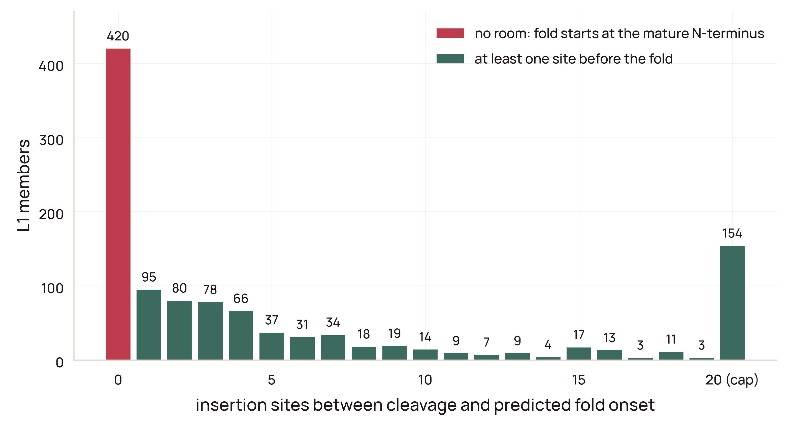
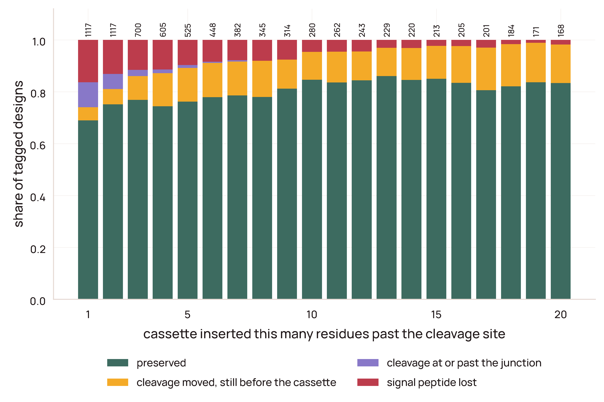

# N-terminal tag placement behind a signal peptide in the L1 library: brief for external review

This is a companion to the [L1 design brief](../BRIEF.md). It covers one step of the design,
which that brief summarizes in a single table row: where the tag cassette goes in a member
whose N-terminus sits behind a cleaved signal peptide. That is the largest single group in
L1. The step has four parts: call the signal peptide, find where the folded domain begins,
confirm on the tagged protein that the signal peptide still works, and confirm on a predicted
structure that the native fold survives the cassette. This brief describes
each part, what it does and does not establish, and what is built from it.

Sections 1–6 describe the interval census and the signal-peptide re-prediction that every
placement starts from. Section 7 describes what is built on top of them: one arm per member,
chosen by the rules in [`nterm_decide.py`](nterm_decide.py) and assembled by
[`build_l1_nterm_arms.py`](../../build_l1_nterm_arms.py). Every built arm is regenerated byte
for byte by `build_l1_nterm_arms.py --check`.

Counts in sections 1–6 are measured by [`nterm_placement.py`](nterm_placement.py) and written
to [`nterm_numbers.json`](nterm_numbers.json); [`run_nterm_review.py`](run_nterm_review.py)
reruns them offline from a frozen bundle (see [`README.md`](README.md)). They refer to
**tranche L1, active members**, with topology from **DeepTMHMM v1**, on the census snapshot of
2026-11-04. Counts in section 7 are from [`nterm_decisions_summary.json`](nterm_decisions_summary.json),
on the membership of 2026-11-13 after the expression-rescue members were retired (1,312 members on this rung). ATRN and NRG2 were evaluated here as well, because a routing proposal would have moved them onto this rung; no N-after-SP form of either keeps a SignalP cleavage site, so both stay on the internal rung, where they are built, and `nterm_decisions.tsv` lists them as `routed_internal`.

## Terms used throughout

| Term | Meaning here |
|---|---|
| Member | One construct in L1: a gene's chosen proteoform, its designed coding sequence (CDS), tag cassette and barcode. A member is named `l1-mNNNN`, numbered by its plate position in insert-length order; the ID it was designed under, `l1-pNNNN`, is kept as its **design ID**, and the interval census and the re-prediction sweep are keyed by it. Its **designed protein** is the designed CDS translated. |
| Rung | Where a member's cassette goes, assigned from the DeepTMHMM v1 topology of its designed protein: N-terminal after the signal peptide, N-terminal at residue 1, C-terminal, or internal. |
| Signal peptide (SP), cleavage site | The N-terminal targeting sequence removed by signal peptidase. The **cleavage site** `c` is its last residue; the mature protein starts at `c + 1`. |
| N after SP | The rung for a member with a predicted signal peptide followed by an extracellular residue. The cassette goes into the mature N-terminal region, never into the signal peptide, which leaves with it. |
| p003 cassette | The 51-aa tag cassette every member reuses, from our first built construct p003 (TFRC): `GGGGS`–SpyTag003–`GGGGSGGGGS`–P-ALFA-P–`GGGGS`. Its DNA is p003's encoding. |
| Insertion site `n` | "Insert after residue `n`", 1-based on the designed protein. The **tagged design** is `native[:n] + cassette + native[n:]`, and in DNA the cassette goes after nucleotide `3n` of the CDS, counted from the A of the ATG. |
| Fold onset | The first residue after the cleavage site where a disorder predictor scores five consecutive residues as ordered (score < 0.5). It marks where the structured ectodomain begins. |
| Admissible interval | The insertion sites from the cleavage site `c` up to the median fold onset minus 1, plus a two-residue tolerance (defined in section 3). |
| Candidate sites | The admissible interval from `c + 1`, capped at `c + 20`. |
| Placeable, no room | A member is **placeable** when at least one candidate lies strictly before the fold onset. It has **no room** (the record's term is *degenerate*) when the fold starts at the first mature residue, so every candidate exists only through the tolerance and lies inside the predicted fold. |

## 1. Which members get an N-terminal tag behind a signal peptide

Each L1 member gets one rung from the DeepTMHMM v1 topology of its own designed protein,
matched by the SHA-256 of the sequence. The rungs are taken in order, and the first that
applies wins:

| Rung | Rule | L1 members |
|---|---|---:|
| N after SP | signal peptide, then an extracellular residue | **1,300** |
| N at residue 1, multipass | N-terminus extracellular, no signal peptide, more than one TM helix | 563 |
| N at residue 1, single-pass (type III) | the same, one TM helix | 62 |
| C-terminal | C-terminus extracellular | 218 |
| internal | neither terminus extracellular, or GPI-anchored with an extracellular C-terminus | 567 |

These are 2,710 members. The other 25 active members are expression-rescue arms that carry
their own designs. Every member whose designed protein has a DeepTMHMM v1 signal peptide lands
on the N-after-SP rung; none lands on the C-terminal or internal rung.

The 1,300 members are 1,121 library references, 76 isoforms and 103 orthologs (mouse and
cynomolgus).

## 2. Calling the signal peptide and its cleavage site

Two predictors call the signal peptide, and the later cleavage site is used:

| Predictor | Version and settings | Role |
|---|---|---|
| DeepTMHMM v1 | 1.0.24; its per-residue `S` labels | assigns the rung (section 1), and gives a cleavage call |
| SignalP 6.0 | `signalp-6.0+h`, `--organism eukarya --mode slow-sequential` (the full six-model ensemble); release `sp6_2026_09_28` for proteins with a public UniProt record, `sp6_2026_10_18` for designed proteins without one | a second cleavage call with a probability |

The cleavage site used is the later of the two calls, because the two possible errors are not
symmetric. A cassette placed inside the signal peptide is cut off with it, and the member then
reads as a non-expressor, which cannot be told apart from a genuine biological negative. A
cassette placed a residue or two late is still displayed. Over the 1,122 members that reach an
interval, the two predictors agree on the cleavage site for 924; SignalP 6.0 calls it later for
164, and DeepTMHMM v1 for 34.

SignalP 6.0 reads only the first 70 residues of a protein.

### Every prediction is matched to the designed protein by sequence

The predictor rows come from a public database of predictions run on UniProt proteins. Most
of those rows are keyed by UniProt accession, not by sequence, and a member's designed protein
is often not its gene's canonical UniProt sequence. Each row is therefore admitted only on the
sequence it was predicted on. The frozen snapshot carries that sequence, and the runner
decides by comparing it with the designed protein:

| Route | Rule | Members |
|---|---|---:|
| exact, accession | every sequence stored under the accession equals the designed protein | 1,202 |
| exact, designed | a row predicted on the designed protein itself (keyed by its SHA-256) | 48 |
| prefix | the census's accession first differs from the designed protein at residue 476–1,059. SignalP's 70 residues are identical, and disorder tracks are cut before the difference | 9 |
| none | no admissible row | 41 |

AlphaFold-disorder is the exception (section 3): its track comes from the AlphaFold Database
model of the accession, whose own sequence is not in the snapshot. Its match is to the
accession and is checked only by length. For every member where it is used (1,132), the
model's length equals the designed protein's.

## 3. Choosing the insertion site: the admissible interval

The rule follows Tedman's method for N-terminal tags on GPCRs with a signal peptide
([Tedman et al., 2025](https://doi.org/10.1101/2025.09.19.677468), bioRxiv preprint). Call
the cleavage site, find where structure begins, and insert between the two. The
implementation of record is in the accessible-surfaceome repository; this package restates it
in [`admissible_interval.py`](admissible_interval.py).

1. **Fold onset per predictor.** Three disorder predictors each give an onset:
   metapredict 3.0.2, NetSurfP-3.0 (which scores the first 400 residues), and
   AlphaFold-disorder, scored as 1 − pLDDT/100 from AlphaFold Database v6 models.
2. **Median onset.** The median of the onsets that were found. With an even number it takes
   the upper middle value. The median is used, not the earliest or the latest, so one
   over-eager or under-calling predictor can neither collapse the interval nor push it into
   the domain. Each predictor's onset is kept in the output, so a disagreement can be
   inspected.
3. **Interval.** From the cleavage site `c` to `median onset − 1 + 2`. The record gives the
   two-residue tolerance this basis: most of the Tedman junctions that fall outside the strict
   interval overshoot it by one or two residues and still express. When no predictor finds an
   onset, the onset is taken as `c + 7` (`FALLBACK_WIDTH` = 6), so with the tolerance the
   interval runs to `c + 8`.
4. **Candidates.** The interval from `c + 1`, capped at `c + 20`. The cleavage site itself is
   excluded, because a cassette there forms the mature N-terminus. The record's analysis of
   Tedman's junctions finds none placed at the cleavage site (not re-measured here).

| Outcome | L1 members |
|---|---:|
| placeable: at least one candidate before the fold | 702 |
| no room: the fold starts at the first mature residue | 420 |
| refused: no SignalP row for the designed protein | 121 |
| refused: DeepTMHMM v1 calls a signal peptide, SignalP 6.0 does not | 57 |

These outcomes reproduce the 2026-10-18 interval census of the same rule. For all 1,291
members the census and today's library share (same candidate ID, same designed protein), they
agree on class, cleavage site, every predictor's onset, the interval and the candidate list.
Nine members have been added since the census (three no room, two placeable, four refused), and
four census members have since been retired as duplicates of another member's protein.

*Figure 1. Insertion sites that lie strictly between the cleavage site and the median fold
onset, per L1 N-after-SP member with an interval. Unit: member; n = 1,122 (702 placeable,
420 with no room); values are counts. The rightmost bar collects members with 20 or more,
because candidates stop at cleavage + 20. 178 refused members are not shown. Topology:
DeepTMHMM v1; cleavage: the later of DeepTMHMM v1 and SignalP 6.0; onsets: metapredict,
NetSurfP-3.0 and AlphaFold-disorder. Regenerated by [`plot_nterm.py`](plot_nterm.py) from
`nterm_members.tsv`.*

**The interval is narrow.** Its median width is 4 residues. For 420 members there is no
position before the predicted fold at all.

**Where disorder ranks the site inside the interval.** An earlier rule took the residue with
the highest mean within-protein disorder percentile in the window `c + 1 … c + 20`
([`tag_placement.post_sp_junction`](../../../../../src/deliverome_analysis/cloning/tag_placement.py)).
For 1,078 of the 1,122 members with an interval, its pick is one of the candidates; for 44 it
falls outside the interval. Section 7 gives the rule that chooses among them.

**InterPro is recorded, not used.** The census records each member's first InterPro domain
start next to the disorder onset, as an audit. It does not set the onset: in the record's
analysis, InterPro's domain starts barely beat a random-onset baseline, and its "clear"
calls often mean that no domain is annotated, not that there is no fold. On the four panel
receptors with no room (VSIG10, ERBB2, AXL, NECTIN4), the disorder onset and InterPro's first
domain agree to within 0–2 residues ([L1 design README](../../README.md)).

## 4. Re-predicting the signal peptide on the tagged protein

Every candidate site was rebuilt as a tagged design and re-predicted with SignalP 6.0
(sweep `sweep_rp_1792381414`; metapredict and NetSurfP-3.0 were rerun too). Each design is
found by the SHA-256 of `native[:n] + cassette + native[n:]`. Its verdict is recomputed from
the native and tagged calls:

| Verdict | Rule | Tagged designs |
|---|---|---:|
| preserved | same cleavage site as the native protein | 6,162 |
| cleavage moved | a different site, still before the cassette | 834 |
| crosses the junction | the new site is at or past the insertion site, so the cassette would be cut off | 208 |
| signal peptide lost | SignalP 6.0 no longer calls a signal peptide | 725 |

That is 7,929 tagged designs for 1,117 members. All 7,929 recomputed verdicts equal the
sweep's own. 1,029 members keep at least one design whose signal peptide is still called; **88
lose every candidate** (34 placeable, 54 with no room).

*Figure 2. SignalP 6.0 verdict on each tagged design, by how many residues past the cleavage
site the cassette is inserted. Unit: tagged design; n = 7,929 designs from 1,117 members; the
number above each bar is the designs at that offset. Bars are shares, with no error bars. One
member contributes one design per offset in its candidate list, so the short offsets carry
every member and the long offsets only members with long intervals. Regenerated by
[`plot_nterm.py`](plot_nterm.py) from `nterm_positions.tsv`.*

Loss of the signal peptide is most common when the cassette sits right after the cleavage
site, and becomes rarer further out. The two offsets are confounded with which members have
long intervals, so this is a description of L1, not a dose–response.

### What re-prediction does and does not establish

Re-prediction checks one thing: whether SignalP 6.0 still recognizes the signal peptide, and
still cuts it before the cassette, with the 51-aa cassette in place. It cannot see whether the
cassette sits inside the folded domain. SignalP reads the first 70 residues, and nothing in it
models the ectodomain.

FOLR1 shows the gap. The panel arm p0028 has the cassette after residue 27. FOLR1's L1 member
`l1-m0329` (design ID `l1-p0654`) has no room: AlphaFold-disorder and metapredict put the fold onset at 23,
NetSurfP-3.0 at 31, and the median is 23. Its interval is 22–24, so residue 27 is past the
interval and inside the fold by two of the three predictors. Its re-prediction is clean: the
cleavage site stays at 22, with probability 0.9821 native and 0.9806 tagged. **A signal-peptide
check is not a fold check.** A `preserved` verdict on a no-room member says nothing about
whether the ectodomain tolerates the insertion. p0028's expression and display data are the
only measurement L1 will have on that question before ordering.

### Coverage

| | Members | Tagged designs |
|---|---:|---:|
| every candidate re-predicted | 1,117 | 7,929 |
| none re-predicted | 5 (added since the sweep: CD58, PRSS8, ADGRE1, PCDHGA7, KIR2DS4) | 26 |
| no interval, nothing to re-predict | 178 | — |

The members outside the sweep, and every form section 7 adds (ortholog, Igκ and relocated
forms), are re-predicted by the same SignalP 6.0 build on Modal, pinned by package and model
fingerprints ([`signalp6_identity.json`](signalp6_identity.json); a 1,024-sequence shard of the
sweep reproduces with a maximum probability difference of 0.0). The runs are listed in
`nterm_overnight.RUN_IDS` and published under `reviewer-package/nterm/signalp6-runs/`.

## 5. Hard cases

| Case | L1 members | Status at the census (section 7 gives the resolution) |
|---|---:|---|
| **No room after the signal peptide.** The fold starts at the mature N-terminus, so every admissible site is inside the predicted fold. Examples: VSIG10 (interval 30–32, fold onset 31 by all three predictors; InterPro's Ig V-set domain starts at 31), NECTIN4, FOLR1. | 420 | No position avoids the fold. For 54 of them, SignalP 6.0 also loses the signal peptide at every candidate; VSIG10 is one (the panel pairs it with an Igκ-leader arm, p0048). Whether the fold tolerates the cassette is untested; p0028 is the test case. |
| **Signal peptide lost at every candidate.** | 88 | No position in the interval keeps the call. A different tag architecture is needed, not a different position. |
| **The predictors disagree on the signal peptide.** DeepTMHMM v1 calls one and SignalP 6.0 does not. | 57 | Refused; no interval is computed. |
| **No SignalP row.** | 121 | Refused. For 81 of them, all orthologs, a SignalP 6.0 row for the exact designed protein exists in the ortholog release `sp6_2026_09_28_ortho`, which the census did not read: 74 call a signal peptide and 7 do not. Checked once against the database, not part of the frozen runner. |
| **Cytoplasmic N-terminus.** | 785 (internal 567, C-terminal 218) | None of these has a signal peptide, and none gets an N-terminal tag. Adding a signal peptide would invert their topology. |

## 6. Coordinate checks

The four checks below run on every candidate site, 7,955 in all. Every residue number is read
on the designed protein: the designed CDS translated, from
`processed://sprint4/s4e9-orf-design-fg-panel/library-candidates/candidate_cds.json`.

| Check | Result |
|---|---|
| The cleavage site and the insertion residue lie inside the designed protein | 7,955 of 7,955 pass |
| The residues either side of the junction are recorded, read from the designed protein | recorded per site (`residue_before`, `residue_after` in `nterm_positions.tsv`) |
| The p003 cassette DNA inserted after nucleotide `3n` of the CDS translates to `native[:n] + cassette + native[n:]` with no internal stop | 7,955 of 7,955 pass |
| The sweep's native record is the designed protein, and each tagged record is found by its own SHA-256 | 1,117 of 1,117 natives match; 3 members were swept under a retired duplicate ID with the identical protein (ACHE, CD177, UPK3BL1) |
| Predictor rows' recorded lengths equal the designed protein's (exact routes) | all pass |

The eight panel arms built with the disorder-anchored junction (`../constructs_nterm_disorder_anchored.tsv`)
were checked the same way. The native protein of each is exactly the designed protein of one L1 member, and each
tagged arm's re-prediction is found by its sequence hash. SLC9A3's built site, 34, is in its
own junction sweep (`canary_rp_1792374944`).

The frame check also tests that each designed CDS ends in a stop codon. It found three L1
members whose Ensembl 115 records end on a sense codon: KIR2DL5A, KIR2DS2 and KIR2DS5
(`l1-m1047`, `l1-m0480` and `l1-m0481`; design IDs `l1-p1054`–`l1-p1056`; their records sit on alternate-haplotype scaffolds). Ten L2 members
have the same defect. The designed CDS now carries an appended TAA for all thirteen, with the
proteins unchanged, and the library pipeline fails on any CDS without a stop (L1 design decision
log, 2026-11-04). Every L1 N-after-SP member now ends in a stop.

## 7. What is built

Each member gets one arm, in this order of evidence:

| Arm | Rule | Members |
|---|---|---:|
| native site | **Re-prediction-gated site before the fold:** among candidates whose tagged design keeps the native SignalP cleavage site, prefer one before the median fold onset, then one whose cleavage probability falls by no more than 0.07, then the highest tagged probability, then the smallest offset | 528 |
| native site | The same gate, when every preserved site lies inside the predicted fold; chosen by the smallest probability drop, then the most disordered junction | 325 |
| native site | No candidate keeps the cleavage site exactly, but at one it shifts and stays upstream of the cassette | 50 |
| native site | Ortholog members, gated on the ortholog SignalP release (`sp6_2026_09_28_ortho`) | 50 |
| native site | Members with no SignalP row, re-predicted natively; or no disorder track, using the fallback interval. The site must follow the later of the DeepTMHMM v1 and SignalP 6.0 cleavage calls | 41 |
| Igκ swap | **Native signal peptide fails at every candidate:** the Igκ leader (`METDTLLLWVLLLWVPGSTG` + D) replaces residues 1…c, and the cassette follows the same mature residue | 105 |
| Igκ swap | Members with no census SignalP row whose native SignalP call is a signal peptide, whose native forms fail and whose Igκ form keeps the leader's cleavage | 18 |
| Igκ swap | **SignalP 6.0 calls no native signal peptide** (the 58-member class, and 12 members with no census row), and UniProt or DeepTMHMM v2 confirms a cleaved signal peptide within 3 residues of DeepTMHMM v1's site (below) | 58 |
| native site | **Moved out of a pro-peptide:** the chosen site lay inside an N-terminal pro-peptide removed during secretion (below), so the cassette sits at the mature N-terminus | 51 |
| native site or Igκ | **Refold replacement:** the chosen form failed refold, so the next SignalP-passing form takes its place | 22 |
| native site or Igκ | **Built and flagged under the multipass rung's disposition rule:** every SignalP-passing form fails refold only on epitope packing (or a buried SpyTag003), with the fold intact (native-region lDDT ≥ 0.85, site lDDT ≥ 0.70 where scored) and ALFA exposed (RSA ≥ 0.25); the form with the fewest packed epitope residues is built (below) | 23 |
| none | Held, with the reason in `nterm_decisions.tsv` | 35 |

The rung has 1,307 members. OR10G6 is retired to the residue-1 multipass rung (Igκ + tag at Met1; SignalP 6.0 and UniProt call no signal peptide, and its leader-free N-terminally tagged form was displayed in Tedman's screen). OR11H6 and TMEM63B have left it for the residue-1 multipass rung
(lane override, PR #337), and both ENTPD2 members for the internal rung (PR #346), because their
N-terminal segment is a signal anchor (below). ATRN and NRG2 are listed as `routed_internal`:
they were evaluated here because a routing proposal would have moved them onto this rung, but
no N-after-SP form of either keeps a SignalP cleavage site, so both stay on the internal rung,
where they are built.

**Why the Igκ swap is triggered by re-prediction, not by native confidence.** 71 of the 105
members swapped because their native signal peptide fails have a native cleavage-site
probability of 0.9 or more (for example TNFRSF14 0.990, VCAM1 0.985, CD274 0.983). The swap
does not judge the native peptide. It answers one question: whether SignalP still recognizes
that peptide with the 51-residue cassette at an admissible site, and for these members it does
not, at any candidate. A confident native peptide is no evidence that it survives the
insertion. For 69 of these members the fold starts at the first mature residue, so the
interval holds exactly two candidates, `c + 1` and `c + 2`. Sites from `c + 3` onward lie
inside the predicted fold beyond the two-residue tolerance, which the interval rule excludes;
they were not overlooked.

**Weak tagged cleavage, flagged and kept.** 34 native-site arms keep the native cleavage site
with a tagged cleavage-site probability below 0.5: MUSK 0.13, L1CAM 0.26 and 0.50, IL1RAPL2
0.28, CD163 0.31 (two members), LYPD1 0.34, CD34 0.34, SORCS3 0.34, NPR3 0.35, IL22RA1 0.35,
VSTM5 0.37, GUCY2C 0.37, SCN1B 0.38, GPC4 0.38, CNTNAP3 and CNTNAP3B 0.41, TLR2 0.42, IFNLR1
0.42, MMP24 0.43, KIR3DL2 0.44, KIAA0319 0.44, FCRL3 0.45, GAS1 0.46, CHRNB3 0.46, THSD7A
0.46, LMLN 0.48 (two members), NTM 0.49, BTNL9 0.49, MR1 0.49, GFRA2 0.49, ADGRE1 0.49 and
ITGB6 0.50. No floor is applied. Every one of their Igκ forms scores 0.97–0.98 (run
`nterm_sp6_2026_11_14g`), but that score is the leader's own and the same for every member,
so it is no evidence that the swap is better for any one of them. SignalP still places the cut
at the native site in all 34, and every one passes refold. These are the arms to watch first if
expression is low.

**Cassette.** The 51-residue p003 tandem, `GGGGS`-SpyTag003-`GGGGSGGGGS`-ALFA-`GGGGS`, with one
shared DNA encoding. N-terminal arms share it because the barcode-swap risk is measured as the
shared suffix ending at the barcode, which an N-terminal cassette does not reach.

**Refold gate.** Each tagged form is folded with ColabFold 1.6.2 (model_1_ptm, 3 recycles,
the native MSA with gap columns for the cassette) by the l1-tag-refold workstream. A form fails
when the native region's lDDT against the untagged model is below 0.85, the lDDT within 15
residues of the site is below 0.70, an epitope is buried (relative solvent accessibility below
0.25), or five or more epitope residues pack confidently on the native domain. A fail whose
only failing values are lDDT within 0.01 of the bar counts as a pass and is labeled
`borderline` (6 members: SNORC, CIST1, FOLR1, LYVE1, SMO, SLITRK2), because a single model's lDDT varies by more than that between runs.
Every one of the 1,272 built arms has a refold verdict: 1,243 pass, 6 of them as borderline, and 23 fail and are built and flagged (below); and 6 pass as borderline (verdicts committed on main by l1-tag-refold, `tag_refold_verdicts.tsv`). The rule each verdict rests on is in the `refold_rule*` columns of `nterm_decisions.tsv`.

**Pro-peptides.** The interval rule sees the signal peptide and disorder only. UniProt
(release 2026_04) annotates an N-terminal pro-peptide on 75 members; a convertase removes it on
the way to the surface, and a cassette inside it leaves with it. The table below gives how each
case is handled ([`propeptide_check.py`](propeptide_check.py)).

| Pro-peptide | Handling | Members |
|---|---|---:|
| Removed during secretion (cadherins, desmogleins, desmocollins, ADAMs, MT-MMPs, BACE1/2, SORT1, SORCS3, PAM, SELPLG, PRRG2/4, TGFA, HBEGF, AREG) | Cassette moved to the mature N-terminus, after the pro-peptide, keeping the R-X-[KR]-R site whole; the new form must keep the SignalP cleavage site and pass refold | 62: 54 built (51 native-site, 3 confirmed Igκ swaps); 5 held (CDH5 loses its cleavage site, AREG, BACE1, CDH15 and ADAM32 fail refold at the mature N-terminus); 3 in the second-source review below |
| Removed only on activation (F2R, F2RL1–3, PRSS8, PRSS21, PRSS41, MEP1B) | Site kept: the tag is present on the resting protein, and a cassette at the new N-terminus would cap the tethered ligand or the zymogen's activation N-terminus | 6 with the cassette inside |
| Cut but kept (RGMA) | Site kept: the fragments stay disulfide-linked | 1 |

Classical cadherins need a free mature N-terminus for strand-swap adhesion, so on those arms the
tag reports surface display, not adhesion. A furin motif without a UniProt annotation (28 built
arms, for example ADAM8, ADAM9, CDH22, CDH26) is listed but does not move a site.

**Members whose signal peptide only DeepTMHMM v1 calls** (58, plus 12 below). SignalP 6.0 calls
no signal peptide, so before residues 1…c are deleted for the Igκ leader, a second source must
show that 1…c is a cleaved signal peptide and not a signal anchor or first transmembrane helix
([`sp_disagree_review.py`](sp_disagree_review.py), matched on sequence: UniProt 2026_04
reviewed entries and isoforms whose first 70 residues equal the designed protein's, and
DeepTMHMM v2 on the designed protein).

| Second-source finding | Handling | Members |
|---|---|---:|
| UniProt SIGNAL or DeepTMHMM v2 confirms a cleaved signal peptide within 3 residues of DeepTMHMM v1's site | Igκ swap kept | 42 (39 built; 3 already held) |
| A signal anchor or first TM helix (UniProt TRANSMEM and DeepTMHMM v2) | Residues kept. OR11H6 and TMEM63B are built at residue 1 by the multipass lane and ENTPD2 on the internal rung (`routed_multipass`, `routed_internal`); CATSPERH is held | 4 |
| A curated cleaved signal peptide at another site: UniProt SIGNAL for TNFRSF10A (1–23), DCBLD2 (1–66), CDH24 (1–19), UNC5C (1–40), CACNA2D4 (1–19), GRM1 (1–18) and PTPRG (1–19); for CNNM2 a primary report of a cleaved signal peptide of about 64 residues ([de Baaij et al., 2012](https://pubmed.ncbi.nlm.nih.gov/22399287/)), where DeepTMHMM v2 cuts at 65 | Igκ swap re-anchored at that site; SignalP keeps the leader's cleavage and refold passes for all eight | 8 |
| Only DeepTMHMM v2 calls a cleaved signal peptide (CDH3 and GRIA1 isoforms): the residues around the v2 site do not align with the canonical entry's UniProt SIGNAL, and no paper reports cleavage there | Held | 2 |
| No independent signal peptide (FCAMR, MDGA2) | Held | 2 |

The same rule covers 12 members with no census SignalP row whose own native SignalP 6.0 call is
not a signal peptide: six orthologs whose native sequence round 2 never scored (now scored by
run `nterm_sp6_2026_11_14h`, all OTHER) and six whose round-2 native call was OTHER. DeepTMHMM
v2 (or UniProt, for one SEMA4C member) confirms the site for 8, which keep the swap (LYPD2,
LYPD6B, PVR, GABRR3, IL9R, SEMA4C ×3). Cynomolgus ENTPD2 is a signal anchor (v2 TM 9–26): it
is built on the internal rung after residue 458, like human ENTPD2 (ranker, PR #341; gate and
refold pass), and has no N-terminal arm. CD84, IL17RC and CACHD1 have no matching UniProt entry and no v2 row, but the human
ortholog's UniProt SIGNAL aligns onto their N-terminus with at least 80% identity over ±5
residues of the site and no gap there, so each is re-anchored at the aligned site: CD84 at 17
(human SIGNAL experimental, ECO:0000269), IL17RC at 20 (experimental; a new form, held until
its refold returns) and CACHD1 at 49 (ECO:0000255).

**Human-ortholog support.** DeepTMHMM v2 agreeing with DeepTMHMM v1 is two versions of one
tool against SignalP's OTHER, so for every ortholog decided on DeepTMHMM alone the human
canonical entry's UniProt SIGNAL is aligned onto the ortholog's first 90 residues (global,
BLOSUM62), and the identity over the signal peptide and over ±5 of the site is recorded in
`sp_disagree_review.tsv` (`human_ortholog_signal`) and in `igk_deletion_evidence`. It supports
IL9R (80% around the site) and cynomolgus LYPD6B (100%); it does not support LYPD2 (60%),
GABRR3 (40%) or PVR (a gap at the site), which keep the swap on DeepTMHMM v2 alone.

**What the second source is.** The 58 Igκ swaps kept or re-anchored on a second source:

| Source of the cleaved-signal-peptide evidence | Swaps |
|---|---:|
| UniProt SIGNAL on the same sequence (including the seven re-anchors) | 36 |
| Human ortholog's UniProt SIGNAL by alignment (CD84, CACHD1, IL17RC, IL9R, LYPD6B) | 5 |
| A primary paper (CNNM2, PMID 22399287) | 1 |
| DeepTMHMM v2 alone (ATRNL1, C5orf15, CDH22, CNNM1, CNTN5, GABRR3, GLP2R, GRIK1, LYPD2, LYPD6B, MMP16, PVR, SEMA4C ×2, SUSD4, VSIG10L) | 16 |

The DeepTMHMM-v2-only subset is the weakest evidence on the rung: it rests on a second version
of the predictor whose call needed checking in the first place.

Every Igκ row records in `igk_deletion_evidence` what shows that the residues it deletes are a
cleaved signal peptide: a native SignalP 6.0 call (124) or a second source (58). `tests/test_nterm_igk_evidence.py` fails the build if any Igκ deletion
lacks it.

Every UniProt SIGNAL used here carries evidence code ECO:0000255 (a sequence-analysis
prediction accepted by curators) except PTPRG's, which carries none; none is experimental. The
code is recorded per member in `sp_disagree_review.tsv` and in the decision's reason. The seven
UniProt re-anchors therefore rest on curated predictions, not on measured cleavage, and are a
low-confidence decision; only CNNM2's rests on a measurement. Several
DeepTMHMM v1 calls in this class end at exactly residue 60 (FCAMR, DCBLD2, CNNM2, MDGA2,
CACNA2D4), which looks like a ceiling on v1's signal-peptide length rather than a measured site:
a known limit of acting on a v1-only call.

**Weak predicted signal peptide: Igκ.** Becca's direction (2026-11-14) is to rely more on
the Igκ leader where the native signal peptide is weakly predicted. The working example is
VSIG10. SignalP 6.0 is near-certain it has a signal peptide (SP probability 0.9998) but unsure
where it is cut: cleavage site 30 at probability 0.35. Its fold starts at 31, so the interval
holds only 31 and 32, and with the cassette at either SignalP loses the signal peptide. VSIG10
was therefore already an Igκ swap under the no-room rule (leader replaces 1–30, cassette after
native 32, tagged cleavage probability 0.98, refold pass). Its weakness is the cleavage-site
call, not the signal-peptide call, and that is what the rule measures.

A native arm counts as weak when the native SignalP cleavage-site probability is below 0.5 or
the built arm's tagged cleavage probability is below 0.5. Both thresholds were proposed here and
adopted by the coordinator on 2026-11-15; Becca has not confirmed them. The native SP
probability is not used: none of the 1,090 native arms falls below 0.5. This marks 53 arms
([`weak_sp.py`](weak_sp.py), `weak_sp.tsv`). The Igκ leader replaces 1…c, where c is the later
of the DeepTMHMM v1 and SignalP calls, so it deletes at most a few mature residues rather than
leaving signal-peptide residues behind. The cassette stays after the same native residue. Each
member's two cut calls and their probabilities are in `weak_sp_flag`.

| Outcome | Members |
|---|---:|
| The two cut calls differ by more than 5 residues: not swapped, flagged for Becca (TMEM81, MXRA8, IL1RAPL2) | 3 |
| The Igκ form moves SignalP's cut (KIAA0319, 20→22): native arm kept, flagged | 1 |
| SignalP keeps the leader's cleavage and the Igκ form passes refold (47) or is built and flagged under the disposition rule (ICAM4, LYPD1): swapped to Igκ | 49 |

**Built and flagged on the multipass rule.** The residue-1 multipass rung keeps every arm that
fails refold as built and flagged, because each verdict is a single model and the pooled screen
measures display directly ([`multipass_refold_dispositions.py`](../../multipass_refold_dispositions.py)).
This rung takes that rule verbatim but only where the fold is intact: a form qualifies when its
failure class is `epitope_packed` (five or more epitope residues confidently packed) or a
buried SpyTag003, its native-region lDDT is at least 0.85, its site lDDT at least 0.70 where
scored, and ALFA is exposed (RSA ≥ 0.25). A confident helix inside the cassette is a reason no
multipass arm is built under, so it disqualifies. 23 members are built this way (ACHE, ADAM32,
BACE2, CDH15, CEACAM1, CEACAM8, FCGRT, GPIHBP1, GPR83, HLA-G ×2, ICAM4, ICOS, ICOSLG, KIR2DL3,
KIR2DS2, KIR2DS4, LRRC38, LRRN4CL, LYPD5, NCR3 ×2, SIGLEC15), each at its form with the fewest
packed residues; the packed count, both tags' RSA and both lDDTs are in `refold_disposition`. Read
ALFA as their display control; a SpyCatcher003:ALFA capture ratio on the bench would show whether
SpyTag003 is occluded. EFNA1, PDCD1 and FAM174A (a helix inside the cassette) and members failing
on lDDT stay held.

**Holds.** 35 members have no N-terminal arm (including IL12RB1's cynomolgus member, held under the ortholog rule because no human IL12RB1 member is built):

| Reason | Members |
|---|---:|
| No tagged form, native or Igκ, keeps a SignalP cleavage site (TMEM210 ×3) | 3 |
| Every SignalP-passing form failed refold on lDDT (fold or site window: for example ITGB3, LRFN2, CXADR, SLC39A6) or with a helix inside the cassette (EFNA1, PDCD1, FAM174A) | 23 |
| The pro-peptide relocation loses the SignalP cleavage site (CDH5; its Igκ form moves the cut 20→22) or fails refold on lDDT (AREG, BACE1) | 3 |
| Signal anchor at the N-terminus with a cytoplasmic N-terminus (CATSPERH) | 1 |
| No independent or curated evidence of a cleaved signal peptide (FCAMR, MDGA2, CDH3 isoform, GRIA1 isoform) | 4 |

An Igκ swap does not rescue a refold failure: it keeps the cassette after the same mature
residue.

**Settled questions.** The census left five questions open; each is now decided:

| Question | Decision |
|---|---|
| How to choose among the surviving candidates | The re-prediction-gated rule above (Becca, 2026-11-11) |
| The no-room members | Built inside the fold when SignalP keeps the cleavage site, and gated by refold, which measures what re-prediction cannot |
| Members that lose the signal peptide at every candidate | The Igκ leader swap, gated by SignalP on the swapped form |
| The SignalP agreement filter | Kept for the interval; members it refuses are re-predicted natively and as Igκ forms, and built when a form keeps the cleavage site |
| The ortholog SignalP release | Admitted |
| Members only DeepTMHMM v1 calls a signal peptide for | Igκ swap only with a second source confirming a cleaved signal peptide (coordinator, 2026-11-14) |

## Materials and provenance

| Element | Location | Status |
|---|---|---|
| Placement runner and frame checks | [`nterm_placement.py`](nterm_placement.py), [`admissible_interval.py`](admissible_interval.py) | committed |
| Outputs | [`nterm_members.tsv`](nterm_members.tsv), [`nterm_positions.tsv`](nterm_positions.tsv), [`nterm_numbers.json`](nterm_numbers.json) | committed; the runner reproduces them byte for byte |
| Offline reviewer runner | [`run_nterm_review.py`](run_nterm_review.py), bundle manifest [`nterm_bundle_manifest.tsv`](nterm_bundle_manifest.tsv) (9 files, about 65 MB) | committed |
| Frozen predictor rows | `processed://sprint4/s4e9-orf-design-fg-panel/reviewer-package/nterm/2026-11-04/`, written by [`snapshot_inputs.py`](snapshot_inputs.py) | frozen 2026-11-04 |
| Re-prediction sweep | `processed://sprint4/s4e9-orf-design-fg-panel/reprediction/sweep_rp_1792381414/` | byte-identical to the Modal volume copy |
| Interval census | `processed://sprint4/s4e9-orf-design-fg-panel/triage/l1_interval_census.tsv` and its code, PR [#191](https://github.com/Deliverome-Project/deliverome-analysis/pull/191) | reproduced for all 1,291 shared members |
| Optional SignalP rerun | [`signalp_rerun.py`](signalp_rerun.py) | needs a SignalP 6.0 licence |
| Decisions and arms | [`nterm_decide.py`](nterm_decide.py) → [`nterm_decisions.tsv`](nterm_decisions.tsv); [`build_l1_nterm_arms.py`](../../build_l1_nterm_arms.py) → `constructs_l1_nterm.{tsv,fasta}` | committed; `--check` rebuilds every arm byte for byte |
| Pinned inputs | [`decision_inputs.json`](decision_inputs.json), written and verified by [`decision_inputs.py`](decision_inputs.py) | 26 inputs by SHA-256, including the refold verdicts and UniProt snapshots |
| SignalP 6.0 runs | [`signalp6_modal.py`](signalp6_modal.py), identity [`signalp6_identity.json`](signalp6_identity.json); `processed://…/reviewer-package/nterm/signalp6-runs/` | each run with its provenance |
| UniProt pro-peptides | `processed://…/reviewer-package/nterm/uniprot-propeptides/2026_04/`, [`uniprot_features_snapshot.json`](uniprot_features_snapshot.json) | snapshot hashed |
| Decision record | [`BUILD_OPTIONS.md`](BUILD_OPTIONS.md) | every rule with date, decider and rejected alternative |
| Parent package | [`../BRIEF.md`](../BRIEF.md), [`../README.md`](../README.md) | committed |

## Decision log

| Date | Was | Now | Why | Decided by / implemented by |
|---|---|---|---|---|
| 2026-10-08 | Cassette at the cleavage site | The later of the two cleavage calls, with a site downstream of it | A cassette in the signal peptide leaves with it; none of Tedman's junctions sits at the cleavage site | Becca (`POST_SP_PLACEMENT.md` decision table) / implementing session not recorded (`tag_placement.py`) |
| 2026-10-18 | One disorder-ranked residue in `c + 1 … c + 20` | Tedman's admissible interval, then re-prediction on the tagged design | The interval bounds the site at the fold onset; the fixed window placed tags inside folds | Recorded as settled in the PR #191 handoff, decider not named / the site-placement session (PR #191) |
| 2026-11-04 | Census and sweep checked only against themselves | An offline reviewer runner that matches every prediction by sequence and checks every site's frame | External review before L1's N-terminal cassettes are assembled | Becca (asked for the package) / Claude Code session nterm-reviewer-package (PR #254) |
| 2026-11-04 | 13 designed CDSs without a stop codon, 3 of them L1 N-after-SP members | TAA appended by the CDS resolver | Found by this package's frame check; the ORF would read through into the vector | Becca / nterm-reviewer-package, on PR #234 (`stop_codon_fix.tsv` per member) |
| 2026-11-10 | Members named `l1-pNNNN` | Member IDs `l1-mNNNN`, with the design ID beside them | Plate-position numbering (PR #272); the census and sweep are matched through the design ID | Becca (renumbering) / nterm-reviewer-package (this package's update, PR #254) |
| 2026-11-10 | No cassette chosen for N-terminal arms | The 51-aa p003 tandem, one shared encoding | Keep both epitopes; the barcode-swap metric is unaffected by an N-terminal cassette | Becca / nterm-reviewer-package (PR #254) |
| 2026-11-11 | Open question on choosing among candidates | Re-prediction-gated site rule | Keeps the measured cleavage site and prefers sites before the fold | Becca / nterm-reviewer-package (PR #254) |
| 2026-11-12 | Held groups awaiting decisions | Every member decided and built (inside-fold, upstream shifts, Igκ swap, ortholog release, re-predicted refused members) | Becca: complete L1 by the morning using best judgment | nterm-reviewer-package (delegated by Becca 2026-11-12) / nterm-reviewer-package (PR #254) |
| 2026-11-12 | SignalP the only gate | Refold gate; a failed form falls to its next SignalP-passing form, or the member is held | Re-prediction cannot see the fold | nterm-reviewer-package (delegated by Becca 2026-11-12) / nterm-reviewer-package (PR #254) |
| 2026-11-13 | Site rule blind to pro-peptides | Cassettes in a constitutively removed N-terminal pro-peptide move to the mature N-terminus | A cassette in a pro-domain never reaches the surface | nterm-reviewer-package (delegated by Becca 2026-11-12) / nterm-reviewer-package (PR #254) |
| 2026-11-13 | Any refold fail overturns an arm | lDDT fails within 0.01 of the bar count as passes, labeled borderline | One model's lDDT varies by more than 0.01 | nterm-reviewer-package (delegated by Becca 2026-11-12) / nterm-reviewer-package (PR #254) |
| 2026-11-13 | Brief stopped at the census and listed the fallback interval as 6 wide | Section 7 describes the built arms; the fallback interval reads `c + 8`, as the code computes | Write-up and code reconciled in the overnight design review | nterm-reviewer-package (overnight review relayed from Becca) / nterm-reviewer-package (PR #254) |
| 2026-11-14 | Igκ swap deleted residues 1…c on DeepTMHMM v1's call alone for 54 members SignalP calls no signal peptide for | A second source must confirm a cleaved signal peptide; signal anchors are routed, other sites re-anchored, unconfirmed members held | An external audit found the swap broader than the written rule; deleting a signal anchor changes topology | coordinator under Becca's 2026-11-12 delegation / nterm-reviewer-package |
| 2026-11-14 | Round-2 candidates laid out from DeepTMHMM v1's cleavage only | A site must follow the parent's own SignalP cleavage; one pick order (`nterm_build_options.pick_key`, `SOFTENING_BOUND`) for every caller, with unit tests | SMO ortholog and ADAM33 isoform had the cassette at or before SignalP's cut | nterm-reviewer-package (audit follow-up) |
| 2026-11-14 | Weak tagged cleavage unlisted | 34 arms below 0.5 listed as flagged; no floor | Their Igκ forms score only the leader's constant 0.98 | coordinator default / nterm-reviewer-package |
| 2026-11-14 | Ten re-anchors proposed (UniProt first, else DeepTMHMM v2) | Re-anchored on curated evidence only: 7 at the UniProt SIGNAL site (all ECO:0000255 or no code, so low confidence) and CNNM2 on a verified paper; CDH3 and GRIA1 isoforms, FCAMR and MDGA2 held; OR11H6, TMEM63B and ENTPD2 routed; CATSPERH held. 1,309 on the rung: 1,066 native, 175 Igκ, 68 held, 1,241 built | A second predictor alone is not enough to delete residues | coordinator under Becca's 2026-11-12 delegation / nterm-reviewer-package |
| 2026-11-14 | Second-source rule covered the 58-member class only | Extended to 12 members with no census SignalP row and no native SignalP signal peptide (six scored natively for the first time, run `nterm_sp6_2026_11_14h`): 8 confirmed, cyno ENTPD2 deferred to the internal rung, CD84, IL17RC and CACHD1 held. Every Igκ row names its deletion evidence; a test enforces it. 1,309 on the rung: 1,066 native, 172 Igκ, 71 held, 1,238 built | The same DeepTMHMM-v1-only deletion existed outside the audited class | coordinator under Becca's 2026-11-12 delegation / nterm-reviewer-package |
| 2026-11-14 | Ortholog swaps decided on DeepTMHMM alone | The human ortholog's UniProt SIGNAL, aligned, is recorded as support; CD84, IL17RC and CACHD1 released at the aligned site (≥80% over ±5, no gap); the 49 second-source swaps split by source, DeepTMHMM-v2-only (16) stated as the weakest. 1,309 on the rung: 1,066 native, 174 Igκ, 69 held, 1,240 built | DeepTMHMM v2 confirming v1 is one tool twice | coordinator under Becca's 2026-11-12 delegation / nterm-reviewer-package |
| 2026-11-14 | Ten new forms held until refold | All ten pass (l1-tag-refold, verdicts SHA-256 0d2b1a23…): the eight re-anchored Igκ swaps and the re-sited SMO ortholog and ADAM33 isoform are built. The pro-peptide snapshot is read from the append-only `external://uniprot/2026_04/nterm-propeptides/` copy (byte-identical). 1,309 on the rung: 1,068 native, 182 Igκ, 59 held, 1,250 built; IL17RC awaits refold | Refold verdicts returned | nterm-reviewer-package |
| 2026-11-14 | Cyno ENTPD2 Igκ arm kept until its internal arm was built | Retired: `routed_internal` (internal arm after 458 passes gate and refold, PR #341). No Igκ deletion now lacks cleaved-signal-peptide evidence. 1,308 on the rung: 1,068 native, 181 Igκ, 59 held, 1,249 built | The deferral's condition was met | ranker session / nterm-reviewer-package |
| 2026-11-14 | IL17RC held until refold | Released: the Igκ swap re-anchored at the human ortholog's aligned site 20 passes refold (#348). Both ENTPD2 members leave the rung for the internal rung (#346). 1,308 on the rung: 1,068 native, 182 Igκ, 58 held, 1,250 built; nothing on the rung awaits a verdict | Refold verdict returned | nterm-reviewer-package |
| 2026-11-14 | 58 holds unreviewed for rescue | Hold review (`hold_review.py`, `hold_review.tsv`): 44 fail refold at every SignalP-passing form, all folded; 13 near misses reported, bars unchanged; route (a) deeper sites: none unfolded; route (b) Igκ where only cleavage failed: CDH5 only, and its Igκ form moves the cut 20→22 (p 0.63), so it stays held. VTCN1 (offered from the C-terminal rung): SignalP 6.0 OTHER on both, DeepTMHMM v1 and v2 call residues ~7–29 a TM helix, UniProt SIGNAL 1–24 is ECO:0000255; the evidence rule does not admit it here (run `nterm_sp6_2026_11_14j`). No arm changes | Becca: "find replacements where things were held if you can and it makes sense"; the coordinator: rule, not bent | coordinator under Becca's delegation / nterm-reviewer-package |
| 2026-11-14 | Arms whose every form failed refold were held | The residue-1 multipass rung's disposition rule applied verbatim where the fold is intact: 23 members built and flagged on epitope packing or a buried SpyTag003 (native-region lDDT ≥ 0.85, site lDDT ≥ 0.70 where scored, ALFA RSA ≥ 0.25), at the form with the fewest packed residues; a helix inside the cassette disqualifies (EFNA1, PDCD1, FAM174A). `refold_disposition` per row; a test requires it on every built arm that fails refold. 1,308 on the rung: 1,090 native, 183 Igκ, 35 held, 1,273 built. CDH5 (Igκ form moves the cut) and VTCN1 (signal anchor by DeepTMHMM v1 and v2; SignalP OTHER) stay off | One rule for both rungs: 19 genes lost their only member to the inconsistency; a packed epitope in one model of a flexible cassette is weak evidence, and the library reads two epitopes. Would change: bench SpyCatcher003:ALFA capture ratio | coordinator under Becca's 2026-11-12 delegation and 2026-11-14 rescue request / nterm-reviewer-package |
| 2026-11-14 | Orthologs built whether or not the gene's human member was | Ortholog rule: an ortholog arm is built only if a human member of its gene is built on some rung. IL12RB1 cyno l1-p2947 held (human l1-p0913 fails refold on site lDDT). A test enforces the rule. 1,308 on the rung: 1,089 native, 183 Igκ, 36 held, 1,272 built | Becca: "Never substitute a mouse or cyno ortholog for a human and don't build orthologs for genes with no good human proteoform" | Becca / nterm-reviewer-package |
| 2026-11-14 | No floor on weak native signal peptides (34 flagged, kept) | Weak predicted SP (native or tagged cleavage-site probability < 0.5, 53 arms) moves to Igκ where the Igκ form keeps the leader's cleavage and passes refold; otherwise the native arm stays, flagged. Cut calls more than 5 residues apart are not swapped but flagged for Becca. Thresholds proposed here, adopted by the coordinator 2026-11-15, not yet confirmed by Becca; rejected: either measure alone, and the native SP probability | Becca: "we are relying more on igk now for ... weak predicted SP like VSIG10" | coordinator under Becca's delegation / nterm-reviewer-package |
| 2026-11-15 | OR10G6 held (no form keeps SignalP cleavage) | Retired as `routed_multipass`: the multipass rung builds it Igκ + tag at Met1 under its own lane override; this rung adds none. 1,307 on the rung, 35 held | Displayed leader-free in Tedman's screen; no signal peptide by SignalP 6.0 or UniProt | multipass session / nterm-reviewer-package |
| 2026-11-15 | 49 weak-SP members awaiting refold of their Igκ forms | All 49 swap to Igκ: 47 pass refold; ICAM4 and LYPD1 fail only on epitope packing with the fold intact and ALFA exposed, so they are built and flagged under the disposition rule. TMEM81, MXRA8, IL1RAPL2 stay native and flagged for Becca; KIAA0319 stays native. 1,307 on the rung: 1,040 native, 232 Igκ, 35 held, 1,272 built | Refold verdicts returned (l1-tag-refold) | coordinator under Becca's delegation / nterm-reviewer-package |

## References

- [Tedman et al., 2025](https://doi.org/10.1101/2025.09.19.677468). Deep receptor scanning
  reveals general sequence constraints on GPCR biosynthesis. bioRxiv
  2025.09.19.677468 (preprint, not peer reviewed).
